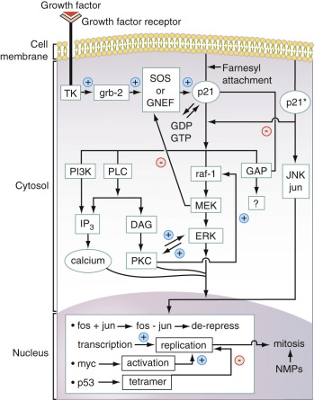
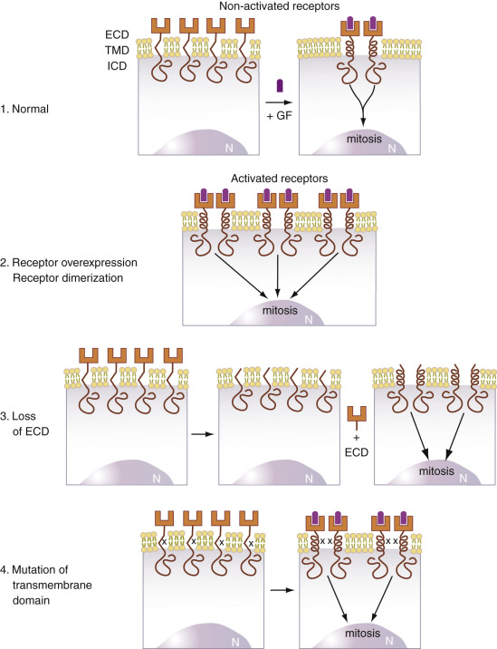
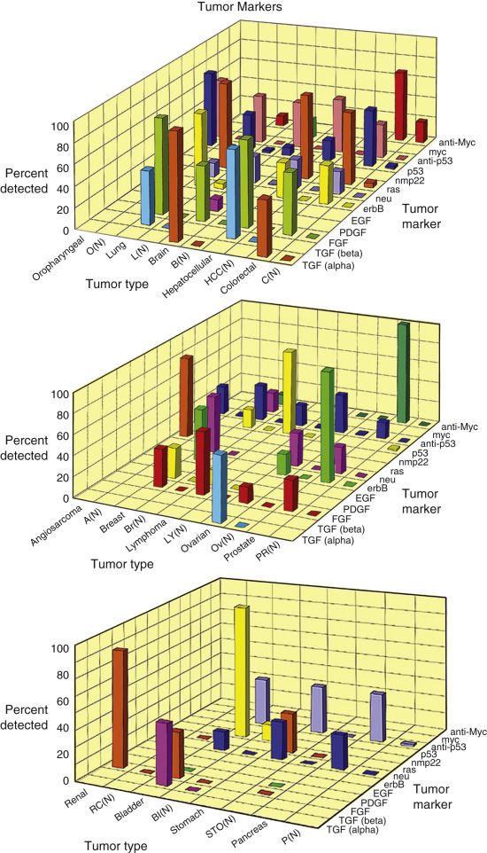

## Key Points

  * •

As a result of the vast progress that has been made very recently in sequencing the entire human genome and in illuminating pathways that are involved in tumorigenesis, it has become clear that the malfunctioning of mutant proteins is the central cause of human cancers. 

  * •

These proteins—growth factors, growth factor receptors, G-proteins such as ras-p21, the mitogen-activated protein kinases, and nuclear proteins such as Myc, Fos, Jun, and p53—are critical in signal transduction pathways in which proliferation signals from growth factors at the cell membrane are transduced to the nucleus and stimulate cell division. 

  * •

The mutations in these proteins result in amino acid substitutions or deletions that cause them to be permanently activated. Mutations in regulatory domains of the genes encoding these proteins can result in protein overexpression, which can also result in continuous mitogenic signaling. 

  * •

These proteins and antibodies to them can be used to detect the presence of cancers in patients at early stages—and even to predict their future occurrence. 

  * •

Although mutated signal transduction proteins are involved in many different human cancers, it appears that there are patterns of expression of mutated proteins that typify specific cancers. 

,  

##  Overview 

As a result of the vast progress that has been made recently in sequencing the entire human genome and in illuminating pathways that are involved in tumorigenesis, it has become clear that the malfunctioning of mutant proteins is the central cause of human cancers. This has given rise to a whole new field of proteomics—that is, detection of these aberrant proteins in the blood and other body fluids of patients. This chapter explains these new approaches and emphasizes that many of these aberrant proteins are actually involved in the transmission of proliferation signals on signal transduction pathways, prominent examples of which are discussed. This chapter explains signal transduction pathways in cell proliferation; illustrates how different mutant proteins on these pathways can cause abnormal, continuous proliferation signaling, leading to cell transformation; demonstrates how these proteins and antibodies to them can be used to detect the presence—and even to predict the future occurrence—of cancers in patients; and shows how new proteins that are strongly associated with different types of cancers have been discovered and can be used to detect these cancers at early stages. 

 

##  Cell Biology and Mitogenesis 

Control of the process of cell division in eukaryotic cells, especially in the higher forms of life, is vital to the processes of cell proliferation and differentiation. The fine balance between these two processes is regulated by numerous proteins that interact in the cell to ensure that this balance is maintained. Virtually all these proteins, many of which are critical in regulating the cell cycle, are encoded by oncogenes. Mutations in oncogenes can result in the production of proteins that become either permanently activated in stimulating cell growth and proliferation (e.g., the ras gene–encoded p21 protein). There can also be silencing or attenuation of genes and their products that inhibit cell proliferation (e.g., the p53 protein), otherwise known as tumor suppressor genes. Both events give rise to malignant tumor cells. 

Knowledge not only of the existence of these oncogenes and their encoded oncoproteins but also of the mechanisms by which they exert their effects has resulted in a new series of highly sensitive assays for both mutated oncogenes and their encoded mutant proteins. Assays using amplification methods such as real-time polymerase chain reaction (RT-PCR) for mutated oncogenes are discussed extensively in Part 8 and are further discussed in this chapter. However, the main focus of this chapter is how the detection of oncogenic _proteins_ , or _oncoproteins,_ that occur in the serum of patients with malignant tumors enables the diagnosis of malignancy to be made, often at an early stage of tumor development. Because the finding of elevated levels of any of these oncoproteins or mutated forms of these proteins in human serum indicates the likely presence of a malignant tumor, these proteins are also referred to in this chapter as _tumor markers_ . Additionally, in view of the enormous strides that have been made in PCR and other molecular technology, allowing the detection of very few copies of aberrant DNA, we also discuss in this chapter recently developed new detection methods for oncogenic DNA present in the sera and other body fluids of patients with cancer, further allowing early tumor detection. 

Oncogenesis, the process by which normal cells become malignant, involves multiple steps that can be broadly classified into tumor initiation and tumor promotion. Mitogenesis itself is a multistep process that commences at the cell membrane as a result of the activation of a growth factor receptor, which then activates other membrane and cytosolic proteins and second-messenger molecules that transduce the mitogenic “signal” to the nucleus. The pathway in which this orderly progression of activation of successive proteins, mostly kinases, occurs from the cell membrane to the nucleus is referred to as a _signal transduction pathway._

 

##  Signal Transduction Pathways 

A number of the steps on the signal transduction pathway that are involved in the transduction of the growth factor–initiated signal to the nucleus have become elucidated, but many of the steps that are involved are still not fully understood. One well-established pathway, for the ras-oncogene-induced mitogenic signaling pathway, is summarized in [ Figure 75-1 ](<#f0010>) . This figure shows that when a growth factor receptor is activated by its growth factor, such as epidermal growth factor (EGF), HER2/ _neu_ , or insulin, the receptor, in turn, activates several intermediary proteins (Grb-2 and SOS, in [ Fig. 75-1 ](<#f0010>) ) that activate the all-important G-protein (i.e., guanosine triphosphate [GTP]–binding protein), ras-p21. This membrane-bound 21-kDa protein, containing 189 amino acids, is activated when the SOS protein induces it to bind GTP in place of guanosine diphosphate (GDP). In its activated (GTP-bound) state, ras-p21 directly activates Raf (  Moodie et al, 1993  ;  Stokoe et al, 1994  ), which in turn induces a sequential protein kinase cascade beginning with the kinase MEK (formerly called MAP kinase kinase) and mitogen-activated protein (MAP) kinase encoded by the ERK gene, as shown in [ Figure 75-1 ](<#f0010>) . 

Figure 75-1 

Scheme of some of the known components of the ras signal transduction pathway beginning _(top, left)_ when a growth factor binds to its cell receptor. 

The remainder of events is explained in the text. _DAG_ , Diacylglycerol; _GAP_ , GTPase-activating protein, which promotes hydrolysis of GTP to GDP bound to p21; _grb-2,_ the adaptor protein that concurrently binds p21 and the guanine nucleotide exchange protein or factor, SOS; _PI3K,_ phosphoinositol-3-hydroxy kinase, an enzyme that induces synthesis of IP3 and is involved in many aspects of mitogenic signal transduction; _IP3,_ inositol triphosphate; _MAP-2 kinase,_ mitogen-activated protein kinase or microtubule-associated protein kinase-2 (ERK in the figure, also called MAP-2K); _myc, fos,_ and _jun_ , nuclear oncogenes that code for nuclear proteins; _NMP,_ nuclear matrix proteins; _PKC,_ protein kinase C; _PLC,_ phospholipase C; _Raf-1,_ the oncogene-encoded p74 protein, which functions as a kinase that phosphorylates another kinase of molecular mass 43 kDa, called MAP-2 kinase kinase, MEK (as in the figure, or MAP-KK; ras-p21 protein, ras-p21, defined in the text). 

MAP kinase directly activates nuclear transcription factors, one of these being Fos. This important protein forms a heterodimeric complex with another nuclear transcription factor, Jun, which is directly activated by Jun kinase (JNK). The Fos–Jun complex, also called AP1, binds to specific regions of genomic DNA, inducing the transcription of mitogenic proteins such as the cyclins. Transcription of these proteins is blocked by the antioncogene p53 protein (see [ Fig. 75-1 ](<#f0010>) ), which further induces the transcription of antimitotic proteins such as Bax and caspases that are critical to the process apoptosis. 

[ Figure 75-1 ](<#f0010>) shows that there are several other important nuclear oncogene–encoded proteins such as Myc, a 75-kDa protein that is overexpressed in Burkitt's lymphoma. This oncogene protein is not directly on the ras signal transduction pathway. Interestingly, there are cell lines that when transfected with either the ras oncogene or with the myc oncogene do not undergo cell transformation but when transfected with both oncogenes simultaneously do undergo cell transformation. These results indicate that ras and myc may be interdependent and are an excellent prototypical example of the multistage nature of oncogenesis. 

[ Figure 75-1 ](<#f0010>) also illustrates that in normal mitogenic signal transduction, antiproliferative proteins, also called antioncogene proteins—that is, products of tumor suppressor genes, such as p53—become activated and downregulate mitogenic events. If these proteins become mutated at critical positions in their polypeptide chains, they become inactivated, allowing mitogenic events to occur with less inhibition and regulation. Numerous other antioncogene proteins occur, including p16, mutations that have been implicated as a major causative factor of bladder cancer; Rb (retinoblastoma antioncogene protein); and APC (adenomatosis polyposis coli) protein, mutations of which have been implicated in causing familial adenomatous polyposis and colon cancer. 

A central feature of the signal transduction events summarized in [ Figure 75-1 ](<#f0010>) is that the activation cascades are ordered and are under tight regulatory control. Thus, for example, whereas SOS activates ras-p21, GTPase-activating protein induces hydrolysis of GTP bound to Ras-p21, causing its inactivation (see [ Fig. 75-1 ](<#f0010>) ). Activated MEK downregulates SOS, diminishing GDP/GTP exchange by Ras-p21 (  Holt et al, 1996  ). 

If one or more proteins on pathways such as the one shown in [ Figure 75-1 ](<#f0010>) become mutated so they cannot be downregulated, continuous mitogenic signaling becomes possible, leading ultimately to neoplasia. The more such mutations occur, the more likely it is that the cell will undergo malignant transformation. Thus progressive lesions in a mitogenic pathway or in more than one mitogenic pathway may correspond to the multiple steps in carcinogenesis. This model has been employed in the explanation for the pathogenesis of colorectal cancer (  Vogelstein et al, 1988  ) and pancreatic cancer (  Hruben et al, 2001  ). 

These considerations have critically important practical consequences for both the diagnosis and treatment of cancer. In colon cancer, overexpression of the epidermal growth factor receptor (EGFr) can occur, resulting in continuous mitogenic signaling. In addition, as a second occurrence, the ras gene encoding the ras-p21 protein can become mutated, resulting in expression of oncogenic ras-p21 and also resulting in continuous mitogenic signaling. Note in [ Figure 75-1 ](<#f0010>) that ras occurs downstream of the growth factor receptor (EGFr in this case). If elevated levels of EGFr are found in the serum and/or tissue of a patient with colorectal cancer, an effective therapy is to treat the patient with anti-EGFr agents such as monoclonal antibodies (e.g., cetuximab and panitumumab). Unfortunately, treatment with EGFr inhibitors has no effect on oncogenic ras-p21 signaling. Therefore, it is necessary, prior to treatment, to ascertain whether oncogenic ras-p21 is present (  Normanno et al, 2009  ). If it is not present, EGFr inhibitor administration is effective. If oncogenic ras-p21 is present, however, this treatment cannot be employed. 

[ Table 75-1 ](<#t0010>) summarizes the mechanisms by which each type of signal transduction element has been found to induce cell transformation, beginning with growth factors, progressing to growth factor receptors, then to G proteins and the kinase cascades, and finally to nuclear proteins. These mechanisms are discussed in more detail in each section of this chapter devoted to these different signal transduction proteins. 

TABLE 75-1 

Mechanisms for Induction of Carcinogenesis by Mitogenic Pathway Elements 

Pathway Element  |  Mechanism of Action   
---|---  
  
  * 1. Growth factors 

| 

  * a. Overproduction by cell into surroundings 
  * b. Interaction of growth factors with high-affinity receptors 

  
  
  * 2. Growth factor receptors 

| 

  * a. Overexpression leading to high concentration of dimers 
  * b. Loss of extracellular domain resulting in permanent dimerization of growth factor receptor and continuous signaling 
  * c. Amino acid substitutions in transmembrane domain, leading to permanent dimerization 

  
  
  * 3. Cytosolic proteins 

| 

  * a. Overexpression of normal G-proteins and protein kinases 
  * b. Amino acid substitutions that permanently change conformation to activated form 
  * c. Mutations that remove regulatory domains of kinases 

  
  
  * 4. Nuclear oncoproteins 

| 

  * a. Overexpression of transcription and replication proteins 
  * b. Mutations in antioncogene proteins that inactivate them 
  * c. Mutations that remove regulatory domains 

  
  
,  

##  Oncoproteins in Tumor Detection 

Detection of mutated signal transduction proteins or high levels of the wild-type proteins in serum or body fluids is strongly suggestive of neoplasia. Therefore, many assays for different oncoproteins are now available commercially in kit form, including enzyme-linked immunosorbent assay (ELISA) assays for the growth factors, transforming growth factor (TGF)-α and β and fibroblast growth factor (FGF); the growth factor receptor proteins EGFr and HER2/ _neu_ , Ras-p21; and the nuclear proteins p53, Myc, and NMP22 from such companies as Oncogene Science (Cambridge, Mass.), now a division of Siemens; Triton Bioscience (Alameda, Calif.), a division of Berlex; and Matritech (Newton, Mass.), now a member of Inverness Medical Innovations, Inc. A number of studies also employ the technique of western blotting or immunoblotting, as described elsewhere in this book. 

Numerous studies have documented alterations in oncogene, onco­protein, or growth factor expression in terms of messenger RNA (mRNA) or protein in tumor tissue compared with normal tissue (  Pimentel, 1989  ;  Brandt-Rauf & Pincus, 1998  ;  Pincus & Friedman, 2003  ). Several studies have examined oncoprotein or growth factor expression in biologic fluids such as urine or effusions and demonstrated the feasibility of using these peptides and proteins as markers for the presence of neoplasia (  Niman et al, 1985  ;  Yeh & Yeh, 1989  ). Succeeding studies have confirmed these initial findings, resulting in the clinical use of these markers to detect the presence of neoplasia. 

Recent studies have now revealed that oncogenes themselves can be detected in the body fluids of patients with different types of cancer. With the advent of microarray techniques for both gene expression and protein detection (see [ Chapter 67 ](<##!/content/3-s2.0-B978032329568000067X?scrollTo=%23c00067>) ), it is now possible to assay for the presence of multiple oncogenes and oncoproteins in the body fluids, especially serum, of cancer patients. A new, parallel approach for cancer screening has been developed, called _proteomics_ , in which serum samples are subjected to mass spectroscopy and pattern analysis to detect the patterns of expression of proteins that are unique to the blood of cancer patients. This type of analysis has recently resulted in the identification of not only oncoproteins but also other proteins that are expressed at abnormally elevated or abnormally low levels in specific types of cancer. In fact, these techniques are being applied to other body-derived fluids to find similar oncoproteins. For example, research on urine biomarkers for breast cancer remains investigational but promising (  Beretov et al, 2014  ). 

This chapter focuses on the identification of different oncoproteins and growth factors, as well as their respective genes, in the serum, plasma, or urine in patients with cancer or who are at risk for the development of cancer. It also focuses on expression of other proteins that occur at abnormally elevated or low levels in specific types of cancer. [ Table 75-2 ](<#t0015>) summarizes some of the many (>50) known oncogenes and their functions in the cell. Those for which commercial serum assays are available are labeled with an asterisk. 

TABLE 75-2 

Summary of Some Important Oncogenes and Their Protein Products [ † ](<#hl0000277>)

Oncogene  |  Protein Product  |  Function   
---|---|---  
  
  * 1. erbB  * 

|  EGF receptor  |  Binds to EGF; dimerizes; activates tyrosine kinases in signal transduction. Works through ras.   
  
  * 2. erbB-2  * 

|  GF receptor  |  Very similar to EGF receptor. Works through ras.   
  
  * 3. sis  * 

|  β-chain of PDGF  |  Growth factor receptor. May work through ras.   
  
  * 4. src 

|  Tyrosine kinase  |  Transduces signal through ras.   
  
  * 5. ras  * 

|  p21 proteins; H-, K-, and N-forms  |  G-proteins; bind to cell membrane and transduce signals through second messengers and Raf, GAP (?), JNK, PKC, and PLC.   
  
  * 6. rap-1A 

|  Anti-ras oncogene; in ras family  |  Blocks ras action in cells.   
  
  * 7. raf  * 

|  74-kDa protein  |  Phosphorylates MAP kinase kinase (MEK), which then phosphorylates MAP kinase.   
  
  * 8. erk-1 and erk-2  * 

|  MAP kinase family   
43-kDa proteins  |  Involved in cytoskeletal rearrangements and nuclear signaling.   
  
  * 9. myc  * 

|  62/64-kDa nuclear protein  |  Turns on transcription factors involved in replication.   
  
  * 10. jun 

|  Nuclear protein  |  Forms complex with fos.   
  
  * 11. fos 

|  Nuclear protein  |  Forms complex with jun. fos–jun complex activates transcription factors.   
  
  * 12. p53  * 

|  53-kDa nuclear antioncogene protein  |  Forms tetramers, then binds DNA segments to block transcription and replication.   
  
  * 13. NMP22  * 

|  236-kDa nuclear matrix protein  |  Involved in mitotic spindle formation.   
  
_EGF_ , Epidermal growth factor; _GAP_ , GTPase-activating protein; _GF_ , growth factor; _MAP_ kinase, mitogen-activated protein kinase; _NMP22_ , nuclear matrix protein 22; _PKC_ , protein kinase C; _PLC_ , phospholipase C. The names of the oncogenes are commonly used and relate to the sources from which they were originally discovered. For example, _ras_ is an abbreviation for rat sarcoma viral oncogene. 

 * Oncogene-encoded proteins for which assays have been performed on human serum. Serum assay kits are commercially available. 

 † Only a few of the many (more than 50) oncogenes are listed in this table. The ones that are listed here encode proteins for which assays have been developed or are closely related to these proteins. No growth factors except PDGF are included in this table. 

 

##  Growth Factors 

Because various growth factors are believed to play a role in influencing cellular proliferation during tumorigenesis and because growth factors are actively secreted into the extracellular environment, they are attractive targets for detection in blood during cancer development. Several studies have demonstrated differences in blood levels of growth factors in cancer patients and noncancer controls. 

 

##  Transforming Growth Factors α and β

TGF-α is a polypeptide with 50 amino acids that binds to the EGF receptor, which dimerizes upon binding to TGF-α or to EGF. TGF-β is a family of proteins labeled β 1  to β 5  . TGF-β 1  is a homodimer of two 12-kDa subunits linked together by disulfide bonds. Even though TGF-β has been found to be elaborated by many different types of human malignant tumors, elevated serum levels of this growth factor have been found predominantly in cancers of the liver (  Jeng et al, 2014  ) and bladder (see later). Interestingly, TGF-β has been found to inhibit mitosis in specific cell lines in culture, such as mink bronchial epithelial cells. It is not clear how TGF-β is triggered to act as a tumor suppressor versus tumor promotor. The pathway for tumor promotion has been somewhat elucidated. TGF-β binds to the inhibitor of DNA binding 1 (ID1), a transcriptional regulator resulting in decreased levels of E-cadherin (  Pickup et al, 2013  ), thereby diminishing the number of tight junctions between cells and causing loss of contact inhibition. This growth factor also has been implicated in the interconversions of epithelial cells into mesenchymal cells and vice versa. These interconversions (called EMT, or epithelial cell to mesenchymal cell transformation, and MET, the reverse process) are thought to be steps involved in tumorigenesis (  Polyak & Weinberg, 2009  ). 

TGF-β activity, which is determined using this technique, has been found to be markedly elevated in patients with hepatocellular carcinoma (HCC) but not in age-matched controls (  Shirai et al, 1992  ). In the sera of patients who have undergone surgical resection of these tumors, the activity of TGF-β is barely detectable, suggesting that the tumor was the source of the elevated levels of growth factor in serum. Interestingly, in many patients with HCC, TGF-β has been found to be elevated in urine (  Tsai et al, 1997  ). In this regard, in a study on the development of HCC in patients with hepatitis C (see [ Chapter 21 ](<##!/content/3-s2.0-B9780323295680000218?scrollTo=%23c00021>) ), TGF-β 1  was found to be elevated in the sera of patients with hepatitis C and hepatitis C–induced fibrosis and cirrhosis but was not elevated in the sera of patients in whom HCC subsequently developed, resulting from the antecedent disease. Thus TGF-β 1  may be an early marker for HCC, but lower levels may be required for progression of disease (  Ali et al, 2004  ). However, in other studies, TGF-β 1  was found to be elevated in small (<3 cm) HCC far more frequently than α-fetoprotein (AFP), the classic marker for HCC (see [ Chapter 73 ](<##!/content/3-s2.0-B9780323295680000735?scrollTo=%23c00073>) ;  Song et al, 2002  ). Using a cutoff of 800 pg/mL for TGF-β 1  and 200 pg/mL for AFP, where the specificities of both markers were 95% (i.e., few false-positive results), the sensitivity of TGF-β 1  was 68% versus only 24% for AFP. Thus TGF-β 1  may be a reliable marker for small HCC. The same conclusion has been reached in a study of HCC in which the sera of 23% of patients with this disease were positive for TGF-β 1  but not for AFP (  Sacco et al, 2000  ). 

TGF-β 1  has also been found to be elevated in metastatic prostate cancer (  Adler et al, 1999  ). Levels of TGF-β have also been associated with extraprostatic extension of the tumor. Serum levels TGF-β together with levels of interleukin-6 soluble receptor (IL-6) can be used to predict progression of the disease after surgery (  Kattan et al, 2003  ). 

Use of an ELISA with a monoclonal antibody directed against TGF-β 2  has revealed that TGF-β 2  is elevated in a high proportion of patients with invasive bladder cancer but not in patients with noninvasive bladder cancers or in cancer-free patients (  Klocker et al, 1994  ;  Brandt-Rauf & Pincus, 1998  ;  Pincus & Friedman, 2003  ). Recently, a new tumor marker for bladder cancer that appears to be more accurate in diagnosing both noninvasive and invasive bladder cancer is the nuclear matrix protein NMP22, detected in urine. 

Thus serum assays for TGF-β are highly useful in diagnosing and following HCC. They are less useful in the diagnosis of carcinoma of the bladder, although for invasive bladder cancer this growth factor has high sensitivity and specificity. 

TGF-α has been found to be elevated in a large number of patients with epithelial cell tumors (  Katoh et al, 1990  ;  Chakrabarty et al, 1994  ), predominantly breast (almost 100%), lung, stomach, colon, liver, and ovarian. It has been found to be elevated frequently in the sera of patients with gastric carcinoma (  Choi et al, 1999  ). In contrast, normal individuals have very low serum levels. With respect to liver, TGF-α has been found to be elevated in the sera of patients with HCC but not in patients with cirrhosis. The elevated levels were reduced in patients who had been treated for HCC (  Tomiya & Fujiwara, 1996  ). 

Recent studies confirm that TGF-α is an effective predictor of the occurrence of malignancies at an early stage. For example, in 36 patients who had a history of asbestosis and subsequently developed a cancer, mainly adenocarcinoma or squamous cell carcinoma of the lung, more than one-third were found to be seropositive for TGF-α. Blood samples from all of these patients were collected and then banked at the time of the diagnosis of asbestosis and before the diagnosis of malignancy. Significantly, all but one of these seropositive patients were found to have elevated TGF-α levels in their banked blood (  Brandt-Rauf & Pincus, 1998  ). 

TGF-α thus appears to be an excellent marker for the presence of malignancy. Unlike the case for TGF-β, these elevations are not tumor-specific. Nonetheless, it is clear that TGF-α is extremely useful in screening patients for the presence of malignant solid tissue tumors. 

 

##  Platelet-Derived Growth Factor 

Platelet-derived growth factor (PDGF), a protein of molecular mass 28 kDa, exists as a dimer of A and B chains, as the A–A, A–B, or B–B dimer forms. Either chain can be glycosylated, increasing the molecular mass to 30 kDa. This growth factor, originally isolated from platelets, binds to a transmembrane growth factor receptor. The B chain is encoded by the sis oncogene. It has been found to be a potent mitogen in lymphoid, myeloid, and fibroblastic cell lines. Overexpression of PDGF has been found in both lung and pleural tumors. It has also been examined in the blood of cancer patients. Overall, this growth factor has been found to be significantly elevated in more than 15% of patients with carcinomas, sarcomas, and lymphomas but not at all in normal individuals. In patients with breast cancer, there is an excellent correlation between the stage of the cancer and the serum level of the growth factor (  Ariad et al, 1991  ). Higher levels predict shorter survivals. In addition, PDGF-B (Sis) in breast tissue appears to correlate with increased cellular proliferation as its expression increases with both nonmalignant and malignant states and decreases after menopause. In malignancy, PDGF-B does not correlate with p53 expression, estrogen/progesterone status, or tumor grade (  Coltrera et al, 1995  ). Levels of PDGF-A and PDGF-B were found to be elevated highest in ovarian cancer patients compared to normal, benign, and borderline patients (  Madsen et al, 2012  ). The role of PDGF-B as a marker in colorectal cancer is less clear (  Lindmark et al, 1993  ). Serum PDGF-A levels in patients with cholangiocarcinoma were 1.4-fold higher than in normal controls (p = 0.014) (  Boonjaraspinyo et al, 2012  ). 

PDGF-receptor A (PDGFRA) mutations have also been implicated in the pathogenesis of gastrointestinal stromal tumors. Most recent genetic analysis reveals that exon 18 is the commonest site of these mutations, although exon 12 can be involved as well (  Ahmad et al, 2015  ). 

As discussed later, both oncoproteins and antibodies to oncoproteins can be elevated in the sera of patients with cancer. Anti-PDGF antibody (PDGF-Ab) in serum has been found to be potentially diagnostic for pleural mesothelioma in patients with histories of exposure to asbestos. The serum levels of PDGF-Ab correlate positively with severity of the disease and show a significant negative correlation with survival—that is, higher levels correlate with shorter survival times (  Filiberti et al, 2005  ). 

 

##  Basic Fibroblast Growth Factor 

Basic fibroblast growth factor (bFGF) is a protein containing 155 amino acids. It is a growth factor for mesenchymal cells but has also been found to have relatively high concentrations in the central nervous system (CNS). Interestingly, bFGF has been found to be present in high concentrations in the sera of patients with epithelial cell tumors. Prominent among these tumors is renal cell carcinoma. More than 50% of patients with this disease have markedly elevated serum levels of bFGF (  Fujimoto et al, 1991  ;  Ii et al, 1993  ), as determined either by ELISA or by enhanced chemiluminescent assays. This growth factor is also elevated in the sera of more than 50% of patients with CNS tumors, 90% of patients with lung cancers (  Ii et al, 1993  ), and more than 60% of patients with lymphomas (  Kurobe et al, 1993  ). It is not elevated, however, in the sera of large populations of normal (control) individuals. 

In colorectal cancer patients with tumors 30 mm or smaller, serum bFGF levels were 7.65 ± 1.11 pg/mL, whereas those with tumors greater than 30 mm had bFGF levels of 8.53 ± 3.22 pg/mL. Although these are small differences, it has been found that serum bFGF levels could be used to predict tumor size in colorectal cancer (  Jibiki et al, 2014  ). 

Elevated serum levels of bFGF have been found to be a good prognostic factor in patients with non–small cell carcinomas of the lung (  Brattstrom et al, 1998  ). Thus TGF-α and TGF-β, PDGF, and bFGF all appear to be elevated in the sera of a significant number of patients with epithelial cell tumors but are not completely tumor specific. TGF-α has some specificity for breast cancer, and TGF-β for HCC. bFGF is elevated in a variety of malignancies, including nonepithelial cell tumors, such as CNS tumors and lymphomas. PDGF shows little specificity for tumor type, but high levels in serum indicate the presence of malignancy. 

Given the development of protein/antibody and gene arrays, it is possible to assay the sera and other body fluids of cohorts of patients who are at risk for developing cancer due to such factors as occupational exposure for multiple oncogene proteins concurrently. Discovery of the elevation of and/or the presence of oncogenic mutations in one or more of these proteins in a patient's serum or other body fluid identifies the patient as either having a cancer or developing one in the near future. Recently, serial levels of both TGF-β and PDGF were determined by ELISA (see [ Chapter 44 ](<##!/content/3-s2.0-B9780323295680000449?scrollTo=%23c00044>) ) on a cohort of workers with long-term exposure to asbestos. PDGF, but not TGF-β, was found to predict both the development of non–small cell carcinoma of the lung and (1) the radiographically determined severity of the disease and (2) the levels of PDGF correlating with severity of cancer and with fibrosis of the lung, which may be a predisposing factor (  Li et al, 2009  ). These studies parallel the results of other studies, such as the study with TGF-α described earlier, in which the sera of patients with occupational and/or environmental risks have been found to be positive for one or more oncogene proteins prior to appearance of a cancer. 

 

##  Epidermal Growth Factor and Hepatocyte Growth Factor 

EGF has been found to be elevated in the serum of some patients with stomach cancer (  Pawlikowski et al, 1989  ) and cancer of the tongue (  Bhatavdekar et al, 1993  ) but unchanged or decreased in other cancers (  Nedvidkova et al, 1992  ). Elevated serum levels of hepatocyte growth factor have been reported in HCC. However, this growth factor appears to be unique in that elevated levels also occur in nonmalignant liver diseases (  Hioki et al, 1993  ), diminishing its utility as a tumor marker. 

 

##  Growth Factor Receptors 

Normally, growth factors bind to their growth factor receptors, generally inducing the receptors to dimerize, an event that activates the receptor. At the growth factor receptor level, there are several mechanisms by which uncontrolled mitogenesis may be initiated. These are summarized in [ Figure 75-2 ](<#f0015>) . For both the EGF receptor and the _neu_ (HER)–encoded p185 growth factor receptor protein, strongly associated with breast cancer (  Slamon et al, 1989  ;  Brandt-Rauf & Pincus, 1998  ;  Pincus & Friedman, 2003  ), receptor dimerization results in activation of tyrosine kinases involved in the phosphorylation of proteins that initiate the transduction of the mitogenic signal to the nucleus. Three pathologic mechanisms can cause abnormally prolonged receptor dimerization that results in continuous mitogenic signaling. These are loss of the extracellular binding domain (ECD), mutations in the transmembrane domain that promote dimerization (  Brandt-Rauf et al, 1990  ;  Pincus & Friedman, 2003  ), and overexpression of the receptor. 

Figure 75-2 

Mechanisms for continuous mitogenic signaling by growth factor receptors. 

Scheme 1 shows that these receptors have three domains: an extracellular, growth factor-binding domain (ECD); a transmembrane domain (TMD); and an intracytoplasmic domain (ICD). A growth factor, GF, binds to the receptor, causing it to dimerize, setting in motion a cascade of intracellular events that are transduced to the nucleus (N) described in [ Figure 75-1 ](<#f0010>) . There are three known ways in which continuous cell signaling by the growth factor receptor can occur, resulting in malignant transformation of cells. Scheme 2 depicts the first of these: overexpression of the receptor that results in many activation processes and continuous signaling to the nucleus. Scheme 3 shows the second mechanism wherein the ECD is either absent or cleaved off by intracellular proteases, leading to spontaneous dimerization. Scheme 4 shows the third mechanism, in which a mutation in the growth factor receptor gene results in an amino acid substitution (X in the figure) in the transmembrane domain leading to formation of α helices that associate (  Brandt-Rauf et al, 1990  ), resulting in spontaneous dimerization that can occur in the absence or presence of the ligand. 

Transmembrane growth factor receptors encoded by the erbB family of oncogenes (i.e., erbB, which encodes the EGF receptor, also called EGFr, and HER2/ _neu_ [erbB-2]) are particularly attractive targets for detection in blood during cancer development because it has been found that in human cancers induced by these receptors the mechanism appears to be proteolysis of the extracellular receptor-binding domain (see [ Fig. 75-2 ](<#f0015>) , third illustration). The liberated extracellular domains, termed _ECD_ , then enter the circulation and can be readily detected in serum using conventional immunoassay techniques (  1994a  1994b  ;  Brandt-Rauf & Pincus, 1998  ;  Pincus & Friedman, 2003  ). 

 

##  Epidermal Growth Factor Receptor 

Overexpression of and/or oncogenic amino acid substitutions in the amino acid sequence of EGFr and in the closely related HER2/ _neu_ receptor are the primary causes of a large number of human epithelial cell tumors. These include colon, breast, lung, and ovarian cancers (  Baron et al, 2009  ). This observation has been extended to CNS tumors, in particular, glioblastoma multiforme (  Quaranta et al, 2007  ). As discussed earlier, serum EGFr is not only important for diagnostic purposes but also suggests a therapeutic strategy—that is, administration of EGFr inhibitors, the efficacy of which can be monitored by assaying for serum EGFr. 

A particularly important use of serum EGFr is in following patients with known histories of exposure to environmental agents known to cause specific tumors. Elevations of circulating levels of the ECD of this growth factor receptor have been studied in patients with asbestosis (  Brandt-Rauf et al, 1992  ), which is known to predispose to malignancies. It has been found that patients with ECD serum levels of 636 fmol/mL or higher either have an asbestos-associated malignancy (carcinoma of the lung or mesothelioma) or subsequently develop such a malignancy. Large numbers of normal individuals have been found to have much lower serum ECD levels. Thus EGFr appears to be an excellent marker for asbestos-induced tumors. These results are also of interest because they suggest that the primary effect of asbestos as a carcinogen is to cause mutations in the EGFr gene (  Brandt-Rauf & Pincus, 1998  ). 

As discussed, many colon cancers are treated with EGFr inhibitors. An important indication of efficacy of treatment is to measure circulating levels of EGFr. It was recently found that baseline levels of serum EGFr were strong predictors of outcome, higher values predicting better responses to treatment with EGFr inhibitors than lower values (  Zampino et al, 2008  ). 

Of considerable interest is the recent finding that serum levels of EGFr can detect the presence of prostate cancer (  Milanese et al, 2009  ). Use of EGFr in detection of prostate cancer was motivated by the finding that overexpression of EGFr or critical amino acid substitutions in the amino acid sequence of prostate EGFr are strongly associated with prostate cancer. It was found that, using a cutoff value of 67.9 ng/mL for serum EGFr, the sensitivity and specificity of serum EGFr was 93.3% and 98%, respectively. In this study it was further found that the best serodiagnostic marker for spread of prostate cancer beyond the prostate (e.g., into the seminal vesicle) was urokinase-type plasminogen activator receptor. These results suggest that both biomarkers may offer a new approach to diagnosis and monitoring of prostate cancer. 

 

##  HER2/ _neu_ Receptor 

This protein is discussed in [ Chapter 73 ](<##!/content/3-s2.0-B9780323295680000735?scrollTo=%23c00073>) as a marker for breast cancer and a number of other cancers. Here we consider its potential as a marker for different stages of this cancer and for other human epithelial neoplasms. Current American Society of Clinical Oncology (ASCO) guidelines recommend evaluating HER2/ _neu_ status of all primary tumors, primarily to guide therapy if trastuzumab is a suitable agent (  Harris et al, 2007  ). Because of the documented strong association between breast cancer and mutations in the HER2/ _neu_ gene, many studies have examined the p185 erbB2 ECD in the blood of cancer patients, particularly breast cancer. In prior studies on _neu_ oncogene-induced overexpression of the p185 protein (  Slamon et al, 1989  ), it was found that the level of expression of the _neu_ oncogene in breast cancer biopsy tissue correlated with the extent of the tumor and was the best prognostic indicator of survival rates, exceeding even the extent of lymph node involvement as a prognostic indicator. 

Results on quantitation of p185 ECD in the serum of patients with breast cancer parallel those of the prior genetic results. Between 25% and 50% of patients with stage III or IV breast cancer have been found to have markedly elevated levels of p185 ECD in their sera (40- to 190-fold higher than in the sera of normal control individuals) (  Mori et al, 1990  ;  Carney et al, 1991  ;  Kath et al, 1993  ). For patients from whom tumor biopsy material is available, there is an excellent correlation between serum ECD levels and tissue level of expression (  Breuer  1993  ;  Ludovini et al, 2008  ). There is also an excellent correlation between levels of serum ECD and recurrent disease (  Brandt-Rauf & Pincus, 1998  ). 

ECD levels in serum have also been found to be an excellent prognostic indicator for breast cancer (  Molina et al, 1996  ). Recently, in a study of patients with stage I to III breast cancer, it was found that presurgical serum ECD level was an independent prognosticator of disease-free survival in early breast cancer (  Ludovini et al, 2008  ). This is an important finding because it identifies patients with early breast cancer with complete apparent surgical removal who are at significant risk for recurrence. In a recent study, ECD levels were elevated in the sera of 44% of HER2-positive and, perhaps more important, in 15.8% of HER2-negative breast cancer patients who developed recurrence, suggesting that HER2 status may change with disease progression (  Kim et al, 2014  ). 

Because serum levels of p185 ECD correlate with tumor load and stage, detection of incipient breast cancer using serum levels of p185 ECD is less effective for these patients. Overall, the rate of detection of stages I and II breast cancers using serum levels of ECD, based on conventional ELISA techniques, ranges from 10% to 15%. However, use of a sensitive ELISA assay for p185 ECD in breast cancer patients resulted in discovery of carcinoma in situ in 43% of patients with this disease (  Breuer et al, 1993  ). This latter result indicates that the use of more sensitive assays for p185 ECD identifies a significant increase in the number of patients with carcinoma in situ (i.e., at an early stage of development). 

 

##  HER2/ _neu_ Detects Pulmonary Neoplasms 

p185 ECD is also elevated in a high percentage of patients with pulmonary cancers. HER2 expression has been detected in about a quarter of specimens of non-small cell lung cancers (NSCLC) (  Bellezza et al, 2013  ). More tellingly, a recent meta-analysis of 40 studies comprising over 6000 patients revealed that HER2 overexpression was associated with a poor prognosis in patients with lung cancer (  Liu et al, 2011  ). 

Elevated serum levels of EGFr in early tumor detection have been employed to screen patients with known predisposition, such as pneumoconioses, for developing these cancers. In 70% of patients with pneumoconioses, elevated serum p185 ECD levels have been found prior to the onset of frank malignancy. In almost 100% of patients with this predisposing factor who have cancer of the lung, serum p185 ECD is markedly elevated (  Brandt-Rauf et al, 1994a  ). Clearly, this protein is a highly sensitive marker for pulmonary cancers. In contrast, no elevations of p185 ECD have been found in the sera of large numbers of normal individuals (  Brandt-Rauf & Pincus, 1998  ;  Pincus & Friedman, 2003  ). 

 

##  HER2/ _neu_ in the Detection of Hepatocellular Carcinomas 

It was noted previously that TGF-β is a good marker for HCC. There are now strong indications that p185 ECD is also a sensitive marker for this disease. Serum p185 ECD has been found to be elevated in almost 100% of East Asian people who have known risk factors for developing this disease (  Luo et al, 1993  ;  Yu  1994a  ). However, tissue expression of c-erbB-2 in biopsies derived from patients with HCC and adenoma showed neither overexpression nor amplification by FISH or immunohistochemistry (  Vlasoff et al, 2002  ). Furthermore, no such elevations have been observed in normal individuals of similar age and race or in those with exposure to risk factors for this disease but who did not subsequently develop cancer. 

By looking at a subset of HCC patients, however, HER2/ _neu_ IHC may be more instructive. It has been observed that HER2/ _neu_ upregulation in response to hepatitis B infection, specifically the hepatitis B x antigen (HBxAg), is an important mediator of hepatocyte proliferation and ultimately of malignant transformation to hepatocellular carcinoma. Hepatitis B patients with liver specimens that stain strongly for HER2/ _neu_ develop HCC and have poorer survival. HER2/ _neu_ may be a sentinel of malignant transformation in this subset of patients (  Liu et al, 2009  ). 

 

##  p185erbB-2 ECD in Other Tumors 

Elevated serum erbB-2 ECD levels have now been found to occur in patients with colorectal, pancreatic, prostatic, hepatic, and ovarian cancers (  Wu et al, 1993  ) at lower frequencies of detection (15% to 20%) and were also found to be significantly higher in patients with nasopharyngeal carcinoma (  Yazici et al, 2001  ). Excellent correlations between serum levels and tissue levels have been found in many of these cases. Serum p185erbB-2 ECD levels correlate well with the stage of oral cavity squamous cell carcinoma, as well as the response to therapy (  Chen et al, 2004  ). These levels do not correlate with tumor size, nodal status, or metastases. There is a direct correlation between serum levels of p185 ECD and tumor size for premalignant adenomas of the colon (  Brandt-Rauf et al, 1994b  ). Because colonic neoplasia usually progresses through well-defined steps from adenoma to carcinoma with the malignant potential of adenomas increasing with size, serum erbB-2 ECD levels may be useful in monitoring this progression. Gene amplification and protein overexpression of c-erbB-2 were also found in adenocarcinoma derived from Barrett esophagus (  Geddert et al, 2002  ). In addition, pretreatment serum ECD has been found to be a reliable prognosticator of recurrence of metastatic prostate cancer and significantly more reliable than tissue p185 (  Tambo et al, 2009  ). 

 

##  E-Cadherin 

E-cadherin, a cell-adhesion transmembrane protein, has been found to be responsible for mesenchymal-to-epithelial transitions (METs) and epithelial-to-mesenchymal transitions (EMTs), activities that stabilize tumors in their local environment. One of the major proteins involved in this interconversion is β-catenin that is transported across the nuclear membrane and stabilizes transcription of mRNA that encodes EMT-promoting factors. However, E-cadherin binds to β-catenin, inhibiting its ability to enter the nucleus. Downregulation of E-cadherin results in decreased binding of β-catenin, allowing increased entry of β-catenin to the nucleus, where it activates EMT. Less certain is the mechanism of METs, likely due to upregulation of E-cadherin and binding of β-catenin, reducing EMT (  Polyak & Weinberg, 2009  ).Thus E-cadherin is a negative regulator of EMT and cell transformation. 

However, E-cadherin is cleaved intracellularly to so-called soluble E-cadherin or sE-cad that is released from cells. This form of E-cadherin has been found to break cell-cell junctions in murine mammary tumor cells, suggesting that sE-cad reduces contact inhibition of cell growth that can lead to uncontrolled proliferation. sE-cad has been detected in the serum of cancer patients 

Elevated levels of sE-cad have been detected in bladder, colorectal, NSCCL, ovarian, prostate, skin, esophageal, gastric, and hepatocellular cancers (  Katayama et al, 1994  ;  Grabowska & Day, 2012  ). The appearance of these cell adhesion molecules in blood circulation can indicate more than the mere presence of neoplasm and can be seen as a marker of metastases or poor prognosis. Indeed, elevated levels of sE-cad have been shown to be valid prognostic markers for gastric cancer and correlated well with late-stage colorectal cancer (  Chan, 2006  ;  Weiss et al, 2011  ). Most recently, it was found useful as a marker of preoperative chemotherapy response for breast cancer (  Hofmann et al, 2013  ). In this study, levels of sE-cad were significantly reduced in patients with pathological complete response (pCR) compared to those without pCR, and the decreases in the sE-cad levels were significantly different between these two groups. This may have great potential in identifying patients with breast cancer. The caveat to using this marker is that it is also found to be elevated in diseases causing inflammatory states, such as diabetes and HIV (  Katayama et al, 1994  ;  Grabowska & Day, 2012  ). 

 

##  Metalloproteases in Pancreatic Cancer 

Matrix metalloproteases (MMPs) constitute a class of many enzymes responsible for cleavage of the ECD of E-cadherin (  Grabowska & Day, 2012  ). Their levels in serum have also been shown to be upregulated in pancreatic ductal adenocarcinoma (PDAC) patients' sera, specifically MMP-1, -3, -7, -9, -10, and -12, compared to normal control patients' sera. MMP-7 and -12 had specificities and sensitivities greater than 90%. MMP-2, however, was significantly downregulated in PDAC patients' sera (  Kahlert et al, 2014  ). Another useful test is urinary MMP-2 (uMMP-2) and urinary tissue inhibitor of metalloprotease (TIMP-1). These markers were elevated to significantly higher levels in the urine of patients with pancreatic neuroendocrine tumors (pNETs) and PDACs than in the urine of normal controls (  Roy et al, 2014  ). 

 

##  G-Proteins 

 

##  ras-p21 Protein 

As for growth factor receptors, signaling proteins that occur downstream of the growth factor receptors become oncogenic primarily from overexpression and amino acid substitutions at critical positions in their polypeptide chains. Less commonly, for some proteins, like Raf (see [ Fig. 75-1 ](<#f0010>) and [ Table 75-2 ](<#t0015>) ), loss of regulatory domains may also lead to oncogenesis. Amino acid substitutions in signal transducing proteins cause these proteins to undergo conformational changes that result in their becoming permanently activated to stimulate cell division (  Pincus et al, 1992;  2000;  2007  ;  Pincus, 2004  ). 

This mechanism has been well documented for the ras-oncogene-encoded p21 protein, for which substitutions of most amino acids for glycine 12 or glutamine 61 result in an oncogenic protein. Many p21 proteins with such substitutions have been cloned and directly microinjected into normal cells in culture such as NIH 3T3 cells (  Barbacid, 1987  ). The cells undergo malignant transformation that lasts until the added mutant protein is metabolized and cleared from the cells. Oncogenic mutant forms of the ras gene and of its encoded p21 protein have been found in approximately one of three common human epithelial cell tumors, in more than 90% of human pancreatic tumors, and 75% of human colon cancers (  Forester et al, 1987  ;  Almoguera et al, 1988  ). 

One of the consequences of amino acid substitutions in p21 and presumably in other signal transducing proteins is the abnormal activation of alternate, unregulated signal transduction pathways. Oncogenic ras-p21 protein (p21 in [ Fig. 75-1 ](<#f0010>) ) has been found to interact directly with Jun, the nuclear transcription factor, and its activating kinase, Jun kinase (JNK). This binding process results in the direct activation of these nuclear transcription-inducing proteins, thereby bypassing the normal cellular controls. This bypass or short-circuit pathway is shown on the right side of [ Figure 75-1 ](<#f0010>) for p21 (  Adler et al, 1995  ;  Amar et al, 1997  ;  Pincus et al, 2007  ). In addition, oncogenic ras-p21 protein requires activation of protein kinase C as a downstream event on its signal transduction pathway (  Pincus et al, 1992  ), as illustrated in [ Figure 75-1 ](<#f0010>) . 

As noted previously, the ras-oncogene-encoded p21 proteins are 21-kDa membrane-associated G proteins that have been implicated in the growth signal transduction process from the cell membrane to cytoplasmic kinases. Qualitative (i.e., point mutations) and quantitative (i.e., overexpression) changes in p21 have been identified as contributing to human carcinogenesis (  Barbacid, 1987  ). By undefined mechanisms, p21 proteins gain access to the extracellular environment. Thus increased amounts of p21 or point-mutated forms of p21 can be detected by immunoblotting with monoclonal antibodies in the supernatant of cells in culture known to overexpress p21 or to express mutant p21, respectively (  Brandt-Rauf, 1991  ;  Brandt-Rauf & Pincus, 1998  ;  Pincus & Friedman, 2003  ). 

Similarly, mice with tumors that overexpress p21 or express mutant p21 are found by immunoblotting to have increased amounts of p21 or mutant forms of p21 in their serum, respectively (  Hamer et al, 1991  ). These results suggest that the detection of increased p21 or mutant p21 in blood is possible in humans. 

Because of its central role in mitogenic signal transduction, overexpressed and/or mutated p21 protein might be expected to be present in a wide variety of human tumors. Indeed, elevated serum p21 has been identified in the serum of up to 68% of patients with many different cancers, including breast, prostate, colon, lung, and liver cancer. On the other hand, only a small percentage of normal individuals have been found to have detectable serum levels (  Weissfeld et al, 1994  ). A high incidence of the occurrence of the oncogenic form of the K-ras gene has been found in human pancreatic and colonic cancers. New assays based on reverse-transcriptase (RT)-PCR have detected the ras oncogene in the stool of a high percentage of patients with colonic cancer (  Pincus, 2004  ). 

 

##  ras-p21 in Lung and Colon Cancer 

Similarly encouraging results have been obtained using the sputum of patients with lung cancer. Parallel results have now been obtained using the ELISA for the p21 protein using the serum of patients with lung and colonic carcinoma. Elevated levels (five times more than controls) of serum ras-p21 have been found in up to 83% of lung cancer patients, whereas only low levels were found in the sera of normal individuals (  Brandt-Rauf, 1991  ;  Brandt-Rauf & Pincus, 1998  ). A recent meta-analysis of 41 trials comprising nearly 7000 patients found that K-RAS mutations were associated with poorer outcomes in patients with NSCLC (  Meng et al, 2013  ). 

In addition, studies have been carried out in which PCR for K-ras mutant genes with base changes at codons 12 and 13 has been performed concurrently on tumor tissue and serum from patients with different stages of colorectal cancer (  De Kok et al, 1997  ). Changes at codon 13, in particular, had a significant negative impact on Dukes classification, lymph node status, and high S-phase fraction (  Bazan et al, 2002  ). In more than 90% of the patients with specific mutant ras genes found in tumor tissue, the same mutated ras gene was discovered in their sera, regardless of the stage of the tumor. 

In the previous discussion of the HER2/ _neu_ -oncogene-encoded p185 protein, it was noted that elevations of the serum levels of this protein were found in patients with pneumoconioses who then progressed to develop frank malignancies. A parallel study has been performed on patients with pneumoconioses in which assays were carried out for ras-p21 in their sera. For patients with this predisposing condition, 39% were found by western blotting to have elevated serum levels of the ras-p21 protein. Almost all of these patients developed a malignant lung tumor subsequent to the observed elevations of the p21 protein. Thus, like p185 ECD, elevated serum p21 is a biomarker of early malignant disease in patients with a known predisposition. An obvious study that is yet to be performed is to assay the sera of these patients for both HER2/ _neu_ and ras-p21 to increase the sensitivity of the assays. 

The aforementioned studies are concerned with detecting elevated serum levels of p21 in serum as an indicator of malignancy. As noted previously, a major mechanism for oncogenesis induced by the ras-p21 protein is amino acid substitutions in its sequence that result in its permanent activation. Identification of mutant ras genes by PCR and direct sequencing of DNA isolated from the serum or plasma of three patients with pancreatic cancer has been described (  Sorenson et al, 1994  ), but, until recently, the direct detection of mutant p21 protein had not been reported in human blood (  De Kok et al, 1997  ). Now, however, oncogenic amino acid substitutions in the p21 protein can be identified through the use of monoclonal antibodies that recognize specific oncogenic amino acid substitutions, including at positions 12, 13, 59, and 61. Use of these antibodies on the sera of patients with known risk factors for cancer appears to offer much promise for early tumor detection. 

 

##  ras-p21 in Angiosarcoma 

Mutated p21 has been found in the serum of patients with a known history of exposure to the carcinogen, vinyl chloride. This chemical has been shown to predispose individuals to developing angiosarcomas (  Brandt-Rauf & Pincus, 1998  ;  Brandt-Rauf et al, 2012  ). Tissue studies of these angiosarcomas reveal that a mutant ras gene that codes for aspartic acid in place of the normally occurring glycine at position 13 in the polypeptide chain is present in the tumor cells. A monoclonal antibody that recognizes the Asp13 form of the p21 protein has been obtained (Oncogene Science/Siemens). This mutant p21 protein has been identified in the sera of 80% of patients with vinyl chloride–induced angiosarcoma of the liver but not in normal individuals (  DeVivo et al, 1994  ). There is a direct correlation, moreover, between the degree of exposure of patients to vinyl chloride and the probability of discovering the oncogenic form of the protein in their sera. 

 

##  ras-p21 in Pancreatic Cancer 

There has been a well-defined association of oncogenic k-ras-p21 with pancreatic cancer. K-ras mutations are present in 90% of all pancreatic adenocarcinomas (  Almoguera et al, 1988  ) and are also found frequently in early precursor lesions, even in low-grade pancreatic intraepithelial neoplasia (PanIN 1A) lesions (  Morris et al, 2010  ;  Kanda et al, 2012  ). Studies have focused on employing assays for the ras oncogene itself in the sera of patients with this disease. A recent study on patients with pancreatic cancer and a control group of patients with pancreatitis used RT-PCR to detect mutant ras DNA in the sera of these patients in combination with a serum assay for CA 19-9, a marker for pancreatic cancer, as discussed in [ Chapter 73 ](<##!/content/3-s2.0-B9780323295680000735?scrollTo=%23c00073>) (  Däbritz et al, 2009  ). Using DNA amplification techniques to detect oncogenes in serum is discussed later. In this study, no patients with pancreatitis were found to have oncogenic ras genes in their sera, whereas 36% of patients with pancreatic cancer were found to have detectable serum levels of this oncogene. Overall, using both markers, 91% of the patients with pancreatic cancer were found to have either elevated levels of CA 19-9 or oncogenic ras-p21 or both. Of these, 35% were found to have detectable oncogenic ras but nonelevated or only moderately elevated CA 19-9. Using restriction fragment length polymorphism (RFLP)-PCR on serum samples from patients with pancreatic cancer before and after chemoradiation therapy (CRT), it was found that in patients whose post-CRT sera were negative for oncogenic ras had significantly more favorable survivals (  Olsen et al, 2009  ). 

 

##  Cytosolic Mitogenic Kinases 

 

##  Raf 

As shown in [ Figure 75-1 ](<#f0010>) and [ Table 75-2, Raf ](<#t0015>) is a 74-kDa protein that is a critical target of ras-p21. It directly activates MEK, which in turn activates MAPK (ERK) (see [ Fig. 75-1 ](<#f0010>) and [ Table 75-2 ](<#t0015>) ). It is involved in cell growth, proliferation, apoptosis, and differentiation. There are several different isoforms of Raf, such as Raf A and Raf B, which may differ in their exact cellular functions. More than 30 mutations of the B-raf gene associated with human cancers have been identified (  Wan et al, 2004  ). Western blot analysis showed that activated Raf was overexpressed in tissues obtained from cirrhosis and HCC patients (91.2% and 100%, respectively) (  Hwang et al, 2004  ). B-raf mutations have also been found in colon cancer, although less frequently than K-ras (  Monstein et al, 2004  ). However, Raf is found minimally to not at all in tissues from patients with bladder or endometrial carcinoma (  Mutch et al, 2004  ;  Stoehr et al, 2004  ). In contrast, mutant Raf (V600E) has been found to occur frequently in melanomas, although the same mutant Raf has also been found in a majority of benign nevi (  Wellbrock et al, 2004  ). Ninety percent of the mutations result in substitution of glutamic acid for the normally occurring valine at position 600. Antibodies to B-raf V600E have been used in the diagnosis of some hematological malignancies, particularly hairy cell leukemia. IHC with this mutation-specific antibody has a sensitivity and specificity of 88% and 97%, respectively (  Uppal et al, 2015  ). These results suggest that this antibody may be useful in detecting the mutant Raf protein in serum. Because Raf is immediately downstream of ras-p21 on the ras signal transduction pathway (see [ Fig. 75-1 ](<#f0010>) ), oncogenic mutations in Raf might also be expected to diminish the efficacy of anti-EGFr agents in cancers, especially colorectal cancers. This has been found to be the case for metastatic colon cancer (  Di Nicolantonio et al, 2008  ). 

 

##  Nuclear Oncoproteins 

As noted previously, two important nuclear proteins that appear to play critical roles in the regulation of cell growth and division are the tumor suppressor gene protein, p53, and the p62/75 protein encoded by the c-myc oncogene for which serum assays have been developed. Furthermore, nuclear skeletal or matrix proteins are the targets of signal transducing kinases such as MAP kinase, as indicated in [ Figure 75-1 ](<#f0010>) . 

 

##  p53 and c-myc Proteins 

The protein p53 is known to function as a homotetramer and, in this form, binds to specific sequences of DNA to suppress the mitotic process. In addition, activation of p53 in transformed cells results in apoptosis via activation of proapoptotic proteins such as Bax and caspases. Thus p53 is an antioncogene protein. Mutations can occur in p53 that inactivate it. This inactivation can itself be oncogenic because the vital control that this protein exerts over mitogenesis is removed. Among the inactivating mutations are deletions of the whole gene, as has been found in a number of colon cancers, and mutations in the gene resulting in amino acid substitutions in the encoded p53 protein. These substitutions cause conformational changes in the protein that result in its inability to perform its antioncogenic function in the cell (  Brandt-Rauf et al, 1996  ). 

Many different point mutations in p53 have been identified in human tumors (  Soussi et al, 1994  ). These mutations cause a loss of the normal growth-inhibitory function of p53, and at the same time, some of these mutations result in p53 proteins with considerably increased half-lives so that the mutant proteins accumulate in the transformed cells (  Soussi et al, 1994  ). 

The c-myc oncoprotein is activated to cause cell transformation by overexpression, so it, too, accumulates in transformed cells (  Field & Spandidos, 1990  ). Thus for both p53 and p62/75 myc, increased levels of the proteins can be detected in transformed cells and human tumors (  Field & Spandidos, 1990  ;  Soussi et al, 1994  ). This overexpression apparently results in leakage of the proteins into the extracellular environment. Not only can these proteins therefore be detected in serum and other body fluids, but these normally sequestered proteins are recognized as foreign, so some cancer patients develop antibodies to p53 or p62/75 myc. As a result, increased concentrations of p53 or p62/75, or of antibodies to these proteins, in blood are excellent markers for tumor detection for following treatment efficacy and prognosis. 

 

##  Detection of Malignancies by Assaying for p53 Protein 

 

##  Hepatocellular Carcinoma. 

Increased levels of mutant p53 in serum by ELISA (>0.3 ng/mL, the upper limit of 100 normals) have been found in 20% of patients with HCC and 30% of patients with cirrhosis, a group known to be at increased risk for the development of HCC (  Virji et al, 1992  ). Because patients with cirrhosis have high levels of p53 in their sera and a known risk factor for developing HCC, the elevated p53 levels may be an early indicator of tumorigenesis. 

From a meta-analysis in 2012 (  Liu et al, 2012  ), elevated mutant p53 levels in serum from HCC patients were associated with higher rates of recurrence and lower rates of overall survival than in patients whose sera were found not to have elevated mutant p53 levels. This indicates that mutant p53 levels can also be a prognostic indicator (  Liu et al, 2012  ). 

 

##  Breast and Lung Cancers. 

There have been few studies on p53 as a tumor marker in the sera of patients with breast and lung cancers. Elevated serum mutant p53 levels determined by ELISA have been reported in 8% of breast cancer patients, with levels decreasing following surgical resection of the tumors (  Rosanelli et al, 1993  ), indicating that the tumors were the source of the elevated p53. Elevations of p53 protein have not been observed in the sera of any normal individuals. Levels of p53 are elevated in lower stages of invasive ductal carcinoma when compared to higher stages—that is, the sera of 63% of patients with stage I, 71% with stage II, and 53% with stage III cancers have elevated levels of p53. This finding suggests that serum levels of p53 can be used for early detection of breast cancer (  Balogh et al, 2010  ). 

For lung cancer, elevated serum mutant p53 levels determined by ELISA and immunoblotting have been found in up to 34% of lung cancer patients but not in normal individuals (  Fontanini et al, 1994  ). For these patients, immunohistochemical staining of subsequently obtained biopsy tissue showed elevated p53 levels, correlating with the serum findings. 

 

##  Colon Cancer. 

An important mechanism believed to be operative in the development of colonic carcinoma is the deletion of the normal p53 gene or mutation of the gene leading to a nonfunctional antioncogenic protein. Elevated serum mutant p53 determined by ELISA has been found in about 1 in 5 patients with colon carcinomas and in approximately 1 in 10 patients with colonic adenomas. Normal individuals were found to be negative for serum p53 protein. These results show relatively low sensitivity of this marker for colon cancer, possibly because deletion of the p53 gene occurred in a high percentage of the tumors studied. 

 

##  Bladder Cancer. 

Studies on the urine of patients with bladder cancer using PCR for p53 on shed cells in urine samples found that the p53 gene was mutated in a high proportion of these patients (  Sidransky et al, 1991  ), supporting the use of p53 in screening for this disease in a completely noninvasive manner. As discussed later, p53, together with several other promising markers, may result in a set of tests that have a high positive predictive value. 

 

##  Leukemia. 

Detection of soluble p53 in B-cell chronic lymphocytic leukemia (B-CLL) can predict stage and progression of disease. In a recent study, 197 patients with B-CLL had plasma p53 levels measured. Using the cutoff of 3.5 U/mL, significant differences were seen in levels of patients with Rai staging levels of low, intermediate, and high, with higher p53 levels correlating with higher stage. Likewise, this cutoff was significant for predicting progression of disease. Significantly, it was found that, using the above cutoff, progression-free survival at 9 years was 67% for patients with serum values less than this cutoff, while it was only 5% for patients whose serum values were greater than this cutoff. In addition, overall survival at 11 years of patients with B-CLL whose serum values for soluble p53 were less than the cutoff was 97%, while it was only 15% for patients whose serum values were greater than the cutoff ( _p_ < 0.0001) (  Del Principe et al, 2004  ). 

 

##  Circulating Anti-p53 Antibodies in Tumor Detection 

Serum antibodies against p53 have been reported to be a frequent occurrence in patients with several types of cancer. Production of antibodies to p53 and other oncoproteins has been attributed to their accumulation in necrotic cells and their subsequent release into the circulation, where they are recognized as foreign (  Pincus & Friedman, 2003  ). There is another cause for the development of antibodies to oncogenic p53. Like oncogenic ras-p21, mutant p53 proteins, containing single amino acid substitutions at critical positions in the polypeptide chain, themselves become oncogenic. These amino acid substitutions induce major changes in the conformation of the p53 protein (  Brandt-Rauf et al, 1996  ;  Adler et al, 1998  ). Among these changes is the exposure of specific antigenic determinants that are not normally exposed (  Pincus & Friedman, 2003  ;  Pincus et al, 2007  ). If the protein diffuses into the circulation, antibodies against these determinants often develop. In a systematic review, it was found that patients with circulating p53 antibodies were more likely to have cancer than patients with no circulating antibodies to p53 (odds ratio 6 : 1) (  Zhang et al, 2014  ). 

 

##  Negative Regulator of p53, S100, as a Tumor Marker for Malignant Melanoma. 

S100 is a low molecular weight calcium-binding protein, expressed in a wide variety of cells from the neural crest lineage and is comprised of two subunits, α and β. Calcium-bound S100 binds wild-type p53, disrupting its tumor suppressive role by breaking up the p53 tetramer (  Baudier et al, 1992  ). The form that is found in melanoma is the αβ dimer. Serum levels of the β subunit are associated with a variety of brain and inflammatory processes; with brain diseases excluded, an elevated S100 β level is specific to malignant melanoma, especially metastases to skeletal muscle and liver. It is found to have low sensitivity but high prognostic value. S100 β correlates with disease severity, tumor mass, and progression and regression of the disease in response to therapy (  Al-Shaer et al, 2010  ). 

S100 is superseded among melanoma tumor markers only by lactate dehydrogenase (LDH). Although not strictly an oncoprotein, this biologic surrogate has great clinical utility. Elevated serum LDH levels have long been associated with poor prognosis in late-stage malignant melanoma and have been included in the AJCC staging guidelines (  Gogas et al, 2009  ). Furthermore, LDH levels can stratify melanoma patients based on susceptibility to specific agents (  Kelderman et al, 2014  ). 

 

##  Antibodies to p53 Are Present in the Sera of Many Patients with Epithelial Cell Tumors and Lymphomas. 

In several major studies (including a large study of 1392 cancer patients), elevated serum levels of anti-p53 antibodies were found in patients with ovarian and colon cancers (15%); lung cancers, including small cell tumors (up to 25%); and breast cancers, including intraductal carcinoma (up to 15%). Normal individuals did not have elevated serum levels of these antibodies (  Angelopoulou et al, 1994  ). In a significant number of patients who have been followed for the presence of anti-p53 antibodies in their sera, the appearance of these antibodies has been found to precede the occurrence of malignant tumors. Anti-p53 antibodies are also found to occur in more than 20% of patients with bladder cancer (mostly at more advanced stages), as well as a high proportion of patients with pancreatic and hepatocellular carcinomas and in childhood lymphomas. 

In a more recent study of 569 cancer patients compared to 879 normal controls, 15% of the cancer patients tested positive for anti-p53 antibodies, whereas 1% of the normal patients tested positive. Four percent of cancer patients tested positive for p53 protein in serum compared to 0.34% in the normal controls. The sensitivity and specificity of anti-p53 antibodies in detecting cancer were 15% and 99%, respectively, while serum p53 was found to be 4% and 100%, respectively (  Wu et al, 2010  ). As noted above, certain specific cancers such as ductal breast carcinomas result in elevated levels of serum p53 at significantly higher rates. 

 

##  Anti-p53 in Ovarian Cancer. 

Further studies on the expression of anti-p53 antibodies in the sera of patients with ovarian cancer have been performed (  Tsai-Turton et al, 2009  ). Patients with type 2 ovarian cancer, a more aggressive form of this cancer, were found to have anti-p53 antibodies in their sera, whereas no patients with less aggressive type 1 cancers were found to have these antibodies in their sera. All of these patients with anti-p53 in their sera were found to have mutant forms of p53 in their cancers; those who did not have mutant p53 in their tumors were not found to have anti-p53 antibodies in their sera, suggesting that mutant p53 is required to provoke this immune response. In all of these seropositive patients, extensive assays for cytokines revealed that interleukin (IL)-4 and -12 were consistently elevated in serum, whereas IL-8 was consistently decreased. 

 

##  Anti-p53 in Hepatocellular Carcinoma. 

Continuing follow-up studies on anti-p53 antibodies in patients with different cancers reveal that up to half of the patients with HCC, regardless of the size, have markedly elevated serum levels of anti-p53 (  Ryder et al, 1996  ). These elevated levels correlate with the known elevation of p53 in the sera of patients with this type of cancer. 

Sensitivity and specificity of anti-p53 antibodies in detecting HCC are 91.5% and 84.6%, respectively. When correlated with alpha-fetoprotein (AFP, an HCC tumor marker), r  2  (r is the correlation coefficient) values are 0.70 and 0.88 for nonviral and viral-associated HCC, respectively (  El Azm et al, 2013  ). 

 

##  Anti-p53 in Oral and Esophageal Cancers. 

Anti-p53 antibodies have likewise been found in the sera of patients with oral lesions, and many of these patients were found to have premalignant lesions (  Kaur et al, 1997  ), indicating that anti-p53 antibodies are markers for early detection of oral cancer. Anti-p53 has also been found to be elevated in more than 50% of patients with esophageal squamous cell carcinoma (  Shimada et al, 1998  ), indicating that anti-p53 may be a very useful one in the diagnosis of this disease. In a meta-analysis, the combined diagnostic odds ratio of serum anti-p53 antibodies in detecting esophageal cancer was 9.65 (95% CI: 7.04-13.22) (  Zhang, 2012  ). 

 

##  Anti-p53 in Lung Cancers. 

In a prospective study of patients with carcinoma of the lung, serum anti-p53 levels were found in 100% of patients with large cell carcinoma, 28% with adenocarcinomas, 55% with squamous cell carcinomas, and 71% with small cell carcinomas (  Segawa et al, 1998  ). These results demonstrate that elevated serum anti-p53 levels are tumor type–specific for carcinoma of the lung, showing high positivity rates for large and small cell lung carcinomas. 

 

##  Anti-p53 Predicts Cancer Occurrence in Patients with Asbestos Exposure. 

A retrospective study (  Li et al, 2004  ) of 103 patients with a known prolonged exposure to asbestos whose serum was banked between the years 1980 and 1988 has been performed. These patients were all followed until the end of 2001. Assays for anti-p53 antibodies were performed on the banked sera. It was found that of 49 patients who developed cancer, 13 (26.5%) had significantly elevated levels of anti-p53 antibodies in their sera, although 4 of the 54 (7.4%) individuals who did not develop cancer were found to have these antibodies. In all four cases, the antibody levels were found initially to be marginally greater than the cutoff for positivity, but for all 4, subsequent banked serum samples were found to be antibody-negative. 

In contrast, in all 13 cancer patients for whom multiple samples were available, all samples were positive for these antibodies. Statistical analysis of these results showed that the presence of anti-p53 antibodies is an independent predictor of cancer occurrence and that survival in anti-p53–antibody-free patients is significantly greater than in anti-p53–antibody-positive patients. 

 

##  Anti-p53 in Colorectal Cancer. 

Serum anti-p53 antibodies have been found to be reliable indicators of postoperative recurrence of colorectal cancer (  Tang et al, 2009  ). In patients whose preoperative anti-p53 titers were elevated, elevated postoperative serum anti-p53 antibody titers were found to be better indicators of tumor recurrence than serum elevation of carcinoembryonic antigen (CEA), the classic serum marker for colorectal cancer, as discussed in [ Chapter 73 ](<##!/content/3-s2.0-B9780323295680000735?scrollTo=%23c00073>) . In a recent systematic review, sensitivity of detecting colorectal cancer increases (to 51%) when using both as markers as opposed to anti-p53 (17%) or CEA (42%) alone (  Suppiah et al, 2013  ). 

 

##  myc Oncogene–Encoded Protein in Tumor Detection 

The myc gene codes for a protein of molecular mass of 75 kDa that functions as a transcription factor. When activated, it derepresses expression of other genes that encode proteins involved in replication. This oncogene is overexpressed in a number of tumors, including Burkitt's lymphoma, where the myc gene on chromosome 8 is translocated to a long terminal repeat–like region of an immunoglobulin-coding region of chromosome 14. Long terminal repeat regions allow constitutive expression of genes that are adjacent to them. 

c-myc–related proteins and antibodies to the c-myc protein, such as p53 and antibodies to it, have been identified in the serum of cancer patients. Detection of this 62/75-kDa protein is hampered by its short half-life in serum. However, it is possible to detect a specific c-myc–related p40 protein in the serum of these patients, using immunoblotting. The highest frequencies of occurrence of myc protein in human serum have been found to occur in breast (about 20%) and colon cancers. Treatment of both types of cancer results in marked diminution in the serum levels of this protein. Recurrences result in elevated levels; c-myc protein is therefore useful in following the course of malignant tumors. It has not been detected in the sera of normal individuals. 

 

##  Serum Anti–c-myc Protein Antibodies in Tumor Detection in Breast Cancer, Ovarian Cancer, Leukemias, and Lymphomas 

High serum levels of anti–c-myc antibodies have been found in the sera of patients with colorectal cancer (55% to 65%) and in the sera of patients with both myeloid leukemias and Burkitt's lymphoma. Lower occurrences of elevated antibodies have been reported in patients with breast cancers (around 10%) and ovarian cancers (10%). Anti–c-myc antibodies have not been found in the sera of normal individuals. 

In a study of serum from 546 cancer patients, elevated anti–c-myc antibodies were found in 12% of patients. In HCC, 25% displayed elevated anti–c-myc antibodies; in breast cancer, 19%, esophageal cancer, 12%; and gastric cancer, 15% (  Megliorino et al, 2005  ). 

 

##  Combined Oncogene Marker Proteins for Detection of Colorectal Cancer 

As discussed later, since the development of gene, mRNA, and protein arrays, it is possible to screen for multiple oncogene proteins at the same time. Clinical guidelines, however, do not currently recommend routine testing of multiple oncogenes (  Locker et al, 2006  ). The only tumor marker with ASCO endorsement is CEA, for staging and treatment purposes, as well as to monitor response to therapy. Recently, a study was performed in which the peripheral blood leukocytes of patients with colorectal cancer at all stages and of a control group were assayed for overexpression of ras-p21, myc, and p53 proteins. All of the patients with colorectal cancer were found to have marked overexpression of all three oncoproteins compared with the control group (  Csontos et al, 2008  ). This study is significant both because three oncoproteins were overexpressed consistently in this disease and because it involves the novel use of leukocytes, rather than serum, to assay for oncoprotein expression, pointing to a new diagnostic approach. 

 

##  Nuclear Matrix Proteins and Detection of Bladder Cancer 

Important targets of oncogene-encoded proteins are nuclear matrix proteins (NMPs) (see [ Fig. 75-1 ](<#f0010>) ), also referred to as _nuclear skeletal proteins_ , and nuclear mitotic apparatus proteins. These 236-kDa proteins are vital for correct mitotic spindle formation. They contain a globular head and tail separated by a central rod-like α-helical core domain consisting of heptad repeat sequences. These proteins vary by cell type, stage of differentiation, and cell cycle. Crucially, a number of tumor-associated NMPs has been identified, each specific for one of five tumor types (bladder, prostate, breast, colon, and bone). The best studied is one strongly associated with transitional cell carcinoma of the bladder, NMP22, which functions as a nuclear mitotic apparatus protein, involved with chromosomal separation during mitosis (  Hughes & Cohen, 1999  ). The amount of this protein in malignant transitional epithelial cells is 10 to 20 times that in normal cells. 

 

##  NMP-22 Is an Excellent Biomarker for Bladder and Urothelial Cancers 

Antibodies that are specific for this NMP have been developed and are now used in a commercial ELISA on urine (Matritech/Berlex, Newton, Mass.). Because malignant urothelial cells in patients with bladder cancer are frequently exfoliated into the urine of these patients, this protein from the lysed cancer cells can be detected at elevated levels. Multiple studies of patients who have bladder cancers of a variety of different stages reveal that the sensitivity is close to 90% in malignant, invasive cancer and 75% in carcinoma in situ. The latter result is highly encouraging, because this stage is the earliest detectable one. For malignant papillary, noninvasive carcinoma, the sensitivity is 62%. The overall specificity for this marker ranges from around 73% to as high as 90%, depending on the specific study. 

Comparison of the sensitivity of NMP22 ELISA with that of cytology reveals that the two methods are about 83% sensitive for invasive carcinoma, but for grade I transitional cell carcinoma, NMP22 is 61% sensitive, whereas cytology is only 17% sensitive (  Landman et al, 1998  ). For grades II and III cancers, the NMP22 ELISA is more sensitive at 78% and 93% than cytology at 50% and 87%, respectively (  Landman et al, 1998  ). 

More recently, studies have compared overall sensitivity and specificity of NMP-22 with the sensitivity and specificity of urine cytology in screening for urothelial cancer of all types and stages. One prospective study of 103 patients found that NMP-22 and cytology gave approximately the same sensitivities and specificities—that is, 69% sensitivity and 76% specificity for NMP-2, and 75% sensitivity and 73% specificity for urine cytology (  Hautmann et al, 2007  ). On the other hand, another large study of 93 patients with bladder cancer, 42 patients with benign urothelial conditions, and 50 normal volunteers found that NMP-22 had a sensitivity of 78% and a specificity of 73%, whereas cytology had a sensitivity of 24% and a specificity of 97% (  Tsui et al, 2007  ). In a study for recurrent bladder cancer in a large cohort of patients, it was found that the sensitivity (85.7%), specificity (77.5%), positive predictive value (70.6%), and negative predictive value (89.6%) of NMP-22 alone were almost the same when combined with urine cytologic findings, presumably because the sensitivity of NMP-22 is higher than that for urine cytology (  Gupta et al, 2009  ). These findings again suggest that NMP-22 is more effective overall in screening for bladder cancer than urine cytology. 

NMP-22 testing has been approved by the U.S. Food and Drug Administration (FDA), both for screening for the presence of bladder cancer and for the follow-up of bladder cancer in patients who have been treated for this disease. With respect to the latter use of this method, clinical studies have been performed in which the NMP22 ELISA was performed on the urine of patients who have been treated for transitional cell carcinoma, 20 to 60 days following treatment, who were then subjected to cystoscopy 2 to 6 months following treatment. Using a cutoff of 10 U/mL, 86% of patients with negative (<10 U/mL) NMP22 values were found to have negative cystoscopic results, and 71% of patients with values greater than 10 U/mL were found to have positive cystoscopic findings. These results, combined with those of other studies, suggest that this methodology may obviate the necessity for performing cystoscopy on many patients who are being followed for tumor recurrence (  Miyanaga et al, 1997  ). 

NMP-22 can be used to monitor the recurrence or bladder cancer after resection. However, because recurrent tumors are smaller than initial tumors, cutoff values should be altered in these cases because the sensitivity of this test increases from 19% to 49% when the cutoff value is reduced to 5.0 U/mL (  Miyanaga et al, 2003  ). 

 

##  Bladder Tumor Antigen 

Several other biomarkers for bladder cancer are also being used to aid in the diagnosis and follow-up of this disease. Prominent among these is the so-called bladder tumor antigen, which measures a human complement H protein that is produced by malignant but not by normal transitional epithelial cells. This marker has a somewhat lower sensitivity than that for NMP-22 (  Tsui et al, 2007  ) and also has a lower specificity due to false-positive results from trauma to the urothelial tract. However, use of NMP-22 together with bladder tumor antigen and a number of other markers, including urokinase-type plasminogen activator, can improve the overall sensitivity of bladder cancer detection (  Shariat et al, 2003  ). It should be further noted that other tests on urine, such as those for mutant or absent p53, discussed previously, and for homozygous deletion of the 9p21 chromosome, discussed later, also have high diagnostic yields. Because these tests are relatively simple to perform, it is conceivable that they can be placed on a chip that will allow for simultaneous evaluations. A positive result on one or more test would suggest the occurrence of bladder cancer. 

 

##  Minichromosome Maintenance Proteins 

Minichromosome maintenance proteins (MCM2-7) are present in nuclei of cells during replication, and all six proteins are required for replication. They form a heterohexamer at the end of metaphase and are downregulated when cells are senescent. They have been found in serum and body fluids of patients with cancer. In bladder cancer, MCM5 in urine detected cancer with high sensitivity and specificity. The areas under the ROC curves for MCM5 and NMP22 were 0.75 and 0.72, respectively. When used in combination, they detected 100% of muscle-invading cancers, 46% of grade 1, 64% of grade 2, and 96% of grade 3 tumors (  Kelly et al, 2012  ). 

In patients with biliary strictures, biliary asparates are routinely checked for pancreaticobiliary malignancy. Using immunofluorometric assay for MCM5 in the aspirates yielded a sensitivity and specificity of 66% and 94%, respectively, compared to 20% and 100% for brush cytology (  Ayaru et al, 2008  ). 

In detection of HCC, MCM6 protein assay had a sensitivity of 67% and a specificity of 89.9%. In AFP-negative patients, MCM6 protein combined with assays for MCM6 mRNA could detect 76.9% of HCC. When combined with AFP, MCM6 as a tumor marker increased detection of small HCC from 71.4% to 85.7% (  Zheng et al, 2014  ). 

,  

##  Use of Multiple Oncoprotein Markers in the Diagnosis of Cancer 

Early detection of cancer using oncoproteins has been enhanced by two new developments: use of oncoprotein and oncogene arrays (i.e., use of multiple oncoproteins and multiple oncogenes), and proteomics (i.e., identification of differential protein expression in the sera and body fluids of patients with specific cancers compared with expression in the sera and body fluids of control groups). The proteomic approach has been further modified to include the identification of major proteins whose levels are expressed at high or low levels reproducibly in the sera or body fluids of patients with specific cancers but not in those of patients with benign disease or of normal individuals. 

 

##  Multiple Oncoprotein Assay in Patients at Risk for Tumor Development in Patients with Pneumoconiosis 

In a prospective study, 46 patients with a history of exposure to carcinogens and with attendant pneumoconiosis participated in a study in which their sera were assayed for elevated levels of five oncoproteins: ras-p21, Fes, Myb, PDGF, and Int-1. Eighteen of these patients were found to have cancer, including 13 with lung cancer or mesothelioma, at the time the assays were performed. Of these 18 patients, 13 were found to have markedly elevated levels of at least one of the five oncoproteins for which the assays were performed. Eight of these patients were found to have elevations of at least two of these proteins. Another seven patients were found to have elevations of at least two of these oncoproteins but were not found to have cancer. Although some of these latter patients were lost to follow-up, long-term follow-up revealed the subsequent development of cancer in all of the remaining patients. More important, several of the patients with only one elevated marker were found to have elevations of different tumor markers in their serum, emphasizing the importance of assaying for as many different oncoproteins as possible (  Qin & Tang, 2002  ). 

 

##  Oncoprotein Arrays Likewise Hold Promise in Detecting Antioncoprotein Antibodies in Sera 

Based on the findings that many patients with cancers are found to have antibodies to a variety of oncoproteins, such as p53 and Myc, studies have been performed to detect one or more such antibodies in patients' sera. In one such study, a miniarray of up to seven full-length recombinant oncoproteins was prepared and included such oncoproteins as Myc and p53. 

This array was employed to detect antibodies in sera from 527 patients with six different types of cancer (  Zhang et al, 2003  ). The antibody frequency to any one oncoprotein was on the order of 15% to 20%, but inclusion of all seven oncoproteins resulted in detection of up to 68%. Furthermore, distinct patterns of antibody expression were found for patients with breast, lung, and prostate cancer, whereas no discrete patterns were found for patients with gastric, colorectal, or hepatocellular carcinomas. These encouraging results can be enhanced by the inclusion of more oncoproteins. Given the results regarding detection of single oncoproteins, it would seem even more effective to construct arrays with the antibodies to the large number of known oncoproteins in cancer patients to assay for the presence of increased levels of these and/or mutated forms. 

,  

##  Proteomic Approaches to Early Detection of Cancer in Serum 

The aforementioned approaches to tumor detection are based on using known oncoproteins that are expressed in uncontrolled cell proliferation. Alternatively, other approaches, mainly the so-called proteomic approach, described extensively in [ Chapter 77 ](<##!/content/3-s2.0-B9780323295680000772?scrollTo=%23c00077>) , have been developed over the past several years to search for the expression of multiple proteins (hence the term _proteomic_ ) that occur uniquely in human cancers and not in normal and nonmalignant cells. These proteins are then used to detect tumors at an early stage. These techniques involve two-dimensional polyacrylamide gel electrophoresis on protein extracts, from tissue and serum, which are first labeled with different fluorochromes (  Wulfkuhle et al, 2003  ). The resulting gels from cancer patients are compared with those from normal subjects to detect differences in fluorescent labeling. Bands that differ are eluted and subjected to mass spectrometry to determine molecular weight and fragmentation patterns. 

An offshoot of this approach is the _phosphoproteomic_ analysis of tumor samples. Given the new paradigm in oncologic therapeutic practice that relies on small kinase inhibitors and monoclonal antibodies, this phosphoproteomic approach aims to clarify the phosphorylation status of key biomarkers identified in the proteome. The main platforms are planar and bead array, reverse phase protein microarray, phosphor-specific flow cytometry, and automated quantitative analysis (AQUA) (  Pierobon et al, 2014  ). As an illustration of the great potential of this approach, a recent study of breast cancer investigated over 8000 phosphorylation sites on nearly 3500 proteins, identifying 133 phosphopeptides that were differentially expressed between high- and low-risk recurrence groups. Fifteen of these were successfully quantified using advanced highly selective mass spectrometry techniques, such as selective reaction monitoring. Further investigation is necessary, but preliminary results suggest that the phosphoproteomic approach is well suited to identify and validate more biomarkers and oncoproteins based on their phosphorylation status (  Shi et al, 2012  ). 

Ultimately, mass spectroscopy, the principles of which are described in [ Chapter 4 ](<##!/content/3-s2.0-B9780323295680000048?scrollTo=%23c00004>), [ Chapter 23 ](<##!/content/3-s2.0-B9780323295680000231?scrollTo=%23c00023>), [ Chapter 77 ](<##!/content/3-s2.0-B9780323295680000772?scrollTo=%23c00077>) , can be used to obtain sequence information on these proteins. Using this technique, the RS/DI-1 protein that regulates protein–RNA interactions has been identified as a circulating protein in the sera of breast cancer patients but not in normal individuals. Likewise, the protein PGP9.5 has been found to occur in the sera of patients with lung cancer (  Wulfkuhle et al, 2003  ). 

This approach has therefore shown promise in identifying unique markers for different types of cancer. However, it requires high concentrations of proteins to enable detection on the two-dimensional gels and is quite time-consuming. Nonetheless, it is a powerful method for the discovery of proteins that are unique to specific types of tumor. 

Another, more direct and more sensitive, approach has been designed that enables detection of cancer in the serum of affected patients. In this method the sera of patients is directly applied to a chip, which allows for the partial separation of the proteins in the sample. The chip is then subjected to surface-enhanced laser desorption ionization time of flight (SELDI-TOF) mass spectrometry, as described in [ Chapters 4 ](<##!/content/3-s2.0-B9780323295680000048?scrollTo=%23c00004>) and [ 77 ](<##!/content/3-s2.0-B9780323295680000772?scrollTo=%23c00077>) . This produces a complex pattern of protein and protein ion fragments with different mass-to-charge ratios (  Wulfkuhle et al, 2003  ). 

The patterns for the sera of patients with cancer are compared with those from normal individuals using computer pattern-recognition algorithms (some of them based on neural network theory) that can distinguish cancer patterns from normal ones. More important, the normal sera provide a “training set” of patterns that define the normal pattern, while a second set of sera from known cancer patients define the cancer training set (  Wulfkuhle et al, 2003  ). The idea of profiling patients with different tumor types is consistent with the earlier discussion, in which it was noted that certain patterns of antioncoprotein antibody occurrence in serum appear to characterize specific cancers. 

 

##  Application of the Proteomic Approach to the Diagnosis of Cancers 

 

##  Ovarian Cancer 

The proteomic pattern-recognition approach was applied to 25 patients with ovarian cancers at all stages and a group of unaffected individuals. The sera were analyzed in a blind study. The method resulted in detecting 100% of the patients with ovarian cancer, including 18 who had stage I (early) disease. All the sera from the unaffected patients were identified as being negative for ovarian cancer (  Wulfkuhle et al, 2003  ). On the other hand, the sera from patients with other types of cancer could not be classified by the algorithm, suggesting that ovarian cancer has a unique protein “profile.”

 

##  Prostate Cancer 

Similar results have been obtained now for patients with breast and prostate cancers. In one study, using an algorithm that incorporated a decision tree classification system, the method had a sensitivity of 83% and a specificity of 97% in distinguishing sera from patients with prostate cancer from sera from patients with noncancerous conditions like benign prostatic hypertrophy (BPH) or with no disease. The sensitivity could be raised to 100% by incorporation of a more robust algorithm (  Wulfkuhle et al, 2003  ). 

As noted in [ Chapter 73 ](<##!/content/3-s2.0-B9780323295680000735?scrollTo=%23c00073>) , prostate specific antigen (PSA) is the marker used in the diagnosis of prostate cancer; the upper limit of normal for PSA is taken to be 4 ng/mL but the 4- to 10-ng/mL range encompasses many false-positive results. Therefore, this method was applied to patients with serum PSA levels of 4 to 10 ng/mL. The method could accurately predict the occurrence of cancer in 95% of patients with PSA values in this range and could detect 70% (107 of 153) of patients with benign disease in the PSA range greater than 4 ng/mL (  Wulfkuhle et al, 2003  ). 

 

##  Proteomics Show Promise in Early Tumor Detection 

The proteomic approach thus appears to be highly promising. Drawbacks include the absence of identity of many of the proteins in the training sets. In the case of prostate cancer detection, different groups who have analyzed the sera of prostate cancer patients and unaffected individuals have obtained different diagnostic protein patterns, none of which contained PSA (  Diamandis, 2003  ). Yet, PSA is known to be elevated in more than 90% of patients with prostate cancer. Further questions have been raised as to whether important protein molecules such as PSA are present in sufficiently high concentration in a serum sample to be detected by the method and whether the actual patterns really characterize prostate tissue. With identification of the proteins in the training sets, these questions should be resolved. 

 

##  Protein Arrays for Specific Types of Cancer 

Proteomic approaches have been modified so as to identify specific critical proteins whose serum levels reliably increase or decrease in specific cancers. Arrays containing these proteins are then employed to screen patients for the presence of specific cancers as we now describe. 

 

##  Squamous Cell Carcinomas of the Head and Neck 

To identify proteins that, as a group, are expressed in oral squamous cell carcinomas (OSCC), human OSCCs were xenotransplanted into mice. Protein expression in the sera of these mice was compared with that in control sera of nontransplanted mice (  Bijian et al, 2009  ). It was possible to identify a number of proteins whose expressions exhibited major differences between the two groups. Large increases in expression in the sera of mice transplanted with the OSCCs included EGFr, cytokeratins, a G-protein–coupled receptor, Rab11 GTPase, and several other proteins. Arrays containing antibodies to these proteins are being used to screen for this disease. 

In a modification of the proteomic method, a large expression array consisting of multiple oncoproteins, cytokines, chemokines, and tumor markers, such as those discussed in [ Chapter 73 ](<##!/content/3-s2.0-B9780323295680000735?scrollTo=%23c00073>) , was used to select the best diagnostic combination of these for head and neck cancers (  Linkov et al, 2007  ). These cancers can be diagnosed with a sensitivity of 84.5% and a specificity of 98% if the following combination of biomarkers was used: EGF, EGFr, IL-8, tissue plasminogen activator inhibitor-1, AFP, matrix metalloproteinase-2, matrix metalloproteinase-3, IFN-α, IFN-γ, IFN-inducible protein-10, regulated on activation, normal T cell expressed and secreted (RANTES) protein, macrophage inflammatory protein-1α, IL-7, IL-17, IL-1 receptor-α, IL-2 receptor, granulocyte colony-stimulating factor, mesothelin, insulin-like growth factor binding protein 1, E-selectin, cytokeratin-19, vascular cell adhesion molecule, and cancer antigen-125. Using this array on a group of patients with known cancers of the head and neck and a group without this disease, 92% of the patients were correctly diagnosed with this disease. 

 

##  Breast Cancer 

Using a similar approach for breast cancer detection, the sera from 4500 patients with different cancer types, including nonmetastatic breast cancer, were screened using 50 different protein markers, of which 35 were selected (  Kim et al, 2009  ). When compared with controls, EGF, soluble CD40-ligand, and pro-apolipoprotein A1 were all found to be increased in breast cancer patients, while high molecular weight kininogen, apolipoprotein A1, soluble vascular cell adhesion molecule-1, plasminogen activator inhibitor-1, vitamin D binding protein, and fibronectin were decreased in the cancer group. Diagnostic accuracy using these proteins was approximately 90%, indicating that the breast cancer array has promise in early detection of this disease. 

 

##  Lung Cancer 

Proteomic methodology has been applied to the sera of a large cohort of patients with squamous cell carcinoma of the lung and a control group (  Dowling et al, 2007  ). To increase the diagnostic sensitivity of the method, all sera were immunodepleted of all major common serum proteins, such as albumin, and were then subjected to high-resolution 2-D electrophoresis and mass spectroscopy. It has been found that a set of proteins—apolipoprotein A-IV precursor, chain F; human complement component C3c; haptoglobin; serum amyloid A protein precursor; and Ras-related protein Rab-7b—is reproducibly elevated. In addition, another set of proteins—α-2-HS glycoprotein, hemopexin precursor, pro-apolipoprotein, antithrombin III, and SP40—were reproducibly decreased. This resulting lung cancer array appears to be very useful in screening for this disease. 

 

##  Diagnostic Efficacy of Serum Oncoproteins 

The results of assays for the different oncoproteins discussed earlier in serum and urine (NMP-22), on several thousand patients, are summarized in [ Figure 75-3 ](<#f0020>) for different tumor types. The figure shows three-dimensional graphs of tumor type ( _y_ -axis), tumor marker ( _x_ -axis), and percentage of cases of each tumor type successfully detected by each marker. The results for each marker are given as a specifically colored three-dimensional bar graph. From [ Figure 75-3 ](<#f0020>) , it is clear that of the proteins studied thus far, positivity rates (sensitivities) vary from less than 30% (myc oncoprotein sensitivity is 8% in breast cancer) to more than 80% (e.g., ras in angiosarcoma). However, all of the control groups (given adjacent to each tumor type, with an “N” in parentheses) show very low positivity rates and are, in most instances, 0. Therefore, whereas the sensitivities of oncoprotein markers vary, _their specificities are exceptionally high_ , in the 95% to 100% range; in other words, there are very few false-positive results. Therefore, if a mutated or overexpressed oncoprotein is detected in the serum or other body fluid of a patient, there is a high probability that the patient has some form of malignancy. Also, the sensitivities and specificities of oncoproteins in diagnosing cancer exceed those of the oncofetal antigens, such as CEA or AFP (see [ Chapter 73 ](<##!/content/3-s2.0-B9780323295680000735?scrollTo=%23c00073>) ). 

Figure 75-3 

Summary of results of serum assays for different components of mitogenic signaling pathways. 

These are three-dimensional plots of tumor type on the _x_ -axis, pathway component on the _y_ -axis, and the percentage detected or the frequency of finding each of the pathway components elevated in the serum of patients with each tumor type on the perpendicular _z_ -axis. Next to the results for each tumor type, the results for control groups are labeled as “N” for “normals”—that is, age- and sex-matched controls who were tumor-free. The controls for patients with each tumor type are abbreviated with a single letter (with “N” in parentheses) for each tumor type, such as “B” for brain. _anti-Myc,_ Antibody to the Myc protein; _anti-p53,_ anti-p53 antibody; _EGF,_ epidermal growth factor; _erbB_ , epidermal growth factor (EGF) receptor; _FGF,_ fibroblast growth factor; _myc,_ a nuclear oncogene that encodes the Myc protein; _Neu,_ p185 protein that is similar to the erbB protein and is also called erbB-2 and HER2; _NMP-22,_ nuclear matrix protein number 22; _p53,_ an antioncogene protein _PDGF,_ platelet-derived growth factor; _Ras,_ p21 protein; _TGF-_ α, transforming growth factor-α; _TGF-_ β, transforming growth factor-β. 

  

##  How Specific Is Oncoprotein Expression for Different Cancer Types? 

Interestingly, although the oncoproteins studied are from signal transduction pathways that are involved in many different types of cells, there seems to be some specificity of expression of particular oncoproteins for certain types of cancer. For example, the growth factor TGF-α is elevated in a large proportion of colorectal, brain, and ovarian cancers, whereas TGF-β is elevated in hepatocellular, lung, and bladder cancers. The p185 ECD (neu) protein is elevated in the sera of many patients with breast (at more advanced stages) carcinomas (see [ Fig. 75-3, _B_ ](<#f0020>) ). Ras-p21 protein is elevated in colorectal and hepatocellular carcinomas and angiosarcomas of the liver and lung cancers. p53 is elevated in colorectal and lung cancers and is elevated uniquely in oropharyngeal cancers, although, as discussed earlier, protein arrays designed for diagnosis of these cancers are now available. In addition, it is elevated in a high proportion of lymphomas. Anti-Myc antibody is elevated in many colon cancers and, interestingly, in a high proportion of prostate cancers. This last finding suggests the need for further investigation. For example, elevated serum anti-Myc may aid in the definitive diagnosis of prostate cancer in patients with elevated serum PSA. In view of the recent findings that the ECD of EGFr is elevated in 93% of patients with prostate cancer in one series (  Milanese et al, 2009  ), this oncoprotein may likewise enable definitive diagnosis of prostate cancer. 

 

##  Sensitivities of Oncoprotein Expression 

As noted earlier, the sensitivities of oncoproteins in diagnosing specific cancers vary. Because of the multistep nature of carcinogenesis, there are many potential oncoproteins that may become abnormal. In some types of cancers, pathways may be activated that are not activated in other types of cancers. This phenomenon occurs even within one type of cancer. For example, ras and neu are elevated in the sera of patients with lung cancer but not elevated in patients with lymphomas because different signal transduction proteins are involved in these two different types of cancers. Also, ras and neu do not detect all lung cancers because these cancers differ with respect to affected signal transduction proteins among themselves, and some of them do not involve these two signal transduction proteins. 

Therefore, the next step in using these oncoprotein markers in the early diagnosis of cancer is to assay for multiple markers in a given patient's serum, because discovery of at least one aberrant component of the signal transduction pathway is much more likely. If at least one positive result is found, the patient can be followed for signs of the development of a tumor. 

As discussed previously, progress has been made in this area. Protein and gene arrays for multiple oncoproteins and oncogenes have been constructed and have succeeded in increasing the rate of positive diagnoses for cancer in patients. Furthermore, the advent of the proteomic/pattern recognition approach to cancer detection is proving to be successful in studies in which it has been thus far tested—that is, in the diagnosis of ovarian, prostate, and breast cancers. Combination of these two methods would result in high diagnostic yields; use of both would be feasible in that each can be performed rapidly. 

 

##  Origins of Malignancies 

[ Figure 75-3 ](<#f0020>) indicates that discovery of an elevated level of an oncoprotein in the serum of a patient does not generally give conclusive information as to the source of the malignancy. For example, although ras-p21 has been found to be elevated with some specificity in colon, lung, and angiosarcomas of the liver, and HER2/ _neu_ (c-erbB-2) p185 ECD has been found to be elevated in colon, lung, and breast cancers, elevation of one of these oncoproteins in a patient's serum would not allow identification of exactly the tissue of origin of a malignancy. Because the signal transduction pathways in most cells are remarkably similar to one another, an increase in any oncoprotein can signify malignancy in a number of different cell types. On the other hand, using the proteomic approach, serum protein patterns on SELDI-TOF mass spectrometry are uniquely characteristic of specific tumors so that this approach can identify the tissue of origin of the tumor. 

Additionally, many studies on the correlations between the presence of tumors and serum levels of oncoproteins remain to be performed. For example, there are no published data on the occurrence of detectable forms of mutant ras-p21 protein in the serum of patients with pancreatic carcinoma with control groups consisting of age- and sex-matched control individuals and with groups containing patients with pancreatitis but no tumors. This is a vitally needed study, because more than 90% of pancreatic cancers express oncogenic ras-p21 (  Almoguera et al, 1988  ). 

One manner of using serum oncoproteins could be to detect specific tumors at an early stage in tumor progression in populations known to be at risk for developing these cancers. These would include patients with a history of occupational exposure to carcinogens or mutagens, as seen from the example of patients with a history of vinyl chloride exposure associated with angiosarcoma of the liver. In addition, patients can be followed who have been exposed chronically to asbestos and silica and who have consequent pneumoconioses associated with lung cancer and mesothelioma. Both conditions are associated with elevated serum levels of ras-p21 protein and/or mutant forms of this protein. Patients with pneumoconioses can also be followed with serum levels of p185neu. 

 

##  Tumor Size and Oncoprotein Levels 

Currently, there is little information on the minimum size of a tumor that gives rise to serum elevations of oncoproteins. However, there are indications that small lesions may give rise to significant levels of certain oncoproteins. 

First, in a significant number of patients with known cancer risks, oncoproteins were discovered in their sera before the development of detectable cancer. Thus in patients with asbestosis, the ECD of the p185erbB protein became elevated _before_ lung tumors were diagnosed. Overexpression of the p185 ECD occurred in a number of patients before the diagnosis of breast cancer. East Asian patients who had high serum levels of p185 ECD went on to develop HCC. Patients with pneumoconioses were found to have elevated levels of p185 ECD and/or ras-p21 protein and subsequently developed lung carcinomas. Mutant (Asp 13-) p21 protein was discovered in the serum of a very high percentage of patients with vinyl chloride exposure who subsequently developed angiosarcoma. Anti-p53 antibodies were found in the sera of individuals who subsequently developed angiosarcomas or lung cancers. For viral-associated HCC, anti-p53 antibodies were significantly correlated with tumor size and tumor number (  El Azm, 2013  ). All these studies suggest that malignant lesions that are undetectable by conventional techniques may be detected by measuring the serum levels of oncoproteins or antibodies to oncoproteins, especially in patients with known exposures or risk factors for cancer. 

Second, carcinomas in situ are known to cause elevated levels of oncoproteins in serum, as evidenced by elevated serum levels of p185neu protein in incipient breast cancer and NMP-22 in carcinoma in situ of the bladder. These findings suggest that serum oncoprotein levels are effective in detecting the presence of small tumors in individuals at an early stage. 

It also seems clear that as the stage progresses, the tumors elaborate higher levels of oncoproteins so that there appears to be a good correlation, at least in some patients, between serum levels of marker oncoproteins and tumor size and/or level of expression of the marker in the tumor tissue itself. In this regard, some small adenomas (<1 cm) have been found to give rise to elevated levels of p185 ECD or ras-p21 in these patients' sera. For both ras-p21 protein and p185erbB ECD, there is an excellent correlation between serum level of these markers and the pretreatment and posttreatment clinical status of the patient. Nonetheless, substantially more correlation studies between tumor size and serum level of oncoproteins remain to be performed. One confounding factor may be that a small tumor may produce large amounts of the marker, whereas larger tumors may produce smaller amounts due to such factors as changes in the oncogenic lesions, affecting which oncoproteins are mutated and/or are overexpressed. 

,  

##  Evaluation and Conclusions 

Well-defined pathways for mitogenic signal transduction exist between the membrane and the nucleus of cells. These pathways consist mainly of proteins, mutations in or overexpression of which can give rise to uncontrolled mitogenic signaling and cancer. More recently, based on proteomic approaches, other proteins are being discovered that characteristically are either overexpressed or expressed at much lower levels in the sera of patients with specific types of cancers compared with the levels found in the sera of control groups. 

Despite the foregoing caveats in interpretations of elevations of serum levels of oncoproteins or the detection of abnormal forms of these proteins in serum and the need for further correlation studies to be performed, assays for the presence of oncoproteins in serum show exceptional promise for detection of malignant tumors at an early stage and for monitoring their progression, response to therapy, remission, and recurrence. 

,,
