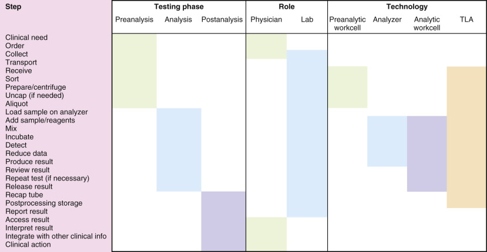
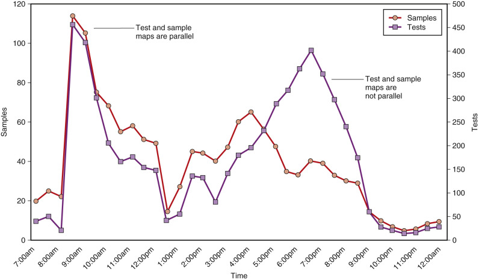
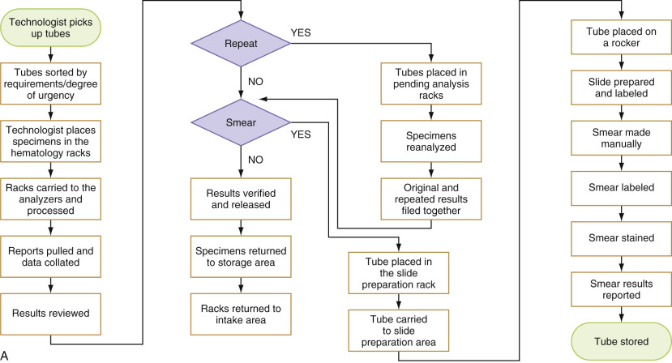
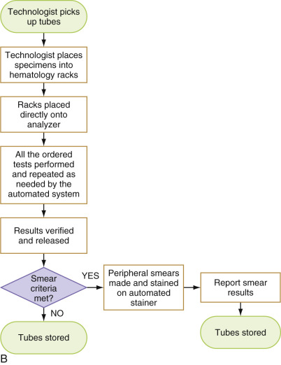
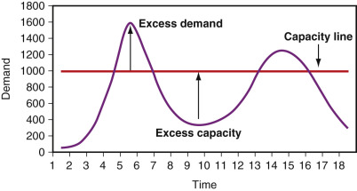

## Key Points

  * •

An effective testing process requires integration of preanalytic, analytic, and postanalytic steps. 

  * •

An understanding of workflow is a fundamental prerequisite to any performance optimization strategy. 

  * •

A variety of techniques should be used to collect workflow data. These include sample and test mapping, tube analysis, workstation analysis, staff interviews, and task (process) mapping. 

  * •

Though technology is a critical component of every laboratory, it is only a tool to reach a goal. Technology alone does not improve performance and workflow; its success or failure depends on how it is implemented and whether it was truly needed. 

  * •

Consolidation, standardization, and integration are key strategies that can optimize workflow using concepts such as Six Sigma to achieve Lean processes. Managing test utilization may also change overall operational needs and workflow patterns. 

The clinical laboratory is a complex operation that must smoothly integrate all three phases of the testing process: preanalysis, analysis, and postanalysis. Preanalysis refers to all the activities that take place before testing, such as test ordering and sample collection. The analysis stage consists of the laboratory activities that actually produce a result, such as running a sample on an automated analyzer. Postanalysis comprises patient reporting and result interpretation. Collectively, all of the interrelated laboratory steps in the testing process describe its workflow; this, in turn, occurs within the overall design of a laboratory operation as described in its policies and procedures. 

The steps in the testing process can be generally categorized according to testing phase, role (responsibility), or laboratory technology ( [ Fig. 2-1 ](<#f0010>) ). Note that the testing process and the grouping of steps vary somewhat from one facility to another. Depending on the laboratory service model and technology used, some steps may fall into one category or another. For example, centrifugation may be performed in a physician office (preanalysis) or in the laboratory as part of a total automation workcell (analysis). Depending on the technology selected, a laboratory may automate some or many of the steps identified in [ Figure 2-1 ](<#f0010>) . Information technology is the essential “glue” that binds these steps. A more detailed discussion of each testing phase is presented in [ Chapter 3 ](<##!/content/3-s2.0-B9780323295680000036?scrollTo=%23c00003>), [ Chapter 4 ](<##!/content/3-s2.0-B9780323295680000048?scrollTo=%23c00004>), [ Chapter 5 ](<##!/content/3-s2.0-B978032329568000005X?scrollTo=%23c00005>), [ Chapter 6 ](<##!/content/3-s2.0-B9780323295680000061?scrollTo=%23c00006>), [ Chapter 7 ](<##!/content/3-s2.0-B9780323295680000073?scrollTo=%23c00007>) . This chapter explores the interrelationship of laboratory workflow, technology, and performance. 

Figure 2-1 

Laboratory testing process. 

Note that the steps can be categorized according to testing phase, role (responsibility), or laboratory technology, as indicated by the shading. 

_TLA,_ Total laboratory automation. 

,  

##  Understanding Workflow 

To fully understand a laboratory's workflow, one must audit all phases of the testing process. Only then can one determine how to optimize performance and to what degree technologic or nontechnologic solutions are needed. [ Table 2-1 ](<#t0010>) provides some of the issues to consider. 

TABLE 2-1 

Issues to Consider When Auditing Operations 

Test ordering  |  Where are orders placed—in the laboratory, patient unit, or office? Are inpatient orders handled differently from outpatient ones? Is there a paper or electronic requisition?   
---|---  
Sample collection  |  Who collects the samples—laboratory or physician? When are they collected—all hours or just in the  am  ? Are samples bar coded at the site of collection or in the laboratory? How are the labels generated? Is there a positive patient ID system? Does the label contain all the information needed to process the sample?   
Transportation  |  How are samples delivered—by messenger, automatic carrier transport, or a combination? Do all laboratories participate? Are all patient care areas served? How are stats handled? What is their impact? Is there a separate system for emergency department and intensive care units?   
Sample receipt  |  Is there a central receiving area? How are samples distributed to each laboratory? Does physical layout promote efficient sample flow? How are stat samples distinguished from routine ones? How are problem samples handled? Are samples sorted by workstation or department?   
Sample processing  |  Are samples centrifuged centrally or in distributed locations? Are stats handled differently? Are samples aliquoted? If so, where? Is a separate sample drawn for each workstation?   
Testing  |  How many workstations are used? How does capacity relate to need? How are samples stored and retrieved? How long are samples kept? When and why are samples repeated? Are repeat criteria appropriate?   
Reporting  |  How are results reported? Electronically? By remote printer? How are stat and critical values reported, and are criteria appropriate? How many calls for reports does the laboratory receive, and why? How are point-of-care tests reported?   
  
Data are of paramount importance in any workflow analysis. Although laboratory data are rather easy to produce because they are readily available from automated analyzers and information systems, they may not be complete, valid, or in the format required. Because laboratory data play a central role in laboratory decision making (e.g., determining which analyzer to acquire), they have to be accurate; otherwise, one may make wrong downstream decisions that can have a negative impact on operations. One must understand how data are collected by each of these systems and whether they are valid. For instance, do the test statistics pulled from an analyzer provide information on how many patient reportable tests are done, or do they count how many total tests are done (with quality control, repeats, etc.)? Are panel constituents counted individually, is only the panel counted, or are both counted? Are the “collect” times accurate on turnaround time reports that measure “collect to result”? Or are samples indicated as “collected” on a patient floor before they are actually collected, thereby making the turnaround time appear longer than it really is? Ultimately, there is no substitute for carefully reviewing data to determine whether they make sense. Sometimes, this requires manually verifying data collected electronically or directly observing a work area. For example, it may be necessary to observe when samples arrive in the laboratory to determine how long a delay exists before staff assign a receipt time in the computer. By doing so, one can determine the accuracy of the sample receipt time. 

 

##  Data Collection Techniques 

Many types of data can be used to assess workflow. Although some of the fundamental data analysis techniques are described in this chapter, they may have to be supplemented with additional data collection to analyze unique characteristics of a laboratory's operation. It is always useful (some would say imperative) to check that the data collected reflect actual laboratory experience rather than anomalies created by unusual workflow patterns or laboratory information system (LIS) programs or definitions. 

 

##  Sample and Test Mapping 

One fundamental data collection technique is to analyze the distribution of samples and tests over time ( [ Fig. 2-2 ](<#f0015>) ). Depending on what is mapped, the time interval can be a day (e.g., hour increments for frequently ordered tests like those in general chemistry) or a week (e.g., daily increments for tests batched several times a week). The goal is to identify overall workload patterns to assess whether resources are appropriately matched to needs and whether turnaround time or other performance indicators can be improved. It is important that the workload measured reflects actual experience. For example, if phlebotomists remotely mark specimens “received” or the laboratory actually orders tests in the LIS, the measured workload distribution may not accurately reflect the underlying processes. As part of the exercise, it is also important to map routine samples versus stat ones and to map locations that may have special needs, such as the emergency department. In addition to sample mapping, one should map key tests and the number or “density” of tests per sample. This is of special interest in the chemistry section. Outpatient samples typically have greater test density than inpatient ones, so an equal number of inpatient and outpatient samples may be associated with different inpatient and outpatient workloads. In automated chemistry, sample mapping more closely reflects staffing needs in that much of the labor is associated with handling and processing tubes rather than actually performing the assays. In contrast, test mapping more closely reflects instrument needs (i.e., the test throughput it needs to complete its workload in a timely manner). By mapping samples and tests and relating them to turnaround time and staffing, a laboratory can identify production bottlenecks and alter workflow to achieve better outcomes. Very frequently, laboratories discover that delays are less the result of instrument issues per se and more the result of workflow patterns that are not matched to instrument capabilities. 

Figure 2-2 

Sample and test mapping. 

Note that the morning volume peak is due to inpatients, and the density is roughly four tests per sample. The evening peak is largely due to outpatients, and density is far greater—about 10 tests per sample. Test density fluctuates during the day; thus both sample mapping and test mapping are necessary to accurately evaluate workload. 

 

##  Tube Analysis 

Part of the laboratory's daily work is related to processing collection tubes or containers. “Tube labor” includes sorting and centrifuging; aliquoting; racking, unracking, loading, and unloading samples on analyzers; retrieving tubes for add-on tests; performing manual dilutions or reruns (depending on instrument); and storing tubes. Although the time needed to perform a tube task may seem insignificant, it has to be repeated many times per day, and this can add up to a substantial amount of time. For example, at an average of 10 seconds per tube, it will take a laboratory 3.3 hours to sort 1200 tubes per day. Automation can often reduce this labor, but redesigning the workflow may be a less expensive and more efficient alternative. To the extent that a laboratory reduces the number of tubes and/or the number of tasks associated with each tube, it can reduce tube labor and positively influence workflow and staffing needs. Reducing tube labor is one of the main goals of consolidating chemistry and immunodiagnostic tests into a single analyzer or workcell. Sample mapping provides information about how many containers are received within a specified interval; tube analysis helps to analyze how many additional “tube-related” tasks have to be done. Tube analysis includes the number of containers other than tubes (e.g., fingerstick collections that may require special processing or aliquoting) and the number of reruns (i.e., repeats) needed as the result of instrument flags and/or laboratory policies ( [ Table 2-2 ](<#t0015>) ). 

TABLE 2-2 

Chemistry Tube Analysis 

|  Analyzer A  |  Analyzer B   
---|---|---  
**Total tubes run** |  **500** |  **500**  
Mechanical error  |  13  |  15   
Dilution  |  7  |  20   
Clot/low volume  |  20  |  30   
_Total instrument-related reruns_ |  _40 (32% of total reruns)_ |  _65 (65% of total reruns)_  
Delta check  |  62  |  21   
Panic value  |  23  |  14   
_Total laboratory criteria –related reruns _ |  _85 (68% of total reruns)_ |  _35 (35% of total reruns)_  
**Total reruns** |  **125** |  **100**  
**% reruns** |  **25%** |  **20%**  
  
Chemistry “reruns” are caused by different factors and can be a source of nonproductive technologist time and/or turnaround time delays. Most Analyzer A reruns are related to overly tight limits for delta checks and panic values that flag too many test results for technologist review and rerun. Most Analyzer B reruns are related to instrument flags caused by a narrow linear range for many methods and a large sample volume requirement per test. A nontechnologic solution (i.e., altering laboratory rerun/review criteria to reduce the number of tubes flagged for rerun) benefits Analyzer A; however, only a technologic solution (i.e., a new analyzer) can lower the number of reruns in Analyzer B. 

 

##  Workstation Analysis 

A typical laboratory is divided into stations for allocating work and scheduling staff. Some workstations consist of a variety of tasks or tests that are grouped together for the purpose of organizing work for one or more staff. For example, all manual or semiautomated chemistry tests may be grouped into a workstation, even though testing might actually be performed at different sites or using different equipment around the laboratory. More typically, a workstation is one physical location (e.g., a fully automated analyzer or group of analyzers such as hematology cell counters, a chemistry workcell or an automated track that includes preanalytic processing, analytic modules and postanalytic storage). Regardless of how a laboratory is organized, it is important to understand where, when, and how the work is performed. This is the goal of a workstation analysis. 

 

##  Instrument Audit 

A key component of any workstation is equipment. By performing an instrument audit ( [ Box 2-1 ](<#b0010>) ), one can better understand how each analyzer is used, its associated costs, and what potential opportunities might exist to improve performance. The operating characteristics of each instrument should be detailed as part of this process. Examples include the maximum number of samples that can be processed per hour, the number of samples that can be loaded at a single time, and the number of reagent containers and assays that can be stored onboard. Instrument throughput (tests/hour) should also be studied by conducting timing studies and reviewing various statistical reports that can be extracted from the instrument and the LIS. Most chemistry analyzers are test-based systems—that is, they perform a specific number of tests per hour, irrespective of how many tests are ordered on each sample. On the other hand, some of these systems are affected by test mix (e.g., the relative proportion of electrolytes, general chemistries, and immunoassays), and this is the major reason that actual throughput experienced in the laboratory may be lower than what is claimed by the vendor. The latter may assume an ideal test mix that cannot be achieved in a given laboratory. It is important to understand how test mix affects an analyzer's throughput and whether work can be redistributed in a way that enhances throughput. An instrument that was well suited for the laboratory's test mix and volume when initially acquired may no longer provide adequate throughput given a change in test mix. It is important to ensure that a vendor's throughput analysis is based on the laboratory's actual test mix and not on a standard used by the vendor. It may turn out that the number of instruments proposed may not meet the laboratory's needs. 

Box 2-1 

Instrument Audit 

  * Instrument model 

  * Vendor 

  * Date acquired 

  * Method of acquisition 

  * Purchased 

  * Leased 

  * Reagent rental 

  * Service cost per year 

  * Supplies cost per year 

  * Reagents 

  * Controls, calibrators 

  * Consumables 

  * Total test volume per year 

  * Patient samples 

  * Controls and calibrators 

  * Test menu 

  * Hours of operation 

  * Days 

  * Shifts 

  * Number of staff trained 

  * Operating mode 

  * Batch versus continuous 

  * Primary system versus backup 

It is equally important to receive a clear and concise definition of up-time from the vendor for the instrument(s). This definition should be simple. If the laboratory cannot report patient results, the instrument is down. Some vendors consider an instrument down only if the vendor is called for service. This may mean the percent of up-time by the vendor may be valued higher than the actual up-time experienced by the laboratory. It is important to include this definition in a contract if a laboratory expects a vendor to uphold desired operational performance levels necessary to consistently maintain patient care support. 

Last, labor considerations should not be ignored. Must the instrument be attended at all times, or does it have walkaway capability? This information can be very useful in identifying processing bottlenecks and redesigning workflow. 

 

##  Test Menu 

A careful review of the laboratory's test offerings should be done during a workstation analysis. Are the tests performed appropriate for the facility, given the volume and frequency of test analysis? Just because a laboratory can perform a test does not mean that it should. For example, if a test is performed only once or twice a week and requires considerable equipment, training, or labor input, it may make more sense to send it to a reference laboratory where it is performed more frequently. Sometimes, the best way to improve turnaround time and lower the cost of a test is not to perform it. Unfortunately, this option can be easily overlooked if one focuses only on how to improve the way existing tests are performed, instead of analyzing how to best meet clinician needs. 

 

##  Processing Mode and Load Balancing. 

These can affect both the cost and the timeliness of testing. Samples can be processed in batches or run continuously as they arrive in the laboratory. When grouped into batches, samples are run at specific intervals (e.g., once a shift, once a day, every other day) or whenever the batch grows to a certain size (e.g., every 20 samples). Batch processing is often less expensive than continuous processing because the setup costs (quality control, labor, etc.) are spread over many specimens (see [ Table 12-2 ](<##!/content/3-s2.0-B9780323295680000127?scrollTo=%23t0015>) ); however, batch processing produces less timely results. Sometimes, batch processing is a limitation of the instrument that is used. A batch analyzer cannot be interrupted during operation; thus a newly arrived sample cannot be processed immediately if the instrument is already in use. Most currently available general chemistry and immunoassay analyzers are random access analyzers that continuously process samples. These analyzers can randomly access samples and reagents and can accommodate an emergency sample at any time. Automation is discussed more fully in [ Chapter 5 ](<##!/content/3-s2.0-B978032329568000005X?scrollTo=%23c00005>) . Continuous processing is facilitated by load balancing, a technique that distributes work evenly among analyzers and spreads testing over a longer period to better match instrumentation throughput. For example, outpatient work, which does not require a rapid turnaround time, can be sequenced into the workflow during off hours. This improves testing efficiency, reduces the labor content of individual tests, and reduces throughput requirements (and capital cost) of instruments. In addition, if significant outreach testing (which does not typically require a rapid turnaround) is performed, some or all of this volume can be shifted to times that the laboratory is not as busy. The feasibility of load balancing can be evaluated only if accurate test mapping and tube analysis are performed. 

 

##  Interviews 

Data collection is not complete without interviewing staff. This exercise provides an opportunity for staff to participate in analyzing workflow and improving performance. It also identifies issues that would not be readily apparent from data collection alone. For example, many hospitals require electronic order entry on patient care units. Although this practice may eliminate paper requisitions, laboratory staff members may still be placing orders for “add-on” tests that are called into the laboratory (or added electronically), processing special requests, and troubleshooting incorrect orders, unacceptable samples, or misaligned bar code labels applied by nonlaboratory staff during sample collection. This residual work is likely to be transparent because it probably will not appear on reports, logs, or computer printouts. Thus “computer-generated orders” may still be associated with considerable manual laboratory labor that may be identified only through interviews. 

Interviews are particularly valuable in understanding what occurs outside the laboratory. Test ordering patterns or habits can have a significant impact on a laboratory's ability to meet clinician needs. Visits to patient care units and discussions with nursing unit staff can identify preprocessing improvements that cost little to implement but save considerable money downstream. 

Early patient discharge can be a challenging task for hospitals trying to shorten length of stay. A full understanding of the discharge process requires interviewing all related staff. One issue that sometimes emerges is the sample collection time for patients awaiting discharge pending a laboratory result. To avoid delays in providing results for discharge patients, some facilities develop elaborate “stat” systems to collect, identify, and process these samples, as well as report results, during the busiest time of the day: the early morning. Sometimes, dedicated (stat instrument) or new technology (point-of-care device) is used for this purpose. However, one can ensure that results are available in the chart during early-morning clinical rounds by simply collecting laboratory samples from patients on the evening before discharge (  Sorita et al, 2014  ). Thus not all solutions require technology. A careful mix of workflow restructuring and appropriate technology is usually the correct approach and the most cost-effective solution. 

 

##  Task Mapping 

No workflow study is complete without mapping the tasks or processes involved in performing a test (  Middleton & Mountain, 1996  ). A rigorous review will detail every specimen-handling step, each decision point, and redundant activities. Task mapping can be applied to any segment of a laboratory's workflow, whether technical or clerical. A full understanding of the tasks involved usually requires thorough staff interviews, as discussed previously. Task mapping should be an ongoing activity and should also be undertaken whenever one contemplates adding a workstation, test, new technology, or any significant change to a laboratory process. When implementing change, it is important to avoid unnecessary or additional steps that are inadvertently added in the name of “efficiency”; task mapping helps identify these steps. Mapping also helps compare processes before and after change ( [ Fig. 2-3, _A_ and _B_ ](<#f0020>) ). 

Figure 2-3 

**A,** Task mapping: Original workflow for hematology cell counting. **B,** Task mapping: Improved workflow for hematology cell counting subsequent to workcell implementation. Note the reduction in steps as compared with part **A.**

 

##  Workflow Analysis 

Workflow analysis assimilates all of the previously discussed data and transforms them into valuable information. This step can be done manually or, as will be described later, using commercially available software for part of the analysis. A comprehensive workstation analysis should identify bottlenecks and highlight areas where improvements are necessary. 

How is this done? The easiest way, and one that does not require computer support, is to follow the path of a specimen or group of specimens through the entire process. This should begin at or near the bedside to see how physicians are ordering tests and should proceed to specimen acquisition and delivery to the laboratory. A flow sheet, which follows the sample from initial order to arrival in the laboratory, should be created. A separate task force is usually assigned to the prelaboratory phase because multiple departments and staff are usually involved; the laboratory often has little or no direct control over this critical portion of workflow, especially when nonlaboratory staff collect samples. 

Specimen transit through the laboratory should then be documented, noting areas where batch processing occurs. For example, one should identify minimum and maximum centrifugation times for applicable specimens (such as those that have to be aliquoted). If specimens require 10 minutes for loading and spinning, this should not be assumed to be the average time because a sample queue may form during peak periods. Using the sample arrival mapping done in data collection, an average time can be assigned by time of day. If this is done manually, it is best to select a number of key times and average them, if possible. Similarly, one should note whether loading specimens on the analyzer is delayed. Many other examples of physical bottlenecks need to be identified and quantified. It is not always possible to completely eliminate bottlenecks, but it is possible to mitigate their impact through new technology, alternative processing modes (e.g., random access vs. batch processing), and workflow redesign. 

Nonphysical bottlenecks should also be identified and quantified. A classic example is the mode of result verification. Batching results for a technologist to review and accept is every bit as much a bottleneck as is waiting for a centrifuge to process a sample. In contrast, LIS autoverification (where results are automatically released on the basis of preset criteria) can reduce test turnaround time without requiring a major reorganization of the laboratory. However, the degree to which autoverification enhances workflow depends on the manner in which it is implemented and the algorithms defined to qualify a result for this feature. This, in turn, may depend on the LIS used. 

Many vendors who want to sell automated equipment systems to the laboratory will provide free workflow analysis. They usually have experienced technical staff who do this, and the information can be very helpful. The laboratory will need to provide the necessary data or access to the laboratory for data collection. Together, the vendor and laboratory leadership need to analyze the workflow to identify opportunities to improve operations, which may well involve the vendor's automated system. 

 

##  Workflow Modeling 

Although the analyses discussed earlier are critical to understanding current and proposed workflow designs, they usually provide a somewhat static picture (i.e., each describes a single data element and often how it changes over time). In practice, however, workflow consists of many interrelated variables, and it is difficult to understand (or to evaluate in the laboratory) how a change in one variable affects another. Further, although workflow studies can be very beneficial, they consume resources that may not be available in every laboratory. To address this need, technology vendors have developed workflow simulations. By using sophisticated workflow modeling software, one can analyze these complex interrelationships to better predict the outcome of a given workflow design ( [ Box 2-2 ](<#b0015>) ). Workflow modeling can help identify bottlenecks and the impact of staffing changes or different equipment configurations on cost and turnaround time. It can also be used to gain a better understanding of how a given analyzer responds to changes in test volume and test mix. For example, one can simulate the impact of increasing routine test volume on an instrument's turnaround time for stat samples (  Mohammad et al, 2004  ). As with all workflow analyses, however, software modeling must be based on accurate data collection techniques. 

Box 2-2 

Interrelated Variables Simulated by Workflow Software Models 

  * Equipment configuration 

  * Facility design 

  * Labor by shift and day 

  * Throughput 

  * Routine maintenance 

  * Downtime 

  * Sample volume (distribution and peak demand) 

  * Sample container type 

  * Review policy and rerun rates 

  * Batch size 

Because most simulation programs are proprietary products, they may not allow modeling of all available instruments. Workflow simulation is still a powerful tool, and inferences can be drawn about more efficient processing and testing regardless of the model instrument involved. More important, these programs readily highlight deficiencies in a laboratory's current operations and can point to specific areas where the greatest improvements are achievable. 

 

##  Pneumatic Tube Transport of Specimens 

Many laboratories, especially those in large hospital facilities, use pneumatic tube systems for specimen transport to the laboratory. They can greatly decrease transport time and thus total turnaround time for test results. Some of these systems can be extensive, especially the branching systems that can reach most parts of a hospital. Once a laboratory has a tube system, it becomes very dependent on it, requiring a good service and support system to maintain it. Usually the plant operations or engineering department of the hospital maintains the system on a daily basis. In addition, enough specimen carriers must be available to supply all areas of the hospital in need of specimen transport to the laboratory. It is important to monitor the number of carriers in the system and to order new carriers when existing supplies wear out or “disappear” (it is not uncommon for locations to “stockpile” carriers, at the expense of other locations, to ensure their availability). 

,  

##  Understanding Technology 

No discussion of workflow is complete without examining the role of technology (  De Cresce & Lifshitz, 1988  ). Laboratory technology refers largely to three functional areas: testing equipment (i.e., analyzers), preanalytic processors, and information technology (IT). Although the former two areas are specific to the laboratory, IT is not, and its design and role are often determined by factors outside the laboratory. For example, the manner in which a laboratory information system is used for data retrieval and reporting (i.e., whether or not physicians directly access the LIS to view results) depends on whether a hospital information system is available to serve this purpose. In the latter case, laboratory data are accessed and reported through a secondary system. Also, the laboratory system may be part of a broader approach or a single IT vendor solution within the health care center and not a standalone product to be selected by the laboratory. Under these circumstances, the technology selected, although optimal for the general institution, may not be optimal for the laboratory. Changes in hospital-wide systems are rarely made to accommodate efficiencies in ancillary services like the laboratory. These systems are primarily geared toward easy access to clinical information by caregivers and accurate billing by the hospital finance department. 

 

##  The Role of Technology: Principles and Pitfalls 

Technology has radically changed the clinical laboratory over the past 30 years and continues to be the driving force behind many new developments. Periodically, a breakthrough technology is introduced that revolutionizes laboratory medicine ( [ Box 2-3 ](<#b0020>) ). Examples include the random access chemistry analyzer, the automated immunodiagnostics system, the chemistry and immunodiagnostics integrated workcell with preanalytic automation, point-of-care testing, and molecular diagnostics. Each change profoundly alters how a laboratory functions and the type of information it provides clinicians. Although breakthrough technologies offer a large potential benefit, they cost more. Over time, a breakthrough technology is adopted by multiple vendors, competition develops, prices fall, and its use becomes widespread among laboratories; in other words, it becomes a current or derivative technology. Early adopters of breakthrough technology often pay more and receive less benefit than those who wait until it becomes a current technology. By thoroughly understanding the role of technology, one can determine how to best use it in the clinical laboratory. The following issues should be considered when evaluating technology. 

Box 2-3 

Breakthrough Technology 

  * Changes fundamental workflow 

  * Consolidates workstations 

  * Saves labor 

  * Improves service 

  * Sets new performance standard 

  * Leads to premium pricing 

**Is technology needed?** Technology is an integral part of a modern laboratory; however, it is not the solution to every problem. Often a nontechnologic solution provides a faster, better, and less expensive workflow approach than a technologic one. Knowing when to introduce a nontechnologic solution instead of a technologic one can mean the difference between a targeted, cost-effective solution and an expensive one that does not fully address the initial problem, provides unnecessary functionality, or provides necessary functionality but at an unnecessary cost. For example, a laboratory may experience a sharp morning spike in samples, thereby creating workflow backlogs ( [ Fig. 2-4 ](<#f0025>) ). Instead of purchasing more equipment to provide additional capacity during peak periods, the laboratory should look for ways to distribute work more evenly during the shift. The key is to avoid delivering large sample batches to the laboratory. Outreach samples can be more evenly distributed because the turnaround time is usually not critical. One approach might be to rearrange phlebotomy draw schedules so that blood draws begin earlier and are spread out over a longer period (  Sunyog, 2004  ). Another approach is to have phlebotomists send samples to the laboratory after every few patients instead of waiting to collect a large batch from an entire floor. One consideration is to have the inpatient nursing unit staff perform specimen collection. This may control the number of inappropriate stat orders because nursing units are more familiar than a laboratory phlebotomist with the status of the patient. This requires consistent phlebotomy training for all nursing unit staff that collect specimens to prevent specimen integrity problems. Thus one should analyze and reengineer processes to the greatest possible degree before embarking on a technology solution; this approach may yield an inexpensive solution that is quicker and easier to implement. Sometimes, nontechnologic solutions, although preferable, are out of the direct control of the laboratory staff and consequently do not receive the attention they deserve. Thus a technology solution is selected because it can be implemented without the support of other departments. 

Figure 2-4 

Test demand versus instrument capacity. 

Note that demand exceeds capacity during peak periods, thereby creating backlogs. In many facilities, short backlogs are acceptable. If they are not clinically acceptable, the laboratory should explore ways to more evenly match capacity and demand—for example, by altering blood collection schedules or introducing new work from additional clients. New technology should be the last approach that is considered. 

**Technology is a means to an end, not an end.** Technology alone does not improve performance and workflow; it is only a tool to reach a goal. Ultimately, new technology succeeds or fails according to how it is implemented. This, in turn, depends on people and their ability to clearly analyze how technology and workflow can be optimally integrated into their setting. What works for one location may not work for another. Sometimes, this means changing long-standing practices or staff schedules. For example, if four chemistry analyzers are consolidated into two, staff need to be reallocated to take into account fewer workstations and/or peak testing needs. Similarly, batching certain tests on a new high-throughput analyzer does not take full advantage of its continuous processing capabilities and in some instances may yield a lower throughput than the analyzer it replaces. Last, manually transcribing physician orders from paper requisitions into an information system provides far less functionality and error reduction capability than is provided by direct electronic order entry by physicians. Because technology has to be “customized” for each site, laboratories implement the same technology in different ways and experience different outcomes. It should never be assumed that improvements and results seen at another facility will automatically occur in one's own facility. The most successful implementations require a total workflow reassessment to evaluate how best to integrate technology. By critically evaluating existing practices, one can avoid perpetuating inefficient processes, even with new equipment. 

**Overbuying —the cardinal sin. ** More than anything else, overbuying increases costs that burden an operation over the life of the technology. Although it is tempting to overbuy “just in case” capacity needs grow (such as with new outreach work), these needs may not materialize or may occur slowly over time, allowing for an incremental and more cost-effective approach. A new instrument in the laboratory rarely, if ever, directly translates into new testing volume. The market demand for testing is generally independent of the laboratory's capacity to test, although greater capacity may allow the laboratory to more aggressively market services. Different types of overbuying may occur. For example, one may buy three analyzers instead of two or an analyzer that performs 1000 tests per hour instead of a device that runs 500 tests per hour. Alternatively, a total laboratory automation solution may be implemented instead of one based on several smaller workcells or standalone analyzers. In all instances, overbuying increases costs. All of the previous examples increase depreciation costs, require more service and maintenance, and can lead to ineffective labor utilization and suboptimal workflow. Buying more analyzers than necessary can also increase reagent costs in that each instrument has to be calibrated, controlled, and cross-correlated with other devices running the same test. Reagent waste (due to outdating) may also increase if low-volume tests are set up on all of the analyzers. 

Overbuying should not be confused with excess capacity that is sometimes unavoidable when necessary backup systems are implemented. Ultimately, it is the laboratory service model that determines whether backup is needed. For some tests (e.g., cardiac markers), the laboratory may need a backup system; for others (e.g., tumor markers), it may not. Also, a stat laboratory's backup needs will differ from those of a reference laboratory. A well-designed workflow can balance a laboratory's need for some backup without unnecessary overbuying. For a laboratory that needs a 1000 test/hour capacity, this may mean selecting two 500 test/hour analyzers instead of two running 1000 tests/hour. Alternatively, it may mean selecting one 1000 test/hour analyzer and using a laboratory nearby (that is interfaced to the first laboratory's information system) for backup. Last, it may mean selecting two 1000 test/hour analyzers but running one at a time. This last solution is rarely successful because it duplicates expensive technology and increases maintenance costs. A simple analogy to the family car is often instructive: People rarely buy two automobiles to do what one can do most of the time. Instead, they rely on alternative sources such as renting, public transportation, or taxis to fill occasional needs. One must be sure not to underbuy as well. Many times the number of analyzers is dependent not only on volume throughput but also on stability (uptime). If instrumentation is down a significant amount of time and the effort to bring it back online will take hours or days, a backup instrument is critical for continued testing support. Many large laboratory operations have extensive automation in chemistry and hematology that require constant availability of service support by the vendor to make sure the instrumentation is always in working order. In some cases, a vendor will actually have a service engineer routinely present onsite during weekday hours to maintain the automation system and to help train staff to do the same. Because of staffing shortages on a national level, automation has helped laboratories do more with less, but only if the automation stays consistently functional. Ultimately, the goal is to “right buy”—that is, to avoid overbuying or underbuying technology. 

**Do you understand what you are buying?** There is a difference between “buying” technology and being “sold” technology by vendors. The former approach requires an analysis by the laboratory to identify what it needs and a thorough understanding of the technology under consideration, whereas the latter relies more heavily on the vendor to provide a solution to the laboratory. The risk of being “sold” a technology is that it might not be the optimal solution. Most instruments work and do what they are advertised to do. Unfortunately, “what they do” may not be “what you need them to do.”

The type of technology is also important. Current technology is generally easier to understand and offers a less risky strategy than breakthrough technology, although it might also provide less reward. Breakthrough technology is, by definition, a new technology, and it may be difficult to fully understand whether it is appropriate in a given laboratory setting, how best to implement it, or how significant a financial impact it will make. 

Other issues to consider relate to the technology itself and whether it currently offers all the features required by a laboratory. A vendor may promote certain enhancements or capabilities scheduled for the future, especially when marketing analyzers. These may include tests in development, instrument or computer hardware improvements, new versions of software, or automatic upgrades to a next-generation system. Although these future enhancements may seem attractive, they may not materialize, so they should not be a primary reason for choosing technology. A better approach is to delay purchasing the system until it can offer the laboratory the capabilities it needs. Another potential mistake is overestimating a technology's lifetime or usefulness because this will underestimate its true cost. In the end, the question each laboratorian should ask is not “Does this technology work?” but rather “Does this technology work for me?”

,  

##  Optimizing Performance 

_Optimizing performance_ refers to the process by which workflow (including laboratory design) and technology are integrated to yield an operation that best meets the clinical needs and financial goals of the organization: high quality at low cost. In practice, there are times when workflow changes improve service levels and reduce cost. For example, consolidating chemistry systems may lower capital and operating costs and may improve turnaround time. At other times, there is a tradeoff between cost and quality. For example, a phlebotomy staff reduction, while lowering costs, may lengthen the time necessary to complete morning blood collection. This, in turn, may delay when test results become available, but this may not be significant if results are not needed until later in the day. On the other hand, if a patient's discharge is contingent on reviewing the result in the morning, a testing delay could increase length of stay. Ultimately, these decisions need to be analyzed within the framework of the overall institution, taking into account the downstream impact of these actions and their effects on other departments. 

Optimizing performance is an ongoing process that requires one to constantly assess and reassess workflow and needs. This requires periodic data collection and analysis. [ Table 2-3 ](<#t0020>) provides examples of workflow metrics that are useful to monitor. Ultimately, the degree to which any of these reports is useful depends on the accuracy of the data. Many different approaches may be taken to optimizing performance; some of the more common ones are discussed here and in [ Table 2-4 ](<#t0025>) . 

TABLE 2-3 

Workflow Metric Examples 

Metric  |  Comments   
---|---  
**Turnaround Time (TAT) Studies**  
Collection to receipt  |  Is collection time correct? How long does it take for samples to reach laboratory? Is tube transport system functioning properly? Are messenger pickups reliable?   
Receipt to result  |  How long does testing take once the laboratory receives a sample? Is it held in a central receiving area before it is brought to the technologist? Is the receipt to result time accurate—that is, is there a delay between physical receipt and electronic sample receipt acknowledgment in LIS (  Stotler & Kratz, 2012  )?   
Order (or collection) to result  |  This is what the physician perceives as total turnaround time. Is it accurate? How long does it take for a released laboratory result to appear in the hospital information system? Do networking issues external to the laboratory delay the appearance of results?   
Stat and routine TAT by hour  |  Is stat TAT longer in the  am  when routine samples from morning collection arrive? What is the difference in TAT for routine and stats? Are some tests affected more than others?   
**Monthly Volume Statistics**  
“Billable” tests  |  How many orderable tests are performed? What is the trend? Has total volume or a specific test's volume changed enough to warrant a reevaluation of workflow or testing capacity? Should any tests be sent to a reference laboratory rather than be performed in-house?   
“Exploded” tests  |  Exploding chemistry panels into individual components provides a more accurate assessment of general testing “load” on analyzers and reagent usage than orderable tests alone. Has volume changed? Is it related to a specific location or a new service?   
By location  |  Has testing volume changed in specific nursing units or outpatient settings? Has the volume of inpatient and outpatient testing changed?   
Reference laboratory tests  |  Are certain tests increasing in volume; if so, why and at what cost? Are total monthly costs changing? (Tests with the highest cost/year are not always the highest volume ones.) Should certain tests be screened for appropriateness? Does it make sense to perform any of these tests in-house (“buy versus make” decision)?   
**Sample and Test Mapping**  
Tubes per hour  |  Tube handling in chemistry has a direct impact on staff (or automation) and includes centrifugation, aliquoting, and storage.   
Tests per hour by department or workstation  |  This is needed to compare “testing demand” versus “instrument capacity” and can help determine optimal instrument configuration.   
  

TABLE 2-4 

Strategies to Optimize Performance 

Strategy  |  Example   
---|---  
Consolidate  |  One facility: Run stat and routine samples together on the same analyzer; run routine and specialty tests on the same platform; collapse number of analyzers and workstations and use workcell, if applicable. Consolidation can reduce “tube labor.”  
|  Multiple facilities: Centralize selected low-volume, high-cost tests/services at a single location (e.g., molecular diagnostics [HIV viral load], blood donor collection).   
Standardize  |  Equipment: All equipment purchased from one vendor yields larger volume discounts and lower costs for reagents and analyzers, especially in chemistry and immunodiagnostics.   
|  Method: Uniform reference range for all laboratories promotes seamless testing environment for inpatients and outpatients with data comparability and trending results across laboratories; it also provides system backup without excess redundancy.   
|  Policies: Simplify procedure manuals and compliance documents so they can be shared.   
|  Staff: Standardized operations make it easier to share staff among facilities.   
|  LIS: Database management is simplified.   
Integrate  |  Computer: Network LIS system with other data systems to promote seamless flow (e.g., sending point-of-care results into the LIS).   
Strategic growth  |  Courier: Use single service to deliver samples among multiple sites.   
Evaluate excess capacity and feasibility of increasing testing workload: Assess outreach infrastructure (couriers, client/sales staff, billing), incremental testing costs, potential revenue, and core mission to determine whether to expand business.   
Strategic sourcing  |  Long-term strategy: Competitively bid equipment, supplies, reference laboratory services, etc., taking into account payment terms, delivery charges, value-added services, and product costs.   
Rapid repricing  |  Short-term strategy: Renegotiate pricing with existing vendors.   
“Make versus buy” |  Review all send-out tests and low-volume in-house tests to identify which tests to “buy” (i.e., send out or outsource) and which to “make” (i.e., do in-house) based on cost and turnaround time. Also, review services such as couriers.   
Review laboratory policies and tasks  |  Critically review laboratory policies and procedures to determine their relevance and appropriateness: Can delta check limits be narrowed or eliminated to reduce the numbers of test repeats and verifications without compromising quality? Do critical values need to be repeated before they are reported (  Lehman et al, 2014  )? Are critical call values clinically appropriate, or do they generate unnecessary calls to physicians? Can nonurgent expensive tests be batched twice weekly instead of every day? Do clinicians need certain tests daily that are available only several times a week? Are quality control and maintenance procedures excessive?   
Make maximum use of simple and/or existing IT solutions  |  The rule-based autoverification process eliminates the need for the technologist to manually release each result (  Crolla & Westgard, 2003  ); sample racking storage system eliminates most of the time spent looking for samples.   
Cross-train staff  |  Train technologists to perform automated chemistry and hematology tests instead of chemistry or hematology alone.   
Adjust skill mix  |  Adjust skill level (and compensation) of staff to match task performed: Use laboratory helpers instead of technologists to centrifuge samples or load samples on analyzers.   
Adjust staff scheduling  |  Use part-time phlebotomists to supplement peak blood collection periods instead of full-time phlebotomists who are underutilized once morning collection is finished.   
Change laboratory layout  |  Design open laboratory that allows all automated testing to run in the same location and promotes cross-training of staff.   
Manage utilization  |  Require pathologist or director approval to order select costly reference laboratory tests and/or restrict usage of various tests to specialists.   
  
_HIV,_ Human immunodeficiency virus; _IT,_ information technology; _LIS,_ laboratory information system. 

Consolidation, integration, and standardization are three key interrelated strategies that have assumed increasing importance in recent years as laboratories have become affiliated with one another through large health care networks. These concepts are also relevant to a single facility. 

**Consolidation.** Testing can be consolidated from multiple sites or workstations in a single facility, or selected tests from many facilities can be centralized in one or more locations. Consolidation creates larger sample batches or runs; this improves testing efficiency in that fixed quality control and calibration costs are distributed over more samples. This, in turn, lowers per-unit costs. Consolidation may yield larger reference laboratory test volume. A “make versus buy” analysis can determine whether it is economically feasible to insource tests previously sent to a reference laboratory (  Kisner, 2003  ). Consolidation may also improve turnaround time by making it cost-effective to perform tests more frequently or to use a more automated technology. Some tests may not be appropriate to consolidate. For example, blood gases and other point-of-care tests may have to be performed at multiple sites in a hospital to provide the necessary turnaround time demanded by clinicians. Similarly, little benefit may be derived from performing routine hospital complete blood counts (CBCs) at a central off-site location instead of at the main hospital rapid response laboratory. In contrast, it may be beneficial to consolidate across facilities those tests that are less time-sensitive (e.g., tumor markers) or that require special skills and/or dedicated equipment at each site (e.g., various microbiology or molecular tests, or electrophoresis). To successfully consolidate tests from multiple facilities, a central site must control new costs (by minimizing additional staff or equipment to perform the tests) and provide better or comparable quality and service to what had been provided (  Carter et al, 2004  ). It must also foster a collaborative approach to ensure that all of the sending facility's needs are met, including common physician concerns such as longer turnaround time and limited ability to access information or interact with a remote laboratory. A successful consolidation should be transparent to the clinician. 

**Standardization.** Standardized policies, methods, and equipment benefit laboratories in several ways. Direct benefits, like lower costs, can be realized when the laboratory aggressively negotiates with one vendor to supply all chemistry or hematology equipment and reagents. Indirect benefits are due to the simplified operations that result from standardization and make it easier to cross-train staff or implement policies and procedures. Standardization is a gradual process that can take several years to complete. Rapid transition usually is not possible because of vendor contract lock-ins; a buyout of an existing contract is usually too expensive and can partially or completely offset any intended savings from a new contract. Sometimes, the unique needs of a location may preclude standardization with other laboratories, or a single vendor may not offer a product line that is suitable for each facility. In these instances, it is still possible to significantly lower costs and/or improve performance albeit using a more varied or limited approach. 

**Integration.** Integration is the process by which services at one location are coordinated, shared, and/or connected to those at another to provide a seamless operation. Although integration is often a by-product of consolidation and standardization, the latter two strategies are not a prerequisite to successful integration. For example, consider a laboratory information system that links several facilities. Although a single seamless operation can be created with a single vendor's system, it is also possible to network systems from different vendors, albeit with greater difficulty and possibly less functionality. Other integration examples include cross-training staff among different laboratory sections or facilities and interfacing point-of-care laboratory data to the main laboratory system. 

**Six Sigma and Lean.** Six Sigma is a management concept that was first introduced by Motorola in 1979 (  Gras & Philippe, 2007  ). The ultimate goal is to reduce defects to fewer than 3.4 per million procedures. Lean is a management concept that reduces waste and streamlines an operation (  Sunyog, 2004  ). It was used to describe the automaker Toyota's business process in the 1980s. (See [ Chapter 1 ](<##!/content/3-s2.0-B9780323295680000012?scrollTo=%23c00001>) for a complete discussion of Six Sigma and Lean.) 

**Managing utilization.** Thus far, strategies to optimize performance have focused on ways to do work better and at lower cost. Although this is important, it does not address the most basic question: Is the work—that is, the test—necessary? After all, the least expensive test is the test that is not done. Lowering test volume may change overall operational needs and workflow patterns. Keep in mind that inpatient laboratory work generally is not reimbursed (see [ Chapter 12 ](<##!/content/3-s2.0-B9780323295680000127?scrollTo=%23c00012>) ), so each laboratory test is an added cost for the hospital. Thus lowering inpatient utilization has a direct impact on costs. In contrast, outpatient testing generally is reimbursed by a third-party payer or by the patient. Despite this, the amount reimbursed may not be sufficient to cover the cost of the test. This is especially true for expensive new reference laboratory tests for which the laboratory may receive only 20 to 30 cents for each dollar spent. So selectively controlling outpatient utilization can be financially beneficial. Appropriate utilization of tests does not only mean lowering utilization. In some instances, tests that should be ordered may not be ordered; this could have an impact on patient care and could lengthen stay. 

A laboratory may use different strategies to manage utilization. A successful test utilization program requires a broad-based effort. Expert clinicians, pathology leadership, administration, and information technology support are critical elements) (  Kim et al, 2011  ;  Warren, 2013  ). Over the years, laboratories have realized large cost savings through productivity improvements. As a result, it is far easier and less costly to run a 10-cent test than to determine whether each one is appropriate. Although this is true for many high-volume tests (like CBCs and basic metabolic panels), it is not true for many new, complex, and costly reference laboratory tests such as cancer diagnostics and viral genotyping. Thus a different strategy is needed to manage utilization of costly reference laboratory tests than to manage CBCs. For example, reference laboratory utilization (for certain tests) can be managed by reviewing each order and its cost with the clinician according to guidelines developed with the clinical services. This cost avoidance strategy not only ensures that clinical indications are met, but it also educates physicians about the cost of a test and challenges each one to evaluate the cost-benefit of ordering it. In contrast, high-volume tests such as a CBC require a broader strategy that restricts or guides ordering frequency electronically through various clinical pathways or guideline-based decision support systems (van  Wijk et al, 2002  ). For example, a comprehensive or basic metabolic panel might be limited to one order per admission if the patient is stable. Little can be saved by eliminating one low-cost laboratory test from a panel of five other tests. The most significant cost savings is realized when a phlebotomy is eliminated. This usually requires rethinking the frequency of laboratory orders across all clinical services and changing practice patterns to reduce the number of times a patient's blood is collected. Test repetition is a common component of overall test utilization and is costly (van  Walraven & Raymond, 2003  ); it can be reduced using a clinical decision support tool (  Procop et al, 2014  ). 

A laboratory-based diagnostic algorithm can assist with medical decision making and reduce test utilization. With this approach, a physician requests the laboratory to perform a diagnostic workup (e.g., thyroid function evaluation) instead of ordering specific tests. Thus the laboratory determines the appropriate tests to run and in what order (  Yang et al, 1996  ). 

,,
