## Key Points

  * •

The dominant clinical feature of organ-specific autoimmune disease is chronic inflammation, generally localized in a single organ specific for each individual disease. 

  * •

The etiology of virtually all organ-specific autoimmune diseases remains elusive. 

  * •

Direct immunofluorescence is essential for resolving the microscopic differential diagnosis of acantholytic and subepidermal bullous disorders. 

  * •

The presence of circulating autoantibodies at significant titers is often useful in establishing the etiology of autoimmune liver disorders. 

  * •

Autoimmune diseases occur in a proportion of people that manifest autoimmunity. 

  * •

In organ-specific autoimmune diseases, an organ-specific, tissue-specific, or cell-specific autoantigen is targeted. Some autoantigens circulate, some are cell-surface molecules, and some are intracellular. Clinical recognition of autoimmunity is dependent on the detection of autoantibodies against relevant autoantigens. 

  * •

Damage to self can be mediated by humoral and/or cell-mediated autoimmunity. 

  * •

An expanding universe of micro-volume technologies is speeding the development of autoantibody detection that could support screening programs when clinically indicated. 

  * •

The detection of relevant autoantibodies in the setting of clinical disease can confirm an autoimmune etiology for the disease. Likewise certain autoantibodies in asymptomatic individuals can predict the later development of disease. 

  * •

Autoimmune disorders frequently affect the skin, gastrointestinal and hepatobiliary systems; the kidney; the endocrine system; and the nervous system. 

  * •

Collectively, organ-specific autoimmune diseases are common and produce significant degrees of morbidity and mortality. 

,  

##  Introduction and Overview to the Organ-Specific Autoimmune Diseases 

 

##  Definition of Autoimmunity Versus Autoimmune Disease 

Autoimmunity is aberrant immunity to self (  Kamradt & Mitchison, 2001  ). In order to protect the body from infection and neoplasia (when new antigens are expressed), the immune system must be able to distinguish self from nonself. The innate immune system uses a large number of nonclonotypic cell surface receptors (such as toll-like receptors) that seek gross differences between self and nonself to recognize the microbiologic world (  Medzhitov & Janeway, 2000  ) The adaptive immune system uses clonotypic T cell receptors for peptide-major histocompatibility complex (MHC) identification, while B cells use clonotypic cell-surface antibody (i.e., membrane immunoglobulin) to accomplish this task. The adaptive immune system can recognize very subtle differences between self and nonself that may not be “observed” by the innate immune system receptors. 

Normally autoimmunity is prevented by central (thymic) tolerance and peripheral tolerance. During T cell ontogeny in the thymus, at the T cell receptor double-positive thymocyte stage (i.e., T cells are positive for CD4 and CD8), interaction with class I or class II MHC molecules expressed by epithelial nurse cells “positively” selects such T cells for initial survival. Failure of these double-positive T cells to interact with MHC leads to apoptotic cell death. Once a double-positive T cell is “selected” (a.k.a., “saved”), it then migrates to the cortico-medullary border within the thymus, where these cells encounter macrophages and dendritic cells. If the T cell receptor of the double-positive T cell interacts strongly with MHC molecules expressed by macrophages or dendritic cells, such an interaction will trigger the T cell to undergo apoptosis. This is termed _negative selection_ : T cells that bind “too tightly” to self are eliminated from the T cell repertoire. 

Those double-positive T cells that survive negative selection migrate into the thymic medulla and become single-positive (i.e., either CD4 or CD8 is persistently expressed). Double-positive T cells that were “saved” by interaction with class I MHC expressed by the thymic nurse epithelial cells, that then survive negative selection at the cortico-medullary border, appear to be programmed to lose CD4 expression, becoming CD8 T cells. Double-positive T cells that were “saved” by interaction with class II MHC expressed by the thymic nurse epithelial cells, that then survive negative selection, appear to be programmed to lose CD8 expression, becoming CD4 T cells. These CD4 and CD8 T cells constitute the naive T cell repertoire that leaves the thymus. 

Peripheral tolerance develops when naive T cells encounter MHC plus antigen-peptide without secondary signals. Such “tolerized” T cells are not able to subsequently respond to antigen, even if the proper secondary signals are then made available. Peripheral tolerance ensures that antigen-presenting cells are activating the naive T cells in an appropriate immune response: Signal one is the T cell receptor's perception of antigen-peptide presented by MHC (stabilized by MHC-CD4 or MHC-CD8 interactions), whereas signal two (a survival signal) is B7 (from the antigen-presenting cell) engaging CD28 on the T cell. For CD4 T cells, a third set of signals involving cytokines secreted by dendritic cells and NK cells determines whether the newly stimulated CD4 T cell differentiates into a Th1 cell (secreting IL-2 and interferon-gamma, tumor necrosis factor-alpha, and granulocyte/monocyte colony-stimulating factor), a Th2 cell (secreting IL-4, IL-5, IL-6, IL-10, IL-13, and eotaxin), a Tfh cell (T follicular helper cell secreting Th1 and/or Th2 cytokines), a Th17 cell (secreting IL-17 and IL-22), or a regulatory T cell (e.g., a CD4+ CD25+ FOXP3+ T cell secreting transforming growth factor-beta, IL-4, and IL-10). 

Autoimmunity becomes pathologic when clinical disease is manifested (  Davidson & Diamond, 2001  ). A normal immune response is directed against “nonself” antigens such as microorganisms that cause infection. Such immune responses are beneficial. In an autoimmune disease, the immune response is directed against “self” antigens that cause injury. When self-antigens are targeted, cellular, tissue, and organ damage can result (  Wahren-Herlenius & Dörner, 2013  ). Most autoimmune diseases involve adaptive humoral (types II and III hypersensitivity reactions) and/or cell-mediated (type IV hypersensitivity reactions) mechanisms ( [ Fig. 54-1 ](<#f0010>) ) that causes disease. 

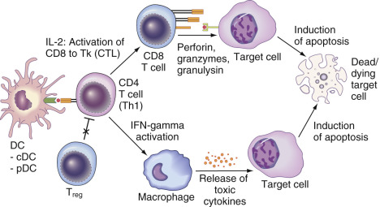

Figure 54-1 

The process of target destruction is believed to begin with dendritic cells (DC) that present peptides from beta-cell autoantigens to CD4 Th1 cells. 

DCs can be classic (conventional) DCs (cDCs) or plasmacytoid DCs (pDCs). Failure to regulate Th1 cells via defective regulatory T cell (Treg) function could contribute to Th1 cell autoimmunity. Activated self-cell autoreactive Th1 cells, in turn, activate CD8 T cells via interleukin-2 and DC upregulation. Activated CD8 T cells are functionally T killer cells (Tk; a.k.a., cytotoxic T lymphocytes [CTLs]). Via cell–cell contact between Th1 cells and macrophages (via CD40L–CD40 interactions [not shown]) and interferon-gamma (IFN-gamma) secreted by Th1 cells, macrophages are activated. Via both CD8 Tk cells and macrophages, target cells are triggered to undergo apoptosis. 

_Autoimmunity_ is a broader term than _autoimmune disease_ ( [ Fig. 54-2 ](<#f0015>) ). For example, autoantibodies directed against thyroid self-antigens such as thyroperoxidase and thyroglobulin are relatively frequent in the general population (5% or greater prevalence in adults) (  Stathatos & Daniels, 2012  ). However, only a subset of individuals with such humoral autoimmunity will manifest clinical autoimmune thyroid disease (AITD). The most common manifestation of AITD is Hashimoto thyroiditis. When agonist autoantibodies against the TSH receptor are produced, Graves disease results. 

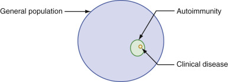

Figure 54-2 

Autoimmunity is defined as laboratory evidence of an auto-(“self”) reactive state, often identified as the detection of a serum autoantibody to self. 

Of individuals with autoimmunity, a subset will manifest a clinically evident autoimmune disease. 

Defects in innate immunity can also be harmful, causing self-injury—for example, C1 esterase inhibitor deficiency, paroxysmal nocturnal hemoglobinuria (PNH), various types of atypical hemolytic-uremic syndrome (aHUS) (e.g., inborn errors in C3, CD46, CFB, CFH, CFHR5, CFI, and THBD), and autoinflammatory diseases (e.g., familial Mediterranean fever [FMF], hyperimmunoglobulinemia D with periodic fever syndrome [HIDS], tumor necrosis factor receptor–associated periodic syndrome [TRAPS], Muckle-Wells syndrome [MWS], familial cold autoinflammatory syndrome [FCAS], and chronic infantile neurologic cutaneous articular syndrome [CINCA]) (  Rodríguez de Córdoba et al, 2014  ). While these disorders are fascinating, in this chapter we limit our discussion to defects involving adaptive immunity causing autoimmune diseases. 

An autoimmune disease may be present when one or more of the following findings are associated with the disease: evidence of humoral or cell-mediated autoimmunity (including lymphocytic infiltration of the affected tissue or organ); ability to transfer the disease with antibodies or lymphocytes; beneficial response to immunomodulatory or immunosuppressive therapy; and in the absence of immunosuppression, disease recurrence with organ transplantation. In practical terms, only autoantibody testing is sufficiently robust for routine clinical applications. Therefore, most cases of autoimmune disease are substantiated by the finding of autoantibodies that are often directed against the target organ or tissue. However, the detection of autoantibodies, by themselves, indicates a state of “autoimmunity” and not “autoimmune disease.” Through the history, physical examination, imaging studies, histologic reports (if a biopsy were performed), and laboratory findings, the physician can judge whether or not disease is present, promoting the diagnosis from “autoimmunity” to a state of “autoimmune disease” (  Lleo et al, 2010  ). 

 

##  Classification of Autoimmune Diseases 

Traditionally autoimmune diseases are classified as “organ-specific” or “non-organ-specific” (  Hayter & Cook, 2012  ). In an organ-specific autoimmune disease, a single tissue or organ is targeted. In some cases, a single circulating protein or receptor is targeted (e.g., insulin in the autoimmune hypoglycemia syndrome) (  Zhang & Zhao, 2014  ). 

One of the best examples of tissue specificity is type 1 diabetes: Within the islets of Langerhans, beta cells are selectively destroyed (  Winter et al, 2011  ). Beta cells are the most prevalent of islet cells (~65%); however, there are ample numbers of alpha cells (producing glucagon) and delta cells (producing somatostatin) and lesser numbers of PP cells (pancreatic-polypeptide producing cells). While there is some evidence of impaired alpha cell function early in the course of type 1 diabetes (  Ganda et al, 1986  ), hyperglucagonemia is a pathogenic and well-recognized feature of type 1 diabetes that contributes substantially to hyperglycemia, ketogenesis, and ketosis in diabetic ketoacidosis. Examples of organ-specific autoimmune diseases are listed in [ Box 54-1 ](<#b0010>) . Multiple organ-specific autoimmune diseases may also occur concurrently in a single patient ( [ Box 54-2 ](<#b0015>) ). 

Box 54-1 

Examples of Organ-Specific Autoimmune Diseases 

 

##  Endocrinopathies 

  * Type 1 diabetes 

  * Autoimmune hypoglycemia 

  * Acanthosis nigricans with insulin resistance (type B insulin resistance) 

  * Insulinomimetic insulin receptor autoantibodies 

  * Chronic lymphocytic (Hashimoto) thyroiditis 

  * Graves disease 

  * Atrophic thyroiditis 

  * Autoimmune Addison disease 

  * Hypophysitis 

  * Autoimmune diabetes insipidus 

  * Autoimmune hypoparathyroidism 

  * Autoimmune hypogonadism 

 

##  Hepato-Gastrointestinal Autoimmunity 

  * Celiac disease 

  * Pernicious anemia 

  * Autoimmune hepatitis 

 

##  Neurologic Disease 

  * Myasthenia gravis 

  * Eaton-Lambert myasthenic syndrome 

  * Multiple sclerosis 

 

##  Hematologic Disorders 

  * Autoimmune hemolytic anemia 

  * Immune thrombocytopenic purpura 

  * Autoimmune neutropenia 

 

##  Dermatologic Disorders 

  * Pemphigus vulgaris 

  * Discoid lupus (in the absence of other systemic disease) 

  * Autoimmune alopecia 

  * Autoimmune vitiligo 

 

##  Other Organ-Specific Disorders 

  * Membranous nephropathy due to antibodies against phospholipase A2 receptor 

  * Polymyositis 

Box 54-2 

Concurrent (Commonly Co-Existent) Organ-Specific Autoimmune Diseases 

  * Autoimmune polyglandular syndrome type I (hypoparathyroidism, mucocutaneous candidiasis, and adrenal autoantibodies or Addison disease; two or more conditions are necessary for the diagnosis) 

  * Autoimmune polyglandular syndrome type II (adrenal autoantibodies or Addison disease with AITD and/or type 1 diabetes) 

  * Thyrogastric autoimmunity (AITD and pernicious anemia) 

  * The association of type 1 diabetes with AITD and/or pernicious anemia 

  * Evans syndrome (autoimmune hemolytic anemia and immune thrombocytopenic purpura) 

Non–organ-specific autoimmune diseases are also termed _systemic_ autoimmune diseases because more than one organ and/or tissue is damaged. An older term for non–organ-specific autoimmune diseases is _collagen-vascular disease_ because many such autoimmune disorders involve joints, connect tissue, and blood vessels (e.g., vasculitis). However, the term is somewhat of a misnomer because collagen itself is not usually an autoantigen; therefore, _collagen-vascular disease_ is not the preferred descriptor. Examples of non–organ-specific autoimmune diseases are listed in [ Box 54-3 ](<#b0020>) . 

Box 54-3 

Examples of Non–Organ-Specific Autoimmune Diseases 

  * Systemic lupus erythematosus 

  * Scleroderma 

  * Sjögren syndrome 

  * Rheumatic fever 

  * Rheumatoid arthritis 

  * Goodpasteur syndrome 

  * Dermatomyositis 

  * Reactive arthritis (urethritis or cervicitis, arthritis, and conjunctivitis) 

  * Mixed connective tissue disease 

 

##  Laboratory Tests for Evaluating Autoimmunity 

Laboratory tests for evaluating autoimmunity focus on the detection of autoantibodies (  Damoiseaux et al, 2015  ). Tests of T cell autoreactivity or lymphocyte-proliferation assays are generally not sufficiently reliable for clinical use. In the setting of clinical disease, the presence of a relevant autoantibody or autoantibodies is highly suggestive that the disease is indeed autoimmune in etiology. For example, goiter and hypothyroidism combined with positivity for thyroperoxidase autoantibodies (TPOA) establish the diagnosis of Hashimoto thyroiditis. 

To detect an autoantibody, the autoantigen must be available in some form whether it is purified (e.g., thyroperoxidase) or not (e.g., thyroid microsomes) (  Fenalti & Buckle, 2010  ). The autoantigen can be present in a tissue section for indirect immunofluorescence, a cellular fraction, a purified protein or other biomolecule, or a cloned protein or a portion of a protein. Assays for autoantibody detection can be competitive or noncompetitive determinations. As an example of a competitive assay, there is now an automated assay for the detection of thyrotropin-binding inhibitory immunoglobulins (TBII). In this assay a labeled monoclonal anti–TSH-receptor antibody competes with the patient's TSH-receptor autoantibodies (TRAbs) for binding to the TSH receptor. 

A classic noncompetitive immunoassay method is indirect immunofluorescence for islet cell autoantibodies (ICA) (  Bottazzo et al, 1974  ). Patient serum is applied to a cryo-cut section of human blood group O pancreas. After incubation and washing, FITC (fluorescein-isothiocyanate)-labeled goat-antihuman IgG is applied. After washing and the application of glycerol and a coverslip, the slide is examined using an epifluorescence microscope. If the islets fluoresce, the patient's serum contains islet cell autoantibodies (ICA) that bind to islet autoantigens in the tissue that were detected by the FITC-labeled goat-antihuman IgG. ICA testing is illustrated in [ Figure 54-3 ](<#f0020>) . Cytoplasmic islet autoantigens include glutamic acid decarboxylase (GAD), the insulinoma-2-associated autoantigen, and asialoglycoconjugate (  Nayak et al, 1985  ). 

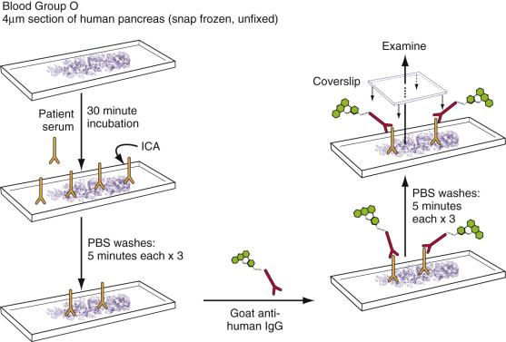

Figure 54-3 

Methodology for islet cell cytoplasmic autoantibody testing. 

See text for details. 

A wide variety of immunoassay formats are available that now often utilize nonradioactive detection of the signal. In addition to indirect immunofluorescence, classic first-generation monoplex technologies applied to autoantibody detection include Ouchternony double immunodiffusion, indirect immunofluorescence, agglutination, complement fixation, radioimmunoassay, enzyme-linked immunosorbent assay (ELISA), immuno­precipitation, and western blotting (a.k.a., immunoblotting). A recent review by  Tozzoli and colleagues (2013)  provides a well-organized summary of the second- and third-generation monoplex technologies (e.g., radioimmunoassay-immunoradiometric, radio-receptor, immunoenzymatic, immunoenzymometric, immunoblot and dot, chemiluminescence, and fluorimetric), followed by truly multiplex technologies (e.g., “addressable microbead immunoassays”). 

Bioassays require living cells such as the detection of thyroid-stimulating immunoglobulins (TSIs) (  Gupta, 1992  ;  Winter et al, 2013  ) ( [ Fig. 54-4 ](<#f0025>) ). Chemiluminescent, electrochemiluminescent, bead, and flow cytometric technologies are being applied to autoantibody detection. The latest adaptations to autoantibody detection involve matrix and solid-chip technologies theoretically testing for hundreds, if not thousands, of autoantibodies simultaneously. 

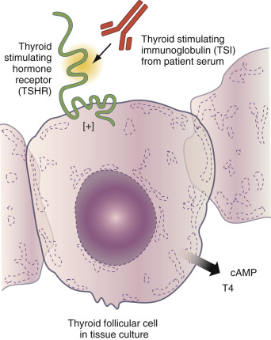

Figure 54-4 

Thyroid-stimulating immunoglobulins (TSIs) are detected by in vitro studies where patient serum is added to a thyroid follicular cell. 

The effect of the TSI is measured by the release of cAMP or T4 from the cell. 

For many diseases, especially autoimmune blistering diseases of the skin, direct and indirect immunofluorescence are key technologies. Biopsy of normal skin adjacent to a skin lesion allows examination of the tissue for in situ autoantibody and/or complement deposition. Indirect immunofluorescence using patient serum applied to normal tissues can reveal autoantibody reactivity to autoantigens. The salt-split skin technique is especially useful in autoimmune diseases affecting the skin. 

In the salt-split skin technique, the patient's skin biopsy is initially incubated in the cold in 1 M of sodium chloride for 1 day. Using forceps, the epidermis is next gently separated from the dermis. The specimens are then histologically processed using standard methods. For indirect immunofluorescence, the salt-split skin can be used as substrate. 

 

##  Interpretation of Serum Autoantibody Levels in Autoimmune Diseases 

The two questions that must be answered are “How are positive/negative cutoffs established for autoantibody assays?” and “Does the titer (i.e., concentration) of the autoantibody provide useful clinical information about the prediction, natural history, severity, prognosis, or therapy of disease?” Positive/negative cutoffs for autoantibody tests are established using criteria similar to other tests intended to diagnose disease (  Tampoia et al, 2012  ). If the analyte's concentration versus prevalence (frequency) in a population is distributed in a bell-shaped (normal) pattern (e.g., a histogram is developed), a positive (abnormal) test might be defined as the mean concentration of the autoantibody in the healthy population, plus either 2 or 3 standard deviations. If the mean plus 2 standard deviations is chosen as the cutoff, approximately 2.5% of the healthy population will test “positive.” A more stringent definition of positivity could employ the mean plus 3 standard deviations as the cutoff, where only approximately 0.15% of the healthy population should test “positive.” Furthermore, to ensure fewer “false positives” (at the expense of less sensitivity), some researchers have set autoantibody cutoffs as high as the mean plus 4 or 5 standard deviations. Because sensitivity and specificity are always at odds with one another in choosing a positive/negative cutoff, the best approach to defining a cutoff is to construct a receiver-operator characteristic (ROC) curve (see [ Chapter 7 ](<##!/content/3-s2.0-B9780323295680000073?scrollTo=%23c00007>) ). 

For distributions of results in a healthy population that do not follow a bell-shaped (normal) distribution, large numbers of healthy controls need to be tested to define the desired cutoff—that is, the 97.5th percentile (e.g., the upper limit of the central 95% of the distribution) or the 99.85th percentile (e.g., the upper limit of the central 99.7% of the distribution). In such cases, defining the 97.5th percentile in a healthy population likely requires study of 200 or more health controls. Defining the 99.85th percentile in a healthy population whose results are not normally distributed is likely beyond the ability (or finances) of any laboratory except, possibly, major reference laboratories. 

The answer to the second question—“Does the titer (i.e., concentration) of the autoantibody provide useful clinical information about the natural history, prognosis, severity, or therapy of disease?”—is solely dependent on the specific autoimmune disease and autoantibody under discussion. For example, in Graves disease patients, the titer of TSIs is inversely correlated with the likelihood of remission following pharmacologic antithyroid therapy (e.g., the likelihood of remission following propylthiouracil [PTU] or methamizole [MM] treatment) (  Cappelli et al, 2007  ). Also, the titer of TSIs in maternal Graves disease correlates directly with the likelihood of neonatal Graves disease in the newborn (  Barbesino & Tomer, 2013  ). In nondiabetic individuals with ICA, higher ICA titers do predict an increased risk for the subsequent development of type 1 diabetes (  Orban et al, 2009  ). This is also true for GADA. In latent autoimmune diabetes of adulthood (LADA—a late-onset form of type 1 diabetes), higher glutamic acid decarboxylase autoantibody (GADA) levels predict the need for earlier insulin treatment, which is beneficial (  Rosário et al, 2007  ). Rarely, the autoantibody concentration provides information differentiating two diseases. In typical cases of type 1 diabetes, the GADA titer is only mildly to modestly elevated above the cutoff. However in type 1 diabetes that is part of stiff-person syndrome, the GADA titer is much higher (  Dayalu & Teener, 2012  ). 

As opposed to autoantibody concentrations near the cutoff value, higher concentrations of an autoantibody ensure that the autoantibody is truly present. Also, when studying an antibody that can be induced by an environmental exposure (such as insulin), the assay specificity should be considered. For example, the insulin autoantibody (IAA) assay does not discriminate autoantibodies from antibodies against exogenous insulin (  Fineberg et al, 2007  ). Exogenous-insulin-induced antibodies are typically in much higher concentration than spontaneous IAAs that predict type 1 diabetes. Thus if the patient has been exposed to insulin for more than 14 days with the development of insulin antibodies, IAA should not be determined as an index of islet autoimmunity. 

As opposed to these examples where the autoantibody concentration influences the prediction, clinical course, or therapy of the disease, in other circumstances the degree of autoantibody positivity appears to be irrelevant. For example, it is highly controversial whether the persistence of GADA after diagnosis relates to beta-cell function following the diagnosis of type 1 diabetes (  Jaeger et al, 1997  ). Whereas generalizations are subject to many exceptions, in most autoimmune diseases, the detection of an autoantibody is more important than the concentration of the autoantibody when that concentration is above the threshold of positivity. Consistent results require strict attention to the principles of quality assurance and quality control. 

 

##  Recent Advances in Diagnostic Technologies 

In order to investigate autoimmune diseases, both in the clinical setting as well as for research purposes, the ability to analyze biological samples for a myriad of potential autoantibodies, autoantigens, and other biomarkers represents a significant advance. The diagnostics revolution in developing new autoantibody immunoassays also involves the identification of new autoantigens in each of the autoimmune diseases discussed in this chapter. To address this “explosion” of technologies, several promising developments are briefly discussed here (  Tozzoli et al, 2013  ;  Burbelo & O'Hanlon, 2014  ). New assays for the detection of autoantibodies have taken advantage of microfluidics, chip, bead, mass spectroscopy, optical, and flow cytometry technologies (  Blixt et al, 2008  ;  Brennan et al, 2010  ). Candidate autoantigens can be identified by western blotting, two-dimensional electrophoresis, mass spectroscopy, automated immunoprecipitation of cell or tissue extracts with sera from affected individuals, and proteomic approaches (  Ehrlich et al, 2006  ;  Wenzlau & Hutton, 2013  ). Traditional noncompetitive or “sandwich” immunoassays detect a single analyte; assays that detect multiple analytes (antigens or antibodies) in a single reaction are termed _multiplex assays_ . 

The two formats for this type of analysis are planar assays and suspension microsphere assays (  Ellington et al, 2010  ;  Tighe et al, 2015  ). One useful “low automated” (  Tozzoli et al, 2013  ) format for the planer assay is the line-blot assay (  Hoffman et al, 2002  ;  Gonzalez-Buitrago, 2006  ). Here, multiple antigens are immobilized in straight lines on a nylon test strip. The test strip is then incubated with the patient specimen, allowing the autoantibodies to recognize the immobilized antigens. An alkaline phosphatase labeled anti-IgG antibody is added in order to identify the autoantibody-antigen complex. Confocal laser scanning of strips is an effective means of detection. In “high automated” (  Tozzoli et al, 2013  ) microarray planar assays, the capture autoantibody (or autoantigen) is fixed to a discrete spot on a glass slide (  Yeste & Quintana, 2013  ). By testing for autoantibodies to tens, if not hundreds, of autoantigens, “serum autoantibody signatures” can be identified (  Veronika Sharp & Utz, 2007  ;  Quintana et al, 2008  ) or within a single well of a microwell plate (  Ellington et al, 2010  ;  Tighe et al, 2015  ). In the case of the latter, multiple distinct capture autoantibodies may be fixed to a single well. The plasma or serum specimen is added to the slide or well. After incubation, the slide or well is then washed, and a labeled detection antibody is added. Electrochemiluminescence, chemiluminescence, and fluorescence are common labels (  Miao et al, 2013  ;  Yu et al, 2013  ), and each unique reaction is identified by its very specific location. Hundreds, if not thousands, of potential purified autoantigens can be interrogated by the application of patient and control sera separately or in competition with one another. 

In the microsphere assay, autoantibodies or autoantigens are linked to very small microspheres that measure a few microns in diameter and are therefore cellular in scale. An autoantibody-microsphere unit is distinguished either by its size or by the color of light emitted. After reaction with the autoantigen is complete, the spheres can be sorted according to size or color using flow cytometry. 

The luciferase immunoprecipitation system (LIPS) is a versatile technique that has been adapted to autoantibody identification (  Burbelo et al, 2011  ;  Donelan et al, 2013  ). Autoantigens are expressed in COS1 cells as recombinant luciferase-autoantigen fusion proteins. These are reacted with the test sera; if the latter contains autoantibodies to the autoantigen, the immunoglobulins will complex with the fusion protein. Protein A/G beads are used to capture IgG molecules that have bound the luciferase-autoantigen. Addition of a luciferase substrate generates a light signal that permits autoantibody quantitation (  Maat et al, 2013  ;  Fhied et al, 2014  ;  Porcelijn et al, 2014  ). 

A completely different technique for analyzing biomarkers is a form of mass spectroscopy called multiple reaction monitoring (MRM). This technology (  Fu et al, 2010  ;  Parker et al, 2014  ) has been adapted to the analysis of proteins in plasma. MRM is especially useful in quantifying specific proteins within highly complex biological mixtures. In this procedure, three quadrupole mass spectrometers are linked in tandem. The first quadrupole mass spectrometer selects the precursor ion of interest. Fragmentation occurs in the second quadrupole mass spectrometer, usually by collision with a neutral gas. The third quadrupole mass spectrometer then analyzes the fragments. Stable isotope (  13  C or  15  N)–labeled internal standard peptides are the key to quantification. 

Phage immunoprecipitation sequencing (PhIP seq) uses the T7 bacteriophage, which is designed to express over 400,000 overlapping peptides of all known human protein sequences (  Larman et al, 2011  ). The engineered phage is called a T7 peptidome phage display library (“T7-Pep”). The T7-Pep library is mixed with patient samples (e.g., cerebrospinal fluid). Autoantibodies present in the biological specimen will bind to the phage-expressed protein. These antibodies and bound phage are captured on a solid phase system. In this way, DNA from the immunoprecipitated phage can be isolated and sequenced, permitting identification of the autoantigen to which the autoantibody binds. 

 

##  Autoantibodies as Predictors of Disease 

The answer to the question “Can autoantibodies predict disease?” is dependent on the specific disease under review. In the proper circumstances, the detection of an autoantibody can predict the subsequent development of disease (  Coco et al, 2006  ). This is most evident in the current research effort to prevent type 1 diabetes (  Sosenko et al, 2015  ). In persons with multiple islet autoantibodies (e.g., ≥3), there is conservatively more than a 50% of risk of developing type 1 diabetes over the span of 5 to 10 years of follow-up. If there is evidence of beta-cell dysfunction with even one islet autoantibody (e.g., ICA), the 10-year risk for type 1 diabetes approaches 100%. 

There are many other autoimmune diseases where autoantibody positivity predicts disease (  Vojdani, 2008  ). This has been extensively studied in the organ-specific endocrinopathies of AITD and Addison disease developing in persons with type 1 diabetes who are positive, respectively, for thyroid autoantibodies (e.g., TPOA) or adrenal cytoplasmic autoantibodies (ACA) (  Ketchum et al, 1984  ;  Maclaren & Riley, 1985  ). Likewise, gastric parietal cell autoantibodies in persons with type 1 diabetes predict the development of pernicious anemia (  Riley et al, 1982  ). 

If autoantibodies can predict certain diseases, is it prudent that we screen the general population for various organ-specific autoantibodies? The answer to this question is complex. The answer depends on the following factors: 

  * 1.

Can the disease be prevented, or does early detection of disease only allow earlier treatment of disease? 

  * 2.

How common is the autoimmune disease? 

  * 3.

What is the cost of treatment versus the cost of screening? 

  * 4.

Does screening actually change outcome? 

  * 5.

What is the morbid burden to the individual and society of delayed diagnosis? 

Considering these issues, there are few circumstances where screening for autoimmune diseases should be undertaken in the absence of a preexisting autoimmune disease or a family history of autoimmune disease. 

In the case of type 1 diabetes, because of the high prevalence of associated AITD, pernicious anemia, and Addison disease (which if untreated can be rapidly fatal), it is recommended that persons with type 1 diabetes be screened for thyroid autoimmunity with TPOA testing, chronic lymphocytic gastritis (the most common cause of pernicious anemia) with gastric parietal cell autoantibodies (PCA), and adrenal autoimmunity with adrenocortical cytoplasmic autoantibodies (ACA) or 21-hydroxylase autoantibodies (  Maclaren & Riley, 1985  ). If a person is autoantibody positive, periodic testing would follow: In TPOA-positive individuals, TSH is measured yearly; in PCA-positive individuals, vitamin B  12  and ferritin are measured yearly; and in ACA-positive individuals, yearly cosyntropin stimulation testing is performed together with supine renin measurements (  Haller et al, 2014  ). The prediction of Addison disease is likely the most important screening to be undertaken because Addisonian crisis can be fatal. 

Because some autoimmune diseases are strongly familial, it may be beneficial to perform autoantibody screening in first-degree relatives of affected individuals. The best example of this situation is thyrogastric autoimmunity. AITD is strongly familial and is common. Although no single gene causes AITD, it appears to be inherited in a dominant fashion. If the proband has Hashimoto thyroiditis or Graves disease, their first-degree relatives can be screened for TPOA to anticipate AITD. TPOA-positive relatives would then have yearly thyroid function testing including, at a minimum, the measurement of TSH. Gastric autoimmunity (e.g., PCA and pernicious anemia) is commonly associated with AITD, so PCA testing is worthwhile to pursue. If the person is PCA positive, vitamin B  12  and ferritin are measured yearly. 

,  

##  Cutaneous Autoimmune Diseases 

Immunofluorescence testing is an important supplement to light microscopy in the diagnosis of immunobullous disease, connective tissue disease, and vasculitis. These autoimmune skin diseases will show certain patterns of immune complex deposition at various locations within the skin on direct immunofluorescence (DIF) examination, which can aid in the diagnosis of specific conditions ( [ Box 54-4 ](<#b0025>) ). This is especially true for the autoimmune bullous disorders, where immunofluorescence is still considered the gold standard for diagnosis. The definitive differentiation of the autoimmune skin diseases is becoming more important for prognosis and treatment decisions. 

Box 54-4 

Location of Immunofluorescence Findings in Autoimmune Skin Diseases 

Pattern of Deposition 

 

##  Intraepidermal (Intercellular) 

  * Pemphigus vulgaris 

  * Pemphigus foliaceus 

  * Paraneoplastic pemphigus 

  * IgA pemphigus 

 

##  Dermal-Epidermal Junction (Basement Membrane Zone) 

  * Bullous pemphigoid 

  * Mucous membrane pemphigoid 

  * Pemphigoid gestationis 

  * Epidermolysis bullosa aquisita 

  * Bullous lupus erythematosus 

  * Linear IgA dermatosis 

  * Lupus erythematosus 

 

##  Dermal Papillae Disease 

  * Dermatitis herpetiformis 

 

##  Intravascular 

  * Vasculitis 

Autoimmune bullous disorders represent a heterogeneous group of blistering diseases of the skin and mucous membranes that are characterized by autoantibodies to structural components in the skin ( [ Table 54-1 ](<#t0010>) ). Classification of the blister location as intraepidermal or subepidermal divides the immunobullous disorders into the pemphigus and pemphigoid group, respectively. The pemphigus group is associated with antibodies against epidermal desmosomal proteins and intercellular deposits between keratinocytes, while the detection of immune deposits at the basement membrane zone (BMZ) is characteristic of the pemphigoid group. Because there can be considerable overlap in the clinical and histologic features of these blistering disorders, accurate diagnosis of an autoimmune bullous disease requires the detection of tissue-bound and circulating autoantibodies. Knowledge of appropriate biopsy locations is also necessary for correct interpretation of immunofluorescence results. For blistering disorders, punch biopsy should be taken from nonblistered perilesional skin. 

TABLE 54-1 

Immunopathologic Features and Target Antigens of Autoimmune Bullous Diseases 

Diagnosis  |  Blister Site/Ultrastructural Location  |  Autoantigen  |  DIF  |  IIF   
---|---|---|---|---  
**Intraepidermal**  
Pemphigus vulgaris  |  Suprabasal  |  Dsg 3, Dsg 1  |  Intercellular IgG and C3  |  Intercellular IgG (monkey esophagus)   
Pemphigus foliaceus  |  Subcorneal or within granular layer  |  Dsg 1  |  Intercellular IgG and C3  |  Intercellular IgG (guinea pig esophagus or lip)   
Paraneoplastic pemphigus  |  Suprabasal  |  Dsg 3, Dsg 1, plakin family (desmoplakin 1 and 2, envoplakin, periplakin, BP230, plectin, A2ML1)  |  Intercellular IgG +/− C3 and at DEJ  |  Intercellular IgG (rat bladder)   
IgA pemphigus  |  Subcorneal  |  Desmocollin 1, Dsg 3  |  Intercellular IgA  |  Intercellular IgA   
**Subepidermal**  
Bullous pemphigoid  |  Hemidesmosome  |  BP180, BP230  |  Linear IgG and C3 at BMZ  |  IgG at BMZ   
SS: epidermal   
Pemphigoid gestationis  |  Hemidesmosome  |  BP180, BP230  |  Linear C3 at BMZ  |   
Mucous membrane pemphigoid  |  Lamina lucida  |  BP180, laminin 332, α6β4 integrin, laminin 311, BP230  |  Linear IgG, C3, and IgA at BMZ  |  IgG at BMZ   
SS: epidermal or mixed   
SS: dermal (laminin 332   
Epidermolysis bullosa acquisita  |  Anchoring fibrils  |  Type VII collagen  |  Linear IgG and C3 at BMZ, +/− IgA and IgM  |  IgG at BMZ   
SS: dermal   
Linear IgA dermatosis  |  Lamina lucida  |  LAD-1  |  Linear IgA at BMZ, +/− C3  |  IgA at BMZ   
SS: epidermal, dermal or mixed   
Dermatitis herpetiformis  |  Papillary dermis  |  Epidermal transglutaminase  |  Granular IgA at tips of dermal papillae, +/− C3  |  IgA endomysial antibody (monkey esophagus)   
  
_DIF,_ Direct immunofluorescence; _IIF,_ indirect immunofluorescence; _Dsg,_ desmoglein; _BP,_ bullous pemphigoid; _A2ML1,_ α2-macroglobulin-like 1; _DEJ,_ dermoepidermal junction; _LAD-1,_ linear IgA disease antigen 1; _BMZ,_ basement membrane zone. 

+/–, with or without. 

_SS,_ Salt-split skin. 

 

##  Pemphigus 

Pemphigus describes a rare group of potentially life-threatening, mucocutaneous blistering diseases characterized by the production of antibodies to epidermal adhesion molecules, resulting in loss of cellular cohesion between keratinocytes (acantholysis) and intraepidermal bullae formation (  Kershenovich, 2014  ). This intraepidermal acantholysis is considered the histologic hallmark of the pemphigus group and is responsible for the clinical presentation of flaccid blisters and erosions (  Schmidt, 2010  ). Through the direct interference in desmosomal function, pathogenic autoantibodies to desmoglein 3 and/or desmoglein 1 on epidermal keratinocytes play an active role in disease activity (  Kershenovich, 2014  ). Three major variants have been described in this group and include pemphigus vulgaris, pemphigus foliaceus, and paraneoplastic pemphigus. Review of their clinical, histopathological, and immunopathological findings may provide differentiating features that are helpful in the diagnosis of the pemphigus subtype (  Joly, 2011  ;  Kershenovich, 2014  ). 

 

##  Pemphigus Vulgaris 

Pemphigus vulgaris (PV) is the most common variant of pemphigus. The mean age of disease onset is between 40 and 60 years of age, with no gender bias (  Nancy, 2009  ;  Joly, 2011  ). Desmogleins 1 and 3 (Dsg1, Dsg3) are the target autoantigens for circulating IgG autoantibodies in this disease. Because of differences in the expression of the desmogleins in cutaneous and mucosal epithelium, patients may present with one of two clinical variants. For example, an anti-Dsg3 immune profile will present with mucosal-dominant disease, but the presence of antibodies to both Dsg1 and 3 will result in the mucocutaneous phenotype (  Amagai, 1999  ). 

Patients with PV often present with painful oral mucosal lesions as their first manifestation of disease, and it is the most frequent site of involvement. Skin involvement classically consists of flaccid bullae that rupture easily and multiple painful erosions. Skin lesions may present on any part of the body, but the scalp, head, neck, and flexural surfaces are more favored sites. There is a positive Nikolsky sign in perilesional skin in both PV and pemphigus foliaceus. In the Nikolsky sign, when the skin is slightly rubbed, the top layers of skin slip apart from the lower layers. Five percent to 10% of PV cases are fatal, and morbidity/mortality is related to the extent of disease and the complications from immunosuppressive treatment (  Joly, 2011  ). 

 

##  Histologic and Immunologic Features 

The intraepidermal acantholysis that characterizes the histology of the pemphigus group of blistering disorders is found in a classic suprabasalar location. Cleavage above the basal layer keratinocytes has been said to resemble a “row of tombstones” sitting on the basement membrane. 

Direct immunofluorescence (DIF) evaluation reveals an intercellular pattern of IgG deposition and C3 characteristics of all types of pemphigus, with the exception of IgA pemphigus ( [ Fig. 54-5 ](<#f0030>) ). Examination of perilesional skin in PV reveals linear and granular staining. This pattern may be described as “chicken wire” because of the hexagonal mesh outline created by the continuous deposition around individual keratinocytes ( [ Fig. 54-6 ](<#f0035>) ). Increased intensity of the staining pattern may be seen at the level of blister formation within the affected skin—that is, lower epidermal for PV and superficial layers for pemphigus foliaceus (  Chhabra, 2012  ). The basement membrane zone does not stain in PV patients. Essentially, all patients with PV display IgG staining, whereas complement staining varies between 50% and 100% of cases. IgM or IgA staining is observed in 30% to 50% of cases of pemphigus. 

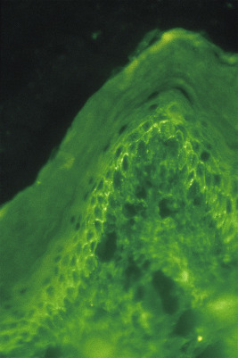

Figure 54-5 

Direct immunofluorescence microscopy of skin lesions in pemphigus shows linear/granular C3 deposition on the cell surfaces (intercellular spaces) of mainly basal keratinocytes without basement membrane zone (BMZ) immunofluorescence (×400). 

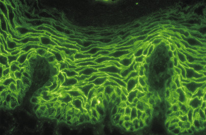

Figure 54-6 

Indirect immunofluorescence microscopy in pemphigus shows linear immunoglobulin (IgG) immunofluorescence on the cell surfaces of epithelial cells (intercellular spaces) using mouse esophagus as tissue substrate (×250). 

Circulating IgG autoantibodies are detected on the surfaces of the squamous epithelial cells by indirect immunofluorescence (IIF). For all investigations by IIF, the appropriate choice of tissue substrate is important because different substrates exhibit different autoantigens (  Kershenovich, 2014  ). Monkey esophagus is the tissue of choice when testing for PV. On the other hand, guinea pig esophagus is the tissue of choice in cases of pemphigus foliaceus. Reference laboratories offer tests such as “Cutaneous Immunofluorescence Antibodies (IgG), Serum” (see [ http://www.mayomedicallaboratories.com/test-catalog/Overview/8052 ](<http://www.mayomedicallaboratories.com/test-catalog/Overview/8052>) ). 

Reference laboratories provide ELISA-based testing for anti–desmoglein 1 and anti–desmoglein 3 autoantibodies. One reference laboratory provides a helpful interpretive summary of skin immunofluorescence testing (see [ http://www.mayomedicallaboratories.com/test-catalog/Overview/83680 ](<http://www.mayomedicallaboratories.com/test-catalog/Overview/83680>) ). 

 

##  Pemphigus Foliaceus 

Pemphigus foliaceus (PF) is characterized clinically by small and superficial flaccid blisters that immediately rupture, evolving into crusted erosions found in a seborrheic distribution (upper torso, scalp, and face). In contrast to PV, there is no mucosal involvement. Antibodies to Dsg1 are responsible for the findings in PF. Although PF is considered to have a less severe clinical course, the eruption still requires treatment with prolonged systemic immunosuppressive therapies (  Joly, 2011  ). The serologic hallmark of PF is the demonstration of IgG autoantibodies against Dsg1, and serum levels have been found to correlate with disease severity (  Ishii, 2015  ). Fogo selvagem (endemic pemphigus) and pemphigus erythematosus (Senear-Usher syndrome) are two distinct clinical variants within PF. 

 

##  Histologic and Immunologic Features 

Compared to PV, the epidermal split in foliaceus lesions is found in the most superficial layers of the epidermis. Acantholysis can be found within the granular layer or in a subcorneal location and may result in loss of the stratum corneum. The differences in intraepidermal blister location correlate with the differences in desmoglein expression within the skin between the pemphigus subtypes. Eosinophilic spongiosis has been reported in some cases of PF. _Spongiosis_ is the descriptive term for increased intercellular fluid in the epidermis (e.g., intercellular edema) that separates keratinocytes from one another, highlighting their desmosomal connections. 

Direct immunofluorescence (DIF) of biopsy tissue will show the same intercellular pattern of fluorescence as described in PV. Guinea pig esophagus is recommended as the most sensitive IIF substrate, and testing should detect circulating IgG autoantibodies to the epithelial cell surface in 90% of specimens (  Arbache, 2014  ). In addition, serologic titers reported in PV and PF may correlate with disease activity and treatment response (  Mutasim, 2001  ). 

 

##  Paraneoplastic Pemphigus 

Paraneoplastic pemphigus (PNP) is a unique form of pemphigus that is characterized by a refractory stomatitis and an association with an underlying malignancy. Non-Hodgkin lymphoma, chronic lymphocytic leukemia, Castleman disease, and thymoma are the most commonly reported neoplasms (  Vassileva, 2014  ). In addition to painful mucosal erosions, a polymorphic skin eruption and internal organ involvement are possible (  Hertl, 2014  ). The prognosis of the mucocutaneous disease is linked to the presence of the associated neoplasm. In addition to the clinical distinctions from classic pemphigus, the autoantibody profile is more diverse and includes antibodies to the desmogleins and plakin family proteins (i.e., envoplakin, periplakin, plectin, desmoplakin 1 and 2) (  Schmidt, 2010  ). 

 

##  Histologic and Immunologic Features 

The histopathologic features in PNP combine the acantholysis characteristic of pemphigus with changes of interface dermatitis with necrotic keratinocytes. Antibodies in PNP are directed against both desmosomal and hemidesmosomal proteins and explain why DIF shows immunoreactivity within the epidermis and at the BMZ. BMZ deposition of IgG and complement can be found in a linear or granular pattern along the dermoepidermal junction. If the histologic features and DIF findings suggest the diagnosis of PNP, IIF studies should be pursued. IIF testing using rat bladder epithelium is considered the best screening test for PNP (  Mutasim, 2001  ). Additional laboratory tests such as immunoprecipitation, immunoblotting, and enzyme-linked immunosorbant assay (ELISA) are helpful in confirming the diagnosis after initial workup. 

 

##  IgA Pemphigus 

The hallmark of IgA pemphigus is the intercellular deposition of IgA as the target antigen is present in desmosomes. Neutrophil infiltration follows the presence of tissue-bound IgA and results in epidermal acantholysis and vesiculation (  Zone, 2004  ). 

 

##  Histologic and Immunologic Features 

Subcorneal acantholysis with intraepithelial neutrophilic collections characterize IgA pemphigus histopathology. DIF will show that intercellular IgA deposits are present within the epidermis in a typical pemphigus pattern. Positive IIF for circulating IgA is found in 50% of patients (  Mutasim, 2001  ). 

 

##  Pemphigoid 

The pemphigoid group of autoimmune bullous disorders is characterized by subepidermal blister formation due to the loss of adhesion between the basal layer keratinocytes and the underlying basement membrane. Autoantibodies are directed at one or more structural proteins found in the hemidesmosome, lamina lucida, lamina densa, or anchoring fibrils that make up the BMZ. This group of disorders includes bullous pemphigoid, pemphigoid gestationis, mucous membrane pemphigoid, and linear IgA dermatosis. 

In addition to the pemphigoid group, epidermolysis bullosa acquisita and dermatitis herpetiformis are other immunobullous disorders that share the histologic hallmark of subepidermal blister formation. Because of clinical and histologic overlap among these disorders, immunofluorescence studies can play a critical role in the distinction among disorders (see [ Table 54-1 ](<#t0010>) ). The salt-split skin technique is an additional test that can be used in the evaluation of the subepidermal blistering disorders to increase the sensitivity of antibody detection and gain further information on the autoantibody binding site (  Mutasim, 2001  ;  Aoki, 2010  ). 

 

##  Bullous Pemphigoid 

Bullous pemphigoid (BP) is the most common type of autoimmune bullous disorder, and it occurs most frequently in the elderly. Clinically, BP patients present with urticarial lesions and tense blisters on the trunk and extremities, with associated pruritus. Mucosal involvement is uncommon and is reported in 10% to 30% of BP patients (  Baum, 2014  ). The Nikolsky sign is negative in BP. 

In BP, autoantibodies target the two hemidesmosomal proteins: bullous pemphigoid antigen 1 (BPAg1 [BP230]) and bullous pemphigoid antigen 2 (BPAg2 [BP180]). BPAg2, also known as type XVII collagen, is a transmembrane protein that is determined to be the target autoantigen for pathogenic autoantibodies in BP (  Vassileva, 2014  ). In it is unclear if autoantibodies to BPAg1, a cytoplasmic plakin family protein, relate to the pathogenesis of BP (  Schmidt, 2010  ). Complement activation is believed to follow autoantibody binding, causing the physical loss of adhesion between the basal cell layer and the basement membrane (  Kershenovich, 2014  ). 

 

##  Histologic and Immunologic Features 

A subepidermal blister with a superficial dermal inflammatory infiltrate, including numerous eosinophils, describes the typical histopathological findings in bullous lesions of BP ( [ Fig. 54-7, _A_ ](<#f0040>) ). Eosinophilic spongiosis may serve as a clue in early lesions (  Baum, 2014  ). Neutrophil predominant and cell-poor variants also exist and may pose a diagnostic challenge. 

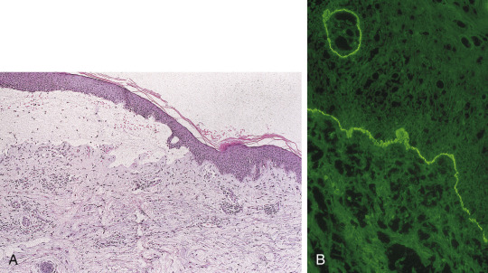

Figure 54-7 

**A,** Skin biopsy of pemphigoid reveals a subepidermal split, nonnecrotic epidermis, and variable inflammation, often with prominent eosinophils (hematoxylin and eosin [H&E], ×100). **B,** Direct immunofluorescence microscopy reveals intense linear C3 deposition along the basement membrane zone (BMZ) (×400). 

Direct immunofluorescence (DIF) of perilesional skin reveals linear IgG and/or C3 deposition at the BMZ in BP, pemphigoid gestationis, and mucous membrane pemphioid ( [ Fig. 54-7, _B_ ](<#f0040>) ). The finding of C3 deposition with a stronger intensity than IgG favors a pemphigoid group disease (  Mutasim, 2001  ). Complement may sometimes be found as the sole immunoreactant in BP, but more often in pemphigoid gestationis. IgA and/or IgM staining can also be present but will stain with less intensity. IIF shows circulating IgG anti-BMZ autoantibodies in 75% of patients (  Mutasim, 2001  ). 

Serum IgG autoantibodies to BPAg1 and BPAg2 can be detected using ELISA testing. The sensitivity of ELISA BPAg1 autoantibodies in cases of bullous pemphigoid is approximately 60%, and the sensitivity of ELISA BPAg2 autoantibodies for bullous pemphigoid is approximately 80% (  Roussel et al, 2011  ). 

 

##  Pemphigoid Gestationis 

Pemphigoid gestationis (PG), previously known as herpes gestationis, is considered to be a form of BP that develops during pregnancy. PG usually develops in the second or third trimester and typically resolves within weeks to months after delivery. Because this is a humoral autoimmune disease, the newborn can be transiently affected through passive maternal transfer of IgG autoantibodies (  Mihai, 2007  ). 

 

##  Histologic and Immunologic Features 

Linear deposits of C3 are present in 100% of PG patients with IgG deposits found less frequently in 30% to 40% of cases. IIF detects anti-BMZ autoantibodies in only 10% to 20% of patients (  Aoki, 2010  ). 

 

##  Mucous Membrane Pemphigoid 

Mucous membrane pemphigoid (MMP), also known as cicatricial pemphigoid, is a rare, chronic variant of pemphigoid characterized by predominant mucous membrane disease. Erosions, blisters, and scarring may involve oral, conjunctival, nasal, laryngeal, esophageal, and anogenital mucosa. Lesions often heal with scarring, which can interfere with the normal function of the affected area, producing significant morbidity. For example, ocular cicatricial pemphigoid presents with progressive subconjunctival scarring that leads to decreased vision and eventual blindness (  Chan, 2012  ). 

Several target autoantigens have been identified with the recognition of a few clinically important variants. MMP with autoantibodies against laminin 332 is clinically indistinguishable from other forms of MMP but is associated with an increased risk of internal malignancy (  Vassileva, 2014  ). 

 

##  Histologic and Immunologic Features 

Perilesional skin and mucosal biopsies reveal continuous IgG and C3 deposits, with occasional IgA present along the basement membrane by DIF. IIF studies are usually negative. Because the numerous target autoantigens in MMP vary in their location within the BMZ, the site of autoantibody binding on salt-split skin microscopic exam may be epidermal, dermal, or both. IIF salt-split skin studies do increase the sensitivity of detection and can be positive in approximately 80% of cases of MMP. 

 

##  Linear IgA Dermatosis 

Linear IgA dermatosis (LAD) is a rare subepidermal blistering disease due to IgA autoantibodies directed at autoantigens in the BMZ. Activated complement and neutrophil infiltration result in the disruption of the dermoepidermal attachments and blister formation. The clinical lesions of LAD can be polymorphic, but annular patterns of tense vesicles or blisters are classically described. Most cases of LAD are considered idiopathic, but drug-induced cases are reported. Chronic bullous dermatosis of childhood is considered a childhood form of linear IgA dermatosis. 

  

##  Histologic and Immunologic Features 

The strong presence of IgA linear deposition along the BMZ is characteristic of LAD (  Mutasim, 2001  ). These features help separate it from the DIF findings in dermatitis herpetiformis. In addition, only LAD shows lgA anti-BMZ autoantibodies by IIF examination (  Chhabra, 2012  ). 

 

##  Epidermolysis Bullosa Acquisita 

Epidermolysis bullosa acquisita (EBA) is a rare subepidermal blistering disorder characterized by autoantibodies against type VII collagen, the anchoring fibrils of the BMZ. EBA is a clinically heterogeneous disease and presents with inflammatory and noninflammatory forms. The noninflammatory form manifests as a mechanobullous disorder that is characterized by skin fragility, trauma-induced lesions, and scarring (  Vassileva, 2014  ). The inflammatory forms can mimic BP or LAD with a more widespread blistering eruption or present with blisters and scarring of mucous membranes similar to MMP (  Mihai, 2007  ). EBA has been associated with several systemic diseases, with inflammatory bowel disease being most frequent (  Vassileva, 2014  ). 

Bullous lupus erythematosus is an autoimmune bullous disease that occurs in patients diagnosed with systemic lupus erythematosus ( [ Fig. 54-8 ](<#f0045>) ). It is also due to autoantibodies against type VII collagen. The immunofluorescence findings can be similar to EBA. 

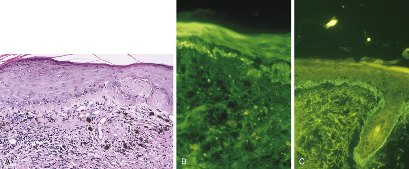

Figure 54-8 

**A,** Skin biopsy of lupus erythematosus reveals epidermal atrophy, vacuolar alternation of basal keratinocytes, marked thickening of the basement membrane zone, perivascular and interstitial mainly lymphocytic inflammation, and melanin incontinence (hematoxylin and eosin [H&E], ×500). **B,** Direct immunofluorescence microscopy reveals continuous granular C3 immunofluorescence along the basement membrane zone (BMZ) (×500). **C,** Direct immunofluorescence microscopy reveals continuous granular C1q along the basement membrane zone (BMZ) (×500). 

  

##  Histologic and Immunologic Features 

The presence of multiple types of immunoglobulin at the BMZ is typical of EBA. IgG and C3 are typically present. IgA and IgM are found in 67% and 50% of cases, respectively (  Aoki, 2010  ). IIF demonstrates anti-BMZ IgG autoantibodies in a pattern similar to BP. The salt-split skin technique is useful in this situation because it enhances the differentiation of these disorders through the localization of fluorescence. The serum of BP patients shows autoantibody binding to the roof of the blister (epidermal side), and EBA sera will show binding to the blister floor (dermal side). This is based on the localization of the autoantigens responsible for the related disease. 

 

##  Dermatitis Herpetiformis 

Dermatitis herpetiformis (DH) is an intensely pruritic and chronic blistering disorder associated with gluten-sensitive enteropathy (e.g., celiac disease). Patients present with papulovesicules and excoriations on the extensor surfaces, typically in a symmetric distribution. The lesions can be found in groups or clusters giving a “herpetiform” appearance—hence the name. Gastrointestinal involvement will manifest as symptoms of malabsorption, but gastrointestinal involvement is present in only approximately 20% of DH patients (  Mendes, 2013  ). Symptoms of DH and celiac disease will improve with a gluten-free diet. IgA autoantibodies directed against tissue epidermal transglutaminase (eTG) are thought to play a more central role in the pathogenesis of skin disease in patients with DH (  Rose, 2009  ;  Ishii, 2015  ). 

  

##  Histologic and Immunologic Features 

Biopsies should be performed on perilesional normal-appearing skin. Typical histopathologic features include the formation of neutrophilic microabscesses at the tips of dermal papillae and a mixed perivascular inflammatory infiltrate including few eosinophils (  Mihai, 2007  ) ( [ Fig. 54-9, _A_ ](<#f0050>) ). As lesions progress, a subepidermal blister may form. The histologic findings of DH may be indistinguishable from linear IgA disease. 

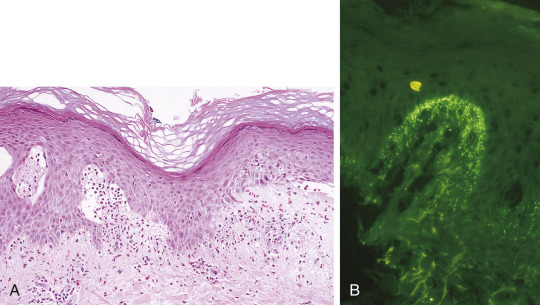

Figure 54-9 

**A,** Skin biopsy of dermatitis herpetiformis reveals a subepidermal split, nonnecrotic epidermis, and neutrophilic microabscesses in the tips of the dermal papillae (hematoxylin and eosin [H&E], ×200). **B,** Direct immunofluorescence microscopy reveals granular immunoglobulin (Ig) A immunofluorescence in the tips of the dermal papillae and, to a lesser extent, along the basement membrane region (×400). 

The diagnosis of DH requires DIF examination of a skin biopsy, revealing granular IgA deposition in the dermal papilla (  Mutasim, 2001  ) ( [ Fig. 54-9, _B_ ](<#f0050>) ). Other findings may include IgA deposits along the BMZ and the presence of C3 deposits (  Arbache, 2014  ). Contrary to the other subepidermal immunobullous disorders, DH patients do not have circulating anti-BMZ autoantibodies. However, serum IgA autoantibodies directed against endomysium, gliadin, tTG (tissue transglutaminase), and eTG (epidermal transglutaminase) can be detected (  Mutasim, 2001  ;  Schmidt, 2010  ). IIF can be used to detect antiendomysial autoantibodies when monkey esophagus is used (  Arbache, 2014  ) ( [ Fig. 54-10 ](<#f0055>) ). Presently, ELISA is the preferred method for serologic investigations in DH (  Cunha, 2009  ). 

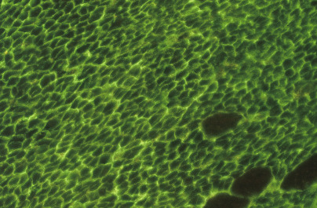

Figure 54-10 

Indirect immunofluorescence microscopy of immunoglobulin (Ig) A endomysial autoantibodies using monkey esophagus as substrate (×400). 

 

##  Vasculitis 

Cutaneous vasculitis describes a spectrum of diseases that involve the inflammation and destruction of small or medium-sized vessels in the skin. It can present as skin-limited disease, but it may also be associated with a larger systemic vasculitis and extracutaneous involvement. Clinically, cutaneous small vessel vasculitis (CSVV) classically presents as palpable purpura of the lower extremities. Clinical findings of nodular erythema, livedo patterns, and ulcers may implicate a medium-sized vessel vasculitic process like polyarteritis nodosa (PAN). A mottled purplish discoloration of the skin can be described as “livedo reticularis.” While many cases of CSVV are idiopathic, a thorough evaluation for an underlying cause or internal organ involvement should be completed. 

  

##  Histologic and Immunologic Features 

CSVV typically displays a characteristic histologic pattern described as leukocytoclastic vasculitis (LCV). Biopsy shows neutrophils and neutrophilic debris (leukocytoclasia) surrounding the small vessels in the superficial dermis, along with evidence of vessel damage seen as fibrin in vessel walls and extravasated red blood cells. Biopsies should include the subcutis in order to evaluate the patient for vasculitis involving the larger vessels in the skin. 

Just as in the evaluation of blistering disorders, the timing and location of biopsy impact the diagnostic yield of DIF testing. A biopsy should be performed on a lesion that is less than 24 hours old (  Mutasim, 2001  ). Deposits of C3, IgM, IgG, and fibrinogen are found within the walls of the postcapillary venules (  Aoki, 2010  ). A vasculitis with IgA as the primary immunoreactant suggests the diagnosis of Henoch-Schönlein purpura (HSP). HSP is a type of CSVV associated with renal and gastrointestinal involvement and is commonly described in children (  Mutasim, 2001  ). A negative DIF does not exclude a diagnosis of CSVV and should be interpreted together with the clinical and histologic findings. 

,  

##  Gastrointestinal and Hepatobiliary Autoimmune Diseases 

 

##  Pernicious Anemia 

The term _pernicious anemia_ (PA) refers specifically to a state of vitamin B  12  (cobalamin) deficiency that results from lack of gastric intrinsic factor, which in turn is a consequence of an autoimmune gastritis (  Toh et al, 1997  ;  Green, 2010  ). PA is typically a disease of middle age or older. While the mean age at diagnosis is 59 to 62 years, it may present in younger individuals. In one study, 10% of patients were between 30 and 40 years of age (  Lahner & Annibale, 2009  ). PA was once thought to be restricted to Northern Europeans, but it has now been described in many ethnic groups. The disorder is initiated by a T lymphocyte–mediated inflammation of the gastric mucosa. The autoimmune gastritis affects the body of the stomach with antral sparing and is typically associated with autoantibodies to gastric parietal cells and to intrinsic factor itself (see below). The gastritis leads to mucosal atrophy, achlorhydria, and very high serum gastrin concentrations, the last being an attempted compensation. 

To avoid confusion, use of the term _pernicious anemia_ should be restricted to the autoimmune gastritis/vitamin B  12  malabsorption syndrome outlined earlier, and it should not be used interchangeably with any other cause of vitamin B  12  deficiency. Furthermore, not all cases of vitamin B  12  deficiency result in hematologic manifestations; in some instances, neurologic features may predominate or may be the sole clinical manifestation. 

Parietal cell autoantibodies (PCA) bind to the H  \+  /K  \+  -ATPase pump on gastric parietal cells (  Bizzaro & Antico, 2014  ). PCA are more common than intrinsic factor autoantibodies but are less specific. PCA are found in 80% to 90% of those with early pernicious anemia. This may fall to 55% in more advanced disease. PCA have been found in about 30% of nonanemic first-degree relatives of those with PA. PCA may be detected in otherwise healthy adults: 2.5% of individuals in the fourth decade and 10% of those in the eighth decade of life. 

Intrinsic factor (IF) is a 60-Kd glycoprotein (15% carbohydrate by weight) that binds to vitamin B  12  and allows specific attachment to a terminal ileal vitamin B  12  receptor that is termed the _cubam_ receptor complex. Autoantibodies to intrinsic factor (IFA) are of two major types: “type I,” or “blocking,” autoantibodies that prevent the combination of IF and vitamin B  12  , and “type II,” or “binding,” autoantibodies that interfere with the attachment of the IF-vitamin B  12  complex to the ileal receptor. IFA are found in 40% to 60% of patients with PA. The predominant antibody is the type I; about half the positive IFA cases have type II antibodies, and these are rarely present in the absence of type I antibodies. PCA can be measured either by indirect immunofluorescent staining of rodent or human stomach ( [ Fig. 54-11 ](<#f0060>) ) or by an ELISA immunoassay. IFAs are typically measured by ELISA. 

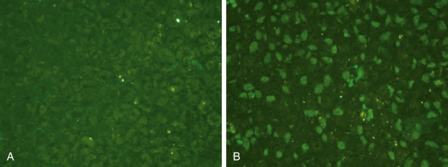

Figure 54-11 

Gastric parietal cell autoantibodies (PCA) can be detected by indirect immunofluorescence. 

**A,** Negative control. **B,** Positive patient result. 

The anatomic pathology of pernicious anemia is referred to as autoimmune corpus-restricted atrophic gastritis (  Neumann et al, 2013  ) or “type A gastritis.” Early features include lymphocytic and plasma cell infiltration of the mucosa of the gastric body. This is followed by loss of gastric parietal cells, intestinal metaplasia with the appearance of “goblet cells,” pancreatic acinar metaplasia, and enterochromaffin-like cell (ECL cell) hyperplasia, the last being positive for chromogranin. These changes are confined to the body of the stomach and are distinct from multifocal atrophic gastritis caused by long-standing _Helicobacter pylori_ infection. Patients with PA are at increased risk for gastric carcinoma. The relative risk of gastric adenocarcinoma is 6.8 (95% CI 2.6-18.1). 

Pernicious anemia may be associated with other autoimmune disorders, including autoimmune thyroid disorders, type 1 diabetes, Addison disease, and vitiligo. The HLA genotypes HLA-DRB1*03 and HLA-DRB1*04 are significantly associated with autoimmune gastritis and PA. These genotypes are also associated with type 1 diabetes and autoimmune thyroid disease. 

The true prevalence of pernicious anemia is difficult to determine because disease definitions are not clearly standardized, and estimates vary widely. Studies have placed the prevalence at about 1% to 2% (  Carmel, 1996;  2000  ) and have estimated that PA is responsible for about 30% of all causes of vitamin B  12  deficiency (  Dali-Youcef & Andrès, 2009  ). 

 

##  Celiac Disease 

Celiac disease is an immune-mediated small intestinal enteropathy caused by an abnormal immune response to epitopes of wheat gluten in patients who express the HLA-DQ2 or HLA-DQ8 (  Di Sabatino et al, 2012  ). Celiac disease affects 0.5% to 1.0% of the western Europe and northern U.S. populations. Prevalence is increased in patients who have an affected first-degree relative, in patients with Down syndrome, and in patients who have other autoimmune diseases such as type 1 diabetes (  Fasano & Catassi, 2012  ). The classic symptoms of celiac disease include malabsorption dominated by chronic diarrhea, steatorrhea, and weight loss (  Ludvigsson et al, 2014  ). Patients also present with a diverse range of nonclassic symptoms, including anemia, vague abdominal symptoms, neuropathy, ataxia, depression, short stature, osteoporosis, liver disease, and lymphoma (  Ludvigsson et al, 2014  ). Asymptomatic patients are discovered through screening when there is an affected first-degree relative, or they are tested because they have an associated autoimmune disease. 

Celiac disease is initiated by the ingestion of gliadin, which can be found in foods containing wheat, barley, or rye. Gliadins are rich in glutamine and proline residues that the human intestine cannot fully digest, and, as a result, some intact gliadin peptides cross the intestinal barrier (  Guandalini & Assiri, 2014  ). 

Transglutaminases (tTG) are enzymes that catalyze the posttranslational modification of proteins by the formation of isopeptide bonds (  Di Sabatino et al, 2012  ). Through deamidation, tTG converts glutamine residues into negatively charged glutamate residues, which have a much higher affinity for HLA-DQ2 and HLA-DQ8 molecules (  Ludvigsson et al, 2014  ;  Tonutti & Bizzaro, 2014  ). HLA-DQ2 and HLA-DQ8 molecules are expressed on the surface of antigen-presenting cells in the lamina propria and preferentially present to lamina propria CD4 T cells, gliadin peptides that have undergone deamidation by tTG (  Di Sabatino et al, 2012  ). Recognition of HLA-bound and tTG-deamidated gliadin peptides by CD4 T cells induces their activation and production of cytokines (  Di Sabatino et al, 2012  ). Some of the cytokines from T helper type 2 (Th2) cells drive the activation and clonal expansion of B cells, with consequent production of IgA antigliadin and anti-tTG autoantibodies. Other cytokines from Th1 cells promote inflammatory processes, leading to the development of the characteristic celiac histology (  Di Sabatino et al, 2012  ). 

Biopsies of the duodenum are essential to confirm the diagnosis of celiac disease. The characteristic histologic findings include increased intraepithelial CD8 T lymphocytes (>25 per 100 enterocytes), villous blunting, and crypt hyperplasia (  Fasano & Catassi, 2012  ). 

Serologic tests are fundamental to screening for celiac disease. Serologic screening is also recommended in all first-degree relatives of celiac disease patients. Initial testing involves measuring serum IgA antitissue transglutaminase autoantibodies (anti-tTG) because of their high sensitivity (94%), high specificity (97%), and excellent standardization (  Fasano & Catassi, 2012  ). In patients with IgA deficiency, IgG anti-tTG autoantibodies can be measured. Measuring IgA endomysial autoantibodies (anti-EMA) is nearly 100% specific for active celiac disease, but it should only be used as a confirmatory test when anti-tTG autoantibody tests are borderline or when anti-tTG autoantibodies are falsely positive. This test that requires fluorescent microscopy is subject to interobserver variability (  Fasano & Catassi, 2012  ;  Tonutti & Bizzaro, 2014  ). Measuring IgG deamidated gliadin peptide antibodies (anti-DGP) is an alternative in patients with IgA deficiency because this test has reported better sensitivity and specificity than IgG anti-tTG autoantibodies. The sensitivity of serologic testing is significantly reduced in patients on a gluten-free diet; therefore, patients should maintain a normal, gluten-containing, diet prior to testing. 

It is best to use a combination of IgA anti-tTG autoantibodies and IgG anti-DGP antibodies in diagnosing celiac disease (  Tonutti & Bizzaro, 2014  ). A presumptive diagnosis of celiac disease can be made when the biopsy shows characteristic changes and the serologies are positive. Definitive diagnosis requires resolution of symptoms with a gluten-free diet (  NIH Consensus, 2004  ). If the diagnosis is uncertain, testing for HLA-DQ2 and HLA-DQ8 may be useful to help classify patients as being at high or low risk for celiac disease. Ninety percent of patients with celiac disease have HLA-DQ2, which is expressed in only a third of the general population. Another 5% of celiac disease patients have HLA-DQ8. The remaining 5% of celiac patients have at least one of the two gene alleles encoding DQ2 (  Fasano & Catassi, 2012  ). Testing has a high negative predictive value, meaning the disease is very unlikely to develop in patients who are negative for both HLA-DQ2 and HLA-DQ8. Less than 1% of patients with celiac disease are negative for DQ2 and DQ8 (  Fasano & Catassi, 2012  ). A lifelong gluten-free diet is the cornerstone therapy for celiac disease (  Fasano & Catassi, 2012  ). 

 

##  Inflammatory Bowel Disease 

Inflammatory bowel disease (IBD) is a heterogeneous disease with an incompletely understood etiopathogenesis. Several immunological, genetic, and environmental factors have been identified that may contribute to this immunoallergic disorder (  Laass et al, 2014  ). Currently studies are focused on the imbalance between tolerance to the intestinal microbiota and the mucosal immune responses in genetically predisposed individuals (  Conrad et al, 2014  ). First-degree relatives of patients with IBD have a ten- to fifteenfold increased risk for IBD (  Laass et al, 2014  ). 

Ulcerative colitis (UC) and Crohn's disease (CD) are the most frequently diagnosed forms of IBD (  Laass et al, 2014  ). UC is clinically characterized by bloody diarrhea and chronic abdominal pain. CD is characterized by abdominal pain, diarrhea, weight loss, and fever (  Laass et al, 2014  ). Endoscopically, CD is characterized by discontinuous transmural ulcerations with frequent involvement of the ileocecal region (  Laass et al, 2014  ). CD-related lesions can be found throughout the digestive tract, in contrast to UC, in which disease is typically limited to the colon. Histologically, UC is characterized by diffuse mononuclear inflammatory infiltrate of the lamina propria with a basal lymphoplasmacytosis, cryptitis, crypt abscesses, mucosal ulceration, architectural distortion, Paneth cell metaplasia, and pseudopolyp formation. CD is characterized by focal transmural inflammation with scattered lymphoid aggregates; noncaseating, poorly formed granulomas; cryptitis; crypt abscesses; and architectural distortion. 

In some patients, a definitive diagnosis of UC or CD cannot be made, and therefore the patient is classified as having “indeterminate colitis.” Serologic biomarkers can be especially useful in these patients. p-ANCA and anti– _Saccharomyces cerevisiae_ mannan antibodies (ASCA) are the most extensively studied and used serologic markers associated with IBD (  Beniwal & Harrell, 2010  ). 

Atypical p-ANCA is directed against neutrophil granules that stain the rim of the neutrophil nuclei, as well as intranuclear foci (  Beniwal & Harrell, 2010  ). p-ANCA is present in 40% to 80% of UC patients and 5% to 25% of CD patients (  Beniwal & Harrell, 2010  ). ASCA is an autoantibody against the mannose residues on _S. cerevisiae_ cell walls (  Lewis, 2011  ). ASCA is present in 48% to 69% of CD patients and 15% of UC patients (  Beniwal & Harrell, 2010  ). Using ASCA and p-ANCA in combination distinguishes CD from UC with 40% to 50% sensitivity and greater than 90% specificity (  Lewis, 2011  ). 

Several IBD-associated antiglycan antibodies have been identified. Glycans are found on the cell walls of bacteria, yeast, fungi, protozoa, and viruses and on the cell surfaces of immune cells and erythrocytes (  Beniwal & Harrell, 2010  ). These are antilaminaribioside carbohydrate antibody (ALCA), antichitobioside carbohydrate antibody (ACCA), antimannobioside carbohydrate antibody (AMCA), and anti-L and anti-C (  Beniwal & Harrell, 2010  ). 

Additional antibodies have been discovered, including antiflagellin CBir1 (CBir1), anti– _Pseudomonas fluorescens_ –associated sequence I2 (anti-I2), and antibodies to the outer-membrane porin C of _Escherichia coli_ (anti-OmpC) (  Ferrante et al, 2007  ). 

One of the major goals in treating IBD patients is to prevent complications such as perforation, fistula formation, and strictures. Some data suggest that the presence of serologic biomarkers may be able to identify patients at increased risk for complications and may predict response to treatment; however, studies in these areas have produced conflicting results (  Lewis, 2011  ). 

 

##  Hepatic and Hepatobiliary Autoimmunity 

 

##  Hepatic Autoantibodies 

Screening for hepatic autoantibodies most commonly utilizes immunofluorescence (IFL). In 2004, the International Autoimmune Hepatitis Group (IAIHG) Committee for Autoimmune Serology released a consensus statement containing guidelines for autoantibody testing in autoimmune hepatitis (AIH). One of the recommendations is that initial screening should consist of indirect IFL on fresh, multiorgan rodent sections (liver, kidney, and stomach) to detect smooth muscle autoantibodies (SMA), antinuclear autoantibodies (ANA), anti–LKM-1 autoantibodies (LKM = liver kidney microsomal) , anti–LC-1 autoantibodies (LC = liver cytosol), and antimitochondrial autoantibodies (AMA) (  Liberal et al, 2014  ). 

 

##  Antinuclear Autoantibodies 

The target antigens of antinuclear antibodies (ANA) are heterogeneous and not well defined. ANA have been shown to be reactive with single- and double-stranded DNA, centromeres, histones, chromatin, and cyclin A. ANA produce a clearly nuclear pattern on kidney, stomach, and liver sections. A homogeneous staining pattern is the most common pattern in autoimmune hepatitis (AIH), and coarse or speckled patterns are less frequently observed. In adults, a clinically significant titer is 1 : 40, and in children it is 1 : 20\. 

Human epithelial type 2 (HEp2) cells have prominent nuclei, so such cells are useful when the nuclear IFL pattern requires clarification. However, HEp2 cells should not be used for screening due to a high false positive rate (  Liberal et al, 2014  ). ANA have also been found in up to 52% of patients with primary biliary cirrhosis (PBC), where they display a characteristic IFL pattern of multiple nuclear dot or rim-like membranous staining on HEp-2 or HeLa cells (  Liberal et al, 2013  ). ANA are also present in other autoimmune and nonautoimmune conditions, such as viral hepatitis, drug-induced hepatitis, and alcoholic and nonalcoholic fatty liver disease (  Liberal et al, 2014  ). 

 

##  Anti–Smooth Muscle Autoantibodies 

Anti–smooth muscle autoantibodies (SMA) are directed against actin and other constituents of the cytoskeleton, such as tubulin, vimentin, desmin, and skeletin. SMA are found in 50% of patients with AIH and often found with other ANA. Characteristic IFL patterns of SMA can be identified in kidney, stomach, and liver, where they target the artery walls. In stomach, SMA bind to the muscularis mucosa and lamina propria. In the kidney, SMA typically stain the smooth muscle in vessels (V), glomeruli (G), and tubules (T) (VGT pattern). The VG and VGT patterns are more specific for AIH than a V pattern alone, which has been seen in other liver diseases. While the VGT pattern is very specific for type 1 AIH, approximately 20% of SMA-positive patients will not have this pattern. Note that type 1 AIH and type 2 AIH are differentiated by the autoantibodies that are present (discussed below). In adults with AIH, the titer is usually greater than or equal to 1 : 80\. Pediatric patients may have titers as low as 1 : 20\. SMA are not specific for AIH and have been reported in other types of liver disease (  Liberal et al, 2013  ). 

 

##  Anti–Liver-Kidney Microsomal Type 1 Autoantibodies 

The hallmark autoantibodies of type 2 AIH are anti–liver-kidney microsomal type 1 (anti–LKM-1) autoantibodies. In IFL, anti–LKM-1 stains the hepatocellular cytoplasm and the P3 portion of the proximal renal tubules (pars recta). The IFL patterns of AMA and anti–LKM-1 share some similarities because they will both stain liver and kidney. AMA will stain the liver more faintly and the renal tubules more diffusely, while accentuating the distal tubules. Also, AMA will stain gastric parietal cells, while anti-LKM will not. 

Because the molecular targets of anti-LKM and AMA are known, immune-based assays have been developed. The molecular target of anti-LKM-1 is cytochrome P450-2D6 (CYP2D6), and the molecular targets of AMA are enzymes of the 2-oxo-acid dehydrogenase complexes. Commercially available enzyme-linked immunosorbent assays (ELISAs) detect AMA and anti–LKM-1 accurately and can be useful when the IFL pattern is inconclusive. 

In adults with AIH, the minimal titer considered relevant is 1 : 40, and in pediatric patients it is 1 : 10\. The titer is associated with disease activity. Of note, anti-LKM autoantibodies are detected in up to 10% of patients with chronic hepatitis C infection (  Liberal et al, 2014  ). 

 

##  Anti–Liver Cytosol Type 1 Autoantibodies 

Whereas isolated anti–liver cytosol type 1 (anti–LC-1) autoantibodies correlate with type 2 AIH, they are also seen in association with anti–LKM-1 autoantibodies, with other serologic markers of type 1 AIH, and in patients with chronic hepatitis C infection. Anti–LC-1 autoantibodies correlate with disease activity and can be used as a marker of hepatocellular inflammation. 

The target of anti–LC-1 autoantibodies is the folate-metabolizing enzyme formimino transferase cyclodaminase (FTCD), which is present at high concentration in the liver. The IFL pattern is cytoplasmic, with relative sparing of the centrilobular areas. The IFL pattern of anti–LC-1 autoantibodies is obscured when present along with anti–LKM-1 (  Liberal et al, 2013  ). 

 

##  Antimitochondrial Antibodies 

Epitopes recognized by antimitochondrial antibodies (AMA) are referred to as M2 antigens and include lipoylated domains of the E2 and E3 binding protein (E3BP) components of the pyruvate dehydrogenase complex (PDC-E2) and the E2 components of the 2-oxo glutarate dehydrogenase (OADC-E2) and branched-chain 2-oxo acid dehydrogenase (BCOADC-E2) complexes (  Bowlus & Gershwin, 2014  ). 

AMA can be detected using several methods. Indirect immunofluorescence was routinely used in the past but lacks specificity and sensitivity. Enzyme-linked immunoassays (EIAs) using recombinant proteins to the three known autoantigens are available. Commercially available EIA tests detect gp210 (nucleoporin 210kDa, a component of the nuclear pore complex) and Sp100 (SP100 nuclear antigen, a subnuclear organelle and significant component of the promyelocytic leukemia-SP100 nuclear bodies). The titer of AMAs does not correlate with disease severity (  Bowlus & Gershwin, 2014  ). 

 

##  Other Autoantibodies 

 

##  Anti–Soluble Liver Antigen/Liver-Pancreas Autoantibodies. 

Originally thought to be distinct antibodies, anti–soluble liver antigen/liver-pancreas autoantibodies (anti-SLA and anti-LP) are now known to share the same antigenic target. Anti-SLA/LP autoantibodies cannot be detected by IFL but are detected by radioimmunoassay or ELISA. The presence of anti-SLA/LP autoantibodies is highly specific for AIH and signifies a more severe disease and a worse clinical outcome (  Liberal et al, 2013  ). 

 

##  Anti-Neutrophil Cytoplasmic Autoantibodies. 

Anti-neutrophil cytoplasmic autoantibodies (ANCA) react to cytoplasmic components of neutrophils displayed as a perinuclear (pANCA) or cytoplasmic (cANCA) pattern. pANCA are frequently detected in type 1 AIH and can be diagnostically helpful when other autoantibodies are absent. The pattern of IFL is atypical in that staining is associated with peripheral nuclear membrane components, hence the name _peripheral antinuclear neutrophil antibody_ (pANNA) (  Liberal et al, 2014  ). 

 

##  Anti–Asialoglycoprotein Receptor Autoantibodies. 

Anti–asialoglycoprotein receptor (anti-ASGPR) autoantibodies are type II transmembrane glycoproteins also known as hepatic lectins. ASGPR is constitutively expressed on the hepatocellular membrane and is the only liver-specific autoantigen. Anti-ASGPR autoantibodies are present in 88% of AIH patients and can be present in combination with ANA, SMA, and anti–LKM-1. This autoantibody is not specific to AIH, as it has also been detected in patients with viral hepatitis, primary biliary cirrhosis (PBC), and drug-induced hepatitis. Titers correlate with inflammatory activity. Detection of anti-ASGPR autoantibodies in clinical practice has limited use due to lack of disease specificity and the difficulty in developing a reliable assay (  Liberal et al, 2014  ). 

 

##  Autoimmune Hepatitis 

Autoimmune hepatitis (AIH) is a progressive immune-mediated liver disease characterized by elevated transaminases (e.g., ALT and AST) and immunoglobulins, the presence of characteristic autoantibodies, and histologic evidence of interface hepatitis ( [ Fig. 54-12 ](<#f0065>) ). An interface hepatitis is characterized by disruption of the parenchymal limiting plate by a dense portal and periportal lymphocyte and plasma cell infiltrate. Women are affected with AIH more frequently than men (sex ratio, 3.6 : 1), and the disease is seen in all ethnic groups and at all ages (  Manns et al, 2010  ). The clinical presentation is variable but frequently includes progressive fatigue, relapsing jaundice, amenorrhea, weight loss, and occasionally arthralgia. Approximately 25% of patients are asymptomatic and are incidentally diagnosed when liver function tests are found to be abnormal. Rarely, the initial presentation is acute hepatic failure. Ultimately AIH can progress to cirrhosis and hepatocellular carcinoma. 

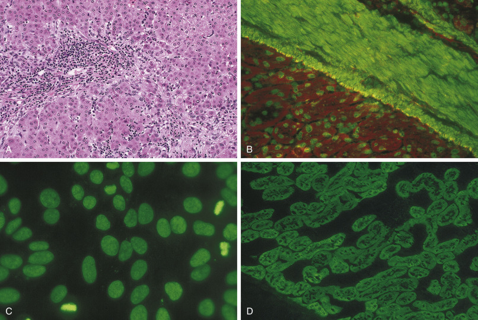

Figure 54-12 

**A,** Liver biopsy in untreated autoimmune hepatitis (AIH) shows prominent portal and lobular inflammation with interface activity and often numerous plasma cells at the leading edge of the inflammation (hematoxylin and eosin [H&E], ×500). 

**B,** Indirect immunofluorescence microscopy in this instance reveals combined smooth muscle autoantibodies (SMA) and antinuclear autoantibodies (ANA) using mouse stomach/kidney as substrate (×200). **C,** The ANA pattern in autoimmune liver disease is often homogeneous (×400). **D,** Indirect immunofluorescence appearance of liver-kidney microsomal autoantibodies using mouse stomach/kidney as substrate. There is finely granular cytoplasmic immunofluorescence of proximal renal tubules but not distal tubules (×200). 

Approximately 40% of AIH patients have a family history of autoimmune disease. Twenty percent have concomitant autoimmune diseases or will develop them during follow-up (  Liberal et al, 2014  ). AIH responds to immunosuppressive treatment. Liver transplantation has also evolved as an effective treatment for the decompensated patient, and the 5-year patient and graft survivals now exceed 80% (  Manns et al, 2010  ). 

Diagnosis of AIH requires the presence of characteristic clinical and laboratory features and the exclusion of other conditions that cause chronic hepatitis and cirrhosis. The IAIHG has established inclusion and exclusion criteria for the diagnosis of autoimmune hepatitis ( [ Table 54-2 ](<#t0015>) ). 

TABLE 54-2 

International Autoimmune Hepatitis Group Revised Diagnostic Scoring System 

Parameter  |  Feature  |  Score   
---|---|---  
Sex  |  Female  |  +2   
ALP: AST (or ALT) ratio  |  >3  |  –2   
1.5-3  |  0   
<1.5  |  +2   
Serum globulins or IgG (times above normal)  |  >2.0  |  +3   
1.5-2.0  |  +2   
1.0-1.5  |  +1   
<1.0  |  0   
ANA, SMA, or anti–LKM-1 titers  |  >1 : 80  |  +3   
1 : 80  |  +2   
1 : 40  |  +1   
<1 : 40  |  0   
AMA  |  Positive  |  –4   
Viral markers of active infection  |  Positive  |  –3   
Negative  |  +3   
Hepatotoxic drug history  |  Yes  |  –4   
No  |  +2   
Average alcohol intake  |  <25 g/day  |  +2   
>60 g/day  |  –2   
Histological features  |  Interface hepatitis  |  +3   
Plasma cells  |  +1   
Rosettes  |  +1   
None of the above  |  –5   
Biliary changes [ * ](<#hl0000371>) |  –3   
Atypical changes [ † ](<#hl0000374>) |  –3   
Immune diseases  |  Thyroiditis, colitis, other  |  +2   
HLA  |  DR3 or DR4  |  +1   
Seropositivity for other autoantibodies  |  Anti-SLA/LP, actin, ASGPR, pANNA  |  +2   
Response to therapy  |  Remission  |  +2   
Relapse  |  +3   
  
Pretreatment score greater than 15: definite AIH; 10 to 15: probable AIH. Posttreatment score greater than 17: definite AIH; 12 to 17: probable AIH. 

_ALP,_ Alkaline phosphatase; _AST,_ aspartate aminotransferase; _ALT,_ alanine aminotransferase; _IgG,_ immunoglobulin G; _ANA,_ antinuclear autoantibodies; _SMA,_ anti–smooth muscle autoantibodies; _anti –LKM-1, _ anti–liver-kidney microsomal type 1 autoantibodies; _AMA,_ antimitochondrial autoantibodies; _SLA/LP,_ soluble liver antigen/liver pancreas; _ASGPR,_ asialoglycoprotein receptor; _p-ANNA,_ peripheral antinuclear neutrophil antibody; _HLA,_ human leukocyte antigen. 

Adapted from Alvarez F, Berg PA, Bianchi FB, et al: International Autoimmune Hepatitis Group report: Review of criteria for diagnosis of autoimmune hepatitis, _J Hepatol_ 31(5):929–938, 1999. 

 * Including granulomatous cholangitis, concentric periductal fibrosis, ductopenia, marginal bile duct proliferation, and cholangiolitis. 

 † Any other prominent feature suggesting a different etiology. 

Laboratory assessment should include serum alanine (ALT) or aspartate (AST) aminotransferases, alkaline phosphatase (ALP), albumin, IgG, and bilirubin. Indirect IFL on fresh, multiorgan rodent sections (liver, kidney, and stomach) is pursued to detect SMA, ANA, anti–LKM-1, anti–LC-1, and AMA (  Manns et al, 2010  ). While histology is essential for the diagnosis of AIH, it does not always show typical lesions. Characteristic histologic findings include interface hepatitis with a predominantly lymphoplasmacytic infiltrate, with or without lobular involvement, portal-portal or portal-central bridging necrosis, and frequent liver cell rosettes (  Alvarez et al, 1999  ). 

Two types of AIH are recognized according to the serological profile. Type 1 autoimmune hepatitis is positive for ANA or anti-SMA. Type 2 autoimmune hepatitis is positive for anti–LKM-1 or anti–LC-1. All AIH-2 patients are positive for anti-LKM1 and/or anti-LC1 autoantibodies. Less than one-third are solely positive for anti-LC1 autoantibodies. 

In 1993, the International Autoimmune Hepatitis Group proposed diagnostic criteria that were revised in 1999. These criteria were devised primarily through expert consensus and were used to compare studies from different centers. The criteria are complex and include a variety of parameters that contribute questionable diagnostic value. The IAIHG devised a simpler scoring system that was more applicable to routine clinical practice and was based on the data of patients with a well-established diagnosis of AIH (  Hennes et al, 2008  ). 

The updated simplified scoring system was proposed for use in clinical practice and is based on just four criteria: autoantibody positivity, elevated IgG levels, histologic findings compatible with AIH, and exclusion of viral hepatitis ( [ Table 54-3 ](<#t0020>) ;  Hennes et al, 2008  ). In three retrospective studies, the simplified scoring system performed with high sensitivity and specificity in the diagnosis of AIH, but it has not been validated in prospective studies (  Manns et al, 2010  ). 

TABLE 54-3 

Simplified Criteria for the Diagnosis of Autoimmune Hepatitis 

Variable  |  Cutoff  |  Points   
---|---|---  
ANA or SMA  |  ≥1 : 40  |  1   
ANA or SMA   
Or anti–LKM-1   
Or SLA  |  ≥1 : 80   
≥1 : 40   
Positive  |  2 [ * ](<#hl0000431>)  
IgG  |  >Upper limit of normal   
>1.10 times upper limit of normal  |  1   
2   
Liver histology  |  Compatible with AIH   
Typical of AIH  |  1   
2   
Absence of viral hepatitis  |  Yes  |  2   
  
Score of 6 or higher: probable AIH; 7 or higher: definite AIH. 

_ANA,_ Antinuclear autoantibody; _SMA,_ anti–smooth muscle autoantibody; _anti-LKM,_ anti–liver-kidney microsomal autoantibody type 1; _SLA,_ soluble liver antigen; _IgG,_ immunoglobulin G; _AIH,_ autoimmune hepatitis. 

Adapted from Hennes EM, Zeniya M, Czaja AJ, et al: Simplified criteria for the diagnosis of autoimmune hepatitis, _Hepatology_ 48(1):169–176, 2008 

 * Addition of points achieved for all autoantibodies cannot exceed a maximum of 2 points. 

 

##  Prognostic Relevance of Autoantibodies in Autoimmune Hepatitis 

ANA and SMA titers tend to decline or disappear during effective immunosuppressive therapy. Neither the titer at diagnosis nor fluctuations over the course of the disease correlate with disease outcome. Anti-SLA autoantibodies denote patients with a more severe course of disease and propensity for relapse after steroid withdrawal. Anti–LKM1-autoantibody-positive pediatric patients tend to present at a younger age than ANA/SMA-autoantibody-positive patients. They also have higher bilirubin and transaminase levels at diagnosis and more often present in fulminant hepatic failure. AIH-2 patients with anti-LC1 autoantibodies have more severe disease histologically (  Liberal et al, 2013  ). 

 

##  Primary Biliary Cirrhosis 

Primary biliary cirrhosis (PBC) is an autoimmune liver disease characterized by immune-mediated destruction of small intrahepatic bile ducts, leading to chronic cholestasis and fibrosis that can eventually result in cirrhosis and liver failure ( [ Fig. 54-13 ](<#f0070>) ). This disease typically affects females in their fifth and sixth decades (  Bowlus & Gershwin, 2014  ). 

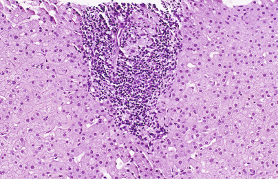

Figure 54-13 

Liver biopsy in primary biliary cirrhosis shows variable portal inflammation with nonsuppurative lymphocytic cholangitis and, in this example, a florid duct lesion with granulomatous inflammation centered on an interlobular bile duct (hematoxylin and eosin [H&E], ×200). 

The diagnosis can be established if two of three objective criteria are present: serum AMA at titers greater than or equal to 1 : 40, unexplained elevated ALP greater than or equal to 1.5 times the upper limit of the reference interval for over 24 weeks, and compatible liver histology. In addition, PBC patients often have elevated transaminases and elevated immunoglobulins, predominantly IgM (  Bowlus & Gershwin, 2014  ). If AMA is negative, the diagnosis of PBC is based on characteristic histologic findings and abnormal serum ALP levels. Liver biopsy is not required for a diagnosis of AMA-positive PBC but can be useful for disease staging. In AMA-negative PBC, liver biopsy is required to rule out other conditions, including small-duct primary sclerosing cholangitis , sarcoidosis, and drug-induced cholestasis. 

Histologic findings include nonsuppurative cholangitis and interlobular bile duct injury. The characteristic histologic finding is the “florid duct lesion.” This lesion occurs when an interlobular bile duct is destroyed by poorly formed epithelioid granulomas, lymphocytes, and plasma cells. These lesions obstruct bile flow and cause upstream portal tracts to have bile ductular reaction, inflammation, and necrosis, which eventually lead to fibrosis. 

AMA-positive and AMA-negative PBC have similar clinical courses, although some data suggest PBC-specific ANA positivity is associated with more severe disease (  Bowlus & Gershwin, 2014  ). PBC-specific ANA is a multiple-nuclear-dots (MND) ANA pattern with staining of 3 to 20 dots of variable size located throughout the nucleus that spare the nucleoli. The only established treatment for PBC is ursodeoxycholic acid (UDCA). The treatment is well tolerated and has been shown to prevent portal hypertension and esophageal varices, and it delays the time to transplant. 

 

##  Primary Sclerosing Cholangitis 

Primary sclerosing cholangitis (PSC) is a progressive cholestatic liver disease characterized by chronic bile duct destruction and progression to end-stage liver disease ( [ Fig. 54-14 ](<#f0075>) ). Chronic, progressive injury occurs in small, medium, and large bile ducts with inflammatory and obliterative concentric periductal fibrosis, so-called onion-skinning, leading to biliary strictures. PSC affects both sexes and all age groups although more than 60% of patients are men. The median age at onset is 30 to 40 years. It has been found that 60% to 80% of northern European cases are associated with inflammatory bowel disease, predominantly ulcerative colitis (UC). More than 50% of patients will require liver transplant within 10 to 15 years of diagnosis (  Hirschfield et al, 2013  ). The clinical presentation is variable, with the most common symptoms being fatigue, jaundice, pruritus, and abdominal pain. 

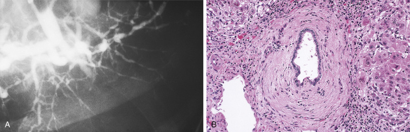

Figure 54-14 

**A,** Cholangiogram in primary sclerosing cholangitis reveals the characteristic beading pattern of bile ducts due to multifocal strictures at those sites. **B,** Liver biopsy reveals prominent periductal fibrosis in the characteristic “onion-skin” pattern (hematoxylin and eosin [H&E], ×500). 

Elevated serum alkaline phosphatase (ALP) between 3 and 10 times the upper limit of the reference interval is seen in 95% of cases (  Yimam & Bowlus, 2014  ). Serum ALT and AST levels are also typically elevated two to three times higher than the upper limit of the reference interval. Approximately 60% of patients will also have elevated serum IgG levels (  Yimam & Bowlus, 2014  ). 

Several autoantibodies are associated with PSC, although none are sufficiently specific or sensitive to be used as a screening test. Perinuclear antineutrophil cytoplasmic autoantibodies (p-ANCA) are seen in 65% to 95% of patients with PSC. Cholangiography is the gold standard for diagnosis of PSC, with the findings of segmental strictures with proximal dilation of the bile ducts creating the “beaded” appearance (  Yimam & Bowlus, 2014  ). Liver biopsy is not necessary when patients have radiographic evidence of PSC, although it can be helpful in excluding other diseases. The histologic findings of PSC are nonspecific and can be normal when only large ducts are involved. The characteristic histologic findings include bile duct proliferation, periductal fibrosis with “onion-skinning” lesions, periductal inflammation, and bile duct obliteration. 

Given the heterogeneous nature of PSC, strict diagnostic criteria have not been established. The diagnosis is based on a cholestatic pattern of liver biochemistries (ALP increased proportionately greater than ALT and AST), typical cholangiographic findings, and the absence of a secondary cause of sclerosing cholangitis (  Yimam & Bowlus, 2014  ). 

 

##  Overlap Syndromes 

Overlap syndrome refers to the simultaneous presence in a single patient of two distinct disease processes. There are two major variants of overlap syndrome in which the features of AIH are mixed with those of PBC (AIH with features of PBC) or PSC (AIH with features of PSC). In both syndromes, the predominant features are manifestations of autoimmune hepatitis and secondary features of PBC or PSC. Clinical features that should prompt consideration of an overlap syndrome are AMA positivity, ALP levels greater than two times the upper limit of the reference interval, concurrent inflammatory bowel disease (IBD), and histologic findings of bile duct injury or loss. Uniform diagnostic criteria have not been established for the overlap syndromes. The IAIHG has suggested classifying these patients by their predominant diagnosis and not by the overlapping features (  Czaja  2013a  ). 

Autoimmune hepatitis with features of PBC is the only overlap syndrome having proposed diagnostic criteria, known as the “Paris criteria.” These criteria were created in 1998 and required the presence of at least two of three recognized hallmarks of each disease (  Czaja  2013a  ). Three hallmarks of autoimmune hepatitis are serum ALT greater than five times the upper limit of the reference interval, IgG level greater than twice the upper limit of the reference interval or positive SMA, and histologic features of interface hepatitis. Three hallmarks of PBC are serum ALP levels greater than twice the upper limit of the reference interval or GGT levels greater than five times the upper limit of the reference interval , positive AMA, and histologic evidence of florid duct lesions. Ultimately, the diagnosis requires clinical judgment. 

Autoimmune hepatitis with features of PSC requires a predominant diagnosis of autoimmune hepatitis, absence of AMA, and cholestatic features, including jaundice, elevated ALP, or histologic findings of bile duct injury or loss. This variant of overlap syndrome typically occurs in the pediatric population and often coexists with IBD (  Durazzo et al, 2013  ). The clinical findings are similar to PSC, with fatigue, jaundice, itching, abdominal pain, and recurrent biliary infections. 

 

##  Autoimmune Pancreatitis 

Autoimmunity to the pancreas encompasses autoimmune pancreatitis (  O'Reilly et al, 2014  ). A rare form of chronic pancreatitis—autoimmune pancreatitis (AIP)—is now classified as type 1 disease (lymphoplasmacytic sclerosing pancreatitis in older individuals; AIP as part of multiorgan IgG4-related disease) and type 2 disease (idiopathic duct-centric pancreatitis in younger individuals; AIP in the absence of IgG4-related disease) (  Hart et al, 2015  ). AIP may anatomically mimic pancreatic cancer. API type 2 may be associated with inflammatory bowel disease. 

In AIP type 1, IgG4 levels are elevated, but this finding is not specific for AIP. The coexistence of chronic pancreatitis, elevated IgG4, and the presence of other IgG4-related diseases would establish the diagnosis of AIP type 1. AIP patients may display antinuclear autoantibodies, rheumatoid factor, or hypergammaglobulinemia. However, none of these findings are specific for AIP. 

Among a variety of autoantibodies described in AIP, autoantibodies to pancreatic secretory trypsin inhibitor have been found in 30% to 40% of AIP patients, respectively, by ELISA and western blotting (  Asada et al, 2006  ). Autoantibodies to heat-shock protein 10 (HSP 10) and amylase alpha-2A have also been identified in AIP (  Endo et al, 2009  ;  Takizawa et al, 2009  ). However, at the present time, these tests must be considered as research-only tests. A beneficial response to glucocorticoids is interpreted as supporting the diagnosis of AIP. 

,  

##  Glomerular Autoimmune Diseases 

 

##  Overview of Autoimmune Glomerular Diseases 

Clinical syndromes associated with glomerular disorders include asymptomatic proteinuria, nephrotic syndrome, asymptomatic hematuria, nephritic syndrome, rapidly progressive nephritic syndrome, and chronic renal failure. Nephrosis (i.e., the nephrotic syndrome) is the clinical syndrome characterized by proteinuria (>3.5 g/day), hypoalbuminemia, hyperlipidemia, and edema that sometimes progresses to anasarca (total body edema). Nephritis (i.e., the nephritic syndrome) is characterized by mild proteinuria, hematuria, red cell casts in the urine, mild edema, and hypertension. Overall these findings are the consequence of glomerular injury with damage to the glomerular capillary wall and often the mesangium. Both immune and nonimmune forms of glomerular injury occur. 

Potential immune mechanisms include circulating antigen-antibody immune complex deposition and complement activation with subsequent inflammation (as seen in cryoglobulinemia); deposition of exogeneous antigens (i.e., “planted” antigens) in the glomeruli, to which is bound an antibody or autoantibody, again eliciting inflammation (as seen in postinfectious glomerulonephritis); and autoantibodies to intrinsic in situ antigens in the glomeruli, again triggering inflammation (as seen in membranous nephropathy). 

Different glomerular diseases can cause the same clinical syndrome. The light, immunofluorescent, and electron microscopic findings on a renal biopsy establish the specific glomerular disease diagnosis. An initial approach is to determine the glomerular cellularity by light microscopy (LM). Proteinuric syndromes are often associated with relatively normocellular glomeruli. These glomerulopathies include minimal change disease, focal segmental glomerulosclerosis (FSGS), and membranous nephropathy. Nephritic syndromes are usually associated with hypercellular glomeruli. These glomerulonephritides include IgA nephropathy, membranoproliferative glomerulonephritis (MPGN), C3 glomerulopathy, postinfectious glomerulonephritis, anti-glomerular basement membrane (GBM) glomerulonephritis, pauci-immune glomerulonephritis, and lupus nephritis. Immunofluorescence (IF), electron microscopy (EM), and serology are essential to establishing the specific diagnosis. Renal pathology is the only area of anatomic pathology where LM, IF, and EM are routinely used to evaluate biopsy specimens. The type, amount, and location of immune deposits (immunoglobulin/complement components) within glomeruli are determined by IF. The ultrastructural character and exact glomerular location (e.g., subendothelial or subepithelial) of deposits and the specific type of cell injury are determined by EM. Observations from each form of microscopy, whether LM, IF, or EM, inform the interpretation of the others. Thus the findings from LM, IF, and EM are integrated with serologic and other laboratory data and clinical observations to render a glomerular disease diagnosis (see [ Table 54-4 ](<#t0025>) ). 

TABLE 54-4 

Pathologic Features of Immune Glomerular Diseases 

Disease  |  Pathogenesis  |  LM  |  IF  |  EM   
---|---|---|---|---  
Membranous  |  In situ immune complex deposition (PLA  2  R is antigen)  |  Capillary wall thickening  |  Capillary wall granular IgG and C3  |  Subepithelial deposits   
IgA nephropathy  |  Abnormal IgA glycosylation  |  Mesangial hypercellularity  |  Mesangial dominant IgA (and some C3)  |  Mesangial deposits   
Membranoproliferative glomerulonephritis (MPGN)  |  Immune complex deposition  |  Endocapillary hypercellularity, mesangial sclerosis, “double contouring” |  Capillary wall IgG (less IgM) and C3  |  Subendothelial deposits   
C3 glomerulonephritis (C3GN)  |  Dysregulation of alternative pathway of complement  |  Variable features, but often similar to MPGN  |  Capillary wall dominant C3 (less or no Igs)  |  Variable, but subendothelial deposits   
Dense deposit disease (DDD)  |  Dysregulation of alternative pathway of complement  |  Variable, but often similar to MPGN or mesangial cell hypercellularity  |  Capillary wall dominant C3 (less or no Igs)  |  Dense deposits in GBM   
Postinfectious glomerulonephritis  |  Immune complex deposition, planted or circulating antigen  |  Endocapillary hypercellularity  |  Capillary wall IgG and C3  |  Subepithelial“hump” deposits   
Anti-GBM disease  |  Circulating anti-GBM antibodies (antigen is α3 chain of COL4)  |  Capillary wall necrosis and crescents  |  Capillary wall linear IgG and C3  |  No deposits, GBM ruptures   
Pauci-immune glomerulonephritis  |  ANCAs (antineutrophil cytoplasmic antibodies)  |  Capillary wall necrosis and crescents  |  No or sparse Ig/C3 staining  |  No or sparse deposits   
Lupus nephritis (Class I-VI)  |  Immune complex deposition  |  Variable, class-dependent  |  “Full-house” staining for all Igs, C3, and C1q  |  Numerous deposits typically (location is class-dependent)   
  
_COL4,_ Type IV collagen; _EM,_ electron microscopy; _IF,_ immunofluorescence; _Igs,_ immunoglobulins; _LM,_ light microscopy. 

 

##  Glomerulopathies 

 

##  Membranous Nephropathy 

Membranous nephropathy (MN) is a common cause of the nephrotic syndrome in adults. It is characterized by glomerular capillary wall thickening on LM, prominent granular (“lumpy-bumpy”) capillary wall staining for IgG and C3 on IF, and subepithelial deposits on EM. Cases of early MN may show no overt changes on LM and quite subtle staining on IF. EM readily establishes the diagnosis in such early cases by revealing small subepithelial deposits. 

After many years of investigation, the target autoantigen was identified in podocytes as type-M phospholipase A  2  receptor (PLA  2  R) (  Beck et al, 2009  ). Approximately 70% to 80% of patients with idiopathic (primary) MN have circulating anti-PLA  2  R autoantibodies measured by ELISA assays (  Kanigicherla et al, 2013  ). Patients with secondary forms of MN (e.g., membranous lupus nephritis) generally lack these autoantibodies. The autoantibodies appear to be an excellent biomarker of the disease because the levels of anti-PLA  2  R correlate with the degree of proteinuria and disease activity (  Bech et al, 2014  ;  Hoxha et al, 2014a;  2014b  ). Moreover, the antibodies disappear (immunologic remission) before the proteinuria (renal remission) in patients treated with rituximab, an anti-CD20/B cell monoclonal antibody (  Beck et al, 2011  ). Detection of enhanced PLA  2  R expression in glomeruli by IF in the renal biopsy correlates with circulating autoantibodies and may be more sensitive because some sero-negative patients still show glomerular PLA  2  R by IF (  Debiec & Ronco, 2011  ;  Hoxha et al, 2012  ). Thus PLA  2  R detected by IF can serve as a footprint of PLA  2  R-associated MN. The majority of patients with PLA  2  R-associated MN that develop recurrent MN within 4 months after renal transplantation are positive for anti-PLA  2  R antibodies (  Kattah et al, 2015  ). A genome-wide association study (GWAS) of more than 500 patients with MN revealed significant linkage to the PLA  2  R gene on chromosome 2q24 (as well as HLA-DQA1 on 6p21) (  Stanescu et al, 2011  ). The preceding studies provide evidence to indicate that anti-PLA  2  R antibodies are pathogenic. Quantitative serologic phospholipase A  2  receptor (PLA  2  R) IgG autoantibody testing is available from reference laboratories. 

Immunofluorescence staining for the four subclasses of IgG (IgG1, IgG2, IgG3, and IgG4) is often performed to help distinguish primary MN from secondary forms of MN, including membranous lupus nephritis. The main IgG subclass found both within the subepithelial deposits of primary MN and the circulating anti-PLA2R antibodies is IgG4 (  Beck & Salant, 2014  ). A caveat is that the IgG1 subclass is often dominant by IF in early stages of idiopathic MN (  Huang et al, 2013  ). In membranous lupus nephritis, IgG1, IgG2, and IgG3 predominate on IF staining. In secondary MN associated with malignancy, IgG1 and IgG2 tend to predominate (  Ohtani et al, 2004  ). 

In the fibro-inflammatory disorder IgG4-related disease, the most common renal manifestation is a tubulointerstitial nephritis characterized by lymphoplasmacytic infiltrates, with IgG4 predominance among plasma cells, tissue eosinophils, and storiform fibrosis, features observed in other involved organs. However, MN has been reported in association with IgG4-related disease (  Alexander et al, 2013  ). In about 50% of these patients, a tubulointerstitial nephritis coexisted with the MN. Although the glomerular immune deposits in this “IgG4-related MN” were primarily IgG4, unlike primary MN, IF staining for PLA  2  R was negative. Moreover, circulating anti-PLA2R antibodies have not been detected in IgG4-related disease (  Khosroshahi et al, 2012  ). Thus IgG4-related MN appears to be a secondary form of MN, distinct from primary PLA  2  R-associated MN. 

Circulating antibodies to a second autoantigen—thrombospondin type-1 domain-containing 7A (THSD7A)—have been described in 2% to 5% of adult patients with idiopathic MN (  Tomas et al, 2014  ). Although rare, a form of early-childhood MN (5 months to 2.3 years) due to circulating antibovine serum albumin (BSA) has been described (  Debiec et al, 2011  ;  Debiec & Ronco, 2011  ). In this secondary form of MN, the target is an exogenous antigen, cationic BSA, that is present in cow's milk. An unusual entity, membranous-like glomerulopathy with masked IgG kappa deposits, has been reported predominantly in young women with clinical autoimmune features (  Larsen et al, 2014  ). Although these patients had LM and EM findings characteristic of classic MN, immunoglobulin deposits were absent on IF of frozen tissue, and they (IgG and kappa light chain) were only revealed by repeat IF on formalin-fixed paraffin-embedded (FFPE) tissue after antigen retrieval (pronase digestion). The nature of this immunoglobulin masking is not evident. IF staining for glomerular PLA  2  R was negative in all cases. EM is critical in selecting cases in which IF of pronase digested FFPE may expose immunoglobulin deposition and establish an accurate diagnosis. Thus, although MN is now considered a classic autoimmune glomerular disease, it appears to have multiple molecular etiologies. 

 

##  Glomerulonephritides 

 

##  IgA Nephropathy 

IgA nephropathy (IgAN) is considered to be the most common form of primary glomerulonephritis in the world (  Wyatt & Julian, 2013  ). Hematuria is the major clinical presentation, but some degree of proteinuria is often present. Typically, LM shows mesangial hypercellularity, IF reveals “dominant” (greater than any other immunoglobulin) mesangial granular IgA staining, and mesangial deposits are seen on EM. 

IgAN is essentially an IF diagnosis. There are no autoantibody tests for IgAN. Human IgA has two subclasses, IgA1 and IgA2, the former representing about 85% of the total circulating IgA. Although serum IgA levels tend to be elevated in patients with IgAN, they have no prognostic significance. However, the elevated IgA1 in patients is aberrantly glycosylated (galactose-deficient) (  Reily et al, 2014  ). A current pathogenic model considers that galactose-deficient IgA, either as a planted autoantigen or as part of an immune complex, deposits in the glomerular mesangium, activates mesangial cells, and induces mesangial sclerosis. In this scheme, IgAN may be considered an autoimmune disease. 

 

##  Membranoproliferative Glomerulonephritis 

Membranoproliferative glomerulonephritis (MPGN) describes a pattern of glomerular injury that may result from several distinct etiologies of glomerular disease. The characteristic LM lesion is mesangial hypercellularity, often endocapillary hypercellularity, increased mesangial matrix, and thickening of the glomerular capillary wall, observed as double-contouring (“tram-tracking”). An older classification included three types (MPGN types I, II, and III), but IF findings have provided insights into the pathogenesis and led to a new classification of these disorders (  Sethi & Fervenza, 2012  ;  Cook & Pickering, 2015  ). IF shows granular capillary wall deposition of immunoglobulins (IgG and/or IgM), with usually some complement C3, in what is now termed simply MPGN. Immunoglobulins are sparse to absent, and C3 deposition is prominent in the glomeruli of MPGN II (dense deposit disease), MPGN III, and other cases. 

These disorders are now called C3 glomerulopathies (see below). Immunoglobulin-associated or immune-complex-mediated MGPN currently are termed simply MPGN. The classical pathway of complement is activated. It is associated with autoimmune diseases, chronic infections (e.g., cryoglobulinemia associated with hepatitis C), and monoclonal gammopathies. The spectrum of renal diseases associated with monoclonal gammopathies (called monoclonal gammopathy of renal significance [MGRS]) is broad (  Bridoux et al, 2015  ). Like IgAN, there are no characteristic autoantibodies. 

 

##  C3 Glomerulopathy 

C3 glomerulopathy (C3G), a relatively new term, includes glomerular disorders with often a membranoproliferative LM pattern and IF characterized by C3 deposition and little to no immunoglobulins. C3G is essentially defined by IF, showing “dominant” C3 glomerular deposition greater than or equal to 2 orders of magnitude of IF intensity greater than any other immune reactant (  Pickering et al, 2013  ;  Hou et al, 2014  ). C3G includes both C3 glomerulonephritis (C3GN) and the rare dense deposit disease (DDD, previously known as MPGN type II). These two disorders are best distinguished on EM: mesangial and capillary wall (usually subendothelial) deposits in C3GN and dense osmiophilic intramemembranous deposits in DDD. _Osmiophilic_ refers to a substance that stains with osmium tetroxide and yields a black color. Both disorders tend to progress to end-stage renal failure (  Ku et al, 2012  ;  Medjeral-Thomas et al, 2014  ). It is important to note that some cases of proliferative immune complex glomerulonephritis—for example, MPGN—may be misdiagnosed as C3 glomerulopathy if the immunoglobulin deposits are masked (  Messias et al, 2015  ). IF staining on formalin-fixed paraffin-embedded (FFPE) tissue after pronase digestion appears to be a valuable technique to expose the immune-complex deposits and prevent a misdiagnosis. 

These disorders involve dysregulation of the alternative pathway of complement. Low circulating levels of C3 and factor B and higher levels of complement breakdown products C3d and Bb are present (  Zhang et al, 2014  ). Genetic and acquired factors are involved. Genetic mutations have been documented in the factor-H–related genes (FHR), encoding a group of five proteins (FHR1-5) (  Athanasiou et al, 2011  ). Other patients develop autoantibodies to C3 convertase (called C3 nephritic factors [C3Nefs]) or the proteins CFB and CFH, leading to abnormal activation of the alternative pathway of complement (  Servais et al, 2012  ;  Xiao et al, 2014  ). Most large hospital laboratories can measure C3 and C4. A range of other complement factors (e.g., factor B, factor H [β1H], and factor I) and C3 nephritic factors can be assayed in reference laboratories. 

 

##  Postinfectious Glomerulonephritis 

Postinfectious glomerulonephritis (PIGN) is an immune-mediated glomerulonephritis associated with extrarenal bacterial infections (  Nasr et al, 2013  ). The classic prototype is poststreptococcal glomerulonephritis (PSGN), but the epidemiology in developed countries has changed over recent decades. In the United States, most cases of PIGN occur in adults and are associated with nonstreptococcal infection, especially staphylococcal infection. Risk factors include diabetes, alcoholism, malignancy, and intravenous drug use. Pathologic features include glomerular endocapillary hypercellularity by LM, granular IgG and C3 staining in capillary walls by IF, and subepithelial “hump”-like deposits by EM. In poststaphylococcal glomerulonephritis, prominent glomerular IgA deposits are often seen, and the distinction from IgA nephropathy may be difficult (  Haas et al, 2008  ). 

Most PIGN cases have hematuria, often with red cell casts and low serum C3 levels with or without decreased C4 levels. With PSGN, ASO (antistreptolysin O) and anti–DNAse-B (antideoxyribonuclease-B) antibody titers are typically elevated, especially the latter with skin infections. The exact pathogenesis is not fully known, but a favored mechanism, at least in PSGN, is in situ immune complex formation via antibody binding to planted nephritogenic antigens, such as streptococcal exotoxin B (SpeB) and glyceraldehyde-3-phosphate dehydrogenase (GAPDH) (  Rodriquez-Iturbe & Musser, 2008  ). 

 

##  Anti-Glomerular Basement Membrane Glomerulonephritis 

The generic term _anti-GBM disease_ covers the clinical spectrum of disease caused by anti-GBM antibodies: both kidney and lung disease (termed “Goodpasture syndrome”), kidney-only disease, and, rarely, lung-only disease (  Hudson et al, 2003  ). Anti-GBM disease typically presents with a rapidly progressive nephritic syndrome with prominent hematuria and red cell casts and often hemoptysis. Renal biopsy typically reveals glomerular capillary necrosis with cellular crescent formation and the diagnostic hallmark of linear GBM staining for IgG on IF. 

Circulating autoantibodies bind to the GBM ( [ Fig. 54-15 ](<#f0080>) ) and activate complement, leading to recruitment of neutrophils and monocytes, with resultant glomerular capillary destruction. The majority of circulating autoantibodies are specific for the C-terminal noncollagenous domain (NC1) of the α3 chain of type IV collagen (α3(IV) chain) within the GBM (  Saus et al, 1988  ). Circulating autoantibodies to the α5(IV) chain may also be present, although they are less abundant. These major epitopes are sequestered within the α345(IV) protomeric hexamer and represent cryptic epitopes. Pathologic insults are believed to cause hexamer dissociation, expose the epitopes, allow binding of the autoantibodies, and initiate the nephritis (  Pedchenko et al, 2010  ). Thus anti-GBM disease has been considered an autoimmune “conformeropathy.” In general, high levels of circulating anti-GBM antibodies measured by ELISA correlate with a worse renal prognosis (  Yang et al, 2009  ). 

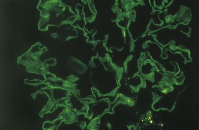

Figure 54-15 

Direct immunofluorescence microscopy reveals globular and linear glomerular basement membrane immunofluorescence in anti-glomerular basement membrane disease (×400). 

In Alport syndrome patients who receive a renal transplant, 3% to 5% develop anti-GBM disease because of alloantibodies against collagen IV chains in the allograft kidney that are absent in the patient's native kidney. In contrast to idiopathic anti-GBM disease, in Alport posttransplant anti-GBM disease, the antibodies target α3(IV) and α5(IV) epitopes present on the intact nondissociated α345(IV) hexamer (  Olaru et al, 2013  ). Reference laboratories can provide GBM autoantibody testing by IF or by using a multiplex bead assay, which is more specific. 

 

##  Pauci-Immune Glomerulonephritis 

The characteristic lesion in pauci-immune glomerulonephritis is glomerular capillary necrosis (often segmental) with cellular crescent formation and few to no immune deposits by IF and EM. The paucity of immune deposits distinguishes this glomerular disease from other forms of crescentic glomerulonephritides, such as anti-GBM disease (with linear IgG staining by IF) and immune-complex mediated glomerulonephritis with crescents (with granular immunoglobulin and/or C3 staining by IF). 

Pauci-immune glomerulonephritis is the most common cause of crescentic glomerulonephritis and occurs as a part of the systemic necrotizing small vessel vasculitides: microscopic polyangiitis (MPA), granulomatosis with polyangiitis (GPA; Wegener's granulomatosis), and eosinophilic granulomatosis with polyangiitis (EGPA; Churg-Strauss syndrome) (  Jennette et al, 2013  ). Most patients have positive serology for antineutrophil cytoplasmic antibodies (ANCAs). The ANCAs react with the cytoplasmic granules of both neutrophils and monocytes. Using indirect IF, two staining patterns are observed; perinuclear (p-ANCA) and cytoplasmic (c-ANCA). The major p-ANCA specificity is for myeloperoxidase (MPO-ANCA), and the major c-ANCA specificity is for proteinase 3 (PR3-ANCA). Both indirect IF and ELISA assays specific for MPO-ANCA and PR3-ANCA are routinely performed. It has been shown that some patients with small vessel vasculitis appear to have MPO-ANCAs that are not detected by conventional assays because of competitive binding of MPO by a fragment of ceruloplasmin (  Roth et al, 2013  ). Another leukocyte protein—lysosomal membrane protein 2 (LAMP2)—has been reported to be a major autoantigen (  Kain et al, 2013  ;  Peschel et al, 2014  ). It is not clear why these studies have not been confirmed, but variation in the patient populations and the assay designs are possibilities (  Roth et al, 2012  ). There is compelling evidence from both in vitro studies and in vivo experimental animal studies that ANCAs not only serve as a marker of disease but that they play a direct pathogenic role in the glomerular necrosis and inflammation (  Jennette & Falk, 2014  ). It is not clear how ANCAs are initially generated. However, neutrophil extracellular traps (NETs)—a mesh of neutrophil extruded DNA, histones, and granule proteins—appear to provide a platform on which ANCAs accumulate and possibly initiate an autoimmune response (  Nakazawa et al, 2014  ;  Kessenbrock et al, 2009  ). 

 

##  Lupus Glomerulonephritis 

Systemic lupus erythematosus (SLE) is the classic chronic autoimmune disease. Renal disease in SLE, called lupus nephritis, may involve all parenchymal compartments (glomeruli, vessels, tubules, and interstitium) and produces the greatest risk of morbidity and mortality in lupus patients. The current classification (ISN/RPS classification 2004) of lupus nephritis (LN) has facilitated communication between pathologists and nephrologists and has provided a standard for clinical-pathologic studies (  Weening et al, 2004  ). 

The six classes of LN are Class I, minimal mesangial LN; Class II, mesangial proliferative LN; Class III, focal LN; Class IV, diffuse LN; Class V, membranous LN; and Class VI, advanced sclerosing LN. Class IV LN is the most common type of LN at renal biopsy. Some cases may be mixed, such as Class IV combined with Class V. The LN classes show various degrees of glomerular hypercellularity on LM and immune deposits detected on IF and EM in nearly all the classes. Moreover, often regardless of the LN class, a characteristic IF staining pattern (called “full-house”) is the deposition of all three immunoglobulins (IgG, IgM, and IgA) and both complement proteins (C3 and C1q). In addition to this “full-house” IF staining, membranous LN (Class V) is characterized by a predominance of IgG1, IgG2, and IgG3 on IF, in contrast to primary membranous nephropathy, which is characterized by predominant IgG4 on IF and a lack of “full-house” staining. 

The pathogenesis of LN remains to be fully understood. Most patients have circulating autoantibodies to nuclear antigens (ANAs). Autoantibodies to double-stranded DNA (dsDNA) are most specific, but autoantibodies to histones, ribonucleoproteins (RNP), including the Sm core protein, Rho (SAA) antigen, C1q, and endothelial antigens are common (  Yaniv et al, 2015  ). Glomerular immune deposits and complement activation clearly are involved in LN, but the mechanisms of their deposition are not fully understood. Currently, binding of autoantibodies to intrinsic glomerular antigens and/or binding of autoantibodies to extrinsic “planted” glomerular antigens are favored over the mechanism of deposition of preformed circulating immune complexes (  Borchers et al, 2012  ). 

,  

##  Immunoendocrinopathies 

 

##  Autoimmune Disorders of Carbohydrate Metabolism 

Autoimmunity to the islet cells, insulin, or the insulin receptor concern type 1 diabetes mellitus, type B insulin resistance, the insulin autoimmune syndrome, and insulinomimetic autoantibodies. For brevity, autoantibodies to glucagon, the pancreatic islet alpha cells (  Winter et al, 1984  ), and delta cells are not discussed. 

 

##  Type 1 Diabetes Mellitus 

Type 1 diabetes mellitus (T1DM) results from a cell-mediated autoimmune attack on the beta cells that leads to beta-cell failure and absolute insulinopenia (  Winter et al, 2011  ). Insulitis is the descriptive term for the lymphocytic infiltration of the islets that causes beta-cell death. However, histologic study of the islets is not used to diagnose T1DM. In addition to cytotoxic CD8 T cells, macrophages also appear to damage beta cells via cytokine release (e.g., tumor necrosis factor-alpha [TNF-alpha]). 

T1DM is a very unusual autoimmune disease based on its early age at onset (an increasing number of children under age 5) and equal prevalence in males and females (with a slight excess of males under age 5). The clinical presentation is that of polyuria, polydipsia, and weight loss. Approximately 30% of children with T1DM present with ketoacidosis. A slower-onset form of T1DM in adults is termed _latent autoimmune diabetes of adulthood,_ where the patient may first be diagnosed with type 2 diabetes mellitus because of the mild degree of hyperglycemia initially recognized (  Leslie et al, 2008  ). Heterogeneity within the “T1DM” phenotype is leading investigators to entertain the possibly that T1DM may be more than 1 disease. A very rare form of type 1 diabetes is the IPEX syndrome. IPEX is characterized by immunodysregulation (I), polyendocrine autoimmune disorders (P), enteropathy (E), and X-linked recessive inheritance (X). Type 1 diabetes is also present in one-third of persons affected with Stiff-person syndrome (see below). 

T1DM is more common in Europeans and people of European origin than in other ethnicities. The long-term risks of T1DM relate to the development of macrovascular, microvascular, and neuropathic complications. The present treatment of T1DM requires insulin replacement by subcutaneous injection or continuous infusion. Efforts are underway to develop a closed-loop, artificial pancreas consisting of an insulin pump and continuous subcutaneous glucose measurement system that are wirelessly linked together and controlled through intelligent and anticipatory programs. 

Presently there are five islet autoantibodies that are most useful for the diagnosis of T1DM in a symptomatic patient with hyperglycemia ( [ Table 54-5 ](<#t0030>) ). None of these autoantibodies are believed to be pathogenic. Applying these five tests in the setting of new-onset T1DM, 95% to 98% or more of patients will be positive for at least one islet autoantibody (  Winter & Schatz, 2011  ). 

TABLE 54-5 

Islet Autoantibodies Clinically Useful for the Diagnosis of T1DM 

Islet autoantibody Name  |  Abbreviation  |  Common Method of Detection   
---|---|---  
Islet cell cytoplasmic autoantibodies  |  ICA  |  Indirect immunofluorescence   
Insulin autoantibodies  |  IAA  |  Immunoprecipitation   
Glutamic acid decarboxylase autoantibodies  |  GADA  |  Immunoprecipitation   
Insulinoma-2-associated autoantibodies  |  IA-2A  |  Immunoprecipitation   
Zinc transporter-8 autoantibodies  |  ZnT8A  |  ELISA   
  
_ICA,_ Islet cell cytoplasmic autoantibodies. 

 

##  Islet Cell Cytoplasmic Autoantibodies 

Islet cell cytoplasmic autoantibodies (ICA) were first described in 1974 in patients with multigland autoimmunity (  Bottazzo et al, 1974  ). ICA are present in 70% to 80% of new-onset patients with T1DM. The frequency of ICA in the general pediatric population is very low at 1 in 250 (  Schatz et al, 1994  ). Therefore, ICA are sensitive and specific for the diagnosis of T1DM in a symptomatic, hyperglycemic patient. 

The detection of ICA was described previously. Although indirect immunofluorescence is a conceptually simple technology, to perform ICA testing consistently and reliably, persistent and substantial quality assurance and quality control efforts are absolutely necessary. [ Figure 54-16 ](<#f0085>) illustrates an ICA-positive serum. 

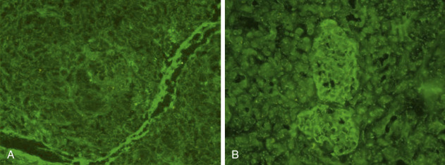

Figure 54-16 

Islet cell cytoplasmic autoantibodies (ICA) can be detected by indirect immunofluorescence. 

**A,** Negative control. **B,** Positive patient result. Note how all of the cells of the islet are identified by ICA (e.g., ICA is not beta-cell specific). ICA are quantitated in Juvenile Diabetes Foundation (JDF) units that are determined by serial end-point dilution. 

 

##  Insulin Autoantibodies 

Insulin autoantibodies (IAA) were first described in 1983 (  Palmer et al, 1983  ). IAA are present at the time of diagnosis of T1DM in up to 60% of children (  Atkinson et al, 1986  ) and are rare in adults. They are present in a few percent of the general population and can be found in other autoimmune diseases such as AITD. 

As described above, the IAA assay does not distinguish insulin antibodies from insulin autoantibodies; therefore, the IAA assay should not be ordered on patients who have been treated with insulin for more than 14 days. IAA are detected by immunoprecipitation of  125  I-labeled A-14 mono-iodinated insulin ( [ Fig. 54-17 ](<#f0090>) ). Newer electro-chemiluminescent assays using proinsulin as the autoantigen are in development (  Yu et al, 2013  ). 

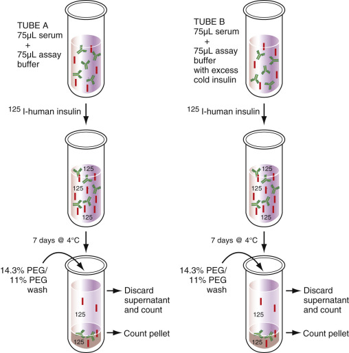

Figure 54-17 

The methodology for the measurement of IAA. 

 

##  Glutamic Acid Decarboxylase Autoantibodies 

Glutamic acid decarboxylase (GAD) was first identified as the “64K” autoantigen by  Baekkeskov and colleagues in 1990  . There are two forms of GAD: GAD65 (65 kDa) and GAD67 (67 kDa); they are encoded by separate genes. Autoimmunity to GAD65 is more common than autoimmunity to GAD67, and therefore most immunoprecipitation assays use GAD65 as the autoantigen. Electro-chemiluminescent assays for GADA are in development (  Miao et al, 2013  ). 

GADA are present at the onset of T1DM in frequencies similar to that of ICA; however, GADA are less specific for the diagnosis of T1DM than ICA because GADA are present in a few percent of the general population. Nevertheless, because GADA immunoassays can be automated, if screening for the prediction of T1DM were to be undertaken, GADA testing would be superior to ICA testing. 

 

##  Insulinoma-2-Associated Autoantibodies 

The insulinoma-2-associated autoantigen (IA-2A) is a protein tyrosine phosphatase that was discovered while screening at insulinoma expression library (  Lan et al, 1996  ). IA-2A are less sensitive than ICA or GADA for the detection of islet autoimmunity. At the onset of T1DM, approximately 60% of patients with T1DM will be IA-2A positive. IA-2A is no more specific than GADA and is less specific than ICA. However, like GADA, IA-2A testing can be automated. When the intracellular portion of IA-2 is used for immunoprecipitation testing, the assay is termed the “ICA512” autoantibody. 

 

##  Zinc Transporter-8 Autoantibodies 

Autoantibodies to the transporter that pumps zinc into insulin secretory granules (the ZnT8 autoantibody) were discovered in 2007 (  Wenzlau et al, 2007  ). The performance of ZnT8A at the time of onset of T1DM is similar to IA-2A. Some T1DM patients who are negative for all other islet autoantibodies are positive for ZnT8A. In the setting of pancreas transplantation for the treatment of T1DM, the appearance of ZnT8A predicts the development of beta-cell failure. 

ELISA kits are now commercially available to conduct ZnT8A testing. In the authors' experience, the commercial ZnT8A ELISA is a robust assay, with a very high ratio of positive signals to cutoff signals. Whereas negative is less than 15 U/mL, positives are frequently greater than 5000 U/mL (100 times greater than the highest calibrator when the sample is diluted 1 to 100). 

In cases where the patient presents with classic symptoms of diabetes, unequivocal hyperglycemia (e.g., random plasma glucose ≥200 mg/dL), and ketonuria or ketonemia, the diagnosis of T1DM is likely, and islet autoantibody testing is not necessary. However, when the diagnosis of T1DM is unclear, such as in obese patients with acute symptoms of diabetes or even ketoacidosis, or lean, young patients with only mild hyperglycemia, islet autoantibody testing may be of value because the presence of islet autoantibodies is pathognomonic of T1DM. [ Table 54-6 ](<#t0035>) illustrates clinically ambivalent cases where islet autoantibody testing may be instructive in diagnosing T1DM (e.g., positivity for an islet autoantibody indicates the presence of type 1 diabetes). 

TABLE 54-6 

Islet Autoantibody Testing 

Clinical Findings  |  Features Favoring T1DM  |  Features Favoring T2DM   
---|---|---  
Lean “T2DM” patient with poor glycemic control  |  Lean favors diagnosis of T1DM  |  Previous diagnosis of T2DM   
Lean prediabetes  |  Lean favors diagnosis of T1DM  |  T1DM is usually of acute onset   
Lean but not ketotic  |  Lean favors diagnosis of T1DM  |  Not ketotic favors diagnosis of T2DM   
Ketotic but obese  |  Ketosis favors diagnosis of T1DM  |  Obesity favors diagnosis of T2DM   
  
 

##  Prediction of T1DM 

Presently, various investigators are pursuing studies designed to prevent T1DM or delay its onset (  Sherr et al, 2008  ). Central to these studies is the recognition of prediabetic individuals who are defined by the presence of one or more islet autoantibodies (  Wasserfall & Atkinson, 2006  ). Because of their adaptability to high test volume throughput, IAA, GADA, and IA-2A are often used as initial screening tests. If any of these three tests is positive, ICA and ZnT8A testing can then be carried out. Because prevention therapies are still under investigation, general population screening for islet autoantibodies is not recommended. 

 

##  Type B Insulin Resistance 

In this autoimmune disease, extreme insulin-resistant, nonketotic diabetes results from antagonistic anti-insulin receptor autoantibodies that block (but do not activate) the insulin receptor (  Page et al, 2007  ). The phenotype of insulin resistance includes dyslipidemia, hypertension, and acanthosis nigricans. Some patients with type b insulin resistance have required insulin doses of more than 10,000 units per day! The diagnosis is established clinically because there are no commercial tests for anti-insulin receptor autoantibodies. 

 

##  Autoimmune Hypoglycemia 

Autoimmune hypoglycemia (also known as the insulin autoimmune syndrome) is not an uncommon cause of hypoglycemia in Japan (  Zhang & Zhao, 2014  ). We have observed at least one case in our institution. 

In this disorder, spontaneous autoantibodies arise, directed against circulating insulin. These IAA can bind insulin excessively, leading to hyperglycemia, or IAA can precipitously release insulin, leading to free insulin excess and hypoglycemia. Autoimmune hypoglycemia has been associated with exposure to sulfur-containing medications such as the thioureas that are used to treat Graves disease. IAA in this disorder are detected using the standard IAA assay that is applicable to T1DM. 

 

##  Insulinomimetic Autoantibodies 

Rare cases of hypoglycemia have been described that result from agonist autoantibodies directed against the insulin receptor (i.e., insulinomimetic autoantibodies) (  Taylor et al, 1982  ). There are no commercial tests for such agonist insulin receptor autoantibodies, and the authors are not aware of any investigators that are currently active in this field. 

 

##  Autoimmune Thyroid Disease 

The spectrum of autoimmune thyroid disease (AITD) spans Hashimoto thyroiditis (HT), causing hypothyroidism to Graves disease (GD), which leads to hyperthyroidism (  Orgiazzi, 1999  ). HT results from cell-mediated destruction of thyroid hormone, producing thyroid follicular cells. Consequent to a chronic inflammatory cell infiltrate into the thyroid gland, thyromegaly (goiter) can initially result. When sufficient numbers of follicular cells are destroyed, hypothyroidism results. With eventual destruction of the entire gland, goiter dissipates, and the gland may even become fibrotic. Riedel thyroiditis is the rare extension of fibrosis into tissues adjacent to the thyroid gland. 

GD results from humoral autoimmunity, where agonist autoantibodies bind to and stimulate the TSH receptor, producing goiter and hyperthyroidism (  Menconi et al, 2014  ). Exophthalmos with proptosis of the eyes is characteristic of GD compared with other causes of hyperthyroidism. Less common in GD is nonpitting myxedema of the lower extremities. If antagonistic autoantibodies are produced against the TSH receptor, the gland atrophies as a consequence of TSH receptor blockade, producing hypothyroidism and atrophic thyroiditis. The prevalence of HT in adults is 5%. The incidence of GD was estimated at 30 cases per 100,000 persons per year in a Minnesota study. 

The diagnosis of HT is based on the findings of clinical disease (e.g., goiter and/or hypothyroidism), plus the presence of a thyroid autoantibody—either TPOA or thyroglobulin autoantibodies (TGA). The diagnosis of GD is based upon the finding of hyperthyroidism and a thyroid autoantibody (TPOA or TGA). Autoantibodies to the TSH receptor (TRAbs: TSH receptor autoantibodies; e.g., TSI or TBII) support the diagnosis of GD. However, testing for TRAbs is usually not necessary in the classic clinical case of GD when goiter, hyperthyroidism, exophthalmos, and positivity for TPOA or TGA are present. Histology is not used to diagnose either HT or GD. 

 

##  Thyroperoxidase Autoantibodies 

Thyroperoxidase autoantibodies (TPOA) are directed against thyroperoxidase (TPO). The function of TPO is to organify iodide to iodine to iodinate tyrosine residues that are part of thyroglobulin (Tg). TPO is also responsible for the coupling reaction where monoiodotyrosine (MIT) and diiodotyrosine (DIT) form triiodothyronine (T3) and two DITs form thyroxine (tetraiodothyronine; T4). Normally, TPO is not accessible to circulating autoantibodies because TPO is colloidal-facing and extracellularly bound to the apical surface of thyroid follicular cells. TPOA are detected by immunoassay (  Sinclair, 2006  ). Older technologies used microsomes in agglutination assays or indirect immunofluorescence ( [ Fig. 54-18 ](<#f0095>) ). 

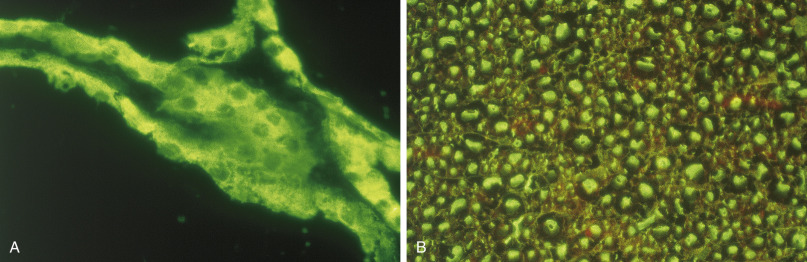

Figure 54-18 

**A,** Indirect immunofluorescence microscopy of thyroid microsomal autoantibodies (TMA) using unfixed monkey thyroid tissue as substrate (×400). **B,** Indirect immunofluorescence microscopy for thyroglobulin autoantibodies (TGA) using methanol-fixed cryostat tissue sections of monkey thyroid gland (×200).The indirect immunofluorescence microscopy technology for the detection of TMA and TGA has been surpassed by various immunoassays with cloned autoantigens. 

 

##  Thyroglobulin Autoantibodies 

Thyroglobulin autoantibodies (TGA) are directed against Tg. Whereas most Tg resides within the colloid of the thyroid follicles, small amounts of iodine-deficient Tg do circulate in the plasma. Neither TPOA nor TGA are believed to be pathogenic in AITD. TGA can interfere in the measurement of Tg, which is relevant when Tg is measured as a tumor marker in cases of differentiated thyroid carcinoma. TGA are detected by immunoassay. Older technologies involved agglutination assays. Most immunoassay analyzers offer robust, automated measurements of TPOA and TGA. 

 

##  Thyroid-Stimulating Immunoglobulins 

The measurement of thyroid-stimulating immunoglobulins (TSI) requires a bioassay where patient serum is added to thyroid slices or cloned thyroid follicular cells (  Lytton & Kahaly, 2010  ). T4 or cyclic AMP (cAMP; the second messenger of the TSH receptor signaling system) are measured in the media. Increased T4 or cAMP above the positive cutoff indicate the presence of TSI. 

 

##  Thyrotropin-Binding Inhibitor Immunoglobulins 

Thyrotropin-binding inhibitor immunoglobulins (TBII) were first detected using a radio-receptor assay where  125  I-labeled TSH competes with autoantibody in the patient's plasma (or serum) for binding to membrane-bound TSH receptors. Higher concentrations of TBII completed off the  125  I-labeled TSH, leading to lower counts in the membrane pellet after washing and centrifugation. An automated, nonradioactive TBII assay was already described above. 

TBII positivity does not distinguish GD from atrophic thyroiditis. However, whereas GD patients should be TSI positive, patients with atrophic thyroiditis should be TSI negative. 

 

##  Treatment of AITD 

Treating AITD requires treating the thyroid dysfunction (  Gessl et al, 2012  ). Immunotherapy is not indicated. HT is treated with thyroxine replacement. GD is initially treated with antithyroid medications (see above). Because of the potential development of aplastic anemia from propylthiouracil (PTU), methimazole (MM) is the preferred medication. If the patient does not enter into remission (e.g., hyperthyroidism is persistent off-therapy after 1 or more years of MM therapy), treatment options include surgical thyroidectomy or radioactive iodine ablation therapy. 

Because of the familial nature of AITD, testing of first-degree relatives for AITD would appear prudent. Likewise, testing for AITD in patients with type 1 diabetes, pernicious anemia, or Addison disease would allow the early detection and treatment of AITD prior to the development of life-threatening crises such as congestive heart failure or coma in HT and thyroid storm in GD. 

 

##  Autoimmune Addison Disease 

Primary adrenal failure causing glucocorticoid (cortisol) and mineralocorticoid (aldosterone) deficiencies is called Addison disease, after the English physician Thomas Addison, who described adrenal insufficiency in 1849. Cortisol deficiency can produce lassitude, fatigue, nausea, gastrointestinal upset, hypovolemia, hypotension, hypoglycemia, and hyponatremia. Aldosterone deficiency can also produce hypovolemia and hypotension with evidence of hyponatremia, hyperkalemia, and acidosis. At times of stress (e.g., serious infection, trauma, or surgery), when the normal physiologic response is to markedly increase cortisol secretion, acute failure to increase cortisol secretion can produce Addisonian crisis. Such Addisonian crisis, if not treated on an emergency basis, can cause death from hypovolemia, hypotension, shock, acidosis, and electrolyte abnormalities (e.g., hyponatremia and hyperkalemia). Addison disease is not a common condition (approximate prevalence in the general population is 1 case in 25,000); however, if not diagnosed and treated appropriately, it can be fatal. 

In the preantibiotic era, Addison disease most frequently resulted from infections such as tuberculosis. Presently, in developed countries, Addison disease results most commonly from cell-mediated autoimmune destruction of the adrenal cortex (  Brandão Neto & de Carvalho, 2014  ). Whereas autoimmune Addison disease can exist as an isolated disorder, it may also coexist with other endocrinopathies and related nonendocrine autoimmune diseases (  Schatz & Winter, 2002  ;  Bertholf et al, 2012  ). Autoimmune polyglandular syndrome type I is diagnosed when two or more of the following conditions are identified in a patient: hypoparathyroidism, mucocutaneous candidiasis, and adrenal autoantibodies or Addison disease. 

Autoimmune polyglandular syndrome type II (APS II) is defined as adrenal autoantibodies or Addison disease plus coexistent AITD and/or type 1 diabetes. APS II is also known as autoimmune polyendocrinopathy-candidiasis-ectodermal dystrophy (APECED). The diagnosis of autoimmune Addison disease is established in patients with endocrinologic confirmation of cortisol and aldosterone deficiency who have evidence of humoral adrenocortical autoimmunity. Histology is not used for diagnosis. 

 

##  Adrenocortical Autoimmunity 

Adrenocortical cytoplasmic autoantibodies (ACA) can be detected by indirect immunofluorescence using span-frozen, cryo-cut sections of human adrenal gland. Alternatively, commercial RIA kits are available for the detection of autoantibodies to the cloned enzyme 21-hydroxylase (  Betterle et al, 2002  ). The enzyme 21-hydroxylase catalyzes the conversion of progesterone to desoxycorticosterone (DOC) and 17-hydroprogesterone to 11-desoxycortisol. 

 

##  Treatment of Autoimmune Addison Disease 

The treatment of autoimmune Addison disease involves glucocorticoid and mineralocorticoid replacement. Immunotherapy is not indicated. The presence of ACA or 21-hydroxylase autoantibodies in an asymptomatic patient predicts the development of Addison disease. In such cases, yearly serial testing is indicated as described above (cosyntropin testing and renin measurements, along with electrolyte measurements). At the earliest confirmation of adrenal hypofunction, glucocorticoid and mineralocorticoid replacement therapy is indicated. If APS I or APS II are present, associated disorders should be sought and treated. 

 

##  Autoimmune Disease of the Ovary 

Premature menopause can be caused by autoimmune-mediated ovarian destruction (gonaditis). Autoimmune gonaditis can occur as an isolated condition, or it can occur as part of an autoimmune polyglandular syndrome (e.g., APS type 1 or APS type 2) (  Ahonen et al, 1987  ). 

Elder and colleagues (1981)  described steroidal-cell autoantibodies in patients with Addison disease ( [ Fig. 54-19 ](<#f0100>) ). Presently, steroidal cell autoantibodies are sought by indirect immunofluorescence using the following tissues as substrate: human testes (i.e., Leydig cell autoantibodies), human placenta (e.g., syncyntiotrophoblast autoantibodies), and pregnant-rabbit ovary (e.g., ovarian autoantibodies). These three tests are commercially available. Although men can express steroidal cell autoantibodies, men do not appear to suffer from testicular failure. This may be because once spermatogenesis begins during puberty, in otherwise healthy men, it continues throughout life. On the other hand, women are born with all the ova they will ever have. 

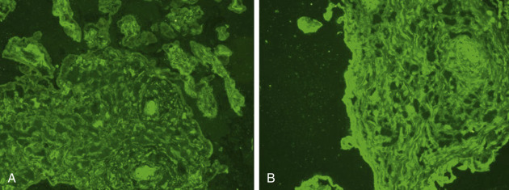

Figure 54-19 

Steroidal cell autoantibodies (SCA) can be detected by indirect immunofluorescence. 

In this case, the substrate is human placenta. **A,** Negative control. **B,** Positive patient result (note the more intense staining). 

,  

##  Autoimmune Diseases of the Neuromuscular Junction, Nervous System, and Muscle 

 

##  Myasthenia Gravis 

Myasthenia gravis (MG) is a neuromuscular disorder characterized by muscle weakness that worsens during the day and with activity (  Ha & Richman, 2015  ). Extraocular muscles, facial muscles, and muscles involved in speech, mastication, and swallowing are commonly affected. While MG can occur at any age, MG most often affects older men (age 60 years or older) and younger women (less than 40 years old) and people of all ethnicities. 

MG is most commonly caused by autoantibodies directed against the nicotinic acetyl choline (Ach) receptor (AChR) (  Oger & Frykman, 2015  ). AChR autoantibodies (AChRA) are found in 85% to 90% of MG patients. Tests for binding, blocking, and modulating autoantibodies are available. AChRA bind complement. These autoantibodies are measured by RIA. Blocking AChRA interfere with the attachment of ACh to the AChR. Modulating AChRA cause internalization of the AChR, which impairs the muscle's response to acetylcholine. Blocking and modulating AChRA are measured by flow cytometry. If a mother is affected with MG, transplacental transfer of the AChR autoantibodies can cause neonatal MG. 

In the 10% to 15% of MG patients lacking AChRA, 30% to 40% will express a muscle-specific kinase (MuSK) autoantibody that is measured by RIA. This kinase is necessary for the clustering of AChRs at the neuromuscular junction. Anti-MuSK autoantibodies are usually IgG4 antibodies. 

Approximately 5% of patients with MG are negative for both AChRA and anti-MuSK autoantibodies. Autoantibodies to striated muscle autoantigens (striational [striated muscle] antibodies) have been reported in cases of MG and thymoma. These autoantibodies are detected by enzyme immunoassay or indirect immunofluorescence, which recognizes autoantibodies against titin, the ryanodine receptor, and the alpha subunit Kv1.4 of the voltage-gated potassium channel (VGKC). 

The diagnosis of MG is made on the basis of a compatible clinical history, serologic positivity for a AChRA, an abnormal electrodiagnostic study, and a beneficial response to acetylcholine esterase inhibitors (e.g., the tensilon test) (  Berrih-Aknin et al, 2014  ). 

MG symptoms can be treated with drugs that block acetylcholine esterase (e.g., neostigmine) (  Díaz-Manera et al, 2012  ). Further therapy involves immunosuppression with a variety of agents, including glucocorticoids, azathioprine, calcineurin inhibitors, intravenous immunoglobulin, plasmapheresis, and thymectomy in resistant cases. 

 

##  Eaton-Lambert Myasthenic Syndrome 

Another neuromuscular autoimmune disease is Eaton-Lambert myasthenic syndrome (ELMS) (  Titulaer et al, 2011  ). ELMS results from autoantibodies that are directed against presynaptic voltage-gated P/Q calcium channels. With impaired entry of calcium into the presynaptic terminal, acetylcholine-containing vesicles do not bind to the presynaptic membrane, causing deficient acetylcholine release (  Pourmand, 2009  ). 

Of insidious onset, the clinical features of ELMS can be subtle. The clinical presentation is usually that of proximal muscle weakness that is more severe in the lower extremities than in the upper extremities. Decreased reflexes and autonomic dysfunction are common. The respiratory and bulbar muscles are usually spared. Of tremendous clinical importance is that in approximately 40% of cases, there is an underlying malignancy. This places the ELMS channelopathy in the category of the paraneoplastic syndromes (  Mareska & Gutmann, 2004  ). Diagnosis is confirmed by electrophysiological testing. Voltage-gated calcium channel (VGCC) autoantibody testing is available. When positive, such autoantibody testing supports the diagnosis of ELMS. 

 

##  Multiple Sclerosis 

Multiple sclerosis (MS) is a demyelinating autoimmune disease of the central nervous system and spinal cord that leads to neurologic deficits that vary over time in location, duration, and severity (  Frohman et al, 2006  ). Visual impairment, bowel and bladder incontinence, unsteady gait, and weakness are typical clinical findings in this disorder, which has a waxing-waning course (  Harrison, 2014  ). The onset of disease is usually in the young adult years. There is a female predominance. Demyelination is observed on magnetic resonance imaging (MRI), although the patient's clinical symptomatology may be discordance from the imaging study results. 

The diagnosis of MS resides upon compatible history and physical examination findings, an abnormal MRI, and cerebrospinal fluid abnormalities consistent with MS (  Karussis, 2014  ). The CSF in MS usually displays a glucose concentration within the reference interval (approximately two-thirds of plasma glucose), a white blood cell (WBC) count of less than 10 mononuclear cells/uL in 90% of cases (>50 WBC/uL is rare), a protein concentration of less than 60 mg/dL in 90% of cases (if the protein exceeds 100 mg/dL, the diagnosis of MS should be questioned), an increased IgG concentration in 80% of cases, and a myelin basic protein (MBP) concentration of greater than 4 ng/mL in 90% of acute cases. Testing for visual evoked potentials (VEPs), somatosensory evoked potentials (SSEPs), and brainstem auditory evoked potentials (BAEPs) is available to provide neurophysiologic assessment of the patient with MS. Despite its autoimmune etiology, there are no clinically useful diagnostic autoantibodies in MS (  Schirmer et al, 2014  ). Biopsy and histology do not play a role in the diagnosis of MS. 

 

##  Paraneoplastic Neurologic Syndromes 

A panoply of neurologic disorders associated with malignancies have been described (  Graus et al, 2010  ). Overall such disorders are rare (  Vernino, 2006  ). Theoretically a humoral immune response to a cancer can cross-react against neurologic self-antigens, causing autoimmunity and subsequent neurologic disease (  Hinton, 1996  ). In the setting of a recognized malignancy and neuropathy, detection of autoantibodies against a variety of nerve autoantigens can establish an autoimmune basis for the neuropathy (  Rosenfeld & Dalmau, 2013  ). 

Immunoblotting, radioimmunoassay (RIA), cytometric bead array (CBA), and indirect immunofluorescence are technologies that are commonly employed to detect paraneoplastic autoantibodies in serum or CSF. Neuronal nuclear antibodies (ANNA), purkinje cell antibodies, contactin-associated protein-2 (CASPR2) IgG antibodies, and leucine-rich, glioma-inactivated protein 1 antibodies, among others, can be investigated by indirect immunofluorescence. RIA can be used to test for voltage-gated potassium channel (VGKC) antibodies. IgG neuronal nuclear antibodies can be detected by immunoblot. These autoantibodies are against antigens that include Hu (neuronal-specific RNA-binding proteins), Ri (ANNA2), and Yo (cerebellar degeneration-related protein 2, 62kDa). 

Extensive panels of autoantibody tests are offered by reference laboratories. For example, Mayo Medical Laboratories offers tests for neuronal nuclear antibodies (antineuronal nuclear antibody-types 1 [ANNA1], 2 [ANNA2], and 3 [ANNA3], and anti-glial/neuronal nuclear antibody-type 1 [AGNA-1]); neuronal and muscle cytoplasmic antibodies purkinje cell cytoplasmic antibody, types 1 [PCA-1], 2 [PCA-2], and Tr [PCA-Tr]; amphiphysin antibody; CRMP-5-IgG; and striational [striated muscle] antibodies); cation channel antibodies (N-type and P/Q type calcium channel antibodies, AChR ganglionic neuronal antibody, and neuronal VGKC autoantibody); AChR receptor (muscle) binding antibody; AChR receptor (muscle) modulating antibody; neuromyelitis optica (NMO/aquaporin-4-IgG cell binding assay); CRMP-5-IgG western blot; amphiphysin western blot; N-methyl-D-aspartate receptor (NMDA-R) antibody; 2-amino-3-(5-methyl-3-oxo-1,2- oxazol-4-yl) propanoic acid receptor (AMPA-R) antibody; and gamma-amino butyric acid-type B receptor (GABA-B-R) antibody. Of course, a comprehensive discussion of all of these autoantibodies is beyond the scope of this chapter. 

More problematic is the patient without a recognized malignancy who presents with a neuropathy of unknown etiology. In such cases when antineuronal autoantibodies are sought, they are almost always negative, and if positive, antineuronal autoantibodies have a very low positive predictive value for cancer. As counter to these findings, the literature reports that some malignancies are not diagnosed for years after the neurologic presentation. It is likely a low-yield (and expensive) endeavor if a paraneoplastic autoantibody panel is ordered for every patient with an unexplained neuropathy in the absence of a recognized malignancy. 

 

##  Stiff-Person Syndrome 

Stiff-Person syndrome (SPS), an acquired autoimmune disease, is characterized by waxing and waning muscle rigidity with spasms that may first affect the axial muscles and progress to involve the proximal limb muscles (  Baizabal-Carvallo & Jankovic, 2014  ). The usual age of onset of this rare disease is age 30 to 60 years. 

These patients with stiffness almost always have high titers of autoantibodies to GAD (e.g., GADA), and type 1 diabetes is observed in approximately one-third of these neurologically affected patients. Thyroiditis can occur in SPS patients. Like GADA, ICA are also very common in SPS. GADA are observed in other neurologic diseases, such as cerebellar ataxia, epilepsy, limbic encephalitis, and abnormal eye movement disorders (  Alexopoulos & Dalakas, 2013  ). Amphiphysin autoantibodies detected by immunoblotting are reported in 5% of people with SPS. These later autoantibodies also serve as paraneoplastic autoantibody markers. Of interest, IA-2A are also associated with SPS (  Morgenthaler et al, 1997  ). The GADA assay for SPS is the same GADA assay as that used for type 1 diabetes. 

 

##  Polymyositis 

Polymyositis is a noninfectious inflammatory myopathy. The disorder affects proximal muscles, is symmetric, and is often painful. Weakness can be of chronic onset. Polymyositis most commonly affects older adults. It is often associated with mixed connective tissue disease. The pathogenesis is that of cell-mediated injury of myocytes via the actions of CD8 cytotoxic T cells and macrophages. Jo 1 autoantibodies directed against histidyl tRNA synthetase are characteristic of polymyositis, and such testing is commercially available from reference laboratories (  Ghirardello et al, 2013  ). 

,  

##  Conclusion 

The diagnosis of an autoimmune disease is best supported by a compatible clinical history and positivity for an organ-specific autoantibody. Indeed, many autoimmune diseases do display organ-specific autoantibodies (e.g., type 1 diabetes, AITD, autoimmune Addison disease, myasthenia gravis, and Eaton-Lambert myasthenic syndrome); however, many autoimmune diseases (e.g., multiple sclerosis) do not manifest such pathognomonic autoantibodies. Autoantibody testing remains the bedrock for the diagnosis of many organ-specific autoimmune diseases. Such markers can also predict the development of disease in asymptomatic but autoantibody-positive individuals. It should be noted that many autoantibodies of potential clinical value are not available outside of research laboratories, limiting their availability. [ Table 54-7 ](<#t0040>) provides a summary of the clinically important antibodies discussed in this chapter. 

TABLE 54-7 

Clinically Important Antibodies or Autoantibodies 

Disease  |  Important Autoantibody or Antibody Marker(s) [ _a_ ](<#hl0000809>) _,_ [ _b_ ](<#hl0000812>)  
---|---  
**Cutaneous Autoimmune Diseases**  
Pemphigus vulgaris  |  Desmoglein 1 autoantibody   
Desmoglein 3 autoantibody   
Pemphigus vulgaris  |  IIF with anti-IgG; substrate: monkey esophagus   
Pemphigus foliaceus  |  Desmoglein 1 autoantibody   
IIF with anti-IgG; substrate: guinea pig esophagus   
Paraneoplastic pemphigus  |  IgG antibodies to desmogleins and plakin family proteins (i.e., envoplakin, periplakin, plectin, desmoplakin 1 and 2) [ _c_ ](<#hl0000815>)  
IIF with anti-IgG; substrate: rat bladder   
IIF with anti-C3; substrate: rat bladder   
IgA pemphigus  |  IIF with anti-IgA; substrate: monkey esophagus   
Bullous pemphigoid  |  Bullous pemphigoid antigen 1 (BPAg1 [BP230]) autoantibody   
Bullous pemphigoid antigen 2 (BPAg2 [BP180]) autoantibody   
IIF with anti-IgG; substrate: salt-split human skin   
Pemphigoid gestationis  |  IIF with anti-C3   
IIF with anti-IgG   
Mucous membrane pemphigoid  |  IIF with anti-IgG   
Linear IgA dermatosis  |  IIF with anti-IgA   
Epidermolysis bullosa acquisita  |  IIF with anti-IgG   
Dermatitis herpetiformis  |  IIF with anti-IgA   
IgA autoantibodies to endomysium, gliadin, tTG (tissue transglutaminase) and eTG (epidermal transglutaminase) [ _c_ ](<#hl0000815>)  
**Gastrointestinal and Hepatobiliary Autoimmune Diseases**  
Pernicious anemia  |  Gastric parietal cell autoantibody (PCA)   
Intrinsic factor autoantibody   
Celiac Disease  |  IgA tissue transglutaminase (tTG) autoantibody   
IgG tissue transglutaminase (tTG) autoantibody   
IgA deamidated gliadin antibody   
IgG deamidated gliadin antibody   
IgA endomysial autoantibody   
Inflammatory bowel disease  |  Perinuclear antineutrophil cytoplasmic autoantibody (p-ANCA)   
IgA IgG anti– _Saccharomyces cerevisiae_ mannan antibodies (IgA ASCA)   
IgG anti– _Saccharomyces cerevisiae_ mannan antibodies (IgG ASCA)   
Autoimmune hepatitis  |  Smooth muscle autoantibody (SMA)   
Antinuclear autoantibody (ANA)   
Anti–LKM-1 autoantibody (LKM = liver-kidney microsomal)   
Anti–LC-1 autoantibody (LC = liver cytosol)   
Antimitochondrial autoantibody (AMA)   
Antineutrophil cytoplasmic autoantibody ANCA)   
Antiasialoglycoprotein receptor autoantibodies (anti-ASGPR autoantibodies) [ _c_ ](<#hl0000815>)  
Primary biliary cirrhosis  |  Antimitochondrial autoantibody (AMA)   
Primary sclerosing cholangitis  |  Perinuclear antineutrophil cytoplasmic autoantibody (p-ANCA)   
Autoimmune pancreatitis  |  No antibodies specific for autoimmune pancreatitis   
**Glomerular Autoimmune Diseases**  
Membranous nephropathy  |  IgG phospholipase A2 receptor autoantibody (PLA  2  RA)   
IgA nephropathy  |  There are no autoantibody tests for IgA nephropathy   
Membranoproliferative Glomerulonephritis (MPGN)  |  There are no autoantibody tests for MPGN   
C3 glomerulopathy  |  C3 nephritic factor (C3Nef)   
Postinfectious glomerulonephritis  |  Antistreptolysin O antibody (ASO)   
Anti–deoxyribonuclease-B antibody (anti–DNAse-B)   
Anti-glomerular basement membrane glomerulonephritis  |  Glomerular basement membrane antibodies   
Pauci-immune glomerulonephritis  |  Perinuclear antineutrophil cytoplasmic autoantibody (p-ANCA)   
Cytoplasmic antineutrophil cytoplasmic autoantibody (c-ANCA)   
Lupus glomerulonephritis  |  Anti–ds-DNA autoantibody   
Anti-Sm autoantibody   
**Immunoendocrinopathies**  
Type 1 diabetes  |  Islet cell cytoplasmic autoantibody (ICA)   
Insulin autoantibody (IAA)   
Glutamic acid decarboxylase autoantibody (GADA)   
Insulinoma-2-associated autoantibodies (IA-2A)   
Zinc transporter-8 autoantibodies (ZnT8A)   
Autoimmune thyroid disease  |  Thyroperoxidase autoantibody (TPOA)   
Thyroglobulin autoantibody (TGA)   
Thyroid stimulating immunoglobulin (TSI)   
Thyrotropin-binding inhibitor immunoglobulin (TBII)   
Autoimmune Addison disease  |  Adrenal cell cytoplasmic autoantibody (ACA)   
21-hydroxylase autoantibody   
Ovarian autoimmunity  |  Steroidal cell autoantibody (SCA)   
**Autoimmune Diseases of the Neuromuscular Junction, Nervous System, and Muscle**  
Myasthenia gravis  |  Acetyl choline receptor (AChR) autoantibody   
Muscle-specific kinase (MuSK) autoantibody   
Eaton-Lambert myasthenic syndrome  |  Voltage-gated calcium channel (VGCC) autoantibody   
Multiple sclerosis  |  There are no autoantibody tests for multiple sclerosis   
Paraneoplastic neurologic syndromes  |  Too numerous to list; see text   
Stiff-person syndrome  |  Glutamic acid decarboxylase autoantibody (GADA)   
Polymyositis  |  Jo 1 (antihistidyl tRNA synthetase) autoantibody   
  
_Anti-C3,_ Anti-C3 antibody labeled with FITC; _anti-IgA,_ anti-IgA antibody labeled with FITC; _anti-IgG,_ anti-IgG antibody labeled with FITC; _BMZ,_ basement membrane zone; _IIF,_ indirect immunofluorescence. 

 a Excludes direct immunofluorescence, which requires biopsy material; not every organ-specific autoimmune disease has a disease-specific autoantibody. Some antibodies are only detected in a subset of affected individuals. Non-disease-specific autoantibodies are listed only when they may be particularly diagnostically helpful. 

 b Regarding IFF, the specific distributions of the antigens are discussed in the text. 

 c Testing may not be available from reference laboratories—for example, research-only laboratories. 

,,
