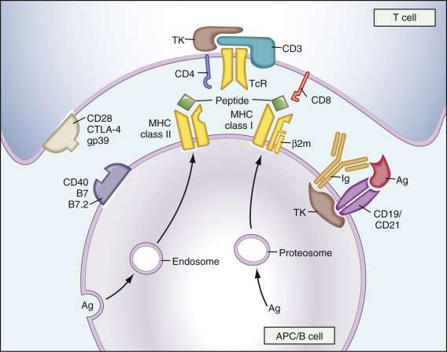

## Key Points

  * •

The immune system consists of cellular and humoral components that defend the body against invading microorganisms. Deficiency of individual factors of the immune system can leave an individual susceptible to different infections. 

  * •

The lymphoid cells of the immune system are composed of T cells that act directly against foreign antigens, and B cells that differentiate into immunoglobulin-secreting plasma cells capable of synthesizing immunoglobulins that combine with foreign antigens. Antigen-presenting cells are crucial for cell-to-cell communication during the direction of an immune response. 

  * •

The mechanisms by which lymphocytes differentiate into T cells and B cells involve rearrangement of genes for the T cell antigen receptor and of genes for immunoglobulins, respectively. 

  * •

Lymphocytes from patient specimens are characterized by detection of surface proteins, termed _cluster of differentiation,_ or _CD markers,_ which designate their subset and function. 

  * •

Additional cellular elements are natural killer lymphocytes plus neutrophils, eosinophils, and the effectors of immunoglobulin (Ig)E-mediated hypersensitivity—basophils and mast cells. 

  * •

In addition to immunoglobulins or antibodies, humoral elements include a cascading series of enzyme activation in the complement system that results in enzymatic destruction of foreign cells and recruitment of inflammatory cells by cytokine actions. 

  * •

Histocompatibility antigens play a major role in antigen presentation to T cells and form the immunologic identity of an individual, which is important in rejection of organ transplants. 

  * •

Immunologic injury can occur as the result of excessive response to specific antigenic exposures, as in an allergic response, or as a result of circulating immune complexes. 

  * •

Autoimmune disease results when the mechanisms for maintaining immunologic tolerance to self-(auto) antigens fail, resulting in the formation of various autoantibodies plus activation of the cellular immune system against the patient's own tissues. 

  * •

Laboratory measurements of the immune system involve relatively simple techniques for counting lymphocytes and their subsets, as well as for quantifying overall concentrations of immunoglobulins and complement proteins. More complex methods such as detection of gene rearrangements, autoantibody characterization, and allergen reactivity with IgE are useful for diagnosing various disorders of the immune system. 

  * •

Therapeutic approaches to disorders of the immune system include stimulation or replacement of deficient components and reduction or removal of other factors that are abnormal or are present in excess. 

The immune system is structured to recognize, respond to, and destroy a wide variety of invading organisms such as bacteria, viruses, fungi, and parasites that otherwise would be capable of promoting infection that is harmful to the body. Discovery of components of the immune system has very often followed investigation of serious infections and the specific reactions that the body uses to combat pathogenic organisms. In general, this immunologic function can be summarized as searching for foreign (or nonself) antigens that do not belong in the body and then destroying them. In this process, the immune system also maintains surveillance over the appearance of new or foreign antigens on tumor cells and attempts to destroy them while leaving unharmed the normal (or self) antigens on healthy cells. Disease states may arise as a result of various aspects of immunologic function going awry, as in hypersensitivity reactions, autoimmune disease, and various immunodeficiency disorders. When functioning properly, the immune system is responsible for rejection of allogeneic organ/tissue transplants and graft-versus-host disease; the quest for tolerance in transplantation continues. This overview highlights components of the immune system and their functions, along with some of the significant clinical disorders of immunity. 

,  

##  Lymphoid Cells 

The lymphoid cells of the body reside in the lymph nodes, the spleen, the mucosal surfaces, and the circulation. They derive from multipotential hematopoietic stem cells, with their production moving progressively from the yolk sac in the embryo to the liver in the fetus, and finally to the bone marrow in the infant through adult ages (  Weissman, 1994  ). The various lymphoid cells are conveniently identified by the presence of unique protein markers on their surfaces that endow those cells with particular functions. 

 

##  T Lymphocytes 

T lymphocytes undergo differentiation in the thymus. After originating in the bone marrow, prothymocytes pass from the cortex to the medulla of the thymus, during which time they undergo maturation. This process involves a selection process such that self-reactive thymocytes are eliminated, while thymocytes that can recognize antigens through interactions with molecules of the major histocompatibility complex (MHC) are retained (  Nossal, 1994  ;  von Boehmer, 1994  ). During maturation, they undergo genetic programming in which the gene for the T cell antigen receptor (TCR) is rearranged to produce protein receptors that are invariant in their antigen specificity for the life span of that T lymphocyte, as well as for all its descendant cells. T lymphocytes account for about 60% to 70% of all lymphocytes in the blood; they are also found in paracortical areas of lymph nodes and within periarteriolar lymphoid sheaths in the spleen. 

A majority (>95%) of T lymphocytes have antigen receptors made of α\- and β-subunits linked with disulfide bonds to form a molecular heterodimer that resides on the outer membrane of the cell in association with the CD3 molecular complex (CD3 is a pan–T cell marker). The α\- and β-subunit TCR proteins have variable, joining, and constant regions (α also contains a diversity region), with corresponding encoding regions in the _TCR_ gene that undergo rearrangement, resulting in high specificity binding for a particular antigen. The CD3 proteins assist transduction of the signal to the interior of the cell when an antigen binds to the TCR on the lymphocyte surface (  Janeway & Bottomly, 1994  ;  Weiss & Littman, 1994  ). A small percentage of T lymphocytes have a TCR composed of γ\- and δ-subunits that similarly interact with CD3; these cells are generally found at mucosal surfaces of the gastrointestinal and respiratory tracts. T cell proliferations may be characterized as neoplastic (clonal) or benign (polyclonal), according to whether their DNA shows predominantly a single form of _TCR_ gene rearrangement or a complete spectrum of such rearrangements, as normally occurs in a heterogeneous lymphocyte population. 

Examination of T lymphocytes by flow cytometry focuses on a variety of surface markers. CD4 is found on about 60% of CD3  \+  cells; these are helper/inducer T cells that direct the functions of other cells of the immune system by secreting cytokines that stimulate various functions. Two distinct subpopulations of CD4  \+  helper cells have been identified: Th1 cells, which secrete interleukin (IL)-2 and interferon (IFN)-γ; and Th2 cells, which secrete IL-4 and IL-5. Th1 cells facilitate macrophage activation, delayed-type hypersensitivity, and the production of antibodies with opsonizing action; Th2 cells direct synthesis of other antibodies such as IgE and activate eosinophils. The marker CD8 is found on about 30% of T cells (thus the normal ratio of CD4  \+  to CD8  \+  cells in the blood is typically 2 : 1). These CD8  \+  T cells exhibit cytotoxicity and suppressor activity in the immune response. 

The mechanism of antigen recognition is different between CD4  \+  and CD8  \+  subsets of T lymphocytes. CD4 molecules bind to the MHC class II molecules on antigen-presenting cells, whereas CD8 molecules interact with MHC class I molecules. Accordingly, CD4  \+  T cells recognize antigens only in the context of MHC class II antigens, and CD8  \+  T cells recognize them only through MHC class I antigens. A subset of T helper cells termed _T regulatory (Treg) cells_ are important for immune tolerance and prevention of autoimmune disorders (see [ Chapter 50 ](<##!/content/3-s2.0-B9780323295680000504?scrollTo=%23c00050>) ). Treg cells have surface markers for CD4 and CD25 (IL-2 receptor) and so are driven by IL-2. The transcription factor FOXP3 plays a role in Treg function, and mutation in the _foxp3_ gene results in dysregulation of immune tolerance and progression to autoimmune diseases. 

 

##  B Lymphocytes 

B lymphocytes make up roughly 10% to 20% of peripheral lymphocytes in the blood; they also are found in the bone marrow, lymph nodes, spleen, and other lymphoid tissues. In the spleen and lymph nodes, they aggregate into lymphoid follicles. Differentiation of B lymphocytes occurs in the bone marrow, where both positive selection and negative selection take place, as well as at peripheral locations. Antigenic stimulation of B cells leads to the formation of plasma cells that secrete immunoglobulins—the basis of specificity in humoral immunity. The B cell antigen receptor complex uses surface IgM as the antigen-binding component. The antigen specificity of immunoglobulins derives from a rearrangement process in which both heavy and light chain genes are realigned. The heavy chain has variable, diversity, joining, and constant regions, whereas the light chain gene has variable, joining, and constant regions. Maturation of an antibody response entails switching from IgM to another heavy chain type (usually IgG) as the result of further gene rearrangement, although the light chain type remains fixed (  Corcoran, 2005  ). 

B cells have on their surfaces receptors for complement (CD21, which is also the receptor for Epstein-Barr virus [EBV] and thus makes these cells susceptible to EBV infection) and for the Fc region of immunoglobulins; they have CD19 and CD20, which are frequently used for immunologic identification of B cells. 

 

##  Antigen-Presenting Cells 

Macrophages function as mononuclear phagocytes in inflammation; they also process ingested antigens and present them to immune effector cells in association with MHC molecules on their membranes ( [ Fig. 43-1 ](<#f0010>) ). T cells are not activated by soluble antigens, and so presentation of antigens in this manner is necessary for T cell stimulation and induction of cell-mediated immunity (  Germain, 1994  ;  Trombetta & Mellman, 2005  ). Macrophages also secrete cytokines such as IL-1 for modulation of inflammatory processes; they can directly lyse tumor cells in their role of immunosurveillance, and they are effector cells for some types of cell-mediated immunity (e.g., delayed hypersensitivity). 

Figure 43-1 

Cellular interactions in the immune system. 

Antigen-presenting cells (APCs) process external or internal antigens (Ag) and present antigen peptide fragments, in association with a major histocompatibility complex (MHC) molecule, to T cells. On the T cell, a specific antigen receptor (TcR), along with the coreceptor CD4 or CD8 molecule, recognizes the antigen–MHC complex. Cellular activation proceeds through the CD3 complex and activation of tyrosine kinases (TKs). The B cell receptor is composed of membrane-bound immunoglobulin (Ig) complexed to associated membrane proteins, and the CD19/21 coreceptor. On antigen recognition, cellular TKs are also activated. Costimulatory activation of T cells or B cells is provided by cellular receptors binding their ligands (the ligand B7 or B7.2 for T cell costimulation through CD28 and CTLA-4 molecules, and the gp39 ligand for the B cell CD40 molecule). 

(Redrawn with permission from  Paul W, Seder R  : Lymphocytic responses and cytokines, _Cell_ 76:229, 1994; and Weiss A, Littman D: Signal transduction by lymphocyte antigen receptors, _Cell_ 76:263, 1994.) 

Dendritic cells (found in lymphoid tissues and in interstitial regions of other organs) and Langerhans cells (found in the epidermis) have extensive dendritic cytoplasmic processes that are rich in MHC class II molecules. Consequently, they are very efficient at presenting antigens (although they probably are not phagocytic) and are considered to be extremely important in that task within the entire immune system (  Park & Chio, 2005  ). 

 

##  Natural Killer Cells 

Natural killer (NK) cells constitute 10% to 15% of lymphocytes in the peripheral blood. They are neither T cells nor B cells and were formerly called **null cells.** NK cells have the function of lysing other cells without prior sensitization. They can attack tumor cells, cells infected with viruses, and others as well; consequently, they form the initial defense against aberrant cells. NK cells are characterized by the surface markers CD16 and CD56, which are commonly used for their identification. CD16 is the Fc receptor for IgG; hence NK cells are able to lyse selectively those cells that are coated with antibodies (antibody-dependent cell-mediated cytotoxicity, which is important in some hypersensitivity reactions). NK cells also secrete cytokines such as IFN-γ. It is interesting to note that NK cells are recognizable on examination of standard stained blood smears as large granular lymphocytes (  Kronenberg, 2005  ). 

,  

##  Nonlymphoid Cells 

These cells are not genetically programmed to recognize specific antigens or to interact with lymphoid cells in the induction of an immune response. Instead, they are effectors of immune reactions that are triggered by various factors. 

 

##  Neutrophils and Eosinophils 

Neutrophils are drawn to regions of inflammation by chemoattractants such as IL-8; they then release from their granules toxic substances and enzymes that digest cellular structures indiscriminately; neutrophils also ingest cellular debris, as do eosinophils, and remove it from tissue sites. 

 

##  Basophils and Mast Cells 

Basophils (and their counterparts in tissues, the mast cells) have on their surfaces high-affinity Fc receptors that bind circulating IgE. Uptake of IgE onto the membranes of basophils apparently is not antigen dependent; instead, it is driven by mass action between the amount of total IgE and the available basophils. When the antigen (or allergen) comes into contact with basophil surface-bound IgE that recognizes it, those basophils become activated and release substances such as histamine, which mediate some hypersensitivity reactions. Thus, basophil specificity is directed by the particular IgE that is bound to its surface from the blood; theoretically, a basophil could have multiple different IgE molecules on its surface and so could react with many different allergens. 

,  

##  Humoral Factors 

 

##  Immunoglobulins 

Antibody molecules can be bound to B cell surfaces for stimulation of further immunoglobulin secretion; they also circulate in the blood and appear at mucosal surfaces of the respiratory and gastrointestinal tracts, where they are likely to come into contact with potentially pathogenic microorganisms. The major immunoglobulins in the blood are IgM, IgG, and IgA; these antibodies presumably arise following exposure to a multitude of foreign antigens and may remain for years with continued secretion to replace molecules that are lost through normal clearance of proteins from the circulation. At mucosal surfaces, the primary type of antibody is dimeric IgA, which is secreted at that site (  Fagarasan, 2004  ) (see [ Chapter 46 ](<##!/content/3-s2.0-B9780323295680000462?scrollTo=%23c00046>) ). The other immunoglobulins are IgD (which resides on B cell surfaces, where it may be involved in immune signal transduction but does not achieve substantial concentrations as free molecules in the blood) and IgE (which functions by binding to surfaces of basophils and stimulates the release of vasoactive substances from those cells in the presence of specific allergens). 

Immunoglobulins in the blood function by attaching to antigens on the surfaces of foreign cells, bacteria, viruses, and the like, and by facilitating their destruction through nonspecific effectors such as complement and NK cell activation. Disease monitoring by immunoglobulin testing includes qualitative analysis for clonal versus polyclonal detection (e.g., for diagnosis of multiple myeloma) and quantitative analyses both for overall concentrations of IgM, IgG, and IgA (to detect possible selective or combined deficiencies or overproduction of immunoglobulin classes) and for titers of specific antibodies against individual antigens (e.g., isohemagglutinins, _Pneumococcus, Haemophilus,_ tetanus, diphtheria). 

 

##  Complement 

This set of interacting proteins has the role of enzymatically destroying targets (e.g., cells, bacteria) to which they have been directed by antibodies or through other means (see [ Chapter 47 ](<##!/content/3-s2.0-B9780323295680000474?scrollTo=%23c00047>) ). Measurements of complement components have two major uses in clinical diagnosis: to detect congenital deficiencies (which are relatively rare) that may predispose to certain disorders such as infection or progression to autoimmune disease, and to detect acquired complement level reductions that reflect current activity of systemic autoimmune diseases such as systemic lupus erythematosus (  Wen et al, 2004  ). 

 

##  Cytokines 

These soluble substances are the means by which cellular immune responses are regulated; they are short-acting mediators that are elaborated by some cells and diffuse to other cells, where they act (  Leonard, 2003  ). Many cytokines are pleiotropic in that they can act on different cell types. They can act in an endocrine manner by stimulating cells at a distance, they can act on cells in their immediate vicinity (paracrine), and they can stimulate the same cells that secreted them (autocrine). The specific actions of cytokines include hematopoiesis through colony-stimulating factors that induce granulocyte and macrophage production, natural immune responses (through IL-1, tumor necrosis factor [TNF]-α, interferons, and IL-8), stimulation of lymphocyte growth and activation (through IL-2 and others), and activation of nonspecific inflammatory cells (see [ Chapter 48 ](<##!/content/3-s2.0-B9780323295680000486?scrollTo=%23c00048>) ). Cytokines are still being discovered as more details emerge regarding cell-to-cell communication. 

Clinical use of cytokines includes both suppression of the immune response in allogeneic organ transplantation by drugs such as cyclosporine, which blocks production of IL-2, and enhancement of the immune response in therapies against cancer or infection. These latter treatments are largely experimental, although it has been shown that pretreatment with antibodies against TNF-α can prevent deleterious Jarisch-Herxheimer reactions resulting from antibiotic treatment of _Borrelia recurrentis_ infection in sheep (  Fekade et al, 1996  ). This model very probably presages a host of new therapies by which immune responses will be selectively enhanced or suppressed according to particular clinical needs. 

,  

##  Histocompatibility Antigens 

The MHC (also called the _human leukocyte antigen [HLA] complex_ ) is encoded on human chromosome 6 and includes class I molecules (HLA A, B, and C), class II molecules (HLA DP, DQ, and DR), and the intervening class III molecules of some complement components and TNF-α and TNF-β (see [ Chapter 49 ](<##!/content/3-s2.0-B9780323295680000486?scrollTo=%23c00048>) ). The functions of class I and class II antigens have already been discussed briefly in terms of how they participate in antigen presentation to T cells. These antigens were discovered and their highly polymorphic natures were described in studies of immune tolerance and rejection of transplanted allogeneic organs. Consequently, one of the most important clinical uses of HLA typing involves matching potential organ or tissue donors with recipients who are in need of a transplant. Another significant clinical application is seen in the typing of affected patients and their family members to establish their risk for developing some diseases that are associated with particular HLA types (e.g., ankylosing spondylitis with HLA B27) (see [ Chapter 50 ](<##!/content/3-s2.0-B9780323295680000504?scrollTo=%23c00050>) ). Still another use of HLA typing involves providing matched platelets for patients who have become refractory to platelet transfusions as the result of HLA antibody formation after exposure to multiple donors (e.g., following transfusion support for chemotherapy or hematopoietic progenitor cell transplantation) (see [ Chapter 38 ](<##!/content/3-s2.0-B9780323295680000383?scrollTo=%23c00038>) ). 

,  

##  Mechanisms of Immunologic Injury 

Immunologic responses can cause injury to normal tissues and to invading organisms that may have triggered a response. These injurious responses are conveniently classified into four types of hypersensitivity. Type I is anaphylactic or allergic in nature; it is mediated by IgE bound to the surface of basophils and mast cells. When specific antigens (or allergens) bind to surface IgE, the basophils are stimulated to release histamine and other vasoactive substances that are the immediate mediators of allergic reactions (  Kemp & Lockey, 2002  ). Clinical strategies for treatment of asthma and allergies have addressed different aspects of this sequence of events, from counteracting the effects or release of histamine back to desensitization. Successful use of a recombinant humanized monoclonal antibody against IgE to treat such individuals has been demonstrated (  Milgrom et al, 1999  ); in the future, this therapy could be based in part on measurement of IgE concentrations in serum. 

Type II occurs when antibodies bind to antigens on the surfaces of cells; damage may occur as the result of binding and activation of complement (e.g., immune hemolysis), antibody-dependent cell-mediated cytotoxicity (e.g., lysis of tumor cells or parasites), or antibody-mediated interference with cellular functions (e.g., autoantibodies against acetylcholine receptors in myasthenia gravis). 

Type III results from immune complex formation between exogenous antigens such as bacteria or viruses and antibodies, or between endogenous autoantigens and autoantibodies. Typical tissue damage occurs in organs that contain numerous small blood vessels wherein circulating immune complexes deposit, or in places where endogenous antigens naturally occur. 

Type IV is cell-mediated or delayed hypersensitivity, which depends on functioning CD4  \+  T cells or other cytotoxicity from CD8  \+  T cells. Type IV is the basis of the immune reaction to viruses, fungi, protozoa, and parasites, and also to intracellular microbes such as mycobacteria. Patients with acquired immunodeficiency syndrome are susceptible to infection with these and other opportunistic agents when they lose CD4  \+  T cells. 

,  

##  Laboratory Applications of Immunologic Assessment 

Examinations of the immune system for evaluation of potential deficiencies or disorders are listed in [ Box 43-1 ](<#b0010>) . 

Box 43-1 

Domains of Immunology Testing 

 

##  Cellular Immunity 

  * •

Complete blood count and differential 

  * •

Lymphocyte enumeration (CD2, CD3, CD4, CD8, CD19, CD20, CD56) for T cells, B cells, NK cells 

  * •

HIV antibodies/viral load/genotype 

  * •

Skin testing for anergy 

  * •

Lymphocyte function/activation 

  * •

Neutrophil activation (oxidative burst) 

  * •

Lymphocyte adhesion defect (CD11a, CD11b, CD11c, CD18) 

 

##  Humoral Immunity 

  * •

Quantitative immunoglobulins (IgG, IgA, IgM) 

  * •

IgG subclasses 

  * •

Immunoglobulin function/stimulation (protein antigens: tetanus, diphtheria; carbohydrate antigens: _Pneumococcus, Haemophilus_ ); ABO blood group isohemagglutinins 

 

##  Complement 

  * •

C3, C4 for consumption 

  * •

Screening for deficiency: CH50 

  * •

Confirming deficiency: C1-C9 

  * •

C4d deposition 

  * •

Circulating immune complexes 

 

##  Cytokines 

  * •

Interleukins 

  * •

Interferons 

  * •

Tumor necrosis factors 

 

##  Human Leukocyte Antigens (HLAs) 

  * •

HLA antibodies for matching organs and bone marrow in allogeneic transplants 

  * •

Identity testing 

  * •

HLA genotyping (high-resolution) 

  * •

HLA typing for disease association (HLA-B27) 

 

##  Autoimmune Diseases 

  * •

Systemic rheumatic diseases: Antinuclear antibodies; anti-dsDNA, anti-Sm, anti-RNP, anti-SSA, anti-SSB, anti-Scl70, anticardiolipin, anti-CCP 

  * •

Organ-specific diseases: Antithyroid, anti–parietal cell, antiendomysial, antiadrenal, antiskin, antimitochondria, anti–smooth muscle 

  * •

Vasculitis: Cryoglobulins (RF), c-ANCA, p-ANCA 

 

##  Allergy/Hypersensitivity/Asthma 

  * •

Total IgE 

  * •

Allergen-specific IgE: Foods, pollens, animals, insects, mold 

  * •

Skin tests for allergy 

_c-ANCA,_ Classical antineutrophil cytoplasmic antibodies; _HIV,_ human immunodeficiency virus; _NK,_ natural killer; _p-ANCA,_ protoplasmic-staining antineutrophil cytoplasmic antibodies; _RF,_ rheumatoid factor. 

**Cellular immunity** has several levels of investigation, beginning with leukocyte count and differential commonly available on automated hematology analyzers as part of the complete blood cell count. Deficiencies of neutrophils often occur with chemotherapy for malignancy, whereas elevation of neutrophils is a sign of acute infection, particularly with bacteria. Rare individuals may have normal numbers of neutrophils but may be susceptible to infection owing to defects of function (e.g., chronic granulomatous disease) that can be assessed by neutrophil activation (by oxidative burst) in response to stimuli, or by bacterial killing assays. 

Different populations of lymphocytes are enumerated by flow cytometric techniques that quantitate cells according to the expression of surface protein markers specific for T cells (CD2, CD3), subsets of T cells (CD4, CD8), B cells (CD19, CD20), monocytes (CD14), and natural killer cells (CD16, CD56). Because the most common cause of lymphocyte disorder today is infection with the human immunodeficiency virus (HIV), the most frequently monitored lymphocyte surface markers are CD4 and CD8, for the effects of HIV infection and prediction of susceptibility to opportunistic infection. HIV infection is usually diagnosed by detection of anti-HIV antibodies confirmed by Western blot; monitoring of HIV infection also includes quantitative viral loads by molecular diagnostic methods such as reverse transcriptase polymerase chain reaction, and use of antiretroviral drugs is guided by HIV genotyping (and on rare occasion by phenotype testing of drug resistance). Lymphocyte function is not often measured directly, but this can be done by stimulation assays that look at lymphocyte proliferation (e.g., by incorporation of tritiated thymidine into DNA) or by cell cycle analysis performed with flow cytometry after stimulation. Of course, skin testing is a direct reflection of T cell response to antigens in vivo. 

**Humoral immunity** is often assessed by quantitative immunoglobulin measurements of total IgG, IgA, and IgM; deficiency of one or more immunoglobulin classes can lead to increased susceptibility to infection. Measurement of IgG subclasses can also be useful in this type of evaluation. Serum protein electrophoresis and immunofixation electrophoresis provide additional information regarding the clonality of immunoglobulins. A monoclonal band of immunoglobulins indicates a clonal population of B cells or plasma cells that have escaped regulation and might result in a plasma cell dyscrasia such as multiple myeloma. In contrast, a polyclonal distribution of immunoglobulins is generally taken to indicate a reactive process of an otherwise normal immune system. 

Direct measurement of immunoglobulin function is done by evaluating the titers of antibodies against specific antigens. The presence of isohemagglutinins against ABO blood group antigens is conveniently examined to detect anti-A and anti-B antibodies in persons who lack those blood groups. Common immunizations result in the presence of detectable antibodies against the protein antigens of diphtheria and the tetanus toxoid, and against the carbohydrate antigens of _Pneumococcus_ and _Haemophilus._ Measurements of antibodies against these antigens are standard procedures for evaluation of immunodeficiencies; if they are lacking, reimmunization can be done to elicit evidence of an immune response. 

Longitudinal profiling of **transcriptomics** plus other omics of genome, metabolism, and autoantibodies has been accomplished as proof of principle in a single individual over 14 months (  Chen et al, 2012  ). Although this methodology is currently very costly, it points the way to future examinations to study disease states, particularly in the evaluation of inflammatory states and whether their etiologies can be established as anti-infectious, autoimmune, anti-tumor, or other condition. This approach possibly may serve as a guide to early and specific therapy. 

A novel approach to cancer diagnosis has emerged in which antibodies to tumors are detected according to their pattern of binding, in a microarray, to thousands of random sequence peptides representing essentially all possible epitopes (  Stafford et al, 2014  ). The **immunosignature** of the peptides to which patient serum antibodies bind has allowed the successful classification of cancers in patients with over 98% accuracy. This system has the promise to provide comprehensive analysis of the immune response for the early diagnosis of malignancies and, potentially, any disease condition in which antibodies are produced, including infectious diseases (  Richer et al, 2015  ). 

The **complement system** is most frequently examined by measurement of C3 and C4 components to look for depressions that suggest consumption through activation. Although circulating immune complexes (CICs) are the presumptive cause of decreased C3 and C4 concentrations, CICs are rarely measured directly; however, deposition of CICs in tissues can be detected by immunofluorescent staining for immunoglobulin and C3 or C4d. Hereditary deficiencies of individual complement components are screened for by the CH50 test, which traditionally used antibody-coated horse erythrocytes in a hemolysis assay (now often replaced by an equivalent assay using liposomes in place of erythrocytes) and then are confirmed with specific immunoasssays for deficiencies of individual complement proteins. 

Determinations of **cytokine** concentrations are usually considered investigational procedures without definitive application, despite the understanding we have of the roles they play in pathophysiology. Some of the potential candidates for future monitoring are the interleukins IL-1β, IL-2, IL-2 receptor, IL-4, IL-5, IL-6, IL-8, IL-10, IL-12, and IL-13. These factors can be elaborated as locally acting messengers in many different inflammatory processes, and so lack specificity for distinguishing different etiologies such as infection versus autoimmune. They act at sites of tissue injury or inflammation and so do not reach easily measured concentrations in blood. Perhaps by looking at concentrations of multiple factors simultaneously both in blood and at the tissue level, interpretation will be feasible using patterns related to specific stimuli and physiologic insults. Other substances that fall into this category of immunomodulating agents include TNF-α and IFN-α, -β, and -γ. A recent clinical application utilizes the quantitation of IFN-γ released by lymphocytes in a peripheral blood specimen after in vitro stimulation with mycobacterial antigens to determine previous exposure status of a patient to that organism. 

**HLA** testing and cross-matching between donors and recipients form the basis of solid organ and bone marrow transplantation. Traditional serologic testing for antigens and antibodies has now been expanded with high-resolution HLA genotyping. HLA typing has also been used for matching platelet transfusions in select refractory patients. HLA typing has been used for identity testing, and some antigenic types (e.g., HLA-B27) are recognized to be associated with specific autoimmune disorders. 

Applications of testing to **autoimmune diseases** are multiple. Systemic rheumatic diseases such as lupus erythematosus, rheumatoid arthritis, and scleroderma are commonly diagnosed with a battery of autoantibody assays, including the antinuclear antibody plus individual antibodies such as anti-DNA, anti-Sm, anti-RNP, anti-SS-A, anti-SS-B, Scl-70, anticardiolipin, rheumatoid factor, and anti–cyclic citrullinated peptide. Organ-specific autoimmune diseases are characterized by tissue or organelle reactive autoantibodies such as antithyroid, anti–parietal cell, antiskin, antiendomysial (antitissue transglutaminase), antimitochondrial, anti–smooth muscle, antiadrenal, and so forth. Antibodies important in vasculitis include cryoglobulins and classical antineutrophil cytoplasmic antibodies/protoplasmic-staining antineutrophil cytoplasmic antibodies. Although some autoantibodies are etiologic and serial measurements of their titers are important for monitoring disease progress, other antibodies are nonetiologic and so are most useful for diagnosis alone. 

For decades, the automated methods for measuring autoantibodies and other serologies have largely been based on ELISA technologies (see [ Chapter 44 ](<##!/content/3-s2.0-B9780323295680000449?scrollTo=%23c00044>) ). Newer methods have been developed in which antigens are coated on small beads using combinations of two colored dyes to identify the antigen. The beads are then allowed to bind immunoglobulin, which is detected by fluorescent-labeled anti-Ig. This configuration allows multiplexing of different assays in the same reaction mixture resulting in labor saving and faster turnaround times. Many of these bead assays are likely to yield results somewhat different from ELISAs because they detect relatively high-avidity antibodies, but not the low-avidity antibodies that can be detected by ELISA. This feature is particularly important for quantitating anti-dsDNA antibodies, and is likely to cause some initial confusion among clinicians as immunoassays are converted to the new platform. On the positive side, high avidity anti-dsDNA antibody measurement by bead immunoassay correlates well with the Farr assay, which also detects high-avidity antibodies that are recognized to have clinical significance (  Venner et al, 2013  ). 

Immunoassays for syphilis also have gone through changes in which the order of testing has been reversed, so that the treponemal-specific assay for antibody against treponemal protein is done first; positive specimens then are tested with the rapid plasma reagin (RPR) as a confirmatory test (  Binnicker et al, 2012  ). This reversal in test order is due to the ability to automate immunoassays for antibodies against proteins, but not against cardiolipin, in the RPR. Discrepant results from these two assays should be evaluated by a third assay that relies on a different principle. 

**Allergies, hypersensitivities, and asthma** have common pathways in which allergens are recognized by specific IgE that is bound to the surfaces of basophils and mast cells, thereby liberating histamine and creating allergic symptoms. Diagnostic evaluation of allergies includes measurements of total IgE plus allergen-specific IgE to determine which allergens are significant for particular patients. Typical allergens for this testing include foods, pollens, molds, animal dander, and insects. Skin testing in vivo with these allergens is complementary because a positive response depends on the presence of reactive IgE plus competent T cells with CD4. 

Evaluation for possible immunodeficiency is usually initiated when a young child presents with numerous and often life-threatening infections. However, for children born with **severe combined immunodeficiency (SCID)** , waiting for repeat infections before initiating a diagnostic workup may allow fatal infections to develop in the first few months of life. Accordingly, many states have now implemented SCID screening of newborns using heel-stick blood samples that are already collected for other neonatal congenital disease testing (see [ Chapter 51 ](<##!/content/3-s2.0-B9780323295680000516?scrollTo=%23c00051>) ). SCID screening is based on quantitation of the T-cell receptor excision circles (TRECs) of DNA that are normally present in mature lymphocytes (  Puck, 2012  ). This approach can lead to early diagnosis and curative hematopoietic stem cell transplant prior to a first major infection in affected children. 

,  

##  Therapeutics in Immunology 

Therapeutic targets in the immune system are important to consider because of the need to measure the effects of such treatments to make adjustments and guide clinical management ( [ Box 43-2 ](<#b0015>) ). Of course, one of the most common abnormalities of cellular immunity today is HIV infection, for which antiretroviral drugs are essential with monitoring that includes viral load measurements as well as genotyping to predict response to specific drugs. 

Box 43-2 

Therapeutic Targets in the Immune System 

 

##  Cellular Immunity 

  * •

Glucocorticoids 

  * •

Anti–T cell drugs (e.g., calcineurin inhibitors) 

  * •

Anti-CD20 (e.g., rituximab) 

  * •

Antilymphocyte globulin 

  * •

Photopheresis 

  * •

Interleukin-2 

  * •

Antiretroviral drugs 

 

##  Humoral Immunity 

  * •

Intravenous immunoglobulins (pooled) 

  * •

Plasma exchange (to remove harmful antibodies, cryoglobulins) 

  * •

Humanized monoclonal/chimeric antibodies for target antigen neutralization (e.g., anti-CD20) 

 

##  Complement 

  * •

Plasmapheresis to remove complement-activating immune complexes 

  * •

Eculizumab to inhibit terminal complement activity 

 

##  Cytokines 

  * •

Interferons 

  * •

Anti–tumor necrosis factor-α

  * •

Granulocyte–colony stimulating factor (G-CSF) 

 

##  Human Leukocyte Antigens 

  * •

Organ transplant rejection: plasmapheresis 

  * •

Graft-versus-host disease: photopheresis 

 

##  Autoimmune Diseases 

Suppression of cellular or humoral immunity by: 

  * •

Glucocorticoids 

  * •

Alkylating agents (e.g., cyclophosphamide) 

  * •

Antimetabolites (e.g., methotrexate, azathioprine) 

  * •

Nonsteroidal antiinflammatory drugs 

  * •

Anti–T cell drugs 

 

##  Allergy/Hypersensitivity/Asthma 

  * •

Antihistamines 

  * •

Glucocorticoids 

  * •

Allergen desensitization injections 

  * •

Leukotriene antagonists 

  * •

β-Adrenergic agonists 

**Cellular immunity** is the target of several different drugs that act against T cells and so are often used to suppress immune responses against allogeneic solid organ transplants, as well as graft-versus-host disease (GVHD) from allogeneic bone marrow transplants. These drugs include the cyclophilin-binding drugs cyclosporine and tacrolimus, which inhibit calcineurin, and the immunosuppressants sirolimus and mycophenolate, both of which block activation of T cells and B cells. Therapeutic drug monitoring of blood concentrations of these immunosuppressants is useful to achieve therapeutic effect (usually as a synergistic action of agents from different drug classes) while avoiding drug toxicities. Polyclonal antilymphocyte globulin is used to reduce the circulating numbers of T cells in an effort to block transplant rejection. Also used is monoclonal anti-CD3 antibody, which binds to that molecule on T cells to reduce their numbers. Experimental anti–IL-2 receptor (CD25) antibody has also been used to block organ transplant rejection. Extracorporeal photopheresis has been successfully applied in the treatment of GVHD, and even for cellular rejection of transplanted solid organs, beyond its well-established role in controlling cutaneous T cell lymphoma. 

**Humoral immunity** can be enhanced by passive intravenous infusion of immunoglobulin (IVIG) fractions pooled from multiple individuals who can be expected to contain antibodies against a multitude of infectious agents; high-titer immunoglobulins against specific microorganisms are also available (e.g., against hepatitis B virus). IVIG is also used to modulate some autoimmune disorders such as myasthenia gravis, possibly by interfering with the attachment of harmful autoantibodies to tissue sites. Alternatively, harmful antibodies can be removed by plasma exchange using apheresis, in which plasma proteins are replaced by another protein solution such as 5% albumin. 

Monoclonal antibodies designed to interact with very specific antigens on cell surfaces or in the blood are now in use for several clinical applications (  Griggs & Zinkewich-Peotti, 2009  ). Because of the potential side effects of stimulating immune or even allergic responses, these large-molecule drugs have been reconfigured to appear as naturally occurring proteins by humanizing them with constant regions derived from human immunoglobulin genes. An example of such a chimeric antibody is anti-CD20, which has application in treating B cell lymphomas, as well as in modulating the synthesis of some autoantibodies. 

**Complement** consumption through CICs can be addressed therapeutically by plasmapheresis to remove those CICs (usually in the form of cryoglobulins), and thus lower the harmful deposition burden in tissues such as the renal glomeruli or other vessels. Eculizumab is a therapeutic preparation of a humanized monoclonal antibody that is a terminal complement inhibitor, specifically acting against complement protein C5. It is used for treatment of paroxysmal nocturnal hemoglobinuria (  Hillmen et al, 2006  ) and of atypical hemolytic uremic syndrome (  Noris et al, 2010  ), and is being evaluated for use in other conditions in which complement activation plays a key role. 

**Cytokines** in regular clinical use include IFN-α for combating infection with hepatitis B virus or hepatitis C virus, and IFN-γ for stimulating immune responsiveness. TNF-α can be neutralized in the circulation by specific therapeutic antibodies or a modified receptor molecule to decrease undesired inflammatory responses in conditions such as rheumatoid arthritis and Crohn's disease. Granulocyte–colony stimulating factor is used regularly in clinical practice to rescue patients who have developed leukopenia after chemotherapy, and to mobilize hematopoietic stem cells for collection from the peripheral blood to prepare for transplantation. Administration of IL-2 does succeed in raising CD4 counts, but this approach has not yet been found to improve outcome in HIV infection (  INSIGHT-ESPRIT Study Group, 2009  ). It is likely that other stimulators or inhibitors of cytokines will come into clinical practice in the future. 

**HLA** mismatches in allogeneic transplanted organs are typically dealt with by administration of immunosuppressant drugs but can also be treated with extracorporeal photopheresis to diminish cellular immune rejection, as well as with plasmapheresis to remove HLA antibodies that the host might have previously formed or later formed in response to the transplanted organ. 

**Autoimmune diseases** have been treated with different groups of drugs to reduce the inflammatory response, such as corticosteroids, alkylating agents (e.g., cyclophosphamide), antimetabolites (e.g., methotrexate, azathioprine), nonsteroidal antiinflammatory drugs, and even some of the immunosuppressants normally used to reduce T cell activity in preventing organ transplant rejection. A new medication under trial for systemic lupus erythematosus is a monoclonal antibody against B lymphocyte stimulator, which is a member of the TNF family that acts to stimulate B cell proliferation and immunoglobulin secretion (  Cancro et al, 2009  ). Other future therapies of autoimmune disorders will likely involve stimulation or suppression of specific sites in the immune response by specific monoclonal antibodies; bone marrow transplantation has also been successful in some cases. 

**Allergies and hypersensitivities** are often treated long term by desensitization methods in which allergens are used to stimulate IgG that competes with IgE to neutralize those allergens that are known to cause problems in individual patients. Medications that are commonly used to control symptoms acutely and chronically are antihistamines, corticosteroids, leukotriene antagonists, and adrenergic agonists. 

,,
