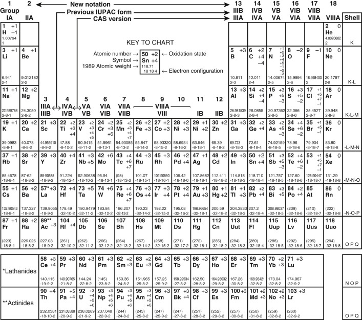

The new International Union of Pure and Applied Chemistry (IUPAC) format numbers the groups from 1 to 18. The previous IUPAC numbering system and the system used by Chemical Abstracts Service (CAS) are also shown. 

For radioactive elements that do not occur in nature, the mass number of the most stable isotope is given in parentheses. 

Modified from Lide DR, Frederikse HPR: _CRC handbook of chemistry and physics 1993 –1994, _ ed 74, Boca Raton, Fla., 1993, CRC Press. 

## References

* Chemical and Engineering News. 63:27 1985.
* Chemical and Engineering News: It's elemental: the periodic table—introduction, National Chemistry Week. October:19–24 [ http://pubs.acs.org/cen/80th/elements.html ](<http://pubs.acs.org/cen/80th/elements.html>) \- -
* Leigh GJ Nomenclature of inorganic chemistry . 1990. Blackwell Scientific Oxford: 
* Los Alamos National Laboratory : Periodic table of elements: LANL. [ periodic.lanl.gov/index.shtml ](<http://periodic.lanl.gov/index.shtml>) \- -
* The periodic table of videos, University of Nottingham. [ http://www.periodicvideos.com ](<http://www.periodicvideos.com>) -
* _Professor Martyn Poliakoff and chemistry staff from the University of Nottingham have produced “The Periodic Table of Videos” as entertaining and educational discussions and laboratory demonstrations of chemical properties of each of the elements. _
,
