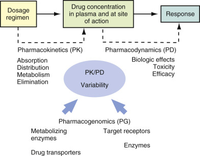
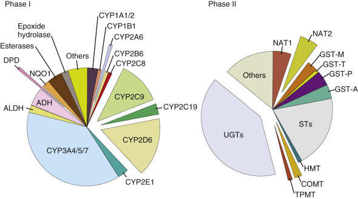
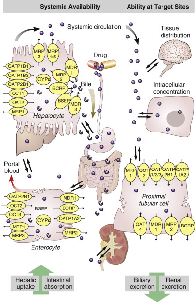
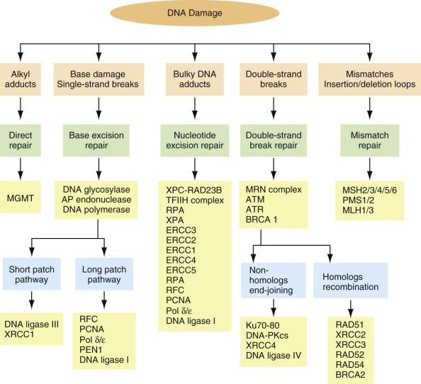
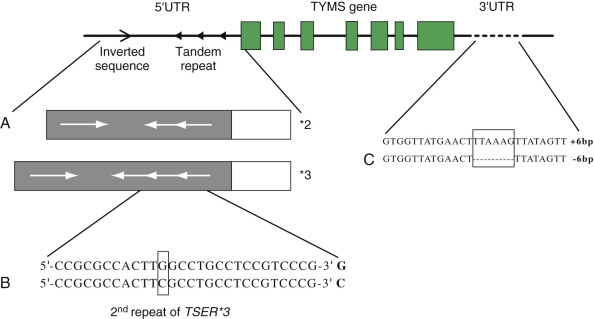
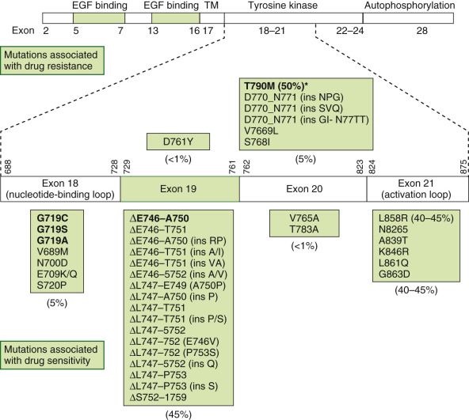
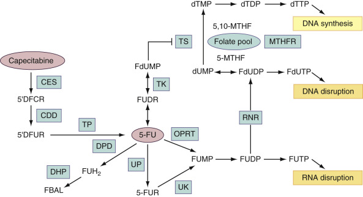
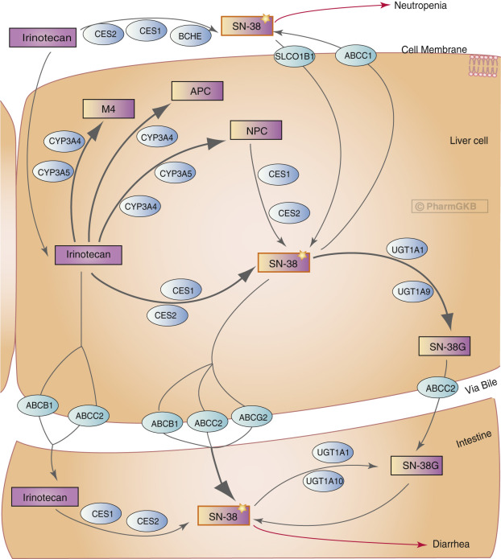
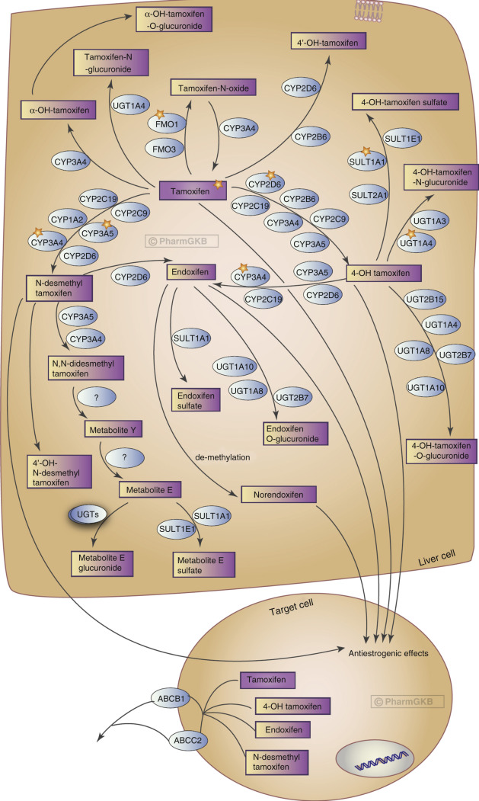
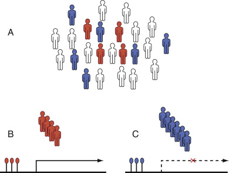

## Key Points

  * •

High throughput array technologies such as genomics and proteomics have provided unprecedented ability to personalize output of biomarkers implicated in select disease states. 

  * •

Pharmacogenomics, through utilization of novel technologies, can detect unique polymorphisms to serve as diagnostic and/or prognostic biomarkers, which relate to an individual or group response to particular therapies. 

  * •

Elucidation of unique or personal responses can tailor therapy to the individual, thereby maximizing drug choice, dose, and effect. 

  * •

Interpretation of pharmacogenomic responses can be discretionary in that many genotypic and phenotypic variables are often involved 

,  

##  Overview 

Pharmacogenomics is the study of how genetic variations influence individual response to drugs, in terms of efficacy and risk for adverse drug reactions. This relatively new field combines pharmacology (the study of drugs and their uses, effects, and mode of action) and genomics (the study of genes and their functions) to develop effective, safe medications and doses that are tailored to a person's genetic makeup. Genetic variations influencing individual response to drugs can be generally grouped into germ-line genetic polymorphisms and somatic mutations as occur in tumor tissues. Germ-line genetic polymorphisms in genes encoding drug-metabolizing enzymes, transporters, drug targets, and more recently human leukocyte antigens (HLAs) have been associated with interindividual differences in the pharmacokinetics, efficacy, and adverse drug reactions of many drugs. Somatic mutations in tumor tissues, such as mutations in epidermal growth factor receptor (EGFR), are important determinants of the response or toxicity of targeted cancer therapy. The knowledge of how inherited differences in genes affect the body's response to medications will allow the development of personalized medicine that will provide greater efficacy and safety in drug development and therapy. This chapter summarizes recent important findings on pharmacogenomics of drug-metabolizing enzymes, transporters, drug targets (including germ-line genetic polymorphisms and somatic mutations), and HLAs, and discusses their implications in the development of personalized medicine to treat a wide range of health problems. 

,  

##  Basic Concepts 

The concept of a relationship between a substance and its effect on genes, rudimentary pharmacogenetics, has been present since the early 1900s. Dr. Archibald Garrod described that genetic variations could cause adverse biologic reactions when chemical substances were ingested (  Garrod, 1902  ). Garrod's work on alcaptonuria constituted the first proof of Mendelian genetics in humans. As a result of these studies, he advanced the hypothesis that genetically determined differences in biochemical proc­esses could affect outcome after drug administration (  Mancinelli et al, 2000  ). The idea of _pharmacogenomics,_ also referred to as _toxogenomics,_ is considered to have matured from _pharmacogenetics,_ a discipline comprising genetics, pharmacology, and biochemistry, as a fusion of pharmacogenetics and genomics. Whereas pharmacogenetics classically investigates the hereditary impacts upon the action of drugs, pharmacogenomics extends pharmacogenetics to include the multifactorial drug responses caused by many genetic alterations plus environmental factors (  Kalow, 2008  ). The recognition of these complex interactions and the advance of genetics into genomics via high-throughput analysis of gene interrogation algorithms have given rise to the application of this science as a means of personalizing drug effects to a group or individual. The term _personalized medicine_ has been coined toward the promise of making therapy safer and more effective, and by giving drugs that fit a person's genes. 

The events following a drug administration can be divided into two phases: _pharmacokinetic_ and _pharmacodynamic_ phases. The pharmacokinetic phase relates a dosage regimen to the drug concentration achieved with time; pharmacokinetics concerns the drug absorption, distribution, metabolism, and excretion. The pharmacodynamic phase relates the drug concentration to the magnitude of the desired or adverse effects produced with time; pharmacodynamics concerns drug target interaction, downstream signaling events, and pharmacologic response. Each drug, after it enters the body, interacts with numerous proteins, including carrier proteins, transporters, metabolizing enzymes, and target receptors. These protein interactions determine the drug pharmacokinetics (i.e., absorption, distribution, metabolism, and excretion) and pharmacodynamics (i.e., target site of action and pharmacologic effects). As a result, the overall response to a drug is determined by the interplay of multiple genes that are involved in the pharmacokinetic and pharmacodynamic pathways of a drug ( [ Fig. 73-1 ](<#f0010>) ). The topics that follow summarize recent findings with regard to the impact of genetic variations of drug-metabolizing enzymes, transporters, drug targets, and HLAs, on drug pharmacokinetics, efficacy, and risk for adverse drug reactions. 

Figure 73-1 

Schematic illustration of interactions between pharmacokinetics (PK), pharmacodynamics (PD), and pharmacogenomics. 

The PK relates a dosage regimen to drug concentration–time course in the body, and the PD relates the drug concentration to the magnitude of the desired or adverse effects produced. Genetic variations in the genes involved in drug disposition (e.g., drug-metabolizing enzymes, transporter genes) and drug action (e.g., target receptors, enzymes) contribute to the interindividual PK/PD variability. 

,  

##  Drug-Metabolizing Enzyme Pharmacogenomics 

Drug-metabolizing enzymes are proteins that catalyze the biochemical modifications of xenobiotics (e.g., drugs) and endogenous chemicals (e.g., hormones, neurotransmitters). Drug metabolism can result in the activation (toxication) or deactivation (detoxication) of the chemical. Even though both occur, the majority of metabolites of most drugs are deactivation products. Broadly, drug-metabolizing enzymes are divided into two categories: phase I (functionalizing) enzymes that introduce or remove functional groups in a substrate through oxidation, reduction, or hydrolysis; and phase II (conjugating) enzymes that transfer moieties from a cofactor to a substrate. Essentially all of the major human metabolizing enzymes exhibit genetic polymorphisms at the genomic level, and many of these enzymes have clinically relevant genetic polymorphisms ( [ Fig. 73-2 ](<#f0015>) ). A gene is considered to be polymorphic when the frequency of a variant allele in a specific population is at least 1%. 

Figure 73-2 

Phase I and II drug-metabolizing enzymes that exhibit common genetic polymorphisms. 

The percentage of phase I and phase II metabolism of drugs that each enzyme contributes is estimated by the relative size of each section of the corresponding chart; those enzyme polymorphisms that have already been associated with changes in drug effects are separated from the corresponding pie charts. _ADH_ , Alcohol dehydrogenase; _ALDH_ , aldehyde dehydrogenase; _CYP_ , cytochrome P450; _DPD_ , dihydropyrimidine dehydrogenase; _NQO1_ , NAD(P)H dehydrogenase, quinone 1; _COMT,_ catechol _O_ -methyltransferase; _GST,_ glutathione _S_ -transferase; _HMT,_ histamine methyltransferase; _NAT, N_ -acetyltransferase; _STs,_ sulfotransferases; _TPMT,_ thiopurine methyltransferase; _UGTs,_ uridine 5′-triphosphate glucuronosyltransferases. 

(Adapted from Evans WE, Relling MV: Pharmacogenomics: translating functional genomics into rational therapeutics, _Science_ 286:487–491, 1999.) 

 

##  Phase I Enzymes 

Phase I metabolizing enzymes include those involved in oxidation (e.g., cytochrome P450 [CYP], alcohol dehydrogenase, aldehyde dehydro­genase, dihydropyrimidine dehydrogenase, monoamine oxidase, and flavin-containing monooxygenase), reduction (e.g., nicotinamide adenine dinucleotide phosphate [NADPH]-cytochrome P450 reductase and reduced cytochrome P450), and hydrolysis (e.g., epoxide hydrolase, esterases, and amidases). 

The most important phase I enzymes that exhibit clinical relevant genetic polymorphisms are in the CYP superfamily, which represents the most important system responsible for catalyzing the oxidation of a large number of endogenous and exogenous compounds including drugs, toxins, and carcinogens. In this superfamily, 57 genes and 58 pseudogenes have been identified, which are divided into 18 families and 43 subfamilies ( [ http://ghr.nlm.nih.gov/geneFamily/cyp ](<http://ghr.nlm.nih.gov/geneFamily/cyp>) ). Among them, three CYP subfamilies— _CYP1, CYP2,_ and _CYP3_ —are the main ones contributing to the oxidative metabolism of more than 90% of clinically used drugs. 

The human _CYP_ genes are highly polymorphic. The polymorphisms within the _CYP_ genes, which include gene deletions, missense mutations, deleterious mutations creating splicing defects or premature stop codon, and gene duplications, can result in abolished, reduced, normal, or enhanced enzyme activity. Based on the level of CYP enzyme activity, patients can be classified into four phenotypes: poor metabolizer (abolished activity), intermediate metabolizer (reduced activity), extensive metabolizer (normal activity), and ultrarapid metabolizer (enhanced activity). Poor metabolizers may have higher concentrations of a drug that is inactivated by that enzyme pathway, thereby requiring a lower dose to avoid adverse reactions; whereas ultrarapid metabolizers may require a higher dose to achieve effective therapeutic drug concentrations. The opposite pattern of reactions occur in response to a prodrug that requires metabolic activation to exert its pharmacologic effect. A prodrug may have little therapeutic effect in poor metabolizers while producing toxic levels of active form in ultrarapid metabolizers. 

A growing body of evidence suggests that genetic polymorphisms within the _CYP_ genes have significant impact on drug disposition and/or response. The common functional polymorphisms in the major human _CYP_ genes and their clinical relevance are summarized in [ Table 73-1 ](<#t0010>) . Comprehensive reviews on the pharmacogenetics/genomics of CYPs have been published (  Ingelman-Sundberg, 2004  ;  Andersson et al, 2005  ; van  Schaik, 2005  ;  Rodriguez-Antona & Ingelman-Sundberg, 2006  ;  Zhou et al, 2009  ). Notably, the most pharmacologically and clinically relevant polymorphisms are found in _CYP2D6, CYP2C9,_ and _CYP2C19_ . Of the U.S. Food and Drug Administration (FDA)-approved drug labels referring to human genomic biomarkers, 62% pertain to polymorphisms in the CYP enzymes, with CYP2D6 (35%), CYP2C19 (17%), and CYP2C9 (7%) being the most common (  Frueh et al, 2008  ). For a review, see  Li & Bluth, 2011  . 

TABLE 73-1 

Most Common Naturally Occurring Functional Polymorphisms in the Major Human Cytochrome P450 Genes: Allele Frequency, Functional Effect, and Highlights of Clinical Relevance 

Common Allelic Variants  |  Polymorphism/Substitution  |  ALLELE FREQUENCY (%) [ * ](<#hl0000578>) |  Functional Effect [ † ](<#hl0000588>) |  Highlights of Clinical Relevance [ ‡ ](<#hl0000592>)  
---|---|---|---|---  
Ca  |  As  |  Af   
**CYP1A1** |  Mainly expressed in extrahepatic tissues.   
CYP1A1 [ * ](<#hl0000578>) 2A  |  3698T>C(MspI)  |  6.6-19  |  33-54  |  22-28  |  ↑Inducibility  |  CYP1A1, 1A2, and 1B1 play an important role in the bioactivation of a variety of carcinogens.   
CYP1A1 [ * ](<#hl0000578>) 2B  |  I462V; 3698T>C(MspI)  |  – |  – |  – |  ↑Inducibility  |  ↑Lung cancer risk generally associated with highly inducible or active CYP1A1 polymorphisms such as CYP1A1 [ * ](<#hl0000578>) 2C.   
CYP1A1 [ * ](<#hl0000578>) 2C  |  I462V  |  2.2-8.9  |  28-31  |  0-2.7  |  ↑Activity  |  CYP1A1 genotypes also associated with risk for breast, prostate, and ovarian cancers that are possibly related to estrogen activation.   
CYP1A1 [ * ](<#hl0000578>) 3  |  3204T>C  |  0  |  0  |  7.6-14  |  Normal   
CYP1A1 [ * ](<#hl0000578>) 4  |  T461N  |  2.0-5.7  |  – |  – |  Normal   
**CYP1A2** |  CYP1A2 accounts for ~13% of total hepatic CYP content.   
CYP1A2 [ * ](<#hl0000578>) 1C  |  –3860G>A  |  |  |  |  ↓Inducibility  |  High inducible [ * ](<#hl0000578>) 1F genotype associated with ↑clearance of CYP1A2 substrates (e.g., caffeine) after smoking or omeprazole treatment.   
CYP1A2 [ * ](<#hl0000578>) 1F  |  –163C>A  |  33  |  68  |  |  ↑Inducibility  |  [ * ](<#hl0000578>) 1K associated with ↓in vivo caffeine metabolism.   
CYP1A2 [ * ](<#hl0000578>) 1K  |  Haplotype (–63C>A, –739T>G, –729C>T)  |  0.5  |  |  |  ↓Inducibility   
↓Activity  |  CYP1A2 genotypes are associated with cancer risk.   
CYP2A6  |  CYP2A6 accounts for 1% to 10% of total hepatic CYPs.   
CYP2A6 [ * ](<#hl0000578>) 1X2  |  Gene duplication  |  1.7  |  |  0.4   
<1  |  ↑Activity   
↓Activity  |  The frequency of CYP2A6 alleles has marked ethnic differences. CYP2A6 [ * ](<#hl0000578>) 4 accounts for the majority of PMs in Asians.   
CYP2A6 [ * ](<#hl0000578>) 2   
CYP2A6 [ * ](<#hl0000578>) 4  |  L160H   
Gene deletion  |  1-3   
0.5-1  |  7-22  |  15-20  |  Abolished activity  |  Because nicotine is converted to cotinine by CYP2A6, a high expression/activity of CYP2A6 is proposed to increase the susceptibility to nicotine addiction and the risk for tobacco-related cancers. Therefore, CYP2A6 genetic variation could play a role in nicotine addiction and tobacco-related cancer risks.   
**CYP2B6** |  CYP2B6 is mainly expressed in the liver, accounting for 6% of total CYPs.   
CYP2B6 [ * ](<#hl0000578>) 4  |  K262R  |  5  |  |  |  ↑Activity  |  The anticancer drug cyclophosphamide (CPA) is bioactivated by CYP2B6. CYP2B6 polymorphisms would likely affect the PK and/or PD of CPA. For example, CYP2B6 [ * ](<#hl0000578>) 6 carriers exhibited ↑CPA clearance and CPA 4-hydroxylation activity.   
CYP2B6 [ * ](<#hl0000578>) 5   
CYP2B6 [ * ](<#hl0000578>) 6   
CYP2B6 [ * ](<#hl0000578>) 7  |  R487C   
Q172H; K262R   
Q172H; K262R; R487C  |  11-14   
16-26   
13  |  1   
16   
0  |  |  ↓Expression   
↑Activity   
↑Activity  |  CYP2B6 polymorphisms may affect the PK and therapeutic outcome of anti-HIV agents such as efavirenz and nevirapine. For example, the CYP2B6 Q172H variant is associated with ↑plasma concentrations of efavirenz and nevirapine.   
**CYP2C8** |  CYP2C8 accounts for ~7% of total hepatic CYP contents.   
CYP2C8 [ * ](<#hl0000578>) 2   
CYP2C8 [ * ](<#hl0000578>) 3   
CYP2C8 [ * ](<#hl0000578>) 4  |  I269F   
R139K; K399R   
I264M  |  0.4   
13   
7.5  |  0  |  18   
2  |  ↓Activity   
↓Activity   
↓Activity  |  CYP2C8 [ * ](<#hl0000578>) 3 is associated with ↓clearance of both R- and S-ibuprofen.   
**CYP2C9** |  CYP2C9 accounts for ~20% of total hepatic CYP contents.   
CYP2C9 [ * ](<#hl0000578>) 2   
CYP2C9 [ * ](<#hl0000578>) 3   
CYP2C9 [ * ](<#hl0000578>) 5  |  R144C   
I359L   
D360E  |  13-22   
3-16   
0  |  0   
3   
2  |  3   
1.3   
0  |  ↓Activity   
↓Activity   
↓Activity  |  CYP2C9 [ * ](<#hl0000578>) 2 and [ * ](<#hl0000578>) 3 have been shown to affect the oral clearance of at least 17 different CYP2C9 substrate drugs (e.g., S-warfarin, celecoxib, ibuprofen, and phenytoin).   
**CYP2C19** |  The PM phenotype of CYP2C19 occurs in 12% to 23% of the Asian population, 1% to 6% of Caucasians, and 1% to 7.5% of black Africans.   
CYP2C19 [ * ](<#hl0000578>) 2   
CYP2C19 [ * ](<#hl0000578>) 3   
CYP2C19 [ * ](<#hl0000578>) 17  |  Splicing defect; I331V   
W212X; I331V   
I331V  |  15   
0.04   
18  |  30   
5   
4  |  17   
0.4  |  Abolished activity   
Abolished activity   
↑Transcription  |  Polymorphisms in the _CYP2C19_ gene are known to affect the PK and/or response of several classes of drugs, including proton pump inhibitors (e.g., omeprazole) and barbiturates.   
**CYP2D6** |  CYP2D6 accounts for ~2% of total hepatic CYP contents. However, it is involved in the metabolism of ~25% of all drugs in clinical use.   
CYP2D6 [ * ](<#hl0000578>) 3  |  Frameshift  |  1-2  |  <1  |  |  Abolished activity (PM)  |  Unlike other CYPs, CYP2D6 is not inducible, and thus genetic polymorphisms are largely responsible for the variation in enzyme expression and activity.   
CYP2D6 [ * ](<#hl0000578>) 4  |  Splicing defect  |  20-25  |  1  |  6-7  |  Abolished activity (PM)  |  CYP2D6 genotypes exhibit large interethnic differences: low frequency of PM in Asian (~1%) and African (0% to 5%) populations, compared to Caucasians (5% to 14%).   
CYP2D6 [ * ](<#hl0000578>) 5  |  Gene deletion  |  4-6  |  4-6  |  4-6  |  Abolished activity (PM)  |  The CYP2D6 genotype is of great importance for the PK and response of many drugs, including tricyclic antidepressants, antiarrhythmics, neuroleptics, analgesics, antiemetics, and anticancer drugs.   
CYP2D6 [ * ](<#hl0000578>) 10  |  P34S; S486T  |  <2  |  50  |  3-9  |  ↓Activity (IM)   
CYP2D6 [ * ](<#hl0000578>) 17  |  T107I; R296C; S486T  |  <1  |  |  20-34  |  ↓Activity (IM)   
CYP2D6 [ * ](<#hl0000578>) 41  |  R296C; splicing defect; S486T  |  1.3  |  2  |  5.8  |  ↓Activity (IM)   
CYP2D6 [ * ](<#hl0000578>) 1×N, N≥2  |  Gene duplication  |  |  |  |  ↑Activity (UM)   
CYP2D6 [ * ](<#hl0000578>) 2×N, N≥2  |  Gene duplication  |  |  |  |  ↑Activity (UM)   
**CYP3A4** |  CYP3A4 has the highest abundance in the human liver (~40%) and metabolizes over 50% of all currently used drugs.   
CYP3A4 [ * ](<#hl0000578>) 1B  |  5′ flanking region  |  2-9  |  0  |  35-67  |  Altered expression  |  Genetic polymorphisms in CYP3A4 appear to be more prevalent in Caucasians than in Asians.   
CYP3A4 [ * ](<#hl0000578>) 2  |  S222P  |  2.7-4.5  |  0  |  0  |  Substrate-dependent altered activity  |  There is no consensus on a direct functional or clinical association of CYP3A4 polymorphism. CYP3A4 polymorphism may have minor or moderate clinical relevance.   
CYP3A4 [ * ](<#hl0000578>) 3  |  M445T  |  1.1  |  |  |  ↓Activity   
CYP3A4 [ * ](<#hl0000578>) 17  |  F189S  |  2.1  |  |  |  ↓Activity   
CYP3A4 [ * ](<#hl0000578>) 18  |  L293P  |  0  |  |  1  |  ↑Activity   
**CYP3A5** |  The clinical relevance of the CYP3A5 polymorphism is demonstrated by the fact that the PK of the immunosuppressive drug tacrolimus is associated with the CYP3A5 genotype.   
CYP3A5 [ * ](<#hl0000578>) 3  |  Splicing defect  |  90  |  75  |  50  |  Abolished activity   
CYP3A5 [ * ](<#hl0000578>) 6  |  Splicing defect  |  0  |  0  |  7.5  |  Severely ↓activity   
CYP3A5 [ * ](<#hl0000578>) 7  |  346 frameshift  |  0  |  0  |  8  |  Severely ↓activity   
**CYP3A7** |  CYP3A7 is a predominantly fetal enzyme.   
CYP3A7 [ * ](<#hl0000578>) 1C   
CYP3A7 [ * ](<#hl0000578>) 2  |  Promoter   
T409R  |  3   
8  |  28  |  6   
62  |  ↑Expression   
↑Activity  |  The in vivo functional effect of CYP3A7 polymorphism is demonstrated by the fact that carriers of the CYP3A7 [ * ](<#hl0000578>) 1C allele had a significantly decreased endogenous level of dehydroepiandrosterone sulfate, a specific substrate of CYP3A7.   
  
_Af,_ African; _As,_ Asian; _Ca,_ Caucasian; ↑ indicates increased; ↓ indicates decreased. 

 * Allele frequency data are obtained from  Xie et al., 2001  ;  Bradford, 2002  ;  Mizutani, 2003  ;  Solus et al., 2004  ;  Roy et al., 2005  ;  Suarez-Kurtz, 2005  ;  Sistonen et al., 2007  . 

 † Functional effect data are obtained from the Human Cytochrome P450 (CYP) Allele Nomenclature Committee website ( [ http://www.cypalleles.ki.se/ ](<http://www.cypalleles.ki.se/>) ). 

 ‡ Comprehensive reviews were written by  Ingelman-Sundberg, 2004  ;  Bozina et al., 2009  ;  Zhou et al., 2009  . 

Unlike other CYPs, CYP2D6 is not inducible. Therefore, variations in the enzyme expression and activity are largely attributable to the genetic polymorphisms. The _CYP2D6_ gene is highly polymorphic with more than 63 functional variants identified to date ( [ http://www.cypalleles.ki.se ](<http://www.cypalleles.ki.se>) ). These alleles result in abolished, decreased, normal, or ultrarapid CYP2D6 enzyme activity. The most important null alleles are _CYP2D6*4_ (splicing defect) and _CYP2D6*5_ (gene deletion); the common alleles with severely reduced enzyme activity are represented by _CYP2D6*10_ , _*17_ , and _*41_ ; ultrarapid enzyme activity is derived from duplication or multiduplications of active _CYP2D6_ genes (e.g., _CYP2D6*1_ × N [N ≥2]) (see [ Table 73-1 ](<#t0010>) ). The distributions of _CYP2D6_ alleles exhibit notable interethnic differences. The nonfunctional allele _CYP2D6*4_ is prevalent in Caucasians (allelic frequency, ~25%); the reduced function allele _CYP2D6*10_ is common in Asians (allelic frequency, ~40%); and _CYP2D6*17_ is common in Africans (allelic frequency, ~34%) (  Bradford, 2002  ). As a result, CYP2D6 poor metabolizers, mainly derived from null allele _CYP2D6*4_ , have a high frequency in Caucasians (5% to 14%) compared with Africans (0% to 5%) and Asians (0% to 1%). In contrast, CYP2D6 ultrarapid metabolizers due to gene duplication or multiduplications have a high frequency in Saudi Arabians (20%) and black Ethiopians (29%) compared with Caucasians (1% to 10%) (  Bradford, 2002  ). The interethnic difference in the _CYP2D6_ genotypes may contribute to the interethnic variation in the disposition and response of substrate drugs. Although it accounts for ~2% of total hepatic CYP contents, CYP2D6 is involved in the metabolism of ~25% of all drugs in clinical use. _CYP2D6_ genotype is of great importance to the pharmacokinetics and response of many drugs, including tricyclic antidepressants, antiarrhythmics, neuroleptics, analgesics, antiemetics, and anticancer drugs (for a review, see  Zhou et al, 2009  ). A representative example is the implication of CYP2D6 phenotypes to the pharmacokinetics and clinical efficacy of tamoxifen, a prodrug requiring metabolic activation primarily mediated by CYP2D6. The pharmacogenetics of tamoxifen is discussed in detail later. 

The human _CYP2C9_ and _CYP2C19_ genes are highly homologous at the nucleotide level. The most common nonsynonymous _CYP2C9_ polymorphisms, _CYP2C9*2_ and _CYP2C9*3,_ result in the enzyme with differing affinity or intrinsic clearance for different substrates. While _CYP2C9*2_ effect appears to be more substrate-specific, _CYP2C9*3_ variant exhibits reduced catalytic activity toward the majority of CYP2C9 substrates. The clinical importance of _CYP2C9_ polymorphisms is exemplified by the CYP2C9 genotype-guided dosing of an oral anticoagulant warfarin. The patients carrying either _CYP2C9*2_ or _CYP2C9*3_ require significantly smaller daily dose of warfarin to maintain desired therapeutic effects while avoiding severe toxicity, compared with patients carrying the wild-type _CYP2C9_ (  Higashi et al, 2002  ). For _CYP2C19,_ a splice site mutation in exon 4 _(CYP2C19*2)_ and a premature stop codon in exon 4 _(CYP2C19*3)_ represent the two most predominant null alleles. It is estimated that by genotyping for _CYP2C19*2_ and _*3,_ ~84%, ~100%, and >90% of poor CYP2C19 metabolizers could be detected in Caucasians, Asians, and Africans, respectively. CYP2C19 poor metabolizers are found in 12% to 23% of Asians, 1% to 6% of Caucasians, and 1% to 7.5% of Africans. _CYP2C19_ genotypes are clinically relevant to the pharmacokinetics and response of several classes of drugs, including proton pump inhibitors (e.g., omeprazole) and barbiturates (for a review, see  Zhou et al, 2009  ). 

 

##  Phase II Enzymes 

The most important phase II enzymes that exhibit functional and clinical relevant genetic polymorphisms are uridine diphosphate glucuronosyltransferase (UGT), sulfotransferase (SULT), glutathione S-transferases (GST), _N_ -acetyltransferase (NAT), and thiopurine methyltransferase (TPMT) (see [ Fig. 73-2 ](<#f0015>) ). [ Table 73-2 ](<#t0015>) summarizes common functional polymorphisms in these phase II enzymes and highlights their clinical significance. 

TABLE 73-2 

Most Common Naturally Occurring Functional Polymorphisms in Major Human Phase II Drug-Metabolizing Enzymes: Allele Frequency, Functional Effect, and Highlights of Clinical Relevance 

Allelic Variants  |  Polymorphism/Substitution  |  ALLELE FREQUENCY (%)  |  Functional Effect  |  Highlights of Clinical Relevance   
---|---|---|---|---  
Ca  |  As  |  Af   
**UGT1A1** [ ***** ](<#hl0001027>) |  UGT1A1 low promoter activity alleles (e.g., UGT1A1 [ * ](<#hl0001027>) 28) are significantly associated with ↓glucuronidation of SN-38 (the active metabolite of irinotecan), thereby resulting in ↑risk for irinotecan-induced toxicity.   
UGT1A1 [ * ](<#hl0001027>) 6  |  G71R  |  0  |  13-23  |  – |  ↓Activity  |  Genetic variations in UGT1A1 may modify susceptibility to steroid-related cancers including breast, ovarian, endometrial, and prostate cancers.   
UGT1A1 [ * ](<#hl0001027>) 28  |  (TA)6>(TA)7 in promoter  |  2-9-40  |  13-16  |  36-43  |  ↓Expression   
UGT1A1 [ * ](<#hl0001027>) 33  |  (TA)6>(TA)5 in promoter  |  0-0.7  |  0  |  3-8  |  ↑Expression   
UGT1A1 [ * ](<#hl0001027>) 34  |  (TA)6>(TA)8 in promoter  |  0-0.7  |  0  |  0.9-7  |  ↓Expression   
**UGT1A6** [ ***** ](<#hl0001027>) |  UGT1A6 catalyzes the glucuronidation of aspirin and acetaminophen.   
UGT1A6 [ * ](<#hl0001027>) 2  |  T181A, R184S  |  30  |  23  |  |  ↓Activity  |  “Low activity” UGT1A6 variants, leading to increased salicylate levels in aspirin users, are associated with a lower risk for colon cancer.   
UGT1A6 [ * ](<#hl0001027>) 3  |  R184S  |  1-2  |  1.6  |  |  Unknown   
UGT1A6 [ * ](<#hl0001027>) 4  |  T181A  |  2.4  |  |  |  Unknown   
**UGT1A7** [ ***** ](<#hl0001027>)  
UGT1A7 [ * ](<#hl0001027>) 2  |  N129K, R131K  |  24-34  |  15  |  39  |  Similar activity  |  UGT1A7 is an important extrahepatic UGT that inactivates a variety of carcinogens.   
UGT1A7 [ * ](<#hl0001027>) 3   
UGT1A7 [ * ](<#hl0001027>) 4  |  N129K, R131K, W208R   
W208R  |  23-36   
1-1.7  |  26   
0  |  23   
1  |  ↓Activity   
↓Activity  |  Low-activity UGT1A7 variants increase the risk of developing tobacco-related cancers, specifically orolaryngeal cancer.   
**UGT2B7** [ ***** ](<#hl0001027>) |  UGT2B7 is of major significance for the glucuronidation of a number of clinically important drugs (e.g., morphinan derivatives, epiribicin, and zidovudine).   
UGT2B7 [ * ](<#hl0001027>) 2  |  H268Y  |  49-54  |  27  |  |  Similar or decreased activity  |  Further studies are needed to elucidate the clinical impact of the UGT2B7 polymorphism.   
**UGT2B15** [ ***** ](<#hl0001027>) |  UGT2B15 is the most efficient UGT2B involved in the inactivation of steroid hormones, mainly androgens.   
UGT2B15 [ * ](<#hl0001027>) 2  |  D85Y  |  52-55  |  36-49  |  39  |  ↑Activity  |  UGT2B15 polymorphisms have a potential role in a modified risk for prostate cancer.   
**SULT1A1** [ ** † ** ](<#hl0001033>) |  SULT1A1 is the most highly expressed hepatic SULT.   
SULT1A1 [ * ](<#hl0001027>) 2  |  R213H  |  25-36  |  4.5-17  |  27-29  |  ↓Activity and ↓thermal stability  |  SULT1A1 plays an important role in the sulfation of the metabolites of tamoxifen, 4-hydroxy-tamoxifen, and endoxifen. SULT1A1 [ * ](<#hl0001027>) 2 is associated with decreased survival of breast cancer patients treated with tamoxifen.   
SULT1A1 [ * ](<#hl0001027>) 3  |  M223V  |  1.2  |  0.6  |  23  |  Similar activity   
**GST** [ ** ‡ ** ](<#hl0001039>) |   
GSTA1 [ * ](<#hl0001027>) B  |  Promoter point mutation (T-631G, T-567G, C-69T, G-52A)  |  40  |  |  41  |  ↓Expression  |  GSTA1 is involved in glutathione conjugation of the active metabolites of cyclophosphamide (CPA). GSTA1 [ * ](<#hl0001027>) B allele is associated with higher survival rate of breast cancer patients treated with CPA-containing chemotherapy.   
GSTM1 [ * ](<#hl0001027>) 0  |  Gene deletion  |  42-58  |  |  27-41  |  Abolished activity  |  The GSTM null genotype is associated with an increased risk for lung, colon, and bladder cancer.   
AML patients carrying GSTM [ * ](<#hl0001027>) 0 appear to have a better response to Adriamycin and cyclophosphamide treatment.   
GSTP1 [ * ](<#hl0001027>) B  |  I105V  |  6-40  |  |  54  |  ↓Activity  |  The GSTP1 [ * ](<#hl0001027>) B allele is associated with lower clearance of etoposide and reduced risk for relapse in childhood ALL patients.   
The GSTP1 [ * ](<#hl0001027>) B allele is associated with increased survival rate in patients with advanced colorectal cancer or breast cancer.   
GSTT1 [ * ](<#hl0001027>) 0  |  Gene deletion  |  2-42  |  |  |  Abolished activity  |  The GSTT1 deletion is associated with reduced risk for relapse in childhood ALL patients.   
The GSTT1 deletion is a poor prognostic factor for survival in adult ALL.   
**NAT** [ ** § ** ](<#hl0001045>) |  NAT1 [ * ](<#hl0001027>) 14 and [ * ](<#hl0001027>) 17 are associated with slow acetylator phenotype.   
NAT1 [ * ](<#hl0001027>) 4  |  Wild-type  |  |  |  |  Normal  |  NAT2 [ * ](<#hl0001027>) 5, [ * ](<#hl0001027>) 6, [ * ](<#hl0001027>) 7, [ * ](<#hl0001027>) 10, [ * ](<#hl0001027>) 14, and [ * ](<#hl0001027>) 19 lead to slow acetylator phenotype.   
NAT1 [ * ](<#hl0001027>) 14  |  R187Q  |  1.3-3.7  |  |  |  ↓Activity  |  NAT2 slow acetylator phenotype is associated with increased susceptibility to hydralazine- and isoniazid-induced toxicity.   
NAT1 [ * ](<#hl0001027>) 14  |  R187Stop  |  |  |  |  ↓Activity  |  NAT2 slow acetylator phenotype is associated with increased risk for bladder cancer.   
NAT1 [ * ](<#hl0001027>) 17  |  R64W  |  |  |  |  ↓Activity  |   
NAT1 [ * ](<#hl0001027>) 19  |  R33Stop  |  |  |  |  ↓Activity  |   
NAT1 [ * ](<#hl0001027>) 22  |  D251V  |  |  |  |  ↓Activity  |   
NAT2 [ * ](<#hl0001027>) 4  |  Wild-type  |  |  |  |  Normal  |   
NAT2 [ * ](<#hl0001027>) 5  |  I114T  |  |  |  |  ↓Activity  |   
NAT2 [ * ](<#hl0001027>) 6  |  R197Q  |  |  |  |  ↓Activity  |   
NAT2 [ * ](<#hl0001027>) 7  |  G286E  |  |  |  |  ↓Activity  |   
NAT2 [ * ](<#hl0001027>) 10  |  E167K  |  |  |  |  ↓Activity  |   
NAT2 [ * ](<#hl0001027>) 14  |  R64Q  |  |  |  |  ↓Activity  |   
NAT2 [ * ](<#hl0001027>) 17  |  Q145P  |  |  |  |  ↓Activity  |   
NAT2 [ * ](<#hl0001027>) 19  |  R64W  |  |  |  |  ↓Activity  |   
**TPMT e  ** |  TPMT is involved in the methylation reaction of mercaptopurine, an anticancer drug used in the treatment of childhood ALL.   
TPMT [ * ](<#hl0001027>) 2  |  A80P  |  0-0.5  |  0  |  0-0.4  |  ↓Activity  |  The TPMT genotype correlated well with in vivo enzyme activity and is clearly associated with a risk for mercaptopurine-induced toxicity. Patients with poor or intermediate TPMT activity may tolerate only one tenth to half of the average mercaptopurine dose.   
TPMT [ * ](<#hl0001027>) 3A  |  A154Y, Y240C  |  0-0.6  |  0-1  |  0-0.8  |  Abolished activity   
TPMT [ * ](<#hl0001027>) 3B  |  Y240C  |  – |  0  |  – |  9-fold ↓Activity   
TPMT [ * ](<#hl0001027>) 3C  |  A154Y  |  0.2-3.3  |  0-0.2  |  2.4-7.6  |  1.4-fold ↓Activity   
  
_Af,_ African; _ALL,_ acute lymphoblastic leukemia; _AML,_ acute myeloid leukemia; _As,_ Asian; _Ca,_ Caucasian; _GST,_ glutathione S-transferases; _NAT,_ N-acetyltransferase; _SULT,_ sulfotransferase; _TPMT,_ thiopurine methyltransferase; _UGT,_ uridine diphosphate glucuronosyltransferase; ↑ indicates increased; ↓ indicates decreased. 

¶ Data on _TPMT_ SNP allele frequencies, function effects, and clinical relevance are summarized from  Hamdy et al, 2003  ;  Zhou, 2006  . 

 * Data on _UGT_ SNP allele frequencies, function effect, and clinical relevance are summarized from  Guillemette, 2003  ;  Nagar & Remmel, 2006  . 

 † Data on _SULT1A1_ SNP allele frequencies, function effect, and clinical relevance are summarized from  Glatt & Meinl, 2004  ;  Nowell & Falany, 2006  . 

 ‡ Data on _GST_ SNP allele frequencies, function effect, and clinical relevance are summarized from  McIlwain et al, 2006  ;  Lo & Ali-Osman, 2007  . 

 § Data on _NAT_ SNP allele frequencies, function effect, and clinical relevance are summarized from  Hein, 2002  ;  Agundez, 2008  ;  Sim et al, 2008  . 

 

##  Uridine Diphosphate Glucuronosyltransferases 

The human UGT superfamily is a group of conjugating enzymes that catalyze the transfer of the glucuronic acid group of uridine diphosphoglucuronic acid to the functional group (e.g., hydroxyl, carboxyl, amino, sulfur) of a specific substrate (  Guillemette, 2003  ). UGTs are membrane-bound enzymes localized in the endoplasmic reticulum of liver and many other extrahepatic tissues. Seventeen human _UGT_ genes have been identified and are classified into two subfamilies ( _UGT1_ and _UGT2_ ). Glucuronidation increases the polarity of the substrates and facilitates their excretion in bile or urine. Genetic polymorphisms have been identified for almost all the UGT family members. These genetic variations may alter the function or expression of the enzyme, and consequently modify the glucuronidation capacity of the enzyme toward a given drug, carcinogen, or endogenous compounds. There is evidence that genetic variations in the _UGT_ genes contribute to differential susceptibility to diseases (e.g., cancer) and influence the pharmacokinetics and clinical outcome of substrate drugs (for reviews, see  Guillemette, 2003  ;  Nagar & Remmel, 2006  ). A representative example is that the _UGT1A1_ low promoter activity alleles (i.e., _UGT1A1*28_ ) are associated with decreased glucuronidation of SN-38 (an active metabolite of irinotecan), which leads to increased risk for irinotecan-induced toxicity. The pharmacogenetics of irinotecan is discussed in detail later. The most common functional polymorphisms in the major UGT enzymes and their clinical relevance are summarized in [ Table 73-2 ](<#t0015>) (for comprehensive reviews, see  Guillemette, 2003  ;  Nagar & Remmel, 2006  ). 

 

##  Sulfotransferases 

Cytosolic SULTs are phase II enzymes that catalyze the transfer of the sulfonyl group from the cofactor 3′-phosphoadenosine 5′-phosphosulfate to the nucleophilic sites of a variety of substrates including hormones and xenobiotics. Sulfo conjugation of xenobiotics leads to formation of polar, excretable products as well as reactive, potentially mutagenic and carcinogenic metabolites (  Glatt & Meinl, 2004  ). Eleven SULT proteins encoded by 10 genes have been identified in humans. They differ in substrate specificity and tissue distribution. Single nucleotide polymorphisms (SNPs) have been identified in most of the human _SULT_ genes. Functional SNPs in _SULTs,_ which result in altered enzymatic activity, have the potential to influence therapeutic response and modify cancer susceptibility (see [ Table 73-2 ](<#t0015>) ) (see reviews in  Glatt & Meinl, 2004  ;  Nowell & Falany, 2006  ). A most commonly occurring SNP, _SULT1A1*2_ (Arg213His), exhibits reduced enzymatic activity and thermal stability. 

 

##  Glutathione S-Transferases 

The superfamily of human GST catalyzes the conjugation of glutathione (GSH) to a large variety of endogenous metabolites and xenobiotics including alkylating and free radical–generating anticancer drugs (  Lo & Ali-Osman, 2007  ). Human GSTs are categorized into three main families: cytosolic/nuclear, mitochondrial, and microsomal GSTs. The cytosolic GSTs are further divided into seven classes: alpha, mu, omega, pi, sigma, theta, and zeta. Besides their enzymatic function, GSTs also possess nonenzymatic functions, in which they act as regulators of cell signaling and posttranslational modification pathway in response to stress, growth factors, and deoxyribonucleic acid (DNA) damage, and in cell proliferation, cell death, and other processes that ultimately lead to tumor growth and drug resistance. These multiple functionalities establish the importance of GSTs as determinants of cancer susceptibility and prognosis, as well as therapeutic response (see reviews in  McIlwain et al, 2006  ;  Lo & Ali-Osman, 2007  ). Most human GSTs have SNPs, and, less frequently, deletions. GST polymorphisms have been linked to cancer incidence, treatment outcome, and prognosis ( [ Table 73-3 ](<#t0020>) ) (for comprehensive reviews, see  McIlwain et al, 2006  ;  Lo & Ali-Osman, 2007  ). 

TABLE 73-3 

Pharmacologically Most Important Efflux and Uptake Drug Transporters, Tissue Distribution, and Representative Substrate Drugs [ * ](<#hl0001210>)

Gene  |  Protein  |  Tissue Distribution  |  Polarity  |  Representative Drug Substrates   
---|---|---|---|---  
**ABC Transporters**  
_ABCB1_ |  MDR1 (P-gp)  |  Liver, intestine, kidney, blood-brain barrier, lymphocytes, placenta  |  AP  |  Anthracyclines, taxanes, vinca alkaloids, imatinib, etoposide, levofloxacin, erythromycin, cyclosporine, tacrolimus, digoxin, quinidine, verapamil, diltiazem, ritonavir, saquinavir, talinolol, phenytoin, cimetidine, simvastatin, morphine, hydrocortisone   
_ABCC1_ |  MRP1 (GS-X)  |  Ubiquitous  |  BL  |  Anthracyclines, vinca alkaloids, irinotecan, SN-38, methotrexate, camptothecins, saquinavir, ritonavir, difloxacin, drug-glucuronate/-glutathione/-sulfate conjugates   
_ABCC2_ |  MRP2 (cMOAT)  |  Liver, kidney, intestine  |  AP  |  Anthracyclines, vinca alkaloids, methotrexate, camptothecins, rifampin, pravastatin, and drug-glucuronate/-glutathione/-sulfate conjugates   
_ABCG2_ |  BCRP  |  Liver, intestine, placenta, breast  |  AP  |  Anthracyclines, irinotecan, SN38, SN38G, imatinib, tamoxifen   
**SLC Transporters**  
**_OATP Family_ **  
_SLC21A3_ |  OATP1A2 (OATP-A)  |  Ubiquitous, with highest expression in brain and testis  |  BL  |  Rosuvastatin, methotrexate, ouabain,  d  -penicillamine   
_SLC21A6_ |  OATP1B1 (OATP-C)  |  Liver  |  BL  |  Statin, pravastatin, fexofenadine, repaglinide, rosuvastatin, ouabain,  d  -penicillamine, rifampin   
_SLC21A8_ |  OATP1B3 (OATP8)  |  Liver  |  BL  |  Digoxin, rifampin, ouabain, methotrexate,  d  -penicillamine, rosuvastatin, cyclosporine   
_SLC21A9_ |  OATP2B1 (OATP-B)  |  Ubiquitous  |  BL  |  Benzylpenicillin, rosuvastatin   
**_OCT Family_ **  
_SLC22A1_ |  OCT1  |  Liver  |  BL  |  Metformin, cisplatin, oxaliplatin, imatinib, procainamide, citalopram, cimetidine, quinidine, verapamil, acyclovir   
_SLC22A2_ |  OCT2  |  Kidney  |  BL  |  Metformin, cisplatin, oxaliplatin, imatinib, procainamide, citalopram, cimetidine, quinidine, amantadine   
_SLC22A3_ |  OCT3  |  Brain, liver, kidney, heart, muscle, placenta, and blood vessels  |  BL  |  Cimetidine, agmatine, adefovir, catecholamines   
**_OAT Family_ **  
_SLC22A6_ |  OAT1  |  Kidney, brain  |  BL  |  Methotrexate, salicylate, antiviral agents (e.g., acyclovir)   
_SLC22A7_ |  OAT2  |  Liver, kidney,  |  BL  |  Methotrexate, salicylate, tetracyclines   
_SLC22A8_ |  OAT3  |  Kidney, brain, muscle  |  BL  |  Methotrexate, antiviral agents (e.g., acyclovir), cimetidine, pravastatin, salicylate   
_SLC22A11_ |  OAT4  |  Kidney, placenta  |  AP  |  Methotrexate, cimetidine, salicylate, tetracyclines   
  
_AP,_ Apical; _BCRP_ , breast cancer resistance protein; _BL_ , basolateral; _GS-X_ , glutathione S-conjugate pump; _MDR1,_ multidrug resistance 1; _MOAT,_ multispecific organic anion transporter; _MRP_ , multidrug resistance-related protein; _OAT,_ organic anion transporter; _OATP_ , organic anion transporting peptides; _OCT_ , organic cation transporter; _P-gp,_ P-glycoprotein. 

 * Comprehensive information on tissue distribution, substrates, and other transporter-related information can be found at [ www.tp-search.jp ](<http://www.tp-search.jp>) , [ http://www.bioparadigms.org/slc/menu.asp ](<http://www.bioparadigms.org/slc/menu.asp>) , and [ http://nutrigene.4t.com/humanabc.htm ](<http://nutrigene.4t.com/humanabc.htm>) . 

 

##  _N_ -Acetyltransferase 

The human NATs catalyze the transfer of an acetyl group from acetylcoenzyme A to arylamines, arylhydroxylamines, and arylhydrazines (  Blum et al, 1990  ). The two human NAT genes, _NAT1_ and _NAT2,_ carry functional polymorphisms that influence the enzyme activity. Based on the level of NAT activity, patients can be classified into two phenotypes: fast acetylator (wild-type NAT acetylation activity) and slow acetylator (reduced NAT enzyme activity). For example, polymorphisms or haplotypes in _NAT1_ (e.g., _NAT1*14, *15, *17, *19,_ and _*22_ ) and _NAT2_ (e.g., _NAT2*5, *6, *7, *10, *14,_ and _*17_ ) lead to slow acetylation phenotype (see [ Table 73-3 ](<#t0020>) ) (for a review, see  Sim et al, 2008  ). A comprehensive list of the NAT1/2 alleles is presented on the website [ http://louisville.edu/medschool/pharmacology/NAT.htlm ](<http://louisville.edu/medschool/pharmacology/NAT.htlm>) . NAT2 plays an important role in the activation and/or deactivation of a large and diverse number of aromatic amine and hydrazine drugs used in clinic, and therefore the _NAT2_ genotype is particularly relevant to the response to these drugs. One representative example is the association of the NAT2 slow-acetylator phenotype with increased risk for an antituberculosis drug (isoniazid)-induced hepatitis (  Huang et al, 2002  ). In addition, because NAT1 and NAT2 catalyze the bioactivation (via _O_ -acetylation) of aromatic and heterocyclic amine carcinogens, genetic variations in _NAT1/2_ genes may modify the cancer risk related to exposure to these carcinogens (  Hein, 2002  ). For instance, the NAT2 slow-acetylator phenotype has been linked to a higher risk for bladder cancer, particularly in cigarette smokers (  Cartwright et al, 1982  ;  Garcia-Closas et al, 2005  ). 

 

##  Thiopurine _S_ -Methyltransferase 

TPMT is best known for its key role in the metabolism of the thiopurine drugs (e.g., 6-mercaptopurine, azathiopurine, and 6-thioguanine) by catalyzing the _S_ -methylation of thiopurine drugs via _S_ -adenosyl-  l  -methionine as the _S_ -methyl donor. These drugs are clinically used to treat cancers or as immunosuppressants. The _TPMT_ gene exhibits significant genetic polymorphisms across all ethnic groups studied, with 18 _TMPT_ alleles identified to date. The three main _TPMT_ alleles, namely _TMPT*2_ (reduced activity), _*3A_ (abolished activity), and _*3C_ (reduced activity), account for 80% to 95% of the intermediate and poor metabolizers (see [ Table 73-3 ](<#t0020>) ) (for a review, see  Zhou, 2006  ). Patients who inherit defective _TPMT_ alleles or _TPMT_ deficiency (i.e., two nonfunctional alleles) are at significantly increased risk for thiopurine-induced toxicity (e.g., myelosuppression). Indeed, patients with absent TMPT activity (~0.3% prevalence) or low activity (~10% prevalence) may tolerate only 5% to 50% of the average mercaptopurine dose. Clinical diagnostic tests are now available for the detection of the SNPs in the human _TPMT_ gene that lead to decreased or abolished enzyme activity. _TPMT_ variant pharmacogenetic testing is recommended before treating patients with azathiopurine, mercaptopurine, and thioguanine. 

,  

##  Drug-Transporter Pharmacogenomics 

In addition to drug-metabolizing enzymes, uptake and efflux transporters that facilitate the movement of drugs into and out of cells are important determinants of drug disposition and response. Broadly, drug transporters are classified into two families: efflux transporters of the adenosine-5′-triphosphate (ATP)-binding cassette (ABC) family and uptake transporters of the solute carrier (SLC) family. In the ABC transporter family, 49 genes have been identified and classified into seven subfamilies from ABCA through ABCG based on the sequence homology ( [ http://nutrigene.4t.com/humanabc.htm ](<http://nutrigene.4t.com/humanabc.htm>) ). The ABC transporters are responsible for transport of diverse substrates out of cells using ATP as an energy source. Among these, _ABCB1, ABCC1/2,_ and _ABCG2_ have been well characterized for their roles in drug disposition and response. In the SLC family, 360 genes have been identified and classified into 46 subfamilies ( [ http://www.bioparadigms.org/slc/menu.asp ](<http://www.bioparadigms.org/slc/menu.asp>) ). Of particular relevance to drug disposition are organic anion–transporting polypeptides (OATPs), organic cation transporters (OCTs), and organic anion transporters (OATs). 

The pharmacologically most important ABC transporters (including ABCB1, ABCC1/2, and ABCG2) and SLC transporters (including OATP, OCT, and OAT families), their tissue distributions, and representative drug substrates are summarized in [ Table 73-3 ](<#t0020>) . These transporters play a crucial role in the intestinal absorption, biliary excretion, renal excretion, and tissue/cellular penetration of a wide variety of therapeutic drugs, and therefore they are important determinants of drug exposure in the system and at the site of action ( [ Fig. 73-3 ](<#f0020>) ). Genetic polymorphisms in transporter genes may influence the expression, subcellular localization, substrate specificity, and intrinsic transport activity of transporter proteins, and consequently may influence the disposition and response of substrate drugs. The sections that follow highlight the functional and clinical significance of the most commonly naturally occurring genetic polymorphisms within the pharmacologically most important ABC and SLC transporters. A comprehensive list of genetic variants in the ABC and SLC transporters and related information are available in Pharmacogenetics Research network databases at [ http://www.pharmGKB.org ](<http://www.pharmGKB.org>) . 

Figure 73-3 

Schematic representation of drug uptake and efflux transporters as determinants of drug disposition. 

(Modified from Kerb R: Implications of genetic polymorphisms in drug transporters for pharmacotherapy, _Cancer Lett_ 234:4–33, 2006.) 

 

##  ATP-Binding Cassette (ABC) Transporters 

 

##  ABCB1 

The _ABCB1_ gene, also named as the multidrug resistance 1 _(MDR1)_ gene, encodes a polypeptide (P-glycoprotein) that has two halves, each containing six hydrophobic transmembrane domains and an ATP-binding domain. ABCB1 is expressed in the intestinal epithelium, canalicular membrane of hepatocyte, brush border of the renal tubule, pancreatic ductile cell, trophoblast of placenta, capillary endothelial cells of brain and testes, and peripheral blood lymphocytes (see [ Table 73-3 ](<#t0020>) ). ABCB1, located on the apical or luminal surface of the epithelial cells, functions as an efflux transporter in restricting intestinal absorption, facilitating hepatobiliary excretion and renal excretion, and protecting the brain and fetus from xenobiotics (see [ Fig. 73-3 ](<#f0020>) ). In addition, ABCB1 overexpression in cancer cells is implicated in multidrug resistance to chemotherapeutic agents (  Gottesman et al, 2002  ). ABCB1 transports a broad spectrum of structurally and functionally diverse drugs, including anticancer agents, antibiotics, immunosuppressants, cardiac drugs, calcium channel antagonists, and human immunodeficiency virus (HIV) protease inhibitors (see [ Table 73-3 ](<#t0020>) ). Notably, there is a large overlap in substrate specificity and tissue distribution for ABCB1 and CYP3A4/5 (  Wacher et al, 1995  ). 

More than 50 SNPs have been identified in the human _ABCB1_ coding region. The most common SNPs are the synonymous _1236C >T _ and _3435C >T _ and the nonsynonymous _2677G >T _ (Ala899Ser). The allele frequencies of these three SNPs vary in different ethnic populations ( [ Table 73-4 ](<#t0025>) ). The _3435C >T _ SNP has strong linkage disequilibrium with other SNPs in the _ABCB1_ gene, creating common haplotypes consisting of _3435C >T _ combined with _2677G >T _ and/or _1236C >T _ . 

TABLE 73-4 

Most Common Functional Polymorphisms in Human _ABCB1_ , _ABCC1/2_ , and _ABCG2_ : Allele Frequency and Functional Effects 

Allele Variants  |  Polymorphism/Substitution  |  ALLELE FREQUENCY (%) [ * ](<#hl0001518>) |  Functional Effects   
---|---|---|---  
Ca  |  As  |  Af   
**_ABCB1_ **  
1236C>T  |  Silent  |  34-42  |  60-72  |  15-21  |  Affects cotranslational folding in nearby amino acids that are essential for ATP-binding and ATP hydrolysis (  Fung & Gottesman, 2009  )   
2677G>T/A  |  A893S/T  |  38-47/1-10  |  32-62/3-22  |  15/ND  |  Affects ABCB1 expression or function, but data are inconsistent (  Marzolini et al, 2004a  )   
3435C>T  |  Silent  |  48-59  |  37-66  |  10-27  |  Affects cotranslational folding in nearby amino acids, thereby altering substrate specificity (  Kimchi-Sarfaty et al, 2007  )   
ABCB1 [ * ](<#hl0001518>) 13  |  1236C>T/2677G>T/3435C>T haplotype  |  23-42  |  28-56  |  4.5-8.7  |  Affects the inhibition of ABCB1 by a small subset of modulators (  Kimchi-Sarfaty et al, 2007  )   
**_ABCC1_ **  
128G>C  |  C43S  |  |  1  |  |  Reduced plasma membrane localization, ↓vincristine resistance in transfected cells (  Leslie et al, 2003  )   
1299G>T  |  R433S  |  1.4  |  |  |  Changes in transport and resistance (  Conrad et al, 2002  )   
2012G>T  |  G671V  |  2.8  |  |  |  Associated with anthracycline-induced cardiotoxicity (  Wojnowski et al, 2005  )   
**_ABCC2_ **  
1271A>G  |  R412G  |  |  |  |  DJS; ↓ in methotrexate elimination (  Hulot et al, 2005  )   
1249G>A  |  V417I  |  22-26  |  13-19  |  14  |  Changes in ABCC2 expression and localization (  Vogelgesang et al, 2004  ;  Merino et al, 2005  ;  Meyer zu Schwabedissen et al, 2005  )   
3563T>A  |  V1188E  |  4-7  |  1  |  |  Associated with anthracycline-induced cardiotoxicity (  Wojnowski et al, 2005  )   
4544G>A  |  C1515Y  |  4-9  |  |  |  Associated with anthracycline-induced cardiotoxicity (  Wojnowski et al, 2005  )   
**_ABCG2_ **  
34G>A  |  V12M  |  2-10  |  15-18  |  4-6  |  Changes in transport and resistance (  Mizuarai et al, 2004  ;  Tamura et al, 2007  )   
376C>T  |  Q126stop  |  0  |  0.9-1.7  |  0  |  Loss of transport activity (  Tamura et al, 2006  )   
421C>A  |  Q141K  |  9-14  |  27-35  |  1-5  |  Affects the ATP-binding domain, thereby leading to reduced transport activity (  Mizuarai et al, 2004  ;  Tamura et al, 2007  )   
**_ABCB1_ **  
1236C>T  |  Silent  |  34-42  |  60-72  |  15-21  |  Affects cotranslational folding in nearby amino acids that are essential for ATP binding and ATP hydrolysis (  Fung & Gottesman, 2009  )   
2677G>T/A  |  A893S/T  |  38-47/1-10  |  32-62/3-22  |  15/ND  |  Affects ABCB1 expression or function, but data are inconsistent (  Marzolini et al, 2004a  )   
3435C>T  |  Silent  |  48-59  |  37-66  |  10-27  |  Affects cotranslational folding in nearby amino acids, thereby altering substrate specificity (  Kimchi-Sarfaty et al, 2007  )   
_ABCB1_ [ _*_ ](<#hl0001518>) _13_ |  1236C>T/2677G>T/3435C>T haplotype  |  23-42  |  28-56  |  4.5-8.7  |  Affects the inhibition of ABCB1 by a small subset of modulators (  Kimchi-Sarfaty et al, 2007  )   
**_ABCC1_ **  
128G>C  |  C43S  |  |  1  |  |  Reduced plasma membrane localization, ↓vincristine resistance in transfected cells (  Leslie et al, 2003  )   
1299G>T  |  R433S  |  1.4  |  |  |  Changes in transport and resistance (  Conrad et al, 2002  )   
2012G>T  |  G671V  |  2.8  |  |  |  Associated with anthracycline-induced cardiotoxicity (  Wojnowski et al, 2005  )   
**_ABCC2_ **  
1271A>G  |  R412G  |  |  |  |  Dubin-Johnson syndrome; ↓ in methotrexate elimination (  Hulot et al, 2005  )   
1249G>A  |  V417I  |  22-26  |  13-19  |  14  |  Changes in ABCC2 expression and localization (  Vogelgesang et al, 2004  ;  Merino et al, 2005  ;  Meyer zu Schwabedissen et al, 2005  )   
3563T>A  |  V1188E  |  4-7  |  1  |  |  Associated with anthracycline-induced cardiotoxicity (  Wojnowski et al, 2005  )   
4544G>A  |  C1515Y  |  4-9  |  |  |  Associated with anthracycline-induced cardiotoxicity (  Wojnowski et al, 2005  )   
**_ABCG2_ **  
_2_ 34G>A  |  V12M  |  2-10  |  15-18  |  4-6  |  Changes in transport and resistance (  Mizuarai et al, 2004  ;  Tamura et al, 2007  )   
376C>T  |  Q126stop  |  0  |  0.9-1.7  |  0  |  Loss of transport activity (  Tamura et al, 2006  )   
421C>A  |  Q141K  |  9-14  |  27-35  |  1-5  |  Affects the ATP-binding domain, thereby leading to reduced transport activity (  Mizuarai et al, 2004  ;  Tamura et al, 2007  )   
  
_Af,_ African; _As,_ Asian; _ATP,_ adenosine-5′-triphosphate; _Ca,_ Caucasian; ↑ indicates increased; ↓ indicates decreased. 

 * Data of allele frequencies are obtained from Marzolini C, Paus E, Buclin T, Kim RB: Polymorphisms in human MDR1 (P-glycoprotein): recent advances and clinical relevance, _Clinical Pharmacol Ther_ 75:13–33, 2004; Gradhand U, Kim RB: Pharmacogenomics of MRP transporters (ABCC1-5) and BCRP (ABCG2), _Drug Metab Rev_ 40:317–354, 2008. 

Given the important role of ABCB1 in drug absorption and disposition, genetic polymorphisms in the _ABCB1_ gene may influence the outcome of pharmacotherapy. The first investigation of the functional and clinical effect of _ABCB1_ polymorphism was reported in 2000 for a silent SNP _3435C >T _ , which was associated with decreased duodenal expression of ABCB1 and increased digoxin plasma concentration after oral administration in humans (  Hoffmeyer et al, 2000  ). In the past decade, a number of preclinical and clinical studies have been conducted investigating association of the ABCB1 genotype with its tissue expression and function, as well as with the pharmacokinetics and pharmacodynamics of a wide variety of substrate drugs (see [ Table 73-4 ](<#t0025>) ) (for a review, see  Ieiri et al, 2004  ). However, data reported on the functional and clinical impact of ABCB1 polymorphisms are often inconsistent (for reviews, see  Ieiri et al, 2004  ;  Marzolini et al, 2004a  ;  Pauli-Magnus & Kroetz, 2004  ;  Sakaeda, 2005  ; and  Kerb, 2006  ). The discrepancy could be due to the lack of standardized methodology and assays among different studies. In addition, a particular SNP may often result in a very subtle functional outcome. It has been shown that the 3435C>T SNP affects the timing of cotranslational folding and insertion of ABCB1 into the membrane, thereby altering substrate specificity (  Kimchi-Sarfaty et al, 2007  ). Interestingly, the _1236C >T-2677G>T-3435C>T _ haplotype did not result in a change in substrate transport per se but influenced the inhibition of transport by a small subset of modulators (  Kimchi-Sarfaty et al, 2007  ). Furthermore, conflicting results could be attributable to confounding factors from other transporters or metabolizing enzymes given the multiple disposition pathway of the substrate drug. For example, the commonly used in vivo ABCB1 probe drugs (e.g., digoxin, fexofenadine, and talinolol) are the dual substrates for both ABCB1 and OATP transporters; cyclosporine is not only transported by ABCB1 but also metabolized by CYP3A4. Thus, the impact of _ABCB1_ polymorphisms on the pharmacokinetics of these substrate drugs could be obscured by the activity of OATP or CYP3A4. Hence, a systemic analysis of polymorphisms in multiple genes known or suspected to contribute to drug disposition and response will be essential to better understand the genetic impact on pharmacotherapy. In addition, the ABCB1 has multiple polymorphisms, some of which are in linkage disequilibrium, and therefore a haplotype approach would allow a more accurate prediction of clinical phenotypes. 

 

##  ABCC1 and ABCC2 

ABCC1/2, also called _multidrug resistance-related proteins,_ play an essential role in transport and excretion of organic anions including physiologic metabolites, carcinogens, and drugs. They also contribute to multidrug resistance to chemotherapeutic agents (  Hinoshita et al, 2000  ). ABCC1 and ABCC2 have overlapping substrate specificities, typically glutathione, glucuronate, and sulfate conjugated and unconjugated drugs, including many anticancer agents (e.g., vincristine and doxorubicin), HIV protease inhibitors (e.g., ritonavir and saquinavir), and antibiotics (e.g., difloxacin and grepafloxacin) (see [ Table 73-3 ](<#t0020>) ). Both ABCC1 and ABCC2 require cotransport of reduced glutathione to transport some of their substrates (  Rothnie et al, 2006  ). ABCC1 is located in basolateral membranes of polarized cells, whereas ABCC2 is located in the apical domain. While ABCC1 is ubiquitously expressed, ABCC2 is mainly expressed in the liver, renal proximal tubules, intestine, and brain (see [ Table 73-3 ](<#t0020>) ). 

The human _ABCC1_ gene appears to be a conserved gene because many of the naturally occurring genetic variants in _ABCC1_ are relatively rare. Of the identified SNPs in the noncoding and coding region of _ABCC1,_ 16 are known to result in amino acid changes, and some of them exhibit functional effects on either expression or function of the protein (see [ Table 73-4 ](<#t0025>) ) (for a review, see  Gradhand & Kim, 2008  ). However, data regarding the impact of _ABCC1_ polymorphisms on in vivo physiology, clinical drug resistance, or toxicity are rather limited. Notably, one study has identified significant associations of _ABCC1 2012G >T _ (Gly671Val) and a haplotype of _ABCC2_ with anthracycline-induced cardiotoxicity among patients with non-Hodgkin lymphoma treated with doxorubicin (  Wojnowski et al, 2005  ). 

Mutations in the _ABCC2_ gene have been initially identified in Dubin-Johnson syndrome, a relatively rare recessive disorder characterized by conjugated hyperbilirubinemia resulting from loss of expression and function of ABCC2 in the liver (see [ Chapter 21 ](<##!/content/3-s2.0-B9780323295680000218?scrollTo=%23c00021>) ). However, the impact of this loss of hepatic ABCC2-mediated transport on the pharmacokinetics of substrate drugs in humans remains to be determined. Among more commonly occurring _ABCC2_ SNPs, the most widely studied is _1249G >A _ (Val417Ile). The effect of this SNP on ABCC2 expression is different depending on the tissue examined. For example, _1249G >A _ was associated with lower _ABCC2_ mRNA and protein levels in preterm placenta, but not in duodenum and liver (  Meyer zu Schwabedissen et al, 2005  ;  Meier et al, 2006  ). Of note, a possible association of _1249G >A _ variant with tenofovir-induced renal proximal tubulopathy has been demonstrated, suggesting this SNP may influence renal excretion of some ABCC2 substrates (  Izzedine et al, 2006  ). In addition, _1249G >A _ has been associated with the change of ABCC2 localization in neuroepithelial tumors (  Vogelgesang et al, 2004  ). A number of other nonsynonymous and synonymous SNPs have been studied for their potential functional influence on ABCC2 expression and transport activity (see [ Table 73-4 ](<#t0025>) ). _ABCC2_ SNPs appear to have varying effects on different organs or substrates, or between in vitro and in vivo studies (for a review, see  Gradhand & Kim, 2008  ). 

 

##  ABCG2 

The ABCG2 (also known as BCRP) protein is an ATP-binding cassette (ABC) half-transporter that bears six transmembrane domains and one ATP-binding domain. The protein actively extrudes a wide variety of chemically unrelated hydrophobic or partially hydrophobic compounds from the cells, including cytotoxic compounds (e.g., mitoxantrone, topotecan, SN-38, flavopiridol, and methotrexate), fluorescent dyes (e.g., Hoechst 33342), and toxic compounds found in normal food (e.g., pheophorbide A) (see [ Table 73-3 ](<#t0020>) ). ABCG2 is expressed in the canalicular membrane of hepatocytes; in the epithelia of small intestine, colon, placenta, lung, kidney, adrenal glands, and sweat glands; as well as in the endothelia of the central nerve system vasculature. It is responsible for host detoxification and protection against potentially toxic xenobiotics (  Jonker et al  2000  ;  Krishnamurthy & Schuetz, 2005  ). ABCG2 transporter–mediated efflux can confer drug resistance and also modulate drug absorption and disposition (  Burger & Nooter, 2004  ;  Hirano et al, 2005  ;  Kondo et al, 2005  ;  Merino et al, 2005  ;  Sparreboom et al, 2005  ). 

More than 80 polymorphisms in the _ABCG2_ gene have been identified in different ethnic populations (  Iida et al, 2002  ;  Imai et al, 2002  ;  Zamber et al, 2003  ;  Ishikawa et al, 2005  ). Several naturally occurring SNPs in ABCG2 have been found to affect the function and/or expression of its encoded protein (  Imai et al, 2002  ;  Mitomo et al, 2003  ;  Kobayashi et al, 2005  ;  Lepper et al, 2005  ), and therefore, may alter the pharmacokinetics and pharmacodynamics of substrate drugs. In particular, a functional SNP in exon 5 of the _ABCG2_ gene, in which a C→A nucleotide transition at position 421 ( _ABCG2_ 421C>A), results in a nonsynonymous variant protein with a glutamine-to-lysine amino acid substitution in codon 141 (Q141K) (  Imai et al, 2002  ). The _ABCG2_ 421C>A variant has been associated with low ABCG2 expression levels and altered substrate specificity (  Imai et al, 2002  ), and also been shown to modify the pharmacokinetics of substrate drugs such as diflomotecan and topotecan (  Sparreboom et al  2004  ). The clinical relevance of this polymorphism was further exemplified by more recent findings that cancer patients carrying the _ABCG2 421A_ allele, who were treated with the epidermal growth factor receptor (EGFR) tyrosine kinase inhibitor gefitinib, tended to have a greater drug systemic accumulation at the steady-state and higher incidence of gefitinib-induced diarrhea, as compared to patients carrying the wild-type _ABCG2_ (  Cusatis et al, 2006  ;  Li et al, 2007b  ). 

 

##  Solute Carrier Transporters 

 

##  Organic Anion Transporting Polypeptides 

OATPs are membrane influx transporters that facilitate cellular uptake of a wide range of endogenous compounds (e.g., bile salts, hormones, and steroid conjugates) and clinically important drugs (e.g., HMG-CoA-reductase inhibitors, cardiac glycosides, anticancer agents, and antibiotics) (see [ Table 73-3 ](<#t0020>) ). Of the 11 human OATP transporters, OATP1A2, OATP1B1, OATP1B3, and OATP2B1 are best characterized for their roles in drug pharmacokinetics. OATP1A2, expressed on the luminal membrane of small-intestinal enterocytes and at the blood-brain barrier, facilitates the intestinal absorption and brain penetration of its substrates. OATP1B1, OATP1B3, and OATP2B1, mainly expressed on the sinusoidal membrane of hepatocytes, facilitate the hepatic uptake of their substrate drugs for metabolism and biliary excretion (  Niemi, 2007  ). 

A number of SNPs and other genetic variations have been identified in the _SLCO1B1_ gene (encoding OATP1B1), and their allele frequencies vary markedly across different populations ( [ Table 73-5 ](<#t0030>) ) (for a review, see  Meyer zu Schwabedissen & Kim, 2009  ). Several _SLCO1B1_ SNPs and haplotypes have been associated with impaired transport activity in vitro toward different substrates (  Tirona et al, 2001  ;  Kameyama et al, 2005  ;  Nozawa et al, 2005  ). These functionally impaired OATP1B1 variants may limit the uptake of the substrate drugs into the hepatocytes, thereby resulting in decreased biliary excretion or hepatic metabolism and, consequently, increased systemic exposure. For instance, a common variant, _521T >C, _ has been associated with increased systemic exposure to OATP1B1 substrate drugs, including repaglinide and statins (e.g., pravastatin) (  Niemi et al  2005  ) in humans. Genome-wide association studies have identified a noncoding SNP, rs4363657, which is in nearly complete linkage disequilibrium with the _SLCO1B1 521T >C _ , to be a strong predictive marker for simvastatin-induced myopathy (  Link et al, 2008  ). _OATP1B1*15_ (a haplotype of _388A >G _ and _512T >C _ ) has been linked to increased systemic exposure to pravastatin (  Nishizato et al, 2003  ) and SN-38 (  Xiang et al, 2006  ;  Han et al, 2008  ). _OATP1B1*17_ (a haplotype of – _11187G >A, 388A>G, _ and _512T >C _ ) has been associated with a better pharmacodynamic effect of pravastatin on cholesterol synthesis. 

TABLE 73-5 

Most Common, Naturally Occurring Nonsynonymous SNPs in Genes Encoding Human OATP, OCT, and OAT Transporters: Allele Frequency and Functional Effects 

Allele Variant  |  Polymorphism/Substitution  |  ALLELE FREQUENCY (%) [ * ](<#hl0001934>) |  Functional Effect [ † ](<#hl0001941>)  
---|---|---|---  
Ca  |  As  |  Af   
**OATP**  
_SLCO1A2_ (OATP1A2)  |  |  |  |  |   
38T>C  |  I3T  |  11.1  |  0  |  2.1  |  ↑Transport activity   
516A>C  |  E172D  |  5.3  |  0  |  2.1  |  ↓Transport activity   
833A  |  N278del  |  0  |  0  |  0.6  |  ↓Transport activity   
_SLCO1B1_ (OATP1B1)  |  |  |  |  |   
217T>C  |  F73L  |  2  |  0  |  0  |  ↓Transport activity   
388A>G  |  N130D  |  30  |  54  |  74  |  ↓Transport activity   
463C>A  |  P155T  |  16  |  0  |  2  |  No alteration   
521T>C  |  V174A  |  14  |  0.7  |  2  |  ↓Transport activity   
1463G>C  |  G488A  |  0  |  |  9  |  ↓Transport activity   
2000A>G  |  E667G  |  2  |  |  34  |  ↓Transport activity   
_SLCO1B3_ (OATP1B3)  |  |  |  |  |   
334T>G  |  S112A  |  74  |  |  |  Unknown   
699G>A  |  M233I  |  71  |  |  |  Unknown   
1564G>T  |  G522C  |  1.9  |  |  |  Affect localization and ↓transport activity   
_SLCO2B1_ (OATP2B1)  |  |  |  |  |   
1457C>T  |  S486F  |  1.2  |  30.9  |  |  ↓Transport activity   
**OCT**  
_SLC22A1_ (OCT1)  |  |  |  |  |   
41C>T  |  S14F  |  0  |  0  |  3.1  |  ↓Transport of metformin but ↑transport of MPP   
480C>G  |  G160L  |  0.65  |  8.6-13  |  0.5  |  No alteration   
1022C>T  |  P341L  |  0  |  16  |  8.2  |  ↓Transport of MPP but not metformin   
1201G>A  |  G401S  |  1.1  |  0  |  0.7  |  ↓Transport activity   
1222A>G  |  M408V  |  60  |  74-81  |  74  |  No alteration   
1256delATG  |  M420del  |  18  |  0  |  2.9  |  ↓Transport of metformin but not MPP   
1393G>A  |  G465R  |  4  |  0  |  0  |  ↓Transport activity   
_SLC22A2_ (OCT2)  |  |  |  |  |   
596C>T  |  T199I  |  0  |  1  |  0  |  ↓Transport activity   
602C>T  |  T201M  |  0  |  1.3-2  |  0  |  ↓Transport activity   
808G>T  |  A270S  |  16  |  14-17  |  11  |  ↓Transport activity   
1198C>T  |  R400C  |  0  |  0  |  1.5  |  ↓Transport activity   
1294A>C  |  K432Q  |  0  |  0  |  1  |  ↓Transport activity   
**OAT**  
_SLC22A6_ (OAT1)  |  |  |  |  |   
20T>C  |  L7P  |  1  |  <1  |  1  |   
149G>A  |  R50H  |  1  |  1  |  1  |  ↑Transport activity   
1361G>A  |  R454Q  |  0  |  0  |  <1  |  ↓Transport activity   
_SLC22A7_ (OAT2)  |  |  |  |  |   
329C>T  |  T110I  |  1  |  1  |  1  |  Unknown   
571G>A  |  V192I  |  1  |  1  |  1  |  Unknown   
1520G>A  |  G507D  |  1  |  1  |  1  |  Unknown   
_SLC22A8_ (OAT3)  |  |  |  |  |   
523A>G  |  I175V  |  1  |  1  |  1  |  Unknown   
829C>T  |  R277W  |  |  |  |  ↓Transport activity   
_SLC22A11_ (OAT4)  |  |  |  |  |   
37G>A  |  V13M  |  1  |  1  |  1  |  Unknown   
142C>T  |  R48Ter  |  1  |  1  |  1  |  Unknown   
185C>G  |  T62R  |  1  |  1  |  1  |  Unknown   
463G>A  |  V155M  |  1  |  1  |  1  |  Unknown   
732C>T  |  A244V  |  1  |  1  |  1  |  Unknown   
832G>A  |  E278K  |  1  |  1  |  1  |  Unknown   
1015G>A  |  V339M  |  1  |  1  |  1  |  Unknown   
1175C>T  |  T392I  |  1  |  1  |  1  |  Unknown   
  
_Af,_ African; _As,_ Asian; _Ca,_ Caucasian; _MPP,_ 1-methyl-4-phenylpyridinium; _OAT,_ organic anion transporter; _OATP,_ organic anion transporting polypeptides; _OCT,_ organic cation transporter; _SNPs,_ single nucleotide polymorphisms; ↑ indicates increased; ↓ indicates decreased. 

 * Allele frequency data are obtained from Xu G, Bhatnagar V, Wen G, et al: Analyses of coding region polymorphisms in apical and basolateral human organic anion transporter (OAT) genes [OAT1 (NKT), OAT2, OAT3, OAT4, URAT (RST)], _Kidney Int_ 68:1491–1499, 2005; Kerb R: Implications of genetic polymorphisms in drug transporters for pharmacotherapy, _Cancer Lett_ 234:4–33, 2006; Konig J, Seithel A, Gradhand U, et al: Pharmacogenomics of human OATP transporters, _Naunyn Schmiedebergs Arch Pharmacol_ 372:432–443, 2006; Choi MK, Song IS: Organic cation transporters and their pharmacokinetic and pharmacodynamic consequences, _Drug Metab Pharmacokinet_ 23:243–253, 2008. 

 † Functional effect data are summarized from Marzolini C, Tirona RG, Kim RB: Pharmacogenomics of the OATP and OAT families, _Pharmacogenomics_ 5:273–282, 2004b; Zhou F, You G: Molecular insights into the structure-function relationship of organic anion transporters (OATs), _Pharm Res_ 24:28–36, 2007; Choi MK, Song IS: Organic cation transporters and their pharmacokinetic and pharmacodynamic consequences, _Drug Metab Pharmacokinet_ 23:243–253, 2008; Zair ZM, Eloranta JJ, Stieger B, et al: Pharmacogenetics of OATP (SLC21/SLCO), OAT and OCT (SLC22) and PEPT (SLC15) transporters in the intestine, liver and kidney, _Pharmacogenomics_ 9:597–624, 2008; Franke RM, Scherkenbach LA, Sparreboom A: Pharmacogenetics of the organic anion transporting polypeptide 1A2, _Pharmacogenomics_ 10:339–344, 2009. 

Several nonsynonymous polymorphisms have been identified in the _SLCO1A2_ gene (encoding OATP1A2), and some of them demonstrate decreased in vitro transport activity toward OATP1A2 substrates (see [ Table 73-5 ](<#t0030>) ) (for a review, see  Franke et al, 2009  ). However, the impact of these functional SNPs on the pharmacokinetics and clinical outcome of therapeutic drug use remains poorly explored and understood. For OATP1B3 and OATP2B1, there are few data on the clinical relevance of _SLCO1B3_ and _SLCO2B1_ polymorphisms, although some genetic variations within these two genes have been associated with altered in vitro transport activity of the protein (see [ Table 73-5 ](<#t0030>) ) (  Nozawa et al, 2002  ;  Letschert et al, 2004  ). 

 

##  Organic Cation Transporters (OCTs) 

The OCTs belong to the solute carrier SLC22A family that mediate intracellular uptake of a broad range of structurally diverse small organic cations (molecular weight <400). Three isoforms, OCT1, OCT2, and OCT3, with partially overlapping substrate spectrum, are identified in humans (see [ Table 73-3 ](<#t0020>) ). OCT1 is primarily expressed in the sinusoidal membrane of hepatocytes; OCT2 is predominantly expressed in the basolateral membrane of kidney proximal tubules; and OCT3 is expressed in many tissues including placenta, heart, liver, and skeletal muscle (see [ Table 73-3 ](<#t0020>) ). The expression of OCTs was also detected in cancer cell lines and tumor tissue samples (  Hayer-Zillgen et al, 2002  ;  Zhang et al, 2006  ). 

A number of nonsynonymous SNPs have been identified in the _SLC22A1_ gene (encoding OCT1) and _SLC22A2_ (encoding OCT2) from different ethnic groups, and some of them have demonstrated altered (mostly impaired) transport function in vitro (see [ Table 73-5 ](<#t0030>) ) (  Choi & Song, 2008  ). By contrary, several synonymous SNPs have been identified in the _SLC22A3_ gene (encoding OCT3); however, their functional impact remains to be determined. Functional polymorphisms in _OCT_ genes could influence the clinical pharmacokinetics and response of substrate drugs, as exemplified by metformin, a drug used as a primary therapy for type 2 diabetes mellitus. 

Metformin is not metabolized and is excreted unchanged in the urine. Active tubular secretion in the kidney is the principal route of metformin elimination in humans (  Pentikainen et al, 1979  ). The uptake of metformin from circulation into renal epithelial cells is primarily facilitated by OCT2, which is expressed predominantly at the basolateral membrane in the renal tubules. Renal excretion of metformin from the tubule cell to the lumen is mediated through MATE1 ( _SLC47A1_ ) and MATE2-K _(SLC47A2),_ which are expressed in the apical membrane of the renal proximal tubule cells. OCT1 is also expressed on the apical and subapical domain side of both the proximal and distal tubules in kidney and may play important roles in metformin reabsorption in kidney tubules (  Tzvetkov et al, 2009  ). Studies in humans suggest that genetic variants in OCT1 and OCT2 modulate the renal clearance and pharmacokinetics of metformin. Low-function OCT1 variants R61C, G401S, M420del, and G465R have been associated with significantly higher renal clearance of metformin (  Tzvetkov et al, 2009  ). Genetic variants of _OCT2_ [c.596C > T, c.602C> T, and c.808G > T (rs316019)] were associated with an increase in metformin systemic exposure and a decrease in renal clearance, compared with the reference genotype, in healthy Chinese participants (  Choi & Song, 2008  ;  Wang et al, 2008  ). In addition, OCT1, expressed on the basolateral membrane of hepatocytes, plays a key role in mediating the hepatic uptake of metformin. Low-activity OCT1 alleles, including R61C (rs12208357), G401S (rs34130495), 420del (rs142448543 or rs34305973 or rs35191146), and G465R (rs34059508), have been associated with decreased hepatic uptake and, consequently, diminished pharmacodynamic effect of metformin in the liver (i.e., glucose-lowering effect) (  Shu et al, 2007  ;  Christensen et al, 2011  ). However, no validated genetic factors are currently available for the prediction of metformin pharmacokinetics or response. In light of multiple transporters and target proteins involved in the pharmacokinetic and pharmacodynamic pathway of metformin, investigation of gene-gene and gene-environment interactions may provide a better understanding of the interindividual variability in metformin pharmacokinetics and response. 

 

##  Organic Anion Transporters (OATs) 

The OATs belong to the SLC22 family of solute carriers that mediate cellular uptake of a broad range of structurally diverse small hydrophilic organic anions. OAT substrates include many clinically important anionic drugs, such as β-lactam antibiotics, diuretics, nonsteroidal antiinflammatory drugs, nucleoside/nucleotide antiviral drugs, and anticancer agents (see [ Table 73-3 ](<#t0020>) ). There are at least six OAT members (OAT1-6). OAT1-3 localize to the basolateral membrane of the renal proximal tubule mediating the uptake of drug substrates from blood into the proximal tubule cells, and OAT4 localizes to the apical side of the renal proximal tubule functioning in the secretion of drug substrates into urine. Together, these transporters are responsible for the movement of drug substrates from the blood to the urine. Genetic variations in the genes encoding OATs may modify the renal clearance of substrate drugs. A number of polymorphisms have been reported in the coding region and 5′ regulatory region of the human _SLC22A6_ (encoding OAT1), _SLC22A7_ (encoding OAT2), _SLC22A8_ (encoding OAT3), and _SLC22A11_ gene (encoding OAT4) (see [ Table 73-5 ](<#t0030>) ). Some of these polymorphisms lead to altered transporter activity in vitro (  Xu et al, 2005  ;  Bhatnagar et al, 2006  ). Notably, the coding region polymorphisms in these genes are rare (~1%), whereas the regulatory region polymorphisms of these genes, particularly _SLC22A8_ (OAT3), may be important in accounting for variation in the renal clearance of substrate drugs (  Bhatnagar et al, 2006  ). The functional and clinical relevance of these coding and regulatory region polymorphisms remains especially unexplored and understood. 

,  

##  Drug Target Pharmacogenomics 

 

##  DNA Repair Genes 

DNA repair is crucial to an organism's ability to maintain its genome integrity and function. Multiple DNA repair pathways exist to cope with a broad range of different DNA lesions or adducts induced by DNA damaging agents or radiation. Major DNA repair pathways include: direct repair of alkyl adducts by methylguanine methyl transferase, repair of base damage and single-strand breaks by base excision repair, repair of bulky DNA adducts by nucleotide excision repair, repair of double-strand breaks by homologous recombination and nonhomologous end-joining repair, and repair of mismatches and insertion/deletion loops by DNA mismatch repair ( [ Fig. 73-4 ](<#f0025>) ). 

Figure 73-4 

Key players in mammalian DNA repair pathway. 

_AP,_ Apurinic/apyrimidinic; _ATM,_ ataxia telangiectasia mutated; _ATR,_ ataxia telangiectasia and RAD3 related; _BRCA1/2,_ breast cancer 1 and 2, early-onset gene; _DNA-PKcs,_ DNA-dependent protein kinase catalytic subunit; _ERCC1/2/3/4/5,_ excision repair cross-complementing group genes; _FEN1,_ flap structure-specific endonuclease 1; _Ku70-80,_ Ku antigen, 70 and 80 KDa subunits (XRCC6 and XRCC5); _MSH2/3/4/5/6,_ mutS homolog genes; _PCNA,_ proliferating cell nuclear antigen; _PMS1/2,_ postmeiotic segregation increased 1 and 2; _Pol δ/ _ ε _,_ DNA polymerase delta/epsilon; _RAD23B/51/52/54,_ homologs of _S. cerevisiae_ RAD (recombination protein) genes; _RFC,_ replication factor C; _RPA,_ replication protein A; _TFIIH,_ transcription factor IIH; _XPA,_ xeroderma pigmentosum complementation group A gene; _XRCC1/2/3/4,_ X-ray repair, cross-complementing genes. 

(Modified from Gossage L, Madhusudan S: Cancer pharmacogenomics: role of DNA repair genetic polymorphisms in individualizing cancer therapy, _Mol Diagn Ther_ 11:361–380, 2007.) 

Chemotherapy and radiotherapy are designed to induce DNA damage, thus causing cell cycle arrest and cell death. The efficacy of DNA damage–based cancer therapy can be compromised by DNA repair mechanisms that operate in cancer cells to recognize and rectify DNA damage. On the other hand, DNA repair activity may affect normal tissue tolerance to DNA damaging agents or radiation. Inefficient DNA repair in normal cells would be expected to result in inefficient removal of damaged DNA and thus lead to accumulation of DNA damage within normal tissues and increased normal tissue toxicity. 

At least 130 human genes have been identified in DNA repair pathways (  Wood et al, 2001  ). Key genes associated with human DNA repair are listed in [ Figure 73-4 ](<#f0025>) . Among these, apurinic endonuclease 1 (APEX1); x-ray repair cross-complementing group 1 (XRCC1); excision repair cross-complementing enzyme group 1 (ERCC1); excision repair cross-complementing rodent repair group 2 (ERCC2); breast cancer 1, early onset (BRCA1); and x-ray repair cross-complementing protein 3 (XRCC3) are the most widely reported DNA repair genes for which genetic polymorphisms have been associated with the therapeutic response (efficacy or toxicity) to chemotherapy or radiotherapy ( [ Table 73-6 ](<#t0035>) ) (for a review, see  Gossage & Madhusudan, 2007  ). 

TABLE 73-6 

Most Widely Reported DNA Repair Gene Polymorphisms That Have Demonstrated Associations with the Response (Efficacy and Toxicity) to Chemotherapy or Radiotherapy 

DNA Repair Pathway/Gene  |  Gene Functions  |  SNP(s)  |  Association with Efficacy  |  Association with Toxicity   
---|---|---|---|---  
**Base Excision Repair (BER)**  
Apurinic endonuclease 1 _(APEX1)_ |  APEX1 is a critical protein involved in BER that hydrolyzes the phosphodiester backbone immediately 5′ to an apurinic/apyrimidinic (AP) site following removal of the damage base by a DNA glycosylase.  |  Asp148Glu (most common SNP of APEX1)  |  ↓Overall survival for 148Glu/Glu homozygotes in pancreatic cancer (Cx/RT/Both) (  Li et al, 2007a  )  |  ↓Risk for acute skin reactions for 148Glu allele in normal-weight breast cancer patients (adjuvant RT) (  Chang-Claude et al, 2005  )   
X-ray repair cross-complementing group 1 _(XRCC1)_ |  XRCC1 interacts with DNA ligase III, polymerase beta, and poly (ADP-ribose) polymerase, and seals the remaining nick in DNA after DNA Pol β performs its one-nucleotide gap-filling reaction. XRCC1 is involved in the efficient repair of DNA single-strand breaks.  |  Arg194Trp  |  ↑Response rate for 194Trp variants in advanced NSCLC (platinum Cx) (  Wang et al, 2004  )   
↑Survival for 194Trp/Trp homozygotes in pancreatic cancer (Cx/RT/Both) (  Li et al, 2007a  )  |  ↑Risk for hematologic toxicity for 194Arg/Arg homozygotes in NSCLC (gemcitabine and docetaxel Cx) (  Petty et al, 2007  )   
↑Risk for early/late adverse reaction for 194Trp allele in breast cancer (adjuvant RT) (  Moullan et al, 2003  )   
↓Risk for late reactions for 194Trp allele in cervical or endometrial cancer (RT) (De  Ruyck et al, 2005  )   
Arg399Gln  |  ↑Response rate and ↑survival for 399Arg/Arg homozygotes in mCRC (FOLFOX), advanced NSCLC (platinum Cx), and esophageal (platinum Cx, RT, and surgery) (  Stoehlmacher et al, 2001  ;  Gurubhagavatula et al, 2004  ;  Wu et al, 2006  )   
↓Breast cancer–free survival and progression-free survival for Gln399 variant allele in metastatic breast cancer (high-dose Cx and stem-cell transplantation) (  Bewick et al, 2006  )  |  ↓Risk for acute skin reactions for 399Glu allele in normal-weight breast cancer patients (adjuvant RT) (  Chang-Claude et al, 2005  )   
↑Risk for late skin toxicity for 399Arg/Arg homozygotes in breast cancer (adjuvant RT) (  Andreassen et al, 2003  )   
**Nucleotide Excision Repair _(NER)_ **  
Excision repair cross-complementing rodent repair group 2 _(ERCC2)_ |  ERCC2 is an ATP-dependent 5′-3′ DNA helicase, and a component of the core-TFIIH basal transcription factor. It is involved in NER by opening DNA in the 5′ to 3′ direction around the damage.  |  Asp312Asn  |  ↓Survival for 312Asn variant allele in advanced NSCLC (platinum) (  Gurubhagavatula et al, 2004  )   
No association with response in advanced NSCLC (platinum) (  Camps et al, 2003  )  |   
Lys751Gln  |  751Lys/Lys homozygotes more likely to relapse in stage 3 and 4 gastric cancer (surgery and chemoradiation) (  Zarate et al, 2006  )   
↑Response rate and median survival for 751Lys/Lys homozygotes in mCRC (FOLFOX) (  Park et al, 2001  )   
↑Disease-free and 1-year survival for 751Lys/Lys homozygotes in AML (Cx) (  Allan et al, 2004  )   
No association with response in advanced NSCLC (platinum Cx) (de las  Penas et al, 2006  )  |  ERCC2 genotype/haplotype associated with GI, GU, and liver toxicities in AML (daunorubicin and cytosine arabinoside Cx) (  Kuptsova et al, 2007  )   
↓Risk for neutropenia for 751Gln/Gln homozygotes in NSCLC (gemcitabine and docetaxel Cx) (  Petty et al, 2007  )   
Excision repair cross-complementing enzyme group 1 _(ERCC1)_ |  ERCC1 is a two-domained, noncatalytic protein that associates with ERCC4 (XPF) endonuclease to form an ERCC1-XPF heterodimer, whose role is to cleave DNA 5′ to the lesion. ERCC1-XPF is the last factor to join the mammalian NER incision complex and is also known to be involved in recombinational DNA repair and in the repair of interstrand cross-links.  |  19007T>C  |  ↑Response rate or ↑survival for 19007C/C homozygotes for advanced NSCLC (platinum or cisplatin/docetaxel Cx) and mCRC (FOLFOX) (  Isla et al, 2004  ;  Ryu et al, 2004  ;  Park et al, 2003  )   
↑Prognosis for 19007T/T homozygotes for CRC (adjuvant FU based) (  Moreno et al, 2006  )   
↓Risk for platinum resistance in 19007T/C and T/T genotypes for ovarian cancer (  Kang et al, 2006  )  |   
8092C>A  |  ↑Survival in 8092C/C homozygotes for NSCLC (platinum Cx) (  Zhou et al, 2004  )  |  ↑Risk for GI toxicity for 8092A allele in NSCLC (platinum Cx) (  Suk et al, 2005  )   
↓Risk for metabolic toxicity for 8092C/A heterozygotes and ↓risk for lung toxicity for 8092A/A homozygotes in AML (daunorubicin and cytosine arabinoside Cx) (  Kuptsova et al, 2007  )   
**Double-Strand Break (DSB) Repair**  
Breast cancer 1, early onset _(BRCA1)_ |  BRCA1 is a nuclear phosphoprotein that plays a role in maintaining genomic stability, and it also acts as a tumor suppressor. BRCA1 is associated with other tumor suppressors, DNA damage sensors, and signal transducers to form a large multi-subunit protein complex known as the _BRCA1-associated genome surveillance complex (BASC)._ It plays a role in transcription, DNA repair of double-stranded breaks, and recombination.  |  BRCA1 mutations  |  ↑Clinical and pathologic complete response for BRCA1 mutation in breast cancer (anthracycline-based Cx) (  Chappuis et al, 2002  )   
↑Response rate for BRCA heterozygotes in ovarian cancer (platinum-based Cx) (  Cass et al, 2003  )  |   
X-ray repair cross- complementing protein 3 _(XRCC3)_ |  XRCC3 participates in homologous recombination to maintain chromosome stability and repair DNA damage. It is involved in DSB repair, and functionally complements Chinese hamster irs1SF, a repair-deficient mutant that exhibits hypersensitivity to a number of different DNA-damaging agents.  |  Thr241Met  |  ↑Time to treatment failure for 241Met variant genotype in multiple myeloma (autologous bone marrow transplantation) (  Vangsted et al, 2007  )   
↑Survival for 241Met/Met homozygotes in advanced NSCLC (platinum Cx) (de las  Penas et al, 2006  )   
↓Survival for 241Met variant genotype in breast cancer (high-dose Cx and stem-cell transplantation) (  Bewick et al, 2006  )   
No association in advanced gastric cancer (platinum Cx) (  Ruzzo et al, 2006  )  |  ↓Risk for 214Met variant in AML (daunorubicin and cytosine arabinoside Cx) (  Kuptsova et al, 2007  )   
↑Risk for late skin toxicity for 241Thr/Thr homozygotes in breast cancer (adjuvant RT) (  Andreassen et al, 2003  )   
  
_Af,_ African; _AML,_ acute myeloid leukemia; _As,_ Asian; _Ca,_ Caucasian; _CRC,_ colorectal cancer; _Cx,_ chemotherapy; _FOLFOX,_ fluorouracil/oxaliplatin chemotherapy; _FU,_ fluorouracil; _GI,_ gastrointestinal; _GU,_ genitourinary _; mCRC,_ metastatic colorectal cancer; _NSCLC,_ non–small-cell lung cancer; _RT,_ radiotherapy; _SNPs,_ single nucleotide polymorphisms; ↑ indicates increased; ↓ indicates decreased. 

Genetic variations within the DNA repair genes may modify the activities of DNA repair pathways within both cancer cells and normal cells, thereby influencing therapeutic resistance and normal tissue tolerance to chemotherapy and radiotherapy (see [ Table 73-6 ](<#t0035>) ). Specifically, low-function variants that cause insufficient DNA repair may enhance the cytotoxic effect in cancer cells, but reduce normal cell tolerance. However, data reported on the functional and clinical impact of genetic variants of DNA repair genes are not always consistent and are even contradictory in some instances (for a review, see  Gossage & Madhusudan, 2007  ). The discrepancies could be due to: (1) heterogeneity in study settings (e.g., different tumor types or stages, different treatment regimens, or different patient populations); (2) the presence of other untested SNPs that confound the data interpretation; and (3) small sample size. Large prospective clinical trials are needed to systematically assess the combined impact of multiple polymorphisms involved in several relevant DNA repair pathways on treatment outcome. 

 

##  Thymidylate Synthase 

Thymidylate synthase (TS) catalyzes the conversion of deoxyuridylate (dUMP) and 5,10-methylenetetrahydrofolate to deoxythymidine monophosphate (dTMP) and 7,8-dihydrofolate. This reaction is the sole de novo biosynthesis of thymine in DNA. In light of the essential role of TS in DNA synthesis, inhibition of TS by drugs such as 5-fluorouracil (5-FU) and capecitabine (orally bioavailable 5-FU prodrug) represents an efficacious treatment for a variety of human cancers (  Danenberg, 1977  ). 5-FU is the mainstay of therapeutic regimens for treating colorectal cancer and other human malignancies. However, there is a large interindividual variability in the clinical outcome (efficacy and toxicity) of 5-FU–based chemotherapy. 

Solid evidence suggests that intratumoral TS expression (either mRNA or protein) is inversely associated with clinical benefit from 5-FU–based chemotherapy regimens (  Johnston et al, 1995  ;  Leichman et al, 1997  ;  Aschele et al, 1999  ;  Salonga et al, 2000  ). In particular, a recent meta-analysis involving 887 patients with metastatic colorectal cancer and 2610 patients with localized colorectal cancer suggests that patients with tumors expressing high levels of TS have poorer overall survival compared with those with tumors expressing low levels of TS (  Popat et al, 2004  ). 

TS expression can be modulated by three functionally significant germline polymorphisms in the 5′ and 3′ untranslated regions (5′UTR and 3′UTR) of the _TS_ gene. These include a polymorphic tandem repeat of a 28–base pair (bp) sequence that is present in either duplicate (2R) or in triplicate (3R) in the _TS_ promoter enhancer region (TSER 2R>3R polymorphism), a SNP (G>C) in the second repeat when three repeats are present (TSER 3R G>C SNP), and a 6-bp deletion in the 3′UTR of the _TS_ gene ( _TS_ 1494del6bp) ( [ Fig. 73-5 ](<#f0030>) ). The 28-bp TSER tandem repeats contain elements that bind upstream stimulating factor and therefore act to enhance transcriptional activity of the _TS_ gene. It has been shown that patients with metastatic colorectal cancer homozygous for the triple repeat (TSER 3R/3R) exhibit significantly higher intratumoral _TS_ gene expression (  Kawakami et al, 1999  ;  Pullarkat et al, 2001  ). On the contrary, the presence of a G>C SNP within the second repeat of the 3R allele leads to decreased transcriptional activity by abolishing the binding of upstream stimulating factor within the repeat (  Mandola et al, 2003  ). The 6-bp deletion in the 3′UTR of the _TS_ gene is linked to decreased TS mRNA stability and a lower intratumoral TS mRNA level in patients (  Mandola et al, 2004  ). Of note, the allele frequencies of these polymorphisms vary among different ethnic populations ( [ Table 73-7 ](<#t0040>) ). 

Figure 73-5 

Three functional genetic polymorphisms in the 5′ and 3′ untranslated regions (5′UTR and 3′UTR) of the thymidylate synthase _(TS)_ gene, including the following: **A,** a polymorphic tandem repeat of a 28-bp sequence that is present in either duplicate (2R) or in triplicate (3R) in the TS promoter enhancer region (TSER 2R>3R polymorphism); **B,** a G to C SNP within the second repeat when three repeats are present (TSER 3R G>C SNP); **C,** a 6-bp deletion in the 3′UTR of the _TS_ gene (TS 1494del6bp). 

(Adapted from Marsh S: Thymidylate synthase pharmacogenetics, _Invest New Drugs_ 23:533–537, 2005.) 

TABLE 73-7 

Functional Polymorphisms of the Thymidylate Synthase (TS) Gene 

Polymorphism  |  ALLELE FREQUENCY [ * ](<#hl0002150>) |  Functional Effect [ * ](<#hl0002150>)  
---|---|---  
Ca  |  As  |  Af   
TSER 2R>3R repeat  |  52-69  |  62-82  |  52  |  ↑TS mRNA for 3R allele   
TSER 3R G>C SNP  |  56  |  37  |  28  |  ↓Transcriptional activity of TS for C allele   
TS 1494del6b  |  27-29  |  |  |  ↓Stability of TS mRNA for –6bp deletion   
  
_Af,_ African; _As,_ Asian; _Ca,_ Caucasian; _mRNA,_ messenger ribonucleic acid; _TSER,_ TS promoter enhancer region; ↑ indicates increased; ↓ indicates decreased. 

 * Summarized from Marsh S: Thymidylate synthase pharmacogenetics, _Invest New Drugs_ 23:533–537, 2005; Lurje G, Manegold PC, Ning Y, et al: Thymidylate synthase gene variations: predictive and prognostic markers, _Mol Cancer Ther_ 8:1000–1007, 2009. 

Genetic polymorphisms of the _TS_ gene are not only the prognostic factor for disease-free survival and overall survival, but also the predictor of clinical benefit from 5-FU–based chemotherapy (for a review, see  Lurje et al, 2009  ). In spite of inconsistent findings from heterogeneous studies, most studies have consistently agreed that colorectal cancer patients carrying high-expression _TS_ alleles (i.e., TSER-2R/3G, –3C/3G, –3G/3G, 3′-UTR +6bp/+6bp) generally have a poorer prognosis and worse clinical outcome to 5-FU–based chemotherapy, as compared with those carrying low-expression _TS_ alleles (i.e., TSER-2R/2R, –2R/3C, –3C/3C, 3′-UTR +6bp/-6bp, -6bp/-bp) (for a review, see  Lurje et al, 2009  ). 

 

##  Epidermal Growth Factor Receptor 

EGFR activation plays a key role in cell proliferation and tumor growth, with effects on tumor cell motility, adhesion, invasion, survival, and angiogenesis (  Woodburn, 1999  ;  Raymond et al, 2000  ). EGFR is a transmembrane cell surface receptor tyrosine kinase that is found in the majority of epithelial tissues. Upon binding of the extracellular ligand (e.g., epidermal growth factor or transforming growth factor-α), the EGFR dimerizes, either homodimerizing with another EGFR or heterodimerizing with other members of the human EGFR family, leading to the activation of cytoplasmic tyrosine kinase (TK) activity (see [ Figures 75-1 ](<##!/content/3-s2.0-B9780323295680000759?scrollTo=%23f0010>) and [ 75-2 ](<##!/content/3-s2.0-B9780323295680000759?scrollTo=%23f0015>) ). The activation of receptor TK leads to the autophosphorylation of the intracellular domain of EGFR, resulting in the activation of downstream signaling pathways (e.g., Ras/mitogen-activated protein kinase pathway and the PI3K/Akt pathway and Janus-activated kinase signal transducers and activator of transcription) that are involved in tumor growth and metastasis. Receptor dimerization and signal transduction pathways are discussed further in [ Chapter 75 ](<##!/content/3-s2.0-B9780323295680000759?scrollTo=%23c00075>) . The reversible EGFR TK inhibitors, such as gefitinib and erlotinib, target the adenosine-5′-triphosphate (ATP) cleft within the EGFR-TK to prevent autophosphorylation of the receptor, thus inhibiting tumor growth and metastasis (  Anderson et al, 2001  ;  Ciardiello et al, 2001  ). Treatment with gefitinib or erlotinib results in dramatic clinical response in approximately 10% to 30% of patients with non–small-cell lung cancer (NSCLC) depending on ethnic origin, sex, and smoking history (  Fukuoka et al, 2003  ;  Kris et al, 2003  ;  Shepherd et al, 2005  ;  Thatcher et al, 2005  ). It is clear that specific types of somatic mutations of the _EGFR_ gene confer sensitivity or resistance to EGFR TK inhibitors (for reviews, see  Kumar et al, 2008  ;  Gazdar, 2009  ). 

Somatic _EGFR_ –activating mutations are found in the first four exons (18 to 21) of the TK domain ( [ Fig. 73-6 ](<#f0035>) ) (  Lynch et al, 2004  ;  Paez et al, 2004  ;  Pao et al, 2004  ). These mutations fall into three broad classes. Class I mutations are in-frame deletions in exon 19 that almost always include amino acid residues leucine-747 to glutamic acid-749 (ΔLRE) and account for approximately 44% of all EGFR TK–activating mutations. Class II mutations are single nucleotide substitutions that cause an amino acid alteration. The most prevalent single-point mutation is L858R (an arginine changed to leucine at codon 858) in exon 21, accounting for about 41% of all EGFR TK–activating mutations; other class II mutations include G719 (a glycine changed to serine, alanine, or cysteine) in exon 18 (4% of all EGFR TK–activating mutations) and other missense mutations. Class III mutations are in-frame duplications and/or insertions in exon 20, accounting for about 5% of EGFR TK–activating mutations. Overall, the frequency of EGFR TK–activating mutations is 5% to 20%, depending on the population studied. EGFR TK–activating mutations are significantly more common in East Asians, women, never smokers, and patients with adenocarcinoma (  Janne & Johnson, 2006  ). This mirrors the clinically defined subsets of patients who were most likely to respond to EGFR TK inhibitors. The NSCLC patients whose tumors present with EGFR TK–activating mutations show better overall response, longer progression-free survival, and overall survival after chronic gefitinib or erlotinib treatment, as compared to those without these activating mutations (  Gazdar, 2009  ). 

Figure 73-6 

Schematic presentation of the epidermal growth factor receptor (EGFR) tyrosine kinase (TK) domain mutations as important determinants of sensitivity or resistance to EGFR TK inhibitors. 

The most prevalent activating EGFR kinase domain mutations in non–small-cell lung cancer (NSCLC) include in-frame deletions in exon 19 (accounting for 45% of EGFR mutations), an L858R substitution in exon 21 (accounting for 40% to 45% of EGFR mutations), nucleotide substitutions in exon 18 (e.g., G719C or G719S) (5%), and in-frame insertions in exon 20 (<1%). The most noteworthy clinically relevant mutations associated with resistance to EGFR TK inhibitors include T790M in exon 20, and D761Y, a T790M-like secondary mutation in exon 19. The main mutations in each class are shown in bold type. 

(Adapted from Sharma SV, Bell DW, Settleman J, et al: Epidermal growth factor receptor mutations in lung cancer, _Nat Rev Cancer_ 7:169–181, 2007.) 

It is noted that acquired resistance occurs in virtually all NSCLC tumors that initially respond to EGFR TK inhibitors. The emergence of acquired resistance is conferred by a second point mutation in the TK domain. The most noteworthy, clinically relevant mutation in exon 20 is T790M, which is detected in 50% of cases as a second site mutation associated with acquired gefitinib and erlotinib resistance (  Sharma et al, 2007  ). It is proposed that the T790M mutation affects the gatekeeper residue in the catalytic domain of the TK that weakens the interaction of the inhibitor with its target (  Blencke et al, 2004  ). In addition, D761Y, a T790M-like secondary mutation in exon 19 of EGFR (at the border of exon 19 and exon 20), was also reported to be associated with resistance to gefitinib and erlotinib in NSCLC cells that contain the L858R-EGFR mutation (  Balak et al, 2006  ). 

In summary, somatic mutations in the EGFR kinase domain are important determinants of sensitivity and resistance to EGFR TK inhibitors. EGFR mutation testing is commercially available, and current research is directed at introducing a genetic assessment of the EGFR mutational status into routine clinical practice for personalized therapy of NSCLC patients. 

,  

##  Human Leukocyte Antigen Pharmacogenomics 

The human leukocyte antigen (HLA) system is the locus of genes that reside on chromosome 6 and encode cell-surface antigen-presenting proteins responsible for regulation of the immune system in humans. The HLA genes belong to the family of major histocompatibility complex (MHC) genes. The physiologic role of HLA is to present an antigen to the T cell receptor, thereby initiating the T cell–mediated immune response (  Rudolph et al, 2006  ). MHC class I molecules (HLA-A, HLA-B, and HLA-C) are responsible for presenting peptides/antigens from inside the cell to killer T cells (also called _CD8-positive_ or _cytotoxic T cells_ ). MHC class II molecules (HLA-DP, HLA-DQ, and HLA-DR) present antigens from outside of the cell to T-helper cells (referred to as _CD4-positive T cells_ ). 

The HLA system has been a major focus for Type B adverse drug reactions (ADRs), which accounts for ~15% of ADRs and are referred to as unpredictable, dose-independent, idiosyncratic, drug-induced hypersensitivity reactions. Type B reactions could be severe cutaneous adverse reactions including Stevens-Johnson syndrome (SJS) and toxic epidermal necrolysis (TEN), drug-induced hypersensitivity syndrome (referred to as _drug reaction with eosinophilia and systemic symptoms_ ), or single-organ drug hypersensitivity syndrome (e.g., drug-induced liver injury, pancreatitis, and tubulointerstitial nephritis). Solid evidence indicates that drug-induced hypersensitivity reactions are mediated by adaptive immunity, which involves HLA-restricted drug presentation, activation, and clonal expansion of T cells. 

Several models have been proposed to explain how small molecular synthetic compounds trigger T cell activation, thus eliciting drug-induced hypersensitivity reactions. These include the _hapten model, p-i model_ (direct pharmacologic interaction of a drug with immune receptors), and _altered repertoire model_ (  Pavlos et al, 2012  ). According to the hapten model, small molecular, chemically reactive drugs or metabolites act as haptens that covalently bind to endogenous proteins, which then undergo cellular proc­essing to produce haptenated peptides (novel MHC ligands). These peptides are then presented on HLA molecules and subsequently activate antigen-specific T cells. Reexposure of sensitized individuals will result in proliferation of memory T cells and an inflammatory response within 24 to 72 hours. A representative example is penicillin derivatives that bind covalently to the lysine residue of serum albumin, eliciting penicillin allergy (  Padovan et al, 1997  ). On the contrary, the p-i model proposed that small molecular drugs are capable of activating T cell immune response by direct binding to the T cell receptor or via the formation of HLA-drug complexes without the requirement for a specific peptide ligand. This model is exemplified by carbamazepine that interacts directly with HLA-B*15:02 to elicit cytotoxic T cell activation without formation of drug-modified peptide (  Wei et al, 2012  ). The altered repertoire model proposes that steric complementarity and noncovalent interactions between the drug molecule and the HLA antigen-binding cleft, which modify the shape and chemistry of the antigen-binding cleft, lead to an altered repertoire of self-peptide presented to T cells thus resulting in an immune response to an alloreactive T cell response. Recent evidence suggests that the altered repertoire model is a mechanism underlying abacavir-induced hypersensitivity syndrome (  Illing et al, 2012  ;  Norcross et al, 2012  ;  Ostrov et al, 2012  ), and it is also one important mechanism involved in the pathogenesis of carbamazepine-induced severe cutaneous adverse reactions (  Ko et al, 2011  ;  Illing et al, 2012  ;  Wei et al, 2012  ). 

In the past decade, both candidate gene and genome-wide association (GWA) studies on drug-induced hypersensitivity reactions have provided strong evidence for the link of particular HLA genetic alleles to susceptibility. To date, the best characterized HLA-associated drug-induced hypersensitivity reactions are for abacavir, carbamazepine, nevirapine, and allopurinol. 

Abacavir, a potent nucleoside reverse transcriptase inhibitor, is widely used for the treatment of HIV-1 infection. Abacavir hypersensitivity syndrome, which is characterized by skin rash, fever, gastrointestinal symptoms, and internal organ involvement, occurs in appropriately 5% to 8% of patients who begin therapy with the drug (  Cutrell et al, 2004  ). Though it may be relatively mild initially and alleviated by withdrawal of the drug, a subsequent rechallenging can result in more severe symptoms, which are potentially fatal (  Shapiro et al, 2001  ). In 2002, two groups independently reported a strong association between a HLA Class I allele, _HLA-B*57:01,_ and abacavir hypersensitivity syndrome in Australian and British populations (  Hetherington et al, 2002  ;  Mallal et al, 2002  ). Notably, abacavir hypersensitivity occurs at a high frequency in Caucasians and at a low frequency in Asian and African-American populations. This is consistent with the highest prevalence of _HLA-B*57:01_ in Caucasians (5% to 8%) compared to Asians and African Americans (2.4%) (  Cao et al, 2001  ). The association between _HLA-B*57:01_ and abacavir hypersensitivity was further confirmed in a randomized, double-blind controlled study enrolling ~2000 patients, which demonstrated the 100% negative-predictive value of _HLA-B*57:01_ for abacavir hypersensitivity syndrome (  Mallal et al, 2008  ). These studies provided strong evidence for the clinical utility of a _HLA-B*57:01_ screening test to prevent abacavir hypersensitivity syndrome. The U.S. Food and Drug Administration (FDA) guidelines now recommend _HLA-B*57:01_ genetic screening prior to initiation of abacavir treatment. The screening significantly reduces the incidence of abacavir hypersensitivity syndrome and is cost-effective (  Hughes et al, 2004  ;  Mallal et al, 2008  ;  Schackman et al, 2008  ). 

Carbamezepine (CBZ), an aromatic amine anticonvulsant, is used for the treatment of epilepsy and other seizure disorders. CBZ-related drug reaction with eosinophilia and systemic symptoms (DRESS), which usually occurs 2 to 8 weeks after the initiation of the drug, presents as fever, rash, internal organ involvement, and lymphadenopathy. In addition, approximately 10% of patients develop mild-to-moderate cutaneous adverse drug reactions without internal organ involvement or fever, which is referred to as _maculopapular eruption._ CBZ-induced severe cutaneous adverse reactions (i.e., SJS and TEN) occur with an incidence rate of ~0.2/10,000 in the United States and ~5.9/10,000 in Taiwan (China). Several HLA alleles have been associated with CBZ hypersensitivity in distinct ethnic groups, with the two most frequently observed being _HLA-B*15:02_ and _HLA-B*31:01_ . _HLA-B*15:02_ is strongly associated with CBZ-induced SJS/TEN in Chinese and other Southeast Asian populations (including Thai, Malaysian, Indian, Vietnamese, and Cambodian) (  Chung et al, 2004  ;  Mehta et al, 2009  ;  Tassaneeyakul et al, 2010  ;  Then et al, 2011  ;  Kulkantrakorn et al, 2012  ). However, the _HLA-B*15:02_ allele has not been observed in cases of CBZ-induced SJS/TEN in Japanese and Korean populations or non-Asian descendants in Europe or North America (  Lonjou et al, 2006  ). This could be explained by the extremely low frequency of the _HLA-B*15:02_ allele in Europeans or Northeast Asians (e.g., Japanese and Korean). Based on the strong evidence for the association of _HLA-B*15:02_ with CBZ-induced SJS/TEN, the U.S. FDA recommends genetic screening of _HLA-B*15:02_ prior to initiating CBZ in patients with Asian ancestry, particularly for those of Southeast Asian ancestry. In contrast to the _HLA-B*15:02_ allele, the _HLA-B*31:01_ allele is presented at a relatively high prevalence in different ethnic populations, specifically, 7% in Chinese, 7% to 12% in Japanese, 5% in Koreans, and 2% to 5% in Europeans. The _HLA-B*31:01_ allele has been identified as the important genetic determinant for all types of CBZ-induced hypersensitivity reactions including drug-induced hypersensitivity syndrome, maculopapular eruption, and SJS/TEN across different ethnic populations (e.g., Chinese, Japanese, Koreans, and Europeans) (  Hung et al, 2006  ;  Kim et al, 2011  ;  McCormack et al, 2011  ;  Ozeki et al, 2011  ;  Genin et al, 2014  ). 

Allopurinol, a xanthine oxidase inhibitor, has been used for decades to lower serum urate levels in patients with gout. Allopurinol-induced SJS/TEN occurs in 0.1% to 0.4% of patients receiving the drug (  Hetherington et al, 2002  ). A strong association between the _HLA-B*58:01_ allele and allopurinol-induced SJS/TEN was first identified in the Chinese population (  Chan and Tan, 1989  ;  Hung et al, 2005  ). This association was later confirmed in other Asian ethnic groups including Japanese, Thai, and Koreans (  Dainichi et al, 2007  ;  Kaniwa et al, 2008  ;  Tassaneeyakul et al, 2009  ;  Kang et al, 2011  ). A recent meta-analysis of association between _HLA-B*58:01_ and allopurinol-induced SJS/TEN from all studies suggests that allopurinol-induced SJS/TEN is significantly associated with _HLA-B*58:01_ in studies including Asian and non-Asian populations and subgroup analysis for Asian and non-Asian populations (  Somkrua et al, 2011  ). Notably, the association between _HLA-B*58:01_ and allopurinol-induced SJS/TEN is weaker in Caucasians than in Asians, which could be explained by the lower allele frequency of _HLA-B*58:01_ in Caucasians (<6%) as compared to Asians (~15%) as well as other yet unknown risk factors in this population. In addition to SJS/TEN, allopurinol also causes a mild cutaneous adverse reaction, maculopapular eruption, with an incidence rate of 2% to 3% (  Hetherington et al, 2002  ). A strong association between _HLA-B*58:01_ and allopurinol-induced maculopapular eruption has been found in the Chinese population (  Cao et al, 2012  ). Based on the strong association of the _HLA-B*58:01_ allele with allopurinol hypersensitivity reactions, the American College of Rheumatology's new guidelines on gout recommend genetic testing for _HLA-B*58:01_ before initiating allopurinol treatment, especially in patients with Asian ancestry (  Khanna et al, 2012  ). 

Nevirapine (NVP) is a non-nucleoside reverse transcriptase inhibitor that is used in combination with other drugs for the treatment of HIV infection. NVP-related hypersensitivity reactions, characterized by a combination of rash, fever, and/or hepatitis, occur in ~5% of patients initiating NVP treatment within the first 6 weeks and become more severe with NVP rechallenge (  Pollard et al, 1998  ;  Gangar et al, 2000  ). NVP hypersensitivity reactions have been associated with different class I and class II HLA alleles across different populations. Associations appear to be population- and phenotype-specific. The class II _HLA-DRB1*01:01_ allele has been associated with NVP-induced hepatic and cutaneous reaction in Caucasian populations (  Martin et al, 2005  ;  Vitezica et al, 2008  ;  Yuan et al, 2011  ). The class I _HLA-B*35:05_ and _HLA-Cw*04_ alleles have been associated with NVP-induced cutaneous reactions in African-American and Chinese populations, and these alleles are also associated with NVP-induced rash in Thai populations (  Chantarangsu et al, 2009  ;  Likanonsakul et al, 2009  ;  Yuan et al, 2011  ;  Gao et al, 2012  ). The _HLA-Cw8-HLA-DRB1:01:01_ haplotype has been linked to NVP hypersensitivity reactions in Sardinians (  Littera et al, 2006  ), and the _HLA-Cw8_ association has also been noted in the Japanese (  Gatanaga et al, 2007  ). In addition to HLA alleles involved in the immune response to NVP, genes outside of the MHC have been identified as additional risk factors for NVP-induced hypersensitivity reactions. For example, in African Americans, the risk for cutaneous reactions was found to be highest for individuals carrying both _HLA-Cw*04_ and _CYP2B6 516TT_ alleles (  Yuan et al, 2011  ). CYP2B6 is a main isozyme responsible for the metabolism of NVP. The _CYP2B6 516TT_ allele is associated with decreased CYP2B6 expression and activity and thus results in higher NVP systemic concentrations (  Mahungu et al, 2009  ). Therefore, genes involved in immunologic and metabolic pathways, and their varying allele frequencies in different ethnic populations, will all have an impact on the susceptibility to NVP-induced hypersensitivity reactions in a phenotype- and population-specific manner. 

In summary, considerable progress has been made in understanding the HLA genotype as a genetic risk factor for immunologically mediated, idiosyncratic adverse drug reactions. Clinical translation of HLA genotyping into routine care to prevent a specific drug-related hypersensitivity has occurred in the cases of _HLA-B*57:01_ and abacavir hypersensitivity as well as _HLA-B*15:02_ and carbamazepine hypersensitivity. 

,  

##  Pharmacogenomics in Cancer Chemotherapy 

 

##  5-Fluorouracil 

Since its introduction more than 50 years ago (  Heidelberger et al, 1957  ), 5-fluorouracil (5-FU) has remained the most frequently prescribed anticancer drug for the treatment of malignancies of the gastrointestinal tract including colorectal and gastric cancer. 5-FU, a fluoropyrimidine analogue, is a prodrug that undergoes multiple metabolic pathways that lead to activation and pharmacodynamic actions of the drug or detoxification and elimination of the drug ( [ Fig. 73-7 ](<#f0045>) ). 

Figure 73-7 

Schematic illustration of pharmacokinetic and pharmacodynamic pathways that affect 5-fluorouracil (5-FU) efficacy. 

Genetic polymorphisms within the genes that are involved in 5-FU metabolic activation (e.g., _OPRT_ ), detoxification (e.g., _DPD_ ), and target interaction (e.g., _TS_ ) are important determinants of the efficacy and safety of 5-FU treatment. _5_ ′ _DFCR,_ 5′deoxy-5-fluorocytidine; _5_ ′ _DFUR,_ 3′deoxy-5-fluorouridine; _5-FUR,_ 5-fluorouridine; _CDD,_ cytosine deaminase; _CES,_ carboxylesterase; _DHP,_ dihydropyrimidinase; _DPD,_ dihydropyrimidine dehydrogenase; _FBAL,_ fluoro-b-alanine; _FUH2,_ dihydro-5-fluorouracil; _MTHFR,_ methylenetetrahydrofolate reductase; _OPRT,_ orotate phosphoribosyltransferase; _RNR,_ ribonucleotide reductase; _TK,_ thymidine kinase; _TP,_ thymidine phosphorylase; _TS,_ thymidylate synthase; _UK,_ uridine-cytidine kinase 2; _UP,_ uridine phosphorylase 1. 

(Adapted from Walther A, Johnstone E, Swanton C, et al: Genetic prognostic and predictive markers in colorectal cancer, _Nat Rev Cancer_ 9:489–499, 2009.) 

The main mechanism of 5-FU activation is conversion to fluorode­oxyuridine monophosphate (FdUMP) which inhibits the enzyme thymidylate synthase (TS), an important part of the folate-homocysteine cycle and purine and pyrimidine synthesis. The conversion of 5-FU to FdUMP can occur via three pathways: oratate phosphoribosyltransferase (OPRT) (pathway 1), uridine phosphorylase (pathway 2), and thymidine phosphorylase (TP) (pathway 3) (see [ Fig. 73-7 ](<#f0045>) ) (  Omura, 2003  ). Enzyme expression or activity in these pathways could influence activation and pharmacodynamic actions of 5-FU. High expression of OPRT (at mRNA or protein level) has been associated with better clinical response to 5-FU–based chemotherapy in patients with metastatic colorectal cancer (  Ichikawa et al, 2003  ). In addition, genetic polymorphisms in the _OPRT_ gene could modify OPRT enzyme activity and, consequently, impact the clinical outcome. For example, copresence of the _OPRT_ Gly213Ala variant and _TS_ 2R/2R genotype has been related to a higher incidence of grade 3/4 5-FU–induced neutropenia and diarrhea (  Ichikawa et al, 2006  ). 

On the other hand, the rate-limiting step of 5-FU catabolism and detoxification is dihydropyrimidine dehydrogenase (DPD) conversion of 5-FU to dihydrofluorouracil (FUH  2  ) that is then converted to fluoro-beta-alanine (FBAL) by dihydropyrimidinase (DHP) (see [ Fig. 73-7 ](<#f0045>) ). Deficiency in enzymes in this pathway can result in severe and even fatal 5-FU toxicity. DPD expression has been linked to the tolerance and response to 5-FU–based chemotherapy. Specifically, low expression or absence of DPD leads to the accumulation of 5-FU and, consequently, increased risk for severe toxicities, whereas high expression or activity of DPD is associated with poor response to 5-FU (  Salonga et al, 2000  ;  Soong et al, 2008  ). Approximately 3% to 5% of patients are partially or completely deficient in DPD enzyme activity (  Lu et al, 1993  ). These patients are likely to experience severe to lethal toxicities when receiving 5-FU–based chemotherapy. Genetic aberrations in the _DPD_ gene, including exon skipping, deletion, and missense mutation, can result in a DPD-deficiency phenotype. Several variants in _DPD_ have been associated with toxicity, including IVS14 + 1G>A, 2846A>T, 1679T>G, and 85T>C (  Morel et al, 2006  ). In particular, the exon 14–skipping mutation IVS14 + 1G>A, a G-to-A point mutation within the 5′-splicing site of intron 14, results in a mutant DPD that lacks amino acids 581 to 635 and, consequently, loses catalytic activity. The allele frequency of this mutation was 0.91% in a Dutch Caucasian population (  Vreken et al, 1996  ). Patients heterozygous for the IVS14 + 1G>A allele have ~50% of the normal activity of DPD and are likely to experience severe 5-FU–induced toxicities, while patients homozygous for this mutated allele are completely deficient for DPD activity and may experience life-threatening or fatal 5-FU toxicities (  Wei et al, 1996  ; Van  Kuilenburg et al, 1997  ). In addition, variants in _DHP_ have also been shown to influence 5-FU toxicity. A rare variant, _DHP_ 833G>A (Gly278Asp) in exon 5, was shown to be the determining variant of severe toxicity in a Dutch patient receiving 5-FU (van  Kuilenburg et al, 2003  ). 

In addition to genes involved in 5-FU pharmacokinetic pathways, genetic polymorphisms in genes involved in pharmacodynamic actions of 5-FU also impact the clinical outcome of 5-FU treatment. In particular, variants in the _TS_ gene have been linked to TS expression and response to fluorouracil chemotherapy (see detailed discussion earlier). In spite of contradictory findings from heterogeneous studies, most studies generally support the notion that colorectal cancer patients with a high TS-expression genotype appear to have poor prognosis and worse response to 5-FU–based chemotherapy, but possibly less severe toxicities, compared with those with a low TS-expression genotype (for a review, see  Lurje et al, 2009  ). A recent study of copy number variation in _TS_ in colorectal tumor samples showed that high copy numbers were associated with disease relapse and death (  Jensen et al, 2008  ), indicating that simple genotyping may not provide the whole picture. In addition, there have been some publications implicating variants in the methylenetetrahydrofolate reductase (MTHFR), DNA repair enzymes, and cell cycle pathways in the pharmacogenomics of fluoropyrimidines (  Huang et al, 2008  ;  Ruzzo et al, 2008  ; De  Mattia & Toffoli, 2009  ). 

In summary, several of the candidate genes in 5-FU metabolic activation (e.g., OPRT), detoxification (e.g., DPD), and target interaction (e.g., TS) have been shown to influence clinical outcomes. However, because of contradictory findings from heterogeneous studies, a definitive prognostic or predictive testing strategy has not been developed for clinical use. In light of many genes involved in the complex pharmacokinetic and pharmacodynamic pathway of 5-FU, a pathway-based multivariant approach may prove the most effective for predicting fluoropyrimidine drug response. 

 

##  Irinotecan 

The topoisomerase I inhibitor irinotecan is a water-soluble, semisynthetic derivative of camptothecin, a plant alkaloid isolated from _Camptotheca acuminata_ (family _Nyssaceae_ ). It is widely used in the treatment of metastatic colorectal cancer, either in combination with 5-FU in the first-line treatment setting or as monotherapy in the second-line setting (  Saltz et al, 2000  ). Irinotecan acts as a prodrug and undergoes complex metabolic pathways in humans ( [ Fig. 73-8 ](<#f0040>) ). Specifically, irinotecan is metabolized by human carboxylesterase 1 and 2 (hCE1 and hCE2) to 7-ethyl-10-hydroxycamptothecin (SN-38) that targets topoisomerase I, inhibiting DNA replication in cancer cells and leading to cell death. SN-38 also contributes to the dose-limiting toxicities, including myelotoxicity, neutropenia, and, most prominently, diarrhea. SN-38 is then glucuronized to SN-38 glucuronic acid (SN-38G) and detoxified in the liver by UGT1A1 (  Slatter et al, 1997  ). SN-38G is released by biliary excretion into the intestines for elimination, where bacterial beta-glucoronidases can reverse the reaction and transform inactive SN-38G back into the active SN-38, leading to severe delayed diarrhea. Simultaneously, irinotecan undergoes CYP3A-mediated oxidation to form the inactive metabolites 7-ethyl-10-(4-N-(5-aminopentanoic acid)-1-piperidino) carbonyloxycamptothecin (APC) and 7-ethyl-10-(4-amino-1-piperidino) carbonyloxycamptothecin (NPC); the latter can be further metabolized by hCE1 and hCE2 to SN-38 (  Rivory et al, 1996  ;  Dodds et al, 1998  ). In addition, uptake and efflux transporters, including OATP1B1, ABCB1, ABCC1/2, and ABCG2, are involved in the hepatic uptake and biliary excretion of irinotecan, SN-38, and SN-38G (see [ Fig. 73-8 ](<#f0040>) ) (  Schellens et al, 2000  ;  Luo et al, 2002  ). 

Figure 73-8 

Schematic illustration of irinotecan pharmacokinetic pathway. 

Irinotecan is activated to 7-ethyl-10-hydroxycamptothecin (SN-38) by human carboxylesterase 1 and 2 (hCE1 and hCE2), and SN-38 is subsequently detoxified by UGT1A1 to a β-glucuronide derivative, SN-38G. In addition, irinotecan undergoes CYP3A4-mediated oxidation to form the inactive metabolites 7-ethyl-10-(4- _N_ -(5-aminopentanoic acid)-1-peperidino) carbonyloxycamptothecin (APC) and 7-ethyl-10-(4-amino-1-peperidino) carbonyloxycamptothecin (NPC), and NPC also undergoes a subsequent conversion by hCE2 to SN-38. Irinotecan and its metabolites (i.e., SN-38 and SN-38G) are also transported by the ABC transporters including ABCB1, ABCC1/2, or ABCG2 or the organic anion transporting polypeptide 1B1 (OATP1B1). 

(Adapted from PharmGKB [ [ https://www.pharmgkb.org/pathway/PA2001 ](<https://www.pharmgkb.org/pathway/PA2001>) ], with permission.) 

Irinotecan exhibits substantial interindividual variability in its pharmacokinetics, efficacy, and toxicity profiles in cancer patients (  Mathijssen et al, 2001  ). This variability is attributable, for a large part, to genetic variations in the genes encoding metabolizing enzymes and transporters involved in irinotecan disposition. 

The UGT1A family is responsible for conjugation of the active SN-38 to inactive SN-38G. The UGT1A1*28 (rs8175347) allele is characterized by the presence of 7 dinucleotide repeats in the TATA sequence of the _UGT1A1_ promoter, as opposed to the UGT1A1*1 allele with 6 repeats. _UGT1A1*28_ results in decreased enzyme expression and activity and, consequently, reduced SN-38 glucuronidation and detoxification. Thus, patients homozygous or heterozygous for the UGT1A1*28 allele commonly have greater susceptibility to dose-limiting severe neutropenia and diarrhea (  Iyer et al, 2002  ;  Tukey et al, 2002  ;  Innocenti et al, 2004  ). UGT1A1*28 is prevalent in the Caucasian and African-American populations with frequencies of 0.26 to 0.31 and 0.42 to 0.56, respectively. Conversely, the frequency of this allele in the East Asian populations is only 0.09 to 0.16, while the UGT1A1*6 (rs4148323) variant has a frequency of 0.23 in the Korean and Chinese populations. Like UGT1A1*28, the UGT1A1*6 allele causes decreased enzyme activity (  Premawardhena et al, 2003  ). Patients homozygous for UGT1A1*6 allele are at great risk for grade 4 neutropenia (  Han et al, 2006  ). Additionally, two promoter variants (i.e., _UGT1A1 –3263T>G _ and _ –3156G>A _ ), which are in strong linkage disequilibrium with _UGT1A1*28_ in Caucasians while less apparent in African Americans and Asians, have been associated with higher incidence of irinotecan-induced grade 4 neutropenia and diarrhea (  Innocenti et al, 2004  ;  Kitagawa et al, 2005  ). 

In addition, genetic polymorphisms in the UGT1A7 and UGT1A9 genes contribute to interpatient toxicity differences (  Carlini et al, 2005  ). _UGT1A7 is located in the intestine and is responsible for detoxifying SN-38._ Patients homozygous for the UGT1A7*2 display higher enzyme activity as compared to the _UGT1A7*3_ and UGT1A7*1 allele carriers. By contrast, patients with UGT1A7*3 and UGT1A7*4 haplotypes display less activity and impaired SN-38 conjugation. _UGT1A9, expressed in the liver, is the principal enzyme catalyzing the glucuronidation of SN-38 to inactive SN-38G._ Patients homozygous for UGT1A9*1 are at higher risk for more severe diarrhea than patients carrying UGT1A9*9 or UGT1A9*22 (rs3832043). UGT1A9*22 is found predominantly in Eastern Asian populations, and leads to higher enzyme expression and glucuronidation rates. 

Besides UGT1A1, associations between genetic polymorphisms within the genes encoding the drug transporters ( _ABCB1, ABCC1, ABCG2,_ and _OATP_ ) and irinotecan pharmacokinetics or toxicity have been reported, even though the data are limited (for a review, see de  Jong et al, 2006  ). ABCB1 is involved in facilitating the biliary excretion of irinotecan and SN-38. The _ABCB1_ 3435C>T variant was related to higher irinotecan plasma concentration in Chinese (  Zhou et al, 2005  ), and _ABCB1_ 1236C>T resulted in higher systemic exposure to irinotecan and SN-38 in Caucasians (  Mathijssen et al, 2003  ). Nevertheless, the true clinical relevance of single _ABCB1_ SNP to irinotecan treatment remains to be elucidated. _ABCC2_ plays a key role in facilitating secretion of irinotecan and its metabolites (SN-38 and SN-38G) from hepatocytes to the intestine. The ABCC2*2 haplotype is beneficial in that it is associated with lower incidence of irinotecan-induced diarrhea, while the ABCC2 3972 C>T (rs3740066) variant results in higher systemic exposure to irinotecan and its metabolites and higher risk for grade 3 diarrhea (  Kim, 2002  ). ABCG2 is found in the intestine and colon and actively transports irinotecan and SN-38. The ABCG2 _34G >A _ (rs2231137) variant has a diminished efflux activity, thus resulting in prolonged exposure of SN-38 to the intestines. Patients with at least one ABCG2 34A allele have a greater risk for grade 3 diarrhea as compared to the G allele carriers (  Han et al, 2007  ). OATP1B1 is an important uptake transporter facilitating the uptake of SN-38 from blood circulation to hepatocytes. Genetic polymorphisms in the _OATP1B1_ gene _,_ such as 521T>C, _ – _ 11187G>A, 388A>G, and the _OATP1B1*15_ haplotype, have been associated with a lower clearance and higher systemic exposure of SN-38 and irinotecan (  Xiang et al, 2006  ;  Han et al, 2008  ). 

In addition to the pharmacogenetic influence of genes involved in irinotecan pharmacokinetics, polymorphisms in genes encoding drug targets such as topoisomerase I (TOP1) and downstream effectors leading to DNA repair or cell death may influence patient outcomes to irinotecan treatment. A study involving 107 advanced colorectal cancer patients showed that _TOP1_ and _TDP1_ haplotype tagging SNPs (htSNPs) were related to grade 3/4 neutropenia and response, respectively, and a DNA repair gene _XRCC1_ haplotype was associated with response (  Hoskins et al, 2008  ). 

In summary, _UGT1A1*28_ is associated with greater susceptibility to irinotecan-induced gastrointestinal and hematologic toxicity. It is recommended that the initial dose of irinotecan is reduced for patients homozygous for the _UGT1A1*28_ allele. The true clinical significance of genetic variations within other genes involved in the pharmacokinetics and pharmacodynamics of irinotecan with respect to clinical outcome remains to be confirmed. 

 

##  Tamoxifen 

Tamoxifen, a selective estrogen receptor (ER) modulator, is a standard endocrine therapy for the treatment and prevention of ER-positive breast cancer. ER-positive breast cancers are often dependent on estrogen for growth. Selective ER modulators bind to the ligand-binding domain of an ER and block the binding of estrogen. This prevents conformational changes of the ER that it requires for its association with coactivators, thus blocking transcriptional activation functions of the ER and subsequently reducing or eliminating estrogen-driven proliferation of ER-positive tumors. 

Tamoxifen can be considered a _pro-drug,_ which requires metabolic activation to exert its pharmacologic activity. Tamoxifen is extensively metabolized by hepatic phase I enzymes (including CYP3A4, CYP3A5, CYP2C9, CYP2C19, CYP1A2, CYP2B6, and CYP2D6, as well as flavin-containing monooxygenase 1 and 3) and phase II enzymes (including SULTs and UGTs) ( [ Fig. 73-9 ](<#f0050>) ) (  Dehal & Kupfer, 1997  ;  Desta et al, 2004  ;  Parte & Kupfer, 2005  ). Tamoxifen metabolism mostly occurs via two pathways, 4-hydroxylation (catalyzed primarily by CYP2D6) and N-demethylation (catalyzed primarily by CYP3A4/5), which contribute approximately 7% and 92% of tamoxifen metabolism, respectively (  Desta et al, 2004  ;  Della-Morte et al, 2004  ). 4-hydroxy-tamoxifen and N-desmethyltamoxifen are further metabolized, mainly by CYP3A4 and CYP2D6, respectively, to form the very potent secondary metabolite, endoxifen (  Desta et al, 2004  ). Endoxifen and 4-hydroxytamoxifen show much greater affinity for the estrogen receptor than tamoxifen. While 4-hydroxytamoxifen and endoxifen have similar potencies in terms of antiestrogenic activity (  Desta et al, 2004  ;  Crewe et al, 2002  ), endoxifen plasma concentration in those receiving tamoxifen therapy is, on average, over ten-fold higher than that of 4-hydroxytamoxifen with large interpatient variability (  Stearns et al, 2003  ), suggesting endoxifen is the predominant and crucial active metabolite responsible for the in vivo pharmacologic activity of tamoxifen. 

Figure 73-9 

Schematic illustration of tamoxifen pharmacokinetic pathway. 

Tamoxifen is extensively metabolized by hepatic phase I enzymes, including CYP3A4, CYP3A5, CYP2C9, CYP2C19, CYP1A2, CYP2B6, CYP2D6, and flavin-containing monooxygenase (FMO) 1 and 3, as well as phase II enzymes (including SULTs and UGTs). Tamoxifen metabolism mostly occurs via two pathways, 4-hydroxylation (catalyzed primarily by CYP2D6) and _N_ -demethylation (catalyzed primarily by CYP3A4/5), and both are further metabolized to form the very potent secondary metabolite, endoxifen. 

(Adapted from PharmGKB [ [ https://www.pharmgkb.org/pathway/PA145011119 ](<https://www.pharmgkb.org/pathway/PA145011119>) ], with permission.) 

Given the key role of CYP2D6 in catalyzing the hydroxylation of N-desmethyltamoxifen to endoxifen, genetic variations on _CYP2D6_ may have a direct impact on endoxifen concentration and consequently therapeutic benefit of tamoxifen. As mentioned earlier, _CYP2D6_ functional alleles result in abolished, decreased, normal, or ultrarapid enzyme activity (see [ Table 73-1 ](<#t0010>) ). As a result, patients can be classified as four phenotypes: poor metabolizer (PM) (abolished activity), intermediate metabolizer (IM) (reduced activity), extensive metabolizer (EM) (normal activity), and ultrarapid metabolizer (UM) (enhanced activity). 

During the past decades, a number of published studies have examined the association between CYP2D6 genotype or phenotype and tamoxifen treatment outcome. There is still much debate about the clinical relevance of CYP2D6 status (  Brauch et al, 2013  ;  Province et al, 2014  ). Some studies suggest that, compared to those with normal enzyme activity, CYP2D6 PMs have worse clinical outcome after tamoxifen treatment or higher incidence of breast cancer when tamoxifen is used as a preventive agent (  Hoskins et al, 2009  ;  Higgins & Stearns, 2010  ;  Goetz et al, 2005  ;  Bonanni et al, 2006  ;  Borges et al, 2006  ;  Lim et al, 2007  ;  Wegman et al, 2007  ;  Schroth et al, 2009  ). These studies support a role for the _CYP2D6_ genotype in the activation of tamoxifen and likelihood of therapeutic benefit from testing for the _CYP2D6_ genotype. On the contrary, some studies report contradictory evidence (  Nowell et al, 2005  ;  Wegman et al, 2005  ;  Wegman et al, 2007  ). In particular, two large studies have recently been published providing evidence against this association and asserting that CYP2D6 genotyping prior to treatment serves no clinical benefit (  Rae et al, 2012  ;  Regan et al, 2012  ). 

A number of factors could contribute to the difficulty of reaching consensus in regard to CYP2D6 genotype as a predictor for tamoxifen response. First, the _CYP2D6_ genotype or phenotype is misclassified. For example, copy number is not always assessed, which may cause a misclassification of metabolizer status. CYP2D6 also has pseudogenes that alter enzymatic activity and are hard to detect (  Skierka et al, 2012  ). Second, environmental factors, such as menopausal status or potential drug interactions with CYP2D6 inhibitors, are not always considered, but can cause a big change in phenotype (  Brauch et al, 2013  ). Third, besides CYP2D6, genetic variations in other metabolizing enzymes also contribute to the interindividual variability in tamoxifen pharmacokinetics. 

The CYP2C19*17 higher-functioning variant has been associated with better responses to treatment, lower adverse reactions, and increased disease-free survival (  Schroth et al, 2007  ;  Gjerde et al, 2010  ). In addition, variants of phase I enzymes have also been associated with tamoxifen treatment outcome. Interestingly, the lower-functioning allele, SULT1A1*2, is associated with worse clinical outcome as compared to the higher-functioning allele SULT1A1*1 (  Nowell et al, 2002  ). One possible explanation for this observation is that sulfation of tamoxifen metabolites (4-hydroxy-tamoxifen and endoxifen) by SULT1A1 forms highly reactive products, leading to DNA adducts (  Dasaradhi & Shibutani, 1997  ;  Davis et al, 1998  ), and, therefore, individuals with a low-activity _SULT1A1_ genotype have poor clinical outcome. Variants in UGT2B15, known for metabolizing steroids as well as xenobiotics, have also been shown to affect survival and disease recurrence after tamoxifen treatment. UGT2B15*2, the higher-functioning variant, has been associated with decreased overall survival and increased disease recurrence (  Nowell et al, 2005  ). This association is much stronger when both SULT1A1 and UGT2B15 genotypes are evaluated together (  Nowell et al, 2005  ). In addition to metabolizing enzymes, genetic variations within the target genes ( _ESR1_ and _ESR2)_ have been associated with altered susceptibility to tamoxifen-induced hot flashes and hormone-resistance (  Zhang et al, 1997  ;  Jin et al, 2008  ). 

In conclusion, tamoxifen is generally considered as a prodrug that undergoes complex metabolism by multiple phase I and phase II enzymes. Given the key role of CYP2D6 in the metabolic activation of tamoxifen, genetic variations on _CYP2D6_ may have significant impact on tamoxifen clinical outcome. However, because of the lack of concordant data, mandatory _CYP2D6_ genotype testing to guide the selection and dose of tamoxifen is premature. In the design of future studies, it will be crucial to (1) examine network effects across variants in all pathway genes, (2) include study cohorts with clearly defined and tightly controlled phenotypes (menopausal status, indication, dose and duration, cotreatments, outcomes, and follow-up), and (3) have strict genotype/metabolizer status groupings. 

,  

##  Pharmacogenomics in Other Diseases 

 

##  Diabetes 

Pharmacogenomic investigations of diabetes mellitus have yielded variations in genomic loci containing common variants with translational consequences of altering disease susceptibility risk, clinical course, and response to standard therapy. This is becoming increasingly important in light of the prospective increased prevalence of type 2 diabetes (T2D) to over 300 million cases in 2025 (  Jiang, 2008  ;  Zimmet et al, 2001  ). To this end, polymorphisms in genes related to beta cell function, glucose tolerance, insulin uptake, and other aspects of glucose metabolism are being actively investigated toward effective drug design and personalized responses. One of the many classes of antidiabetic agents are the glitazones (e.g., Thiazolidinedione [TZD]), which can be prescribed alone or in combination with sulphonylurea, metformin, or insulin. TZD pharmacologically acts by agonizing the nuclear peroxisome proliferator–activated receptor gamma (PPAR-γ) to form heterodimers with the retinoid X receptors (RXR), which binds the PPAR-response elements and regulates target gene transcription. Pro12Ala, polymorphism in the PPAR-γ2, has a frequency of roughly 12% to 15% in the general population, making it the most common PPAR-γ variant. A meta-analysis showed that the Ala12 allele displayed a protective effect with regard to developing T2D, reducing the risk in carriers by 19% (  Ludovico et al, 2007  ). Although one study demonstrated that patients with the Pro12Al genotype receiving rosiglitazone for 12 weeks were significantly better when compared with patients with the homozygous Pro12 (PPAR-γ2) genotype (86.7% and 43.7%, respectively) (  Kang et al, 2005  ), other studies have been inconsistent (  Bluher et al, 2003  ). Recently, TZDs including pioglitazone, rosiglitazone, and troglitazone have shown pleiotropic effects in reducing vascular risk factors and atherosclerosis. Of note, however, troglitazone was removed from the market due to its hepatotoxicity, and rosiglitazone and pioglitazone both have particular warnings due to being associated with heart diseases. It is thought that specific genetic variations in genes involved in the pathways regulated by TDZs can pose variability in treatment with these drugs (  Della-Morte et al, 2014  ). Polymorphisms in genes associated with glidazone (TZD) toxicity include CYP2C19, CYP2D6, CYP2C8, CYP2C9, and CYP3A4 (  Aquilante, 2007  ); however, the strengths of these relationships vary.  Avery and colleagues (2009)  and others (  Holstein & Biel, 2009  ;  Pearson, 2009  ;  Pawlyk et al, 2014  ) have reviewed other polymorphisms related to patient responses to antidiabetic agents such as sulphonylurea (tolbutamide [Orinase], glipizide [Glucotrol], glibenclamide [Glyburide], and glimepiride [Amaryl]), biguanides (Metformin), and meglitinides (nateglinide [Starlix] and rapeglinide [Prandin]. Furthermore, genetic variations of several membrane transporters, including SLC22A1/2 and SLC47A1/2 genes, are implicated in the highly variable glycemic response to metformin, and cytochrome P450 (CYP) enzymes are implicated in variation of sulphonylurea and meglitinide metabolism (  Semiz et al, 2013  ). 

 

##  Human Immunodeficiency Virus 

Human immunodeficiency virus (HIV) has become increasingly difficult to treat due to the mutational nature of the virus (  Wolinski et al, 1996  ). Toward this end, degenerate pathways common to HIV mutants and strains have been targets of drug design such as highly active antiretroviral therapy (HAART), which represents a combination of substances directed against various steps in the viral life cycle. Pharmacogenomic approaches are providing additional information toward devising therapies to decrease morbidity and mortality associated with HIV infections. Earlier studies by  Liu and colleagues (1996)  described resistance to HIV-1 infection in cells, obtained from multiply exposed individuals. Those studies found that such patients were homozygously defective for CC-CKR5 and therefore resistant to infection. Polymorphisms in the cytochrome P450 system, which is involved in drug clearance, have also been shown to be of value. The CYP3A4*20 null allele contains a premature stop codon yielding a truncated protein. Subjects of this genotype might be susceptible to side effects during drug therapy with substrates or inhibitors of CYP3A4, and this may have pharmacokinetic and pharmacodynamic application to antiretroviral drug design (  Lakhman et al, 2009  ;  Westlind-Johnsson et al, 2006  ). Adverse effects to antiviral medications have also been linked to polymorphisms. The HLA-DRB1*0101 haplotype may determine the susceptibility to nevirapine (NPV) hypersensitivity and the 3434T allele at the _MDR1_ gene is associated with a decreased risk for NPV-induced hepatotoxicity. Genetic polymorphisms in the human leukocyte antigen (HLA) haplotypes HLD HLA-B*5701, HLA-DR7, and/or HLA-DQ3 have been correlated with susceptibility to abacavir (ABC) allergic reactions. The presence of a TA insertion into the UGT1A1 promoter (Gilbert syndrome) has been associated with increased occurrence of hyperbilirubinemia of atazanavir (ATZ) and indinavir (IDV). Polymorphisms in the _APOC3_ gene have been associated with antiretroviral-induced hyperlipidemia; and polymorphisms at the serine protease kinase inhibitor Kazal-1 (SPINK-1) that encodes a trypsin inhibitor in the cytoplasm of pancreatic acinar cells and the cystic fibrosis transmembrane conductance regulator (CFTR) have been associated with some treatment regimens. Furthermore, many of these responses differ with respect to race (for a review, see  Clarke & Mousa, 2009  ). Polymorphisms in specific alleles can also vary among populations. Variations in CYP2B6, CYP2A6, and UGT2B7 alleles in African populations have been reported to have an effect on the metabolism of HIV-1 inhibitors efavirenz and nevirapine (  Čolić et al, 2015  ), and the CYP2B6 c.983T>C polymorphism has been reported to be associated with nevirapine-induced hypersensitivities including Stevens-Johnson syndrome and toxic epidermal necrolysis in Malawian and Ugandan HIV populations (  Carr et al, 2014  ). 

 

##  Osteoporosis 

Osteoporosis is an increasingly common disorder found in older adult patients often resulting from decreased bone mineral density (BMD) with subsequent enhanced bone fragility collectively leading to an increased incidence of fracture. Genetic susceptibility and hormonal and environmental factors are thought to influence bone mass and, as such, polymorphisms and their reciprocal effects on therapeutic interventions are actively sought to design the most efficient medications. The _VDR_ gene codes for the vitamin D receptor, which is the target for the active form of vitamin D, 1,25-dihydroxyvitamin D  3  [1,25(OH)  2  D  3  ]. Polymorphisms in the _VDR_ gene can affect stability and expression of the mRNA. Restriction fragment length polymorphism (RFLP) and linkage disequilibrium analysis have highlighted polymorphisms in the _VRD_ gene (TaqI, ApaI, BsmI, and FokI), some of which have been correlated with increased bone mineral density measurements in certain patients taking antiresorptive drugs, alendronate, or raloxifen as hormone replacement therapy (  Massart et al, 2008  ) and that these responses were allele-specific (  Nguyen et al, 2008  ). Bone density regulation, by hormones such as estrogens, are also subject to the effects of genetic polymorphisms and allelic variation. Studies on the estrogen receptors, ERα and ERβ, which are coded for by _ESR1_ and _ESR2_ genes, respectively, have shown that women with a particular polymorphism (Xba1) had greater spine and hip BMD and that genetic variations of ESR1 relate to bone structure and strength (  Ferrari, 2008  ). The _CYP19_ gene codes for an enzyme (aromatase) that catalyzes the conversion of androstenedione to estrone and testosterone to estradiol. Mutations in this gene have been found to correlate with decreased BMD. In addition, enzymes involved in the biogenesis of estrone and estradiol have attracted attention as well as polymorphisms in the regulatory region of the type I collagen gene, _COLIA1,_ affecting the binding site for the transcription factor specificity protein 1 (Sp1) (  Thijssen, 2006  ). Other novel genes associated with osteoporosis-related pathways and their relationship to therapeutic intervention have also been reported (  Marini & Brandi, 2014  ;  Riancho & Hernández, 2012  ). 

 

##  Psychiatric and Cognitive Disorders 

Medications prescribed for psychiatric disorders are often administered on a trial-and-error basis (  Lin et al, 2006  ). Furthermore, although depression and other disorders have been linked to certain genetic predispositions, the multifactorial nature of this disease class is wanting for better understanding of causal relationships. Accordingly, clinical correlation studies employing methods such as SNP and linkage studies to facilitate efficiency of antidepressants/antipsychotics with genetic variants have been described (  Hamilton, 2015  ;  Lin & Chen, 2008  ). As an example, the brain-derived neurotrophic factor _(BDNF)_ gene encodes a protein of the nerve growth factor family that regulates synaptic plasticity and connectivity in the brain. A variation of this gene, which codes for a methionine (Met) substitution for valine (Val) at codon 66 (Val66Met), is associated with alterations in brain anatomy and memory (  Chen et al, 2006  ). Patients with depressive disorder with polymorphisms in this gene have been shown to respond more efficiently to antidepressants such as citalopram, milnacipran, and fluvoxamine in select populations (  Choi et al, 2006  ;  Yoshida et al, 2007  ). Furthermore, BDNF stimulates the release of acetylcholine (ACH). Alzheimer's disease (AD) is associated with defective ACH, and recent data demonstrate decreased expression of BDNF and its receptor, _trk B,_ in AD patients. As such, agents that serve to upregulate BNDF and/or _trk B_ expression are being investigated with respect to genetic polymorphisms and responses to select drug classes (  Fumagalli et al, 2006  ). Similarly in bipolar disorders, genetic factors and polymorphisms have been attributed to efficient response to drugs such as lithium and clozapine. These include variations in serotonin transporter genes (SERTPR) and responses to selective serotonin reuptake inhibitors (SSRIs) among others (  Mansour et al, 2002  ). Furthermore,  Glubb and colleagues (2010)  examined whether a SNP (rs11042725) in the promoter of the adrenomedullin gene _(Adm)_ was associated with mood disorders or selective serotonin reuptake inhibitor (SSRI) antidepressant response. They found that the only significant result was an association of the C/C genotype with a lower likelihood of response to paroxetine (  Glubb et al, 2010  ). Other genes involved in affective disorders that correlate with selective treatment include variants at the tryptophan hydroxylase gene, 5-HT2a receptor, G-protein beta3 and inositol polyphosphate 1-phosphatase, among others (  Serretti et al, 2002  ). Furthermore, altered activity of drug-metabolizing enzymes such as CYP2C19, TPMT, and CYP2D6 are becoming important with regard to drug dosing, as they can affect steady-state drug levels and effectiveness requiring significant dose reductions in patients who possess the “poor metabolizer” phenotype (  Hamilton, 2015  ). Attention to polymorphisms such as genetic variations of the _CYP450_ genotype (CYP2D6, CYP2C9, and CYP2C19) among other variables (substrate drugs and doses, coprescribed inhibitors and inducers, and patient age) have been proposed due to reports of associated akathisia/serotonin toxicity, homicidal or violent behavior, or other deleterious side effects, after taking antidepressant medications (  Lucire & Crotty, 2011  ). These concerns prompted the FDA to issue “black box” warnings on certain medications to alert physicians to determine if their patient carried a specific polymorphism prior to prescribing pharmaceutical agents to avoid such negative side effects ( [ http://www.fda.gov/Drugs/ScienceResearch/ResearchAreas/Pharmacogenetics/ucm083378.htm ](<http://www.fda.gov/Drugs/ScienceResearch/ResearchAreas/Pharmacogenetics/ucm083378.htm>) ). 

 

##  Epigenomics 

The term epigenetics ( _epi-_ [Greek: over; above] _-genetics_ ) refers to changes that occur outside the scope of a gene's DNA sequence. Rather, these changes result in phenotypic (appearance) or genotypic expression modulation caused by mechanisms other than changes in the underlying DNA sequence (  Russo et al, 1996  ). Examples of epigenetic phenomena include DNA methylation status, histone coding, single nucleotide polymorphisms, copy number variants, and chromatin remodeling, which can affect transcription and subsequent translation of a given gene irrespective of its sequence. As such, epigenetics can be used to describe any aspect other than DNA sequence that influences the development of an organism. _Epigenomics_ can be considered an extension of this concept to convey overall epigenetic state of a cell across the entire genome. As such, data by  Zhang and colleagues (2008  ) challenge the notion that a drug response is influenced by many different genetic and nongenetic factors and the extent to which each factor contributes to variation in response is not yet fully understood ( [ Fig. 73-10 ](<#f0055>) ). These concerns make the development of diagnostic tests that could predict an individual's response to a particular drug rather difficult. Profiling the variation in DNA methylation can provide new insights into the regulation of gene expression as well as the mechanisms of individual drug response at a new level of complexity. To this end, the National Institutes of Health has published a roadmap to better understand the relationship of epigenomics to the clinical marketplace ( [ http://nihroadmap.nih.gov/epigenomics/initiatives.asp ](<http://nihroadmap.nih.gov/epigenomics/initiatives.asp>) ). Their proposition is to study a variety of human cell types, including human embryonic stem cells, differentiating cells, selected differentiated cell lines representative of human disease, and select human primary cells that are relevant to complex human disease. Epigenomes derived from these studies will serve as a reference and resource to identify potential therapeutic targets, enhance understanding of disease mechanisms, provide additional insights to genetic susceptibility of disease, pursue therapeutic opportunities in stem cell–based and tissue-regeneration strategies, and to understand normal differentiation, development, and aging/senescence. The initiative is intended to elucidate fundamental epigenomic changes or mechanisms underlying specific diseases; conditions of development or aging; or response to exposures (physical, chemical, behavioral, and social factors). 

Figure 73-10 

DNA methylation status can affect variation in gene expression and drug response. 

**A,** For a particular drug response–related gene, there could be people with different epigenetic signatures within a population. _Orange_ , sensitive people; _blue,_ nonrespondent people; _white,_ all others. **B,** Sensitive people have an epigenetic signature that causes overexpression of the gene. **C,** In contrast, nonrespondent people have an epigenetic signature that inhibits gene expression. 

(From Zhang W, Huang RS, Dolan E: Integrating epigenomics into pharmacogenomic studies, _Pharmgenomics Pers Med_ 1:7–14, 2008, with permission.) 

To this end, epigenomics hold potential to shed light on mental disorders (cognitive decline, Alzheimer's disease, and schizophrenia) (  Bennett et al, 2015  ;  Yu et al, 2015  ;  Gomase & Tagore, 2008  ); drug dependence (  Coller et al, 2009  ); diabetes (  Berná et al, 2014  ;  Maier & Olek, 2002  ); prostate cancer (  Gu et al, 2015  ); and autoimmune (  Jeffries & Sawalha, 2015  ) and respiratory diseases (  Bowman et al, 2009  ), among others. As an example with respect to drug dependence, the mu opioid receptor has a clear involvement in mediating the analgesic and rewarding effects of endogenous and exogenous opioids (  Glatt et al, 2007  ). The most frequently studied of these receptors is the _OPRM1_ variant—a single nucleotide polymorphism (SNP) A118G (recently renamed _304A/G10_ ) in exon 1 that causes an Asn40Asp substitution at a putative glycosylation site in the extracellular domain and occurs at an allelic frequency of between 10% and 40% depending on ethnicity, and epigenetic studies have elucidated potential differences among ethnicities that may have a role in personalizing drug development. As such, it is important to note that although meta-analyses of such studies may not yield conclusive differences (  Coller et al, 2009  ), there may be differences in gender or in certain ethnicities (  Gelernter et al, 1999  ;  Hoehe et al, 2000  ;  Kapur et al, 2007  ) that may not be apparent when combined with other studies. 

,  

##  Conclusion 

It is clear that the field of pharmacogenomics has heralded a new way of thinking about the relationship of a disease to the individual and the individual's response to a disease state encompassing the spectrum of disease pathophysiology, diagnosis, prognosis, and treatment. As such, the methodologies employed such as single nucleotide polymorphism (SNP), restriction fragment length polymorphism (RFLP), loss of heterozygosity (LOH), genome wide association studies (GWASs), and hybridization array–based profiling (see also [ Chapter 68 ](<##!/content/3-s2.0-B9780323295680000681?scrollTo=%23c00068>) ), among others, are as important as the study design, patient demographics, characterization, stratification, comorbidities, and data interpretation. Nonetheless, pharmacogenomics provides a unique approach toward investigating, appreciating, and therapeutically serving the individual patient. Continued investigation and adaptation of pharmacogenomics in clinical medicine should likely provide mankind with improved risk-versus-benefit ratios with respect to therapeutic efficacy versus side-effect profiles and effective reevaluation of drug design toward the generation of novel and specific therapies for disease. 

,, 

## Selected References

* Choi MK, Song IS: Organic cation transporters and their pharmacokinetic and pharmacodynamic consequences. Drug Metab Pharmacokinet 2008; 23: pp. 243-253.
* _This review provides an update of our current knowledge on organic cation transporters in terms of their roles in drug pharmacokinetics and pharmacodynamics_ .
* Gossage L, Madhusudan S: Cancer pharmacogenomics: role of DNA repair genetic polymorphisms in individualizing cancer therapy. Mol Diagn Ther 2007; 11: pp. 361-380.
* _This review provides an overview on DNA repair pathways and the influence of DNA repair genetic polymorphisms on the clinical outcome (efficacy and toxicity) of DNA-damaging agents and radiotherapy_ .
* Gradhand U, Kim RB: Pharmacogenomics of MRP transporters (ABCC1-5) and BCRP (ABCG2). Drug Metab Rev 2008; 40: pp. 317-354.
* _This review provides an overview on ABCC1-5 and ABCG2 transporters with regard to the functional and clinical relevance of their genetic polymorphisms_ .
* Kumar A, Petri ET, Halmos B, et. al.: Structure and clinical relevance of the epidermal growth factor receptor in human cancer. J Clin Oncol 2008; 26: pp. 1742-1751.
* _This article provides a comprehensive review on the epidermal growth factor receptor (EGFR) with regard to its structure, implication in cancer treatment, and genetic mutations as the determinant of sensitivity or resistance to small-molecule EGFR inhibitors_ .
* Zhang W, Huang RS, Dolan E: Integrating epigenomics into pharmacogenomic studies. Pharmgenomics Pers Med 2008; 1: pp. 7-14.
* _This review provides an overview of the effect and relationship of epigenomics —genetic and nongenetic factors—and how they may contribute to pharmacogenomic influence and clinical outcomes _ .
* Zhou SF, Liu JP, Chowbay B: Polymorphism of human cytochrome P450 enzymes and its clinical impact. Drug Metab Rev 2009; 41: pp. 89-95.
* _This article provides a comprehensive review on human CYP enzymes with regard to their distribution, substrates, genetic polymorphisms, and clinical relevance_ .
,
