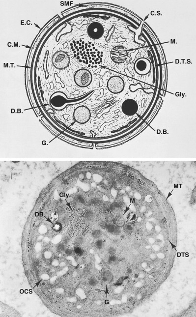
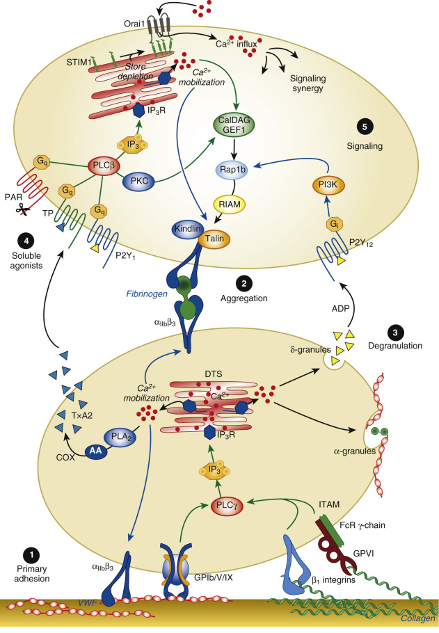
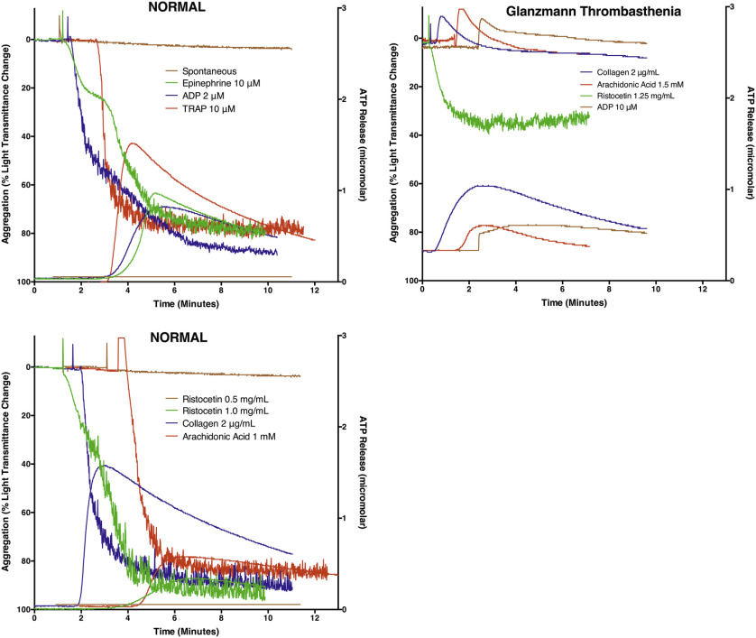
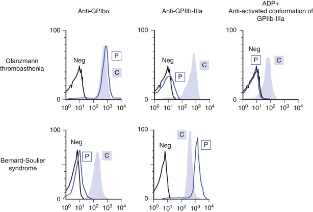
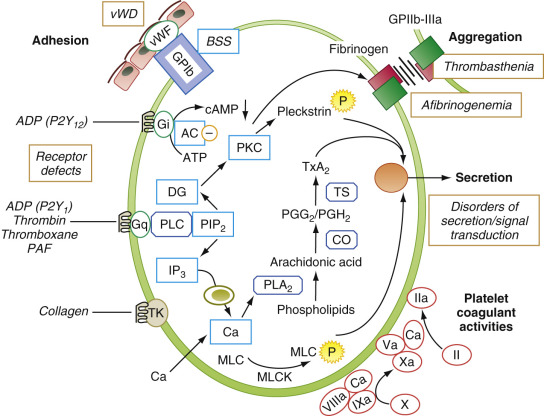
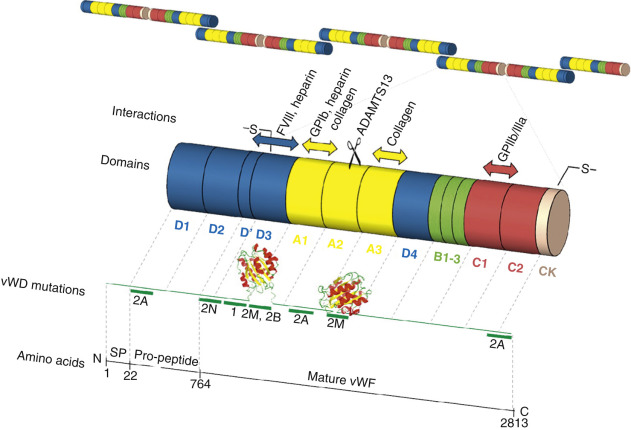
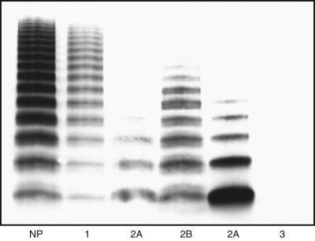
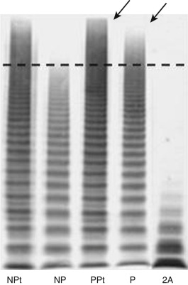

## Key Points

  * •

Platelets are highly complex cells that participate in critical steps central to hemostasis and thrombosis, including adhesion to subendothelium, aggregation, secretion of granule contents, and provision of membrane surface for activation of coagulation factors. 

  * •

Abnormalities of either platelet number or of platelet function can play an important role in the balance of hemostasis and thrombosis. 

  * •

Almost unique to laboratory medicine and pathology, assessment of platelet pathology may be performed in real time upon living cells obtained from the patient. 

  * •

Von Willebrand factor is a multimeric protein synthesized by endothelial cells and megakaryocytes that plays a central role in platelet adhesive interactions. 

  * •

A number of inherited and acquired disorders, autoimmune processes, and drugs affect platelet counts and platelet function. 

,  

##  Normal Platelet Biology 

 

##  Platelet Structure 

Blood platelets are highly complex, anucleate cells that derive from bone marrow megakaryocytes. The peripheral blood film offers the opportunity for evaluation of platelet numbers, size, distribution, and structure under the light microscope. Although subtle abnormalities of platelet structure usually require electron microscopy, absence or gross abnormalities of granules and grossly aberrant platelet structure may be evident. In films from nonanticoagulated fingerstick specimens, some platelet clumping is expected. When abnormalities are observed, artifacts resulting from improper specimen collection or handling should be considered, and a repeat specimen may need to be obtained. 

Electron microscopy allows more precise characterization of the structural abnormalities (  White, 2004  ), with the opportunity to examine in greater detail the specific platelet organelles (  Clauser & Cramer-Borde, 2009  ). 

Platelet features that may be visualized ultrastructurally are shown in [ Figure 40-1 ](<#f0010>) . The outer surface of the platelet, the _glycocalyx_ , is rich in glycoproteins. A submembranous band of _microtubules,_ composed of the protein tubulin, provides structural support for the normally discoid cell. Contractile _microfilaments_ may also be seen. These are composed principally of actin and myosin. An extensive _open canalicular system_ within the platelet is in direct communication with the extracellular environment. Often seen in close proximity to the open canalicular system is the _dense tubular system._ This system, apparently derived from the smooth endoplasmic reticulum, shows positive staining for platelet peroxidase activity (  Breton-Gorius & Guichard, 1972  ), in accord with its role as a site for arachidonic acid metabolism. The dense tubular system also functions as a calcium-sequestering pump, maintaining low levels of cytoplasmic calcium in the resting platelet. 

Figure 40-1 

Discoid platelets. 

Shown are ultrastructural features observed in thin sections of discoid platelets cut in the equatorial plane. The peripheral zone includes the exterior coat (EC), the trilaminar unit membrane (CM), and the submembrane area containing specialized filaments (SMFs) that form the wall of the platelet and line channels of the surface-connected canalicular system (also referred to as the _open canalicular system,_ or OCS). The matrix of the platelet interior is the sol-gel zone containing actin microfilaments, structural filaments, the circumferential band of microtubules (MTs), and glycogen (Gly). Formed elements embedded in the sol-gel zone include mitochondria (M), granules (G), and dense bodies (DBs). Collectively, they constitute the organelle zone. The membrane systems include the OCS and the dense tubular system (DTS), which serve as the platelet sarcoplasmic reticulum. The electron micrograph shows a platelet sectioned in the equatorial plane (30,000×), which reveals most of the structures indicated on the diagram. 

(With permission from White JG, Bloom AL, Forbes CD, et al, editors: _Hemostasis and thrombosis_ , New York, 1994, Churchill Livingstone.) 

A variety of inclusions may be recognized within the platelet cytoplasm, including _mitochondria, glycogen, and granules._ Lighter staining α-granules, less frequent dense core (or “bull's-eye”) granules, lysosomes, and peroxisomes are also seen. Three-dimensional electron microscopic studies have revealed morphologically distinct α-granule subtypes, and demonstrated that high spatial segregation of different stored proteins exists within individual α-granules (van  Nispen tot Pannerden et al, 2010  ). The α-granule proteins derive both from endocytic uptake and de novo synthesis by megakaryocytes, and include fibrinogen, platelet-derived growth factor (PDGF), von Willebrand factor (vWF), the factor V binding protein multimerin, β-thromboglobulin (βTG), and the heparin-neutralizing platelet factor (PF)4. P-selectin, a constituent of the alpha granule membrane, translocates to the plasma membrane of the platelet when alpha granule contents are released. The dense granules contain a nonmetabolic pool of adenosine diphosphate (ADP) and adenosine triphosphate (ATP), 5-hydroxytryptamine (5-HT, serotonin), calcium, and inorganic polyphosphate (polyP). 

 

##  Platelet Membrane Glycoproteins and Phospholipids 

Historically, detailed analyses of platelet surface glycoproteins in patients with congenital platelet disorders were key to our current understanding of how the various platelet glycoproteins subserve specific platelet function. [ Table 40-1 ](<#t0010>) summarizes the platelet membrane glycoproteins that function as receptors for adhesive ligands. The GPIIb-IIIa receptor complex (also referred to as _integrin αIIbβ3 _ ), which in its activated form serves as a receptor for fibrinogen, is the most abundant platelet receptor, with ~80,000 to 100,000 copies per platelet (  Wagner et al, 1996  ;  Buitrago et al, 2015  ). This is followed by the major platelet receptor for von Willebrand factor, GPIbα, at ~30,000 copies. GPIbα is disulfide linked to GPIbβ and noncovalently linked to GPIX and GPV, and together these glycoproteins make up the GPIb-IX-V complex (  Gardiner & Andrews, 2014  ). The copy number for other platelet surface glycoproteins is lower. 

TABLE 40-1 

Selective List of Adhesive Platelet Membrane Glycoproteins 

|  Alternate Designation(s)  |  Structural Family  |  Principal Ligand(s)  |  Major Function   
---|---|---|---|---  
GPIIb-IIIa  |  CD41-CD61, α IIb  β 3  ,  |  Integrin  |  Fibrinogen, von Willebrand factor (vWF)  |  Aggregation (platelet-platelet interaction)   
GPIb-IX-V  |  CD42a-d complex  |  Leucine-rich glycoprotein  |  vWF, thrombin, P-selectin, coagulation contact factors  |  Adhesion (platelet-subendothelium interaction)   
GPVI  |  |  Immunoglobulin receptor superfamily  |  Collagen  |  Signaling following platelet-collagen interaction   
GPIa-IIa  |  CD49b-CD29, α 2  β 1  ,  |  Integrin  |  Collagen  |  Adhesion (platelet-collagen interaction)   
P-selectin  |  CD62P, GMP 140, PADGEM  |  Selectin  |  P-selectin–glycoprotein ligand-1 (PSGL-1)  |  Platelet-leukocyte interaction   
PECAM-1  |  CD31  |  Immunoglobulin receptor superfamily  |  PECAM-1/PECAM-1 homophilic interactions  |  Platelet-endothelial cell interaction   
GPIV  |  CD36, GPIIIb  |  Scavenger receptor family  |  Thrombospondin, collagen, oxidized low-density lipoproteins  |  Scavenger, adhesion   
  
Platelet membranes contain several phospholipids that play a major role in platelet function, including phosphatidylinositol, phosphatidylcholine, phosphatidylserine (PS), and phosphatidylethanolamine. Phosphatidylinositides are the source of signaling molecules inositoltrisphosphate and diacylglycerol that are produced following platelet activation. Negatively charged PS is expressed in the inner membrane leaflet of the resting platelet (  Zwaal et al, 2005  ); on platelet activation, PS translocates to the outer leaflet, an essential step in the formation of a procoagulant platelet surface that is critical in several blood coagulation mechanisms (  Solum, 1999  ). This activation-associated change in PS exposure can be assessed using flow cytometry as increased binding of annexin V to the platelet surface. 

 

##  Role of Platelets in Hemostasis and Platelet-Activation Mechanisms 

Following injury to the blood vessel, platelets adhere to exposed subendothelium by a process (adhesion) that involves the interaction of a plasma protein, von Willebrand factor (vWF), and a specific glycoprotein complex on the platelet surface, GPIb-IX-V ( [ Fig. 40-2 ](<#f0015>) ), which binds vWF particularly under conditions of high shear stress. Adhesion is followed by recruitment of additional platelets, which interact with each other to form clumps, a process called _aggregation_ . This involves binding of fibrinogen to specific platelet surface receptors—a complex composed of GPIIb-IIIa, which is platelet- and megakaryocyte-specific and binds vWF as well. Resting platelets do not bind fibrinogen. Stimulation of platelets leads to a series of intracellular signaling responses, including binding of the adapter proteins talin and kindlin to the cytoplasmic tails of the GPIIb-IIIa receptor complexes (  Smyth et al, 2010  ;  Kahner et al, 2012  ). These binding events produce conformational changes in the GPIIb-IIIa complex that expose binding sites for fibrinogen, a prerequisite for platelet aggregation. Activated platelets release contents of their granules (secretion or release reaction), such as ADP and serotonin from the dense granules, which cause recruitment of additional platelets. In addition, platelets play a major role in coagulation mechanisms; several key enzymatic reactions occur on the platelet membrane lipoprotein surface. During platelet activation, the negatively charged phospholipid PS is exposed on the platelet surface, and this is essential for the role of platelets in accelerating specific coagulation reactions (platelet coagulant activity). 

Figure 40-2 

Platelet proteins and molecular pathways important for hemostasis. 

The stages of hemostatic plug formation are broadly divided into platelet adhesion and initial signaling events, platelet aggregation, secretion, soluble agonist receptor activation, and subsequent signaling. _AA,_ Arachidonic acid; _AC,_ adenylyl cyclase; _Ca 2+  _ , calcium; _CalDAG GEF1,_ calcium and diacylglycerol-regulated guanine nucleotide exchange factor; _COX,_ cyclooxygenase; _DTS,_ dense tubular system; _IP3,_ inositol (1,4,5)-trisphosphate; _IP3R,_ IP3 receptor; _ITAM,_ immunoreceptor tyrosine-based activation motif; _PAR,_ protease-activated receptor; _PGH 2  , _ prostaglandin H  2  ; _PIP2,_ phosphatidylinositol (4,5)-bisphosphate; _PI3K,_ PI3-kinase; _PKC,_ protein kinase C; _PLA 2  , _ phospholipase A  2  ; _PLC,_ phospholipase C; _RIAM,_ Rap1-GTP interacting adapter molecule; _Src,_ Src family kinases; _STIM1,_ stromal interaction molecule 1; _TP,_ thromboxane receptor. 

(For discussion in greater depth of these molecules and their roles in platelet activation, please see Wei AH, Schoenwaelder SM, Andrews RK: New insights into the haemostatic function of platelets, _Brit J Haematol_ 47:415–430, 2009 from which this figure is reproduced with permission.) 

 

##  Platelet Activation and Signaling Events (see [ Fig. 40-2 ](<#f0015>) ) 

Several physiologic agonists interact with specific receptors on the platelet surface to induce events that culminate in the well-recognized responses, including a change in platelet shape from discoid to spherical (shape change), aggregation, secretion, and thromboxane A2 (TxA2) production (  Shattil & Newman, 2004  ;  Smyth et al, 2010  ). These agonists include ADP, collagen, thrombin, TxA2, epinephrine, and platelet-activating factor, and they induce signaling events in platelets. Platelets possess at least three well-defined purinergic receptors that mediate the responses to ADP: P2Y1, P2Y12, and P2X1. The P2Y1 receptor mediates the rise in cytoplasmic Ca  2+  ; the P2Y12 receptor mediates inhibition of adenylyl cyclase to lower cAMP levels in platelets and is the receptor targeted by antiplatelet agents, including clopidogrel, ticlopidine, prasugrel, and ticagrelor. P2X1 has attributes of an ion channel and may play a role in amplifying the initial phase of platelet activation (  Hu & Hoylaerts, 2010  ). Thrombin induces platelet responses through the protease-activated receptors (PAR); human platelets possess PAR1 and PAR4 receptors. GPVI is the principal collagen receptor in platelets and is a member of the immunoglobulin receptor superfamily. Ligation of the platelet receptors by agonists such as thrombin, TxA2, and ADP initiates the production and release of several intracellular messenger molecules including products of hydrolysis of phosphoinositides (PI) by phos­pholipase C (diacylglycerol, and inositol 1,4,5-triphosphate [IP3]) and conversion of arachidonic acid to TxA2. These mediators induce or modulate the various platelet responses of Ca  2+  mobilization, protein phosphorylation, aggregation, secretion, and thromboxane production. The interaction between the platelet surface receptors and the key intracellular enzymes (e.g., phospholipases A2 and C, adenylyl cyclase) is mediated by a group of distinct proteins called _G-proteins_ that bind and are modulated by GTP. As in most secretory cells, platelet activation results in a rise in cytoplasmic ionized calcium concentration; IP3 functions as a messenger to mobilize Ca  2+  from intracellular stores. This increase in cytoplasmic Ca  2+  levels regulates other events, such as the activation of phospholipase A2, leading to TxA2 production, and phosphorylation by myosin light-chain kinase of myosin light chain, which is involved in shape change and secretion. DAG activates the protein kinase C (PKC) family of enzymes that phosphorylate several proteins, including pleckstrin. PKC activation is considered to play a major role in platelet responses, including secretion and the activation of GPIIb-IIIa. Platelets possess several families of G-proteins that function as molecular switches in transmitting the signal from the surface receptors to the intracellular effectors. For example, PLC activation and calcium mobilization on activation by ADP (P2Y1), TxA2, or thrombin is mediated by Gαq, whereas signaling through the P2Y12 ADP receptor and inhibition of adenylyl cyclase is mediated by Gαi. Another well-recognized response of platelets to activation is synthesis of TxA2. The initial and rate-limiting step in TxA2 production is the mobilization of arachidonic acid (AA) from phospholipids (predominantly phosphatidylcholine) by phospholipase A2. Free AA is converted by cyclooxygenase to prostaglandins (PG) G2 and H2, which are converted by thromboxane synthase to TxA2. Binding of fibrinogen to the GPIIb-IIIa complex results in the activation of tyrosine kinases and associated events (“outside-in signaling”) (  Shattil & Newman, 2004  ). Numerous other mechanisms and events occur in platelets on activation, involving small GTPases, tyrosine kinases, and phosphatases; these are beyond the scope of this chapter. While the agonists mentioned earlier activate platelets to function in hemostasis, there are other agonists, such as prostacyclin (PGI2), produced by endothelial cells, which inhibit platelet responses. PGI2 does this by increasing platelet cAMP levels through activation of adenylyl cyclase. 

Upon stimulation, platelets change in shape from discoid to spherical, extend pseudopods, undergo internal contraction resulting in centralization of their α-granules and dense granules, and release the granule contents. Depending upon the strength of the stimulus, the contents of the α-granules, dense granules, and lysosomal granules are released. 

Following vascular injury, blood platelets rapidly adhere to the exposed subendothelium. Under lower shear conditions, as in the venous circulation, platelets may bind directly to exposed collagen by means of GP VI and GP Ia-IIa (α 2  β 1  ). Under the higher shear conditions present in the arterial circulation, adhesion is initiated by circulating vWF binding to exposed subendothelial collagen, and the surface-bound vWF then binding to the platelet via the GPIb-IX-V receptor complex (  Auger et al, 2005  ). 

 

##  Platelet Coagulant Activity 

Platelets play a vital role in coagulation. Numerous proteins, including coagulation factor V and fibrinogen, are released from α-granules, and ADP, ATP, serotonin, and the pro-hemostatic polyphosphates (  Smith & Morrissey, 2014  ) are released from dense granules. Importantly, several of the key enzymatic reactions leading to factor X and prothrombin activation, and to thrombin generation, require the platelet membrane surface to proceed at an optimum rate (  Smyth et al, 2010  ). Following platelet activation, there is a progressive loss of platelet membrane phospholipid asymmetry, which results from movement or “flip-flop” of PS and other phospholipids from the internal to the external surface of the membrane (  Zwaal et al, 2005  ). This is essential to the role of platelets in blood coagulation mechanisms. 

,  

##  Laboratory Evaluation of Platelet Function Disorders 

 

##  Initial Laboratory Evaluation 

The initial laboratory evaluation of platelet disorders includes a platelet count, a routine component of the complete blood count in an era of electronic particle counting. The normal platelet count is 150 to 400 × 10  9  /L. Many instruments additionally provide the mean platelet volume (MPV) and a histogram of MPV. In healthy individuals, the MPV varies inversely with platelet count, so that interpretation of MPV is best done with reference to the platelet count (  Bessman et al, 1981  ). Some automated instruments additionally assess platelet maturity, as reflected by the RNA content of “reticulated platelets”—analogous to reticulocyte measurements in the erythroid series (  Hoffmann, 2014  ;  Dusse & Freitas, 2015  ). Such measurements offer the opportunity to detect a thrombopoietic response from the bone marrow one or more days earlier than might otherwise be detected. Evaluation of the peripheral blood film provides valuable information regarding platelet count and size distribution, and on associated changes in other blood cells. 

Because platelets may undergo activation and spreading in the preparation of the blood film, the apparent size distribution of platelets in the blood film may deviate from the MPV. In severe thrombocytopenia below the established linearity of a given automated instrument, or whenever cellular fragments may be spuriously affecting the automated count, a manual phase contrast count with a hemocytometer chamber may be required. However, such manual counts performed on a relatively small number of platelets have a much higher coefficient of variation than is obtained when automated instruments are used within their linear ranges, and the counts may be unreliable unless they are performed by an experienced individual. 

 

##  Studies of Platelet Function 

 

##  Bleeding Time 

No currently available laboratory test faithfully reflects the enormously complex platelet role in hemostasis (  Gorog & Fuster, 2013  ). For many years, the template bleeding time test was used as a “global” test for the adequacy of primary hemostasis. In such testing, a standardized cut was made on the volar surface of the forearm, the resulting drops of blood were blotted with filter paper, and the duration it took for the bleeding to stop constituted the bleeding time. An extensive review (  Rodgers & Levin, 1990  ) of publications reporting clinical bleeding in various settings concluded that bleeding time results provided relatively poor predictive value of actual clinical bleeding. Moreover, the degree of bleeding from a standardized template cut in the skin could not be relied upon in an individual patient to predict the risk for bleeding elsewhere in the body, such as at operative sites. Because of these limitations, the risk for scarring, and the considerable technical expertise and time required in performance of the bleeding time, its use has declined considerably. 

 

##  PFA-100/200 

In parallel with decreased reliance upon the bleeding time has been the increased popularity of in vitro measures, most notably the platelet function analyzer (PFA-100 and PFA-200) (  Favaloro & Bonar, 2014  ). In this instrument, anticoagulated whole blood is flowed under high shear force through a narrow hole punched out of a membrane coated with collagen and either epinephrine or ADP. The combination of biophysical shear and chemical stimulation initially promotes platelet adhesion to the outer edges of the cut membrane, and subsequently platelet-platelet aggregation leads to full occlusion of the channel, which is recorded as “closure time.” This is dependent on plasma levels of vWF, platelet count and function, and hematocrit. Whereas inhibition of the platelet cyclooxygenase by aspirin or other mild-moderate impairments of platelet function prolong closure times with the collagen/epinephrine membranes, only more profound impairment of platelet function or of vWF prolong closure times in the collagen/ADP cartridges. Although abnormal in some platelet disorders, this instrument does not have sufficient sensitivity or specificity to be relied upon as a screening tool for platelet disorders (  Hayward et al, 2006  ). Definitive identification of abnormalities of platelets or vWF requires more specific studies. 

Several additional ex vivo experimental systems to assess platelet function have been developed in which shear forces play a major role. Notable among these is the development of the Impact-R instrument based upon the cone and plate method for generation of shear (  Varon et al, 1998  ). Limitations of this method both in the diagnosis of bleeding disorders (  Revel-Vilk et al, 2009  ) and in monitoring antiplatelet therapy (van  Werkum et al, 2010  ) have been described. Several other methods aiming to detect inherited and acquired disorders relating both to platelets and to vWF have been developed, but their role in clinical practice still remains to be defined (  Harrison & Lordkipanidze, 2013  ). 

 

##  Platelet Aggregation and Secretion Studies 

Platelet function can be evaluated in vitro through study of platelet aggregation and secretion in response to a battery of platelet-stimulating agents. These studies are performed using platelet-rich plasma (PRP) harvested from blood collected using sodium citrate as the anticoagulant. Sodium citrate lowers Ca  2+  in the blood to prevent clotting of blood, but not to the extent lowered by EDTA routinely used to collect samples for blood counts. EDTA dissociates the GPIIb-IIIa complexes on the platelet surface; thus, aggregation studies cannot be performed using such a sample. When citrated PRP is continuously stirred in a platelet aggregometer and a light beam is passed through the suspension, platelet aggregation in response to an added agonist can be monitored by changes in light transmittance. Change in platelet shape from discoid to spheroid is seen as an initial decrease in transmittance, whereas the subsequent formation of platelet clumps allows more light to pass through the suspension to the photodetector and is recorded as an increase in light transmittance (  Harrison et al, 2011  ). Detailed recommendations from the International Society on Thrombosis and Haemostasis (ISTH) for the standardization of light-transmission aggregometry have also been published (  Cattaneo et al, 2013  ). In instruments equipped with a second channel for monitoring secretion, the release of ATP from platelet-dense granules is simultaneously measured ( [ Fig. 40-3 ](<#f0020>) ). This is accomplished by adding the firefly luminescence substrate and enzyme, luciferin and luciferase, to the PRP; released ATP then functions as a cofactor in the light-producing luciferin-luciferase reaction, and light emission is recorded with a second photodetector. Thus, aggregation and secretion can be monitored independently and simultaneously (  Miller, 1984  ). Some laboratories have also employed this methodology to assess ATP release without the concurrent measurement of platelet aggregation (  Pai et al, 2011  ). The release of ATP may in most cases be assumed to reflect the release of the other constituents of dense granules, which are less easily measured (i.e., ADP, serotonin, calcium). Direct measurements of serotonin, ATP, and ADP can also be performed (  Holmsen & Dangelmaier, 1989  ). As an alternative to lumiaggregometry studies, platelet-dense granule secretion may be studied in parallel with aggregation by labeling platelets with  14  C-serotonin and then measuring the release of radioactivity following platelet activation (  Lan & Schmaier, 2005  ). 

Figure 40-3 

Platelet Lumi-Aggregometer tracings in a normal individual _(left panels)_ and a patient with Glanzmann thrombasthenia _(right panel)._

Following addition of an agonist to stirred platelet-rich plasma, aggregation of platelets leads to increasing light transmittance, registered in the displays as downward-going deflections. Dense granule secretion is simultaneously monitored by the luminescence resulting when ATP released from platelets reacts with luciferin-luciferase reagent present in the cuvette and displays as upward-going deflections. In the Glanzmann thrombasthenia patient, initial platelet shape change (upward deflection of aggregation tracing) is seen, but virtually no aggregation follows, due to deficiency of GPIIb-IIIa. Only ristocetin produces aggregation, since vWF binding to GPIb-IX-V remains intact. ATP secretion in response to platelet agonists is variable in Glanzmann thrombasthenia patients. 

Platelets have receptors for a wide variety of agonists on their surface (see [ Fig. 40-2 ](<#f0015>) ). A number of agonists may be used in the laboratory to determine if response to one or more of these is impaired. Frequently employed agonists include collagen, epinephrine, ADP, U46619 (a TxA2 analog), arachidonic acid, ristocetin, PAR-1 agonist (SFLLRN), and the calcium ionophore A23187. Platelet responses to these stimuli with the exception of ristocetin are dependent on active metabolic processes in platelets. In contrast, ristocetin-induced clumping of platelets occurs to a large degree even in the presence of metabolic inhibitors and in formalin-fixed platelets; therefore it is often referred as _agglutination_ . 

Although of paramount importance as a platelet stimulus in vivo, thrombin is difficult to employ with PRP, because of interference from fibrin formation. The partially trypsinized γ-thrombin, however, retains platelet-stimulating activity but largely lacks clotting activity and can be useful (  Charo et al, 1977  ). Platelet responses to thrombin are mediated by a G-protein–coupled seven-transmembrane receptor that is cleaved by thrombin. Thus, thrombin receptor–activating peptide (TRAP), consisting of amino acid sequence SFLLRN, derived from the extracellular “tethered ligand” region of the thrombin receptor (  Furman et al, 1998  ), is useful in platelet function testing. Strong agonists such as collagen, thrombin, and TxA2 are capable of directly inducing secretion and TxA2 synthesis in addition to inducing aggregation. In contrast, secretion and TxA2 synthesis following platelet stimulation with weaker agonists such as ADP or epinephrine may be considered secondary responses following attainment of a threshold level of aggregation (  Cattaneo, 2009  ). The potential diagnostic yields and limitations of aggregation and secretion studies have been recently reviewed (  Mezzano et al, 2009  ;  Dawood et al, 2012  ). 

Other methods have also been developed to test platelet function. Electrical impedance measurements, as opposed to monitoring light transmission, have been used to study platelet aggregation not only in PRP but also in whole blood (  Cardinal & Flower, 1980  ). Following the addition of an agonist to the stirred sample, the conductance between two electrodes falls as platelets aggregate upon the electrode surfaces. The resulting curves of electrical impedance over time share many similarities to those of light transmittance recordings, although there are characteristic differences between these two approaches (  Ingerman-Wojenski & Silver, 1984  ;  Joseph et al, 1987  ). When impedance aggregometry is combined with ATP secretion measurement on whole-blood samples (  Ingerman-Wojenski & Silver, 1984  ), relatively rapid evaluation of platelet function, requiring only a small volume of blood, may be performed (  McGlasson & Fritsma, 2009  ). Additionally, platelet aggregation in whole blood may be monitored optically by means of the coaggregation of fibrinogen-coated beads impregnated with a dye that absorbs light in the infrared region of the electromagnetic spectrum. This approach has been applied for assessing the effect of treatment with platelet inhibitors (see later). 

The contractile abilities of activated platelets also result in contraction (or “retraction”) of formed clots. In the test tube, _clot retraction_ may be quantitatively assessed. In thrombocytopenia or Glanzmann thrombasthenia, clot retraction is delayed or incomplete. GPIIb-IIIa (  Coller et al, 1983  ) as well as a number of additional platelet proteins (de  Witt et al, 2014  ) are required for effective clot retraction. 

 

##  Evaluation of Platelet Function Using Flow Cytometry 

Flow cytometry has proved useful not only for assessing the expression of specific glycoprotein receptors on the platelet surface but also for assessing the effect of platelet activation, including ability of GPIIb-IIIa to undergo conformational change and expression of markers of platelet secretion (e.g., P-selectin) ( [ Fig. 40-4 ](<#f0025>) ). Platelet activation leads to translocation of P-selectin from α-granules to the platelet surface, where it may be readily assessed by flow cytometry. In addition, flow cytometry has been used to assess expression of platelet annexin V and dense granules, and release of microparticles from platelets. Due to the small volumes of blood required to perform flow cytometry, this technique can be particularly valuable in diagnostic evaluations of children and neonates (  Israels, 2009  ). 

Figure 40-4 

Flow cytometric evaluation of platelet membrane glycoprotein (GP) disorders, Glanzmann thrombasthenia and Bernard-Soulier syndrome. 

Platelets from normal controls (C) or from patients (P) were incubated with monoclonal antibodies against GPIbα, GPIIb-IIIa, or a monoclonal antibody (PAC-1) that recognizes only the conformationally altered active form of GPIIb-IIIa that occurs following platelet activation (e.g., in response to ADP). In the patient with Glanzmann thrombasthenia _(upper panel),_ there is virtual absence of GPIIb-IIIa, although GPIbα is present at normal levels. In the patient with Bernard-Soulier syndrome _(lower panel),_ a severe deficiency of GPIbα expression but no decrease in GPIIb-IIIa expression is seen. 

(Modified with permission from Nurden AT, George JN: Inherited disorders of the platelet membrane: Glanzmann thrombasthenia, Bernard-Soulier syndrome, and other disorders. In Colman RW, editor: _Hemostasis and thrombosis: basic principles and clinical practice,_ ed 4. Philadelphia, 2001, Lippincott.) 

,  

##  Quantitative Platelet Disorders 

 

##  Thrombocytopenia 

Decreased platelet production and increased platelet destruction ( [ Table 40-2 ](<#t0015>) ) constitute two of the major causes of thrombocytopenia. Additionally, thrombocytopenia may be seen with splenomegaly of any cause, because of increased splenic sequestration of platelets. 

TABLE 40-2 

Mechanisms of Platelet Destruction 

Type of Thrombocytopenia  |  Specific Example(s)   
---|---  
**Immune Mediated**  
Autoantibody-mediated platelet destruction by reticuloendothelial system (RES)  |  Primary immune thrombocytopenic purpura; secondary immune thrombocytopenia associated with lymphoproliferative disease; collagen vascular disease; infections such as infectious mononucleosis; human immunodeficiency virus syndrome   
Alloantibody-mediated platelet destruction by RES  |  Neonatal alloimmune thrombocytopenia; posttransfusion purpura; passive alloimmune thrombocytopenia; alloimmune platelet transfusion refractoriness   
Drug-dependent, antibody-mediated platelet destruction by RES  |  Drug-induced immune thrombocytopenic purpura (e.g., quinine)   
Platelet activation by binding of immunoglobulin G (IgG) Fc of drug-dependent IgG to platelet FcγIIa receptors  |  Heparin-induced thrombocytopenia   
**Non –Immune Mediated **  
Platelet activation by thrombin or proinflammatory cytokines  |  Disseminated intravascular coagulation; septicemia/systemic inflammatory response syndromes   
Platelet destruction via ingestion by macrophages (hemophagocytosis)  |  Infections; certain malignant lymphoproliferative disorders   
Platelet destruction through platelet interactions with altered von Willebrand factor  |  Thrombotic thrombocytopenic purpura; hemolytic-uremic syndrome; aortic stenosis   
Platelet losses on artificial surfaces  |  Cardiopulmonary bypass surgery; use of intravascular catheters   
Decreased platelet survival associated with cardiovascular disease  |  Congenital and acquired heart disease; cardiomyopathy; pulmonary embolism   
  
Modified with permission from Warkentin TE, Kelton JG: Thrombocytopenia due to platelet destruction and hypersplenism. In Hoffman R, Benz EJ Jr, Shattil SJ, et al, editors: _Hematology: basic principles and practice_ . Philadelphia, 2005, Elsevier Churchill Livingstone, pp 2305–2325\. 

 

##  Congenital Thrombocytopenias 

Congenital thrombocytopenias are being recognized with increasing frequency, and several distinct genetic abnormalities have been documented in such patients (  Althaus & Greinacher, 2009  ;  Balduini et al, 2013a  ,  2013b  ; 

Kumar & Kahr, 2013  ;  Noris et al, 2014  ). These patients may present with isolated thrombocytopenia or in conjunction with characteristic syndromes. In some patients, the platelets have defects in function as well. 

From a mechanistic perspective, inherited thrombocytopenias are associated with mutations in genes with diverse function, although for some the specific function in megakaryocytes/platelets is unclear. The genes implicated include transcription factors _(RUNX1, FLI1, GATA1, GFI1b, HOXA11),_ thrombopoietin receptor _MpL,_ cytoskeletal proteins and related signaling _(MYH9, TUBB1, ACTN1, FLNA, WASP),_ surface membrane glycoproteins and related signaling _(GPIBA, GPIBB, GPIX, ITGA2B, ITGB3),_ proteins involved in vesicle transport _(NBEAL2),_ exon-junction complex involved in RNA processing _(RBM8A),_ and cAMP-dependent protein kinase _(PRKACG)_ (  Balduini et al, 2013a  ;  Kumar & Kahr, 2013  ;  Manchev et al, 2014  ;  Monteferrario et al, 2014  ;  Noris et al, 2014  ;  Rao & Songdej, 2015b  ). Mutations in the _ANKRD26_ 5′ untranslated region result in loss of RUNX1 and FLI1 binding, and ANKRD26 silencing (  Bluteau et al, 2014  ;  Marquez et al, 2014  ). 

A better understanding of inherited thrombocytopenias is important in clinical practice, beyond recognizing predisposition to bleeding, which is highly variable and often mild. First, many of these patients are initially recognized in their adulthood (  Balduini et al, 2013a  ), and in the absence of a family history of thrombocytopenia, there is the risk for misdiagnosis as immune thrombocytopenia that may lead to unnecessary therapy (including splenectomy). Second, some gene mutations have prognostic implications, such as the association with myeloid malignancies in the case of _RUNX1_ and _ANKRD26_ mutations; or worsening renal function or hearing loss, as with _MYH9_ mutations _._ Further, there may be therapeutic implications, as in the potential role of eltrombopag in patients with _MYH9_ mutations (  Balduini et al, 2013a  ). Moreover, previously described pedigrees have documented recurrence of leukemia following hematopoietic stem cell transplantation from an undiagnosed sibling donor with a _RUNX1_ mutation (  Owen et al, 2008  ). Lastly, some entities are associated with platelet function abnormalities as well, as in patients with _RUNX1_ mutations (  Rao  2013a  ;  Songdej & Rao, 2015  ). 

From a practical point of view, patients with congenital throm­bocytopenias may be characterized based on the inheritance patterns or on platelet size ( [ Table 40-3 ](<#t0020>) ) or diameter (  Balduini et al, 2013a  ,  2013b  ;  Kumar & Kahr, 2013  ;  Noris et al, 2013  ,  2014  ). 

TABLE 40-3 

Classification of Inherited Thrombocytopenias by Platelet Size 

Small Platelets (MPV <7 fL)  |  Normal-Sized Platelets (MPV 7-11 fL)  |  Large Platelets (MPV>11 fL)   
---|---|---  
Wiskott-Aldrich syndrome  |  Congenital amegakaryocytic thrombocytopenia  |  _MYH9-_ related disorders   
X-linked thrombocytopenia  |  Thrombocytopenia absent radius syndrome  |  Bernard-Soulier syndrome   
|  Radioulnar synostosis with amegakaryocytic thrombocytopenia  |  Gray platelet syndrome   
_RUNX1_ mutations (FPD/AML)  |  Velocardiofacial syndrome   
_ANKRD26-_ related thrombocytopenia  |  _GATA_ -1 mutations   
_CYCS_ -related thrombocytopenia  |  Type 2B von Willebrand disease   
|  Platelet-type von Willebrand disease   
|  Paris-Trousseau (Jacobsen) syndrome   
|  _TUBB1_ -related macrothrombocytopenia   
Thrombocytopenia associated with sitosterolemia   
  
Modified with permission from Kumar R, Kahr WHA: Congenital thrombocytopenia: Clinical manifestations, laboratory abnormalities, and molecular defects of a heterogeneous group of conditions. In Rao AK, editor: _Hematology/oncology Clinics of North America: disorders of the platelets_ (vol 27), Philadelphia, 2013, Elsevier, pp 465–494\. 

 

##  Autosomal Dominant Thrombocytopenias 

A diverse group of autosomal dominant syndromes, referred to as _MYH9-related macrothrombocytopenias,_ include the May-Hegglin anomaly, Fechtner syndrome, Epstein syndrome, and Sebastian syndrome and share features of increased platelet size, cytoplasmic inclusions in leukocytes (Döhle bodies), and premature release of platelets. These entities arise from mutations in _MYH9_ encoding the nonmuscle myosin heavy chain IIA, a contractile cytoskeletal protein. All of the _MYH-9_ syndromes have macrothrombocytopenia; other features such as nephritis, sensorineural deafness, and cataracts serve to distinguish them (  Althaus & Greinacher, 2009  ). In patients having the familial platelet disorder with predisposition to acute myeloid leukemia (FPD/AML), the autosomal dominant thrombocytopenia is secondary to mutations in the _RUNX1/CBFA2/AML1_ gene (  Song et al, 1999  ;  Songdej & Rao, 2015  ). In these patients, platelet size is normal and their function is abnormal (  Rao  2013a  ;  Songdej & Rao, 2015  ). Patients with platelet-type vWD are characterized by thrombocytopenia, gain-of-function mutations in _GPIBA,_ and enhanced responsiveness to ristocetin on platelet aggregation (  Miller, 1996  ). Other congenital thrombocytopenias inherited in an autosomal dominant manner include velocardiofacial syndrome and DiGeorge syndrome, which arise due to deletions within chromosome 22q11 and are associated with cardiac abnormalities, parathyroid and thymus insufficiencies, cognitive impairment, and facial dysmorphology (velocardiofacial only); and the Paris-Trousseau/Jacobsen syndrome, which is characterized by psychomotor retardation and facial and cardiac abnormalities, and arises due to deletion of a portion of chromosome 11,11q23-24, which encompasses the transcription factor _FLI-1_ gene. Platelets in the latter disorder are increased in size and have giant α-granules. A dominant form of macrothrombocytopenia (Mediterranean macrothrombocytopenia, Bolzano variant) has been described in southern Europe, and this has been associated with mutations in GPIbα and considered a heterozygous form of Bernard-Soulier syndrome (  Savoia et al, 2001  ). Autosomal dominant Bernard-Soulier syndrome resulting from a point mutation in a leucine tandem repeat of GPIbα has been described in the American population (  Miller et al, 1992  ). An autosomal dominant thrombocytopenia been reported in association with mutations in the genes encoding cytoskeletal protein beta-1 tubulin TUBB1 _(TUBB1)_ and alpha actinin-1 _(ACTN1),_ cytochrome c _(CYCS),_ and _ANKRYD26,_ (  Balduini et al, 2013a  ,  2013b  ;  Kumar & Kahr, 2013  ;  Noris et al, 2014  ). It has also been reported in association with mutations in GPIIb or GPIIIa; these mutations lead to constitutive activation of the GPIIb-IIIa integrin complex (  Balduini et al, 2013a  ,  2013b  ). 

 

##  Autosomal Recessive Thrombocytopenias 

In the classical Bernard-Soulier syndrome, the macrothrombocytopenia results from biallelic mutations involving the GPIb-IX-V complex (see later). Congenital amegakaryocytic thrombocytopenia (CAMT) is an autosomal recessive disorder associated with mutations in the thrombopoietin receptor _MPL_ and is characterized by severe thrombocytopenia and absence of megakaryocytes in the bone marrow. Other causes of congenital thrombocytopenia include gray platelet syndrome (see later), linked to mutations in the _NBEAL2_ gene, which encodes a BEACH protein involved in vesicular trafficking. (  Albers et al, 2011  ;  Gunay-Aygun et al, 2011  ;  Kahr et al, 2011  ). The thrombocytopenia with absent radii (TAR) syndrome is associated with skeletal abnormalities and inherited in an autosomal recessive manner. 

 

##  Sex-Linked Inherited Thrombocytopenias 

Patients with Wiskott-Aldrich syndrome (WAS) and the related X-linked thrombocytopenia have mutations in the _WAS_ gene, with patients characteristically having small platelets, and the thrombocytopenia may occur in the absence of other immunologic features of the syndrome. Mutations in transcription factor GATA-1 are associated with thrombocytopenia, anemia, and alteration in red cell morphology. 

 

##  Immune Thrombocytopenias 

Immune thrombocytopenias (ITPs) are a heterogeneous group of disorders characterized by autoimmune-mediated platelet destruction (  Rodeghiero et al, 2009  ;  Provan et al, 2010  ). These disorders are also associated with impaired platelet production (  Rodeghiero et al, 2009  ). _Primary_ ITP is a diagnosis of exclusion, made in the absence of other causes or disorders associated with thrombocytopenia. _Secondary_ ITP ( [ Table 40-4 ](<#t0025>) , _upper panel_ ) consists of all forms of immune-mediated thrombocytopenia except primary ITP. The clinical history is usually helpful in arriving at a tentative diagnosis, and in particular in distinguishing between the newly diagnosed, persistent, chronic, and severe forms of secondary ITP, as defined in [ Table 40-4 ](<#t0025>) . A platelet count of <100,000 platelets/µL has been recommended as a threshold for diagnosis of ITP (  Rodeghiero et al, 2009  ). This threshold seeks to avoid overdiagnosis of disease in apparently healthy people with platelet counts of 100 to 150,000/µL, and also to avoid inclusion of many women with pregnancy-related thrombocytopenia. An international consensus conference report (  Provan et al, 2010  ) addressed a number of critical issues concerning the diagnosis and management of ITP. No single laboratory test for the diagnosis of ITP constitutes a gold standard status by this group. A variety of laboratory approaches were deemed to be either of “potential utility” or of “unproven or uncertain benefit,” as shown in [ Table 40-4 ](<#t0025>) _(lower panel)._ 

TABLE 40-4 

Immunologic Thrombocytopenic Purpura (ITP) 

PROPOSED DEFINITIONS OF DISEASE   
---  
Primary ITP  |  Secondary ITP: All Forms of Immune-Mediated Thrombocytopenia Except Primary ITP [ * ](<#hl0000422>)  
  
  * • Primary ITP is an autoimmune disorder characterized by isolated thrombocytopenia (peripheral platelet count <100 × 10  9  /L) in the absence of other causes and disorders that may be associated with thrombocytopenia. 
  * • The diagnosis of primary ITP remains one of exclusion; no robust clinical or laboratory parameters are currently available to establish this diagnosis with accuracy. 
  * • The main clinical problem with primary ITP is an increased risk for bleeding, although bleeding symptoms may not always be present. 

| 

  * • Newly diagnosed ITP: within 3 months from diagnosis 
  * • Persistent ITP: between 3 and 12 months from diagnosis; includes patients not reaching spontaneous remission and not maintaining complete response off therapy 
  * • Chronic ITP: lasting for longer than 12 months 
  * • Severe ITP: presence of bleeding symptoms at presentation sufficient to mandate treatment, or occurrence of new bleeding symptoms requiring additional therapeutic intervention with a different platelet-enhancing agent or an increased dose 

  
  
RECOMMENDATIONS FOR THE DIAGNOSIS OF ITP IN CHILDREN AND ADULTS   
---  
Basic Evaluation  |  Tests of Potential Utility in the Management of an ITP Patient  |  Tests of Unproven or Uncertain Benefit   
  
  * Patient history 
  * Family history 
  * Physical examination 
  * Complete blood count and reticulocyte count 
  * Peripheral blood film 
  * Quantitative immunoglobulin measurement  * 
  * Bone marrow examination (in selected patients) 
  * Blood group (Rh) 
  * Direct antiglobulin test 
  * _Helicobacter pylori_ †
  * HIV  †
  * HCV  †

| 

  * Glycoprotein-specific antibody 
  * Antiphospholipid antibodies (including anticardolipin and lupus anticoagulant) 
  * Antithyroid antibodies and thyroid function 
  * Pregnancy test in women of childbearing potential 
  * Antinuclear antibodies 
  * Viral PCR for parvovirus and CMV 

| 

  * TPO 
  * Reticulated platelets 
  * PaIgG 
  * Platelet survival study 
  * Bleeding time 
  * Serum complement 

  
  
_Upper panel:_ ITP: proposed definitions of disease. 

_Lower panel:_ recommendations for the diagnosis of ITP in children and adults. 

Modified with permission from Provan D, Stasi R, Newland AC: International consensus report on the investigation and management of primary immune thrombocytopenia, _Blood_ 115:168–186, 2010. 

_CMV,_ Cytomegalovirus; _HCV,_ hepatitis C virus; _HIV,_ human immunodeficiency virus; _PaIgG,_ platelet-associated immunoglobulin G; _PCR,_ polymerase chain reaction; _Rh,_ rhesus; _TPO,_ thrombopoietin. 

Modified with permission from Rodeghiero F, Stasi R, Gernsheimer T: Standardization of terminology, definitions and outcome criteria in immune thrombocytopenic purpura of adults and children: report from an international working group, _Blood_ 113:2386–2393, 2009. 

 * The acronym ITP should be followed by the name of the associated disease (for thrombocytopenia after exposure to drugs, the term _drug-induced_ should be used) in parentheses, for example, “secondary ITP (lupus-associated),” “secondary ITP (HIV-associated),” and “secondary ITP (drug-induced).”

 * Quantitative immunoglobulin level measurement should be considered in children with ITP and is recommended in children with persistent or chronic ITP as part of the reassessment evaluation. 

 † Recommended by the majority of international consensus panel members for adult patients regardless of geographic locale. 

Of particular interest, antecedent infectious diseases appear to be present in approximately 60% of pediatric ITP patients. Molecular mimicry, in which immune responses initially directed against an infectious organism cross-react with platelet antigens in both children and adults, appears likely in a number of instances, including infection with HIV and HCV (  Karpatkin & Nardi, 1992  ;  Karpatkin et al, 1995  ;  Cines et al, 2009a  ;  Stasi et al, 2009  ;  Zhang et al, 2009  ). There has also been attention focused on the association between _H. pylori_ infection and ITP (  Semple, 2009  ;  Stasi et al, 2009  ). A possible mechanistic explanation for the thrombocytopenia is that the _H. pylori_ organisms may trigger P-selectin–dependent platelet aggregation and increased PS expression (  Yeh et al, 2010  ). 

In addition to the accelerated platelet destruction in ITP, there is also defective platelet production (  McMillan, 2007  ;  Cines et al, 2009a  ,  2009b  ). The observations that thrombopoietin mimetic agents are effective in increasing the platelet counts in these patients add further support for impaired platelet production in ITP (  McMillan, 2007  ). 

The role of the clinical laboratory in helping to establish a diagnosis of ITP remains elusive. In 1996, a distinguished panel of experts from the American Society of Hematology (ASH) (  George et al, 1996  ) concluded that there was little evidence in support of laboratory tests to detect antiplatelet antibodies in ITP patients. Fifteen years later, a subsequent evidence-based ASH panel on ITP (  Neunert et al, 2011  ) concluded both for children and adults that they had “found insufficient evidence to recommend or suggest the routine use of antiplatelet, antiphospholipid and antinuclear antibodies, thrombopoietin levels, or platelet parameters obtained on automated analyzers in the evaluation of patients with suspected ITP.” Efforts to establish the usefulness of in vitro testing do nonetheless continue, particularly with respect to identification of patient antibodies directed against specific platelet membrane GP targets. The closest to what could be considered a reference methodology would be the “MAIPA” technique, or “monoclonal antibody immobilization of platelet antigen” (  Kiefel et al, 1987  ). Through incubation of freshly obtained donor platelets with patient serum or with eluates from patient platelets, the MAIPA optimally preserves the native conformations of the platelet membrane GP against which the patient antibodies are usually targeted. Because it is labor intensive and requires the availability of previously characterized platelet donors, the MAIPA and closely related techniques have proved challenging for most clinical laboratories, and even specialized laboratories have found it difficult to achieve consensus of findings when evaluating shared workshop samples (  Sachs et al, 2012  ). The principal challenge for alternative approaches has been to develop assays that react patient-derived antibodies with platelet GP targets presented in a standardized format, such as immobilized by murine monoclonal antibodies to microplate wells or attached to bead surfaces. Some pathologic antibodies may simply fail to recognize their epitopes within the GP targets provided in this artificial manner. Additionally, false-positive results may occur if anti-mouse antibodies are present in human serum (  Leach & Aubuchon, 2003  ). Techniques using flow-cytometric detection of antiplatelet GP antibodies captured onto fluorescent beads have also been introduced (  Nguyen et al, 2004  ;  Porcelijn et al, 2014  ), but their usefulness in the diagnostic evaluation of ITP remains unestablished. 

 

##  Drug-Induced Immune Thrombocytopenia (DITP) 

Thrombocytopenia can be caused by a large number of drugs. Excluding those recognized to cause dose-dependent bone marrow suppression, such as the chemotherapeutic agents, there is strong evidence that immunologic mechanisms are the cause of platelet destruction. DITP may be induced by classic drug-dependent antibodies (e.g., quinine), haptens (e.g., penicillin), fiban-dependent antibodies (e.g., tirofiban, integrilin), monoclonal antibodies (abciximab), autoantibodies (e.g., gold), and immune-complex formation (e.g., heparin, protamine) (  Aster et al, 2004  ;  Aster, 2007a  ;  Al-Nouri & George, 2012  ;  Arnold et al, 2013  ;  Chong et al, 2013  ). Most commonly implicated drugs include quinine, quinidine, trimethoprim-sulfamethoxazole, vancomycin, and pipericillin/tazobactam (  Von Drygalski et al, 2007  ;  Arnold et al, 2013  ,  2015  ). A list of drugs implicated in DITP is provided in several publications (  Aster & Bougie, 2007  ;  Al-Nouri & George, 2012  ;  Arnold et al, 2013  ), and more information is available at [ www.uptodate.com/contents/drug-induced-thrombocytopenia ](<http://www.uptodate.com/contents/drug-induced-thrombocytopenia>) . 

The clinical features of DITP include a platelet count less than 20,000/µL and bleeding symptoms that typically begin 5 to 10 days after starting the drug. Interestingly, with GPIIb-IIIa antagonist drugs (“fibans”) eptifibatide and tirofiban, acute severe thrombocytopenia may occur, even following the first exposure to the drug (  Aster & Bougie, 2007  ). This acute thrombocytopenia results from preexisting antibodies in the patients binding to novel epitopes exposed in the drug-bound GPIIb-IIIa complex. With abciximab, which is a chimeric human-mouse Fab fragment specific for GPIIIa, preexisting antibodies causing the DITP target structural elements in the abciximab molecule that are of murine origin (  Aster et al, 2004  ). The targets of drug-dependent antibodies in patients with DITP due to quinine, sulfonamides, and others are often epitopes on platelet GPIIb-IIIa or GPIb-IX. In the case of gold and procainamide, autoantibodies are induced that have specificity for platelet GP. Heparins (see later) and protamine (  Bakchoul et al, 2013  ;  Cuker & Cines, 2013  ;  Lee et al, 2013  ) induce thrombocytopenia by formation of immune complexes that bind and activate platelets. 

Laboratory assessment for DITP employs normal test platelets as the target for antibody binding in the presence, but not the absence, of added drug. Recommendations regarding such testing recently published by the ISTH include the following (  Arnold et al  2015  ): Blood should be collected during the acute episode of thrombocytopenia as soon as DITP is suspected, and EDTA anticoagulant should be avoided. Test platelets obtained from blood group O/HPA-1a positive donors can be studied either by flow cytometry or by enzyme immunoassay. Drug-solubility limitations must be addressed, with the drug being maintained at constant concentration throughout all washing steps. If a positive control serum from a patient known to contain the drug-dependent antibody, and/or a negative control serum from a patient who received the drug in question but did not develop DITP, is not available, suitable alternative controls must be developed. While a positive test generally carries high specificity for DITP, a negative test result does not necessarily exclude DITP, due to the low sensitivity that has been observed with such testing (  Arnold et al  2015  ). 

The laboratory approach to heparin-induced thrombocytopenia is discussed in [ Chapter 42 ](<##!/content/3-s2.0-B9780323295680000425?scrollTo=%23c00042>) . 

 

##  Thrombocytosis 

In most patients, thrombocytosis is acquired. In the rare patients with congenital thrombocytosis, this results from gain-of-function mutations in either thrombopoietin or its receptor (MPL) (  Skoda, 2009  ;  Sulai & Tefferi, 2012  ). Acquired thrombocytosis may be primary, related to autonomous clonal bone marrow disorders, such as the myeloproliferative neoplasms (MPN) and essential thrombocytosis, or reactive and secondary to conditions such as infections, chronic inflammation, malignancy, hemolysis, iron-deficiency anemia, or splenectomy ( [ Box 40-1 ](<#b0010>) ) (  Skoda, 2009  ;  Harrison et al, 2010  ;  Sulai & Tefferi, 2012  ;  Griesshammer et al, 1999  ;  Schafer, 2004  ) (see later). The blood film should be reviewed to confirm the increase in platelets. A number of clinical and laboratory findings may provide clues as to whether one is dealing with an autonomous clonal process or a reactive process ( [ Table 40-5 ](<#t0030>) ). This distinction is important because of the implications regarding the potential for thrombohemorrhagic complications, which are common in MPN, and regarding treatment strategies (cytoreduction). The extent of elevation in platelet counts does not provide a reliable clue in this distinction. Patients with MPN may have abnormalities in platelet and megakaryocyte structure and platelet function (see later). The presence of cytogenetic abnormalities, such as in JAK2V617F and calreticulin, are strongly associated with primary thrombocytosis (  Campbell & Green, 2006  ;  Skoda, 2009  ;  Klampfl et al, 2013  ;  Nangalia et al, 2013  ). Lastly, recent studies utilizing platelet transcript profiling of patients with thrombocytosis have shown that specific biomarker gene subsets may predict their thrombocytosis class (  Gnatenko et al, 2010  ;  Nagalla & Bray, 2010  ). 

Box 40-1 

Reactive Conditions in Which Elevated Platelet Counts May Be Found 

 

##  Transient Processes 

  * Acute blood loss 

  * Recovery (rebound) from thrombocytopenia 

  * Acute infection or inflammation 

  * Response to exercise 

 

##  Sustained Processes 

  * Iron deficiency 

  * Hemolytic anemia 

  * Asplenia (e.g., after splenectomy) 

  * Cancer 

  * Chronic inflammatory or infectious diseases 

  * Connective tissue disorders 

  * Temporal arteritis 

  * Inflammatory bowel disease 

  * Tuberculosis 

  * Chronic pneumonitis 

  * Drug reactions 

    * •

Vincristine 

    * •

All- _trans_ -retinoic acid 

    * •

Cytokines 

    * •

Growth factors 

Reprinted with permission from Schafer AI: Thrombocytosis, _N Engl J Med_ 350:1211–1219, 2004. 

TABLE 40-5 

Clinical Findings That May Distinguish Between Clonal and Secondary (Reactive) Thrombocytosis 

Finding  |  Clonal Thrombocytosis [ * ](<#hl0000508>) |  Secondary (Reactive) Thrombocytosis   
---|---|---  
Underlying systemic disease  |  No  |  Often clinically apparent   
Digital or cerebrovascular ischemia  |  Characteristic  |  No   
Large-vessel arterial or venous thrombosis  |  Increased risk  |  No   
Bleeding complications  |  Increased risk  |  No   
Splenomegaly  |  Yes, in about 40% of patients  |  No   
Peripheral blood smear  |  Variable, may include giant platelets  |  Normal platelets   
Platelet function  |  May be abnormal  |  Normal   
Bone marrow megakaryocytes:  |  |   
  
  * • Number 

|  Increased  |  Increased   
  
  * • Morphologic features 

|  Giant, dysplastic forms with increased ploidy; associated with large masses of platelet debris  |  Normal   
Presence of cytogenetic abnormalities (mutations in _JAK2, MPL, CALR, BCR-ABL1_ )  |  Present  |  Absent   
  
_JAK2,_ Janus kinase 2; _MPL,_ thrombopoietin receptor gene; _CALR,_ calreticulin; _BCR-ABL1,_ fusion gene formed by translocation between chromosomes 9 and 22. 

Modified with permission from Schafer AI: Thrombocytosis, _N Engl J Med_ 50:1211–1219, 2004. 

 * Clonal thrombocytosis includes essential thrombocythemia and other myeloproliferative disorders. 

Patients with MPN may develop bleeding or thrombotic events. In a meta-analysis, platelet counts failed to achieve significance as a risk factor for thrombosis in patients with essential thrombocythemia (  Finazzi & Barbui, 2008  ). Unless additional associated risk factors, such as malignancy, are present, thrombotic events are unlikely in reactive thrombocytosis (  Griesshammer et al, 1999  ;  Ho et al, 2012  ). However, in one study (  Ho et al, 2012  ), reactive thrombocytosis occurred in about 10% of patients in the recovery phase after an admission to the intensive care unit, and this was associated with an increase in venous thromboembolism. 

,  

##  Inherited Disorders of Platelet Function 

 

##  Overview 

[ Box 40-2 ](<#b0015>) provides a classification based on the platelet functions or responses that are abnormal ( [ Fig. 40-5 ](<#f0030>) ). Although several of these disorders are rare, they shed enormous light on platelet physiology. Of note, not all of the disorders resulting in an impaired platelet role in hemostasis are due to a defect in the platelets _per se_ . Some, such as vWD and afibrinogenemia, result from deficiencies of plasma proteins essential for normal platelet function. Moreover, in most patients with inherited abnormalities of platelet aggregation and secretion, the underlying molecular mechanisms remain unknown. In patients with defects in platelet-vessel wall interactions (adhesion disorders), adhesion of platelets to subendothelium is abnormal. The two disorders in this group are von Willebrand disease (vWD), due to a deficiency or abnormality in plasma vWF, and Bernard-Soulier syndrome (BSS), in which platelets are deficient in the GPIb-IX-V complex; in both disorders, platelet-vWF interaction is compromised. Binding of fibrinogen to the GPIIb-IIIa complex is a prerequisite for platelet aggregation. Disorders characterized by abnormal platelet-platelet interactions (aggregation disorders) arise because of a severe deficiency of plasma fibrinogen (congenital afibrinogenemia) or because of a quantitative or qualitative abnormality in the platelet membrane GPIIb-IIIa complex (Glanzmann thrombasthenia). Patients with defects in platelet secretion and signal transduction are a heterogeneous group lumped together for convenience of classification rather than on the basis of an understanding of the specific underlying abnormality. The major common characteristics in these patients, as currently perceived, are abnormal aggregation responses and an inability to release dense granule contents upon activation of platelet-rich plasma with agonists such as ADP, epinephrine, and collagen. In aggregation studies, the second wave of aggregation is blunted or absent. The platelet dysfunction in such patients may arise from diverse mechanisms. A small proportion of these patients have a deficiency of dense granule stores (storage pool). In some of the others, impaired platelet function arises due to aberrations in signal transduction events that lead to secretion and aggregation. Another group consists of patients who have an abnormality in interactions of platelets with proteins of the coagulation system; the best described is Scott syndrome, characterized by impaired transmembrane migration of phospholipid phosphatidylserine (  Weiss, 1994  ,  2009  ;  Kodigepalli et al, 2015  ). Defects related to platelet cytoskeleton or structural proteins may also be associated with platelet dysfunction, as in Wiskott-Aldrich syndrome. Recent studies document impaired platelet function associated with mutations in transcription factors (RUNX1, GATA1, FLI1, and GFI1b) that regulate megakaryocyte biology and expression of platelet proteins. In addition to the above groups, there are patients who have abnormal platelet function associated with systemic disorders, such as Down syndrome and the May-Hegglin anomaly, where the specific aberrant platelet mechanisms are unclear. 

Box 40-2 

Classification of Inherited Disorders of Platelet Function 

  * 1.

Defects in platelet-vessel wall interaction (disorders of adhesion) 

    * a.

von Willebrand disease (deficiency or defect in plasma vWF) 

    * b.

Bernard-Soulier syndrome (deficiency or defect in GPIb) 

  * 2.

Defects in platelet-platelet interaction (disorders of aggregation) 

    * a.

Congenital afibrinogenemia (deficiency of plasma fibrinogen) 

    * b.

Glanzmann thrombasthenia (deficiency or defect in GPIIb-IIIa) 

  * 3.

Disorders of platelet secretion and abnormalities of granules 

    * a.

Storage pool deficiency (δ, α, αδ) 

    * b.

Quebec platelet disorder 

  * 4.

Disorders of platelet secretion and signaling (primary secretion defects) 

    * a.

Defects in platelet-agonist interaction (receptor defects) 

      * (ADP, thromboxane A2, collagen, epinephrine) 

    * b.

Defects in G-proteins and their activation 

      * Abnormalities in Gαq, Gαs, or Gαi 

      * Calcium and diacylglycerol (DAG)-regulated guanine exchange factor-1 (CalDAG-GEF1) deficiency 

    * c.

Defects in phosphatidylinositol metabolism and protein phosphorylation 

      * Phospholipase C-β2 deficiency 

      * PKC-θ deficiency 

    * d.

Abnormalities in arachidonic acid pathways and thromboxane A  2  synthesis 

      * Phospholipase A  2  deficiency 

      * Cyclooxygenase deficiency 

      * Thromboxane synthase deficiency 

  * 5.

Defects related to cytoskeletal-linking and structural proteins 

    * a.

Wiskott-Aldrich syndrome protein 

    * b.

Kindlin-3 deficiency–leukocyte adhesion defect (LAD) 

  * 6.

Disorders of platelet coagulant-protein interaction (Scott syndrome) 

  * 7.

Abnormalities of transcription factors leading to platelet dysfunction 

    * RUNX1 (familial platelet dysfunction with predisposition to acute myelogenous leukemia) 

      * GATA-1 

      * FLI-1 

      * GFI1b 

Modified with permission from Rao AK: Inherited platelet function disorders: overview and disorders of granules, secretion, and signal transduction, _Hematol Oncol Clin North Am_ 27:585–611, 2013c. 

Figure 40-5 

A schematic representation of selected platelet responses to activation and inherited disorders of platelet function. 

_AC,_ Adenylyl cyclase; _BSS,_ Bernard-Soulier syndrome; _CO,_ cyclooxygenase; _DAG,_ diacylglycerol; _G,_ GTP-binding protein; _IP3,_ inositol trisphosphate; _MLC,_ myosin light chain; _MLCK,_ myosin light chain kinase; _P2Y1, P2Y12,_ G-protein–coupled adenosine diphosphate (ADP) receptors; _PAF,_ platelet-activating factor; _PGG2/PGH2,_ prostaglandins G2 and H2; arachidonic pathway intermediates; _PIP2,_ phosphatidylinositol bisphosphate; _PKC,_ protein kinase C; _PLA 2  , _ phospholipase A  2  ; _PLC,_ phospholipase C; _TK,_ tyrosine kinase; _TS,_ thromboxane synthase; _vWD,_ von Willebrand's disease; _vWF,_ von Willebrand factor. The Roman numerals in the circles represent coagulation factors. 

(Modified with permission from Rao AK: Congenital disorders of platelet function: disorders of signal transduction and secretion, _Am J Med Sci_ 316:69–76, 1998.) 

 

##  Disorders of Platelet Adhesion 

 

##  Bernard-Soulier Syndrome 

Bernard-Soulier syndrome (BSS) is a rare autosomal recessive platelet function disorder resulting from an abnormality in the platelet GPIb-IX-V complex, which consists of four polypeptides and distinct gene products ( _GPIb α, GPIbβ, GPIX _ and _GPV_ ) (  Lopez et al, 1998  ;  Diz-Kucukkaya & Lopez, 2013  ;  Rao & Coller, 2015a  ). This complex mediates the binding of vWF to platelets and thus plays a major role in platelet adhesion to the subendothelium, especially at the higher shear rates. The platelet GPIb-IX-V complexes are markedly reduced in number or functionally abnormal in BSS. Although GPV is also decreased in BSS platelets, it is not required for platelet surface GPIb-IX expression. The bleeding time is markedly prolonged, the platelet counts are moderately decreased, and, on the peripheral smear, the platelets are markedly increased in size. In platelet aggregation studies, the responses to the commonly used agonists ADP, epinephrine, thrombin, and collagen are normal. Characteristically, the aggregation in PRP in response to ristocetin is decreased or absent. These findings in the aggregometer are almost the reciprocal of those in Glanzmann thrombasthenia. Although ristocetin-induced aggregation is impaired in both vWD and BSS, the plasma vWF and factor VIII are normal in BSS. 

Moreover, in BSS the addition of exogenous vWF (present in plasma cryoprecipitate fractions) does not restore ristocetin-induced agglutination of platelets. This important difference is attributable to the finding that, whereas in vWD there is a deficiency in plasma vWF, in BSS the deficiency is in the platelet membrane receptor for vWF. Thrombin-induced dense granule secretion may also be decreased. 

Platelets from patients with BSS have a striking decrease in surface membrane glycoprotein Ib (  Nurden & Caen, 1975  ;  Nurden, 2014a  ), and this can be demonstrated using flow cytometry. Numerous specific point mutations or deletions in GPIbα, GPIbβ, and GPIX, when present in homozygous or doubly heterozygous fashion, result in a classic BSS phenotype. Mutations in the gene coding GPIbα are the most common. A point mutation in the leucine-rich region of the GPIbα chain may also produce a Bernard-Soulier phenotype even when expressed only by a single allele (  Miller et al, 1992  ;  Ware et al, 1993  ). 

 

##  Disorders of Platelet Aggregation 

 

##  Glanzmann Thrombasthenia 

Glanzmann thrombasthenia is a rare autosomal recessive disorder characterized by markedly impaired platelet aggregation in response to activation with all physiologic agonists, a prolonged bleeding time, and relatively more severe mucocutaneous bleeding manifestations than most platelet function disorders (  Nurden & George, 2001  ;  Diz-Kucukkaya & Lopez, 2013  ;  Nurden & Nurden, 2014  ;  Rao & Coller, 2015a  ). It has been reported in clusters in populations where consanguinity is common. The primary abnormality in thrombasthenia is a quantitative or qualitative defect in the GPIIb-IIIa complex, a heterodimer consisting of GPIIb and GPIIIa whose synthesis is governed by distinct genes located on chromosome 17. Thus, thrombasthenia may arise due to a mutation in either gene, with decreased platelet surface expression of the complex. Because of this, fibrinogen binding to platelets on activation and aggregation are impaired. Numerous distinct mutations involving GPIIb and GPIIIa have been described in thrombasthenia (  Franchini et al, 2010  ;  Rao & Coller, 2015a  ). Clot retraction, a function of the interaction of GPIIb-IIIa with the platelet cytoskeleton, is also impaired. Investigation of Glanzmann thrombasthenia has advanced the understanding of platelet pathophysiology and development of major antiplatelet agents (  Coller & Shattil, 2008  ). 

In non-anticoagulated blood films prepared from patients with Glanz­mann thrombasthenia, platelets are normal in number and appearance but show a characteristic tendency to remain isolated, without the platelet-platelet clumping seen in normal blood films. The diagnostic hallmark of thrombasthenia is absence or marked decrease of platelet aggregation (see [ Fig. 40-3 ](<#f0020>) ) in response to virtually all platelet agonists (except ristocetin), with absence of both the primary and secondary wave of aggregation; the shape change response is preserved. Platelet dense granule secretion may be decreased with weak agonists (e.g., ADP) but normal on activation with thrombin. Heterozygotes have approximately half the number of platelet GPIIb-IIIa complexes, but platelet aggregation responses are normal. 

Because the platelet antigen Pl  A1  is associated with glycoprotein IIIa, this antigen is typically decreased in patients with Glanzmann thrombasthenia (  Kunicki & Aster, 1978  ;  Von dem Borne et al, 1981  ). The diagnosis of Glanzmann thrombasthenia can be established by demonstrating a marked decrease in platelet GPIIb-IIIa using flow cytometry (  Giannini et al, 2008  ;  Miller, 2009  ), as illustrated in [ Figure 40-4 ](<#f0025>) . Definitive characterization of the mutations in GPIIb or GPIIIa may be undertaken by molecular techniques (  Nurden et al, 2011  ;  Buitrago et al, 2015  ;  Rao & Coller, 2015a  ). Although congenital afibrinogenemia is also characterized by a similar absence of platelet aggregation, in this disorder the PT, aPTT, and thrombin time are markedly prolonged, whereas they are normal in thrombasthenia. 

 

##  Disorders of Platelet Secretion and Granules 

As a unifying theme, patients lumped in this heterogeneous group of disorders of secretion generally manifest impaired secretion of granule contents and absence of the second wave of aggregation upon stimulation of PRP with ADP or epinephrine; responses to collagen, thromboxane analog (U46619), arachidonic acid, and platelet-activating factor (PAF) may also be impaired. Conceptually, platelet function is abnormal in these patients either when the granule contents are diminished (storage pool deficiency [SPD]) or when there is an aberration in the activation mechanisms governing aggregation and secretion (see [ Box 40-2 ](<#b0015>) ). 

 

##  Deficiency of Granule Stores 

The term _SPD_ refers to patients with deficiencies in platelet content of dense granules (δ-SPD), α-granules (α-SPD, gray platelet syndrome) or both types of granule (αδ-SPD) (  Hayward, 1997  ;  Gunay-Aygun et al, 2004  ;  Rao, 2013c  ;  Rao & Coller, 2015a  ). 

 

##  _ δ _ -Storage Pool Deficiency 

Patients with δ-storage pool deficiency (δ-SPD) have a mild to moderate bleeding diathesis associated with a variably prolonged bleeding time. In the platelet studies, the second wave of aggregation in response to ADP and epinephrine is absent or blunted, and the collagen response is markedly impaired. However, both impaired (  Weiss & Lages, 1981  ) and normal (  Ingerman et al, 1978  ) aggregation responses to arachidonic acid have been noted. The responses to epinephrine may also be variable; a second wave of aggregation is noted in some patients (  Weiss & Lages, 1988  ). Interestingly, some patients with δ-SPD have had prolonged bleeding times and normal aggregation (  Nieuwenhuis et al, 1987  ;  Israels et al, 1990  ). Thrombin-induced secretion of acid hydrolases is also impaired in SPD platelets; this is corrected by addition of exogenous ADP (  Lages et al, 1988  ). 

Normal platelets possess three to eight dense granules per platelet (each 200 to 300 nm in diameter) (  Nieuwenhuis et al, 1987  ;  Israels et al, 1990  ). Under the electron microscope, dense granules are decreased in SPD platelets (  White et al, 1971  ;  Israels et al, 1990  ). Other methods to demonstrate a decrease in the dense granules include fluorescence microscopy after staining platelets with mepacrine (quinacrine), which localizes in the dense granules because of high affinity for ATP; and specific staining by uranyl ions (uranaffin reaction) of both the membrane and core of the dense granules. Flow cytometry can also be applied to assess the fluorescent staining of dense granules (  Linden et al, 2004  ). By direct biochemical measurements, the total platelet and granule ATP and ADP contents are decreased (  Holmsen, 1979  ) along with other dense granule constituents, calcium, polyphosphate, and serotonin. Two-thirds of platelet ATP and ADP resides in the dense granules with a smaller amount in the metabolic pool, and there is proportionally more ADP than ATP in dense granules (  Holmsen, 1979  ). Thus, in δ-SPD platelets, the ratio of total ATP to ADP increases (>2.5) compared to that in normal platelets. Incubation of normal platelets with  14  C-serotonin results in its incorporation into dense granules, and subsequent secretion upon activation. In SPD platelets, the initial rate of uptake of  14  C-serotonin is normal, but its retention over 4 to 6 hours is decreased. 

Other abnormalities reported in δ-SPD include decreased synthesis of prostaglandins, TxA2, and malondialdehyde in platelets activated with collagen and epinephrine, but not arachidonate (  Weiss & Lages, 1988  ). Impaired liberation of arachidonic acid from membrane phospholipids (  Rendu et al, 1978  ), and enhanced ADP-induced, but not thrombin-induced, rise in cytoplasmic Ca  2+  levels have also been found (  Lages & Weisss, 1997  ). Platelet procoagulant activity (prothrombinase activity) induced upon activation has been reported to be impaired in association with an inability to maintain elevated intracellular Ca  2+  levels (  Weiss & Lages, 1997  ). 

δ-SPD has been reported in association with other syndromic inherited disorders such as Hermansky-Pudlak syndrome (HPS) (oculocutaneous albinism and increased reticuloendothelial ceroid), Chédiak-Higashi syndrome, Wiskott-Aldrich syndrome, thrombocytopenia with absent radii syndrome, and Griscelli syndrome (  Menasche et al, 2000  ;  Gunay-Aygun et al, 2004  ;  Huizing et al, 2008  ). The simultaneous occurrence of δ-SPD and defects in skin pigment granules, as in HPS, points to the interrelatedness of the two kinds of granules with respect to genetic control, a concept further advanced by animal models (  Huizing et al  2001  ;  Novak et al, 1984  ;  Menasche et al, 2000  ;  Gunay-Aygun et al, 2004  ). 

Dense granule membranes possess the lysosomal proteins lysosomal-associated membrane protein (LAMP)2 and CD63 (granulophysin or LAMP3) (  Nishibori et al, 1993  ;  Israels et al, 1996  ) as well as P-selectin and GPIIb-IIIa. Granulophysin is deficient in HPS platelets (  Gerrard et al, 1991  ). Studies with anti-granulophysin antibody demonstrated the presence of the normal number of granules in platelets of two non-albino SPD patients (  McNicol et al, 1994  ); these patients, therefore, may have the granules but with reduced contents. 

A substantial amount of our information in SPD has been obtained from patients with HPS, which is characterized by oculocutaneous albinism, platelet SPD, and lipofuscinosis (  Gunay-Aygun et al, 2004  ;  Huizing et al, 2008  ). There is a large group of HPS patients in northwest Puerto Rico, where HPS occurs in 1 in every 1800 individuals (gene frequency 1 in 21) (  Witkop et al, 1990  ;  Gahl et al, 1998  ). There are at least nine known HPS-causing genes leading to various subtypes of human HPS, with most patients being in HPS-1 and from Puerto Rico (  Gunay-Aygun et al, 2004  ;  Huizing et al, 2008  ;  Cullinane et al, 2011  ). There are at least 14 mouse models of HPS reported to date; several of these constitute models for the human subtypes (  Gunay-Aygun et al, 2004  ;  Huizing et al, 2008  ). Together, the human disease and mouse models have been an invaluable source of information about vesicle formation and trafficking. The human HPS subtypes are autosomal recessive, and the heterozygotes have no clinical findings. In addition to the albinism, which is variable between the HPS subtypes, most patients have congenital nystagmus and decreased visual acuity. There are two additional manifestations in HPS patients: granulomatous colitis and pulmonary fibrosis (  Gahl et al, 1998  ;  Gunay-Aygun et al, 2004  ). Interestingly, some patients described to have δ-SPD have been subsequently shown to have mutations in _RUNX1_ (  Weiss et al, 1979b  ;  Michaud et al, 2002  ;  Connelly et al, 2014  ), indicating that multiple genetic abnormalities are associated with δ-SPD. 

Chédiak-Higashi syndrome is a rare autosomal recessive disorder characterized by oculocutaneous albinism, immune deficiency, neurologic dysfunction, and the presence of giant cytoplasmic inclusions in different cells (  Huizing et al, 2001  ,  2008  ). Chediak-Higashi syndrome patients have defective cytotoxic T and natural killer (NK) cell function. It arises from mutations in the lysosomal trafficking regulator _(LYST)_ gene on chromosome 1. The protein coded by this gene (CHS1) is a member of the BEACH protein family and is considered to participate in intracellular membrane fusion reactions and vesicle trafficking (  Huizing et al, 2001  ,  2008  ;  Tchernev et al, 2002  ). 

 

##  Gray Platelet Syndrome 

The term _gray platelet syndrome_ (GPS) has been derived from the initial observation by Raccuglia of a gray appearance of platelets with paucity of granules in peripheral blood smears from a patient with a lifelong bleeding disorder (  Raccuglia, 1971  ). Characterized by an isolated deficiency of α-granule contents, GPS is a heterogeneous disorder (  Nurden & Nurden, 2007  ,  2008  ). GPS patients have a lifelong bleeding diathesis, mild thrombocytopenia, and a prolonged bleeding time (  Nurden & Nurden, 2008  ). Under the electron microscope, platelets and megakaryocytes reveal absent or markedly decreased α granules. The platelets are severely and selectively deficient in α-granule proteins: PF4, β-thromboglobulin, vWF, thrombospondin, fibronectin, factor V, high molecular weight kininogen, and PDGF. Platelet aggregation responses have been variable. Responses to ADP and epinephrine were normal in most patients; in some patients, aggregation responses to thrombin, collagen, and ADP have been impaired. Impaired thrombin-induced Ca  2+  mobilization and an increase in Ca  2+  transport have also been reported. Plasma PF4 levels are elevated in some patients. There is increased reticulin in the bone marrow from GPS patients, attributed to elevated PDGF levels. Studies on megakaryocytes cultured from peripheral blood of three GPS patients show that vWF is synthesized but is secreted into extracellular space instead of normal α-granule packaging (  Drouin et al, 2001  ). 

The molecular mechanisms leading to α-granule deficiency are heterogeneous and include failure of α-granule maturation during megakaryocyte differentiation, transport or targeting of proteins to α-granules, and/or synthesis of granule membranes (  Nurden & Nurden, 2007  ;  Maynard et al, 2010  ). Proteomic studies in a GPS patient suggested a failure to incorporate endogenously synthesized megakaryocytic proteins into α-granules (  Maynard et al, 2010  ). Some GPS patients have elevated plasma PF4 (  Nurden & Nurden, 2007  ), suggesting that PF4 synthesis was normal and the primary defect was impaired granule biogenesis with leakage of PF4. Some patients with decreased α-granule contents have a mutation in transcription factor RUNX1 (  Michaud et al, 2002  ;  Weiss et al, 1979b  ), and PF4 is a transcriptional target of RUNX1 (  Aneja et al, 2011  ). This suggests that decreased platelet PF4 levels represent a defect in PF4 synthesis. X-linked thrombocytopenia GPS has been reported in association with a mutation in _GATA-1_ (  Tubman, 2007  ). Three groups (  Albers et al, 2011  ;  Gunay-Aygun et al, 2011  ;  Kahr et al, 2011  ) have reported mutations in _NBEAL2_ in patients with autosomal recessive GPS _; NBEAL2_ encodes for a protein linked to vesicle transport. Autosomal dominant GPS due to mutations in transcription factor gene _GFI1B_ has been reported in two kindreds (  Stevenson et al, 2013  ;  Monteferrario et al, 2014  ). Mutations in _VPS33B_ and _VPS16B_ genes encoding proteins involved in vesicle trafficking have also been associated with human α-granule deficiency in arthrogryposis multiplex congenita, renal dysfunction, and cholestasis (ARC) syndrome (  Urban & Christensen, 2012  ). Thus, multiple mechanisms can lead to GPS. The inheritance of α-granule deficiency has been autosomal recessive in most reports, but autosomal dominant and sex-linked cases are also described (  Weiss, 1979b  ;  Michaud et al, 2002  ;  Nurden & Nurden, 2007  ;  Tubman et al, 2007  ). 

 

##  Quebec Platelet Syndrome 

Quebec platelet syndrome is an autosomal dominant disorder associated with delayed mucocutaneous bleeding and abnormal proteolysis of α-granule proteins due to increased amounts of platelet urokinase-type plasminogen activator (uPA) (  Kahr et al, 2001  ;  Blavignac et al, 2011  ). These patients are characterized by normal to reduced platelet counts, proteolytic degradation of α-granule proteins, deficiency of the factor V–binding protein multimerin, and defective aggregation selectively with epinephrine. Platelet factor V, but not plasma factor V, is degraded along with other α-granule proteins, including fibrinogen, vWF, thrombospondin, osteonectin, fibronectin, and P-selectin. The increased expression of uPA in QPD megakaryocytes is due to a _cis-_ regulatory defect linked to the _uPA_ gene (  Diamandis et al, 2008  ). This leads to an increase in intraplatelet generation of plasmin, which degrades several α-granule proteins. Patients with QPD suffer from mucocutaneous bleeding following injury that is unresponsive to platelet transfusions but responsive to fibrinolytic inhibitors (  McKay et al, 2004  ). 

 

##  Disorders of Platelet Secretion and Signaling Pathways 

Signal transduction mechanisms encompass processes that are initiated by the interaction of agonists with specific platelet receptors and include responses such as G-protein activation and activation of effector enzymes such as phospholipase C and phospholipase A2 (see [ Fig. 40-5 ](<#f0030>) ). (See the “Platelet Activation and Signaling Events” section earlier in the chapter.) If the key components in signal transduction are the surface receptors, the G-proteins, and the effectors, evidence now exists for specific platelet abnormalities at each of these levels. 

 

##  Defects in Receptors 

Patients with defects in platelet-agonist interaction have impaired responses because of an abnormality in the platelet surface receptor for a specific agonist. Such receptor defects have been documented for epinephrine, collagen, ADP, TxA2, and platelet activating factor (  Bennett & Rao, 2013  ;  Rao, 2013c  ;  Rao & Coller, 2015a  ). Several patients have been described with mutation in the thromboxane A2 receptor. Hirata and colleagues described an Arg 60–to–Leu mutation of the human TxA2 receptor in a dominantly inherited bleeding disorder (  Hirata et al, 1994  ). Other mutations ( _D304N_ and _V2416_ ) have also been described (  Mumford et al, 2010  ;  Flamm et al, 2012  ). Several patients have been described with a defect in the P2Y12 ADP receptor (  Cattaneo et al, 1992  ,  1997  ;  Nurden et al, 1995  ;  Daly et al, 2009  ), which is coupled to inhibition of adenylyl cyclase. Because ADP and TxA2 play a synergistic role in platelet responses to several agonists, these patients with receptor defects manifest abnormal responses to multiple agonists. Specific deficiencies in the P2Y1 (  Oury et al, 1999  ) and P2X (  Oury et al, 2000  ) ADP receptors have also been documented, but are less well characterized. 

A few patients have been described with isolated blunting of platelet responses to collagen associated with deficiencies in platelet GPIa and GPVI (  Khan, 2004  ;  Rao & Coller, 2015a  ;  Nieuwenhuis et al  1985  ;  Kehrel et al, 1988  ). Reduced surface expression by flow cytometry of GPIa on the platelets of 18 individuals from two unrelated families with an autosomally dominant bleeding disorder has been reported; Western blot analysis also showed mildly reduced GPIa. However, no mutations in either GPIa or GPIIa could be demonstrated (  Noris et al, 2006  ). Abnormalities of GPVI have been associated with increased bleeding tendency in several families, and associated with mutations in GPVI (  Khan, 2004  ;  Rao & Coller, 2015a  ). In some of these patients, evidence has been provided for a defect in GPVI signaling. Deficiency of platelet GPVI in some patients has been attributed to anti-GPVI antibody-mediated loss of this GP (  Boylan et al, 2004  ). 

 

##  Defects in G-Proteins and Their Activation 

G-proteins are a heterogeneous group of proteins that link surface receptors and intracellular effector enzymes, and defects in G-protein activation can impair signal transduction. Patients with deficiencies in the level of Gαq (  Gabbeta et al, 1997  ) and Gαi1 (  Patel et al, 2003  ) have been described. A patient with Gαq deficiency had a mild bleeding disorder, abnormal aggregation and secretion responses to a number of agonists, and diminished GTPase activity (a reflection of G-protein α-subunit function) on activation. Additionally, impaired platelet responses have been reported in association with Gαs hyperfunction (which leads to increased cAMP levels) and alterations in the Gαs gene _(GNAS1)_ (  Freson et al, 2001b  ). More recently, a family has been described with abnormal platelet responses and a mutation in RAS guanyl-releasing protein-2 _(RASGRP2),_ the gene encoding for the protein calcium and diacylglycerol (DAG)-regulated guanine exchange factor-1 (CalDAG-GEF1) (  Canault et al, 2014  ). 

 

##  Defects in Phospholipase C Activation, Calcium Mobilization, and Protein Phosphorylation 

Platelet signal transduction is also impaired by defects in phospholipase C activation, calcium mobilization, and protein phosphorylation. Several patients have been identified who have a relatively mild bleeding diathesis and impaired dense granule secretion, although their platelets have normal granule stores and, in general, synthesize substantial amounts of TxA2. On laboratory testing, these patients have abnormal aggregation and secretion, particularly in response to weaker agonists (ADP, epinephrine, PAF); the response to relatively stronger agonists such as arachidonate and high concentrations of collagen may be normal. Such patients appear to be more common than those with SPD or defects in TxA2 synthesis. Defects in early platelet activation events, including Ca  2+  mobilization, phosphatidylinositol hydrolysis, and phosphorylation of pleckstrin (a protein phosphorylated by protein kinase C) have been described (  Rao et al, 2004  ;  Coller et al, 2010  ;  Bennett & Rao, 2013  ;  Rao, 2013c  ;  Rao & Coller, 2015a  ). Specific deficiencies at the level of phospholipase C-β2 (  Lee et al, 1996  ;  Yang et al, 1996  ) and protein kinase C-θ (  Sun et al, 2004  ) have been documented. Activation of GPIIb-IIIa and platelet fibrinogen-binding is a prerequisite for aggregation and is a signal-transduction–dependent process. Defects in GPIIb-IIIa activation due to upstream signal-transduction defects have been noted in some patients (  Gabbeta et al, 1996  ). 

 

##  Abnormalities in Arachidonic Acid Metabolism and Thromboxane Synthesis 

A major platelet response to activation is liberation of arachidonic acid from phospholipids and its subsequent conversion to TxA2, which plays a synergistic role in the response to several agonists. Patients have been described with impaired liberation of arachidonic acid from membrane phospholipids related to an abnormality in phospholipase A2 (  Adler et al, 2008  ), as well as with congenital deficiencies of cyclooxygenase and thromboxane synthase (  Bennett & Rao, 2013  ;  Rao, 2013c  ;  Rao & Coller, 2015a  ); these lead to diminished TxA2 production on platelet stimulation. 

 

##  Defects in Cytoskeletal Linking Proteins 

 

##  Wiskott-Aldrich Syndrome 

Wiskott-Aldrich syndrome (WAS) is an X-linked inherited disorder affecting T lymphocytes and platelets, characterized by thrombocytopenia, small platelets, immunodeficiency, and eczema (  Remold-O'Donnell et al, 1996  ;  Massaad et al, 2013  ;  Buchbinder et al, 2014  ). Bleeding manifestations are variable and driven by the thrombocytopenia. WAS arises from mutations in the gene coding for the WAS protein, a multidomain protein that relays signals from the cell surface to the actin cytoskeleton and regulates its reorganization. It has also been implicated in GPIIb-IIIa outside-in signaling (  Shcherbina et al, 2010  ). Platelet abnormalities, including dense granule SPD and deficiencies of platelet GPIb, GPIIb-IIIa, and GPIa, have been reported; platelet aggregation responses have been variable from decreased to enhanced (  Buchbinder et al, 2014  ;  Rao & Coller, 2015a  ). 

 

##  Kindlin-3 Deficiency–Leukocyte Adhesion Deficiency 

Mutations in another cytoskeletal linking protein, kindlin-3, encoded by the _FERMTS3_ gene, is associated with markedly abnormal aggregation responses to multiple agonists resembling Glanzmann thrombasthenia and features of mild leukocyte adhesion–deficiency disorder (LAD) (  Pasvolsky et al, 2007  ;  Moser et al, 2008  ;  Malinin et al, 2009  ). This disorder, called LAD-III, is characterized by a hemorrhagic diathesis in combination with a variable predisposition to infections and inflammation without pus formation, and poor wound healing. Kindlin-3 binds to the cytoplasmic domain of the integrin β3 subunit of αIIbβ3\. Platelet aggregation studies demonstrate defects similar to those observed in GT, with the absence of both the primary and secondary waves of aggregation (  Pasvolsky et al, 2007  ;  Moser et al, 2008  ;  Malinin et al, 2009  ). 

 

##  Disorders of Platelet Procoagulant Activities: Scott Syndrome 

Platelets play a major role in blood coagulation by providing the surface on which several specific key enzymatic reactions occur. Platelet activation results in redistribution of PS to the outer surface; this is important in the expression of platelet procoagulant activities (PCA). A few patients have been described in whom the platelet contribution to blood coagulation is impaired, but aggregation and secretion responses are normal, and this is referred to as _Scott syndrome_ (  Weiss, 1994  ,  2009  ). Defects in PCA may also be secondary to abnormalities in platelet aggregation, such as in patients with SPD and thrombasthenia. Patients with Scott syndrome have a bleeding disorder; the bleeding time and platelet aggregation responses have been normal, along with a normal PT and PTT. In the original patient described by Weiss, platelet factor Xa binding sites as well as the platelet binding of factors IXa and VIIIa were diminished, associated with a decreased surface expression of PS following platelet activation (  Weiss, 1994  ). In patients with Scott syndrome, the serum prothrombin time, which reflects the consumption of prothrombin and completeness of clotting of whole blood, is abnormally short, indicating incomplete coagulation (  Weiss et al, 1979a  ). More specific assays of “platelet factor 3,” the phenomenologic designation of the platelet contribution to accelerating clot formation, are also abnormal. A review of additional patients presenting with forms of Scott syndrome has been presented (  Weiss, 2009  ). Mutations in _TMEM16F_ (transmembrane protein 16F) have been identified in two patients with Scott syndrome (  Suzuki et al, 2010  ;  Castoldi et al, 2011  ). 

 

##  Transcription Factor Mutations and Associated Platelet Dysfunction 

Transcription factors regulate the expression of proteins in platelets and megakaryocytes, megakaryopoiesis, and platelet production. Several reports have linked mutations in transcription factors RUNX1, FLI1, GATA-1, and GFI1B to inherited platelet dysfunction and thrombocytopenia (  Rao, 2013a;  2013c  ;  Songdej & Rao, 2015  ). Thus, in some patients with impaired platelet aggregation and secretion responses on an inherited basis, the genetic defect may be in a transcription factor. These mutations may be more common in such patients than generally considered (  Rao, 2013a  ;  Stockley et al, 2013  ). 

 

##  RUNX1/CBFA2 Mutations (Familial Platelet Disorder with Predisposition to Acute Myelogenous Leukemia) 

An association between inherited platelet function abnormalities, thrombocytopenia, and a predisposition to acute myeloid leukemia has been reported in several families and linked to mutations in the _RUNX1_ gene _(AML1, CBFA2)_ (  Song et al, 1999  ;  Sun et al, 2004  ;  Rao & Coller, 2015a  ;  Songdej & Rao, 2015  ) (see [ Chapter 78 ](<##!/content/3-s2.0-B9780323295680000784?scrollTo=%23c00078>) for a discussion of RUNX1 in AML). This disorder is inherited as an autosomal dominant trait. Platelet abnormalities include impaired aggregation and secretion, α and δ granule deficiency, abnormal GPIIb-IIIa activation, decreased platelet myosin light chain and pleckstrin phosphorylation, selective decrease in platelet protein kinase C-θ and 12-lipoxygenase, and decreased platelet thrombopoietin receptors (Mpl) (  Song et al, 1999  ;  Sun et al, 2004  ;  Kaur et al, 2010  ;  Rao, 2013c  ;  Songdej & Rao, 2015  ). 

 

##  _GATA-1_ Mutations 

_GATA-1_ mutations have been associated with an X-linked syndrome consisting of dyserythropoiesis, anemia, thrombocytopenia, and large platelets (  Drachman, 2004  ), selectively impaired responses to collagen and ristocetin related to abnormalities in GPIbβ, diminished levels of platelet GαS protein and mRNA, and a form of GPS (  Freson et al, 2001a  ;  Drachman, 2004  ;  Hughan et al, 2005  ;  Tubman et al, 2007  ). 

 

##  FLI1 

FLI1, a member of the E-twenty-six (ETS) family of TFs, regulates expression of several megakaryocytic genes, including _ITGA2B, GP1BA, GP9,_ and _c-MPL_ (  Kumar & Kahr, 2013  ). Distal deletion of chromosome 11 that includes the _FLI1_ locus (11q23.3-24) is associated with a rare autosomal dominant disorder, Jacobsen syndrome, and its accompanying platelet disorder, Paris-Trousseau syndrome (  Favier et al, 2003  ;  Raslova et al, 2004  ;  Shivdasani, 2004  ). The clinical features of Jacobsen syndrome include mental retardation, abnormal craniofacial appearance, and abnormalities in multiple organ systems (  Jacobsen et al, 1973  ;  Kumar & Kahr, 2013  ). Paris-Trousseau syndrome is characterized by congenital macrothrombocytopenia with giant α-granules in a subpopulation of circulating platelets (1% to 5%) and bone marrow dysmegakaryopoiesis. Thrombin-induced platelet release of α-granule contents has also been found to be impaired. 

 

##  GFI1B 

Two studies have implicated mutations in _GFI1B_ in autosomal dominant platelet disorders characterized by dysmegakaryopoiesis, macrothrombocytopenia, α-granule deficiency, and variable bleeding tendency. The first study identified a single nucleotide insertion in exon 7 (c880-881insC) that leads to a frameshift mutation in a family with a bleeding disorder originally described in 1976 (  Ardlie et al, 1976  ;  Stevenson et al, 2013  ;  Monteferrario et al, 2014  ). The family also had red cell anisopoikilocytosis, impaired platelet aggregation responses, and decreased platelet P-selectin, fibrinogen, glycoprotein Ibα, and glycoprotein IIIa (  Stevenson et al, 2013  ). The second study uncovered a truncating mutation (c.859C>T) in a family originally reported in 1968 and subsequently diagnosed with GPS (  Kurstjens et al, 1968  ;  Monteferrario et al, 2014  ). The family members also had reduced platelet factor 4 and β thromboglobulin, as well as evidence of bone marrow myelofibrosis and emperipolesis (  Monteferrario et al, 2014  ). 

 

##  Relative Frequencies of Various Inherited Platelet Disorders 

The relative frequency of the various disorders remains largely unknown. The entities commonly thought about—Glanzmann thrombasthenia, BSS, and SPD—are distinctly rare or uncommon, with the exception of some pockets on a worldwide basis. Patients currently lumped in the markedly heterogeneous category of defects in platelet secretion and signal transduction probably constitute the more frequently encountered inherited platelet function abnormalities, excluding vWD. In most of them, the specific underlying molecular mechanisms are unknown. In our experience, dense granule SPD appears to be present in less than 10% to 15% of patients. Abnormalities in thromboxane production occur in about 20% of these patients, but multiple mechanisms may contribute to this. A large proportion of patients with abnormal aggregation and secretion demonstrate adequate dense granule stores and produce substantial amounts of TxA2, and yet have abnormalities in platelet aggregation and secretion on activation responses. In some of these patients, there is strong evidence for defects in the signaling mechanisms (  Dawood et al, 2012  ;  Rao, 2013c  ;  Rao & Coller, 2015a  ). Of particular importance, some patients have simultaneous abnormalities in multiple structural, biochemical, and functional aspects, as evidenced by the finding of mutations in hematopoietic transcription factors (  Rao, 2013a  ;  Rao & Coller, 2015a  ;  Songdej & Rao, 2015  ). 

 

##  Evaluation of Patients with Suspected Congenital Platelet Disorders 

The evaluation of patients with a clinical history suggesting a bleeding tendency involves consideration of the coagulation and fibrinolytic systems as well as of the blood platelets. A carefully conducted history, including the family history, and physical examination is important. A platelet count may help determine whether the bleeding tendency is explicable by thrombocytopenia alone. A prolonged PFA-100 or bleeding time may suggest a platelet defect is present. However, both may be normal in patients with platelet function defects. Because vWD may be more common than congenital platelet defects in patients with mucocutaneous bleeding manifestations, a simultaneous evaluation of plasma factor VIII and vWF would be indicated (see later). 

The bleeding manifestations in patients with inherited platelet function defects are highly variable. The usual reasons for referral for evaluation have been mucocutaneous bleeding manifestations, excessive bleeding following a procedure or surgery, and a prolonged PFA-100 closure time or bleeding time with a reasonable platelet count. In patients suspected to have a platelet function defect, possible studies include a platelet count, bleeding time, PFA-100, and studies to assess platelet aggregation and secretion responses in vitro. The platelet studies are usually performed using PRP harvested from anticoagulated blood, and responses are monitored to various agonists. The patterns of responses observed may often provide clues to the nature of the underlying platelet defect, although specific techniques, largely available in research laboratories, are required to delineate the precise platelet mechanisms that are altered. Patients with classical Glanzmann thrombasthenia are characterized by the absence of both the primary and the secondary waves of aggregation in response to all the commonly used agonists, except ristocetin (see [ Fig. 40-3 ](<#f0020>) ). Impaired or absent response to ristocetin but with normal aggregation response to other agonists suggests vWD or the BSS. In the latter disorder, the platelet counts are decreased, and the platelet size is increased. Although these findings may occur in some variants of vWD (e.g., type 2B), plasma levels of vWF and factor VIII, as well as the multimeric pattern of vWF, are normal in BSS, but abnormalies are observed in vWD (see later). Patients with impaired granule secretion or diminished dense granule contents generally show a decreased or absent second wave of aggregation in response to ADP, epinephrine, and PAF, and blunted responses to other agonists (collagen, U46619), associated with a markedly decreased release of granule contents. 

 

##  Therapy of Congenital Platelet Function Defects 

Platelet transfusions and 1-desamino-8D-arginine vasopressin (DDAVP) administration have been the mainstays of therapy for patients with inherited platelet defects. Because of highly variable bleeding manifestations, therapeutic approaches need to be individualized. Platelet transfusions are effective in controlling the bleeding manifestations but come with potential risks associated with blood products, including alloimmunization. Patients with Glanzmann thrombasthenia and BSS may develop antibodies against the missing platelet glycoproteins, and these may compromise the efficacy of subsequent platelet transfusions. An alternative to platelet transfusions is intravenous administration of DDAVP, which was shown to shorten the bleeding time in a substantial number of patients with platelet function defects (  Rao et al, 1995  ;  Mannucci, 1998  ). The effect on the bleeding time lasted about 4 to 5 hours. This response appears to be dependent on the abnormalities leading to the platelet dysfunction. Most patients with Glanz­mann thrombasthenia have not responded to DDAVP infusion with a shortening of the bleeding time. Responses in patients with disorders of platelet secretion, signal transduction, or storage pool deficiency have been variable, with a shortening of bleeding time in some patients. DDAVP administration induces a rise in plasma vWF, factor VIII, and tissue plasminogen activator. DDAVP does not correct the abnormal in vitro platelet aggregation or secretion responses in patients with platelet defects (  Rao et al, 1995  ). Recombinant factor VIIa has developed into an important agent for the management of bleeding events in patients with Glanzmann thrombasthenia, particularly those with antibodies against platelet GP, and some other inherited defects (  Poon & d'Oiron, 2000  ;  Almeida et al, 2003  ). Additional approaches that have been utilized to improve hemostasis in patients with inherited platelet defects include the administration of antifibrinolytic agents such as ε-aminocaproic acid or tranexamic acid, and a short (3- to 4-day) course of prednisone (20 to 50 mg) (  Mielke et al, 1981  ). Allogeneic bone marrow transplantation has now been successfully performed with complete correction in patients with thrombasthenia, although the development of antibodies directed against the GPIIb-IIIa complex remains a potential problem (  Flood et al, 2005  ;  Fujimoto et al, 2005  ). 

,  

##  Acquired Disorders of Platelet Function 

Alterations in platelet function occur in many acquired disorders of diverse etiologies (  Rao, 2013a  ;  Rao & Bennett, 2013  ). The specific biochemical and pathophysiologic aberrations leading to platelet dysfunction are poorly understood in most of them. In some, such as the myeloproliferative neoplasms (MPNs), there is production of intrinsically abnormal platelets by the bone marrow. In others, the dysfunction results from interaction of platelets with exogenous factors, such as pharmacologic agents, artificial surfaces (cardiopulmonary bypass), compounds that accumulate in plasma due to renal failure, and antibodies. In these disorders, the bleeding is usually mucocutaneous with a wide and often unpredictable spectrum of severity. The laboratory tests that generally identify the platelet dysfunction are an abnormal bleeding time, prolonged PFA-100 closure time, and abnormal _in vitro_ platelet aggregation studies. In general, the correlation between the abnormalities observed in these studies and clinical bleeding remains weak. 

 

##  Myeloproliferative Neoplasms 

Bleeding tendency, thromboembolic complications, and qualitative platelet defects are all recognized in myeloproliferative neoplasms (MPNs), which include essential thrombocythemia, polycythemia vera, chronic idiopathic myelofibrosis, and chronic myelogenous leukemia (  Schafer, 1984  ;  Pearson, 2002  ;  Kessler, 2004  ;  Papadakis et al, 2010  ) (see [ Chapter 33 ](<##!/content/3-s2.0-B9780323295680000334?scrollTo=%23c00033>) ). The frequency of thrombotic events exceeds that of hemorrhagic events. The platelet abnormalities reflect their development from an abnormal clone of stem cells, but some alterations may be secondary to enhanced platelet activation in vivo. Increased blood viscosity (as in polycythemia vera), the increased platelet counts, and endothelial and leukocyte dysfunction also contribute to the hemorrhagic events. Bleeding is usually mucocutaneous, but may manifest after surgery or trauma. Thrombosis can involve arteries, veins, and the microvasculature and may occur in unusual locations such as abdominal wall vessels or the hepatic, portal, and mesenteric circulations. Indeed, MPNs account for a substantial proportion of patients with Budd-Chiari syndrome or portal vein thrombosis. Erythromelalgia, characterized by redness and burning pain in the extremities, is strongly associated with ET and PV and is thought to be due primarily to arteriolar platelet thrombi (van  Genderen et al, 1995  ;  Michiels et al, 2006  ). Predictors for arterial thrombosis are age older than 60 years, a history of thrombosis, cardiovascular risk factors, leukocytosis, and the presence of the _JAK2_ V617F mutation. 

Several studies have examined platelet function and morphology in patients with MPN (  Schafer, 1984  ;  Landolfi et al, 1997  ;  Rao, 2013b  ;  Rao & Bennett, 2013  ). Under the electron microscope, the platelet findings include reduction in dense and α-granules, alterations in the open canalicular and dense tubular systems, and a reduction of mitochondria (  Maldonado et al, 1974  ). The bleeding time is prolonged in a minority (≈17%) of MPN patients and does not correlate with an increased risk for bleeding (  Schafer, 1984  ). Platelet aggregation responses are highly variable in MPN patients and often vary in the same patient over time. Decreased platelet responses are more common, although some patients demonstrate enhanced responses to agonists. In one analysis (  Schafer, 1984  ) responses to ADP, collagen, and epinephrine were decreased in 39%, 37%, and 57% of patients, respectively. The impairment in aggregation in response to epinephrine is more commonly encountered than with other agonists; however, a diminished response to epinephrine is not pathognomonic of an MPN. The impaired responsiveness to epinephrine in MPN has been attributed to a decrease in the number of platelet α 2  -adrenergic receptors. Diminished epinephrine-induced TxA2 production, dense granule secretion, and Ca  2+  mobilization have also been reported. Decreases in platelet surface GPIIb-IIIa complexes, GPIb-IX, and GPIa-IIa have been documented in MPN, as well as impaired signal transduction–dependent activation of GPIIb-IIIa. Platelet GPIV (CD36), a membrane GP related to platelet-collagen and platelet-thrombospondin interactions, and platelet receptors for the Fc portion of IgG have been noted to be increased in MPN patients. 

Platelet activation results in the release of free arachidonic acid, which is metabolized by the cyclooxygenase pathway leading to TxA2 production and by the 12-lipoxygenase pathway. Reduced formation of lipoxygenase products has been reported in MPN patients, and this was associated with enhanced TxA2 production (  Schafer, 1982  ). Other abnormalities reported in MPN patients include defects in platelet signaling mechanisms, including in calcium mobilization and protein phosphorylation; decreased PGD2-induced activation of adenylyl cyclase and a 50% reduction in platelet PGD2 receptors, indicating an impairment in platelet inhibitory mechanisms; and reduced expression of the thrombopoietin receptor (MpL) in polycythemia vera and idiopathic myelofibrosis, but not ET or chronic myelogenous leukemia (  Rao, 2013b  ;  Rao & Bennett, 2013  ). Abnormalities in plasma vWF and AVWS may occur in MPN patients and contribute to the hemostatic defect (see the “Acquired von Willebrand Syndrome” section later in the chapter) (  Budde & van Genderen, 1997  ;  Elliott & Tefferi, 2005  ). 

A major advance in understanding the pathogenesis of the MPN is the identification of gain-of-function mutations in the _JAK2_ or _MPL_ genes in approximately 95% of patients with PV and approximately 50% to 60% of patients with ET and MV (  Skoda, 2009  ;  Kiladjian, 2012  ;  Sulai & Tefferi, 2012  ;  Rao & Bennett, 2013  ). Some studies, but not others, have suggested that the presence of the _JAK2_ V617F or a high _JAK2_ V617F allele burden confers increased thrombotic risk in essential thrombocythemia (  Skoda, 2009  ;  Kiladjian, 2012  ;  Rao & Bennett, 2013  ). 

 

##  Acute Leukemias and Myelodysplastic Syndromes 

The major cause of bleeding in these conditions is thrombocytopenia. However, these disorders may be associated with platelet dysfunction (  Rao, 2013b  ;  Rao & Bennett, 2013  ). Acquired platelet defects associated with clinical bleeding are more common in acute myelogenous leukemia, but have been reported in acute lymphoblastic and myelomonoblastic leukemias, hairy cell leukemia, and myelodysplastic syndromes. Reduced aggregation responses to ADP, epinephrine, and collagen have been reported along with diminished nucleotide secretion, TxA2 production, and platelet PDGF and β-thromboglobulin. Acquired forms of vWD and a Bernard-Soulier–like platelet defect have been described in hairy cell leukemia and myelodysplastic syndromes. In acute leukemias and myelodysplastic syndromes, platelets may be morphologically abnormal, and ultrastructural studies have shown decreased microtubules, reduced number and abnormal sizes of dense granules, and excessive membranous systems. The megakaryocytes exhibit dysplasia. 

 

##  Dysproteinemias 

Excessive clinical bleeding may occur in patients with dysproteinemias, and this appears to be related to multiple mechanisms including platelet dysfunction, specific coagulation abnormalities, hyperviscosity, and amyloid deposition in blood vessels (  Rao, 2013b  ;  Rao & Bennett, 2013  ). Platelet dysfunction in these patients has been attributed to coating of platelets by the paraprotein. 

 

##  Uremia 

The hemostatic defect in uremia has been attributed to platelet dysfunction and impaired platelet–vessel-wall interaction as the major mechanisms (  Gangji et al, 2006  ;  Sohal et al, 2006  ;  Pavord & Myers, 2011  ;  Rao, 2013b  ;  Rao & Bennett, 2013  ). Patients on dialysis have increased circulating reticulated platelets, indicating accelerated platelet turnover. The bleeding time was demonstrated many years ago to be prolonged in uremia. The prolonged bleeding times are typically shortened following red cell transfusions or treatment with erythropoietin (  Livio et al, 1982  ;  Moia et al, 1987  ), indicating that anemia also contributes to the prolonged bleeding time. Multiple platelet abnormalities are recognized in uremia (  Boccardo et al, 2004  ). Adhesion of platelets to the subendothelium, an initial step in hemostasis, involves the interaction of vWF, platelets, and the subendothelium. Adhesion of platelets from uremic whole blood perfused over de-endothelialized rabbit aorta has been reported to be impaired (  Castillo et al, 1986  ). Most studies have found normal or increased plasma vWF antigen levels and activity (ristocetin cofactor), although in some, vWF activity was consistently lower than the antigen level. The multimeric structure of vWF has been shown to be normal. The number of GPIb and GPIIb-IIIa sites per platelet has been reported to be normal in uremia (  Gralnick et al, 1988  ). Many studies have shown impaired platelet aggregation responses to several agonists in uremia, with sometimes conflicting results. Plasma levels of PF4 and β-thromboglobulin are elevated in uremia and increase further with hemodialysis, reflecting reduced renal clearance as well as platelet activation by membrane dialyzers. Several studies have shown reductions in products of arachidonic acid metabolism (PGG2/PGH2, TxA2) in uremic platelets. The reduced TxA2 may arise due to a dysfunctional cyclooxygenase or defect in the liberation of arachidonic acid from phospholipids by phospholipase A2 activation. Other platelet defects described in uremia include increased platelet cAMP levels and adenylyl cyclase (which can inhibit platelet responses), and decreased agonist-induced Ca  2+  mobilization, clot retraction, and platelet procoagulant activity. Lastly, evidence has been presented for changes in the expression of selective platelet miRNAs and mRNAs in chronic kidney disease (  Ple et al, 2012  ). 

The pathogenesis of the hemostatic defect in uremia has also been linked to accumulation of dialyzable and non-dialyzable molecules in the uremic plasma. One such compound, guanidinosuccinic acid, accumulates in uremic plasma, inhibits platelets in vitro, and stimulates generation of nitric oxide, which inhibits platelet adhesion and platelet responses by increasing cGMP levels (  Boccardo et al, 2004  ;  Sohal et al, 2006  ). Exposure of human endothelial cells to uremic plasma leads to enhanced nitric oxide production. Enhanced prostacyclin-like activity has been observed in uremic plasma (  Remuzzi et al, 1978  ). Aggressive dialysis is an important component of the overall management and corrects the bleeding diathesis in some patients, but is only partially effective in others (  Gangji et al, 2006  ;  Galbusera et al, 2009  ). Elevation of the hematocrit with packed red blood cells or recombinant erythropoietin shortens the bleeding time and corrects mild bleeding in uremic patients. 

 

##  Acquired Storage Pool Disease 

Several patients have been reported in whom the dense granule SPD appears to be acquired (  Rao, 2013b  ;  Rao & Bennett, 2013  ). In general, this defect probably reflects in vivo release of platelet dense granule contents due to activation or a production of abnormal platelets by the marrow. Acquired SPD has been observed in patients with antiplatelet antibodies, systemic lupus erythematosus, chronic ITP, disseminated intravascular coagulation, hemolytic-uremic syndrome, renal transplant rejection, multiple congenital cavernous hemangioma, MPN, acute and chronic leukemias, severe valvular disease; in patients undergoing CPB; and in platelet concentrates stored for transfusion. 

 

##  Antiplatelet Antibodies and Platelet Function 

Binding of an antibody to platelets may induce several effects, including accelerated destruction, platelet activation, cell lysis, aggregation, secretion of granule contents, and outward exposure of PS. Platelet-antibody interaction may lead to impaired function, both as a consequence of activation and due to antibody binding to specific glycoproteins. Patients with ITP have decreased platelet survival, and may have impaired platelet function and abnormally prolonged bleeding times even at adequate counts. Antibodies may induce platelet dysfunction by multiple mechanisms. In many patients, the antibodies are directed against specific platelet surface membrane glycoproteins GPIb-IX-V (  Woods et al, 1984b  ), GPIIb-IIIa (  Woods et al, 1984a  ), GPIa-IIa (  Deckmyn et al, 1994  ), GPVI (  Sugiyama et al, 1987  ;  Boylan et al, 2004  ), and glycosphingolipids (van  Vliet et al, 1987  ;  Koerner et al, 1989  ). In one report, the anti-GPVI antibody induced clearance of the GPVI/FcRγ complex from the platelet surface (  Boylan et al, 2004  ). Some of these antibodies, in effect, induce acquired forms of BSS and thrombasthenia. 

 

##  Drugs That Inhibit Platelet Function 

Many drugs affect platelet function ( [ Box 40-3 ](<#b0020>) ) (  Rao & Bennett, 2013  ). For several, the effects on platelets have been studied in vitro, and the relevance of such findings to the drug levels achieved in clinical practice is not well established. Even among those shown to alter platelet responses ex vivo, the impact on hemostasis often remains unclear. Moreover, the impact of concomitant administration of multiple drugs, each with a mild effect on platelet function, is unknown, although this is clinically relevant. Because of their widespread use, aspirin and nonsteroidal antiinflammatory agents are an important cause of platelet inhibition in clinical practice. Aspirin ingestion results in inhibition of platelet aggregation and secretion upon stimulation with ADP, epinephrine, and low concentrations of collagen. Aspirin irreversibly acetylates and inactivates the platelet cyclooxygenase, leading to the inhibition of synthesis of endoperoxides (PGG2 and PGH2) and TxA2. It is recommended that aspirin be discontinued 5 to 7 days prior to platelet aggregation studies. Several other nonsteroidal antiinflammatory drugs also impair platelet function by inhibiting the cyclooxygenase enzyme and may prolong bleeding time. Compared with aspirin, the inhibition of cyclooxygenase by these agents is generally short-lived and reversible. 

Box 40-3 

Drugs That Affect Platelet Function 

 

##  Cyclooxygenase Inhibitors 

  * Aspirin 

  * Nonsteroidal antiinflammatory agents 

    * •

Indomethacin, phenylbutazone, ibuprofen, sulfinpyrazone, sulindac, meclofenamic acid, and others 

 

##  Adenosine Diphosphate (ADP) Receptor Antagonists 

  * Ticlopidine, clopidogrel, prasugrel, ticagrelor 

 

##  Glycoprotein (GP)IIb-IIa Receptor Antagonists 

  * c7E3 (abciximab), tirofiban, eptifibatide 

 

##  Drugs That Increase Platelet Cyclic Adenosine Monophosphate (cAMP) or Cyclic Guanosine Monophosphate (cGMP) 

  * Adenylate cyclase activators 

    * •

Prostaglandins I  2  , D  2  , E  1  , and analogs 

  * Phosphodiesterase inhibitors 

    * •

Dipyridamole 

    * •

Cilostazol 

    * •

Anagrelide 

    * •

Milrinone 

    * •

Methylxanthines (caffeine, theophylline, aminophylline) 

 

##  Nitric Oxide and Nitric Oxide Donors 

**Antimicrobials**

  * Penicillins 

  * Cephalosporins 

  * Nitrofurantoin 

  * Hydroxychloroquine 

  * Miconazole 

 

##  Cardiovascular Drugs 

  * β-Adrenergic blockers (propranolol) 

  * Vasodilators (nitroprusside, nitroglycerin) 

  * Diuretics (furosemide) 

  * Calcium channel blockers 

  * Quinidine 

  * Angiotensin-converting enzyme inhibitors 

 

##  Anticoagulants 

  * Heparin 

 

##  Thrombolytic Agents 

  * Streptokinase, tissue plasminogen activator, urokinase 

 

##  Psychotropics and Anesthetics 

  * Tricyclic antidepressants 

    * •

Imipramine, amitriptyline, nortriptyline 

  * Phenothiazines 

    * •

Chlorpromazine, promethazine, trifluoperazine 

  * Selective serotonin reuptake inhibitors 

    * •

Fluoxetine, sertraline, paroxetine, and others 

  * Local anesthetics 

  * General anesthesia (halothane) 

 

##  Chemotherapeutic Agents 

  * Mithramycin 

  * Carmustine 

  * Daunorubicin 

 

##  Miscellaneous Agents 

  * Dextrans and hydroxyethyl starch 

  * Lipid-lowering agents (clofibrate, halofenate) 

  * ε-Aminocaproic acid 

  * Antihistaminics 

  * Ethanol 

  * Vitamin E 

  * Radiographic contrast agents 

  * Food items (omega-3 fatty acids, vitamin E, onions, garlic, ginger, cumin, turmeric, cloves, black tree fungus, _Gingko biloba_ , ginseng) 

Modified with permission from Rao AK: Acquired disorders of platelet function. In Colman RW, editor: _Hemostasis and thrombosis: basic principles and clinical practice_ , Philadelphia, 2006, Lippincott. 

Ticlopidine, clopidogrel, and prasugrel are orally administered thienopyridine derivatives that inhibit platelet function by inhibiting the binding of ADP to the platelet P2Y12 receptor. While these three are prodrugs that are metabolized to active compounds in vivo, ticagrelor is a direct-acting P2Y12 antagonist. All of them prolong the bleeding time and inhibit platelet aggregation responses to several agonists, including ADP, collagen, epinephrine, and thrombin, to various extents depending on agonist concentrations. GPIIb-IIIa receptor antagonists are a class of compounds that inhibit fibrinogen binding and platelet aggregation. These include a monoclonal antibody against the GPIIb-IIIa receptor (abciximab), a synthetic peptide containing the KGD sequence (eptifibatide), and a peptidomimetic (tirofiban). They are potent inhibitors of aggregation (both primary and secondary) in response to all the usual agonists except ristocetin; they all prolong bleeding time and are far more potent as platelet inhibitors than aspirin. Immune-mediated thrombocytopenia is a potential complication of the GPIIb-IIIa antagonists (  Aster & Bougie, 2007  ) (see [ Chapter 42 ](<##!/content/3-s2.0-B9780323295680000425?scrollTo=%23c00042>) ). 

Selective serotonin reuptake inhibitors (SSRIs) inhibit platelet function. These include fluoxetine, sertraline, paroxetine, fluvoxamine, citalopram, and escitalopram. Serotonin in plasma is taken up by platelets, incorporated into dense granules, and secreted on platelet activation. The SSRIs inhibit serotonin uptake, and platelet aggregation and secretion responses to activation. In epidemiologic studies, patients on SSRIs have had increased gastrointestinal bleeding and increased bleeding with surgery (  Movig et al, 2003  ;  McCloskey et al, 2008  ). 

β-Lactam antibiotics, including penicillins and cephalosporins, inhibit platelet aggregation responses, and may contribute to a bleeding diathesis at high doses (  Rao, 2013b  ;  Rao & Bennett, 2013  ). These include carbenicillin, penicillin G, ticarcillin, ampicillin, nafcillin, azlocillin, cloxacillin, mezlocillin, oxacillin, piperacillin, and apalcillin. The platelet inhibition appears to be dose-dependent, taking about 2 to 3 days to manifest and 3 to 10 days to abate after drug discontinuation. Cephalosporins may also impair platelet function. Moxalactam has been reported to induce platelet dysfunction associated with prolonged bleeding times and clinical hemorrhage; it inhibits synthesis of vitamin-dependent coagulation factors as well. Other third-generation cephalosporins appear to show little effect on normal platelet function. In general, the clinical significance of the effect of antibiotics on platelet function remains unclear. The general context in which the bleeding events are encountered in patients on antibiotics prevents identification of the precise role played by the antimicrobials, because of the presence of concomitant factors (thrombocytopenia, DIC, infection, vitamin K deficiency). Discontinuation of a specifically indicated antibiotic may not be an option or necessary. 

A host of other medications (see [ Box 40-3 ](<#b0020>) ) (  Rao, 2013b  ;  Rao & Bennett, 2013  ) and agents, including food substances, inhibit platelet responses but the clinical significance for many is unclear (  Rao, 2013b  ;  Rao & Bennett, 2013  ). Given the increasing use of herbal medicines, such as gingko _(Gingko biloba),_ and food supplements, such as garlic _(Allium sativum),_ their role and interaction with pharmaceutical drugs needs to be considered in the evaluation of patients with unexplained bleeding. 

,  

##  Von Willebrand Factor, von Willebrand Disease, and Thrombotic Thrombocytopenic Purpura 

 

##  Von Willebrand Factor Biology 

Von Willebrand factor (vWF) plays key roles both in primary hemostasis and in secondary hemostasis. In the latter role, vWF serves as a carrier protein for factor VIII; in the absence of vWF, plasma factor VIII is rapidly cleared (see [ Chapter 39 ](<##!/content/3-s2.0-B9780323295680000395?scrollTo=%23c00039>) ). In primary hemostasis, vWF mediates platelet adhesion to exposed collagen at sites of vascular injury. Plasma vWF derives from secretion by endothelial cells. This secretion has a major constitutive component, but there is an additional releasable pool of vWF that is stored in the endothelial Weibel-Palade bodies. Megakaryocytes also synthesize vWF, which is stored in the platelet α-granules and released upon platelet activation. Although such released vWF may not raise the plasma vWF appreciably, a local increase of vWF at sites of injury may be significant. 

The _vWF_ gene is located on chromosome 12 and is 178 kB long with 52 exons. There is a partial, but nonfunctional, duplication of the _vWF_ gene on chromosome 22 ( _vWF_ pseudogene), which is of importance in the design of primers for amplification of the _vWF_ gene. Following cleavage of an N-terminal propeptide fragment, the mature 2050 amino acid vWF protein is composed of a series of functional domains and subdomains (  Springer, 2014  ;  Lenting et al, 2015  ). The _vWF_ gene and its resulting gene products are shown schematically in [ Figure 40-6 ](<#f0035>) . The individual vWF monomeric units are bound together by multiple disulfide bonds, occurring both near the N-termini and C-termini (  Tsai, 2003  ). The resulting multimers may achieve molecular weights exceeding 20 MDa. The higher molecular weight multimers are subsequently lost when vWF released into the circulating plasma comes in contact with and activates the metalloproteinase ADAMTS-13 (  Muia et al, 2014  ). ADAMTS-13 cleaves between Tyr842 and Met843 within the A2 domain of vWF multimeric subunits. Following initial proteolysis, the ADAMTS13 proteolysis of potential sites within vWF comes to a halt, presumably due to steric hindrance of the ADAMTS13 penetrating deeper into the vWF multimeric structure. Deficiency of ADAMTS13, either due to a congenital abnormality or to the formation of autoantibodies against the enzyme, results in “unusually large” vWF multimers circulating in the plasma. These forms are capable of spontaneously aggregating platelets, as well as forming large strands anchored to endothelial P-selectin that can result in RBC fragmentation—two characteristic attributes of thrombotic thrombocytopenic purpura (TTP). 

Figure 40-6 

Schematic representation of von Willebrand factor (vWF). 

vWF is synthesized as a pre-pro-vWF molecule that comprises a 22-residue signal peptide, a 741-residue propeptide, and the 2050-residue mature subunit. After removal of the signal peptide (SP), pro-vWF subunits associate in the endoplasmic reticulum in “tail-to-tail” dimers by the formation of disulfide bonds, after which dimers further multimerize by forming “head-to-head” disulfide bonds between the amino-terminal regions. The propeptide and the mature subunit form pro-vWF (2791 residues) consisting of four types of repeated domains as indicated. Crystal structures within the A1 and A3 domains are depicted. The main binding sites that are important for the hemostatic function of vWF are indicated, together with the ADAMTS13 cleavage site. Major regions in which mutations have been found that are associated with vWD types 1 and 2 are also shown. 

(Reprinted with permission from De Meyer SF, Deckmyn H, Vanhoorelbeke K: von Willebrand factor to the rescue, _Blood_ 113:5049–5057, 2009.) 

At sites of vessel injury, vWF binds to exposed subendothelial collagen. The bound vWF and the GPIbα on the platelet surface interact, effectively tethering the platelet to the injury site. This ligand-receptor interaction produces an outside-to-inside signaling across the platelet membrane, leading to platelet activation. One component of this platelet activation consists of a subsequent inside-to-outside signaling event within GPIIb-IIIa that allows it to bind fibrinogen. In the laboratory, vWF may be assayed antigenically, functionally, and even structurally. While the vWF antigen (vWF : Ag) was formerly quantified by a variety of gel electrophoretic approaches, it may now be measured with high precision by rapid methods such as ELISA or immunoturbidometric procedures. 

 

##  Laboratory Tests for von Willebrand Factor 

vWF is capable of binding to a number of different molecules (see [ Fig. 40-6 ](<#f0035>) ). The functional tests currently employed in the evaluation of patients assess vWF binding to platelets, collagen, and factor VIII. vWF binds to the GPIbα chain of the platelet GPIb-IX-V complex. This receptor was discovered by  Brinkhous and Read in 1978  to possess the unusual, but certainly convenient, property of retaining reactivity with its ligand vWF even in formalin-fixed, lyophilized platelets in an aqueous suspension (  Brinkhous & Read, 1978  ). The antibiotic ristocetin enhances the binding of vWF to platelet GPIbα. The “ristocetin cofactor” assay of vWF reactivity with platelets has served as the primary measure of vWF functional activity for many years. When formalin-fixed platelets are incubated under stirring conditions with ristocetin and plasma, the rate and extent of platelet aggregation is a function of the amount of plasma vWF. This test may be performed either manually in a standard platelet aggregometer or by a variety of automated approaches. It is the higher molecular weight multimers that are most active in binding to platelets, so that ristocetin cofactor activity is diminished when there is a deficiency in the higher molecular weight multimers, even if the total amount of vWF is normal because of relative abundance of lower-molecular-weight multimers). 

Ristocetin cofactor activity assays using platelets have suffered a relatively high coefficient of variation (i.e., low precision) compared to other tests performed in the coagulation laboratory (  Kitchen et al, 2006  ). Thus, alternative approaches to quantify vWF-platelet interaction have been pursued. Most notable is the replacement of platelets (whether fresh or formalinized) by recombinant GPIbα in functional ELISA assays of vWF “ristocetin cofactor” activity (  Federici et al, 2004  ;  Hui et al, 2007  ;  Flood et al, 2009  ). An interesting modification of such assays employs GPIbα with increase-of-function mutations such as those seen in platelet-type vWD (see later), and does not require the addition of ristocetin for vWF binding. This approach may be particularly useful in individuals possessing phenotypically normal variations in vWF who would otherwise be classified as a type 2M vWD (see later) solely because their variant form of vWF lacks the ability to bind ristocetin (  Flood et al, 2009  ). However, the new ELISA-based functional assays in some instances provide discordant results both with each other and with traditional ristocetin cofactor assays, potentially leading to differences in vWD subtyping (  Timm et al, 2015  ). 

Functional ELISA tests have also been developed for quantitation of vWF collagen binding activity (vWF : CBA). Typically wells are coated with type 3 or a mixture of types 1 and 3 collagen, patient plasma incubated in the wells, and bound vWF subsequently quantitated by means of conjugated anti-vWF antibody. vWF : CBA is strongly dependent upon the binding of high molecular weight vWF multimers. vWF also binds to type 4 and type 6 collagen; some mutations within the vWF A1 domain appear to alter binding to these collagens (  Flood et al, 2015  ). Assays for vWF binding to types 4 and 6 collagen are not presently in clinical use. 

Evaluation of the ability of a patient's plasma vWF to bind Factor VIII (also referred to as vWF : FVIIIB) has progressed from a laborious multiday procedure to a same-day standardized ELISA procedure, and is now available commercially in some countries (see the “Type 2N (Normandy)” section later in the chapter) (  Veyradier et al, 2011  ;  Lillicrap, 2013a  ). 

Multimeric analysis of plasma vWF has made substantial contributions to defining the various phenotypes of vWD. At low resolution, multimeric analysis determines the relative distribution of vWF by molecular weight range ( [ Fig. 40-7 ](<#f0040>) ). At higher resolution, abnormal patterns of the multimers within a narrow size range may additionally be resolved. It should be noted that platelet α-granules contain megakaryocyte-synthesized vWF that, like the endothelial vWF, has not been exposed to ADAMTS-13. vWF isolated from endothelial cells or platelets, accordingly, contains higher multimers than plasma vWF. 

Figure 40-7 

Multimeric patterns in selected variants of von Willebrand disease (vWD). 

Plasma samples were analyzed for von Willebrand factor (vWF) by sodium dodecyl sulfate (SDS)-agarose gel electrophoresis and Western blotting. Patterns are shown for pooled normal plasma (NP) and patients with the indicated types of vWD. Note that in the vWD 2A and 2B there is relative loss of higher molecular weight multimers, although to varying extents. Of note, the extent of multimer loss is variable in each subtype, and the differences in extent of multimer loss between the 2A and 2B subtypes do not distinguish these subtypes in diagnostic studies. Functional studies such as platelet aggregation in response to ristocetin are required to distinguish between the decrease-of-function 2A subtype and the increase-of-function 2B subtype (see text). 

(Adapted with permission from Sadler JE: New concepts in von Willebrand disease, _Annu Rev Med_ 56:173–191, 2005; and Sadler JE: von Willebrand disease. In Bloom AL, Forbes CD, Thomas DP, Tuddenham EGD, editors: _Hemostasis and thrombosis_ , New York, 1994, Churchill Livingstone, pp 843–857.) 

 

##  Von Willebrand Disease 

The term _von Willebrand disease_ (vWD) encompasses a broad array of quantitative and qualitative inherited abnormalities of vWF ( [ Table 40-6 ](<#t0035>) ). Overall, the prevalence of vWD associated with significant bleeding has been estimated to be 1 : 10,000 (  Ng et al, 2015  ), although higher estimates have been reported in population-based studies (  Federici et al, 2014  ). 

TABLE 40-6 

Laboratory Patterns of Different Types of von Willebrand Disease 

|  vWF : Ag  |  vWF : RCo  |  vWF : RCo/vWF : Ag  |  FVIII : C  |  Multimeric Pattern  |  Platelet Count  |  Specialized Testing   
---|---|---|---|---|---|---|---  
**Quantitative Disorders of vWF**  
Type 1  |  ↓ |  ↓ |  ≥0.6  |  Normal to ↓ |  Normal  |  Normal  |   
Type 1C  |  ↓ |  ↓ |  ≥0.6  |  Normal to ↓ |  Normal  |  Normal  |  Increased ratio of vWFpp/vWF : Ag   
Low vWF levels  |  ↓ |  ↓ |  ≥0.6  |  Normal to ↓ |  Normal  |  Normal  |   
Type 3  |  ↓↓↓ |  ↓↓↓ |  ≥0.6  |  ↓↓↓ |  Absent  |  Normal  |   
**Qualitative Disorders of vWF**  
Type 2A  |  ↓ |  ↓↓ |  ≤0.6  |  Normal to ↓ |  Loss of HMW-vWF  |  Normal  |   
Type 2B  |  ↓ |  ↓↓ |  ≤0.6  |  Normal to ↓ |  Loss of HMW-vWF  |  ↓↓ |  LD-RIPA enhanced with patient-derived plasma (vWF)   
Platelet-type vWD  |  ↓ |  ↓↓ |  ≤0.6  |  Normal  |  Loss of HMW-vWF  |  ↓↓ |  LD-RIPA enhanced with patient-derived platelets   
Type 2M  |  ↓ |  ↓↓ |  ≤0.6  |  Normal to ↓ |  Normal  |  Normal  |   
Type 2N  |  Normal to ↓ |  Normal to ↓ |  ≥0.6  |  ↓↓ |  Normal  |  Normal  |  Decreased vWF : FVIII-binding capacity   
  
Modified with permission from Ng C, Motto DG, Di Paola J: Diagnostic approach to von Willebrand disease, _Blood_ 125:2029–2037, 2015. 

 

##  Type 1 vWD: Partial Quantitative Abnormality 

In type 1 vWD, vWF molecules are present in decreased amount in plasma, but are qualitatively normal. The entire size spectrum of vWF multimers is present, albeit at decreased amounts (see [ Fig. 40-7 ](<#f0040>) ). Type 1 is the most commonly diagnosed vWD subtype, estimated at 75% of all cases (  Lillicrap, 2013b  ). vWF gene mutations have been detected in approximately two thirds of cases. In addition to loci within the vWD gene itself, studies are also being undertaken to detect mutations at alternative genetic loci that contribute to vWF synthesis, secretion, and clearance (  Lillicrap, 2013b  ). In type 1 vWD, there is roughly commensurate decrease in vWF, whether measured antigenically or with respect to its various functions—i.e., interacting with platelets (vWF : RCo activity), with collagen (vWF : CBA activity), or in its chaperone role for circulating factor VIII. In normal plasma, the ratio of vWF functional activity to that of vWF : Ag is expected to be ≥0.6 (  Ng et al, 2015  ). Flood and colleagues have reported that using a cutoff of 0.6 for the ratio of vWF : CBA/vWF : Ag, sensitivity of these assays with respect to vWF multimer abnormalities was 100% for healthy controls, 99% for type 1 vWD patients, and 100% for patients with type 2A and type 2B vWD (see later) (  Flood et al, 2013  ). 

Multigenic factors influence the level of circulating vWF, which adds complexity to efforts to diagnose type 1 vWD (  Sanders et al, 2015  ). Not only genes encoding vWF, but also genes encoding intracellular transporter proteins, ABO genes affecting posttranslational modifications of the vWF molecule, genes affecting vWF proteolysis, and still other genetic factors influence the quantity and functionality of vWF. The ABO antigenic system exerts a particularly strong effect upon plasma vWF levels, which are approximately 25% lower in type O individuals than in those whose blood group is non–blood group O (  Franchini et al, 2014  ). In some instances, this could make the difference between being considered normal or deficient in vWF level. Differences in vWF clearance between blood group O and non–blood group O individuals appear related to their blood group status, but not to the actual ABH antigenic loading on vWF molecules (  Groeneveld et al, 2015  ). While ABO status appears to affect vWF clearance rates, the underlying mechanism for this variability still remains unclear. A recent analysis evaluating clinical bleeding, laboratory measures of vWF, and vWF sequencing concluded that treatment considerations should be based solely upon baseline vWF level and not modified because of ABO blood group status (  Gill et al, 2014  ). 

Because of the relatively high prevalence both of mild bleeding symptoms and of mild deficiencies of vWF, it may be erroneous to conclude that simply demonstrating a mild to moderate decrease in plasma vWF level is actually the _cause_ of an individual patient's increased bleeding tendency (  Sadler, 2003a  ). It is important to consider other etiologies for the hemostatic abnormality as well, such as a platelet defect. The approach to patients with mild deficiencies of vWF continues to be debated (  Gudmundsdottir et al, 2007  ;  Onundarson et al, 2008  ). It has been proposed that, unless more diagnostic family or personal information is available, an individual with a vWF level of 30 to 50 U/dL may better be considered to have a “low vWF level” rather than “type 1 vWD” (  Nichols et al, 2009  ;  Sadler, 2009  ) (see [ Table 40-6 ](<#t0035>) ). 

A subset of type 1 patients has been designated type 1C, where the “C” serves to indicate abnormally increased clearance of vWF from the circulation (  Haberichter et al, 2006  ). The laboratory identification of these patients has been facilitated by measurement of plasma level of mature vWF protein in relation to that of the vWF propeptide (vWFpp). Cleavage of vWFpp from the immature vWF molecule after residue 763 releases the 2050-residue mature subunit of vWF (see [ Fig. 40-6 ](<#f0035>) ). The finding of an increased vWFpp/vWF : Ag ratio in the context of a reduced vWF antigen has shown success in identifying the type 1C subtype (  Haberichter et al, 2006  ,  2008  ). 

 

##  Type 3 vWD: Severe Quantitative Abnormality 

In type 3 vWD, there is a severe, if not in fact total, absence of vWF gene product. Whereas type 1 vWD is generally expressed in autosomal dominant fashion, type 3 is autosomal recessive, with neither parent typically showing symptomatic disease. Since vWF serves as a carrier molecule for factor VIII, type 3 patients not only suffer with respect to platelet function but also because of factor VIII levels (typically <10%) (  James & Lillicrap, 2012  ). 

 

##  Qualitative Abnormalities: Type 2A, Type 2B, Type 2M, and Type 2N vWD 

Patients with type 2 vWD subtypes have a qualitative abnormality of this complex protein. These patients are divided into the following subtypes: 

 

##  Type 2A 

In type 2A vWD, there is a lack of higher molecular weight multimers in plasma (see [ Fig. 40-7 ](<#f0040>) ), with corresponding loss of vWF functionality. They arise due to vWF mutations that prevent proper multimerization or to mutations that increase the susceptibility of fully formed vWF to proteolysis by ADAMTS13 or other enzymes. The interaction of the plasma vWF with platelets is characteristically impaired, so that both measurement of plasma vWF : RCo and ristocetin-induced aggregation of the patient's PRP are decreased. The ratios of vWF : RCo/vWF : Ag and of vWF : CBA/vWF : Ag are generally <0.6. 

 

##  Type 2B 

In type 2B vWD, point mutations within the vWF molecule confer an increase-of-function capability with respect to its ability to bind the platelet GPIb. This enhanced binding of the abnormal type 2B vWF molecules to circulating platelets leads to a depletion of the higher molecular weight multimers in plasma (see [ Fig. 40-7 ](<#f0040>) ) and often to a mild to moderate thrombocytopenia. This increase of function can be demonstrated by the ability of abnormally low ristocetin concentrations of ~0.3 to 0.5 mg/mL to aggregate the PRP of such patients. As in the case of type 2A, the ratios of vWF : RCo/vWF : Ag and of vWF : CBA/vWF : Ag are typically <0.6. 

 

##  Type 2M 

Patients with type 2M vWD have a decrease-of-function phenotype resembling type 2A, yet their vWF contains the normal full complement of molecular weight components in multimeric analysis. The original patients fitting this subtype had missense mutations that led to loss of interaction with the platelet GPIb-IX-V complex. Such patients usually have a decreased ratio of vWF : RCo/vWF : Ag, yet may retain a normal vWF : CBA/vWF : Ag ratio. More recently, however, the 2M subtype has been considered also to include several missense mutations leading to selective decrease in collagen binding, in which case the only phenotypic test that may be abnormal is the vWF : CBA ratio (  Lillicrap  2013a  ). 

 

##  Type 2N (Normandy) 

These patients have point mutations within the vWF molecule that specifically impair its ability to bind factor VIII. They may show quite normal levels of vWF antigen and even ristocetin cofactor activity, but will have abnormally low plasma factor VIII. Since the _vWF_ gene is transmitted autosomally, type 2N vWD should be suspected when there appears to be an autosomal inheritance pattern of factor VIII deficiency. Definitive diagnosis is made by demonstrating impaired binding of normal factor VIII to the patient vWF, such as by ELISA test, and by molecular diagnostic methods (  James & Lillicrap, 2012  ). Evaluation of a commercial ELISA procedure in the French population reported that it detected all patients with type 2N vWD (vWF : FVIIIB values <15%), as well as all heterozygous carriers of a known 2N mutation (values between 30% and 65%), and that no hemophilia A patients or carriers, nor normal subjects, exhibited a markedly decreased vWF : FVIIIB level (  Veyradier et al, 2011  ). These authors went on to estimate that type 2N vWD might actually account for around 10% of patients with decreased FVIII : C together with a FVIII : C/vWF : Ag ratio lower than 0.6 (  Veyradier et al, 2011  ). The great majority of mutations resulting in a type 2N vWD phenotype are clustered within the FVIII-binding D'/D3 region of vWF (see [ Fig. 40-6 ](<#f0035>) ), and genotypic/phenotypic associations have emerged from DNA sequence analyses. For example, the R816W and T791M mutations result in FVIII levels <10% with poor DDAVP responsiveness, while the R854 Q mutation is associated with FVIII levels of around 25% and a greater likelihood of responsiveness to DDAVP (  Lillicrap, 2013a  ). 

 

##  Platelet-Type vWD 

In the autosomal dominant bleeding disorder termed _platelet-type vWD_ (  Miller & Castella, 1982  ;  Weiss et al, 1982  ) the genetic defect is not in vWF but a gain-of-function defect in platelet GPIbα. This results in enhanced binding of normal vWF to platelets and in its clearance from plasma. Additionally, the heightened binding in vivo of vWF to the mutant GPIbα may induce a conformational change in the vWF and enhanced proteolysis by ADAMTS13 (  Nishio et al, 2004  ). Laboratory assessment of plasma vWF and enhanced responsiveness of patient PRP to low concentrations of ristocetin in this entity are indistinguishable from type 2B vWD. Genetic analysis of platelet GPIbα and of vWF provides the definitive distinction between platelet-type vWD and type 2B vWD. Several point mutations in a conformationally sensitive portion of the _GPIb α _ gene (  Miller et al, 1991  ;  Russell & Roth, 1993  ;  Woods et al, 2014  ), as well as a 9–amino acid deletion in an unexpectedly distant region of the glycoprotein Ib α chain (  Othman et al, 2005  ), have been reported in this rare disorder. 

 

##  Acquired von Willebrand Syndrome 

The term _acquired von Willebrand syndrome_ (AVWS) describes patients with recent onset, yet no prior personal or family history of an increased bleeding tendency, whose laboratory studies show abnormalities similar to those seen in inherited vWD (  Tiede et al, 2011  ). This is a heterogeneous group with a varied set of disease associations. In most patients, a quantitative or qualitative loss of vWF activity is due to one of the following three pathophysiologic mechanisms (  Federici et al, 2013  ): (1) Abnormally increased shearing of vWF leading to proteolysis of high molecular weight vWF multimers, as seen in aortic stenosis or with cardiac-assist devices; (2) Development of a neutralizing or non-neutralizing autoantibody that binds to the patient's vWF, leading to its removal from the circulation; (3) Adsorption of vWF to circulating cells, most often lymphoproliferative or other malignant cell clones. Decreased vWF synthesis has also been invoked in patients with hypothyroidism (  Levesque et al, 1993  ) and those receiving valproate (  Kreuz et al, 1990  ). Additionally, increased proteolytic degradation of vWF by plasmin or other proteases may occur (  Federici et al, 2013  ). 

Analysis of the patient's plasma provides a picture similar to that of inherited vWD, particularly type 2 variants with the loss of the highest multimers. In AVWS associated with pathophysiologically high shear such as in aortic stenosis (  Sadler, 2003b  ;  Vincentelli et al, 2003  ), angiodysplasias (  Veyradier et al, 2001  ), or following placement of cardiac-assist devices, the largest vWF multimers are missing. The most common bleeding events are gastrointestinal, and in fact the association of aortic stenosis with gastrointestinal bleeding preceded our understanding of the role of vWF in its pathophysiology (  Heyde, 1958  ). Dramatic correction of bleeding following surgical repair of aortic stenosis was a landmark finding (  Vincentelli et al, 2003  ). In a study of 31 patients with advanced heart failure who had received continuous-flow left ventricular–assist devices, the mean levels of vWF : RCo activity and vWF : Ag were 102% and 204%, respectively, yet with decreased or absent high molecular weight multimers in all patients (  Uriel et al, 2010  ). Six of these patients received heart transplants, following which the vWF multimeric patterns returned to normal. 

Abnormalities in plasma vWF also occur in MPN patients and may contribute to the hemostatic defect. Plasma vWF, particularly the large vWF multimers, are decreased, inversely related to the platelet counts, and have improved following cytoreduction (  Budde & van Genderen, 1997  ). These changes in plasma vWF occur in patients with reactive thrombocytosis as well. It has been postulated that enhanced vWF proteolysis by ADAMTS-13 may be occurring, possibly because of platelet-induced conformational effects upon the plasma vWF (  Elliott & Tefferi, 2005  ). 

Defining the etiology of AVWS may be difficult in some patients, especially in those without obvious cardiovascular causes. In contrast to the laboratory's ability to identify autoantibodies to clotting factors such as factor VIII (see [ Chapter 39 ](<##!/content/3-s2.0-B9780323295680000395?scrollTo=%23c00039>) ), mixing studies in AVWS based upon vWF functional activity rarely identify neutralizing autoantibodies directed against vWF; however, efforts to develop novel assays capable of detecting such antibodies are ongoing (  Franchi et al, 2014  ). 

 

##  Thrombotic Thrombocytopenic Purpura 

The thrombotic microangiopathies (TMAs) comprise a syndrome of disorders of diverse etiologies that produce characteristic vascular pathologic abnormalities (  George & Nester, 2014  ). In recent years, our understanding has greatly increased with respect to the role of vWF in the TMAs. Thrombotic thrombocytopenic purpura (TTP) may be either congenital (Upshaw-Schulman syndrome) or acquired, the pathophysiologies of which have recently been extensively reviewed (  Zheng, 2015  ). Neurologic abnormalities or other signs of organ injury (renal, cardiac) are characteristically seen; notably, in the congenital forms, severe acute kidney injury is rare (  George & Nester, 2014  ). Laboratory studies reveal thrombocytopenia together with a microangiopathic hemolytic anemia. In 1998, two independent groups (  Furlan et al, 1998  ;  Tsai & Lian, 1998  ) demonstrated that the pathogenesis of TTP was related to deficient activity of the plasma metalloproteinase ADAMTS-13, which normally cleaves the higher molecular weight vWF molecules (so-called “unusually large” vWF multimers) that have been released into the circulation from endothelial cells. The enzyme deficiency results in the persistence in the plasma of these highly reactive forms of vWF ( [ Fig. 40-8 ](<#f0045>) ) (  Perez-Rodriguez et al, 2014  ) capable of binding both to endothelial cells and to platelets, and consequently producing a pathologic meshwork of platelet-rich thrombi in the microcirculation (  Moake et al, 1986  ;  Tsai & Lian, 1998  ;  Padilla et al, 2004  ;  Chauhan et al, 2007  ;  Perez-Rodriguez et al, 2014  ;  Zheng, 2015  ). 

Figure 40-8 

Ultra-large von Willebrand factor (vWF) multimers in platelets and plasma from a healthy normal subject and a patient with thrombotic thrombocytopenic purpura (TTP). 

vWF within normal platelets (NPt) and normal endothelial cells _(not shown)_ comprises a very large range of multimer sizes. Once released into the circulation from cellular stores (predominantly endothelial), the vWF undergoes limited proteolysis by ADAMTS-13. The resulting upper extent of vWF multimer size observed in normal plasma (NP) is indicated by the dashed line. In TTP, where there is a characteristic deficiency of ADAMTS-13, patient plasma (P) retains the full distribution of vWF multimers, including the ultra-large forms, present in the patient platelets (PPt) or endothelial cells _(not shown)._

(Modified with permission from Perez-Rodriguez A, Loures E, Rodriguez-Trillo A: Inherited ADAMTS13 deficiency (Upshaw-Schulman syndrome): a short review, _Thromb Res_ 134:1171–1175, 2014.) 

In the etiologically distinct TMA termed _Shiga toxin –related hemolytic uremic syndrome _ (HUS), plasma ADAMTS-13 levels are not decreased to the low levels associated with TTP (  Furlan et al, 1998  ;  George & Nester, 2014  ). Nevertheless, in the typical forms of _E. coli – _ or _Shigella_ toxin–associated diarrheal HUS, long vWF strings have been observed to bind both to endothelial cells and to platelets, and the possibility raised that the toxin may interfere with ADAMTS-13 binding to the vWF strings (  Moake, 2009  ). Characteristic clinical and laboratory aspects of TTP and of HUS are summarized in [ Table 40-7 ](<#t0040>) (  Shenkman & Einav, 2014  ). 

TABLE 40-7 

Etiology, Epidemiology, and Pathogenesis of TTP, HUS, and ADAMTS-13–related Parameters 

|  Congenital TTP  |  Acquired TTP  |  HUS   
---|---|---|---  
Etiology  |  ADAMTS-13 mutation  |  Antibody to ADAMTS-13, endothelial cell activation  |  _Escherichia coli_ or other microorganisms   
Epidemiology  |  5-10 cases per year per million  |  ≤1 case per year per million  |  1-5 cases per year per million, mainly in children   
Pathogenesis  |  Defective cleavage of vWF multimers, massive secretion of ultra-large vWF multimers, increased platelet deposition under shear condition, occlusion of blood vessels in microcirculation  |  Intoxication with Shiga-like toxin, damage of endothelial cells, enterohemorrhagic colitis, renal disorder   
ADAMTS-13 antigen  |  Very low or absent  |  Low or variable  |  Normal or moderately decreased   
ADAMTS-13 activity  |  ≤5%-10%  |  ≤5%-10% or variable  |  30% to 100%   
Inhibitor against ADAMTS-13  |  No  |  Mostly yes  |  No   
  
ADAMTS-13 testing has increasingly been found to be helpful both for the purpose of prognostication and for guidance in treatment, such as the decision to institute rituximab anti-B lymphocyte immunotherapy (  Coppo et al, 2010  ;  Hovinga et al, 2010  ;  Zheng, 2010  ). An ADAMTS-13 level below 10%, with or without a demonstrable anti-ADAMTS-13 antibody, in a patient having both thrombocytopenia and microangiopathic hemolytic anemia provides strong support for a diagnosis of TTP (  Sayani & Abrams, 2015  ). However, there are limits for both the specificity and the sensitivity of ADAMTS-13 testing with respect to TTP diagnosis. For ADAMTS-13 levels in the range of 10% to 40%, in addition to TTP, other conditions such as connective tissue disorders (see later), uremia, inflammation, and pregnancy may need to be considered as well. Moreover, neither a normal level of ADAMTS-13 nor the absence of demonstrable neutralizing antibodies excludes this diagnosis (  George et al, 2004  ;  Peyvandi et al, 2004  ). A recent study of acquired TTP reported a positive predictive value of 91% and negative predictive value of 100% using a 20% activity level cutoff for ADAMTS-13 activity (  Barrows & Teruya, 2014  ). Reduced ADAMTS13 levels have been reported in a number of disease states including systemic connective tissue disorders (  Mannucci et al, 2003  ), ITP, and disseminated intravascular coagulation (  Moore et al, 2001  ). 

The original ADAMTS-13 assays involved a number of steps, including reacting the patient's plasma with a protease-free vWF substrate previously denatured with guanidine or urea, performing gel electrophoresis on the degraded vWF, immunoblotting, and then demonstrating an abnormal persistence of the higher molecular weight vWF multimers. There have been efforts to simplify the ADAMTS-13 assays. An early modification of this method was in the final step, where a vWF collagen-binding assay was substituted for vWF multimeric analysis (  Gerritsen et al, 1999  ). Subsequently, efforts were directed toward the development of simplified assays employing synthetic peptides that recapitulated the critical residues of vWF required for proteolysis by ADAMTS-13 (  Kokame et al, 2004  ;  Whitelock et al, 2004  ). Such assays, whether based on chromogenic or fluorescence resonance energy transfer (FRET) changes following proteolytic cleavage, offer the advantage of ease of performance, as well as rapid turnaround times. Variation in results among the available ADAMTS-13 assays, however, can be significant (  Mackie et al, 2013  ). Additionally, these same assay formats can be used to assess plasma inhibitory activity directed against ADAMTS-13, with results expressed in Bethesda-style units similar to what is done for factor VIII antibodies (  Muia et al, 2013  ) (see [ Chapter 39 ](<##!/content/3-s2.0-B9780323295680000395?scrollTo=%23c00039>) ). 

,, 

## Selected References

* Arnold DM, Curtis BR, Bakchoul T: Recommendations for standardization of laboratory testing for drug-induced immune thrombocytopenia: communication from the SSC of the ISTH. J Thromb Haemost 2015; 13: pp. 676-678.
* _A recent consensus report on drug-induced immune thrombocytopenias_ .
* Aster RH, Bougie DW: Drug-induced thrombocytopenia. N Engl J Med 2007; 357: pp. 580-587.
* _A review of mechanisms of drug-induced thrombocytopenias_ .
* Cattaneo M, Cerletti C, Harrison P: Recommendations for the Standardization of Light Transmission Aggregometry: A Consensus of the Working Party from the Platelet Physiology Subcommittee of SSC/ISTH. J Thromb Haemost 2013; 
* _A recent consensus report on platelet aggregation testing_ .
* Coller BS, Shattil SJ: The GPIIb/IIIa (integrin alpha IIb beta 3) odyssey: a technology-driven saga of a receptor with twists, turns, and even a bend. Blood 2008; 112: pp. 3011-3025.
* _A historical review of Glanzmann thrombasthenia_ .
* Federici AB, Budde U, Castaman G: Current diagnostic and therapeutic approaches to patients with acquired von Willebrand syndrome: a 2013 update. Semin Thromb Hemost 2013; 39: pp. 191-201.
* _A recent review of acquired von Willebrand syndrome_ .
* Furlan M, Robles R, Galbusera M: von Willebrand factor-cleaving protease in thrombotic thrombocytopenic purpura and the hemolytic-uremic syndrome. N Engl J Med 1998; 339: pp. 1578-1584.
* _A landmark paper leading to the recognition of ADAMTS13_ .
* George JN, Nester CM: Syndromes of thrombotic microangiopathy. N Engl J Med 2014; 371: pp. 654-666.
* _A recent review of thrombotic microangiopathies_ .
* Kumar R, Kahr WHA: Congenital thrombocytopenia: Clinical manifestations, laboratory abnormalities, and molecular defects of a heterogeneous group of conditions. 2013. Elsevier Philadelphia: pp. 465-494.
* _A recent review of congenital thrombocytopenias_ .
* Lenting PJ, Christophe OD, Denis CV: Von Willebrand factor biosynthesis, secretion and clearance: connecting the far ends. Blood 2015; 125: pp. 2019-2028.
* _A recent review of von Willebrand factor biology_ .
* Neunert C, Lim W, Crowther M: The American Society of Hematology 2011 evidence-based practice guideline for immune thrombocytopenia. Blood 2011; 117: pp. 4190-4207.
* _A recent consensus report on ITP_ .
* Ng C, Motto DG, Di Paola J: Diagnostic approach to von Willebrand disease. Blood 2015; 125: pp. 2029-2037.
* _A recent review of von Willebrand disease_ .
* Nurden AT: Platelet membrane glycoproteins: a historical review. Semin Thromb Hemost 2014; 40: pp. 577-584.
* _A recent historical review of platelet membrane glycoproteins_ .
* Provan D, Stasi R, Newland AC: International consensus report on the investigation and management of primary immune thrombocytopenia. Blood 2010; 115: pp. 168-186.
* _A recent consensus report on immune thrombocytopenia_ .
* Rao AK, Bennett JS: Acquired disorders of platelet function. Marder VJ Aird WC Bennett JS Hemostasis and thrombosis: basic principles and clinical practice . 2013. Lippincott Philadelphia: pp. 820-828.
* _A recent review of acquired platelet function disorders_ .
* Rao AK, Coller BS: Hereditary qualitative platelet disorders. Kaushansky K Lichtman M Kipps T Williams hematology . 2015. McGraw-Hill New York: 
* _A recent review of inherited platelet function disorders_ .
* Rodgers RPC, Levin J: A critical reappraisal of the bleeding time. Semin Thromb Hemost 1990; 16: pp. 1-20.
* _A landmark article (and entire journal issue) demonstrating the poor predictive value of bleeding time in a wide variety of clinical settings_ .
* Tsai HM, Lian EC: Antibodies to von Willebrand factor-cleaving protease in acute thrombotic thrombocytopenic purpura. N Engl J Med 1998; 339: pp. 1585-1594.
* _A landmark paper leading to the recognition of ADAMTS13_ .
* Vincentelli A, Susen S, Le Tourneau T: Acquired von Willebrand syndrome in aortic stenosis. N Engl J Med 2003; 349: pp. 343-349.
* _A landmark paper showing correction of acquired von Willebrand syndrome by surgical repair of aortic stenosis that reduced vascular shear_ .
,
