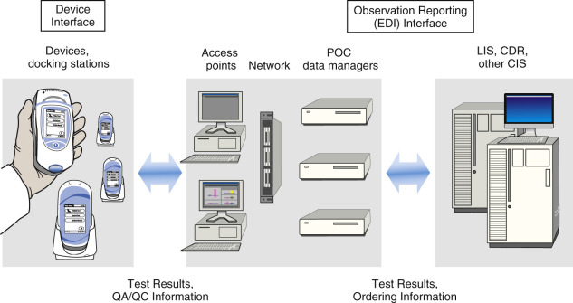

## Key Points

  * •

Point-of-care testing refers to the scope of laboratory tests that are performed where patient care is delivered. This includes physician office testing as well as various hospital locations outside the laboratory, such as the emergency department, operating room, and intensive care unit. 

  * •

When performed in a physician office, simple tests (such as urine dipstick and whole blood glucose meters) are exempt from most regulations involving personnel, proficiency testing, and rigorous quality assurance requirements. These are referred to as “waived” tests under the Clinical Laboratory Improvement Act. In hospitals, these tests fall under the laboratory certificate of the parent hospital or health care facility and generally are subject to stricter requirements. 

  * •

Special personnel requirements are necessary (including those for laboratory director) if a physician office laboratory performs moderate-complexity testing. 

  * •

Key components of a hospital point-of-care testing program include method validation, training of nonlaboratory staff, and clear policies and procedures to establish who is responsible for each part of the program. Laboratory oversight is mandatory. 

  * •

Current technology of select tests in hematology, chemistry, and microbiology is reviewed, and limitations are discussed. 

,  

##  Introduction: Definition of Point-of-Care Testing 

Point-of-care testing (POCT) is laboratory testing that is performed outside the central or core laboratory and generally at the site of clinical care or close to the patient. In most settings, POCT is performed by clinical staff rather than laboratorians. Some POCT is also performed by the patient at home. This is the case for home glucose monitoring for diabetics and home coagulation testing for people on warfarin. 

Because POCT is mainly performed by nonlaboratorians, there are many challenges to ensuring that testing is performed in an appropriate and accurate manner. Regulatory requirements are available to help guide outpatient locations in the implementation and maintenance of important components of POCT, such as training, creating procedure manuals, performance of quality control, test validation, and documentation of results. Because testing is generally performed by people who are not trained in laboratory sciences and do not have a background in quality assurance and error reduction in laboratory testing, device manufacturers have built-in features to reduce the possibility of errors. These features include passwords for individual users with lock-out if training is not up-to-date, requirements for external and internal quality control prior to patient testing, and electronic transmission of results. 

Some of the clinical settings where POCT is performed include emergency rooms or urgent care settings, where often quick decisions need to be made; inpatient settings to maintain tight glucose control; physicians' offices; health fairs; cancer centers that perform infusions; radiology sites prior to contrast administration; presurgical testing; nursing homes; and blood drives. This variety of settings involves a diverse group of health care workers who perform different types of tests. Depending on the type of testing, the clinical setting, and the test categorization (mandated by the Clinical Laboratory Improvement Act, or CLIA), testing may be performed by nurses, medical assistants, physicians, or office assistants. This diversity of clinical roles and levels of education means that training and testing responsibilities must be tailored to the individuals' backgrounds as appropriate. For instance, a medical assistant may be trained to perform urine dipsticks in an outpatient setting, but a nurse may be responsible for reviewing daily quality control. Similarly, a physician or medical director on the CLIA certificate may be responsible for writing the procedure manual and oversight of training. 

Oversight of POCT programs can be very complex and challenging due to the mix of tests and devices, the number of people performing the tests, and the focus on clinical care over laboratory testing. Testing in a clinical laboratory is generally performed by a relatively small number of people trained in laboratory sciences whose primary focus is lab testing. Testing is also generally performed on only a few laboratory analyzers. This is in contrast to POCT, which is performed in a clinical site by health care providers who have other responsibilities besides POCT. They are generally trained in patient care, not clinical laboratory sciences. Also, POCT is frequently distributed over a larger number of devices, with each performing a relatively low volume of testing, requiring more validation, calibration, quality control, and so on. 

,  

##  Regulatory Requirements 

The Clinical Laboratory Improvement Act of 1988 (CLIA 88) set basic standards for laboratories to follow to ensure the accuracy of patient test results regardless of the setting in which they are performed (  Code of Federal Regulations, Part 493  ). These standards apply to central or core laboratories performing testing on samples received from inpatient and outpatient locations; they also apply to any other site performing testing, including POCT and provider-performed microscopy procedures (PPMP). CLIA defines four different categories of tests based upon the following factors: level of training and education required to perform the test, reliability and stability of the reagents, complexity of operational steps, availability and stability of quality control and proficiency testing materials, requirements for maintenance of the test system, and the level of judgment and interpretation required to perform the test and compile the results. The levels of complexity are waived testing, provider-performed microscopy, moderate-complexity, and high-complexity testing. The Centers for Disease Control (CDC) determines the level of complexity based on the preceding criteria ( [ http://www.fda.gov/MedicalDevices/DeviceRegulationandGuidance/IVDRegulatoryAssistance/ucm393229.htm ](<http://www.fda.gov/MedicalDevices/DeviceRegulationandGuidance/IVDRegulatoryAssistance/ucm393229.htm>) ). Waived testing is testing that requires minimal training and education to perform and/or would theoretically cause minimal harm if the results were not accurate ( [ Box 6-1 ](<#b0010>) ). Many point-of-care tests are waived, including any tests approved for home use. Testing such as urine dipsticks, qualitative hCG, and glucose are generally waived. Some point-of-care INR devices are waived, and the Food and Drug Administration (FDA) has recently granted the first ever CLIA waiver to a nucleic acid–based influenza diagnostic test (FDA, 2015). Provider-performed microscopy procedures are a discrete set of tests in which specimens that are time-dependent are examined under a microscope at the point of care ( [ Table 6-1 ](<#t0010>) ). PPMP can only be performed by licensed professionals like physicians and dentists, as well as nurse practitioners and physician assistants under the direction of a physician, depending on the state in which they practice. Moderate- and high-complexity testing is usually performed in larger and more advanced laboratory settings, including hospital and reference laboratories. 

Box 6-1 

Types of CLIA Certificates 

 

##  Certificate of Waiver 

  * Certificate issued to a laboratory to perform only waived tests 

  * Certificate for provider-performed microscopy procedures 

  * Certificate issued to a laboratory in which a physician, midlevel practitioner, or dentist performs no tests other than the microscopy procedures; permits the laboratory to also perform waived tests 

 

##  Certificate of Registration 

  * Certificate issued to a laboratory that enables the entity to conduct moderate- or high-complexity laboratory testing, or both, until the entity is determined by survey to be in compliance with CLIA regulations 

 

##  Certificate of Compliance 

  * Certificate issued to a laboratory after an inspection that finds the laboratory to be in compliance with all applicable CLIA requirements 

 

##  Certificate of Accreditation 

  * Certificate issued to a laboratory on the basis of the laboratory's accreditation by an accreditation organization approved by the Health Care Finance Administration 

Data from Centers for Medicare and Medicaid Services. _CLIA: How to obtain a CLIA certificate of waiver._ Obtained at [ http://www.cms.gov/CLIA/downloads/HowObtainCertificateofWaiver.pdf ](<http://www.cms.gov/CLIA/downloads/HowObtainCertificateofWaiver.pdf>) . Accessed February 24, 2015. 

TABLE 6-1 

Waived Tests 

Chemistry  |  Albumin, amylase, ALT, AST, GGT, alkaline phosphatase, total protein, bilirubin (total), carbon dioxide, glucose, sodium, potassium, calcium (ionized), calcium (total), phosphorous, urea (BUN), creatinine, uric acid, brain natriuretic peptide (BNP), glycated hemoglobin (HbA1c), fructosamine, cholesterol, LDL, HDL, triglyceride, creatine kinase (CK), lactic acid, ketones, lead, collagen type 1 N-telopeptides   
---|---  
Endocrinology  |  TSH, FSH, LH, ovulation tests (LH) by visual color comparison, estrone 3-glucuronide   
Drugs  |  Alcohol (saliva), barbiturates, benzodiazepines, buprenorphine, cannabinoids (THC), cocaine metabolites, methadone, methamphetamines/amphetamines, MDMA, morphine, oxycodone, nicotine, opiates, PCP, propoxyphene, tricyclic antidepressants, lithium   
Hematology  |  Hemoglobin, hematocrit, ESR (nonautomated), platelet aggregation (VerifyNow), prothrombin time (PT)   
Microbiology  |  _H. pylori_ antibodies, HIV 1 and 2 antigens/antibodies, adenovirus antigens, RSV, _Treponema pallidum_ antibodies, influenza A and B, group A streptococcus, trichomonas antigen, Lyme antibodies, vaginal aerobes/anaerobes, hepatitis C virus antibody, infectious mononucleosis antibodies   
Urine  |  pH, glucose, ketone, protein, nitrite, urobilinogen, bilirubin, leukocyte esterase, catalase, hCG, albumin, microalbumin, specific gravity, leukocytes, ascorbic acid   
Miscellaneous  |  Vaginal pH, matrix metalloproteinase-9 (MMP-9), glucose (fluid), gastric pH, semen, osmolality (tears), fecal occult blood, gastric occult blood, bladder tumor–associated antigen   
  
Data from U.S. Food and Drug Administration. Obtained at [ http://www.accessdata.fda.gov/scripts/cdrh/cfdocs/cfClia/analyteswaived.cfm ](<http://www.accessdata.fda.gov/scripts/cdrh/cfdocs/cfClia/analyteswaived.cfm>) . Accessed February 24, 2015. 

A CLIA certificate must be issued for a site to perform laboratory testing. Five different types of certificates are issued: Certificate of Waiver, Certificate for Provider-Performed Microscopy Procedures, Certificate of Registration, Certificate of Compliance, and Certificate of Accreditation ( [ Box 6-2 ](<#b0015>) ). Some examples of accreditation organizations are The Joint Commission and the College of American Pathologists (CAP). When a hospital laboratory is issued a certificate, all testing that is performed in that building or any contiguous buildings falls under the laboratory's certificate. Any testing that is performed at a separate location, even if it is overseen by the hospital laboratory and has the same laboratory director, must have its own certificate. 

Box 6-2 

Provider-Performed Microscopy Procedures 

  * Wet mounts, including preparations of vaginal, cervical, or skin specimens 

  * Potassium hydroxide (KOH) preparations 

  * Pinworm examinations 

  * Fern test 

  * Postcoital direct, qualitative examinations of vaginal or cervical mucus 

  * Urinalysis with microscopy 

  * Fecal leukocyte examination 

  * Semen analysis; presence and/or motility of sperm 

  * Nasal smears for eosinophils 

Data from Centers for Disease Control. Obtained at [ http://wwwn.cdc.gov/CLIA/Resources/TestComplexities.aspx ](<http://wwwn.cdc.gov/CLIA/Resources/TestComplexities.aspx>) . Accessed February 24, 2015. 

CLIA 88 established the laboratory requirements for testing personnel, supervisory personnel, laboratory directors, testing facilities, test validation, procedure manuals, personnel training and competency, quality control, proficiency testing, and reporting results. Some states, including New York, California, and Florida, have more stringent laboratory regulations than those mandated by CLIA. Also, laboratories that choose to be accredited by CAP face some more stringent requirements. 

,  

##  Laboratory Directorship 

Laboratories that perform under a Certificate of Waiver or with a certificate for PPMP can perform waived testing without the overhead of having personnel who meet established qualifications in training, experience, job performance, and competency. However, if any moderate-complexity tests or measurements are performed, CLIA requires that the laboratory be directed by a laboratory director and/or a laboratory consultant with appropriate credentials. This director is to be responsible for determining the qualifications of individuals performing and reporting test results, as well as ensuring compliance with all applicable regulations. The director is also responsible for the analytic performance of all assays and must monitor ongoing proficiency, accuracy, and precision. If more than one individual in the practice qualifies as a laboratory director, the laboratory is required to designate one as being responsible. It must be demonstrated that the laboratory director is providing effective direction for the operation of the laboratory, and if he or she does not provide onsite direction, he or she must provide consultation by phone or delegate to qualified personnel with specific responsibility as required by regulation. Online courses are available that allow physicians to qualify as director of a moderately complex laboratory by obtaining 20 hours of continuing education credit. 

For POCT, a separate certification is usually not necessary when it is performed under the supervision of the laboratory director responsible for laboratory services in a health care facility. POCT that occurs within a health care facility, at sites that are located in contiguous buildings on the same campus, and under common direction can be performed under the certificate of the parent organization. When assays and procedures are performed in a situation such as this, the terms _waived_ and _complexity_ no longer apply. The test menu is no longer restricted to waived testing, but more frequent inspections and higher scrutiny are received in return. Because the parent organization typically has a certificate that allows testing at all levels of complexity, it is the responsibility of the laboratory director to ensure that the test method used at the POCT site is appropriate for the skills and training of those performing the test. What inspectors do not tolerate could be called “rogue testing.” This occurs when a clinic or service sets up a test without the knowledge and supervision of the laboratory director. With the tracer method used by accrediting agencies such as the Joint Commission, if an inspector finds a lab result and traces it back to a laboratory that is not adequately supervised by the laboratory director, a citation may be issued to the discredit of the health care facility. 

,  

##  Compliance 

In addition to CLIA, all laboratories must adhere to regulatory procedures, particularly in the outpatient setting. First, all testing for which Medicare is billed must be medically necessary. Screening tests and other measures of wellness generally are not covered. Medical necessity determination is implemented by Medicare, Medicaid, and other insurance carriers through Current Procedural Terminology (CPT) codes used in conjunction with International Classification of Disease (ICD) codes. When the ICD-10 code does not warrant the CPT-4 code, payment is rejected. Even worse, if it is determined that a laboratory deliberately added codes to obtain a higher payment than it deserves or payment for work that it has not done, it can be charged with fraud, which is a felony, and the laboratory will be subjected to fines. Errors are assumed to be deliberate unless a compliance program is in place that actively seeks to uncover billing errors. 

Another potential pitfall is Stark regulations. The Stark laws, which are named after their original sponsor, Representative Fortney Pete Stark (D-Calif.), were intended to prevent unnecessary self-referrals intended to boost revenue. Under Stark, physicians are prohibited from referring Medicare patients to laboratories in which the physician (or a close family member) has a financial interest. Because this prohibition would be detrimental to most POLs, it is important to understand the “safe harbors” that allow legitimate self-referral. 

CLIA 88 created standards for POLs and POCT in the United States that predated similar measures on the international scene. However, an international working group has proposed and adopted ISO 22870-2006 as an international standard for POCT. These standards are more extensive than current CLIA requirements; however, CLIA is a minimum federal requirement, and states and other accrediting agencies can impose standards that are more rigorous. An evolution of accreditation expectations may occur over the next few years to meet these international standards. Thomas has published a summary of these international standards with cross-referencing to current College of American Pathologists accreditation standards (  Thomas, 2008  ). 

,  

##  Types of Point-of-Care Testing 

Many different analytes can be used for point-of-care tests. Some of these tests are single-use cartridges, such as rapid HIV tests and urine pregnancy tests, and manual tests that require testing personnel to record a result, such as a urine dipstick or fecal occult blood testing. Other tests are performed on portable multiuse devices that may require a blood draw or fingerstick. These include many glucometers, coagulation monitoring devices, blood gas analyzers, and point-of-care chemistry analyzers ( [ Table 6-2 ](<#t0015>) ). 

TABLE 6-2 

Examples of Common Point-of-Care Tests 

Test  |  Clinical Setting   
---|---  
Glucose  |  Home monitoring for diabetics, inpatient monitoring for glycemic control   
Blood gases  |  Critical care units, operating rooms   
Cardiac markers  |  Emergency rooms   
Urinalysis  |  Physicians' offices   
Creatinine  |  Radiology suites prior to contrast administration   
PT/INR  |  Coagulation clinics, cardiology practices, home monitoring   
Infectious diseases (HIV, RSV, influenza, etc.)  |  Outpatient and emergency settings for treatment decisions and cohorting or isolation   
Drug screening  |  Emergency rooms, outpatient treatment programs, workplace testing   
  
 

##  Hematology 

POCT in hematology is generally limited to hemoglobin and hematocrit on a blood gas or chemistry device and prothrombin time and INR for monitoring patients on warfarin. What is missing in the hematology realm of POCT is the ability to perform white cell counts and differentials. Some manufacturers produce small instruments that are capable of performing CBC and a three- or five-part differential. However, because this testing is all moderate complexity, a moderate-complexity laboratory must be installed at the site where the testing is to be performed. This lack of point-of-care CBC can be a hindrance to patient care in emergency settings as well as cancer centers. In an emergency room or urgent care center, a rapid CBC and differential can help the clinician determine whether a patient is suffering from a viral or bacterial infection and whether he or she needs admission and antibiotics. In a cancer center, some treatment decisions are based on the white blood cell count. If the CBC had to be sent to the central laboratory for testing, the delay could hold up the patient's treatment and cause inefficiencies in productivity for the cancer center. 

Point-of-care coagulation monitoring for patients on warfarin is well established. This testing may be performed in a coagulation clinic, a cardiology practice, a primary care setting, or at home by the patient. Many of these devices are waived, but some are moderate complexity, which would necessitate meeting all the requirements of a moderate complexity laboratory. In a CAP Q Probes survey of quality control performance for POCT on PT/INR and activated clotting times (ACT) at 87 institutions, 95.6% of expected quality control was performed. However, only 79.5% of out-of-range quality control was associated with corrective action, and 9.6% of the time, patient testing was performed even though no corrective action was taken. Additionally, for the sites performing routine INR comparisons with the central laboratory, 10% of the time there was a difference of greater than 0.5 units (  Meier & Jones, 1999  ). This study highlights some of the common quality issues facing POCT programs, such as failure to perform quality control, lack of follow-up on missing or inaccurate quality control, and potential discrepancies among testing methods. These are issues that every POCT program should strive to avoid and/or improve through proper laboratory oversight, user training, and well-defined procedures. 

 

##  Chemistry 

By far, the most ubiquitous POCT performed is glucose testing. Point-of-care glucose testing is performed at home by diabetic patients, in physician offices and nursing homes, and in inpatient settings. Glucose testing devices were originally designed for home monitoring in diabetic patients to maintain glycemic control. Many studies have demonstrated the patient benefits of this approach, including reduction in morbidity and mortality and decreases in retinopathy, nephropathy, neuropathy, and cardiovascular disease. To achieve tight glycemic control (TGC), these home use devices were later adopted in inpatient settings, such as critical care and postoperative units, as well as general inpatient units. However, these devices were never intended for use in these patient populations, nor were they validated in them. Recently, the FDA has indicated that these devices should be redefined as moderate complexity owing to their use with critically ill patients. This would significantly increase the regulatory burden on hospitals. Currently, POCT performed in an inpatient setting is considered “off-label” use, placing the burden on the manufacturers or the hospital to validate the devices in the appropriate patient populations. However, no clear definition of a critically ill patient exists. Therefore, it is unclear how to approach validating these devices. This current attempt to improve patient safety in the context of point-of-care glucose testing demonstrates the difference between home testing devices and those used for inpatients. In an inpatient setting, a patient's state of health ranges from a well patient admitted for elective surgery to a critically ill patient with multiorgan failure who is on many medications. Recently, Nova Biomedical received FDA clearance for intensive care use after performing extensive validations in critically ill patients. How the other manufacturers' devices perform in these patient populations will be determined as they are validated for such use. This issue demonstrates the need to define appropriate use for these devices in different patient populations and settings. 

Point-of-care measurement of hemoglobin A1c (HbA1c) is increasingly being performed in outpatient settings to monitor glucose control in diabetics. This allows a physician to determine whether any changes in medications or lifestyle need to be made. Thus the patient does not have to return for a follow-up visit or wait for a phone call from the doctor's office. Also, if any new prescriptions need to be issued, it can be done immediately. So while point-of-care HbA1c testing does not necessarily provide critical clinical information, it does help improve patient care, because important clinical decisions can be made at the visit without waiting a day or more for the lab results to be available. This decreases the burden on the physician's staff and potentially improves adherence to treatment changes as well as patient satisfaction. Thus the cost, labor, and expertise involved in implementing POCT for HbA1c must be weighed against the benefits to the patient and the provider. 

Another area of chemistry that is rapidly changing involves creatinine and cardiac markers in EDs. Creatinine measurements and pregnancy tests are used to determine whether patients can be appropriately referred for radiologic procedures.  Nichols and colleagues (2007)  questioned the accuracy of two POCT creatinine assays. In these situations, however, when values near the decision points for creatinine are obtained, the specimen can be referred to the central lab for confirmation, while the remaining patients can be moved on more rapidly increasing throughput. With pregnancy testing, an assay with high sensitivity should be selected to yield a high predictive value for a negative result. 

In a review of the literature on the use of POCT for serum markers of cardiac necrosis in terms of the process and outcomes of patient care in the ED,  Storrow and colleagues (2009)  found general agreement that POCT led to significantly decreased turnaround time for cardiac marker results reporting to the ordering physician. In addition, improvements in other ED efficiency measures (e.g., time to therapy and total ED length of stay) were seen. However, investigators could find no evidence that POCT for cardiac biomarkers had any effect on clinical outcomes of patients evaluated for acute coronary syndrome. In a multicenter, randomized, controlled study comparing laboratory and point-of-care cardiac marker testing strategies,  Ryan and colleagues (2009)  found similar reductions in turnaround time, but effects on ED length of stay varied among institutions. Across all sites, POCT did not decrease time to disposition for admitted or discharged patients (  Ryan et al, 2009  ). 

 

##  Microbiology 

Given the long turnaround times experienced with most microbiology testing, the availability of effective POCT could radically change practice in infectious disease. This can be seen quite clearly with the advent of effective POCT for human immunodeficiency virus (HIV). Performance characteristics of the available POCT HIV assays have been reviewed and were found to have comparable sensitivity and specificity to conventional enzyme immunoassays (  Campbell & Fedoriw, 2009  ). In early infection, however, these assays were found to be less sensitive than nucleic acid amplification testing.  Appiah and colleagues (2009)  compared point-of-care HIV testing in a voluntary counseling and testing (VCT) clinic and in a tuberculosis (TB) clinic in Ghana and found that in both clinics, 100% of patients offered POCT accepted it, but only 93% of VCT clients and 40% of TB patients had accepted a standard HIV test offered 6 months earlier. Moreover, all patients attending the VCT or TB clinics who tested positive for HIV with the point-of-care test returned to the HIV clinic for care, but only 64% and 95%, respectively, of patients who tested positive in the previous cohort had returned for follow-up, indicating a strong change in patient behavior when access to POCT and immediate results is provided (  Appiah et al, 2009  ). 

Other infectious disease POCT is not quite so effective. Rapid group A streptococcal antigen testing is relatively insensitive, with sensitivity estimates ranging from 60% to 90%, making the recommendation necessary for backup blood agar culturing for all negative POCT antigen results. Waived testing for respiratory viruses is limited to respiratory syncytial viruses and influenza A and B viruses with similar sensitivities. Recent experience with the novel H1N1 outbreak, where all point-of-care tests indicating influenza A were assumed to be positive for H1N1, was less than satisfactory. 

,  

##  Advantages and Disadvantages of Point-of-Care Testing 

POCT has many advantages, including improved turnaround time, convenience, shorter length of stay, and improved patient satisfaction ( [ Box 6-3 ](<#b0020>) ). However, whether these benefits are realized can be challenging to quantify.  Crocker and colleagues (2014)  showed some benefits to implementing POCT in an outpatient setting, including fewer follow-up tests, fewer phone calls and repeat visits, and reduced cost of care. However, these advantages have to be weighed against the disadvantages, including the higher cost of testing, regulatory requirements, consequences of erroneous results, and differences in technology compared to the central laboratory. 

Box 6-3 

Advantages and Disadvantages of Point-of-Care Testing 

 

##  Advantages 

  * Decreased turnaround time 

  * Decreased time to treatment 

  * Decreased length of stay 

  * Fewer follow-up visits or calls 

  * Improved patient and provider satisfaction 

  * Less traumatic sample collection 

  * Collaboration between laboratory and clinical staff 

 

##  Disadvantages 

  * Increased cost, direct and indirect 

  * Increased regulatory burden 

  * Increased work for clinical staff 

  * Increased oversight for laboratory 

  * Greater potential for error 

  * Results may not correlate with central laboratory 

The pros and cons of implementing POCT vary, depending on the clinical setting and need. For instance, in an inpatient setting, point-of-care glucose testing is practically a necessity. That number of glucose tests regularly performed in an inpatient setting would rapidly overwhelm the central laboratory and slow down everything from accessioning to processing. Also, it would add to the workload of the nursing staff responsible for drawing the specimens and sending them to the laboratory. Finally, the patient would require more blood draws and could even develop iatrogenic anemia. In an emergency room, time is of the essence. Rapid turnaround times guide decisions for treatment, further testing, and admission or discharge. For a patient presenting with symptoms of acute coronary syndrome (ACS) without classic EKG changes, the cardiac markers help the clinicians decide whether the patient needs an intervention such as cardiac catheterization or thrombolysis. Many studies have shown that the time to intervention is critical to salvaging precious cardiac muscle (  Ryan et al, 2009  ). In an outpatient, POCT may be considered when treatment decisions can be guided by the test results at the visit. This is the case for INR monitoring for patients on warfarin. However, erroneous results can lead to improper dosage adjustments, and any questionable results should be confirmed by the laboratory. Testing for HbA1c is a good example of a noncritical test that may improve patient care in an outpatient visit. Having the test results at the office visit allows the clinician to adjust treatment and counsel the patient appropriately to improve glycemic control in the future. Finally, home monitoring is appropriate for insulin-dependent diabetics to properly adjust their dose. Home INR monitoring frees a patient from coming to the physician's office for a fingerstick or blood draw on a regular basis. However, patients still need to consult with their clinicians when adjustments are appropriate. 

,  

##  Connectivity and Data Management 

Data management in POCT can be quite extensive. Test results must be recorded in the patient's chart, whether electronic or on paper, and appropriate units of measure and reference ranges must be included with the report. Other data that must be maintained by the site are records of validation of devices; validation and tracking of new lots of reagent; quality control data, including proficiency testing results that must be performed; all testing personnel; and operator training and competency. To meet regulatory requirements, it must be possible to link each patient result to a specific operator, device, and lot of reagent and quality control. For an outpatient practice, this documentation may not be too cumbersome. For a hospital or health care system with many types of devices, tests, and operators, however, this documentation can quickly become overwhelming. 

To make maintenance of these data easier, many device vendors have implemented certain features for result reporting and data management ( [ Table 6-3 ](<#t0020>) ). In addition to device-specific information processing features, middleware systems can electronically connect with multiple types of devices to manage patient and QA/QC data. Thus in a complex health care system using multiple POCT devices, there can be one central repository for the data. Interfaces with the laboratory information system (LIS) and the electronic medical record (EMR) further improve functionality, reduce errors, and transmit patient data very rapidly. Many devices now have wireless transmission of data, so the device does not even need to be docked to send the patient's results across an interface to an LIS or EMR. 

TABLE 6-3 

Point-of-Care Testing Device Software Features 

Feature  |  Details   
---|---  
System lockouts  |  Quality control out of range or not performed, no patient ID, no operator training   
Calibration  |   
Security access  |  Different levels for users and managers   
Reference ranges  |  May transmit to LIS   
Quality control ranges  |   
Bar code scanner  |  For patient identification, reagent and quality control identification   
Data management  |  Patient results, quality control records, maintenance and calibration documentation   
Connectivity  |  Data manager or middleware, LIS   
  
The CLSI has developed standards for transmitting POCT data based on the specifications of the Connectivity Industry Consortium (CIC) (  Dunka et al, 2014  ). The CIC is a group of 49 health care institutions, point-of-care diagnostic vendors, diagnostic test system vendors, and system integrators. This document describes two types of interfaces: the device interface and the observation reporting interface ( [ Figure 6-1 ](<#f0010>) ). It sets standards for the POCT industry to maintain some level of uniformity among vendors and promotes cost-effective and easy-to-implement data management. 

Figure 6-1 

Point-of-care testing interfaces. 

(From CLSI: _Point-of-care connectivity; approved standard_ , ed 2, CLSI document POCT01-A2. Wayne, Pa., 2006, Clinical and Laboratory Standards Institute; 2006. Redrawn with permission.) 

,  

##  Implementation of a Point-of-Care Testing Program 

 

##  Physician Offices 

POCT programs differ significantly, depending on the scope of testing and the setting where it will be performed. In an outpatient physician office setting where only waived testing will be performed, establishing a program may be relatively simple. A physician or the medical director for the practice will generally serve as the director on the Certificate of Waiver. It will be his or her responsibility to develop policies and procedures and lead the practice in deciding what testing to perform and what methods to use. However, the director should solicit feedback from other practitioners, nurses, and clinical staff who will play a role in the testing. After clinical need, the most important factors in test selection are usually ease of use and cost per test. A system for initial training and subsequent competency will need to be established. The practice should follow the manufacturer's recommendations for quality control procedures, specimen collection, and testing procedures. Appropriate logs with patient information and lots of reagent and quality control material should be maintained if electronic reporting is not performed. 

 

##  Hospitals and Medical Centers 

 

##  Point-of-Care Committee and Management Team 

A first step in implementing a POCT program at a hospital or medical center is to establish a Point-of-Care Committee. This committee should consist of representatives from the clinical laboratory, particularly the medical director responsible for POCT, the point-of-care manager and/or administrator from the medical laboratory, and medical staff from departments who frequently use POCT. These could include the emergency department, the intensive care units, outpatient clinics, and so on. Nurses should play a critical role in the committee because they will be overseeing training, verifying correct use of tests, and ensuring proper storage of reagents, kits, and quality control materials. They may also be performing the tests, depending on the situation. Hospital administration should have a role on the committee because they can provide information about future growth and addition of new sites and technologies that will help guide the committee. A member from the hospital regulatory team might also be involved to ensure regulatory compliance and keep the committee apprised of impending inspections, new regulations, or deficiencies noted in mock inspections. Finally, representation of the information technology department is critical because more and more devices have the capability to report electronically. Many devices can now report results wirelessly, an important consideration in a fast-paced setting where a device may not be docked between patients. 

In addition to a Point-of-Care Committee, it may be necessary to have a point-of-care team as part of the clinical laboratory staff. This depends on the number of sites that are performing testing and the diversity of devices and tests in use. In a smaller community hospital where only point-of-care glucose testing is done, it may be adequate to have one laboratory technologist run the program. However, in a large medical center where many inpatient and outpatient locations perform POCT (e.g., rehabilitation, cancer centers, same-day surgery, cardiac catheterization suites, radiology, and endoscopy), it is important to have a laboratory team that can meet the many needs of these different locations. A clinical staff member who is responsible for the site should be present at all times. This person would ensure that quality control was being performed and was acceptable, that new employees received training, and that procedures were being followed. The laboratory staff member might visit once a month to make sure that documentation was in order; devices were in good working order; reagents, kits, and quality control materials were labeled and stored correctly; and that any necessary calibrations and instrument comparisons were performed. This lab representative should also make sure that proficiency testing materials were being handled and tested appropriately, although the PT must be performed at the site by the staff normally performing patient testing. The number of people on the point-of-care laboratory team will depend on the number of sites and the complexity of testing. These should be technologists who are organized, competent to perform validations on new instruments and analyze the data, and can help troubleshoot problems with instruments. Also, the ability to communicate clearly with clinical staff at the different locations is an important attribute. 

 

##  Selection of Appropriate Tests 

After instituting the Point-of-Care Committee, it is important to survey the institution to determine what testing is currently performed. This will involve talking to clinicians and nurses, as well as actually visiting testing locations to observe what is being done. Reagents and other testing materials may be discovered by laboratory representatives by visiting inpatient floors and outpatient testing locations. Some locations may not report all the testing they are doing. For instance, on labor and delivery, physicians may not realize that the microscopy they do for ferning is a PPMP that requires an appropriate CLIA certificate. Other locations may be performing fecal occult blood testing and not realize that it is a laboratory test requiring appropriate procedures, training, and documentation of results. Once the survey is complete, it is important to assess the needs of each location performing the testing. Some locations may not need all of the testing they are performing or may be able to scale back on the number of devices and/or tests. Other locations may have a valid clinical need to add more testing. 

When a location wants to add a new point-of-care test, some basic information should be collected for review by the Point-of-Care Committee. This information includes testing to be added, anticipated volume of testing, reason for performing the testing on-site rather than sending it to the clinical laboratory, number of personnel who will be performing testing and their qualifications, person who will be the site manager and his or her qualifications, and person who will be the medical director and his or her qualifications. Perhaps the most important consideration is the reason for the testing to be performed as a point-of-care test. Some important factors are impact on the number of patient visits, length of stay, treatment initiation, morbidity and mortality, patient/clinician satisfaction, and compliance with therapy (CLSI POCT09-A). A standard form could be used for this purpose, followed by a visit from a laboratory representative, either the medical director for POCT or the administrator/manager, depending on the request. Once this information has been collected, it should be presented to the Point-of-Care Committee for review. Criteria for accepting the request might include clinical need, cost considerations, complexity of testing (waived or moderate), and the location's track record with other POCT. 

 

##  Selection of Appropriate Testing Devices and Methods 

During the initial survey to determine what POCT is being performed, it is important to start moving toward standardization of equipment as well as manual tests such as urine dipsticks and urine pregnancy. This approach has several advantages. One is that policies and procedures can be uniform for all locations. Sometimes inpatient policies may differ slightly from outpatient policies if, for instance, an outpatient will be sent to the emergency department for a critical result. Training and competency can also be the same for all locations, for the most part. Reagents, quality control, and any other material can be bought in larger quantities by the central lab and distributed appropriately. This way, the laboratory can be sure the correct materials are being used. It also ensures appropriate storage of reagents requiring specific storage conditions. It may also help to keep costs down and can be a tremendous help with lot-to-lot changes in reagents and quality control because these comparisons can be performed centrally, if required. Any other documentation can be consolidated, such as logs for quality control and temperature and humidity logs. 

Selection of which manufacturer's tests and devices to use is an important function of the Point-of-Care Committee. Vendors may be invited to give a presentation to the Committee and provide a demonstration. Other clinical sites that are using the test under consideration can be contacted for input and feedback on their experiences. Considerations such as ease of use, frequency of quality control, electronic quality control, lockouts for unacceptable quality control results, lockouts for users whose training has expired, electronic data transmission to a middleware product or LIS, wireless downloads, and robust construction of the device are all important. Other important considerations include complexity of testing, cost of device, cost and stability of reagent/cartridges/kits, and validation procedures. From an analytical perspective, the accuracy and precision, analytic sensitivity and specificity, reportable range, and comparison to laboratory methods in use at the institution are important considerations (  Zucker et al, 2014  ). Ultimately, input from the laboratory professionals on the committee is important because they will be responsible for overseeing the testing and ensuring the quality of the results. Also, laboratory professionals are familiar with the process of assessing new equipment and determining which equipment best suits the testing needs for the situation. However, it is also important that the end users are comfortable with device selection and that the testing, quality control, calibration, and other maintenance are relatively easy to perform. 

 

##  Policies and Procedures 

Test procedures should adhere to Clinical and Laboratory Standards Institute (CLSI) guidelines and adhere to the manufacturer's instructions. The procedure should act as a reference for the person performing testing and contain institution- or practice-specific information such as critical values, reference ranges, and acceptable specimen types. Procedures should be reviewed annually and signed by the director on the CLIA certificate or his or her designee. Procedures should be uniform for all locations using the same device or manual test. The procedure is generally written by the laboratory point-of-care team in a hospital or medical center. However, input from nursing or other clinical users may be appropriate to be sure that the procedure actually fits the testing workflow. Also, because nursing frequently bears much of the responsibility for training, they should be familiar with the procedures and comfortable with training on them. 

 

##  Method Validations 

Prior to implementation, point-of-care tests must be validated and approved by the director. Validation may be a simple procedure for a manual test, such as a urine dipstick, where results can be compared to those run on a laboratory analyzer. Ten to 20 specimens are usually adequate as long as all components have normal and abnormal results. Additionally, some simple precision studies using normal and abnormal quality control material should be performed. More complex validations are required for point-of-care devices reporting analytes such as blood gases, chemistries, and cardiac markers. CLSI guidelines should be followed for these validations with method comparison to the main laboratory analyzer(s). Precision studies and reference range verifications may be warranted. When multiple devices are being validated at once, it is acceptable to compare one device to the laboratory method and then compare other devices to that one. This can streamline the process and decrease the burden on the central laboratory when implementing new POCT throughout a large institution. 

 

##  Oversight of Training and Competency 

Regulatory requirements must be considered when developing training and competency programs and documents for new POCT. Generally, oversight of training and competency is a shared responsibility between nursing and the point-of-care team in the clinical laboratory. The point-of-care team may set up logins and passwords for devices and coordinate with vendors for training large groups of employees. Many devices require a login that can automatically lock an employee out when training is not up-to-date. Nursing keeps records of who has been trained and is due for competency, as well as makes sure that new employees receive the appropriate training. 

,  

##  Maintenance of a Point-of-Care Testing Program 

 

##  Quality Assurance Program 

Once the POCT program has been established, including the Point-of-Care Committee, point-of-care management team, and standardization and implementation of appropriate tests, ongoing work is necessary to maintain the program. Each inpatient and outpatient location should have a clinical staff member who is responsible for the daily operations. This includes maintaining appropriate inventory, reviewing quality control, and ensuring that staff are trained and following procedures. Devices also need to be checked regularly for damage that may affect function, and reagents should be properly labeled in a temperature-controlled environment. This also may include retraining when necessary and following up on critical and erroneous results. The laboratory point-of-care team member should visit each location on a routine basis to ensure compliance with policies and procedures, spot check the site for any problems, and discuss issues with the clinical staff. 

Hospital-based programs in which POCT falls under the laboratory's certificate are obliged to perform regular proficiency testing. While the proficiency testing may be overseen by the laboratory, the testing itself must be performed by the staff that regularly perform patient testing. An attempt should be made to rotate proficiency testing throughout the staff. This can also be used as evidence of competency because it demonstrates the accuracy of test results. The laboratory point-of-care team will generally review the results and perform root cause analysis for any unacceptable results. Ultimately, this will be reviewed and signed off by the laboratory director. 

Inventory management can be challenging in a complex organization with many POCT sites. Inventory may be maintained by the central laboratory and distributed as needed. Alternatively, a lot mortgage may be sequestered by the vendor or distributor to maintain uniformity across all testing sites of an organization. In this situation, individual locations are responsible for ordering their own supplies but may order only what has been approved by the laboratory. The advantage of keeping the entire hospital or medical center on the same lot of reagent is that the lab point-of-care team can perform lot-to-lot studies where appropriate and does not have to worry about remote locations complying with this requirement. This control over inventory also prevents ordering the wrong reagent, strip, or quality control materials. 

Maintenance of devices, periodic calibration, and instrument comparisons also must be performed. These tasks are generally performed or at least coordinated by the laboratory point-of-care team because they may require a more in-depth understanding of laboratory processes and coordination with the central laboratory. Once the data for the method comparisons are compiled, the director must review and approve them. The point-of-care team may also maintain a few backup devices that will be available in the event that devices are damaged or require maintenance. 

Finally, the point-of-care team and the information technology department are responsible for the appropriate results reporting, implementing and maintaining any middleware products or data repositories, and installing any software upgrades or other technology changes. The point-of-care manager or administrator should make sure that any data in the middleware are reviewed for errors or problems, such as critical high or low values or out-of-range values. If the procedure states that a sample should be sent to the laboratory under these circumstances, the point-of-care manager can verify that this was done. Noncompliant users can be retrained and, if the issue persists, testing privileges revoked. Middleware databases also may track proper patient identification in the case where a wristband is scanned or patient number is entered. Improper use of generic numbers that do not link to a patient can be tracked down and prevented in the future. 

,  

##  Conclusions 

POCT is a rapidly expanding and evolving area of laboratory medicine. With new technologies and tests becoming available on a regular basis, as well as expansion of routine POCT to more locations, it is a constant challenge to maintain a program that delivers accurate results and maintains regulatory compliance. Wireless connectivity and middleware products facilitate order and result transmission, as well as documentation of quality control, testing personnel, and problematic results. Data management is a constant challenge for POCT programs, including training and competency, QC, calibrations, and validations. Electronic options for maintaining this information have become a critical component of a POCT program for a large hospital or medical center. Perhaps the most important consideration when implementing a new point-of-care test should be whether the benefit to the patient and/or provider outweighs the cost, including the added expenses related to maintaining testing (personnel, quality control, proficiency testing, etc.). As our health care system focuses more on resource management and test utilization, it will be interesting to see how this impacts POCT. 

,,
