## Key Points

  * •

Nucleic amplification technology has created new opportunities for the clinical laboratory to affect patient care. 

  * •

Although the polymerase chain reaction (PCR) is the most mature and widely used nucleic acid amplification method, other methods have diagnostic applications. 

  * •

Clinical applications of the technology cut across the traditional disciplines in laboratory medicine. 

  * •

An understanding of the basic principles and relative strengths and limitations of the nucleic amplification methods is important for all involved in the practice of clinical pathology. 

  * •

The development of the PCR by Mullis and colleagues (  Saiki et al, 1988  ) was a milestone in biotechnology that heralded the beginning of molecular diagnostics. Although PCR is the most widely used nucleic acid amplification method, other approaches have been developed, and several have unique properties and advantages. These methods are based on target, probe, or signal amplification. Examples of each category are discussed in this chapter. These techniques have analytical sensitivity unparalleled in laboratory medicine, creating new opportunities for the clinical laboratory to impact patient care. 

,  

##  Target Amplification Methods 

Polymerase chain reaction (PCR), transcription-based amplification, and strand displacement amplification are all examples of target amplification methods. These methods share certain fundamental characteristics. They are enzyme-mediated processes in which a single enzyme or multiple enzymes synthesize copies of target nucleic acid. The amplification products in all the techniques are defined by two oligonucleotide primers that bind to complementary sequences on opposite strands of double-stranded targets. All result in the production of millions to billions of copies of the targeted sequence in a matter of hours, and, in each case, the amplification products can serve as templates for subsequent rounds of amplification. Consequently, all the techniques are sensitive to contamination with product molecules from previous amplifications, which can lead to false-positive reactions. However, special laboratory design, practices, and workflow have been developed to reduce the possibility of false-positive reactions to acceptable levels. 

 

##  Polymerase Chain Reaction 

PCR is a simple in vitro chemical reaction that permits the synthesis of essentially limitless quantities of a targeted nucleic acid sequence. This is accomplished through the action of a deoxyribonucleic acid (DNA) polymerase that, under the right conditions, can copy a strand of DNA. At its simplest, a PCR consists of target DNA, a molar excess of two oligonucleotide primers, a heat-stable DNA polymerase, an equimolar mixture of deoxyribonucleotide triphosphates (dATP, dCTP, dGTP, and dTTP), MgCl  2  , KCl, and a Tris-HCl buffer. The two primers flank the sequence to be amplified, are typically 18 to 30 bases long, and are complementary to opposite strands of the target. 

To initiate a PCR, the reaction mixture is heated to separate the two strands of target DNA (denaturation) and then cooled to permit the primers to anneal to the target DNA in a sequence-specific manner (annealing) ( [ Fig. 67-1 ](<#f0010>) ). The DNA polymerase then initiates extension of each primer at its 3′ end (extension). The primer extension products are dissociated from the target DNA by heating. Each extension product, as well as the original target, can serve as a template for subsequent rounds of primer annealing and extension. 

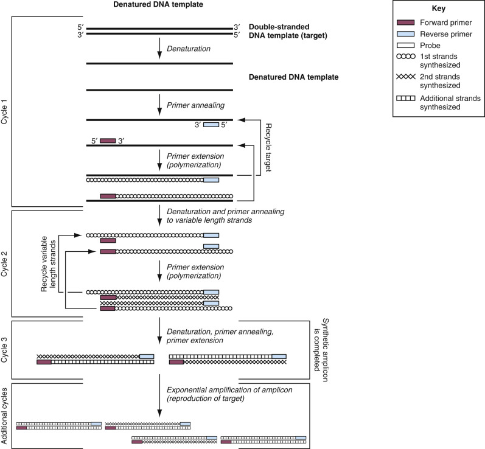

Figure 67-1 

Polymerase chain reaction. 

(Redrawn from Wolk D, Mitchell S, Patel R: Principles of molecular microbiology testing methods. _Infect Dis Clin N Am_ 15:1157–1204, 2008.) 

A PCR cycle consists of three steps: denaturation, annealing, and extension. At the end of each cycle, the PCR products are theoretically doubled. Thus after n PCR cycles, the target sequence can be amplified 2  n  -fold. The whole procedure is carried out in a programmable thermal cycler that precisely controls the temperature at which the steps occur, the length of time that the reaction is held at the different temperatures, and the number of cycles. Ideally, after 20 cycles of PCR, a million-fold amplification is achieved, and after 30 cycles, a billion-fold. In practice, the amplification may not be completely efficient because of failure to optimize the reaction conditions or the presence of inhibitors of the DNA polymerase. In such cases, the total amplification is best described by the expression (1 + e)  n  , where e is the amplification efficiency (0 < e < 1) and _n_ is the total number of cycles. 

 

##  Reverse-Transcriptase Polymerase Chain Reaction 

PCR, as it was originally described, was a technique for DNA amplification. Reverse-transcriptase PCR (RT-PCR) was developed to amplify ribonucleic acid (RNA) targets. In this process, complementary DNA (cDNA) is first produced from RNA targets by reverse transcription, and then the cDNA is amplified by PCR. As originally described, RT-PCR employed two enzymes: a heat-labile RT such as avian myeloblastosis virus reverse transcriptase (AMV-RT) and a thermostable DNA polymerase. Because of the temperature requirements of the heat-labile enzyme, cDNA synthesis had to occur at lower temperatures. This presented problems both in terms of the nonspecific primer annealing and inefficient primer extension due to formation of RNA secondary structures. These problems have been largely overcome by the development of thermostable DNA polymerases derived from _Thermus_ species, which, under the proper conditions, can function efficiently as both an RT and a DNA polymerase (  Myers & Gelfand, 1991  ;  Schönbrunner et al, 2006  ). RT-PCRs using these enzymes are more specific and efficient than previous protocols using conventional, heat-labile RT enzymes. Commercially available kits employing this single-enzyme RT-PCR are available for detection of a variety of RNA targets in clinical specimens. RNA targets may present problems due to secondary or tertiary structure that may require special conditions or alternative target sites for efficient cDNA synthesis. 

While the single enzyme RT-PCR has improved specificity and efficiency for problematic targets, there remain many applications that use a two-enzyme system. Modified heat-labile RT enzymes and optimized mixtures of reverse transcriptases with improved specificity and efficiency are now commercially available. Performing a separate RT reaction with random sequence primers allows PCR analysis of multiple targets from a single RT reaction. The RT reaction may be performed with oligo-dT primers providing cDNA of the messenger RNAs only. This scheme also allows PCR to be performed for multiple targets from a single RT reaction. 

 

##  Nested Polymerase Chain Reaction 

Nested PCR was developed to increase both the sensitivity and specificity of PCR (  Haqqi et al, 1988  ). It employs two pairs of amplification primers and two rounds of PCR. Typically, one primer pair is used in the first round of PCR of 15 to 30 cycles. The products of the first round of amplification are then subjected to a second round of amplification using the second set of primers, which anneal to a sequence internal to the sequence amplified by the first primer set. The increased sensitivity arises from the high total cycle number, and the increased specificity arises from the annealing of the second primer set to sequences found only in the first-round products, thus verifying the identity of the first-round product. The major disadvantage of nested PCR is the high rate of contamination that can occur during the transfer of first-round products to the second tube for the second round of amplification. This can be avoided either by physically separating the first- and second-round amplification mixtures with a layer of wax or oil, or by designing single-tube amplification protocols. In practice, the enhanced sensitivity afforded by nested PCR protocols is rarely required in diagnostic applications, and the identity of an amplification product is usually confirmed by hybridization with a nucleic acid probe. 

 

##  Multiplex Polymerase Chain Reaction 

In multiplex PCR, two or more primer sets designed for amplification of different targets are included in the same reaction mixture (  Chamberlain et al, 1988  ). With this technique, more than one target sequence in a clinical specimen can be coamplified in a single tube. The primers used in multiplexed reactions must be selected carefully to have similar annealing temperatures and must be noncomplementary to each other to avoid primer-dimers and inefficient reactions. Multiplex PCRs are more complicated to develop and are often less sensitive than single-primer-set PCR reactions, but they allow multiple targets to be detected from a single specimen in one reaction. Multiplex PCR is analyzed by separating products by size by gel electrophoresis, by spatial separation on a surface or bead, or by probe color in real-time PCR. Real-time PCR is typically limited to 2 to 6 colors, but greater multiplexing is possible by combining color with the melting temperature of probes. Recent technological advances in decoding highly multiplex PCR reactions are described below. 

A highly multiplexed platform for PCR analysis is the xMAP system (Luminex Corp., Austin, Tex.). The xMAP system incorporates a proprietary process to internally dye polystyrene microspheres with two spectrally distinct fluorochromes. By using precise ratios of these fluorochromes, an array is created consisting of 100 different microsphere sets with specific spectral addresses. Each microsphere set can possess a different reactant on its surface. For nucleic acid analysis, oligonucleotide probes would be covalently bound to the microsphere surface by carbodiimide coupling. Because each microsphere set can be distinguished by its spectral address, the sets can be combined, allowing up to 100 different analytes to be measured simultaneously in a single reaction vessel. A third fluorochrome coupled to a reporter molecule quantifies the biomolecular interaction that occurs at the microsphere surface. 

Microspheres are interrogated individually in a rapidly flowing liquid stream as they pass by two separate lasers in the Luminex xMAP flow cytometer. High-speed digital signal processing classifies each microsphere based on its spectral address and quantifies the reaction on its surface. Thousands of microspheres are investigated per second, resulting in an analysis system capable of analyzing and reporting up to 500 different reactions in a single reaction vessel in a few seconds. 

Multiplex assays run on the Luminex platform typically consist of three major steps: nucleic acid amplification by PCR, target specific extension, and liquid bead array decoding (  Merante et al, 2007  ). After PCR amplification, the amplicons are mixed with a second set of tagged primers specific for each target. If the target is present, the tagged primer will be extended through a process called _target specific extension_ . During this extension a label is incorporated into the extension product. The color-coded beads are added to identify the tagged and labeled extension products. Attached to each differently colored bead is oligonucleotide complementary to the tag sequence for each target. Samples are then placed in the Luminex xMAP flow cytometer where the beads are read by two color lasers. One laser identifies the color of the bead, and the other laser detects the presence or absence of a labeled extension product on that bead. FDA-cleared assays for cystic fibrosis mutations, HLA testing, respiratory virus and gastrointestinal pathogens, and pharmacogenetics are available from Luminex using this technology. 

Another promising technology for high-order multiplex PCR is the FilmArray developed by BioFire Diagnostics, Salt Lake City, Utah. It is a completely automated, integrated, and self-contained lab-in-a-pouch system (  Poritz et al, 2011  ). The film portion of the pouch has stations for cell lysis, nucleic acid purification, reverse transcription to detect RNA targets, first stage PCR multiplex PCR, and an array of up to 120 second-stage nested PCRs ( [ Fig. 67-2 ](<#f0015>) ). After extracting and purifying nucleic acids from the unprocessed sample, the FilmArray performs a nested multiplex PCR that is executed in two stages. During the first-stage PCR, the Film Array performs a single, large-volume, massively multiplexed reaction. The products from the first-stage PCR are then diluted and combined with a fresh, primer-free master mix. Aliquots of this second master mix solution are then distributed to each well of the array. Each well of the array is prespotted with a single set of primers. In the second stage, small-volume PCR is performed in singleplex fashion in each well of the array. Even though this assay uses nested PCR, the entire test is performed within a sealed pouch, thus eliminating concerns of carryover contamination. Using amplification and melting curve data, the FilmArray software automatically generates a result for each target. FilmArray panels for detection of respiratory, gastrointestinal and bloodstream pathogens have been cleared for clinical use by the FDA. In addition, a FilmArray for detection of Ebola Zaire virus, as part of a biothreat panel, was given Emergency Use Authorization by the FDA during the 2014 Ebola outbreak. 

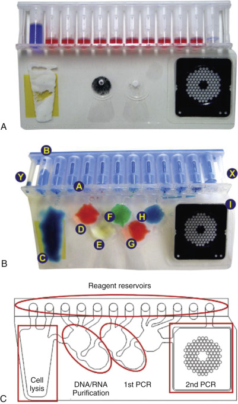

Figure 67-2 

FilmArray pouch. 

**A,** Pouch was injected with mock sample (blue) in the right side injection port and hydration solution (red) left side injection port. **B,** The blisters of the pouch were filled with different coloring, and the channels between the blisters were heat-sealed shut. **C,** A schematic of the pouch showing a trace of blisters, channels, and array wells. The functional areas of the pouch are highlighted in red. 

(Reproduced with permission from Poritz, MA, Blaschke AJ, Byinhton CL, et al: FilmArray, an automated nested multiplex PCR system for multi-pathogen detection: Development and application to respiratory tract infection. _PLoS One_ 6:e2606047, 2011. doi: 10.1371/journal.pone.0026047.) 

GenMark Diagnostics (Carlsbad, Calif.) couples multiplex PCR with solution hybridization to ferrocene-labeled, target-specific signal probes and a microarray of gold-plated electrodes, each coated with different capture probes specific for the targets (  Pierce & Hodinka, 2012  ). Target DNA-signal probe complexes present in the sample hybridize to the capture probes, bringing the ferrocene label in close proximity to the gold electrode. An electrical current is applied to each electrode, and a captured DNA target is analyzed by electrochemical detection using voltammetry with a signal of 3 nA or greater for a given analyte considered positive. 

 

##  End-Point Quantitative Polymerase Chain Reaction 

A linear relationship should exist between the quantity of input template and the amount of amplification product. However, because the final amount of PCR product depends on exponential amplification of the initial quantity of template, minor differences in amplification efficiency may lead to very large and unpredictable differences in the final product yield (  Clementi et al, 1993  ). The tube-to-tube differences may depend on sample preparation and nucleic acid purification procedures, presence of inhibitors, and thermal cycler performance. For these reasons, simple quantification of product accumulated at the end of the reaction and the use of external standard curves do not provide reliable quantification of the amount of template initially present in the sample. 

A variety of PCR-based strategies have been developed to accurately quantify DNA and RNA targets in clinical specimens, but the competitive PCR (cPCR) approach has proved reliable and robust for clinical applications (  Gilliland et al, 1990  ;  Piatak et al, 1993  ). The basic concept behind cPCR is the coamplification in the same reaction tube of two different templates of equal or similar lengths and with the same primer binding sequences. Because both templates are amplified with the same primer pair, identical thermodynamics and amplification efficiency are ensured. The amount of one of the templates must be known, and, after amplification, products from both templates must be distinguishable. 

End-point PCR is rapidly being replaced in the clinical laboratory by homogeneous kinetic (real-time) methods for product detection (  Barbeau et al, 2004  ) (see next section). These methods provide for more precise measurements of initial template concentrations because the analysis is performed early in the log phase of product accumulation and, as a result, is less prone to error resulting from differences in sample-to-sample amplification efficiency. 

 

##  Real-Time (Homogeneous, Kinetic) Polymerase Chain Reaction 

Real-time PCR describes methods by which the target amplification and detection steps occur simultaneously in the same tube (homogeneous). These methods require special thermal cyclers with precision optics that can monitor the fluorescence emission from the sample wells. The computer software supporting the thermocycler monitors the data throughout the PCR at every cycle (kinetic) and generates an amplification plot for each reaction. A typical amplification plot is shown in [ Figure 67-3 ](<#f0020>) . The amplification plot shows the normalized fluorescence signal from the reporter (Rn) at each cycle number. In the initial cycles there is little change in the amount of fluorescence, which defines the baseline of the plot. Detection of accumulated PCR product is indicated by an increase above the baseline. A fixed fluorescence threshold can be set above the baseline to call positive samples. The PCR cycle at which the fluorescence passes the threshold is defined as the _cycle threshold_ (C  T  ). There is an inverse linear relationship between the log of the initial target concentration and the C  T  . Alternatively, the cycle number corresponding to the maximal rate change in fluorescence, the second derivative maximum, has a similar relationship to initial target concentration. 

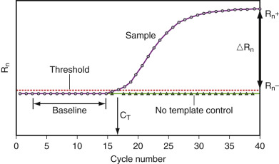

Figure 67-3 

Real-time PCR amplification plot. 

_PCR,_ Polymerase chain reaction. 

(Courtesy Applied Biosystems.) 

In the simplest format, the PCR product is detected as it is produced using fluorescent dyes that preferentially bind to double-stranded DNA (dsDNA). SYBR Green I is one such dye that has been used in this application (  Morrison et al, 1998  ). In the unbound state, the fluorescence is relatively low, but when bound to dsDNA, the fluorescence is greatly enhanced. The DNA-binding dye will affix to any dsDNA and therefore will bind both specific and nonspecific PCR products equally well. The specificity of the detection can be improved through melting curve analysis. 

Melt curve analysis is a way to assess an amplicon sequence or complementarity by using a slow increase in temperature to dissociate dsDNA. The ability to break a double hydrogen bond between two nucleic acids during melt curve analysis depends on the length, the GC content, and the complementarity of the amplicon. A melt curve analysis can be measured with both intercalating dye reactions and with fluorescently labeled probes that are not degraded during the PCR reaction. Intercalating dyes, such as SYBR green, slot into the minor groove of dsDNA, so dissociation results in reduction of fluorescence. By slowly increasing the temperature in a melt curve reaction, characteristics of the sequence of the amplicon can be inferred from the temperature of the dissociation, which is reflected by a loss of fluorescence. The melting temperature of the amplicon is predictable based on the nucleic acid bases that make up the amplicon, so the shape and temperature at which the amplicon or probes dissociate are reliable and reproducible. A mutation in that amplicon sequence will result in a different melting temperature. The data are transformed and analyzed by plotting the first derivative of fluorescence on the _y_ -axis and temperature on the _x-_ axis. The specific amplified product will have a characteristic melting peak at its predicted melting temperature (T  m  ), whereas the primer-dimers and other nonspecific products should have a different T  m  or give broader peaks (  Ririe et al, 1997  ). 

The specificity of real-time PCR can also be increased by including hybridization probes in the reactions mixture. These probes are labeled with fluorescent dyes or with a combination of fluorescent and quencher dyes. In the 5′ nuclease (TaqMan) PCR assay, the 5′ to 3′ exonuclease activity of Taq DNA polymerase is used to cleave a nonextendable hybridization probe during the primer extension phase of PCR (  Holland et al, 1991  ). This approach uses dual-labeled fluorogenic hybridization probes. One fluorescent dye serves as reporter, and its emission spectrum is quenched by the second fluorescent (quencher) dye. The nuclease degradation of the hybridization probe releases the reporter dye, resulting in an increase in its peak fluorescent emission ( [ Fig. 67-4 ](<#f0025>) ). The increase in fluorescent emission indicates that a specific PCR product has been made, and the intensity of the fluorescence is related to the amount of product (  Heid et al, 1996  ). Specificity is increased because the signal is generated only when the primer and probe are bound to the same template strand. 

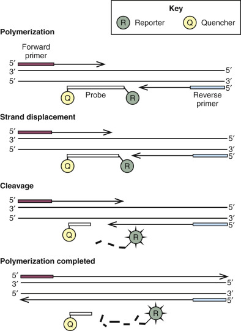

Figure 67-4 

Mechanism of signal generation in 5′ nuclease PCR assays. 

_PCR,_ Polymerase chain reaction. 

(Courtesy Applied Biosystems.) 

Fluorescence resonance energy transfer (FRET) probes can also be used to detect PCR product as it is generated (  Lay & Wittwer, 1997  ). This method requires two specially designed sequence-specific oligonucleotide probes. These hybridization probes hybridize next to each other on the product molecule. As shown in [ Figure 67-5 ](<#f0030>) , the 3′ end of one probe is labeled with a donor dye, and the 5′ end of the other probe is labeled with an acceptor dye. The donor dye is excited by an external light source and, instead of emitting light, transfers its energy to the acceptor dye by a process called FRET. The excited acceptor dye emits light at a longer wavelength than the unbound donor dye, and the intensity of the acceptor dye light emission is proportional to the amount of PCR product. 

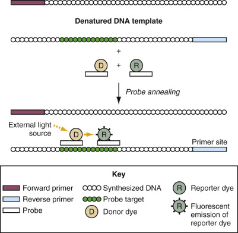

Figure 67-5 

Fluorescence resonance energy transfer probes. 

(Redrawn from Wolk D, Mitchell S, Patel R: Principles of molecular microbiology testing methods. _Infect Dis Clin N Am_ 15:1157–1204, 2008.) 

Real-time detection and quantification of PCR product can also be accomplished using molecular beacons (  Tyagi et al, 1998  ). Molecular beacons are hairpin-shaped oligonucleotide probes with an internally quenched fluorophore whose fluorescence is restored when they bind to a target nucleic acid ( [ Fig. 67-6 ](<#f0035>) ). They are designed in such a way that the loop portion of the probe molecule is complementary to the target sequence. The stem is formed by the annealing of complementary arm sequences on the ends of the probe. A fluorescent dye is attached to one end of one arm, and a quenching molecule is attached to the end of the other arm. The stem keeps the fluorophore and quencher in close proximity such that no light emission occurs. When the probe encounters a target molecule, it forms a hybrid that is longer and more stable than the stem and undergoes a conformational change that forces the stem apart and causes the fluorophore and quencher to move away from each other, restoring the fluorescence. 

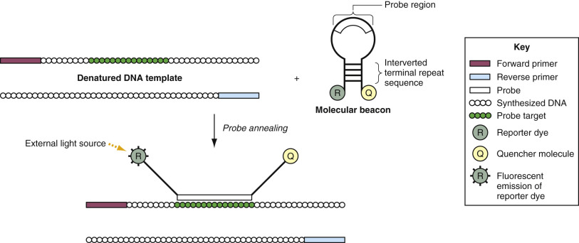

Figure 67-6 

Molecular beacon probes. 

(Redrawn from Wolk D, Mitchell S, Patel R: Principles of molecular microbiology testing methods. _Infect Dis Clin N Am_ 15:1157–1204, 2008.) 

It is not absolutely necessary to have a stem loop structure to use nonhydrolyzable probes in real-time PCR applications. Dark quencher probes contain a fluorophore on the 5′ end and a nonfluorescent quencher molecule on the 3′ end (  Afonina et al, 2002  ). The fluorescence is quenched when the probe is in a random coil configuration and emitted when the probe anneals to the target sequence. Because the dark quencher is not fluorescent, it does not contribute to the background signal. This has the advantage of improved signal-to-noise ratio for the detection system, which may improve sensitivity. These probes also incorporate a hybridization-stabilizing compound known as a _minor groove binder._ It is a small, crescent-shaped molecule that is covalently linked to the 3′ end of the probe that spans about 3 to 4 nt and snugly fits into the minor groove of DNA, where it forms hydrogen bonds with the template. The minor groove binder allows the use of shorter probes and enables improved Tm leveling, which improves the specificity of the detection reaction (  Kutyavin et al, 2000  ). 

Scorpion probes combine a PCR primer with a molecular beacon (  Thelwell et al, 2000  ). Intramolecular hybridization of the loop structure to a downstream portion of the amplification product separates the reporter and quencher dyes. The hybridization kinetics of scorpion probes are generally faster than those of molecular beacons because the primer and the probe are located on the same molecule. Partially double-stranded (ds) linear probes consist of a hybridization probe labeled with a fluorescent probe and a shorter complementary quencher. The asymmetry in strand length of the ds-probes correlates with an increase capacity for mismatch tolerance, and the length of both the hybridization probe and the quencher strand affect the mismatch tolerance efficiency (  Luk et al, 2007  ). This double-stranded probe design can be useful to evaluate genetically polymorphic targets compared to other probe types, such as molecular Beacons or TaqMan probes, for which nucleotide mismatches can result in reduced efficiency of probe hybridization. These probes can be created to tolerate or discriminate polymorphic targets, such as HIV-1 and HCV. In the absence of amplicon, the ds-probe remains in a duplex that places the fluorophore in close proximity to the quencher and prevents a fluorescent signal. Presence of a target results in hybridization of the probe to the amplicon, displacing the complementary quencher and leading to emission of the fluorescent signal. The hybridization probe is not destroyed during the amplification process, allowing for later melting curve analysis. 

Another approach to detection, characterization, and quantification of real-time PCR amplicons involves the use of a nonstandard DNA base pair constructed from isoG and isoC (  Sherrill et al, 2004  ). These synthetic bases pair with each other but not with the natural bases guanine and cytosine and can be covalently coupled to a wide variety of reporter groups. In the MultiCode-RTx assays (Luminex), the target is amplified using a forward primer with a single isoC nucleotide with a fluorescent label at the 5′ end and an unlabeled standard base reverse primer. Amplification is performed in the presence of isoG coupled to a fluorescence quencher molecule. Site-specific incorporation of the isoG molecule by the DNA polymerase places the quencher in close proximity to the fluorophore, resulting in a decrease of fluorescence with every PCR cycle. The number of cycles in which the fluorescence change can be detected depends on the initial number of target molecules in the reaction. The decrease in fluorescence is easily monitored by a number of standard real-time PCR instruments. Postreaction amplicon melting curve analysis can be performed to confirm the identity of the amplicon and to detect sequence variants. 

Real-time PCR methods decrease the time required to perform nucleic acid assays because there are no post-PCR processing steps. Also, because amplification and detection occur in the same closed tube, these methods eliminate the postamplification manipulations that can lead to laboratory contamination with amplicon. In addition, real-time PCR methods lend themselves well to quantitative applications because analysis is performed early in the log phase of product accumulation and as a result is less prone to errors that may result from differences in amplification efficiency among samples. 

Relative concentrations of DNA present during the exponential phase of the reaction are determined by plotting fluorescence against cycle number on a logarithmic scale (so an exponentially increasing quantity will give a straight line). A threshold for detection of fluorescence above the background is determined, and the C  T  is determined. Because all sets of primers do not work equally well, one has to calculate the reaction efficiency first. Reaction efficiency is the rate at which the PCR product is generated. A perfectly doubling PCR reaction would have an efficiency of 2 because the quantity of DNA theoretically doubles every cycle during the exponential phase, and relative amounts of DNA can be calculated (e.g., a sample whose C  T  is three cycles earlier than another's has 2  3  = 8 times more template). The equation to determine a reaction's efficiency is E = 10  (-1/slope)  . One way to calculate efficiency is by using the slope of a standard curve from a dilution series. This is done by plotting the C  T  values versus the log  10  of the serial dilution and performing a linear regression to get the slope. This dilution series should cover a minimum of 5 logs and contain replicates. A second method to calculate efficiency can be done for each individual reaction by plotting fluorescence on a log scale and performing a linear regression on the exponential phase to get the slope. Both methods of determining efficiency have been shown to be comparable in measuring accuracy, although the second method was found to be more robust and requires fewer PCR reactions than the first method (  Karlen et al, 2007  ). If a reaction efficiency was found to be 1.96 and we used the previous example of a C  T  of 3 times earlier, then the starting template would be calculated by 1.96  3  = 7.53 times more template. 

Amounts of RNA or DNA are determined by comparing the results to a standard curve produced by a real-time PCR of serial dilutions (e.g., undiluted, 1 : 4, 1 : 16, 1 : 64) of a known amount of RNA or DNA. As mentioned earlier, to accurately quantify gene expression, the measured amount of RNA from the gene of interest is divided by the amount of RNA from a housekeeping gene measured in the same sample to normalize for possible variation in the amount and quality of RNA among the samples. This normalization permits accurate comparison of expression of the gene of interest between different samples, as long as the expression of the reference (housekeeping) gene used in the normalization is very similar across all the samples. Choosing a reference gene that fulfills this criterion is therefore of high importance and often can be challenging because only a very few genes show equal levels of expression across a range of different conditions or tissues. 

Real-time PCR can be used to quantify nucleic acids by two strategies: relative quantification and absolute quantification (  VanGuilder et al, 2008  ). Relative quantification measures the fold-difference (2×, 3×, etc.) in the target amount. For gene expression analysis, relative concentrations may be determined by the 2  -ΔΔCT  method, where for each sample, the difference in CT values for the gene of interest and the endogenous gene control is calculated (ΔCT). Next, subtraction of the control-condition ΔCT from the treated-condition ΔCT yields the ΔΔCT. The negative value of this subtraction, –ΔΔCT, is used as the exponent of 2 in the equation and represents the difference in the corrected number of cycles to threshold. This value is often referred to as the _relative quantity value._

Absolute quantification gives the exact number of target molecules present by comparing with known standards. The quality of standard is important for accurate quantification. 

 

##  Rapid-Cycle Polymerase Chain Reaction 

While real-time PCR methods have had a significant impact on assay time, a great deal of emphasis continues to be placed on reducing the assay time for the various PCR formats. Rapid-cycle PCR is not chemically different from any of the standard PCR formats (  Wittwer & Garling, 1991  ). The polymerases used in PCR are capable of incorporating 35 to 100 nucleotides per second. Most of the time consumed in performing PCR is temperature equilibration for the solution so that efficient annealing and extension occur, as well as a significant amount of time changing the temperature. By reducing the thermal profile of the solution using thin-walled tubes or capillaries that force the reaction solution into thin columns or sheets of fluid, it is possible to improve thermal transfer rates as well as equilibration rates such that thermocycling time can be significantly reduced. In highly optimized systems, it is possible to approach the ideal processivity rate of the polymerase such that a 40-cycle PCR may be performed in 30 minutes or less using standard or real-time PCR chemistries. In fact, by increasing the primer and polymerase concentrations ten- to twentyfold over typical concentrations with temperature cycles of 0.4 to 2.0 s in thin-walled reaction capillaries, efficient, specific, and high-yield PCR is possible in 15 to 60 s (  Farrar et al, 2015  ). This so-called “extreme PCR” highlights the considerable future potential of PCR for point-of-care applications if suitable instruments can be designed. 

 

##  Digital Polymerase Chain Reaction 

PCR exponentially amplifies nucleic acids and the number of amplification cycles, and the amount of amplicon allows the computation of the starting quantity of targeted nucleic acid. However, many factors can complicate this calculation, such as the quality and source materials of the standard curve, choice for signal threshold, and interlaboratory variation. These factors can often create uncertainties and inaccuracies, particularly when the starting concentration is low. Digital PCR attempts to overcome these difficulties by transforming the exponential data from conventional PCR to digital signals that indicate whether or not amplification occurred (  Vogelstein & Kinzler, 1999  ). 

Digital PCR is accomplished by partitioning nucleic acid template into reactions that, on average, contain less than or equal to 1 molecule of DNA in an aliquot of master mix reagent in order to accurately calculate the number of negative versus positive reactions. After PCR amplification, a count of the individual partitioned reactions containing PCR product is a direct measure of the absolute quantity of nucleic acid in the sample. The capture or isolation of individual nucleic acid molecules may be done in capillaries, microemulsions, arrays of miniaturized chambers, or on surfaces that bind nucleic acids. Digital PCR has many applications, including detection and absolute quantification of low levels of pathogens or viral load, rare genetic variants, gene expression in single cells or circulating nucleic acids, and clonal amplification of nucleic acids for sequencing mixed nucleic acid samples. Target amplification using digital PCR can be included as part of “next-generation” sequencing methods. Microfluidic or microdroplet technology can be used in combination with digital PCR to automate and improve the partitioning with high-throughput and/or low-volume reactions (  Taly et al, 2012  ). 

 

##  Transcription-Based Amplification 

Transcription-based amplification includes transcription-mediated amplification (TMA) and nucleic acid sequence-based amplification (NASBA). Both TMA and NASBA are isothermal nucleic acid amplification techniques that, although slightly different in practice, are identical in concept and are described together (  Kwoh et al, 1989  ;  Compton, 1991  ). TMA and NASBA are the intellectual properties of Hologic/Gen-Probe, San Diego, and bioMérieux, Durham, N.C., respectively. These techniques essentially recapitulate retroviral replication in vitro, converting RNA into DNA and then using the DNA as a template for transcription of multiple copies of RNA. 

The process begins with an RNA target, which in most cases exists as a single-stranded entity, removing the need for thermal denaturation of the template before amplification ( [ Fig. 67-7 ](<#f0040>) ). A sequence-specific DNA primer binds to the RNA target. Reverse transcriptase then extends the primer, creating a DNA–RNA heteroduplex. The 5′ end of the sequence-specific primer contains the promoter for a T7 bacteriophage polymerase. The presence of this T7 promoter in the 5′ end of the primer results in the synthesis of a DNA strand complementary to the initial RNA target containing the T7 promoter at its 5′ end. In the case of TMA, the reverse-transcriptase enzyme itself degrades the initial RNA template as it synthesizes its complementary DNA. In NASBA, a separate enzyme, RNAse H, degrades the initial RNA template. RNAse H selectively cleaves RNA, which is heteroduplexed to DNA but not RNA alone. In either case, the resultant single-stranded, complementary DNA with the T7 promoter sequence binds to a second primer at its 3′ end. The DNA polymerase extends from this second primer, resulting in the synthesis of a dsDNA molecule containing an intact T7 promoter. This DNA molecule can now serve as a template for T7 polymerase, a bacteriophage enzyme that specifically recognizes the T7 promoter and synthesizes multiple copies of RNA. Each of these newly synthesized RNA molecules is antisense to the initial target, allowing it to hybridize to the second primer. The reverse-transcriptase, second primer, RNAse H, and DNA polymerase then use this antisense RNA molecule as a template to synthesize new dsDNA templates, which in turn make more RNA template. A 10  9  -fold amplification of target RNA can be achieved with these methods in 2 hours or less. 

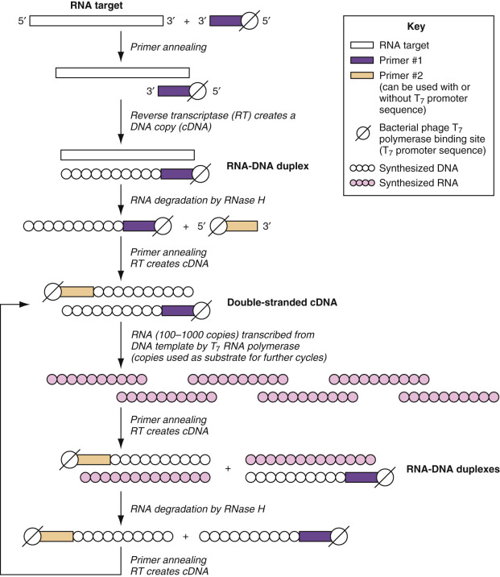

Figure 67-7 

Transcription-based amplification. 

(Redrawn from Wolk D, Mitchell S, Patel R: Principles of molecular microbiology testing methods. _Infect Dis Clin N Am_ 15:1157–1204, 2008.) 

TMA and NASBA have several distinct advantages over other RNA amplification techniques. Perhaps the most significant of these advantages is that no initial denaturation is required for the amplification to occur. Hence, dsDNA sequences are not denatured and thus are incapable of binding to primers in the reaction. DNA contamination can be particularly problematic when techniques such as PCR are used to assay for the RNA transcripts of retroviral or intronless eukaryotic genes. NASBA and TMA eliminate the problem of DNA contamination giving a falsely elevated determination of RNA. A second advantage is that this technology uses isothermal processes that obviate the need for sophisticated thermocyclers because the whole process occurs at a single temperature. Combining this technology with molecular beacons or other sequence-specific probes that can be added directly to the amplification mixture creates a closed-tube system, which aids in preventing amplicon cross-contamination in the laboratory. 

NASBA and TMA have been used successfully in a wide variety of clinical qualitative and quantitative applications, primarily in infectious diseases. FDA-cleared tests for detection of _Neisseria gonorrhoeae, Chlamydia trachomatis, Trichomonas vaginalis,_ and human papillomavirus (HPV) based on TMA are available from Hologic/Gen-Probe. They also have viral load tests for HIV-1 and HCV in development. BioMerieux has an FDA-cleared HIV-1 quantitative assay based on NASBA. 

TMA and NASBA are isothermal RNA amplification techniques with a widespread applicability and several unique advantages over other amplification methods. Combining these techniques with fluorescent probes allows one-step, closed-tube, real-time amplification without the need for thermal cycling. 

 

##  Strand-Displacement Amplification 

Strand-displacement amplification (SDA) is an isothermal template amplification technique that can be used to detect trace amounts of DNA or RNA of a particular sequence. SDA as it was first described was a conceptually straightforward amplification process, with some technical limitations (  Walker et al, 1992a;  1992b  ). Since its initial description, however, it has evolved into a highly versatile tool that is technically simple to perform but conceptually complex. In its current iteration, SDA occurs in two discrete phases: target generation and exponential target amplification (  Little et al, 1999  ). Only the target amplification phase is shown in [ Figure 67-8 ](<#f0045>) . In the target generation phase, a dsDNA target is denatured and hybridized to two different primer pairs, designated as _bumper_ and _amplification_ primers. The amplification primers include the single-stranded restriction endonuclease enzyme sequence for BsoB1 located at the 5′ end of the target binding sequence. The bumper primers are shorter and anneal to the target DNA just upstream of the region to be amplified. In the presence of BsoB1, an exonuclease-free DNA polymerase, and a dNTP mixture consisting of dUTP, dATP, dGTP, and thiolated dCTP (Cs), simultaneous extension products of both the bumper and amplification primers are generated. This process displaces the amplification primer products, which are available for hybridization with the opposite-strand products with the opposite-strand bumper and amplification primers. 

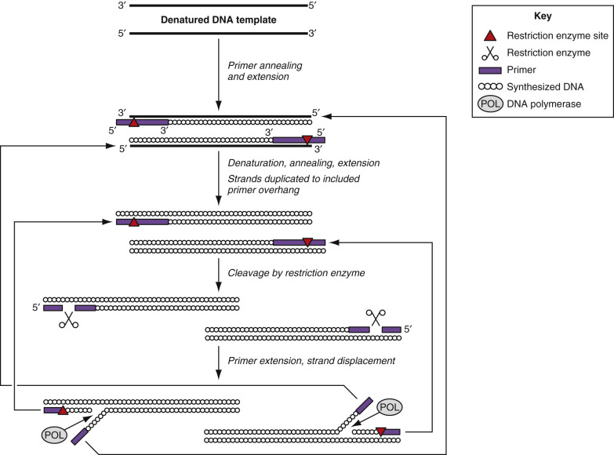

Figure 67-8 

Strand displacement amplification. 

(Redrawn from Wolk D, Mitchell S, Patel R: Principles of molecular microbiology testing methods. _Infect Dis Clin N Am_ 15:1157–1204, 2008.) 

The simultaneous extension of opposite-strand primers produces strands complementary to the products formed by extension of the first amplification primer with Cs incorporated into the BsoB1 cleavage site. This product enters the exponential target amplification phase of the reaction. The BsoB1 enzyme recognizes the double-stranded site, but because one strand contains Cs, it is nicked rather than cleaved by the enzyme. The DNA polymerase then binds to the nick and begins synthesis of a new strand, while simultaneously displacing the downstream strand. This step recreates the double-stranded species with the hemimodified restriction endonuclease recognition sequence, and the iterative nicking and displacement process repeats. The displaced strands are capable of binding to opposite-strand primers, which produces exponential amplification of the target sequences. 

These single-stranded products also bind to detector probes for real-time detection. The detector probes are single-stranded DNA (ssDNA) molecules with fluorescein and rhodamine labels. The region between the labels includes a stem-loop structure. The loop contains the recognition site for the BsoB1 enzyme. The target-specific sequences are located 3′ to the rhodamine label. In the absence-specific target, the stem-loop structure is maintained with the fluorescein and rhodamine labels in close proximity. The net effect is that very little emission for the fluorescein is detected after excitation. After SDA, the probe is converted to a double-stranded species, which is cleaved by BsoB1. The cleavage causes physical separation of the fluorescein and rhodamine labels, which results in an increase in emission from the fluorescein label. 

The main advantage of SDA is that it is an isothermal process that, unlike PCR, can be performed at a single temperature after initial target denaturation. This eliminates the need for expensive thermocyclers. Furthermore, samples can be subjected to SDA in a single tube, with amplification times varying from 30 minutes to 2 hours. The main disadvantage of SDA lies in the fact that, unlike PCR, the relatively low temperature at which SDA is carried out (52.5° C) can result in nonspecific primer hybridization to sequences found in complex mixtures such as genomic DNA. Hence, when the target is in low abundance compared to background DNA, nonspecific amplification products can swamp the system, decreasing the sensitivity of the technique. However, the use of organic solvents to increase stringency at low temperatures and the recent introduction of more thermostable polymerases capable of strand displacement have alleviated much of this problem. FDA-cleared assays for detection of _N. gonorrhoeae_ , _Chlamydia trachomatis_ , Herpes simplex virus types 1 and 2, and _T. vaginalis_ using SDA are available from BD Diagnostics (Franklin Lakes, N.J.) on their Viper™ system. 

 

##  Loop-Mediated Amplification 

Loop-mediated amplification (LAMP) is an isothermal method that relies on autocycling strand displacement DNA synthesis by _Bst_ DNA polymerase and a set of four to six primers (  Notomi et al, 2000  ). Two inner and two outer primers define the target sequence, and an additional set of loop primers are added to increase the sensitivity of the reaction. The final products of the LAMP reaction are DNA molecules with a cauliflower-like structure of multiple loops consisting of repeats of the target sequence. The products can be analyzed in real-time by monitoring of the turbidity in the reaction tube resulting from production of magnesium pyrophosphate precipitate during the DNA amplification. Amplification products can also be visualized in agarose gels after electrophoresis and staining with ethidium bromide or SYBR Green. 

Because LAMP is an isothermal process and positive reactions can be detected by simple turbidity measurements or visualized directly with the naked eye, it requires no expensive equipment. These attributes make it an attractive technology for resource-poor settings and field use. However, primer design for LAMP is more complex than for PCR, with specialized training and software required for their design. Meridian Bioscience, Inc. (Cincinnati, Ohio) has licensed LAMP technology from Eiken Chemical Company, Ltd., Japan, for the development of infectious disease diagnostics in the United States including _Clostridium difficile_ , group A and Group B beta hemolytic streptococci, _Mycoplasma pneumoniae_ , and _Bordetella pertussis_ . 

 

##  Helicase-Dependent Amplification 

Helicase-dependent amplification (HDA) is an isothermal process developed by BioHelix (Beverly, Mass.) that uses helicase to separate dsDNA and generate single-stranded templates for primer hybridization and subsequent extension by a DNA polymerase (  Vincent et al, 2004  ). As the helicase unwinds dsDNA enzymatically, the initial heat denaturation and subsequent thermocycling steps required by PCR can all be omitted. In HDA, strands of dsDNA are separated by the DNA helicase and the ssDNA-coated ssDNA-binding proteins. Two sequence-specific primers hybridize to each border of the target sequence, and a DNA polymerase extends the primers annealed to the target sequence to produce dsDNA. The two newly synthesized products are used as substrates by the helicase in the next round of amplification. Thus a simultaneous chain reaction proceeds, resulting in exponential amplification of the selected target sequence. 

HDA is compatible with multiple detection technologies, including qualitative and quantitative fluorescent technologies and with instruments designed for real-time PCR (  Tong et al, 2008  ). Futhermore, HDA has shown potential for the development of simple, portable DNA diagnostic devices to be used in the field or at the point-of-care. FDA-cleared tests for detection of HSV type 1 and type 2, _C. difficile_ , and group A and B beta-hemolytic streptococci based on HDA are available from Quidel (San Diego, Calif.). 

 

##  Nicking Endonuclease Amplification 

Nicking endonuclease amplification is an isothermal process that begins with nicking of a double-stranded DNA template by a nicking enzyme (  Nie et al, 2014  ). A DNA polymerase then binds at the nick sites and unravels the template. The T2 primer that includes the nicking enzyme recognition site binds loosely to the template and is extended by polymerase. A second T2 primer binds to the same target and is extended, displacing the first T2. The template-specific region of the T1 primer binds to its complement on the released strand and is extended to the 5′ end, creating the double-stranded NEAR amplification duplex. The nick sites within primers allow for the process to repeat for rapid amplification of products. 

NEAR is the basis of the FDA-cleared test for direct detection of influenza A and B viruses in respiratory specimens that is available from Alere (Waltham, Mass.) for use in point-of-care settings by nonlaboratory personnel. As such, it represents a milestone in molecular diagnostics as the first CLIA-waived nucleic acid amplification test. 

,  

##  Probe Amplification Methods 

Probe amplification methods differ from target amplification in that the amplification products contain a sequence only present in the initial probes. Cleavase/invader technology is an example of a probe amplification method that is used currently as an important diagnostic application: the detection of high-risk genotypes of human papilloma viruses (HPV) in cervical samples (  Ginocchio et al, 2008  ). 

 

##  Cleavase/Invader Technology 

Cleavase/invader technology is a probe amplification method that relies on the specific recognition and cleavage of particular DNA structures by members of the flap endonuclease-1 family of DNA polymerases (  Lyamichev et al, 1999  ). These polymerases cleave the 5′ single-stranded flap of a branched base-paired duplex and are termed _cleavases_ . This enzymatic activity probably plays an essential role in the elimination of complex nucleic acid structures that arise during DNA replication and repair in vivo. Because these structures may occur anywhere in the replicating genome, the enzyme recognizes the molecular structure of the substrate without regard to the sequence of the nucleic acids making up the DNA complex (  Lieber, 1996  ). This enzymatic activity has proved to be a very useful tool for DNA analysis and is the basis of this technology. 

In cleavase/invader assays, two primers are designed that hybridize to the target sequence in an overlapping fashion ( [ Fig. 67-9 ](<#f0050>) ). Under the proper annealing conditions, signal and invader probes bind to the target sequence such that the invader hybridizes upstream of the signal probe with a region of overlap between the 3′ end of invader and the 5′ end of the signal probe. Under the proper conditions, the overlap of binding sites for the primers results in a displacement equilibrium between the primers. Cleavase only cleaves 5′ flaps; thus the 5′ end of the signal probe is released. The target sequence acts as a scaffold upon which the proper DNA structure can form. Because the DNA structure that serves as the cleavase substrate only occurs in the presence of the target sequence, the generation of cleavage products indicates the presence of the target. The cleaved product is detected by binding to and serving as an invader probe for a FRET probe. The 5′ end of the FRET probe is cut by cleavase, releasing the reporter molecule in the same way that it releases the 5′ end of the signal probe. 

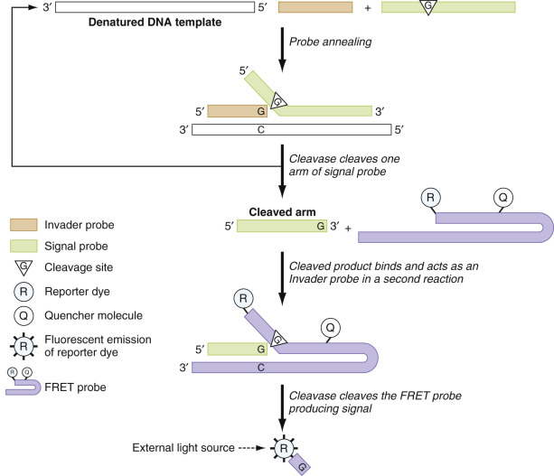

Figure 67-9 

Invasive cleavage and detection of an oligonucleotide probe using a FEN-1 DNA polymerase. _FEN-1,_ Flap endonuclease-1; _FRET,_ fluorescence resonance energy transfer. 

(Redrawn from Wolk D, Mitchell S, Patel R: Principles of molecular microbiology testing methods. _Infect Dis Clin N Am_ 15:1157–1204, 2008.) 

Use of a thermostable cleavase enzyme allows the reactions to be run at high enough temperatures for a primer exchange equilibrium to exist. This allows multiple cleavase products to form from a single target molecule. Hence, the invader assay can be run under isothermal conditions, removing the need for thermal cycling. This technology has been used for detection, quantification, and characterization of a variety of microbial and human nucleic acid targets (  Rosetti et al, 1997  ;  Ryan et al, 1999  ;  Wong et al, 2008  ). 

The cleavase/invader technology has several inherent advantages over other amplification strategies. Because the overlap in the invader probe need only be one base pair, this technology can easily be adapted to detect point mutations of interest by designing the overlap region to encompass the mutation to be detected. In addition, unlike target amplification techniques in which the target sequence itself is amplified, the invader assay does not increase the amount of the target sequence. Thus the invader assay is less prone to problems of false-positive results due to amplicon cross-contamination. 

In addition to the invader assay, cleavase can also be used to generate fragment-length polymorphisms (in a fashion analogous to restriction fragment-length polymorphism). By melting genomic DNA and cooling rapidly, highly reproducible hairpin loop secondary structures will form in the DNA that can serve as substrates for cleavase. Digestion of the DNA results in a distinct pattern that has been successfully employed to screen for interferon-α–resistant hepatitis C (  Sreevatsan et al, 1998  ) and to detect specific mutations in human genes (  Rosetti et al, 1997  ). Because hairpin loops occur with a greater diversity than most restriction enzyme recognition sites, this offers a versatile fragmentation pattern analysis. 

Thus structure-specific endonucleases can be used to detect nucleic acid targets of a particular sequence, employed in assay for point mutations, and applied to generate diverse fragmentation patterns capable of distinguishing complex genotypes. These enzymes are powerful tools for nucleic acid analysis. FDA-cleared assays for HPV and various mutations associated with thrombophilia (Factor II, Factor V, MTHFR 677, and MTHFR 1298) based on cleavase/invader technology are available from Hologic/Gen-Probe. 

,  

##  Signal Amplification Methods 

In signal amplification methods, the concentration of the probe or the target does not increase. The increased analytical sensitivity comes from increasing the concentration of label molecules attached to the target nucleic acid. Multiple enzymes, multiple probes, multiple layers of probes, and reduction of background noise have been used to enhance target detection (  Kricka, 1999  ). Target amplification systems generally have greater analytical sensitivity than signal amplification methods, but technological developments, particularly in branched DNA (bDNA) assays, have lowered the limits of detection to levels that may rival target amplification assays in some applications (  Kern et al, 1996  ). 

Signal amplification assays have several advantages over target amplification assays. In signal amplification systems, the number of target molecules is not altered, and as a result, the signal is directly proportional to the amount of target sequence present in the clinical specimen. This reduces concerns about false-positives due to cross-contamination and simplifies the development of quantitative assays. Because signal amplification systems are not dependent on enzymatic processes to amplify target sequences, they are not affected by the presence of enzyme inhibitors in clinical specimens. Consequently, less cumbersome nucleic acid extraction methods may be used. Typically, signal amplification systems employ either larger probes or more probes than target amplification systems and, consequently, are less susceptible to errors resulting from target sequence heterogeneity. Finally, RNA can be measured directly, without the synthesis of a cDNA intermediate. Branched DNA and hybrid capture are examples of signal amplification systems that have developed into diagnostic tests. 

 

##  Branched DNA 

The bDNA is a solid-phase, sandwich hybridization assay incorporating multiple sets of synthetic oligonucleotide probes (  Nolte, 1998  ). The key to this technology is the amplifier molecule, a DNA molecule with 15 identical branches, each of which can bind three labeled probes. 

Multiple target-specific probes are used to capture the target nucleic acid on to the surface of a microtiter well ( [ Fig. 67-10 ](<#f0055>) ). A second set of target-specific probes also binds to the target. Preamplifier molecules bind to the second set of target probes and up to eight bDNA amplifiers. Three alkaline-phosphatase–labeled probes hybridize to each branch of the amplifier. Detection of the bound labeled probes is achieved by incubating the complex with an enzyme-triggerable substrate, dioxetane, and then measuring the light emission in a luminometer. The resulting signal is directly proportional to the quantity of target in the sample, which is determined from an external standard curve. 

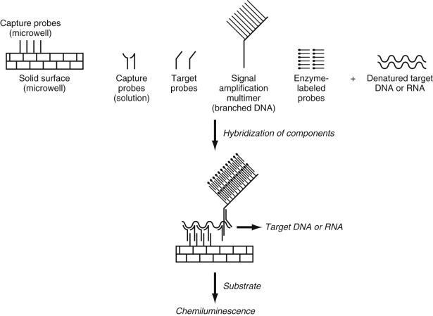

Figure 67-10 

Branched DNA amplification. 

(Redrawn from Wolk D, Mitchell S, Patel R: Principles of molecular microbiology testing methods. _Infect Dis Clin N Am_ 15:1157–1204, 2008.) 

Nonspecific hybridization of any of the amplification probes and nontarget nucleic acids leads to amplification of the background signal. To reduce the hybridization potential to all nontargets, the nonnatural bases isocytidine (isoC) and isoguanosine (isoG) were incorporated into the amplification probes of the third-generation bDNA assays (  Collins et al, 1995  ). IsoC and isoG bases pair with each other but not with any of the four naturally occurring bases (  Piccirilli et al, 1990  ). The use of isoC and isoG probes in bDNA assays increases target-specific amplification without a concomitant increase in background, thereby greatly enhancing the detection limits. The detection limit of the third-generation bDNA assay for HIV-1 RNA is 50 copies/mL (  Kern et al, 1996  ). bDNA assays for the quantification of HBV DNA, HCV RNA, and HIV-1 RNA are commercially available (Bayer Diagnostics). An instrument platform for bDNA assays automates the incubation, washing, reading, and data processing. 

 

##  Hybrid Capture Assays 

The hybrid capture system is a solution hybridization antibody capture assay that uses chemiluminescent detection. The target DNA in the specimen is denatured and hybridized with a specific RNA probe ( [ Fig. 67-11 ](<#f0060>) ). The DNA–RNA hybrids are captured by antibodies specific for DNA–RNA hybrids that are coated onto the surface of a tube. Alkaline-phosphatase–conjugated antihybrid antibodies bind to the immobilized hybrids. The bound enzyme–antibody conjugate is detected with a chemiluminescent substrate, and the light emitted is measured in a luminometer. Signal amplification results from the large number of antibody binding sites and the efficiency of the enzyme–substrate reaction. The intensity of the emitted light is proportional to the amount of target DNA in the specimen. Hybrid capture assays for detection of HPV (  Cope et al, 1997  ) and CMV (  Mazzulli et al, 1999  ) in clinical specimens are commercially available (Digene, Gaithersburg, Md.). 

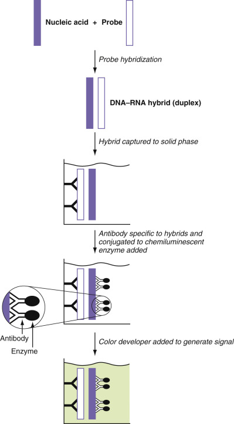

Figure 67-11 

Hybrid capture amplification. 

(Redrawn from Wolk D, Mitchell S, Patel R: Principles of molecular microbiology testing methods. _Infect Dis Clin N Am_ 15:1157–1204, 2008.) 

,  

##  Summary 

This chapter provides a basis for understanding the principles underlying the various nucleic acid amplification methods and their relative strengths and limitations. The technology has already had a tremendous impact on the diagnosis of infectious diseases and genetic disorders and promises to revolutionize the diagnosis and management of patients with cancer. The real power of the technology lies in its ability to cut across traditional disciplines in laboratory medicine. Consequently, a thorough understanding of the basic principles of nucleic acid amplification technology is important for all involved in the practice of laboratory medicine. 

,,
