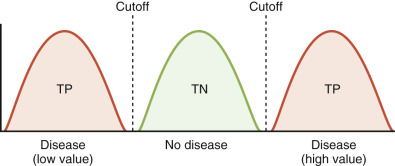
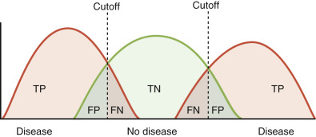
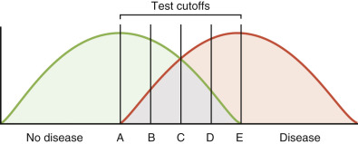
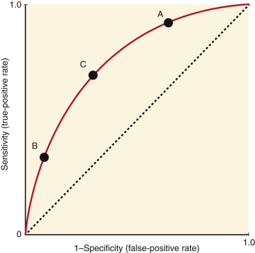
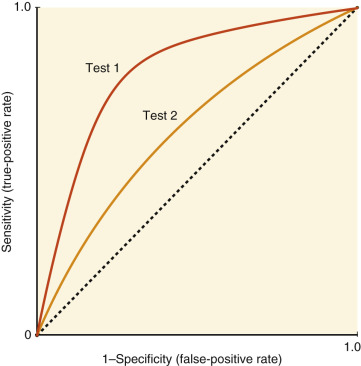
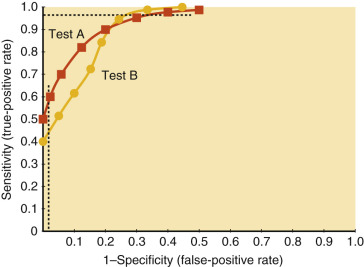
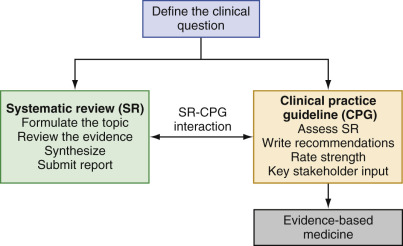

## Key Points

  * •

Laboratory results must undergo a two-step postanalytic review for analytic correctness (using delta checks, linearity ranges, etc.) and for clinical significance for the patient (applying critical values, reference ranges, pretest and posttest probability, etc.). 

  * •

Reference intervals are most commonly defined as the range of values into which 95% of nondiseased individuals will fall; this definition implies that 5% of nondiseased individuals can have laboratory results outside the reference range. 

  * •

The ability of a test to discriminate disease from no disease is described by the sensitivity and specificity of the test. Sensitivity is the probability of a positive result in a person with the disease (true-positive rate). Specificity is the probability of a negative result in a person without disease (true-negative rate). 

  * •

Screening tests require high sensitivity so that no case is missed. Confirmatory tests require high specificity to be certain of the diagnosis. 

  * •

Altering a test cutoff has a reciprocal effect on sensitivity and specificity. A cutoff can be lowered to include all patients with disease (100% sensitivity), but this reduces the specificity (i.e., increases false-positives). 

  * •

Receiver operator characteristic (ROC) curves plot the true-positive rate (sensitivity) versus the false-positive rate (1-specificity) and graphically present the range of sensitivities and specificities at all test cutoffs. If two tests are compared, the more accurate test is closer to the upper-left-hand corner of the ROC curve. 

  * •

The likelihood ratio of a test refers to the ratio of the probability of a given test result in the disease state over the probability of the same result in the nondisease state. The likelihood ratio of a test changes as the cutoff value defining disease and nondisease is varied. 

  * •

Predictive value describes the probability of disease or no disease for a positive or negative result, respectively. The predictive value of a positive test increases with disease prevalence. 

  * •

Bayes theorem uses information about test characteristics (sensitivity and specificity) and disease prevalence (pretest probability) to obtain the posttest probability of disease, given a positive test. Similarly, it can be used to determine the posttest probability of no disease, given a negative test. 

  * •

Evidence-based medicine is a process by which medical decisions can be made using as many objective tools as possible; it integrates the most current and the best medical evidence with clinical expertise and patient preferences. 

  * •

Clinical practice guidelines (CPG) can be used to decrease practice variability, establish monitoring parameters, improve health, increase safety, and decrease cost. 

  * •

Systematic reviews of clinical effectiveness are transparent, scientifically rigorous, and reliable syntheses of literature that evaluate specific medical interventions and are often used to inform groups developing CPGs. 

Every time a clinical laboratory produces a test result, the value must undergo a two-step postanalytic evaluation process. The result needs to be assessed for analytic correctness and for clinical significance. It is often assumed that these two tasks can be easily divided between the performing laboratory, which is responsible for determining analytic correctness, and the clinical team, which is responsible for evaluating the clinical meaning of the results. However, significant overlap is seen in the responsibilities for these tasks. Although the laboratory performs most of the review of laboratory results for analytic reliability by using techniques such as delta checks, flagging of questionable results, moving averages, and linear ranges, it is incumbent upon the clinician to review every laboratory result with regard to the patient's clinical situation and to question the analytic reliability of implausible results. When evaluating the clinical significance of a laboratory result, one of the most important factors to consider is the reference range. In most settings, the laboratory determines reference ranges, with varying degrees of input from the clinical staff. Postanalytic decision making is therefore a shared responsibility of the laboratory and the clinical staff, and it behooves both groups to maintain close communication to optimize every part of the process. The purpose of this chapter is to discuss postanalytic review of laboratory data and its use in medical decision making and to provide tools that can be used to objectively interpret results. 

,  

##  Assessment of Analytic Correctness of Results 

 

##  Alarms and Flags 

Modern diagnostic laboratories often analyze large numbers of samples using highly automated instruments. Many results are released into patients' electronic medical records without prior review by a laboratory employee (e.g., autoverification). To prevent the release of erroneous results, most laboratories utilize a variety of “flags” or alarms. Automated analyzers can flag specimens that require additional or repeat testing before results are released (i.e., reported) by specialized middleware or by the laboratory information system. Flags can indicate a problem with the specimen (e.g., the presence of an interfering substance) or an issue with the result (e.g., a numeric value outside the analytic range of the method, or the need for confirmation by an additional assay). 

 

##  Flags for Problem Specimens 

Many automated instruments can measure the amount of sample present in a collection tube and flag samples that contain amounts that are inadequate for a reliable analysis. The laboratory will have to identify another tube containing an adequate sample volume or will request the collection of a new sample. Another frequent cause of inadequate samples is the presence of high concentrations of interfering substances in the specimen, most commonly lipids (lipemia), hemoglobin (Hb) (hemolysis), paraproteins (gammopathies), or bilirubin (icterus). The mechanism for this interference is dependent on the substance and the analytic method. For example, in spectrophotometric assays, lipids interfere mainly by increasing light scatter (turbidity); in assays using ion-specific electrodes for measurement, lipids will affect results by solvent exclusion. A more detailed discussion of interference mechanisms is provided elsewhere in this text. Most commercial assays will list concentrations of interfering substances, above which assay results are no longer valid. Visual inspection is often an adequate means of assessing the presence of unacceptable concentrations of interfering substances. A technologist may immediately flag samples that are grossly hemolyzed or icteric as inappropriate for analysis. However, automated analyzers are also able to detect troublesome levels of interfering substances, even when they are not apparent to the laboratorian at the macroscopic level. Automated systems can measure the concentrations of bilirubin, lipid, and hemoglobin in samples and can report the degree of interference as an index (  Kroll & Elin, 1994  ;  Vermeer et al, 2005  ). If the index exceeds a given threshold, then the sample is flagged as problematic and should be rejected or rerun after sample treatment to remove the interfering substance. Serum bilirubin and Hb levels have been shown to correlate very closely with interference indices, but because of the chemical heterogeneity of serum lipids, lipemia indices do not correlate as well (  Fossati & Prencipe, 1982  ). 

 

##  Flags for Specimens That Require Additional Analysis with Another Method 

Some laboratory technologies are screening methods used to analyze large numbers of samples, rapidly report results on most samples, and identify potentially abnormal samples that require retesting with a more labor-intensive method. Automated cell counters are the paradigm of such instruments. These instruments can often analyze more than 100 samples per hour in a highly automated fashion; samples that are normal or that show only quantitative abnormalities (e.g., increased or decreased percentage of lymphocytes, low platelet counts, low red cell counts) can be reported immediately, and samples that could potentially contain qualitative abnormalities (e.g., atypical lymphocytes, platelet clumps, red cell fragments) are flagged for preparation of a blood smear and further evaluation. The flags are generally based on forward- and side-scatter and impedance measurements that provide information about size and nuclear complexity/granularity of the cells, and on special stains that help identify the potential presence of immature cells (  Fujimoto, 1999  ). The sensitivities and specificities of these flags show poor discriminatory power, and clinical judgment is needed if suspicion of an underlying hematologic abnormality is high (  Thalhammer-Scherrer et al, 1997  ;  Briggs et al, 1999  ;  Ruzicka et al, 2001  ). 

 

##  Flags for Problematic Results 

An analyte concentration outside the validated linear range is another common problem affecting samples. Generally, package inserts of commercial assays will provide end users with an estimated range within which an increase in signal is linearly related to an increase in the analyte concentration. The laboratory may validate this range or may establish its own acceptable linear range when the assay is introduced. Analyzers, middleware, or the laboratory information system will identify and flag samples in which the measured analyte values fall outside the linear range. If the analyte falls above the linear range, many instruments can automatically dilute and reanalyze the sample. In some cases, a manual dilution may be necessary, or the information that the result is higher than a certain value may be sufficient for the requesting clinician. For example, patients in diabetic ketoacidosis will have glucose measurements over 1000 mg/dL, far exceeding the linearity of most analyzers. These samples will be flagged, diluted by a predetermined factor, and then rerun before reporting. If an analyte concentration falls below the linear range, the sample is usually reported as “less than the limit of detection.”

 

##  Delta Checks 

Advances in computer technology have facilitated the storage of data from large numbers of patients and increasingly complex calculations in laboratory information systems. This has made it possible to use patient data for quality control purposes in real time. For example, most laboratories routinely submit the results of certain laboratory assays to “delta checks” before releasing them into the patient record. Delta checks are defined as comparing a current laboratory result with results obtained on a previous specimen from the same patient. Parameters chosen for delta checks should not be subject to large intraindividual variations; for example, many laboratories have delta checks in place for the mean corpuscular volume of red cells. Suggested assays, thresholds, and time intervals between measurements can be found in the literature (  Ladenson, 1975  ). Some studies have suggested the comparison of multiple test parameters to decrease the false-positive rate of the delta check; however, few laboratories have implemented such delta checks. Delta checks can detect preanalytic (e.g., mislabeling of specimens) and analytic issues (e.g., aspiration of insufficient sample volume by the instrument sample probe) (  Kazmierczak, 2003  ). Laboratories should define procedures for samples that have been flagged by delta checks; protocols usually incorporate repeating the assay, reviewing the specimen identification, and notifying the clinical staff of the possibility of a mislabeled specimen. 

,  

##  Assessment of Clinical Significance of Results 

 

##  Critical Values 

A critical value (also known as a panic value) is a laboratory result that may represent a life-threatening situation that may not otherwise be readily detectable; it must be reported immediately to a health care provider who can provide necessary medical interventions. Federal law, regulatory agencies, and The Joint Commission require rapid communication of such results; it is one of the most common, recurring Joint Commission Laboratory National Patient Safety Goals (  The Joint Commission, 2015  ). To be sure results are correctly communicated, regulations require the health care provider to read back the critical value and the patient name. The laboratory then has to document the event, including the name and title of the caregiver who is notified, the time and date of notification, and the read-back by the care provider. 

No universally accepted guidelines indicate which assays should have critical values, what the thresholds should be, whether critical values should be repeated before reporting, and what is an acceptable time from result availability to caregiver notification. Although it is generally established that critical values must be called to a caregiver who has the ability to act upon the information, there is no universal agreement regarding the types of caregivers (e.g., physician's assistant, registered nurse) who fulfill this definition. This has caused significant variation in procedures related to critical values at different institutions. It is ultimately the responsibility of the medical director of the laboratory to work with clinical colleagues to develop a critical values policy that meets the needs of patients and staff served by the laboratory. 

 

##  Reference Ranges 

 

##  Definition of Reference Intervals 

Comparison of a laboratory result versus a reference or “normal” range is often one of the most important aspects of medical decision making. Reference intervals are usually defined as the range of values into which 95% of nondiseased (“normal”) individuals will fall; the corollary of this definition is that 2.5% of nondiseased individuals will have laboratory results below the reference range, and 2.5% of nondiseased individuals will have laboratory results above the reference range (  CLSI  2008  ). For some analytes, the reference range is defined as “less than” or “greater than” a certain value; for example, a prostate-specific antigen (PSA) level of 4 ng/mL is often used to distinguish patients who require no further follow-up (“normal”) from those who require a prostate biopsy (“abnormal”). Some reference ranges have been defined by professional organizations without adherence to the 95% rule. A paradigm of this is the recommendation of American and European cardiology associations: “An increased cardiac troponin concentration is defined as a value exceeding the 99th percentile of a normal reference population” (upper reference limit; [URL])” (  Jaffe, 2013  ). For other analytes (e.g., cholesterol/lipids), laboratories frequently provide therapeutic target ranges that represent recommendations based on clinical trials and/or epidemiologic studies (  Grundy et al, 2004  ). Finally, it is common practice to provide therapeutic and/or toxic ranges for drug measurements. 

In the future, the efforts to standardize methods should minimize the effects of site-to-site differences in the implementation of methods. With such standardization, each laboratory would not need to establish its own reference intervals unless its patient population was clearly distinct and exhibited a unique range of values—for example, the protein differences seen in various Asian populations (  Myron et al, 2004  ). The Joint Committee for Traceability in Laboratory Medicine has established a process for standardization by identifying, reviewing against agreed criteria, and publishing list(s) of Higher Order Certified Reference Materials and Reference Measurement Procedures. One effort made by all U.S. manufacturers of in vitro diagnostics is to reduce interlaboratory variability by calibrating and using materials traceable to the isotope dilution mass spectrometry (IDMS) reference measurement procedure (  Myers et al, 2006  ). This allows for comparability of estimated glomerular filtration (eGFR) and calculated creatinine clearance rates across laboratories (  Levey et al, 1999  ). 

 

##  Factors That Influence Reference Ranges 

A variety of factors can influence reference ranges. Different laboratory methods often yield significantly different results and therefore require different reference ranges. This phenomenon is best documented and understood for methods in which measurement of the analyte is based on one or more antibody–antigen interactions, but it can affect all analytic methods. Because of differences in age, genetic background, or exposure to environmental factors, different populations may need different reference ranges for certain laboratory analytes. Many other factors can affect reference ranges, including sample collection container (e.g., glass vs. plastic tubes), sample transport (e.g., by messenger or pneumatic tube), the time between specimen collection and analysis, and sample storage before analysis (  Bowen et al, 2005  ;  Victor et al, 2011  ;  Zhao & Lv, 2013  ). 

 

##  Determination of Reference Ranges 

Because many factors can affect reference ranges, laboratories are strongly encouraged to perform their own studies to establish reference ranges for all analytes they report, usually by testing at least 120 samples from nondiseased individuals in each “partition” (e.g., gender, age group). If this is not possible, the laboratory can verify a reference interval that it has previously established for a different method by transference (i.e., demonstrating that the new method yields identical results to the previous method). The laboratory can verify another laboratory's or the manufacturer's reference interval if the analyte was not previously tested for in the laboratory (  CLSI  2008  ). 

 

##  Variability of Laboratory Results 

Interindividual variation of laboratory results often occurs because of factors specific to individual patients. For example, creatine kinase (CK) levels are proportional to muscle mass. Thus a population of normal subjects will express a range of CK values according to each individual's muscle mass, but an individual patient will have a unique set value that is “normal” for that individual. In clinical practice, this unique value, if known, is the best “reference value” for a particular individual. Comparison of test results from a patient versus such an individualized reference value has to take into account random variability. Random variability is the sum of analytic and intraindividual variability. Analytic variability is the result of assay imprecision. It is usually determined during validation studies for a new method by running the same sample multiple times and is expressed quantitatively as the coefficient of variation (CV). Intraindividual variability is due to biologic changes that cause analyte levels to fluctuate over time. Well-known examples of this phenomenon include diurnal variations in cortisol levels, estrogen levels that vary with the menstrual cycle, and seasonal variations of vitamin D. Many other analytes show some biologic variability, including changes related to exercise or food intake. [ Table 7-1 ](<#t0010>) provides estimates of interindividual and intraindividual biologic variation for common analytes. As expected, intraindividual variation is generally less than interindividual variation. The index of individuality is the ratio of intraindividual CV to interindividual CV. A low index (<0.6) means that results from a given individual fluctuate within a narrow range of the reference interval. In such instances, serial changes in an individual's analyte may be more useful in detecting disease than in comparing each of the measurements versus the reference interval (  Lacher et al, 2005  ). [ Table 7-1 ](<#t0010>) also shows that the method CV or degree of analytic variability is usually much lower than the biologic variability and thus is much less of a factor in affecting the overall random variability of measurements. For some analytes, guidelines have been published as to what constitutes a clinically significant difference between two consecutive patient sample results. As an example, [ Table 7-2 ](<#t0015>) provides this information for various thyroid function tests (  Baloch et al, 2003  ). 

TABLE 7-1 

Interindividual and Intraindividual Biologic Variability for Common Analytes 

Analyte Individual  |  Interindividual CV, %  |  Intraindividual CV, %  |  Index of CV, %  |  Method   
---|---|---|---|---  
Alanine aminotransferase  |  50.2  |  23.7  |  0.47  |  3.2   
Albumin  |  8.9  |  2.8  |  0.31  |  3.4   
Alkaline phosphatase  |  33.4  |  4.4  |  0.13  |  6.5   
Apolipoprotein A  |  17.8  |  7.0  |  0.39  |  4.8   
Apolipoprotein B  |  27.6  |  9.5  |  0.34  |  2.7   
Aspartate aminotransferase  |  29.1  |  15.1  |  0.52  |  3.4   
β-Carotene  |  67.4  |  24.2  |  0.36  |  7.4   
Bicarbonate  |  13.3  |  11.0  |  0.83  |  2.4   
Bilirubin, total  |  43.9  |  24.6  |  0.56  |  3.0   
C-peptide  |  65.7  |  28.4  |  0.43  |  7.2   
Calcium, ionized  |  3.6  |  2.4  |  0.67  |  1.4   
Calcium, total  |  4.7  |  3.3  |  0.70  |  2.2   
Chloride  |  3.1  |  1.9  |  0.61  |  1.0   
Cholesterol, total  |  22.3  |  8.2  |  0.37  |  2.3   
Creatinine  |  18.7  |  6.8  |  0.36  |  1.0   
Creatinine, urine  |  61.3  |  43.0  |  0.70  |  2.2   
Fibrinogen, plasma  |  25.6  |  16.2  |  0.63  |  3.9   
Folate  |  64.3  |  22.6  |  0.35  |  3.6   
γ-Glutamyl transferase  |  59.8  |  16.2  |  0.27  |  1.7   
Glucose, plasma  |  12.5  |  8.3  |  0.66  |  1.7   
Glycohemoglobin, blood  |  9.6  |  1.5  |  0.16  |  3.1   
HDL cholesterol  |  28.3  |  12.4  |  0.44  |  2.5   
Homocysteine  |  36.6  |  18.0  |  0.49  |  6.0   
Insulin, plasma  |  55.9  |  25.2  |  0.45  |  13.0   
Iron  |  41.6  |  29.0  |  0.70  |  3.2   
Iron binding capacity, total  |  15.5  |  6.9  |  0.45  |  3.3   
Lactate dehydrogenase  |  21.6  |  7.9  |  0.37  |  6.0   
Phosphorus  |  15.8  |  9.2  |  0.58  |  2.0   
Potassium  |  7.7  |  5.4  |  0.70  |  0.5   
Protein, total  |  6.2  |  3.5  |  0.56  |  0.9   
Selenium  |  13.2  |  5.1  |  0.39  |  4.8   
Sodium  |  1.6  |  1.3  |  0.81  |  0.7   
Triglycerides  |  56.8  |  28.8  |  0.51  |  4.7   
Urea nitrogen  |  32.1  |  18.0  |  0.56  |  3.7   
Uric acid  |  27.1  |  9.0  |  0.33  |  0.7   
Varicella antibody  |  43.2  |  13.7  |  0.32  |  6.7   
Vitamin A  |  30.7  |  9.5  |  0.31  |  2.5   
Vitamin B  12  |  41.6  |  13.4  |  0.32  |  6.2   
Vitamin E  |  35.1  |  11.3  |  0.32  |  2.9   
  
_CV,_ Coefficient of variation; _HDL,_ high-density lipoprotein. 

Data from Lacher DA, Hughes JP, Carroll MD: Estimate of biologic variation of laboratory analytes based on the third national health and nutrition examination survey, _Clin Chem_ 51(2):450–452, 2005. 

TABLE 7-2 

Clinically Significant Difference between Two Consecutive Patient Results 

Analyte  |  Change   
---|---  
Total T  4  |  2.2 µg/dL   
Free T  4  |  0.5 ng/dL   
Total T  3  |  35 ng/dL   
Free T  3  |  0.1 ng/dL   
TSH  |  0.75 mIU/L   
Thyroglobulin  |  1.5 ng/mL   
  
_T 3  , _ Triiodothyronine; _T 4  , _ thyroxine; _TSH,_ thyroid-stimulating hormone. 

Data from Baloch Z, Carayon P, Conte-Devolx B, et al: Laboratory medicine practice guidelines: laboratory support for the diagnosis and monitoring of thyroid disease, _Thyroid_ 13(1):3–126, 2003. 

,  

##  General Principles for the Interpretation of Laboratory Results 

 

##  Diagnostic Accuracy 

 

##  Truth Table 

Clinicians often find it helpful and intuitive to dichotomize a continuous test result into a binary one by applying a threshold value for the analyte. Although the reference range can be used to separate normal from abnormal values, clinically validated thresholds are also commonly used for disease classification. For example, the reference range for HBA1c in a laboratory may be 4.0% to 6.0%, but the clinically established threshold to classify a patient as diabetic is 6.5%. This means that a patient's result can be outside the reference range without meeting the threshold for diabetes. 

A test with perfect diagnostic accuracy could determine the presence or absence of disease with certainty, and the established cutoff point would perfectly separate diseased from non diseased populations (  Galen & Gambino, 1975  ) ( [ Fig. 7-1 ](<#f0010>) ). However, nearly all laboratory tests are imperfect, and overlap is seen between populations at both low and high cutoffs ( [ Fig. 7-2 ](<#f0015>) ). 

Figure 7-1 

Distribution of test results from nonoverlapping populations of patients with and without disease (see [ Table 7-3 ](<#t0020>) ). 

_TN,_ True-negative; _TP,_ true-positive. 

Figure 7-2 

Distribution of test results from overlapping populations of patients with and without disease (see [ Table 7-3 ](<#t0020>) ). 

_FN,_ False-negative; _FP,_ false-positive; _TN,_ true-negative; _TP,_ true-positive. 

The diagnostic accuracy of a test is determined by comparing the test's ability to discern true disease from nondisease as determined by a diagnostic gold standard (i.e., truth). Based on results from the test and the gold standard, patients can be classified into four groups in a 2 × 2 table (see [ Fig. 7-2 ](<#f0015>) and [ Table 7-3 ](<#t0020>) ). Patients correctly classified as abnormal are called true-positives (TPs) and those correctly classified as normal are called true-negatives (TNs). These true results are the nonoverlapping areas of the two patient distributions. False results occur because the two populations overlap (i.e., because a test cannot completely discriminate all abnormal patients from normal ones). Patients incorrectly classified as normal are false-negatives (FNs), and those incorrectly classified as abnormal are false-positives (FPs). As seen in [ Figure 7-3 ](<#f0020>) , where for ease of illustration a single cutoff is used to discriminate disease from normal populations, varying the cutoff changes the numbers of true and false results in a given population. False results can also be produced when an analyte has two relevant cutoffs (e.g., thyroid-stimulating hormone), with overlapping populations at both the low end and the high end. 

TABLE 7-3 

Truth (2 × 2) Table: Classifying Patients 

Result  |  Disease  |  No Disease  |  Total   
---|---|---|---  
Positive  |  TP  |  FP  |  TP + FP   
Negative  |  FN  |  TN  |  FN + TN   
Total  |  TP + FN  |  FP + TN  |  TP + FP + FN + TN   
 Sensitivity  %  =  100  × (  TP  TP  \+  FN  )   
 Specificity  (  %  )  =  100  × (  TN  TN  \+  FP  )   
 Positive predictive value  (  %  )  =  100  × (  TP  TP  \+  FP  )   
 Negative predictive value  (  %  )  =  100  × (  TN  TN  \+  FN  )   
  
_FN,_ False-negative; _FP,_ false-positive; _TN,_ true-negative; _TP,_ true-positive. 

Figure 7-3 

Effects of varying the test cutoff on overlapping populations of patients with and without disease. 

 

##  Sensitivity and Specificity 

Sensitivity and specificity are measures of the diagnostic accuracy of a test; they are indicators of a test's ability to distinguish between disease and absence of disease at a chosen cutoff. Sensitivity and specificity therefore are not fixed characteristics of a test and must be calculated from a different 2 × 2 table for each cutoff chosen. 

Sensitivity is the ability of a test to detect disease and is expressed as the proportion of persons with disease in whom the test is positive (see [ Tables 7-3 ](<#t0020>) and [ 7-4 ](<#t0025>) ). It may also be thought of as the probability of a positive test given a true disease state as defined by the gold standard. A test that is 90% sensitive will give positive results in 90% of diseased patients (TP) and negative results in 10% of diseased patients (FN). Specificity is the ability to detect the absence of disease and is expressed as the proportion of persons without disease in whom the test is negative (see [ Tables 7-3 ](<#t0020>) and [ 7-4 ](<#t0025>) ). It may be thought of as the probability of a negative test, given no disease as defined by the gold standard. Thus a test that is 90% specific will give negative results in 90% of patients without disease (TN) and positive results in 10% of patients without disease (FP). A test with a higher sensitivity identifies a greater proportion of persons with disease, and a test with a higher specificity excludes a greater proportion of persons without disease. 

TABLE 7-4 

Example Truth (2 × 2) Table 

Result  |  Disease  |  No Disease  |  Total   
---|---|---|---  
Positive  |  196  |  20  |  116   
Negative  |  4  |  180  |  184   
Total  |  200  |  200  |  400   
 Sensitivity  %  =  100  × (  196  196  \+  4  )  =  98  %   
 Specificity  (  %  )  =  100  × (  180  180  \+  20  )  =  90  %   
 Positive predictive value  (  %  )  =  100  × (  196  196  \+  20  )  =  91  %   
 Negative predictive value  (  %  )  =  100  × (  180  180  \+  4  )  =  98  %   
  
In this evaluation study of a hypothetical cardiac marker, 200 patients with acute myocardial infarction (AMI) and 200 healthy subjects are recruited for a study designed to mimic a prevalence of 50%. The assay is performed and is compared with a “gold standard” test for AMI, and the 2 × 2 truth table shown here is generated. Measures of diagnostic accuracy are determined according to the formulas outlined in [ Table 7-3 ](<#t0020>) . 

Sensitivity is also the TP rate, and the inverse (1 – sensitivity) is the FN rate. If the sensitivity is 95%, 5 of 100 individuals with the disease will test negative. Specificity is the TN rate, and the inverse (1 – specificity) is the FP rate. If the specificity is 95%, 5 of 100 individuals without disease will test positive. 

 

##  Effect of Altering the Test Cutoff 

When a test cutoff is altered, an inverse relationship between sensitivity and specificity is noted, and a tradeoff between the numbers of FP and FN results can be seen. Altering a cutoff changes a test's sensitivity and specificity because it relates to overlapping normal and abnormal patient distributions along the test value continuum (see [ Fig. 7-3 ](<#f0020>) ). For tests where high values indicate disease, lowering the cutoff (i.e., moving the cutoff line to the left) will lead to more diseased patients being classified as abnormal. Thus in [ Figure 7-3 ](<#f0020>) , changing the cutoff from C to B increases sensitivity. If the cutoff is moved to A, then all diseased persons will have a positive test, and the sensitivity will be 100%. However, increased sensitivity is associated with decreased specificity, and the number of nondiseased persons with a positive test (FPs) increases as the cutoff is moved from C to B to A. If the cutoff is raised (i.e., the cutoff line is moved to the right), more nondiseased patients are classified correctly, and specificity increases. If the cutoff is moved to E, then all nondiseased persons will have a negative test, and the specificity will be 100%. However, this will be accompanied by concomitant decreased sensitivity and additional FN results. 

 

##  The Need for High Sensitivity versus High Specificity 

FP and FN results can lead to misdiagnosis and inappropriate clinical management with adverse clinical and financial consequences. For example, an FP result may cause the unnecessary admission of a patient, needless additional testing, and invasive procedures. Similarly, an FN result may lead to a patient's release from the emergency department despite a life-threatening disorder. Enhanced assays that provide improved sensitivity and specificity and thereby allow better discrimination between diseased and nondiseased populations continue to be developed. However, it is nearly impossible to eliminate false results entirely because some overlap between diseased and nondiseased persons is always evident. In most situations, the cost of an FP or an FN result supersedes the other, and the cutoff that delineates normal from abnormal can be shifted to reduce the more significant of the two consequences. 

In general, the sensitivity of a test used to screen a population for a serious disease should be high to capture the majority of cases for confirmation by a gold standard. When PSA is used to screen for prostate cancer, a low threshold is used to capture all potential cases. Many men without a malignancy (e.g., prostatitis, nodular hyperplasia) will also have a positive result and need to undergo an invasive procedure for a definitive diagnosis. These “unnecessary” prostate biopsies, which are performed to confirm the true cases of prostate cancer, are the FP cost of this sensitive, but not specific, screening test. In contrast, high specificity is required when the definitive diagnosis of a serious condition will be based on a positive result; initiation of toxic or costly therapy can be based only on a test with the ability to “rule in” the disease with high confidence. A highly specific test excludes persons without disease (eliminates FPs). In a test where higher values indicate disease, specificity can be increased by increasing the cutoff, thereby excluding all persons without the disease; however, this will also exclude some persons with the disease (see [ Fig. 7-3 ](<#f0020>) ). 

Less expensive and less labor-intensive screening procedures with high sensitivity are often used in combination with more complex, highly specific tests for confirmation. For example, an immunoassay is used as an initial test to screen for drugs of abuse and may cross-react with substances other than the analyte of interest, thereby producing a false-positive (FP) result. These FP individuals can be identified with a highly specific, albeit expensive, follow-up test, such as gas chromatography/mass spectrometry (GC/MS). In many combinations of screening and confirmatory tests, the confirmatory test is both highly specific and highly sensitive, but it is inappropriate to use as a screening test because of cost or test complexity. 

 

##  Predictive Value and Prevalence of Disease 

The predictive value of a positive test (sometimes referred to as positive predictive value) may be understood as the probability that a positive test indicates disease. It is the proportion of persons with a positive test who truly have the disease (see [ Tables 7-3 ](<#t0020>) and [ 7-4 ](<#t0025>) ). The predictive value of a negative test (sometimes referred to as negative predictive value) is the probability that a negative test indicates absence of disease. It is the proportion of persons with a negative test who are truly without disease (see [ Tables 7-3 ](<#t0020>) and [ 7-4 ](<#t0025>) ). 

The diagnostic accuracy of a test tends to diminish as the test becomes more widely used in a population. Initial validation studies are often performed on a small group of individuals in whom disease is clearly absent or present. Those who lack the disease are often selected from a population of subjects in overall good health. In practice, however, patients exhibit a spectrum of illness, including early or mild disease, which overlaps with nondiseased individuals, including those with other diseases, some cases of which might cause an abnormal test result. Thus the proportion of false test results is often higher in clinical practice than is claimed by the manufacturer from more limited studies in healthy individuals. 

The predictive value of a positive test is highly dependent on the prevalence of the disease being tested. The higher the prevalence, or pretest probability, the higher the posttest probability, or predictive value of a positive test. Consider a test with a sensitivity of 90% and a specificity of 90% for a disease with a prevalence of 0.1%. Based on the formula, the predictive value of a positive result (PV+) would be 0.9%. If the prevalence increases to 5.0%, the PV+ increases to 32%. Thus the predictive value of a positive test increases as the prevalence increases. This effect of prevalence on predictive value is shown in [ Table 7-5 ](<#t0030>) . 

TABLE 7-5 

Positive Predictive Value Decreases with Decreasing Disease Prevalence 

Result  |  Disease  |  No Disease  |  Total   
---|---|---|---  
Positive  |  49  |  95  |  144   
Negative  |  1  |  855  |  856   
Total  |  50  |  950  |  1000   
 Positive predictive value  (  %  )  =  100  × (  49  49  \+  95  )  =  34  %   
 Negative predictive value  (  %  )  =  100  × (  855  855  \+  1  )  =  100  %   
  
In this study, a population of 1000 hospitalized patients is studied. Fifty (50) patients are determined to have an acute myocardial infarction (AMI), and 950 patients do not have an AMI according to a “gold standard” (prevalence = 5%). If the cardiac marker described in [ Table 7-4 ](<#t0025>) is performed on this population, we would expect a TP rate of 49 (50 AMI patients × sensitivity = 50 × 0.98) and a FN rate of 1 (FN = total AMI – TP = 49 – 1); a TN rate of 855 (950 non-AMI × specificity = 950 × 0.90) and an FP rate of 95 (total non-AMI – TN = 950 – 855). The positive predictive value of the test decreases with a lower prevalence. 

_FN,_ False-negative; _FP,_ false-positive; _TN,_ true-negative, _TP,_ true-positive. 

The impact of prevalence on predictive value theory has a practical application in that it enables one to derive a higher predictive value from results of a test performed in a high-prevalence setting as compared with a low-prevalence setting ( [ Table 7-6 ](<#t0035>) ). For example, consider the serum antiheparin/platelet factor (PF4) immunoassay for suspected heparin-induced thrombocytopenia (HIT). The positive predictive value of antiheparin/PF4 antibodies in a patient suspected of HIT is 40%, and the negative predictive value is 100% (  Bakchoul et al, 2009  ). However, if a clinical scoring system were used to stratify patients based on several clinical criteria (e.g., thrombocytopenia, time course of thrombocytopenia, thrombosis), then the positive predictive value would be higher if testing were performed only on patients with a high probability of HIT using the clinical scoring system. We can also examine this situation from a pretest probability point of view. The clinical suspicion of HIT, or the pretest probability, is significantly higher when the clinical score is high. Because pretest probability determines posttest probability, the stronger pretest suspicion translates into stronger prediction of disease (see [ Bayes theorem ](<#s0080>) below). 

TABLE 7-6 

Predictive Value of a Positive Test: The Effect of Prevalence and Accuracy 

|  PREDICTIVE VALUE OF A POSITIVE TEST   
---|---  
Prevalence, %  |  Sensitivity, 90%   
Specificity, 90%  |  Sensitivity, 99%   
Specificity, 99%   
0.01  |  0.09  |  0.9   
0.1  |  0.9  |  9   
5  |  32.1  |  83.9   
50  |  90.0  |  99   
  
For a disease with low prevalence, even a test with high sensitivity and specificity will yield a low predictive value because most positive test results will be FPs. For example, consider a disease with a prevalence of 1 in 10,000 and a test that is 99% sensitive and 99% specific. The PV+ will be only about 1% because 99 of every 100 who test positive have a FP result. One can see that the accuracy of tests for rare conditions must be very high to reliably predict disease. Thus besides requiring near perfect sensitivity, tests that are used to screen for rare diseases have greater utility in selected populations that offer a higher pretest probability. 

On the other hand, the predictive value of a negative test decreases as the prevalence of disease increases. However, the effect is small, especially when sensitivity and specificity are high. Prevalence influences the predictive value of a negative test to a noticeable extent only when the starting prevalence is high. 

 

##  Predictive Value and Accuracy 

Improved accuracy (i.e., sensitivity and specificity) enhances the predictive value of a test. The formula for predictive value (see [ Table 7-3 ](<#t0020>) ) from Bayes theorem shows that sensitivity and specificity influence the predictive value. Further, [ Table 7-6 ](<#t0035>) shows that the predictive value of a positive test increases with increasing prevalence and improved accuracy. Specificity has the biggest impact on the predictive value of a positive test, whereas sensitivity determines the predictive value of a negative test. This is also appreciated from [ Table 7-5 ](<#t0030>) , where the number of FPs directly influences the predictive value of a positive test, whereas the number of FNs has the same effect on a negative test. 

When a test cutoff changes, its accuracy (sensitivity/specficity) and predictive value also change. As an example, D-dimer testing is used to exclude deep vein thrombosis in patients who present to the emergency department. In the reference population, a value greater than 400 U/mL is considered abnormal and indicative of thrombosis. For a patient in the emergency department with symptoms suggestive of thrombosis, an even lower D-dimer value will predict thrombosis to the same extent as the greater than 400 U/mL value in the general population. (Recall that posttest probability is dependent on pretest probability.) Because a cutoff of 400 U/mL is not 100% sensitive, it excludes some patients with thrombosis, thereby yielding FNs. Because one cannot risk neglecting a possible case of thrombosis, a lower value of 200 U/mL could be selected to improve sensitivity, decrease the proportion of FNs, and greatly improve the predictive value of a negative test. A negative test could then be used to exclude thrombosis and obviate the need for additional costly diagnostic studies such as radiologic scans or lower extremity Doppler. 

 

##  Bayes Theorem 

Clinical assessment and diagnostic tests are inherently flawed, and these uncertainties must be considered when medical decisions are made. Sensitivity and specificity represent a summary of the diagnostic accuracy of a test, but they do not indicate the probability that an individual patient has a disease after the test result is obtained. It would be useful to know how the test result changes the probability of disease (i.e., posttest probability), given certain assay characteristics and disease prevalence (i.e., pretest probability). Alternatively, it is useful to know that a condition can be ruled out given a negative test if the probability of disease after a negative test is very low. To determine this information, one must consider predictive value theory, also known as Bayes theorem. Bayes theorem describes the relationship between posttest and pretest probability of disease or no disease based on the sensitivity and specificity of the test. _P_ ( _D_ ) is the probability of disease before the test result is obtained; this is also known as clinical suspicion, prevalence, or pretest probability. _P_ ( _D_ | _T_ ) is the probability of the disease after the test result is known; this is the posttest probability. _P_ ( _D_ | _T_ ) is the probability that the test is positive when the disease is present, or the TP rate.  is the probability of not having the disease.  is the FP rate. The probability (posttest) of disease or no disease is calculated; examples are shown in [ Table 7-7 ](<#t0040>) . 

 P  (  D  |  T  )  =  P  (  T  |  D  )  × P  (  D  )  P  (  T  |  D  )  × P  (  D  )  \+  P  (  T  |  D  ¯ )  × P  (  D  ¯ )  Posttest  probability  =  sensitivity  × pretest  probability  (  sensitivity  × pretest  probability  )  \+  (  F  P  × [  1  − pretest  probability  ]  ) 

TABLE 7-7 

Posttest Probability (Predictive Value) from Bayes Theorem 

Posttest probability of disease (predictive value) depends on diagnostic accuracy and disease prevalence. A test for rheumatoid factor is positive in 95 of 100 patients with rheumatoid arthritis (RA) (sensitivity of 95%), but it is also positive in 10 of 100 non-RA patients (specificity of 90%). The RA pretest probability (prevalence) is 5% in a rheumatology practice.   
---  
 P  o  s  t  t  e  s  t  p  r  o  b  a  b  i  l  i  t  y  =  sensitivity  × pretest  probability  (  sensitivity  × pretest  probability  )  \+  (  [  1  − specificity  ]  × [  1  − pretest  probability  ]  )   
 P  o  s  t  t  e  s  t  p  r  o  b  a  b  i  l  i  t  y  =  0.95  × 0.05  (  0.95  × 0.05  )  \+  (  0.1  × 0.95  )  =  33  %   
Posttest probability of no disease for the same test characteristics.   
 P  o  s  t  t  e  s  t  p  r  o  b  a  b  i  l  i  t  y  =  (  1  − pretest  probability  )  × specificity  (  [  1  − pretest  probability  ]  × specificity  )  \+  (  [  1  − sensitivity  ]  × [  1  − pretest  probability  ]  )   
 P  o  s  t  t  e  s  t  p  r  o  b  a  b  i  l  i  t  y  =  0.95  × 0.9  (  0.95  × 0.9  )  \+  (  0.05  × 0.05  )  =  99.7  %   
  
The theorem applies population data and test characteristics directly to an individual subject and calculates the probability of the presence of a disease for a particular patient after a positive test result is obtained and, alternatively, the probability of the absence of disease given a negative test. Although sensitivity and specificity describe a test at a particular cutoff value (e.g., what percent of diseased patients have abnormal results?), the predictive value describes the state of the patient (e.g., how likely is it that a given patient's positive result indicates disease?). The predictive value depends on sensitivity, specificity, and prevalence of the disease being tested. [ Table 7-6 ](<#t0035>) illustrates how disease prevalence, test accuracy, and predictive value of a test are interrelated (Bayes theorem). 

This approach requires information about the individual patient and clinical suspicion of disease, which includes prevalence of the disease in different populations, to establish the pretest probability of a patient having a disease. For example, if nothing is known about a patient other than the test result, then the pretest probability of disease would be the prevalence of the disease in the population. Clinical suspicion may raise this pretest probability to 50% based on a thorough clinical history and physical examination, the clinician's personal experience, and knowledge of relevant literature. Pretest probability, or a priori probability, is the prevalence of disease in the patient's clinical setting. For example, the prevalence of myocardial damage among subjects with chest pain is higher in the CCU than it is in the emergency department. 

The pretest probability is used in conjunction with the characteristics of diagnostic accuracy as summarized in the sensitivity and specificity of the test. Posttest probability, or a posteriori probability, is the probability of disease in the posttest situation and is commonly referred to as the predictive value of the test. As described earlier, pretest probability and posttest probability are related through Bayes theorem (see [ Table 7-7 ](<#t0040>) ). Additionally, posttest probability = posttest odds/(posttest odds + 1). The value of posttest odds is equal to the pretest probability × the likelihood ratio (LR). The LR is used to change the probability based on test characteristics, as described below. 

 

##  Likelihood Ratio 

The LR is a convenient measure that combines sensitivity and specificity into a single number ( [ Table 7-8 ](<#t0045>) ). Similar to these other measures of test accuracy (sensitivity and specificity), the LR is an assessment of test performance, and not of disease status, in the patient being tested. The likelihood ratio of a positive test (LR+) is the ratio of two probabilities: the probability of a positive test result when disease is present (TP) divided by the probability of the same test result when disease is absent (FP). In other words, the calculation gives the likelihood that a test result will occur in a diseased patient as opposed to a healthy one. For example, serum lipase is used to detect acute pancreatitis; it may be elevated (higher than the cutoff of 200 U/L) in 90 of 100 individuals with acute pancreatitis, but it may be similarly elevated in 10 of 100 individuals with other causes of abdominal pain. The LR+ at the 200 U/L cutoff is 9, which means that an abnormal lipase is nine times more likely in individuals with pancreatitis than in those without, or nine times as many patients with pancreatitis than with other abdominal diseases will have an elevated lipase. The LR refers to the likelihood of the test result, given the disease. This is not the same as the likelihood of pancreatitis being nine times greater, given an abnormal lipase. The latter would be the predictive value of a positive lipase. Alternatively, the likelihood ratio of a negative test (LR–) is the probability that an individual with the disease will have a negative test divided by the probability that an individual without the disease will have a negative test. Additional advantages of the LR are that it is not influenced by disease prevalence, and the LR can be calculated for multiple test cutoffs. Thus a result's degree of abnormality can be taken into account, and medical decisions can be made at a point where fewer FN and FP results are seen. 

TABLE 7-8 

Likelihood Ratio 

**Definition**  
---  
 LR  =  probability of test result in persons with disease  probability of same result in persons with no disease   
**Example**  
 L  R  \+  =  sensitivity  1  − specificity  |  From [ Table 7-7 ](<#t0040>) , using the test for rheumatoid factor (RF) that is positive in 95 of 100 rheumatoid arthritis (RA) patients (sensitivity of 95%) but also positive in 10 of 100 non-RA patients (specificity of 90%)   
|   L  R  \+  =  95  100  10  100  =  9.5   
 L  R  − =  1  − sensitivity  specificity  |  The same test for RF is negative in 90 of 100 non-RA patients but is also negative in 5 of 100 RA patients.   
|   L  R  − =  (  5  100  )  (  90  100  )  =  0.06   
  
The LR may also be used, along with pretest probability (prevalence), to calculate posttest probability (predictive value). Although the concept is similar to Bayes theorem, LR is used to calculate posterior probabilities in terms of odds and not direct probabilities, making it less intuitive than Bayes method. This is illustrated in the examples in [ Table 7-9 ](<#t0050>) . For a positive test, an LR+ higher than 1 will increase the posttest probability. The larger the LR, the greater the difference between pretest and posttest probabilities. Regardless of prevalence, a high LR increases the probability that a positive test result predicts disease. The converse applies for a negative test result, for which any LR– less than 1 will decrease the posttest probability. Thus tests likely to be useful in clinical practice are those for which a positive result has a high LR and a negative result has a low LR. 

TABLE 7-9 

Likelihood Ratio and Probability of Disease 

The likelihood ratio and pretest probability (prevalence) can be used to calculate posttest probability (predictive value). This is best understood by expressing probability in terms of odds.   
---  
**Definitions**  
 Pretest  odds  =  pretest  probability  1  − pretest  probability  |  Step 1. Pretest probability is converted to pretest odds to calculate posttest odds of disease or no disease (see examples).   
 Posttest  odds  =  pretest  odds  × L  R  |  Step 2. Posttest odds are calculated. Note: As LR of a positive or negative result increases, so do the odds that the result will predict disease or no disease, respectively.   
 Posttest  probability  =  posttest  odds  (  1  \+  posttest  odds  )  |  Step 3. Odds are converted back into probability to calculate the posttest probability (predictive value) of a positive or negative test.   
**Example 1**  
From [ Table 7-7 ](<#t0040>) , the rheumatoid arthritis pretest probability (prevalence) is 5% in a rheumatology practice. From [ Table 7-8 ](<#t0045>) , the LR of a positive rheumatoid factor test is 9.5. Note that the probability of disease increases from 5% (pretest) to 33% (posttest) because of the positive test result.   
 Pretest  odds  =  pretest  probability  1  − pretest  probability  =  0.05  1  − 0.05  =  0.053   
 Posttest  odds  =  pretest  odds  × L  R  \+  =  0.053  × 9.5  =  0.5   
 Posttest  probability  =  posttest  odds  (  1  \+  posttest  odds  )  =  0.5  (  1  \+  0.5  )  =  0.33  o  r  33  %   
**Example 2**  
From [ Table 7-8 ](<#t0045>) , the LR of a negative rheumatoid factor test is 0.06. Although the probability of disease increases from 5% (pretest) to 33% (posttest) because of the positive test result (Example 1), the probability of disease decreases from 5% (pretest) to 0.3% (posttest) because of the negative test result.   
 Pretest  odds  =  pretest  probability  1  − pretest  probability  =  0.05  1  − 0.05  =  0.053   
 Posttest  odds  =  pretest  odds  × L  R  \+  =  0.053  × 0.06  =  0.003   
 Posttest  probability  =  posttest  odds  (  1  \+  posttest  odds  )  =  003  1  \+  0.003  =  0.3  %   
  
 

##  Receiver Operator Characteristic Curves 

Because diagnostic tests are not perfect, there is always a tradeoff between sensitivity and specificity, making it difficult to determine an optimal cutoff. The receiver operator characteristic (ROC) curve is a useful tool for identifying the optimal cutoff for a diagnostic test by calculating the sensitivity and specificity combinations across the entire range of cutoff values. In addition, the ROC curves of two or more tests can be compared to identify the one with the greatest discriminating ability (  Zweig & Campbell, 1993  ). 

An ROC curve is constructed by calculating sensitivity and specificity across the entire range of cutoffs for the diagnostic test being evaluated. Sensitivity is plotted on the _y_ -axis, and 1– specificity (or the FP rate) is plotted on the _x_ -axis; construction of the curve shows the tradeoff between sensitivity and specificity at each cutoff. The ROC curve for a test with no ability to predict disease (i.e., random chance) is a 45-degree line drawn through the origin. As the discriminatory ability of a test increases, the curve progresses outward toward the upper-left-hand corner. The area under the ROC curve (AUC) is a single measure of the overall discriminating ability of a test; the minimum AUC is 0.5, which is the area under the 45-degree line, and the maximum AUC is 1.0 for a perfect diagnostic test. Because diagnostic tests are not absolutely perfect, the AUC will range from 0.5 to 1.0; the higher the AUC, the greater the overall discriminating ability of the test. In general, an AUC that is greater than 0.8 suggests that the diagnostic test has good discriminatory power. 

Point A on the ROC curve in [ Figure 7-4 ](<#f0025>) has the highest sensitivity but has low specificity. Increasing the specificity to point B trades the higher specificity for lower sensitivity. The optimal cutoff is identified by the coordinate that maximizes discriminatory power, which, in this example, is point C. Point C is also the location on the ROC curve with the farthest distance perpendicular from the 45-degree line. The second useful application for the ROC curve is to compare two or more diagnostic methods by calculating the area under the curve. If the area under the curve is similar, then no difference is observed between the two tests. However, if one ROC curve has a greater AUC than a comparison test, it has better sensitivity and specificity at all cutoffs. For example, in [ Figure 7-5 ](<#f0030>) , Test 1 is better than Test 2 at all cutoffs and therefore would be the better test. However, curves may cross, indicating that performance depends on the desired use of the test (i.e., whether a higher sensitivity or specificity is required for clinical use). In the example in [ Figure 7-6 ](<#f0035>) , Test B has a lower FP rate than Test A at high sensitivity, which makes it a better screening test; Test A would be the better confirmatory test because it has greater sensitivity at high specificities. 

Figure 7-4 

Receiver operator characteristic curve: effect of varying the cutoff value for separating disease from no disease (also see [ Fig. 7-3 ](<#f0020>) ). 

Figure 7-5 

Receiver operator characteristic curves for two tests. 

Note that Test 1 is always superior to Test 2 because it has higher sensitivity than Test 2 (i.e., it is always above and to the left of Test 2). 

Figure 7-6 

Receiver operator characteristic curves for two tests. 

Note that the curves cross. See text for interpretation. 

 

##  Positivity Criterion 

The LR may be used to select the optimal cutoff for an assay that best separates disease from nondisease. As was previously discussed, the LR, like sensitivity and specificity, varies with the cutoff. To select the optimal discriminatory cutoff, one might simply pick the cutoff resulting in the greatest LR for a positive test. However, this approach does not take into account the clinical impact of the test result. The clinical consequences of an FP test (e.g., unnecessary surgery) or an FN test (e.g., a missed chance to treat) need to be weighed when the optimal cutoff is determined. The _positivity criterion_ is a method that allows one to assess the optimal cutoff with numeric estimates for clinical impact, or consequences, of test results. 

In determining which cutoff will serve as the positivity criterion, a finite list of possible cutoffs is generated, and an LR for a positive test is calculated for each cutoff value. Next, the consequences of each of the four possible testing outcomes (TP, TN, FP, and FN) are assigned numeric estimates with respect to some outcome (e.g., morbidity, mortality, cost). For example, the clinical consequence of missing propionic acidemia on newborn screening by tandem mass spectroscopy is an increased risk of metabolic decompensation before diagnosis, with resultant developmental delay and long-term disability. One might estimate the consequence of this FN as 0.1; quality of life (QOL) lived in this state of misdiagnosis has 10% of the QOL lived without disease. It is important to note that the consequence of TP may not always be 100%, or equivalent to healthy life. Indeed, for propionic acidemia, even neonatal diagnosis may not completely alleviate the burden of disease. A possible estimate of the consequence of a TP on morbidity would be 80%. Similar estimates are determined for the remaining two outcomes. Values for the estimated consequences, as well as prevalence estimates of the disease, are then used in the equation that follows, where cTN, cFP, cTP, and cFN are the estimated consequences of each diagnostic category, and _P_ ( _D_ ) is disease prevalence and  is 1 – prevalence. The LR  threshold  is the optimal assay cutoff. 

 L  R  threshold  =  P  (  D  ¯ )  P  (  D  )  × c  T  N  − c  F  P  c  T  P  − c  F  N 

From the list of possible analyte concentrations, one can now select the cutoff that most closely approximates the LR  threshold  . In this way, one may select a test cutoff that not only optimizes the discriminatory power of the assay but also fits the clinical need that the test is meant to address. 

Consider a theoretical test for a disease shown in [ Table 7-10 ](<#t0055>) with a prevalence (pretest probability) of 10%. R1 to R5 represent possible assay cutoffs, where R1 represents a barely positive result and R5 a strong positive test result. [ Table 7-10 ](<#t0055>) shows the percentage of diseased patients (defined by a “gold standard”) with a test result greater than the cutoffs defined as R1 to R5. In addition, the percentage of patients without disease at each cutoff is shown. As the value for the cutoff increases from R1 to R5, the percentage of patients with disease increases. Using this information, an LR for a positive test can be calculated for each cutoff level. 

TABLE 7-10 

Positivity Criterion 

Cutoff  |  % Disease with This Value or Greater on Assay  |  % Without Disease with This Value or Greater on Assay  |  LR-Positive Test   
---|---|---|---  
R1—barely positive  |  5  |  30  |  0.17   
R2—weakly positive  |  20  |  40  |  0.5   
R3—intermediate positive  |  20  |  15  |  1.33   
R4—strongly positive  |  25  |  10  |  2.50   
R5—very strongly positive  |  30  |  5  |  6.00   
  
The characteristics of a theoretical test for a disease with a prevalence of 10% are shown. Possible cutoff values for this assay ranging from a barely positive reading to a very strongly positive reading are denoted as R1 to R5, respectively. The percentage of patients with and without disease at or above each cutoff is also provided. The likelihood ratio (LR) for a positive test for R1–R5 is calculated from the information in the table (see explanation in text). 

Next we consider the consequences of an FN/FP and TP/TN result on the assay in terms of QOL. It is important to note that consequences can be estimated in terms of a variety of outcomes, including cost, excess mortality, or even cost-benefit, and each of these will result in a different positivity criterion. Assume that a missed diagnosis (FN) results in a QOL that is 70% that of a healthy person. Furthermore, assume that an FP result will lead to an unnecessary workup and anxiety, with a QOL that is 93% that of a healthy person. Finally, QOL for a TP living with a correctly diagnosed disease may be considered as 80% the QOL of a healthy person. Finally, a TN person experiences 95% the QOL as a fully healthy, untested person. Values for consequences are generally estimated from the literature or from expert opinion. By plugging the values for consequences into the above formula for LR  threshold  , we obtain a value of 1.8. In other words, the assay is most efficient, in terms of maximized quality of life, at an LR+ of 1.8. From [ Table 7-10 ](<#t0055>) , the positivity criterion for this assay should be between R3 and R4, and closer to R3. 

,  

##  Evidence-Based Medicine 

Historically, medical decisions have relied heavily on clinical experience, expert opinions, and other subjective or uncontrolled sources of information. This has also been true in laboratory medicine, where often an inadequate foundation of evidence is found to support existing practices (  Price, 2000;  2003  ). There may be no clear understanding of why a test is ordered or what clinical question it is trying to answer. Alternatively, there may be no information on whether or how a test affects morbidity, mortality, cost, patient satisfaction, risk, and quality of life (  Bruns, 2001  ). For example, it is not clear whether point-of-care testing improves patient diagnosis and discharge in the emergency department (  Kendall et al, 1998  ;  Bruns, 2001  ;  Asha et al, 2014  ). Studies of clinical effectiveness in the clinical laboratory are hard to find because they are expensive and difficult to design (  Price, 2000  ;  McQueen, 2001  ). In addition, laboratory consultation is often based on the tradition of clinical and laboratory experience and less on a systematic approach to determining the current best evidence. In contrast to traditional approaches, evidence-based medicine (EBM) is a process by which medical decisions can be made by using as many objective tools as possible. This, in turn, can help reduce the uncertainty of medical decision making. EBM is a systematic practice that integrates the most current and best evidence with clinical expertise and patient preferences when making medical decisions (  Sackett et al, 2000  ). EBM places emphasis on critically analyzing information from the literature and developing knowledge for medical practice (  Sackett, 1983  ;  Sackett et al, 1991  ;  Elstein, 2004  ;  Ludmerer, 2004  ). EBM encourages the cultivation of continuous learning and sharing of medical knowledge at all levels of training from medical student to attending physician (  Ludmerer, 2004  ). Since the time of its introduction, EBM has grown to become a key tool for all health care providers. 

Practicing EBM consists of five steps (  Price  2000  ; [ Fig. 7-7 ](<#f0040>) ): ask a clinical question based on a patient encounter; acquire information by searching resources; analyze and critically evaluate the information and reach a conclusion that answers the clinical question; apply the information to individual patients; and audit effectiveness and monitor the literature. 

Figure 7-7 

Flowchart showing the process of evidence-based medicine. 

The development of systematic reviews (SR) informs the group developing the clinical practice guidelines (CPGs). The SRs may be developed independently or specifically to inform the CPG group. 

A clinical encounter of a patient with a health care provider generally results in a clinical question that necessitates one or more laboratory tests—whether for screening, diagnosis, prognosis, or monitoring of treatment. The question that is developed should be specific to a decision that must be made for that patient. The question compares an intervention such as ordering a diagnostic test versus accepted practice. The clinical question can be described in four parts and summarized with the acronym PICO (Sackett, 2000;  Elstein, 2004  ): 

  * Problem (P): What is the problem of interest for the specific patient? 

  * Intervention (I): What intervention is being considered? 

  * Comparison (C): To what alternatives can the intervention be compared? 

  * Outcome (O): Is there a quantifiable clinical outcome that can be measured? 

For example, a laboratory director is asked to provide instrumentation for diabetes screening at an employee health fair. The clinical question can be summarized as follows: 

  * Problem: Is a portable glucometer and fingerstick blood sample appropriate for population screening for diabetes? (  Sturgeon & Diamandis  2010  ) 

  * Intervention/Test: Portable fingerstick glucose 

  * Comparison: Glucose measurement on venous plasma in an accredited laboratory 

  * Outcome: Predictive value of fingerstick glucose in screening for diabetes 

A second example might be the following: A 58-year-old man with hepatocellular carcinoma (HCC) undergoes liver resection. 

  * Problem: Should serum alpha-fetoprotein (AFP) be routinely monitored after liver resection for HCC recurrence? (  National Academy of Clinical Biochemistry  2011  ) 

  * Intervention: Serum AFP measured after liver resection 

  * Comparison: Serum AFP not measured after liver resection 

  * Outcome: Predictive value of serum AFP to detect HCC recurrence and survival rates 

The strategy for answering these questions must be determined before searching the resources to prevent the introduction of selection bias. Information sources include textbooks, journals, electronic textbooks, and summary journals. Journal articles provide more up-to-date information than textbooks, but they can also be outdated by the time the articles have been written, accepted, and published. Randomized clinical controlled trials (RCTs) that are double-blinded are the most valuable of the journal articles because they are the least biased. However, RCTs are still highly dependent on the methods employed in the blinding and treatment of subjects (  Lijmer et al, 1999  ). 

,  

##  Systematic Reviews of Clinical Effectiveness Research and Clinical Practice Guidelines 

Patients assume that their physician bases his or her diagnostic testing and treatment recommendations on EBM. However, practitioners cannot stay abreast of the rapidly expanding literature, which can be of variable quality, and the labor-intensive steps required answering each clinical question using EBM. Therefore, practitioners are increasingly turning to systematic reviews (SRs) for a summary of the current best evidence and to clinical practice guidelines (CPGs) for diagnostic testing and treatment recommendations. However, how does a clinician determine which SRs and CPGs are trustworthy? The quality of SRs can be variable due to developer bias, lack of scientific rigor, and subsequent incorrect conclusions. CPGs can be affected by the quality of the SRs used to inform the CPGs, particularly with respect to strength of the evidence and recommendation appraisals; unmanaged conflicts of interest (COI); and overall failure to use rigorous methodologies in CPG development. Thus, the Medicare Improvements for Patients and Providers Act of 2008 called for the Institute of Medicine of the National Academies (IOM) to conduct a study to identify the standards for conducting SRs of clinical effectiveness research. The goal was to ensure the publication of trustworthy, objective, transparent, and scientifically valid SRs. In addition, IOM was tasked to identify the best methods for developing CPGs to ensure that CPG development groups are objective and use scientifically valid methods. Based on the IOM studies, a common set of standards addressing the group structure, transparent process, scientific rigor, and reporting of SRs and CPGs was published. In other words, the IOM published a “guideline for guidelines” (  IOM  2011  ). 

 

##  Systematic Reviews 

SRs identify, select, assess, and synthesize the findings of the relevant literature and clarify what is known and not known about the potential benefits and harms of medical interventions. They are increasingly being used to guide clinicians who want to practice EBM. Professional medical societies and other organizations that develop CPGs rely on SRs to inform their recommendations. An SR of comparative effectiveness research (CER) is a specific type of SR that analyzes the two or more medical interventions (e.g., fingerstick vs. plasma glucose) for the same disease. For example, an SR of CER in transfusion medicine may compare plasma versus four factor prothrombin complex concentrates for the treatment of intracranial bleeding in a patient requiring warfarin reversal. 

The IOM standards for producing an SR (  IOM  2011  ) are shown in [ Box 7-1 ](<#b0010>) . After formulating the question of the SR, a multidisciplinary team consisting of the relevant experts and key stakeholders (e.g., professional organizations) is assembled. Management of conflicts of interest must begin at the start of the process with full transparency. After having defined searching methods, the studies are analyzed and synthesized using a qualitative, or preferably a quantitative, method such as meta-analysis (a statistical technique to integrate results from multiple studies). The group then publishes the SR for peer review and then may publish it as a standalone document, or it can be used to specifically inform a group developing a CPG. The Centre for Evidence-Based Medicine ( [ http://www.cebm.net ](<http://www.cebm.net>) ), the Cochrane Collaboration/Cochrane Library ( [ http://www.cochrane.org ](<http://www.cochrane.org>) ), and Up-to-Date ( [ http://www.uptodate.com/ ](<http://www.uptodate.com/>) ) are sources that present summarized information. The Evidence-Based Medicine (ebm.bmjjournals.com) series of journals are also an excellent resource for up-to-date SRs. 

Box 7-1 

IOM Key Standards for Systematic Reviews 

  * •

Establish a team with appropriate expertise and experience. 

  * •

Ensure end user and stakeholder input. 

  * •

Manage bias and conflict of interest. 

  * •

Formulate the topic. 

  * •

Develop a systematic review protocol. 

  * •

Conduct a comprehensive systematic search for evidence. 

  * •

Screen and select studies; critically appraise. 

  * •

Use a prespecified method to evaluate the body of evidence. 

  * •

Conduct a qualitative and/or quantitative analysis (e.g., meta-analysis). 

  * •

Prepare a draft, obtain peer reviews, and publish with free public access. 

From  IOM (2011)  [2]  . 

 

##  Clinical Practice Guidelines 

Clinical practice guidelines are statements, usually by a governmental agency or professional organization, that include recommendations intended to optimize patient care, make clinical practice more uniform, establish performance measures, improve patient outcomes, improve patient safety, and reduce medical costs. They are usually informed by one or more SRs. The number of CPGs has been rapidly growing; the National Guideline Clearinghouse (NGC) database now lists 2727 CPGs ( [ www.guideline.gov ](<http://www.guideline.gov>) ). The mission of the NGC, an initiative of the Agency for Healthcare Research and Quality (AHRQ) of the U.S. Department of Health and Human Services, is to provide health care practitioners, hospitals, and insurers with an accessible location for the dissemination of CPGs. Similar to SRs, CPGs have highly variable quality. The IOM published Standards for CPGs are shown in [ Box 7-2 ](<#b0015>) (  Institute of Medicine  2011  ). 

Box 7-2 

IOM Key Standards for Clinical Practice Guidelines 

  * •

Establish transparency of how the CPG is going to be developed and funded. 

  * •

Manage conflicts of interest. 

  * •

CPG development group should be composed of a variety of methodological experts, clinicians, and patients served. 

  * •

Use systematic reviews that meet the IOM standards for SRs. 

  * •

Establish the foundations for and rating strength of recommendations. 

  * •

Provide recommendations in a standardized form; clinical flexibility should be built in. 

  * •

Prepare a draft, obtain peer reviews, and publish with free public access. 

  * •

Regularly update as new literature is published. 

From  IOM (2011)  [2]  . 

The process of developing a CPG starts with selecting a group of experts and key stakeholders who will develop the CPG. It is important to manage conflicts of interest within the CPG group and the SR group, if one is specifically selected to inform the CPG. It is indisputable that a trustworthy CPG should be based on high-quality SRs based on the IOM standards. The summary of the CPG should include the scope of the CPG (e.g., objective, interventions considered, major outcomes considered), methodology (e.g., ratings for strength of evidence, ratings for strength of recommendations), major recommendations, and the risk benefits of implementing the recommendations. For example, the _Guidelines on the Use of Therapeutic Apheresis in Clinical Practice_ provides the details of the systematic approach for the SR and CPG, uniform criteria to assign a category for the indications for therapeutic apheresis (i.e., Categories I through IV), and an assignment of the strength of the recommendation (i.e., 1A-C or 2A-C) (  Schwartz et al  2013  ). In the use of tumor markers in liver, bladder, cervical, and gastric cancers, the strength of the evidence and the strength of the recommendations are well described (  Sturgeon & Diamandis  2010  ) ( [ Box 7-3 ](<#b0020>) ). Finally, there should be a comment period, and it should be published, ideally with free access. 

Box 7-3 

Rating Schemes for Systematic Reviews and Clinical Practice Guidelines 

 

##  Example of Rating Scheme for Level of Evidence 

  * I.

Evidence from a single high-powered, prospective-controlled study that is specifically designed to test marker data or evidence from a meta-analysis, pooled analysis, or overview of level II or III studies 

  * II.

Evidence from a study in which marker data are determined in relation to prospective therapeutic trials that are performed to test therapeutic hypotheses but not specifically designed to test marker utility 

  * III.

Evidence from large prospective studies 

  * IV.

Evidence from small retrospective studies 

  * V.

Evidence from small pilot studies 

 

##  Example of Rating Scheme for Strength of Recommendation 

  * A.

High: Further research is very unlikely to change the panel's confidence in the estimate of effect. 

  * B.

Moderate: Further research is likely to have an important impact on the panel's confidence in the estimate of effect and is likely to change the estimate. 

  * C.

Low: Further research is very likely to have an important effect on the panel's confidence in the estimate of effect and is likely to change the estimate. 

  * D.

Very Low: Any estimate of effect is very uncertain. 

Level of evidence from  Sturgeon & Diamandis (2010)  ; strength of recommendation from  National Academy of Clinical Biochemistry (2011)  [2]  . 

,,
