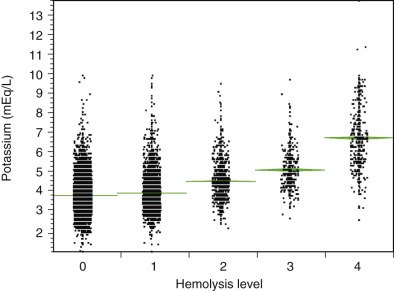

## Key Points

  * •

Errors and variables in the preanalysis stage can affect test results. 

  * •

Patient variables include physical activity, diet, age, sex, circadian variations, posture, stress, obesity, smoking, and medication. 

  * •

Strict adherence to proper technique and site selection can minimize collection variables such as hemolysis, hemoconcentration, clots, and other causes for sample rejection or erroneous results. 

  * •

Blood collection containers are color-coded based on additive or preservative, and each is suitable only for specific tests. Failure to use the proper tubes or filling tubes in the wrong sequence can produce erroneous results. 

  * •

Blood collection staff must be adequately trained in safety and confidentiality issues. 

  * •

Blood, urine, and other body fluid constituents can change during transport and storage. The extent of these changes varies by analyte. 

  * •

The most common reasons for specimen rejection are clotted blood for hematology or coagulation tests; insufficient volume in a tube for coagulation tests; and hemolysis, icterus, and lipemia in serum or plasma that can cause interference in chemistry testing. 

Preanalysis refers to all the complex steps that must take place before a sample can be analyzed. Over the years, a series of studies identified that 32% to 75% of all testing errors occur in the preanalytic phase (  Lapworth & Teal, 1994  ;  Stahl & Lund, 1998  ;  Hofgartner & Tait, 1999  ;  Bonini et al, 2002  ;  Plebani, 2010  ), and technologic advances and quality assurance procedures have significantly reduced the number of analytic-based errors. This has exposed the preanalysis stage as a major source of residual “error” and/or variables that can affect test results. Preanalytic factors include patient-related variables (diet, age, sex, etc.), specimen collection and labeling techniques, specimen preservatives and anticoagulants, specimen transport, and processing and storage. Potential sources of error or failure in this process include improperly ordered tests, sample misidentification, improper timing, improper fasting, improper anticoagulant/blood ratio, improper mixing, incorrect order of draw, and hemolyzed or lipemic specimens. The most frequent preanalytic errors include improperly filling the sample tube, placing specimens in the wrong containers or preservatives, and selecting the incorrect test (  Plebani, 2010  ). [ Table 3-1 ](<#t0010>) lists the most common errors associated with specimen collection, including those that occur before specimen collection (e.g., patient ID error), during collection (e.g., incorrect tube or order of draw), and after collection (e.g., improper transport or centrifugation). 

TABLE 3-1 

Common Preanalytical Errors 

Phase  |  Error   
---|---  
Before Collection  | 

  * 1. Incorrect test ordered 
  * 2. Inadequate patient preparation (e.g., not fasting, recent heavy meal—lipemia) or improper timing (e.g., trough drug level drawn too early) 
  * 3. Misidentification of patient 

  
During Collection  | 

  * 1. Wrong container/wrong additive 
  * 2. Short draws/wrong anticoagulant/blood ratio 
  * 3. Hemoconcentration from prolonged tourniquet time 
  * 4. Hemolysis due to incorrect technique (e.g., forcing blood through needle, draw via intravenous line) 

  
After Collection  | 

  * 1. Inadequate mixing/clots 
  * 2. Mislabeling of specimen 
  * 3. Improper transport to lab: Exposure to light/extreme temperatures or delayed delivery 
  * 4. Processing errors: Incomplete centrifugation, incorrect log-in, improper storage or aliquoting prior to analysis 

  
  
Errors in the preanalytic stage create extra work or additional investigation that may cause unnecessary procedures for patients and costs to the health care system (  Stankovic & DeLauro, 2010  ). Preanalytic issues have downstream impact on the use of laboratory resources, hospital costs, and overall quality of care. By some estimates, specimen collection errors cost the average 400-bed hospital about $200,000/year in recollection costs. The estimated average costs of a preanalytical error in North American institutions were estimated at $208, with costs representing between 0.23% and 1.2% of total hospital operating costs (  Green, 2013  ). Proper collection technique is also essential to minimize injury to the phlebotomist and the patient. Treatment for an injury related to a traumatic needlestick can cost $500 to $3000, and poor technique can result in patient injury, such as nerve and arterial damage, subcutaneous hemorrhage, infection, and even death. The Centers for Disease Control and Prevention (CDC) estimates that 385,000 needlestick injuries occur per year (  CDC, 2004  ). Many go unreported. This chapter discusses the preanalytic process, with special emphasis on the clinical impact of variables and sources of failure. 

,  

##  Precollection Variables 

In preparing a patient for phlebotomy, care should be taken to minimize physiologic factors related to activities that might influence laboratory determinations. These include diurnal variation, exercise, fasting, diet, ethanol consumption, tobacco smoking, drug ingestion, and posture (  Haverstick, 2015  ). 

 

##  Physiologic Factors 

**Diurnal variation.** This may be encountered when testing for hormones, iron, acid phosphatase, and urinary excretion of most electrolytes such as sodium, potassium, and phosphate (  Dufour, 2003  ). [ Table 3-2 ](<#t0015>) presents several tests affected by diurnal variations, posture, and stress. 

TABLE 3-2 

Tests Affected by Diurnal Variation, Posture, and Stress 

Cortisol  |  Peaks 4-6  am  ; lowest 8  pm  –12  am  ; 50% lower at 8  pm  than at 8  am  ; increased with stress   
---|---  
Adrenocorticotropic hormone  |  Lower at night; increased with stress   
Plasma renin activity  |  Lower at night; higher standing than supine   
Aldosterone  |  Lower at night   
Insulin  |  Lower at night   
Growth hormone  |  Higher in afternoon and evening   
Acid phosphatase  |  Higher in afternoon and evening   
Thyroxine  |  Increases with exercise   
Prolactin  |  Higher with stress; higher levels at 4 and 8  am  and at 8 and 10  pm   
Iron  |  Peaks early to late morning; decreases up to 30% during the day   
Calcium  |  4% decrease supine   
  
**Exercise.** Physical activity has transient and long-term effects on laboratory determinations. Transient changes may include an initial decrease followed by an increase in free fatty acids, and lactate may increase by as much as 300%. Exercise may elevate creatine phosphokinase (CK), aspartate aminotransferase (AST), and lactate dehydrogenase (LD) and may activate coagulation, fibrinolysis, and platelets (  Garza & Becan-McBride, 2014  ). These changes are related to increased metabolic activities for energy purposes and usually return to preexercise levels soon after exercise cessation. Long-term effects of exercise may increase CK, aldolase, AST, and LD values. Chronic aerobic exercise is associated with lesser increases in plasma concentration of muscle enzymes such as CK, AST, alanine aminotransferase (ALT), and LD. Decreased levels of serum gonadotropin and sex steroid concentrations are seen in long-distance athletes, while prolactin levels are elevated (  Dufour, 2003  ). 

**Diet.** An individual's diet can greatly affect laboratory test results. The effect is transient and is easily controlled. Glucose and triglycerides, absorbed from food, increase after eating (  Dufour, 2003  ). After 48 hours of fasting, serum bilirubin concentrations may increase. Fasting for 72 hours decreases plasma glucose levels in healthy women to 45 mg/dL (2.5 mmol/L), while men show an increase in plasma triglycerides, glycerol, and free fatty acids, with no significant change in plasma cholesterol. When determining blood constituents such as glucose, triglycerides, cholesterol, and electrolytes, collection should be done in the basal state (  Garza & Becan-McBride, 2014  ). Eating a meal, depending on fat content, may elevate plasma potassium, triglycerides, alkaline phosphatase, and 5-hydroxyindoleacetic acid (5-HIAA). Stool occult blood tests, which detect heme, are affected by the intake of meat, fish, iron, and horseradish, a source of peroxidase, causing a false-positive occult blood reaction (  Dufour, 2003  ). In addition, consumption of bismuth-containing antacids such as Pepto-Bismol also renders false-positive results. Physiologic changes may include hyperchylomicronemia, thus increasing turbidity of the serum or plasma and potentially interfering with instrument readings. 

Certain foods or diet regimens may affect serum or urine constituents. Long-time vegetarian diets are reported to cause decreased concentrations of low-density lipoproteins (LDLs), very-low-density lipoproteins (VLDLs), total lipids, phospholipids, cholesterol, and triglycerides. Vitamin B  12  deficiency can also occur, unless supplements are taken (  Young, 2007  ). A high-meat or other protein-rich diet may increase serum urea, ammonia, and urate levels. High-protein, low-carbohydrate diets, such as the Atkins diet, greatly increase ketones in the urine and increase the serum blood urea nitrogen (BUN). Foods with a high unsaturated-to-saturated fatty acid ratio may show decreased serum cholesterol, while a diet rich in purines will show an increased urate value. Foods such as bananas, pineapples, tomatoes, and avocados are rich in serotonin. When ingested, elevated urine excretion of 5-HIAA may be observed. Beverages rich in caffeine elevate plasma free fatty acids and cause catecholamine release from the adrenal medulla and brain tissue. Ethanol ingestion increases plasma lactate, urate, and triglyceride concentrations. Elevated high-density lipoprotein (HDL) cholesterol, γ-glutamyl transferase (GGT), urate, and mean corpuscular volume (MCV) have been associated with chronic alcohol abuse. 

Serum concentrations of cholesterol, triglycerides, and apoB lipoproteins are correlated with obesity. Serum LD activity, cortisol production, and glucose increase in obesity. Plasma insulin concentration is also increased, but glucose tolerance is impaired. In obese men, testosterone concentration is reduced (  Young, 2007  ). 

**Stress.** Mental and physical stresses induce the production of adrenocorticotropic hormone (ACTH), cortisol, and catecholamines. Total cholesterol has been reported to increase with mild stress, and HDL cholesterol to decrease by as much as 15% (  Dufour, 2003  ). Hyperventilation affects acid-base balance and elevates leukocyte counts, serum lactate, or free fatty acids. 

**Posture.** Posture of the patient during phlebotomy can have an effect on various laboratory results. An upright position increases hydrostatic pressure, causing a reduction of plasma volume and increased concentration of proteins. Albumin and calcium levels may become elevated as one changes position from supine to upright. Elements that are affected by postural changes are albumin, total protein, enzymes, calcium, bilirubin, cholesterol, triglycerides, and drugs bound to proteins. Incorrect application of the tourniquet and fist exercise can result in erroneous test results. Using a tourniquet to collect blood to determine lactate concentration may result in falsely increased values. Prolonged tourniquet application may also increase serum enzymes, proteins, and protein-bound substances, including cholesterol, calcium, and triglycerides, as the result of hemoconcentration when plasma water leaves the vein because of back pressure. After bed rest in the hospital, a patient's hemoglobin (Hb) can decrease from the original admitting value enough to falsely lead a physician to suspect internal hemorrhage or hemolysis (  Dufour, 2003  ). This effect can be amplified by intravenous fluid administration. Patients should be advised to avoid changes in their diet, consumption of alcohol, and strenuous exercise 24 hours before having their blood drawn for laboratory testing. 

**Age.** Age of the patient has an effect on serum constituents. Young defines four age groups: newborn, childhood to puberty, adult, and elderly adult (  Young, 2007  ). In the newborn, much of the Hb is Hb F, not Hb A, as seen in the adult. Bilirubin concentration rises after birth and peaks at about 5 days. In cases of hemolytic disease of the fetus and newborn (HDFN), bilirubin levels continue to rise. This often causes difficulty in distinguishing between physiologic jaundice and HDFN. Infants have a lower glucose level than adults because of their low glycogen reserve. With skeletal growth and muscle development, serum alkaline phosphatase and creatinine levels, respectively, also increase. The high uric acid level seen in a newborn decreases for the first 10 years of life, then increases, especially in boys, until the age of 16 (  Young, 2007  ). Most serum constituents remain constant during adult life until the onset of menopause in women and middle age in men. Increases of about 2 mg/dL (0.05 mmol/L) per year in total cholesterol and 2 mg/dL (0.02 mmol/L) per year in triglycerides until midlife have been reported. The increase in cholesterol seen in postmenopausal women has been attributed to a decrease in estrogen levels. Uric acid levels peak in men in their 20s but do not peak in women until middle age. The elderly secrete less triiodothyronine, parathyroid hormone, aldosterone, and cortisol. After age 50, men experience a decrease in secretion rate and concentration of testosterone, and women have an increase in pituitary gonadotropins, especially follicle-stimulating hormone (FSH) (  Young, 2007  ). 

**Gender.** After puberty, men generally have higher alkaline phosphatase, aminotransferase, creatine kinase, and aldolase levels than women; this is due to the larger muscle mass of men. Women have lower levels of magnesium, calcium, albumin, Hb, serum iron, and ferritin. Menstrual blood loss contributes to the lower iron values (  Young, 2007  ). 

 

##  Common Interferences 

 

##  In Vivo 

 

##  Tobacco Smoking 

Tobacco smokers have high blood carboxyhemoglobin levels, plasma catecholamines, and serum cortisol. Changes in these hormones often result in decreased numbers of eosinophils, while neutrophils, monocytes, and plasma free fatty acids increase. Chronic effects of smoking lead to increased Hb concentration, erythrocyte (RBC) count, MCV, and leukocyte (WBC) count. Increased plasma levels of lactate, insulin, epinephrine, and growth hormone and urinary secretion of 5-HIAA are also seen. Vitamin B  12  levels may be substantially decreased and have been reported to be inversely proportional to serum thiocyanate levels. Smoking also affects the body's immune response. Immunoglobulin (Ig)A, IgG, and IgM are lower in smokers, and IgE levels are higher. Decreased sperm counts and motility and increased abnormal morphology have been reported in male smokers when compared with nonsmokers (  Young, 2007  ). 

 

##  In Vitro 

 

##  Collection-Associated Variables 

On occasion, when there is a problem finding a vein for phlebotomy, the specimen may be hemolyzed as the result of sheer forces on the red blood cells. Hemolysis can also be caused by using a needle that is too small, pulling a syringe plunger back too fast, expelling the blood vigorously into a tube, shaking or mixing the tubes vigorously, or performing blood collection before the alcohol has dried at the collection site. Hemolysis is present when the serum or plasma layer is pink. Hemolysis can falsely increase blood constituents such as potassium, magnesium, iron, LD, phosphorus, ammonium, and total protein (  Garza, 2014  ). [ Table 3-3 ](<#t0020>) shows changes in serum concentrations (or activities) of selected constituents caused by lysis of RBCs. 

TABLE 3-3 

Changes in Serum Concentration (or Activities) of Selected Constituents Due to Lysis of Erythrocytes (RBCs) 

Constituent  |  Ratio of Concentration (or Activity) in RBC to Concentration (or Activity) in Serum  |  Percent Change of Concentration (or Activity) in Serum after Lysis of 1% RBC, Assuming a Hematocrit of 0.50   
---|---|---  
Lactate dehydrogenase  |  16 : 1  |  +272.0   
Aspartate aminotransferase  |  4 : 1  |  +220.0   
Potassium  |  23 : 1  |  +24.4   
Alanine aminotransferase  |  6.7 : 1  |  +55.0   
Glucose  |  0.82 : 1  |  –5.0   
Inorganic phosphate  |  0.78 : 1  |  +9.1   
Sodium  |  0.11 : 1  |  –1.0   
Calcium  |  0.10 : 1  |  +2.9   
  
Modified from  Caraway WT, Kammeyer CW. Chemical interference by drug and other substances with clinical laboratory test procedures. _Clin Chem Acta_ 1972  ; 41:395; and  Laessig RH, Hassermer DJ, Paskay TA, et al. The effects of 0.1 and 1.0 percent erythrocytes and hemolysis on serum chemistry values. _Am J Clin Pathol_ 1976  ; 66:639–644, with permission. 

Because of the extremely important role of potassium in cardiac excitation, elevations due to hemolysis can be problematic, especially for emergency room patients who are at risk of hemolysis during frantic blood collection. The relationship between level of hemolysis and potassium (as determined on a Siemens ADVIA 1650 chemistry analyzer [Siemens Healthcare Diagnostics, Deerfield, Ill.]) in serum and plasma specimens is shown in [ Figure 3-1 ](<#f0010>) . Even with no hemolysis, the range of potassium concentrations can be broad in a combination of healthy and sick individuals. Low levels of hemolysis cause only minor elevations, but very strong hemolysis can raise the potassium level by 2 to 3 mEq/L into a critical range. 

Figure 3-1 

Relationship between hemolysis and potassium in 60,989 serum and plasma specimens grouped according to level of hemolysis. 

The mean values of potassium were 4.12, 4.23, 4.80, 5.36, and 6.93 mEq/L for levels of hemolysis from 0 through 4, respectively. 

Another special case where pseudohyperkalemia can occur is in patients with extremely high blast counts in acute or accelerated phase leukemias. Those blasts can be fragile and may lyse during standard phlebotomy, releasing potassium. In contrast, specimens with very high WBC counts that are collected gently can show pseudohypokalemia when potassium is taken up by highly metabolically active leukemic cells along with glucose; such specimens can be transported on ice to slow this enzymatically mediated uptake. 

Normally platelets release potassium during clotting, so serum has a slightly higher value of potassium than plasma from the same individual; this difference is accentuated when the platelet count is extremely elevated. 

To avoid problems with hemoconcentration and hemodilution, the patient should be seated in a supine position for 15 to 20 minutes before the blood is drawn (  Young, 2007  ). Extended application of the tourniquet can cause hemoconcentration, which increases the concentrations of analytes and cellular components. When blood collection tubes that contain various anticoagulants/additives are used, it is important to follow the proper order of draw and to thoroughly mix an anticoagulated tube of blood after it has been filled. Failure to mix a tube containing an anticoagulant will result in failure to anticoagulate the entire blood specimen, and small clots may be formed. Erroneous cell counts can result. If a clot is present, it may also occlude or otherwise interfere with an automated analyzer. It is very important that the proper anticoagulant be used for the test ordered. Using the wrong anticoagulant will greatly affect the test results. 

Icteric or lipemic serum provides additional challenges in laboratory analysis. When serum bilirubin approaches 430 mmol/L (25 mg/L), interference may be observed in assays for albumin (4-hydroxyazobenzene-2-carboxylic acid [HABA] procedure), cholesterol (using ferric chloride reagents), and total protein (Biuret procedure). Artifactually induced values in some laboratory determinations result when triglyceride levels are elevated (turbidity) on the basis of absorbance of light of various lipid particles. Lipemia occurs when serum triglyceride levels exceed 4.6 mmol/L (400 mg/dL). Inhibition of assays for amylase, urate, urea, CK, bilirubin, and total protein may be observed. To correct for artifactual absorbance readings, “blanking” procedures (the blank contains serum but lacks a crucial element to complete the assay) or dual-wavelength methods may be used. A blanking process may not be effective in some cases of turbidity, and ultracentrifugation may be necessary to clear the serum or plasma of chylomicrons. 

 

##  Special Issues That May Impact Analysis 

In addition to the preanalytical variables discussed above, there are a variety of special conditions and interferences that may impact sample analysis. 

 

##  Immunoassays 

A variety of substances can interfere with immunoassays, and this, in turn, can lead to the misinterpretation of a patient's results. Endogenous substances, human antianimal species, or autoantibodies can interfere with the reaction between analyte and reagent antibodies. Manufacturers usually add blocking agents to immunoassay reagents to inhibit or neutralize the interference (  Tate & Ward, 2004  ). Immunoassays use antibodies derived from a variety of species—for example, mouse antibody. Human antimouse antibodies (HAMAs) can arise following antigenic stimulation from therapeutic mouse monoclonal antibodies that are administered to alter immune responses (e.g., anti–T cell antibody), to bind and remove toxic levels of drugs (e.g., digoxin), or to attack tumors. Some individuals with HAMAs have no history of therapeutic exposures but could conceivably have had incidental exposure to mouse proteins through contaminated food or other environmental sources. The effect of HAMAs in immunoassays can be to cross-link capture and signal antibodies in a sandwich that mimics true antigen (  Klee, 2000  ). For example, an immunoassay for thyroid-stimulating hormone (TSH) that has separate antibodies against α and β subunits might yield an astonishingly high false-positive result in a euthyroid person with HAMA; in this case, the other thyroid function tests could be completely normal. The presence of HAMA can be confirmed by direct measurement (usually sent to a reference laboratory) and can also be inferred by adsorption of the HAMA onto special tubes coated with mouse antibodies, followed by repeat measurement of the analyte to look for reduction in signal strength in the treated specimen (  Madry et al, 1997  ). 

 

##  Specimen Matrix Effects 

Common biochemical analytes such as electrolytes, small molecules, enzymes, and so on, are generally distributed in the water phase of plasma or serum. Consequently, specimens with reduced water phase due to hyperproteinemia (e.g., from very high concentrations of a myeloma protein) or hyperlipidemia (e.g., high chylomicron content) can have reduced content of those solvent analytes even though other properties such as ionic activities in those specimens may be within normal physiologic range. This phenomenon is termed the _solvent exclusion effect,_ referring to the exclusion of water and small molecules in the aqueous phase when more volume within a specimen is occupied by protein or lipid that excludes water. The content of small molecules per volume is the osmolarity (which is the measurement that can be erroneous), whereas the physiologically important aspect such as ionic activities is the osmolality. If excess lipids are the cause, they may be removed by ultracentrifugation. If interference is due to excess protein, an alternative mode of analysis such as ion-selective electrode in undiluted specimen can be employed to yield correct electrolyte activity (i.e., equivalent of osmolality). 

Matrix effects from very high or very low concentrations of proteins and other constituents may be problematic when dealing with other body fluids, especially when the specimens are highly viscous or otherwise atypical (see [ Chapter 29 ](<##!/content/3-s2.0-B9780323295680000292?scrollTo=%23c00029>) ). In those situations, it may be necessary to qualify results in the report to indicate the site of the body fluid and possible limitations in accuracy of measurement. 

 

##  Molecular Diagnostics 

Laboratory manipulations of nucleic acids are susceptible to interferences at various stages, including specimen collection and processing. Introduction of inhibitory substances and contamination with false-positive signals are among the significant interferences. Blood specimens for nucleic acid testing are generally collected into EDTA anticoagulant to inhibit enzymes that might break them down. Heparin is a poor choice for anticoagulant in this application because it can be coextracted with DNA and inhibits DNA polymerase in polymerase chain reactions (PCRs). Hemin from hemolysis in plasma or serum can also inhibit DNA polymerase. RNA is labile in blood or tissues, so these specimens must be stored appropriately by rapid freezing in liquid nitrogen if the extraction will be delayed. 

Extraction of nucleic acids from clinical specimens such as plasma (e.g., for viral load measurement), blood cells (e.g., for genetic testing), or tissues (e.g., for analyzing mutations in tumors) entails lysing cells and separating nucleic acids from proteins and lipids. Reagents for extraction include salts, proteases, and phenol-chloroform to denature the substances complexed with nucleic acids. This process must be optimized for specimen type to recover high-quality nucleic acids with good quantitative yield (see [ Chapter 66 ](<##!/content/3-s2.0-B9780323295680000668?scrollTo=%23c00066>) ). Care must be taken to avoid contamination of specimens with target nucleic acids from other specimens or with amplified targets from specimens that have been analyzed previously in that vicinity. Accordingly, laboratories practicing nucleic acid amplification, especially polymerase chain reaction (PCR), should have separate preamplification, amplification, and postamplification areas with strict rules about personnel movements between them (see [ Chapters 66 ](<##!/content/3-s2.0-B9780323295680000668?scrollTo=%23c00066>) and [ 70 ](<##!/content/3-s2.0-B978032329568000070X?scrollTo=%23c00070>) ). 

 

##  Effects of Drugs 

Analytic methods that are based on oxidation–reduction reactions may be influenced positively or negatively by ingested substances such as ascorbic acid (vitamin C). This interference is observed in chemical testing of serum on automated analyzers (  Meng et al, 2005  ), and it can also occur in urine testing for glucose (positive interference for reducing substance method; negative interference with enzymatic method). In stool testing for occult blood, peroxidases from meats (myoglobin) or vegetables (horseradish) in the diet can yield a false-positive result with guaiac-based methods, as can topical iodine or chlorine used as a disinfectant. 

Drugs can have unanticipated reactions with the reagents intended for specific chemical tests. The list of potential interfering drugs is extremely long, and some methods for a particular analyte may be strongly affected, whereas other methods may not be affected at all. A voluminous compendium of drug interactions has been developed by Dr. Donald S. Young (  Young, 2007  ). In addition to assisting with recognition of potential interferences, this source can be used to evaluate a different method that is unaffected by a particular drug to confirm the accuracy of measurement in cases of suspected interference. These interferences are separated into those whose effects are manifested directly in the assay in vitro and those that are due to drug actions in vivo, whereby physiologic functions are changed (e.g., prolonged prothrombin time with Coumadin; lower potassium in blood with some diuretics). 

,  

##  Specimen Collection 

 

##  The Test Order 

One of the most frequent preanalytic errors involves selecting the wrong laboratory test or panel of tests, leading to inappropriate interpretation of results (  Bonini et al, 2002  ). Laboratory tests are usually ordered electronically (e.g., computer) or in writing (e.g., paper requisition used to transcribe orders into an information system). Online computer input is the most error-free means of requesting laboratory tests. Verbal requests are made in emergency situations and should be documented on a standard form; after the blood is drawn, an official laboratory request or computerized order should be placed. Physician direct order entry and result retrieval provide prompt and accurate patient care. Patient demographics include patient name, sex, age, date of birth (DOB), date of admission (for inpatients), date of test order, location, and physician. Computerized laboratory information systems (LISs), common in today's laboratories, are used to generate requisitions and specimen labels. Some systems also generate requisitions with the number of tubes and the types of tubes required for collection. 

Most laboratories facilitate test ordering by providing access to an electronic laboratory reference manual that lists available tests, types of specimens required, collection methods, color of blood collection tubes used, amounts of blood/body fluid required, turnaround time, reference intervals, test codes, costs, diagnostic information, and so forth. All specimens must be clearly labeled. Preprinted bar code labels applied after proper patient identification, and after the specimen is collected, avoid preanalytic transcription errors. Frequently, the laboratory receives a request for an “add-on test.” This is an additional test requested on a previously collected sample. Problems are encountered when the specimen is not the proper type for the add-on requested test, the residual volume is not sufficient to perform the test, or storage conditions result in deterioration of the analyte (e.g., bicarbonate). This is usually due to the presence or absence of a particular anticoagulant or additive. All add-on requests must be documented. 

Medicolegal concerns include proper identification of the patient, proper labeling of the specimen, patient consent issues, patient privacy issues, and chain of custody. Laboratories should have clearly written policies for these issues. In addition, policies should describe what to do when a patient refuses to have blood drawn, what to do if the patient was unable to be drawn, what to do if a patient is unavailable, and how to deal with a combative patient, as well as emergency measures for patients who become ill or faint during phlebotomy. The Health Insurance Portability and Accountability Act (HIPAA) ensures the security and privacy of health data and protects the confidentiality of all patient record information, including all laboratory data. Employees must be trained to comply with HIPAA. 

 

##  Time of Collection 

Sometimes, samples have to be collected at a specific time. Failure to follow the planned time schedule can lead to erroneous results and misinterpretation of a patient's condition. The most common tests in this category are the ASAP and stat collections. _ASAP_ means “as soon as possible,” and _stat_ is an American medical term meaning “immediately” (from the Latin _statim_ ). The exact definitions of these terms vary from one laboratory to another. Stat specimens are collected and analyzed immediately. They are given the highest priority and are usually ordered from the emergency department and critical care units (  Strasinger & DiLorenzo, 2011  ). Timed specimens are ordered for a variety of reasons, usually to monitor changes in a patient's condition, to determine the level of a medication, or to measure how well a substance is metabolized. For example, a physician may want to monitor a cardiac marker to determine if it is rising or decreasing. In therapeutic drug monitoring, trough and peak levels of a drug may be ordered. Trough specimens reflect the lowest level in the blood and are generally drawn 30 minutes before the drug is administered. The peak specimen is drawn shortly after the medication is given; the actual collection time varies by medication. Drug manufacturers specify the length of time that must pass between trough and peak collection times. 

 

##  Specimen Acceptability and Identification Issues 

All specimens must be collected, labeled, transported, and processed according to established procedures that include sample volume, special handling needs, and container type. Failure to follow specific procedures can result in specimen rejection. Inappropriate specimen type, wrong preservative, hemolysis, lipemia, clots, and so on, are reasons for rejection. Specimen rejection is costly and time-consuming. 

An incorrect sample collection may harm the patient, especially when the blood sample in the tube is mislabeled. The first goal of The Joint Commission 2015 Laboratory National Patient Safety Goals is to “identify patients correctly” ( [ http://www.jointcommission.org/standards_information/npsgs.aspx ](<http://www.jointcommission.org/standards_information/npsgs.aspx>) ). Patient wristbands that include bar codes or radiofrequency technology promote positive patient identification. A fully integrated, information technology–based preanalytical process has also been described (  Barak & Jaschek, 2014  ). Misidentification of patients during sample collection for transfusion or at the time of transfusion can be a life-threatening medical error. The incidence of patient misidentification at the time of specimen collection has been reported to be approximately 1 in 1000, with 1 in 12,000 patients receiving a unit of blood that was not intended for that individual (  Linden et al, 2000  ;  Dzik et al, 2003  ). Trained phlebotomists appear to have fewer Wrong Blood in Tube (WBIT) errors (1.1 per 1000) than nondedicated staff (2.7 per 1000) (  Bolton-Maggs et al, 2015  ). As a result, the College of American Pathologists requires laboratories to have a plan to reduce the risk of mistransfusion and suggests as options collecting two samples at separate phlebotomy events or utilizing an electronic identification verification system such as an electronic bar code reader for patient identification wristbands (CAP TRM.30575). It is therefore essential to thoroughly train all medical staff in all aspects of patient identification, specimen collection, transportation, and processing. [ Box 3-1 ](<#b0010>) lists various reasons for specimen rejection. 

Box 3-1 

Reasons for Specimen Rejection 

  * Hemolysis/lipemia 

  * Clots present in an anticoagulated specimen 

  * Nonfasting specimen when test requires fasting 

  * Improper blood collection tube 

  * Short draws, wrong volume 

  * Improper transport conditions (ice for blood gases) 

  * Discrepancies between requisition and specimen label 

  * Unlabeled or mislabeled specimen 

  * Contaminated specimen/leaking container 

,  

##  Blood Collection Overview 

Venipuncture is performed using a needle/adapter assembly attached to an evacuated glass/plastic test tube with a rubber/plastic stopper. Blood may also be collected in a syringe and transferred to the appropriate specimen container (evacuated tube system). A syringe may be helpful when procuring a specimen from the hand or ankle or from small children. In addition, patients with small or poor veins may experience collapse of veins with use of an evacuated tube system. AccuVein (AccuVein LLC, Huntington, N.Y.) is a handheld medical device that helps medical staff visualize veins before phlebotomy. The device emits infrared light and is held about 7 inches over the potential phlebotomy site. Hb in the blood absorbs infrared light and projects an image map of the veins onto the patient's overlying skin. The device is able to distinguish between Hb in the veins and surrounding tissue. This device assists the phlebotomist in determining the best site for needle placement, especially for challenging patients such as the elderly, the obese, burn victims, oncology patients, and patients with other chronic diseases requiring many diagnostic or therapeutic procedures ( [ http://www.accuvein.com ](<http://www.accuvein.com>) ). 

Blood collection tubes have color-coded stoppers that distinguish the presence of a specific anticoagulant or additive, how the tube is chemically cleaned (e.g., for lead or iron determinations), or if the tube does not contain any additives. [ Table 3-4 ](<#t0025>) lists the most frequently used anticoagulants/additives based on color-coded tube stoppers. Tubes also come in various sizes for adult and pediatric patient populations. Draw volume is determined by the internal vacuum within the sealed tubes (e.g., 3.5, 4.0, 4.5, or 8.5 mL). By using anticoagulants, plasma (obtained by centrifugation) or whole blood can be analyzed. Plasma contains fibrinogen, which is missing from serum. Many laboratories have converted from glass to plastic collection tubes to minimize exposure to biohazardous material (e.g., blood) and broken glass; to lower biohazard waste disposal costs; and to comply with Occupational Safety and Health Administration (OSHA) guidelines mandating substitution. This change from glass to plastic has required a modification in the order of draw. Glass or plastic tubes with additives, including gel tubes, are drawn after the citrate tube (blue top) to avoid interference with coagulation measurements ( [ Box 3-2 ](<#b0015>) ). Glass or plastic serum tubes, without a clot activator or gel separator, may be drawn before the coagulation tubes are drawn, consistent with Clinical and Laboratory Standards Institute (CLSI) guidelines (GP41-A6) (  Ernst & Calam, 2004  ). 

TABLE 3-4 

Tube Color and Anticoagulant/Additive 

Stopper Color  |  Anticoagulant/Additive  |  Specimen Type/Use  |  Mechanism of Action   
---|---|---|---  
Red (glass)  |  None  |  Serum/chemistry and serology  |  N/A   
Red (plastic/Hemogard)  |  Clot activator  |  Serum/chemistry and serology  |  Silica clot activator   
Lavender (glass)  |  K  3  EDTA in liquid form  |  Whole blood/hematology  |  Chelates (binds) calcium   
Lavender (plastic)  |  K  2  EDTA/spray-dried  |  Whole blood/hematology  |  Chelates (binds) calcium   
Pink  |  Spray-dried K  2  EDTA  |  Whole blood/blood bank and molecular diagnostics  |  Chelates (binds) calcium   
White  |  EDTA and gel  |  Plasma/molecular diagnostics  |  Chelates (binds) calcium   
Light blue  |  Sodium citrate  |  Plasma/coagulation  |  Chelates (binds) calcium   
Light blue  |  Thrombin and soybean trypsin inhibitor  |  Plasma/coagulation  |  Fibrin degradation products   
Black  |  Sodium citrate  |  Plasma/sed rates—hematology  |  Chelates (binds) calcium   
Light green/black  |  Lithium heparin and gel  |  Plasma/chemistry  |  Inhibits thrombin formation   
Green  |  Sodium heparin, lithium heparin  |  Plasma/chemistry  |  Inhibits thrombin formation   
Royal blue  |  Sodium heparin, K  2  EDTA  |  Plasma/chemistry/toxicology  |  Heparin inhibits thrombin formation Na  2  EDTA binds calcium   
Gray  |  Sodium fluoride/potassium oxalate  |  Plasma/glucose testing  |  Inhibits glycolysis   
Yellow  |  Sterile containing sodium polyanetholesulfonate  |  Serum/microbiology culture  |  Aids in bacterial recovery by inhibiting complement, phagocytes, and certain antibiotics   
Yellow  |  Acid citrate dextrose  |  Plasma/blood bank, HLA phenotyping, and paternity testing  |  WBC preservative   
Tan (glass)  |  Sodium heparin  |  Plasma/lead testing  |  Inhibits thrombin formation   
Tan (plastic)  |  K  2  EDTA  |  Plasma/lead testing  |  Chelates (binds) calcium   
Yellow/gray and orange  |  Thrombin  |  Serum/chemistry  |  Clot activator   
Red/gray and gold  |  Clot activator separation gel  |  Serum/chemistry  |  Silica clot activator   
  
_EDTA,_ Ethylenediaminetetraacetic acid; _HLA,_ human leukocyte antigen; _K 2  EDTA, _ dipotassium form of EDTA; _K 3  EDTA, _ tripotassium form of EDTA; _N/A,_ not applicable; _Na 2  EDTA, _ disodium EDTA; _WBC,_ white blood cell. 

Box 3-2 

Order of Draw 

Evacuated Tube and Syringe 

  * 1.

Blood-culture tubes (yellow) 

  * 2.

Coagulation sodium citrate tube (blue stopper) 

  * 3.

Serum tubes with or without clot activator or gel separator 

  * 4.

Heparin tubes with or without gel (green stopper) 

  * 5.

Ethylenediaminetetraacetic acid tubes (lavender stopper) 

  * 6.

Glycolytic inhibitor tubes (gray stopper) 

 

##  Anticoagulants and Additives 

Ethylenediaminetetraacetic acid (EDTA) is the anticoagulant of choice for hematology cell counts and cell morphology. It is available in lavender-top tubes as a liquid or is spray-dried in the dipotassium or tripotassium salt form (K  2  EDTA in plastic, spray-dried, and K  3  EDTA in liquid form in glass tubes). K  3  EDTA is a liquid and will dilute the sample about 1% to 2%. K  2  EDTA is spray-dried on the walls of the tube and will not dilute the sample. Pink-top tubes also contain EDTA. The EDTA is spray-dried K  2  EDTA. Pink tubes are used in immunohematology for ABO grouping, Rh typing, and antibody screening. These tubes have a special cross-match label for information required by the American Association of Blood Banks (AABB) and are approved by the U.S. Food and Drug Administration (FDA) for blood bank collections. White-top tubes also contain EDTA and gel. They are used most often for molecular diagnostic testing of plasma. 

For coagulation testing, a light blue–top tube containing 0.105 M or 0.129 M (3.2% or 3.8%, respectively) sodium citrate is commonly used because it preserves the labile coagulation factors. Coagulation tests require the correct ratio of blood and anticoagulant; thus containers should be adequately filled. An insufficient blood collection volume yields excess citrate in plasma and falsely elevated clotting times. This interference is also important in polycythemia, when the hematocrit is abnormally high and the volume of plasma (where citrate distributes) is small. Thus even in an apparently correctly filled tube, polycythemia can lead to falsely prolonged PT and PTT unless the amount of citrate anticoagulant in the tube is reduced proportionally to the decrease in plasma volume. A discard tube (i.e., a partially filled tube that is discarded prior to collecting the one used for testing) is normally only needed when the sample is drawn from a winged set or intravenous catheter; this is because the air space in these collection systems leads to underfilling the first tube (  Favaloro et al, 2012  ). Black-top tubes also contain buffered sodium citrate and are generally used for Westergren sedimentation rates, as are lavender-top tubes. They differ from light blue–top tubes in that the ratio of blood to anticoagulant is 4 : 1 in the black-top tubes and 9 : 1 in the light blue–top tubes. 

Heparin, a mucoitin polysulfuric acid, is an effective anticoagulant in small quantities without significant effect on many determinations. Heparin was originally isolated from liver cells by scientists looking for an anticoagulant that could work safely in humans. Heparin is available as lithium heparin (LiHep) and sodium heparin (NaHep) in green-top tubes. Heparin accelerates the action of antithrombin III, neutralizing thrombin and preventing the formation of fibrin. Heparin has an advantage over EDTA as an anticoagulant, in that it does not affect levels of ions such as calcium. However, heparin can interfere with some immunoassays. Heparin should not be used for coagulation or hematology testing. Heparinized plasma is preferred for potassium measurements to avoid an elevation due to the release of potassium from platelets as the blood clots (  Garza, 2014  ). Lithium heparin may be used for most chemistry tests except for lithium and folate levels; for lithium, a serum specimen can be used instead. Sodium heparin cannot be used for assays measuring sodium levels, but it is recommended for trace elements, leads, and toxicology. Sodium heparin is the injectable form used for anticoagulant therapy. 

Gray-top tubes are generally used for glucose measurements because they contain a preservative or antiglycolytic agent, such as sodium fluoride, which prevents glycolysis for 3 days (  Strasinger & DiLorenzo, 2011  ). In bacterial septicemia, fluoride inhibition of glycolysis is neither adequate nor effective in preserving glucose concentration. Red-top tubes have no additive, so blood collected in these tubes clots. 

Red-top tubes can be used for most chemistry, blood bank, and immunology assays. Integrated serum separator tubes are available for isolating serum from whole blood. During centrifugation, blood is forced into a thixotropic gel material located at the base of the tube. The gel undergoes a temporary change in viscosity during centrifugation and lodges between the packed cells and the top serum layer (  Strasinger & DiLorenzo, 2011  ). Pediatric-sized tubes are also available. Advantages of serum separator tubes include (1) ease of use, (2) shorter processing time through clot activation, (3) higher serum yield, (4) minimal liberation of potentially hazardous aerosols, (5) only one centrifugation step, (6) use of single tube (same one as patient specimen), and (7) ease of a single label. A unique advantage is that centrifuged specimens can be transported without disturbing the separation. Some silica gel serum separation tubes may give rise to minute particles that can cause flow problems during analysis. Filtering the serum solves the problem. 

A few specialized tubes exist. Red/gray- and gold-top tubes contain a clot activator and a separation gel. These tubes are referred to as _serum separator tubes_ (SSTs) and are used most often for chemistry tests. Therapeutic drug monitoring specimens should not be collected in tubes that contain gel separators because some gels absorb certain drugs, causing a falsely lowered result. Significant decreases in phenytoin, phenobarbital, lidocaine, quinidine, and carbamazepine have been reported when stored in Vacutainer SST tubes (Becton, Dickinson and Company [BD], Franklin Lakes, N.J.), while no changes were noted in theophylline and salicylate levels. Storage in standard red-top Vacutainer collection tubes without barrier gels did not affect measured levels of the above therapeutic drugs (  Dasgupta et al, 1994  ). Studies indicate that this absorption is time dependent, and therefore speed in processing minimizes absorption. Acrylic-based gels do not exhibit the absorption problems associated with silicone and polyester gels (  Garza, 2014  ). 

Tubes containing gels are not used in the blood bank or for immunologic testing because the gel may interfere with the immunologic reactions (  Strasinger & DiLorenzo, 2011  ). Clotting time for tubes using gel separators is approximately 30 minutes, and tubes that have clot activators, such as thrombin, will clot in 5 minutes. Plain red-stoppered tubes with no additives take about 60 minutes to clot completely (  Strasinger & DiLorenzo, 2011  ). 

Anticoagulants may affect the transport of water between cell and plasma, thereby altering cell size and constituent plasma concentration. Oxalate anticoagulants may shrink red cells; thus blood anticoagulated with oxalate cannot be used to measure hematocrit. Combined ammonium/potassium oxalate does not have the same effect of shrinking cells. 

EDTA, citrate, and oxalate chelate calcium, thereby lowering calcium levels. Fluoride, used for glucose determinations, prevents glycolysis by forming an ionic complex with Mg  ++  , thereby inhibiting the Mg  ++  -dependent enzyme, enolase (  Young, 2007  ). [ Table 3-5 ](<#t0030>) lists anticoagulants/additives and their effects on various blood tests. 

TABLE 3-5 

Anticoagulant/Additive Effect on Blood Tests 

Additive  |  Test  |  Effect   
---|---|---  
EDTA  |  Alkaline phosphatase  |  Inhibits   
|  Creatine kinase  |  Inhibits   
|  Leucine aminopeptidase  |  Inhibits   
|  Calcium and iron  |  Decrease   
|  PT and PTT  |  Increase   
|  Sodium and potassium  |  Increase   
|  Platelet aggregation  |  Prevents   
Oxalate  |  Acid phosphatase  |  Inhibits   
|  Alkaline phosphatase  |  Inhibits   
|  Amylase  |  Inhibits   
|  LD  |  Inhibits   
|  Calcium  |  Decreases   
|  Sodium and potassium  |  Increase   
|  Cell morphology  |  Distorts   
Citrate  |  ALT and AST  |  Inhibit   
|  Alkaline phosphatase  |  Inhibits   
|  Acid phosphatase  |  Stimulates   
|  Amylase  |  Decreases   
|  Calcium  |  Decreases   
|  Sodium and potassium  |  Increase   
|  Labile coagulation factors  |  Preserve   
Heparin  |  Triiodothyronine  |  Increases   
|  Thyroxine  |  Increases   
|  PT and PTT  |  Increase   
|  Wright's stain  |  Causes blue background   
|  Lithium (LiHep tubes only)  |  Increases   
|  Sodium (NaHep tubes only)  |  Increases   
Fluorides  |  Acid phosphatase  |  Decreases   
|  Alkaline phosphatase  |  Decreases   
|  Amylase  |  Decreases   
|  Creatine kinase  |  Decreases   
|  ALT and AST  |  Decrease   
|  Cell morphology  |  Distorts   
  
_ALT,_ Alanine aminotransferase; _AST,_ aspartate aminotransferase; _EDTA,_ ethylenediaminetetraacetic acid; _LD,_ lactate dehydrogenase; _LiHep,_ lithium heparin; _NaHep,_ sodium heparin; _PT,_ prothrombin time; _PTT,_ partial thromboplastin time. 

**Sample transfer between tubes.** A serious error that is sometimes encountered in sample collection occurs when a portion of a sample in the EDTA-containing lavender-top tube for hematological analysis is poured into a red-top tube for clinical chemistry analysis. EDTA is a potassium salt, artificially increasing the potassium concentration of the sample to values around 25 meq/L, a value that would be incompatible with life. EDTA itself is an ion exchanger that exchanges potassium for calcium. Calcium levels are therefore greatly reduced in the red-top tube sample to values as low as 0. Very low calcium levels and very high potassium levels in red-top tube samples should be taken as a flag for an error due to EDTA contamination. 

 

##  Blood Collection Devices 

The most common blood collection system uses a vacuum to pull blood into a container; it consists of a color-coded evacuated collection tube, a double-headed needle, and an adapter/holder. Small tubes are available for pediatric and geriatric collections. The blood collection holder accommodates various sizes (gauge) of blood collection needles. Needles vary from large (16 gauge) to small (23 gauge). Several types of holders have been designed to eject the needle after use. OSHA policies require that the adapters be discarded with the used needle (  OSHA, 2002  ). Pediatric inserts are available for adapters and accommodate the smaller-diameter pediatric blood collection tubes. Also available are a variety of safety needles that cover the needle after use or retract the needle before it is discarded. 

Winged infusion sets (butterfly needles) can be used when blood has to be collected from a very small vein. Butterfly needles come in 21, 23, and 25 gauge. These needles have plastic wings attached to the end of the needle that aid in insertion of the needle into the small vein. Tubing is attached to the back end of the needle, which terminates with an adapter for attachment to a syringe or evacuated collection holder. A retractable needle design has significantly reduced needlestick injuries (  Hotaling, 2009  ). 

Blood collected in a syringe can be transferred to an evacuated tube. Special syringe safety shield devices are available to avoid unnecessary contact with the blood sample. If blood requires anticoagulation, speed becomes an important factor, and the blood must be transferred before clot formation begins. Once the blood has been transferred, the anticoagulated tube must be thoroughly mixed to avoid small clot formation. 

Several additional pieces of phlebotomy equipment are necessary. A tourniquet, usually a flat latex strip or piece of tubing, is wrapped around the arm to occlude the vein before blood collection and is discarded after each phlebotomy. OSHA guidelines state that gloves should be worn when performing phlebotomy and should be changed between patients. Gloves are available in various sizes and are made of various materials to avoid latex sensitivity as experienced by some individuals. Other supplies include gauze pads, alcohol or iodine wipes for disinfection of the puncture site, and a Band-Aid (Johnson & Johnson, New Brunswick, N.J.) to prevent bleeding after completion of the phlebotomy. 

 

##  Blood Storage and Preservation 

During storage, the concentration of a blood constituent in the specimen may change as a result of various processes, including adsorption to glass or plastic tubes, protein denaturation, evaporation of volatile compounds, water movement into cells resulting in hemoconcentration of serum and plasma, and continuing metabolic activities of leukocytes and erythrocytes. These changes occur, although to varying degrees, at ambient temperature and during refrigeration or freezing. Storage requirements vary widely by analyte. 

Stability studies have shown that clinically significant analyte changes occur if serum or plasma remains in prolonged contact with blood cells. After separation from blood cells, analytes have the same stability in plasma and serum when stored under the same conditions. Glucose concentration in unseparated serum and plasma decreases rapidly in the first 24 hours and more slowly thereafter. This decrease is more pronounced in plasma. Two approaches have been used to minimize this effect. First, the serum or plasma may be rapidly separated from the red cells, or the specimen may be collected in a fluoride tube to inhibit glycolysis of the red blood cells, thereby stabilizing the glucose level during transport and storage. Fluoride has little effect on reducing glycolysis within the first hour of storage and may not reach complete inhibition until 4 hours of storage. One study has demonstrated a reduction in glucose concentration by 0.39 mmol/L in specimens collected in fluoride that are not immediately separated. These authors suggest that specimens collected in fluoride have a negative bias in blood glucose levels (  Shi et al, 2009  ). Lactate levels increase, and a greater rise is seen in plasma than in serum. Chloride and total carbon dioxide (CO  2  ) show a steady decrease over 56 hours, with the degree of change more pronounced in plasma. K  \+  is reported to be stable for up to 24 hours, after which a rapid increase takes place. The degree of change is slightly more pronounced in plasma. Unseparated serum and plasma yield clinically significant increases in total bilirubin, sodium, urea, nitrogen, albumin, calcium, magnesium, and total protein. These changes are attributed to movement of water into cells after 24 hours, resulting in hemoconcentration (  Boyanton & Blick, 2002  ). Other studies found potassium, phosphorus, and glucose to be the analytes that were least stable in serum not removed from the clot within 30 minutes. Albumin, bicarbonate, chloride, C-peptide, HDL-cholesterol, iron, LDL-cholesterol, and total protein were found to be unstable after 6 hours when the serum was not separated from the clot (  Zhang et al, 1998  ). 

When serum and plasma are not removed from the cells, lipids (such as cholesterol) and some enzymes increase over time, with the change more pronounced in plasma than in serum. LD activity continuously increases over 56 hours. AST, ALT, and CK were found to be stable over 56 hours. GGT activity in plasma, with and without prolonged contact with cells, was found to be 27% lower than in serum at 0.5 hours; however, plasma GGT activity steadily increases with prolonged exposure to cells. Creatinine can increase by 110% in plasma and by 60% in serum after 48 to 56 hours (  Boyanton & Blick, 2002  ). 

Serum and plasma may yield significantly different results for an analyte. For example, when serum and EDTA plasma results for parathyroid hormone (PTH) are compared from specimens frozen within 30 minutes of collection, EDTA plasma results are significantly higher (>19%) than those obtained from serum (  Omar et al, 2001  ). The effect of freeze–thaw cycles on constituent stability is an important consideration. In plasma or serum specimens, the ice crystals formed cause shear effects that are disruptive to molecular structure(s), particularly to large protein molecules. Slow freezing allows larger crystals to form, causing more serious degradative effects. Thus quick freezing is recommended for optimal stability. 

 

##  Importance of Policies and Procedures 

It is essential to establish institution-specific phlebotomy policies and procedures that include personnel standards with qualifications; dress code and evaluation procedures; safety protocols, including immunization recommendations; universal precautions; needlestick and sharps information; personal protective equipment; test order procedures; patient identification; confidentiality and preparation; documentation of problems encountered during blood collection; needlestick site selection and areas to be avoided (mastectomy side, edematous area, burned/scarred areas, etc.); anticoagulants required and tube color; order of draw; special requirements for patient isolation units; and specimen transport. The laboratory should have available all CDC, College of American Pathologists (CAP), Clinical and Laboratory Standards Institute (CLSI), OSHA, and The Joint Commission (TJC) guidelines, as well as other government regulations pertaining to laboratory testing. All employees must be trained about safety procedures, and a written blood-borne pathogen exposure control plan must be available. See [ Chapter 1 ](<##!/content/3-s2.0-B9780323295680000012?scrollTo=%23c00001>) for a more complete discussion of safety. 

The OSHA Bloodborne Pathogens Standard concluded that the best practice for prevention of needlestick injury following phlebotomy is the use of a sharp with engineered sharps injury protection (SESIP) attached to the blood tube holder and immediate disposal of the entire unit after each patient's blood is drawn (  OSHA, 2001  ). Information on exposure prevention can be found on the Exposure Prevention Information Network (EPINet), a database coordinated by the International Healthcare Worker Safety Center at the University of Virginia ( [ http://www.healthsystem.virginia.edu/internet/epinet/ ](<http://www.healthsystem.virginia.edu/internet/epinet/>) ). OSHA further mandates that employers make available closable, puncture-resistant, leak-proof sharps containers that are labeled and color-coded. The containers must have an opening that is large enough to accommodate disposal of the entire blood collection assembly (i.e., blood tube, holder, and needle). These containers must be easily accessible to employees in the immediate area of use, and if employees travel from one location to another (one patient room to another), they must be provided with a sharps container that is conveniently placed at each location/facility. Employers must maintain a sharps injury log to record percutaneous injuries from contaminated sharps, while at the same time protecting the confidentiality of the injured employee. 

,  

##  Blood Collection Techniques 

[ Box 3-3 ](<#b0020>) summarizes the technique for obtaining blood from a vein (  CLSI GP41-A6, 2007  ). 

Box 3-3 

Venous Puncture Technique 

  * 1.

Verify that computer-printed labels match requisitions. Check patient identification band against labels and requisition forms. Ask the patient for his or her full name, address, identification number, and/or date of birth. 

  * 2.

If a fasting specimen or a dietary restriction is required, confirm patient has fasted or eliminated foods from diet as ordered by physician. 

  * 3.

Position the patient properly. Assemble equipment and supplies. 

  * 4.

Apply a tourniquet and ask the patient to make a fist without vigorous hand pumping. Select a suitable vein for puncture. 

  * 5.

Put on gloves with consideration of latex allergy for the patient. 

  * 6.

Cleanse the venipuncture site with 70% isopropyl alcohol. Allow the area to dry. 

  * 7.

Anchor the vein firmly. 

  * 8.

Enter the skin with the needle at approximately a 30-degree angle or less to the arm, with the bevel of the needle up: 

    * a.

Follow the geography of the vein with the needle. 

    * b.

Insert the needle smoothly and fairly rapidly to minimize patient discomfort. 

    * c.

If using a syringe, pull back on the barrel with a slow, even tension as blood flows into the syringe. Do not pull back too quickly to avoid hemolysis or collapsing the vein. 

    * d.

If using an evacuated system, as soon as the needle is in the vein, ease the tube forward in the holder as far as it will go, firmly securing the needle holder in place. When the tube has filled, remove it by grasping the end of the tube and pulling gently to withdraw, and gently invert tubes containing additives. 

  * 9.

Release the tourniquet when blood begins to flow. Never withdraw the needle without removing the tourniquet. 

  * 10.

Withdraw the needle, and then apply pressure to the site. Apply adhesive bandage strip over a cotton ball or gauze to adequately stop bleeding and to avoid a hematoma. 

  * 11.

Mix and invert tubes with anticoagulant; do not shake the tubes. Check condition of the patient. Dispose of contaminated material in designated containers (sharps container) using Universal Precautions. 

  * 12.

Label the tubes before leaving patient's side with: 

    * a.

patient's first and last name 

    * b.

identification number 

    * c.

date of collection 

    * d.

time of collection 

    * e.

identification of person collecting specimen 

  * 13.

Deliver tubes of blood for testing to appropriate laboratory section or central receiving and processing area. 

 

##  Arterial Puncture 

Arterial punctures are technically more difficult to perform than venous punctures. Increased pressure in the arteries makes it more difficult to stop bleeding, with the undesired development of a hematoma. In order of preference, the radial, brachial, and femoral arteries can be selected. 

Before blood is collected from the radial artery in the wrist, one should do a modified Allen test ( [ Box 3-4 ](<#b0025>) ) to determine whether the ulnar artery can provide collateral circulation to the hand after the radial artery puncture. The femoral artery is relatively large and easy to puncture, but one must be especially careful in older individuals because the femoral artery can bleed more than the radial or brachial. Because the bleeding site is hidden by bedcovers, it may not be noticed until bleeding is massive. The radial artery is more difficult to puncture, but complications occur less frequently. The major complications of arterial puncture include thrombosis, hemorrhage, and possible infection. When performed correctly, no significant complications are reported except for possible hematomas. 

Box 3-4 

Modified Allen Test 

  * 1.

Have the patient make a fist and occlude both the ulnar (opposite the thumb side) and the radial arteries (closest to the thumb) by compressing with two fingers over each artery. 

  * 2.

Have the patient open his or her fist, and observe if the patient's palm has become bleached of blood. 

  * 3.

Release the pressure on the ulnar artery (farthest from the thumb) only, and note if blood return is present. The palm should become perfused with blood. Adequate perfusion is a positive test indicating that arterial blood may be drawn from the radial artery. Blood should not be taken if the test is negative. Serious consequences may occur if this procedure is not followed, which may result in loss of the hand or its function. 

Unacceptable sites are those that are irritated, edematous, near a wound, or in an area of an arteriovenous (AV) shunt or fistula (  McCall & Tankersley, 1993  ). Arterial spasm is a reflex constriction that restricts blood flow with possible severe consequences for circulation and tissue perfusion. Radial artery puncture can be painful and is associated with symptoms such as aching, throbbing, tenderness, sharp sensation, and cramping. At times, it may be impractical or impossible to obtain arterial blood from a patient for blood gas analysis. Under these circumstances, another source of blood can be used, with the recognition that arterial blood provides a more accurate result. Although venous blood is more readily obtained, it usually reflects the acid-base status of an extremity—not the body as a whole. 

 

##  Arterial Puncture Technique 

The artery to be punctured is identified by its pulsations, and the overlying skin is cleansed with 70% aqueous isopropanol solution followed by iodine. A nonanesthetized arterial puncture provides an accurate measurement of resting pH and partial pressure of carbon dioxide (pCO  2  ) in spite of possible theoretical error caused by patient hyperventilation resulting from the pain of the arterial puncture. The use of butterfly infusion sets is not recommended. Using 19-gauge versus 25-gauge needles does not vary the pCO  2  or the partial pressure of oxygen (pO  2  ) by more than 1 mm Hg. The amount of anticoagulant should be 0.05 mL liquid heparin (1000 IU/mL) for each milliliter of blood. Using too much heparin is probably the most common preanalytic error in blood gas measurement (  Garza, 2014  ). [ Box 3-5 ](<#b0030>) lists the procedure for arterial puncture (  CLSI GP43-A4, 2004  ). 

Box 3-5 

Arterial Puncture Procedure 

  * 1.

Prepare the arterial blood gas syringe according to established procedures. The needle (18-20 gauge for brachial artery) should pierce the skin at an angle of approximately 45 to 60 degrees (90 degrees for femoral artery) in a slow and deliberate manner. Some degree of dorsiflexion of the wrist is necessary with the radial artery, for which a 23- to 25-gauge needle is used. The pulsations of blood into the syringe confirm that it will fill by arterial pressure alone. 

  * 2.

After the required blood is collected, place dry gauze over the puncture site, and quickly withdraw the needle and the collection device. 

  * 3.

Compress the puncture site quickly, expel air from the syringe, and activate the needle safety feature; discard into sharps container. 

  * 4.

Mix specimen thoroughly by gently rotating or inverting the syringe to ensure anticoagulation. 

  * 5.

Place in ice water (or other coolant that will maintain a temperature of 1° C to 5° C) to minimize leukocyte consumption of oxygen. 

  * 6.

Continue compression with a sterile gauze pad for a minimum of 3 to 5 minutes (timed). Apply an adhesive bandage. 

 

##  Finger or Heel Skin Puncture 

For routine assays requiring small amounts of blood, skin puncture is a simple method by which to collect blood samples in pediatric patients. In the neonate, skin puncture of the heel is the preferred site to collect a blood sample; in older children, the finger is the preferred site. The large amount of blood required for repeated venipunctures may cause iatrogenic anemia, especially in premature infants. Venipuncture of deep veins in pediatric patients may rarely cause cardiac arrest, hemorrhage, venous thrombosis, reflex arteriospasm followed by gangrene of an extremity, damage to organs or tissues accidentally punctured, infection, and injury caused by restraining an infant or child during collection. Accessible veins in sick infants must be reserved exclusively for parenteral therapy. Skin puncture is useful in adults with extreme obesity, severe burns, and thrombotic tendencies, with point-of-care testing or with patients performing tests at home (blood glucose). Skin puncture is often preferred in geriatric patients because the skin is thinner and less elastic; thus a hematoma is more likely to occur from a venipuncture. 

In newborns, skin puncture of the heel is frequently used to collect a sample for newborn screening tests for inherited metabolic disorders. A deep heel prick is made at the distal edge of the calcaneal protuberance following a 5- to 10-minute exposure period to prewarmed water. The best method for blood gas collection in the newborn remains the indwelling umbilical artery catheter. [ Box 3-6 ](<#b0035>) lists the steps for a skin puncture (  CLSI GP42-A6, 2008  ). 

Box 3-6 

Skin Puncture Technique 

  * 1.

Select an appropriate puncture site. 

    * a.

For infants younger than 12 months old, this is most usually the lateral or medial plantar heel surface. 

    * b.

For infants older than 12 months, children, and adults, the palmar surface of the last digit of the second, third, or fourth finger may be used. 

    * c.

The thumb and fifth finger must not be used, and the site of puncture must not be edematous or a previous puncture site because of accumulated tissue fluid. 

  * 2.

Warm the puncture site with a warm, moist towel no hotter than 42° C; this increases the blood flow through arterioles and capillaries and results in arterial-enriched blood. 

  * 3.

Cleanse the puncture site with 70% aqueous isopropanol solution. Allow the area to dry. Do not touch the swabbed area with any nonsterile object. 

  * 4.

Make the puncture with a sterile lancet or other skin-puncturing device, using a single deliberate motion nearly perpendicular to the skin surface. For a heel puncture, hold the heel with the forefinger at the arch and the thumb proximal to the puncture site at the ankle. If using a lancet, the blade should not be longer than 2 mm to avoid injury to the calcaneus (heel bone). 

  * 5.

Discard the first drop of blood by wiping it away with a sterile pad. Regulate further blood flow by gentle thumb pressure. Do not milk the site, as this may cause hemolysis and introduce excess tissue fluid. 

  * 6.

Collect the specimen in a suitable container by capillary action. Closed systems are available for collection of nonanticoagulated blood and with additives for whole blood analysis. Open-ended, narrow-bore disposable glass micropipettes are most often used up to volumes of 200 µL. Both heparinized and nonheparinized micropipettes are available. Use the appropriate anticoagulant for the test ordered. Mix the specimen as necessary. 

  * 7.

Apply pressure and dispose of the puncture device. 

  * 8.

Label the specimen container with date and time of collection and patient demographics. 

  * 9.

Indicate in the report that test results are from skin puncture. 

 

##  Central Venous Access Devices 

Central venous access devices (CVADs) provide ready access to the patient's circulation, eliminating multiple phlebotomies, and are especially useful in critical care and surgical situations. Indwelling catheters are surgically inserted into the cephalic vein or into the internal jugular, subclavian, or femoral vein and can be used to draw blood, administer drugs or blood products, and provide total parenteral nutrition. Continuous, real-time, intraarterial monitoring of blood gases and acid-base status has been accomplished with fiberoptic channels containing fluorescent and absorbent chemical analytes (  Smith et al, 1992  ). 

 

##  CVA Collection Technique 

Blood specimens drawn from catheters may be contaminated with whatever was administered or infused via the catheter. The solution (usually heparin) used to maintain patency of the vein must be cleared before blood for analysis is collected. Sufficient blood (minimum of 2-5 mL) must be withdrawn to clear the line, so laboratory data are reliable. Specialized training is therefore necessary before a catheter line is used to collect blood specimens. To obtain a blood specimen from the indwelling catheter, 5 mL of intravenous fluid is first drawn and discarded. In a separate syringe, the amount of blood required for the requested laboratory procedure(s) is then drawn. Strict aseptic technique must be followed to avoid site and/or catheter contamination. Coagulation measurements such as prothrombin time (PT), activated partial thromboplastin time (APTT), and thrombin time (TT) are extremely sensitive to heparin interference, so even larger volumes of presample blood must be withdrawn before laboratory results are acceptable for these tests. The appropriate volume to be discarded should be established by each laboratory. 

The laboratory is sometimes asked to perform blood culture studies on blood drawn from indwelling catheters. Because the indwelling catheters are in place for a few days, this procedure is not recommended because organisms that grow on the walls of the catheter can contaminate the blood specimen. Lines, such as central venous pressure (CVP) lines, are specifically inserted and used for immediate blood product infusion and are less likely to become contaminated. Determination of catheter contamination requires special handling and careful analysis of multiple samples from the catheter and peripheral blood. [ Box 3-7 ](<#b0040>) lists the order of draw from catheter lines. 

Box 3-7 

Order of Draw from Catheter Lines 

  * 1.

Draw 3 to 5 mL in a syringe and discard. 

  * 2.

Blood for blood culture 

  * 3.

Blood for anticoagulated tubes (lavender, green, light blue, etc.) 

  * 4.

Blood for clot tubes (red, SST, etc.) 

_SST,_ Serum separator tube. 

,  

##  Urine and Other Body Fluids Collection 

 

##  Urine 

Collection and preservation of urine for analytic testing must follow a carefully prescribed procedure to ensure valid results. Laboratory testing of urine generally falls into three categories: chemical, bacteriologic, and microscopic examinations. Several kinds of collection are used for urine specimens: random, clean catch, timed, 24 hour, and catheterized. Random specimens may be collected at any time, but a first-morning-voided aliquot is optimal for constituent concentration, because it is usually the most concentrated and has a lower pH caused by decreased respiration during sleep. Random urine specimens should be collected in a chemically clean receptacle, either glass or plastic. A clean-catch midstream specimen is most desirable for bacteriologic examinations. Proper collection of a clean-catch specimen requires that the patient first clean the external genitalia with an antiseptic wipe; the patient next begins urination, stops midstream, and discards this first portion of urine, then collects the remaining urine in a sterile container. The vessel is tightly sealed, is labeled with the patient's name and date of collection, and is submitted for analysis. A urine transfer straw kit for midstream specimens (BD Vacutainer) can be used to remove an aliquot from the sterile collection container, which then can be transported to the laboratory. The system consists of an adapter that attaches to a yellow evacuated sterile tube. The vacuum draws the urine into the sterile tube. The adapter assembly must be treated like a needle assembly system and be discarded into a biohazard container. A similar product is available for cultures; it uses a sterile gray-top tube containing 6.7 mg/L of boric acid and 3.335 mg/L of sodium formate, along with the adapter device described previously (BD Vacutainer). 

Timed specimens are obtained at designated intervals, starting from “time zero.” Collection time is noted on each subsequent container. Urine specimens for a 24-hour total volume collection are most difficult to obtain and require patient cooperation. Incomplete collection is the most frequent problem. In some instances, too much sample is collected. In-hospital collection is usually supervised by nurses and generally is more reliable than outpatient collection. Pediatric collections require special attention to avoid stool contamination. One can avoid problems in collecting 24-hour specimens by giving patients complete written and verbal instructions with a warning that the test can be invalidated by incorrect collection technique. The preferred container is unbreakable, measures 4 L (approximately), is plastic, and is chemically clean, with the correct preservative already added. One should remind the patient to discard the first morning specimen, record the time, and collect every subsequent voiding for the next 24 hours. An easy approach is to instruct the patient to start with an empty bladder and to end with an empty bladder. Overcollection occurs if the first morning specimen is included in this routine. The total volume collected is measured and recorded on the request form, the entire 24-hour specimen is thoroughly mixed, and a 40-mL aliquot is submitted for analysis. 

It is difficult to determine whether a collection is complete. If results appear clinically invalid, this is cause for suspicion. Because creatinine excretion is based on muscle mass, and because a patient's muscle mass is relatively constant, creatinine excretion is also reasonably constant. Therefore, one can measure creatinine on several 24-hour collections to assess the completeness of the specimen and keep this as part of the patient's record. One- and 2-hour timed collection specimens may suffice in some instances, depending on the analyte being measured. Urobilinogen is subject to diurnal variation, with the highest levels reached in the afternoon. Commonly, urine is collected from 2 to 4  pm  , when a quantification of urobilinogen is requested. 

 

##  Special Urine Collection Techniques 

Catheterization of the urethra and bladder may cause infection but is necessary in some patients (e.g., for urine collection when patients are unable to void or control micturition). Ureteral catheters can also be inserted via a cystoscope into the ureter. Bladder urine is collected first, followed by a bladder washing. Ureteral urine specimens are useful in differentiating bladder from kidney infection or for differential ureteral analysis, and may be obtained separately from each kidney pelvis (labeled left and right). First morning urine is optimal for cytologic examination. 

 

##  Urine Storage and Preservation 

Preservation of a urine specimen is essential to maintain its integrity. Unpreserved urine specimens are subject both to microbiologic decomposition and to inherent chemical changes. [ Table 3-6 ](<#t0035>) lists common changes that occur as urine decomposes. To prevent growth of microbes, the specimen should be refrigerated promptly after collection and, when necessary, should contain the indicated chemical preservative. For some determinations, the addition of a chemical preservative may be best to maintain analytes when performing 24-hour urine collections. If a preservative is added to the empty collection bottle, particularly if acid preservatives are used, a warning label is placed on the bottle. The concentrated acid adds a risk of potential chemical burns; the patient should be warned about this potential danger, and the container labeled accordingly. In this scenario, the clinician must assess the patient's risk of exposure to the preservative; therefore, refrigeration may be more appropriate, and the preservative may be added upon submission to the laboratory. Light-sensitive compounds, such as bilirubin, are protected in amber plastic bottles. Precipitation of calcium and phosphates occurs unless the urine is acidified adequately before analysis. 

TABLE 3-6 

Changes in Urine with Delayed Testing 

Result  |  Reason   
---|---  
Changes in color  |  Breakdown or alteration of chromogen or other urine constituent (e.g., hemoglobin, melanin, homogentisic acid, porphyrins)   
Changes in odor  |  Bacterial growth, decomposition   
Increased turbidity  |  Increased bacteria, crystal formation, precipitation of amorphous material   
Falsely low pH  |  Glucose converted to acids and alcohols by bacteria producing ammonia; carbon dioxide (CO  2  ) lost   
Falsely elevated pH  |  Breakdown of urea by bacteria, forming ammonia   
False-negative glucose  |  Utilization by bacteria (glycolysis)   
False-negative ketone  |  Volatilization of acetone; breakdown of acetoacetate by bacteria   
False-negative bilirubin  |  Destroyed by light; oxidation to biliverdin   
False-negative urobilinogen  |  Destroyed by light   
False-positive nitrite  |  Nitrite produced by bacteria after specimen is voided   
False-negative nitrite  |  Nitrite converts to nitrogen and evaporates.   
Increased bacteriuria  |  Bacteria multiply in specimen before analysis.   
Disintegration of cells/casts  |  Unstable environment, especially in alkaline urine, hypotonic urine, or both   
  
It is particularly important to use freshly voided and concentrated urine to identify casts and red and white blood cells, as these undergo decomposition upon storage at room temperature or with decreased concentration (<1.015 specific gravity). They disappear rapidly in hypotonic and alkaline urine. Bilirubin and urobilinogen decrease, especially after exposure to light. Glucose and ketones may be consumed, while bacterial contamination and loss of CO  2  lead to increase of pH, formation of turbidity with precipitates, and change in color. Ideally specimens should be delivered to the laboratory and analyzed within 1 hour of collection. 

Urine may be frozen in aliquots to be assayed at a later date for chemical analysis only. When repeat testing is expected, the specimen should be stored in multiple aliquots to circumvent specimen degradation as a result of repeated freeze–thawing of a single specimen. Preservatives may also be added, depending on the substance to be tested. Sodium fluoride can be added to 24-hour urine for glucose determinations to inhibit bacterial growth and cell glycolysis but not growth of yeast. About 0.5 g of sodium fluoride is added to a 3- to 4-L container. Sodium fluoride may inhibit reagent (enzyme-embedded) glucose strip tests. Tablets containing for­maldehyde, mercury, and benzoate (95-mg tablet/20 mL urine) have also been used; however these preservatives elevate specific gravity (0.002/1 tablet/20 mL). Boric acid in a concentration of 1 g/dL preserves urine elements such as estriol and estrogen for up to 7 days. Boric acid maintains the pH at about 6.0 and preserves protein and formed elements well without interfering with routine testing except for pH. Boric acid is a bacteriostatic preservative, not a bactericidal, and it does not inhibit the growth of yeasts. Boric acid has been reported to interfere with drug and hormone analysis (  Strasinger & DiLorenzo, 2001  ). For catecholamines, vanillylmandelic acid (VMA), or 5-hydroxyindoleacetic acid (5-HIAA) collections, 10 mL of 6N HCl is added to a 3- to 4-L container. The HCl establishes a pH of approximately less than 3.0, which is good for chemical testing. However, the low pH destroys formed elements and enhances uric acid precipitation. [ Table 3-7 ](<#t0040>) lists preservatives commonly used for 24-hour urine specimens. The CLSI-approved guidelines for urinalysis and collection, transportation, and preservation of urine specimens provide useful information on various preservatives recommended for 24-hour urine collections (  CLSI, 2009  ). 

TABLE 3-7 

24-Hour Urine Collection Preservatives 

Preservative  |  Tests   
---|---  
None (refrigerate)  |  Amino acids, amylase, calcium, citrate, chloride, copper, creatinine, delta ALA, glucose, 5-HIAA, heavy metals (arsenic, lead, mercury), histamine, immunoelectrophoresis, lysozyme, magnesium, methylmalonic acid, microalbumin, mucopolysaccharides, phosphorus, porphobilinogen, porphyrins, potassium, protein, protein electrophoresis, sodium, urea, uric acid, xylose tolerance   
10 g boric acid  |  Aldosterone, cortisol   
10 mL 6N HCl  |  Catecholamines, cystine, homovanillic acid, hydroxyproline, metanephrines, oxalate, VMA   
0.5 g sodium fluoride  |  Glucose   
If processing delayed longer than 24 hours: equal amounts of 50% alcohol, Saccomanno's fixative, and SurePath or Preserve CT  |  Cytologic examination   
  
_ALA,_ Alanine aminotransferase; _5-HIAA,_ 5-hydroxyindoleacetic acid; _VMA,_ vanillylmandelic acid. 

 

##  Other Body Fluids 

 

##  Cerebrospinal Fluid 

Lumbar punctures (LPs) are performed to collect cerebrospinal fluid (CSF) for laboratory evaluation to establish a diagnosis of infection (bacterial, fungal, mycobacterial, or amebic meningitis), malignancy, subarachnoid hemorrhage, multiple sclerosis, or demyelinating disorders. The most common site for lumbar puncture is between the third and fourth lumbar vertebrae or between the fourth and fifth lumbar vertebrae. A serious complication of an LP is cerebellar tonsillar herniation in patients with elevated intracranial pressure, and it should be avoided unless CSF findings are expected to improve treatment or outcome. Patients with spinal cord tumors with paresis may progress to paralysis following LP. Patients with sepsis in the lumbar region (skin infection, cellulitis, or epidural abscess) should not have an LP performed, to avoid introduction of infection. Other complications of LP include asphyxiation in infants due to hyperextending the head forward, thus occluding the trachea, paresthesia, headache, and, rarely, hematomas. CSF is also collected by cisternal puncture. A needle is inserted into the cisternal subarachnoidea, or small space, that serves as a reservoir for CSF between the atlas and the occipital bone in the back of the head or by lateral cervical puncture (  Kjeldsberg & Knight, 1993  ). Specimens can also be collected from ventricular cannulas (shunts) when present. 

Before CSF is collected, the pressure should be between 90 and 180 mm Hg; this is measured by allowing fluid to rise in a sterile, graduated manometer. Holding one's breath, abdominal compression, congestive heart failure, inflammation of the meninges, obstruction of intracranial venous sinuses, mass lesions, or cerebral edema may cause the pressure to be elevated (>180 mm Hg). When pressure is normal, 20 mL of specimen may be removed. On closing, the pressure should be between 10 and 30 mm Hg. A marked decrease in pressure following this procedure suggests cerebellar herniation or spinal cord compression; thus no additional CSF should be collected. Patients with partial or complete spinal block may have low pressure (<80 mm Hg), falling to zero after removal of only 1 mL. Again, no additional fluid should be removed. No more than 2 mL can be removed when the pressure is greater than 200 mm Hg. Three aliquots are generally collected in separate, sterile tubes labeled appropriately with name, date, and sequential tube collection number and distributed. Hospital policies differ as to which tube is distributed to which laboratory for analysis. It is generally recommended that Tube #1 goes to chemistry for glucose and protein analysis or to immunology/serology; Tube #2 goes to microbiology for culture and Gram stain; and Tube #3 goes to hematology for cell counts. Tube #3 is the least likely to be contaminated by a bloody tap at collection. Expansion of tests ordered on CSF to include molecular diagnostic procedures has placed even greater demand on proper utilization of the entire volume of CSF collected, with special efforts to conserve specimens in each laboratory section so that additional tests may be performed. 

 

##  Synovial Fluid 

Synovial fluid found in the joint cavities is an ultrafiltrate of plasma that is passed through fenestrations of the subsynovial capillary endothelium into the synovial cavity. Once in the cavity, it is combined with hyaluronic acid, a glycosaminoglycan secreted by the synovial lining cells. Synovial fluid differs from the other serous fluids in that it contains hyaluronic acid (mucin) and may contain crystals. Synovial fluid is collected by arthrocentesis, an aspiration of the joint using a syringe, moistened with an anticoagulant, usually 25 units of sodium heparin per mL of synovial fluid. Oxalate, powdered EDTA, and lithium heparin should not be used, because they can produce crystalline structures similar to monosodium urate (MSU) crystals. Once removed, the synovial fluid is usually transferred to three tubes—one sterile, one containing EDTA or heparin, and one red-top tube; 5 to 10 mL of fluid is added to each. The sterile tube is sent to microbiology, the anticoagulated tube is sent to hematology, and the red-top tube, after centrifugation, is used for chemical analysis. Some hospitals transfer synovial fluid to aerobic and anaerobic blood culture bottles for microbiologic culture. 

 

##  Pleural Fluid, Pericardial Fluid, and Peritoneal Fluid 

Pleural fluid is an ultrafiltrate of the blood plasma. It is formed continuously in the pleural cavity. This cavity, normally containing 1 to 10 mL of fluid, is formed by the parietal pleura lining the chest wall and the visceral pleura covering the lung. Each lung is enveloped by this double membrane of contiguous mesothelial layers. Pleural fluid acts as a natural lubricant for contraction and expansion of the lungs during respiration. It is reabsorbed by the lymphatics and the venules in the pleura (  Miller, 1999  ). 

Thoracentesis is a surgical procedure to drain fluid (effusions) from the thoracic cavity and is helpful in diagnosing inflammation or neoplastic disease in the lung or pleura. _Pericardiocentesis_ and _peritoneocentesis_ refer to the collection of fluid from the pericardium (effusion) and the peritoneal cavities (ascites), respectively. These cavities normally contain less than 50 mL of fluid. 

The patient, sitting in an upright position with arms and head extended on an overbed table, is prepared with a local anesthetic after appropriate cleansing of the site. A 50-mL syringe is fitted with a stopcock and rubber tubing to assist in the aseptic collection process. Specimens are obtained for chemical, microbiologic, and cytologic examination and are transferred to collection tubes with appropriate additive(s). For most chemical evaluations, no additive is used, and the specimen is allowed to clot. Bacteriologic and cytologic specimens may be collected in EDTA or sterile sodium heparin (without preservatives). Special studies for _Mycobacterium,_ anaerobic bacteria, or viruses may require special handling procedures. Special handling procedures must be reviewed before collection is begun. 

,  

##  Specimen Transport 

Transport of blood, urine, body fluids, and tissue specimens from the collection site to the laboratory is an important component of processing. For blood samples, it accounts for approximately one third of the total turnaround time (TAT) (  Howanitz et al, 1992  ). Excessive agitation of blood specimens must be avoided to minimize hemolysis. Specimens should be protected from direct exposure to light, which causes breakdown of certain analytes (e.g., bilirubin). For analysis of unstable constituents such as ammonia, plasma renin activity, and acid phosphatase, specimens must be kept at 4° C immediately after collection and transported on ice. Routine urine is collected in a sterile, disposable, 200-mL plastic container. Pediatric urine collectors are flexible polyethylene bags, which may be sealed for transportation. All laboratory specimens must be transported in a safe and convenient manner to prevent biohazard exposure or contamination of the specimen. Broken or leaking specimens are a biohazard to those who may come in contact with them and require collection of a new specimen; this can delay treatment of the patient and add to the cost. 

The stability of the constituents must be determined before specimens are transported. The laboratory usually provides this information along with instructions for specimen preparation and shipping. Polystyrene or other high-impact plastic-type containers are commonly used. Specimens requiring refrigeration must be maintained at between 2° C and 10° C and can be appropriately carried in an insulated container. Large-volume urine specimens should be collected in a leak-proof, 3- to 4-L container. Stool specimens are transported in a cardboard container and placed in a polyethylene bag. To mail a specimen in the frozen state, solid carbon dioxide (dry ice) may be packed in a polystyrene container with the specimen, which can be kept frozen at temperatures as low as −70° C. 

The OSHA Bloodborne Pathogens Standard (OSHA: 1910.1030) requires specimens of blood or other potentially infectious materials (OPIM) to be placed in a container that prevents leakage during collection, handling, processing, storage, transport, and/or shipping. This container must be labeled or color-coded according to specific standards (OSHA: 1910.1030[g][1][i]). Furthermore, according to the standard, if contamination of the outside of the primary container occurs, or if the specimen could puncture the primary container, the primary container must be placed in a secondary container that is puncture-resistant in addition to having the previous characteristics (OSHA: 1910.1030[d][2][xiii]). 

Labeling is required on all containers used to store, transport, ship, or dispose of blood or other potentially infectious materials, except as noted in the OSHA standard. For example, if individual containers of blood or OPIM are placed in a larger container during storage, transport, shipment, or disposal, and that larger container is labeled with the OSHA “BIOHAZARD” label or is color-coded, the individual containers are exempt from the labeling requirement. OSHA accepts the Department of Transportation's (DOT's) “INFECTIOUS SUBSTANCE” label in lieu of the “BIOHAZARD” label on packages where the DOT requires its label on shipped containers but requires the “BIOHAZARD” label where OSHA regulates a material but DOT does not. If the DOT-required label is the only label used on the outside of the transport container, the OSHA-mandated label must be applied to any internal containers containing blood or OPIM. The accepted “BIOHAZARD” label is fluorescent orange. 

For local, onsite transport, pneumatic tube systems provide a rapid, efficient, and cost-effective way of transporting laboratory specimens to a specific location. For laboratory use, blood specimens are placed in a carrier with liners to prevent leakage and padding to ensure that specimen containers remain intact. The advantages of a pneumatic tube system are improved TAT; reliability; minimal training; low maintenance; availability 24 hours/day, 7 days/week; and improved staff utilization. Studies have shown that most routine chemical and hematologic evaluations, including blood gases, red cell packs, coagulation tests, and LD values, are not substantially affected by rapid transport (  Hardin et al, 1990  ;  Keshgegian & Bull, 1992  ). 

,  

##  Specimen Processing 

Processing of specimens includes three distinct phases: precentrifugation, centrifugation, and postcentrifugation. Continuing appraisal of all specimen handling activities is an important preanalytic component of total quality control. Appropriate guidelines must be established and adhered to by laboratory personnel in each phase of specimen handling to ensure the generation of reliable and medically meaningful measurement and examination results. 

 

##  Precentrifugation Phase 

Ideally, all measurements should be performed within 45 minutes to 1 hour after collection. If this is not practical, the specimen should be processed to a point at which it can be properly stored to preclude alteration of constituents to be measured. With the exception of blood gases and ammonia determinations, plasma or serum is preferred for most biochemical determinations. In clinical chemistry, serum and plasma are interchangeable except for a few measurements. Serum is required for protein electrophoresis and immunofixation assays, just as plasma is necessary for fibrinogen and other coagulation measurements. Serum is most commonly the specimen of choice, owing to its simplicity in collection and handling. Additionally, interference from anticoagulants is obviated. Plasma may be used in medical emergencies because samples do not have to clot before centrifugation. Usually, a greater volume of plasma than serum is obtained from a given volume of whole blood owing to the clot formation process. Hospitalized patients are likely to be receiving heparin (especially under critical care), which can delay clotting in blood collection tubes even with activators and lead to fibrin strands that can clog up aspiration probes on instrumentation. Accordingly, it is good practice to collect blood from hospitalized patients into tubes with heparin anticoagulant to obtain plasma for chemical tests. 

Blood should be stoppered in the original container until ready for separation. For plasma preparation, centrifuge blood within 1 hour after collection, for 10 minutes at a relative centrifugal force (RCF) of 850 to 1000× gravity (g), keeping the container stoppered to prevent evaporation of plasma or serum water. Adequate time for clotting must be allowed to prevent latent fibrin formation, which may cause undesirable clogging of automated chemistry analyzers. Loosening the clot by “trimming” or “ringing” the tube may cause some hemolysis and should be avoided. When glass tubes are used, they should be centrifuged in an aerosol-contained vessel. Serum or plasma must be stored at 4° C to 6° C if analysis is to be delayed for longer than 4 hours. One study suggests that this may not be necessary (  Melanson et al, 2004  ). Many laboratories store samples for 7 days in case a test is added. 

 

##  Centrifugation Phase 

A centrifuge uses centrifugal force to separate phases of suspensions by different densities. It is most frequently used in processing blood to derive plasma or serum fractions. Urine and other body fluids may be centrifuged to concentrate particulate matter as sediment to be examined and to minimize interference with other determinations from the same material. Conditions for centrifugation should specify both the time and the centrifugal force. In selecting a centrifuge, one should look for the highest possible centrifugal force and not the rotational speed. The RCF in g units—that is, multiples of the gravitational force—may be calculated by using the following formula: 

 R  C  F  =  1.118  × 10  − 5  × r  × (  r  p  m  )  2 

where 1.118 × 10  −5  is a constant; _r_ is the radius, expressed in centimeters, between the axis of rotation and the center of the centrifuge tube; and _rpm_ is the speed in revolutions per minute. The RCF can also be obtained from a nomogram that gives the RCF without the need to calculate it from the previous formula. 

Several principles must be observed to avoid damage to the centrifuge, or the specimen, and danger to personnel. Tubes, carriers, or shields of equal weight, shape, and size should be placed in opposing positions in the centrifuge head to achieve appropriate balance. Tubes must be balanced across the center of rotation, and each bucket must be balanced with respect to its pivotal axis (  Seamonds & Elizabeth, 2001  ). Specimens must be placed with regard for a geometrically symmetrical arrangement, using water-filled tubes to attain balance. 

Recentrifugation of gel separator tubes has been associated with pseudohyperkalemia. One study demonstrated that after initial centrifugation, a new serum layer develops under the gel within the cellular layer. During storage, potassium leaks from the cellular layer into the new serum layer, creating hyperkalemia in this layer. When the tube is recentrifuged, the new serum layer will move above the gel layer and cause a pseudohyperkalemia in the serum for analysis. The same authors also demonstrated that a pseudonormokalemia in patients with true hypokalemia may be erroneously reported after recentrifugation (  Hira et al, 2001;  2004  ). 

 

##  Equipment 

A wide variety of centrifuges and accessories are available to meet specific needs in the clinical laboratory. These include tabletop, general laboratory centrifuges; horizontal head, fixed-angle, or angle-head; high-speed centrifuges; portable floor models, undercounter models; microcentrifuges; refrigerated and unrefrigerated types; and ultracentrifuge models. Ultracentrifuges are high speed and capable of reaching a centrifugal force of 165,000 times gravity. These centrifuges require refrigeration chambers to compensate for the considerable heat produced. Ultracentrifuges are used to clear serum of chylomicrons, which is necessary to avoid interference with clinical testing (  Bermes & Young, 2001  ). An example of a centrifuge designed for fast speed and quick turnaround time is the StatSpin Express 3 (  StatSpin, 2014  ), a microprocessor-controlled, high-speed, bench-top centrifuge designed to rapidly separate blood in evacuated tubes. This centrifuge accelerates rapidly and brakes very fast, decreasing specimen processing time. The centrifuge operates at a fixed speed of 8500 rpm, produces an RCF of 4440 × (g), and can be operated with a 120- or 180-second spin cycle. 

Centrifuge capacities vary with model type and centrifuge head. Specimen volume (per tube), number of tubes to be centrifuged, speed required for adequate separation, and durability of equipment should be considered. For every laboratory procedure requiring centrifuge operation, a written specification identifying centrifuge type, temperature, g forces, and length of centrifugation time is required. Calibration of the centrifuge must be part of the quality assurance process. Speed settings must be calibrated using rpm, and RCFs must be calculated using the earlier formula or a nomogram. Any significant changes will indicate deterioration effects, such as wearing of brushes or bearing problems. Timers must be checked for accuracy. 

,,
