## Key Points

  * •

Quality control samples are assayed on a regular schedule to verify that a laboratory procedure is performing correctly. 

  * •

Interpretation of quality control results is based on acceptance criteria that will identify bias, trend in bias, or imprecision that exceeds expected method performance attributes. 

  * •

In the event of an unacceptable quality control result, corrective action is taken to fix the method problem, and all patient results from the time of the previous acceptable quality control result are repeated. 

  * •

Because of commutability limitations, quality control samples should not be used to verify that two methods, or two different lots of reagents, produce the same results for patient samples. 

  * •

Proficiency testing provides external evaluation that a laboratory is using a method correctly and in conformance to the manufacturer's specifications. 

The purpose of a clinical laboratory test is to evaluate the pathophysiologic condition of an individual patient to assist with diagnosis, to guide or monitor therapy, or to assess risk for a disease or for progression of a disease. To have value for clinical decision making, an individual laboratory test result must have total error small enough to reflect the biological condition being evaluated. The total error of a measured result is influenced by the following: 

  * •

Preanalytic variability in sample collection, transportation, processing, and storage 

  * •

Analytic variability in test performance 

  * •

Interfering substances such as drugs or metabolic components 

Quality control (QC, also called internal quality control or statistical process control) is a process to periodically examine a measurement procedure to verify that it is performing according to preestablished specifications. This chapter addresses QC of an analytic measurement procedure using QC sample materials intended to simulate patient samples. Such QC sample materials are called surrogate samples. The QC samples are measured periodically in the same manner as clinical samples, and their results are examined to determine that the measurement procedure meets performance requirements appropriate for patient care. Techniques for using results from patient samples in the QC program are also included. This chapter is organized as follows: 

  * •

Analytical bias and imprecision 

  * •

Calibration considerations in quality control 

  * •

Overview of quality control procedures 

  * •

Implementing quality control procedures 

  * •

Reagent and calibrator lot changes 

  * •

Using patient data in quality control procedures 

  * •

Proficiency testing 

  * •

Quality management 

,  

##  Analytic Bias and Imprecision 

[ Figures 10-1 ](<#f0010>) and [ 10-2 ](<#f0015>) illustrate the meaning of bias and imprecision for a measurement. In [ Figure 10-1 ](<#f0010>) , the horizontal axis represents the numeric value for an individual result, and the vertical axis represents the number of repeated measurements with the same value made on aliquots of a QC material. The red line shows the dispersion of results for repeated measurements of aliquots of the same QC material, which is the random imprecision of the measurement. Assuming that the dispersion follows a Gaussian (normal) distribution, it can be described by the standard deviation (SD). The SD is a measure of expected imprecision in a measurement procedure when it is performing correctly. Note that results near the mean (average value) occur more frequently than results farther away from the mean. An interval of ±1 SD includes 68% of the measured values, and an interval of ±2 SD includes 95% of the values. A result that is more than 2 SD from the mean is expected to occur 5% of the time (100% − 95%) in a positive or a negative direction from the mean value. Correct calibration of a method eliminates systematic bias (within uncertainty limits), so the mean of repeated measurements of a QC sample becomes the expected value for that QC sample when the method is performing within specifications. 

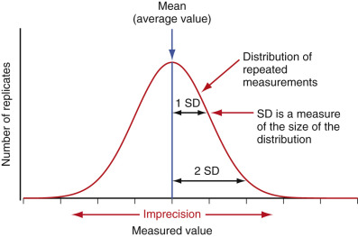

Figure 10-1 

Illustration of results distribution showing the mean value and expected imprecision for repeated measurements of a quality control sample. 

_SD,_ Standard deviation. 

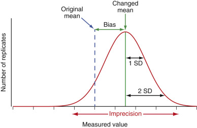

Figure 10-2 

Illustration of systematic bias when a change in calibration has occurred. 

_SD,_ Standard deviation. 

[ Figure 10-2 ](<#f0015>) illustrates that if the calibration changes for any reason, a systematic bias is introduced into the results. The systematic bias is the difference between the observed mean and the expected value for a QC material. Note that the imprecision of an incorrectly calibrated method is the same as when correctly calibrated. All methods have an inherent imprecision. The primary purpose of measuring QC samples is to statistically evaluate the measurement process to verify that the method continues to perform within the specifications consistent with acceptable systematic bias and imprecision or to identify that a change in performance occurred that needs to be corrected. QC result acceptance criteria, discussed in a later section, are based on the probability for an individual QC result to be different from the variability in results expected when the method is performing correctly. 

The term _accuracy_ is used for an individual result and is the combination of systematic bias and imprecision that occurred for that specific measurement. An individual QC sample result can evaluate the combined errors caused by systematic bias in calibration and imprecision of the measurement procedure. The result for an individual patient sample can also be influenced by interfering substances that may be present in that sample. Total error for a patient sample measurement is the sum of systematic bias, imprecision, and sample specific bias caused by any interfering substances that may be present. Statistical QC does not evaluate possible interfering substances that may affect results from patient samples. However, the imprecision observed in QC results provides a measure of the variability expected for individual patient results caused by the inherent imprecision of the method. 

The term _trueness_ is used to refer to an average systematic bias that may be present in a given method. Trueness is an attribute of a method that reflects how correctly the calibration of that method is traceable to a reference system and is discussed further in the next section. 

,  

##  Calibration Considerations in Quality Control 

Calibration of the analytic measurement procedure is a key component in achieving quality results. Part 1 of [ Figure 10-3 ](<#f0020>) shows calibration of a method, which establishes the relationship between the signal measured and the quantitative value of analyte in the calibrator materials. This relationship is used to convert the measurement signal from a patient sample into a reportable concentration for the analyte. Specific techniques for calibration are unique to individual methods and will not be covered here. However, some general principles for implementing calibration procedures can contribute to the stability and clinical reliability of laboratory results. 

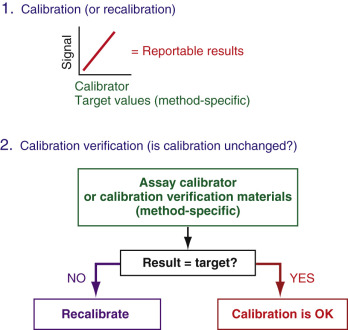

Figure 10-3 

Calibration (1), and calibration verification (2) using method-specific calibrators (or other method-specific calibration verification materials). 

 

##  Calibration and Verification of Calibration 

Method calibration is most often performed by the laboratory using calibrator materials provided by the method or instrument manufacturer. In some cases (e.g., point-of-care devices), methods are calibrated during the manufacturing process, and the laboratory performs a verification of that calibration. In either situation, traceability of result accuracy to the highest-order reference system is provided by the method manufacturer. The method manufacturer's calibrator material(s) and assigned target value(s) are designed to produce accurate results with clinical patient samples assayed using that particular manufacturer's routine method. One manufacturer's product calibrator is not intended for use with other methods, and laboratories should not use calibrator materials intended for one method with any other method. Use of a calibrator with a method for which it was not specifically intended can produce miscalibration and erroneous patient results (see next section). 

In principle, a measurement procedure should be calibrated only when evidence indicates that the current calibration is no longer valid. A recalibration event may introduce a small change in the relationship between analytic system response and sample concentration that contributes to overall long-term variability in method performance. Evidence that a recalibration is needed could come from QC sample results that demonstrate a shift or trend in bias over a time period. However, QC results have random variability that may make identification of a trend in bias difficult to detect. Consequently, it is common practice to recalibrate methods on a time schedule that is established based on experience with the sources of drift that are important for a given technology. In vitro device (IVD) manufacturers frequently specify calibration intervals. 

The U.S. Clinical Laboratory Improvement Act (CLIA) regulations, section 493.1255, require calibration or calibration verification at least every 6 months, or more frequently if recommended by the method manufacturer (  Department of Health and Human Services, 2003  ). When no change in method performance parameters has occurred, it is acceptable to verify that the current calibration has not changed (calibration verification), rather than perform a recalibration. 

Part 2 in [ Figure 10-3 ](<#f0020>) shows that a method's current calibration can be verified not to have changed rather than performing a recalibration. One common procedure to verify calibration is to assay the method calibrator materials as “unknowns.” Recovery of target values for the calibrators indicates that the measurement system calibration has not changed (i.e., the current calibration is verified to be correct), and there is no reason to perform a recalibration to reestablish the same relationship between measurement signal and calibrator concentration that is already in use. The laboratory must establish criteria for agreement with the calibrator target value for calibration verification. Conservative criteria for agreement, such as ±1 SD from the target value, should be considered to avoid misinterpretation of calibration status. 

 

##  Calibration Traceability to a Reference System and Commutability Considerations 

Whenever possible, calibration of routine methods should be traceable to a higher-order reference measurement procedure or international reference material (  ISO, 2003  ;  Vesper & Thienpont, 2009  ;  Miller et al, 2014  ). For commercially available methods cleared by the U.S. Food and Drug Administration (FDA), the IVD manufacturer provides product calibrators that provide calibration traceable to the applicable reference system for an analyte (or measurand when fully specified to include sample type and molecular substance measured). 

It is important to recognize that IVD manufacturer-provided calibrators typically have matrix characteristics and target values that are intended only for use with that specific method and cannot be used with any other manufacturer's methods. An IVD manufacturer can assign a target value to a method-specific calibrator that corrects for any matrix-related bias that may be present so results for clinical samples are correctly traceable to the reference system for an analyte. However, if such a method-specific calibrator is used with a different method, it will cause miscalibration, because it does not compensate for a different matrix-related bias with that different method (i.e., the calibrator is not commutable with clinical samples when used with a different method; see later). 

A clinical laboratory may wish to verify that a method's calibration conforms to a method manufacturer's claim for traceability to the reference system used for a given analyte. Some method manufacturers provide calibration verification materials specifically intended for this purpose. Such materials may be provided as method-specific QC materials. As for method-specific calibrators, such method manufacturer–provided QC materials typically have matrix characteristics and target values that are intended only for use with the specific methods claimed in the instructions for use and cannot be used with any other manufacturers' methods. Such method-specific calibration verification materials may have target values that are specific for stated reagent lots or may have values certified by the manufacturer to be suitable for all reagent lots. 

National and international reference materials are available for some analytes. In most cases, these reference materials are intended for use with higher-order reference measurement procedures and may not be suitable for use with routine clinical laboratory methods. Laboratories should not use national or international reference materials to calibrate a routine method (or to verify calibration of a routine method) unless the reference material's commutability with patient samples has been verified for the specific routine method used by a laboratory. A commutable reference material has a numeric relationship between two or more methods that closely agrees with the relationship observed for a panel of clinical patient samples (  CLSI, 2010  ;  Miller & Myers, 2013  ;  Miller et al, 2014  ). Consequently, a commutable reference material (or calibrator) reacts in a measurement procedure to give a numeric result that would be in close agreement to that observed for a patient sample with the same amount of analyte. Differences in matrix-related bias between a reference material (or calibrator) and clinical patient samples cause a noncommutable relationship between the reference material (or calibrator) and the patient samples. Note that noncommutability is an important limitation of QC and PT materials discussed in later sections. 

A reference material's certificate of analysis should be reviewed for commutability documentation. If a reference material is commutable with patient samples for a given method, it can be used for calibration or verification of calibration traceability to the reference system. Use of a noncommutable reference material for calibration will cause the routine method to be miscalibrated and produce erroneous patient results (  Franzini & Ceriotti, 1998  ;  Vesper et al, 2007  ;  Miller & Myers, 2013  ;  Miller et al, 2014  ). Similarly, use of a noncommutable reference material for calibration verification will give incorrect information regarding the calibration status of a method. Many higher-order reference materials have not been evaluated for commutability with patient samples measured using clinical laboratory methods. If a reference material's commutability status is unknown, it must be assumed not to be commutable with patient samples. 

Third-party QC materials (i.e., those provided by a manufacturer other than the routine method's manufacturer) are not suitable to verify calibration traceability. These materials are not validated for commutability with clinical samples for different routine methods, and they do not have target values that are traceable to higher-order reference measurement procedures. Such QC materials are designed to be used as QC samples for statistical process control, with target values and SD values assigned as described later in the Implementing Quality Control Procedures section. When third-party QC materials are used in an interlaboratory method comparison program with method-specific peer group mean values, these values can be used to confirm that a laboratory is using a specific method in conformance with other users of the same method (see [ Proficiency Testing ](<#s0130>) section, later). 

,  

##  Overview of Quality Control Procedures 

Statistical QC is a component of a quality management system as shown in [ Figure 10-4 ](<#f0025>) . Statistical QC evaluates a measurement procedure by periodically assaying a QC sample for which the expected result is known in advance. If the QC result is within acceptable limits of the known value, the measurement procedure is verified to be stable, which means it is performing as expected, and results for patient samples can be reported with good probability that they are suitable for clinical use. If a QC result is not within acceptable limits, the measurement procedure is not performing correctly, results for patient samples are not reported, and corrective action is necessary. Following corrective action, the patient sample measurements are repeated along with QC samples. Good laboratory practice requires verification that a method is performing correctly at the time patient results are measured. 

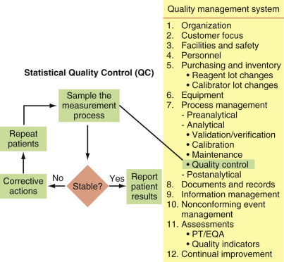

Figure 10-4 

Overview of statistical quality control and its integration into a quality management system. 

_EQA,_ External quality assessment; _PT,_ proficiency testing. 

Statistical QC is part of the process management component of the quality system that integrates good laboratory practices to ensure correct patient results. Written standard operating procedures (SOPs) are required for all aspects of laboratory operation, including statistical quality control. The SOP for QC should include all aspects of the program, including the selection of QC materials, how to determine statistical parameters to describe method performance, criteria for acceptability of QC results, how frequently to measure the QC materials, corrective action when problems are identified, and documentation and review processes. The SOP should include who is authorized to establish acceptable control limits and interpretive rules for release of results; who should review performance parameters, including statistical quality control results; and who can authorize exceptions to or modify an established QC policy or procedure. 

[ Figure 10-5 ](<#f0030>) shows a Levey-Jennings (  Levey, 1950  ), also called Shewhart (  Shewhart, 1931  ), plot, which is the most common presentation for evaluating QC results. This format shows each QC result sequentially over time and allows a quick visual assessment of method performance, including trend detection. Assuming the method is performing in a stable condition consistent with its specifications, the mean value represents the target (or expected) value for the result, and the SD lines represent the expected imprecision for the method. Assuming a Gaussian (normal) distribution of imprecision, the results are distributed uniformly around the mean, with results observed more frequently closer to the mean than near the extremes of the distribution. Note that a few results are greater than 2 SD, and two results slightly exceed 3 SD, which is expected on the basis of a Gaussian distribution of imprecision. For a large number of repeated measurements, the number of results expected within the SD intervals is as follows: 

  * •

±1 SD = 68.3% of observations 

  * •

±2 SD = 95.4% of observations 

  * •

±3 SD = 99.7% of observations 

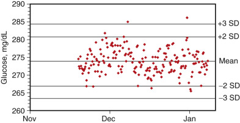

Figure 10-5 

Levey-Jennings plot of quality control (QC) results (N = 199) for a single lot of QC material used for a 49-day period. 

_SD,_ Standard deviation. 

Interpretation of an individual QC result is based on its probability to be part of the expected distribution of results for the method when the method is performing correctly. A later section provides details regarding interpretive rules for evaluation of QC results. Note that evaluation of individual QC results may be performed by computer algorithms. However, the underlying logic of such algorithms is illustrated by the Levey-Jennings chart example. 

,  

##  Implementing Quality Control Procedures 

 

##  Selection of Quality Control Materials 

Generally, two different concentrations are necessary for adequate statistical QC. For quantitative methods, QC materials should be selected to provide analyte concentrations that monitor the analytic measurement range of the method. In practice, laboratories are frequently limited by concentrations available in commercial QC products. When possible, it is important to confirm that method performance is stable near the limits of its analytic measurement range, because defects may affect these concentrations before others. Many quantitative measurement procedures have a linear response over the analytic measurement range, and it is reasonable to assume that their performance over the range is acceptable if the results near the assay limits are acceptable. In the case of non–linear method response, it may be necessary to use additional controls at intermediate concentrations. Critical concentrations for clinical decisions (e.g., glucose, therapeutic drugs, thyroid-stimulating hormone, prostate-specific antigen, troponin) may also warrant QC monitoring. In the case of analytes that have poor precision at low concentrations, such as troponin or bilirubin, the concentration should be chosen to provide adequate SD for practical evaluation. For procedures with extraction or other pretreatment, controls must be used in the extraction or pretreatment step. 

This chapter is primarily focused on QC procedures for quantitative methods. However, the principles can be adapted to most qualitative procedures with allowances for the lack of numeric results. For tests based on qualitative interpretation of quantitative measurements (e.g., drugs of abuse, human chorionic gonadotropin), the same principles of QC assessment can be applied to the numeric results, and the negative and positive controls should be selected to have concentrations relatively near the threshold to adequately control for discrimination between negative and positive. For qualitative procedures with graded responses (e.g., dipstick urinalysis), negative, positive, and graded response controls are required. For qualitative tests based on other properties (e.g., electrophoretic procedures, stain adequacy, immunofluorescence, organism identification), it is necessary to ensure that the QC procedure will appropriately discriminate normal from pathologic conditions. 

The QC materials selected must be manufactured to provide a stable product that can be used for an extended time period, preferably 1 or more years for stable analytes. Use of a single lot for an extended period allows reliable interpretive criteria to be established that will permit efficient identification of an assay problem, avoid false alerts due to poorly defined expected ranges for the QC results, and minimize limitations in interpreting values following reagent and calibrator lot changes. 

 

##  Limitations of Quality Control Materials 

Limitations are inherent in currently available QC materials. One limitation is that the QC material is frequently noncommutable with clinical patient samples. A commutable QC material (or other reference material such as a method calibrator or proficiency testing [PT] material) is one that reacts in a measurement system to give a result that would closely agree with that expected for an authentic patient sample with the same amount of analyte. QC and PT materials are typically noncommutable with clinical patient samples because the serum or other biological fluid matrix is usually altered from that of a patient sample (  Franzini & Ceriotti, 1998  ;  Miller, 2003  ;  Thienpont et al, 2003  ;  Miller et al, 2005  ;  Miller et al, 2008  ;  Miller et al, 2011a  ). The matrix alteration is due to processing of the biological fluid during product manufacturing, use of partially purified human and nonhuman analyte additives to achieve desired concentrations, and various stabilization processes that alter proteins, cells, and other components. The impact of the matrix alteration on the recovery of an analyte in an assay system is not predictable and is frequently different for different lots of QC material, for different lots of reagent within a given analytical method, and for different analytical methods. Because of the noncommutability limitation, special procedures are required (discussed in later sections) when changing lots of reagent or comparing QC results among two or more methods. 

A second limitation of QC materials is deterioration of the analyte during storage. Analyte stability during unopened storage is generally excellent, but slow deterioration eventually limits the shelf life of a product and can introduce a gradual drift into monitoring data. Analyte stability after reconstitution, thawing, or vial opening can be an important source of variability in QC results and can vary substantially among analytes in the same vial. User variables to be controlled are the time spent at room temperature and the time spent uncapped with the potential for evaporation. An expiration time after opening is provided by the product manufacturer but may need to be established by a laboratory for each QC material under the conditions of use in that laboratory and may be different for different analytes in the same QC product. For QC materials reconstituted by adding a diluent, vial-to-vial variability can be minimized by standardizing the pipetting procedure (e.g., using the same pipet or filling device [preferably an automated device] and having the same person prepare the controls) whenever practical. 

Another limitation is that analyte concentrations in multiconstituent control materials may not be at levels optimal for all assays. This limitation may be caused by solubility considerations or potential interactions between different constituents, particularly at higher concentrations. It may be necessary to use supplementary QC materials to adequately monitor the analytic measurement range. 

 

##  Frequency to Assay Quality Control Samples 

The frequency to assay QC samples is a function of several parameters: 

  * •

Analytic stability of the measurement procedure 

  * •

Risk of harm to a patient from clinical action being taken before a significant error is detected 

  * •

Number of patient results produced in a period of time when an error condition existed but was not yet detected 

  * •

Events such as recalibration or maintenance that may alter the current performance condition of the measurement system 

  * •

Training and competency of the test operator, particularly for manual or semiautomated methods 

  * •

Risk of failure of the measuring device 

 

##  Analytic Stability of the Measurement Procedure 

The stability of the measurement procedure is a fundamental determinant of how frequently a QC sample needs to be assayed. The more stable the system, the less frequently a statistical QC evaluation needs to be performed. The minimum requirement, consistent with CLIA regulations, section 493.1256 (  Department of Health and Human Services, 2003  ), is to assay controls at least once per 24 hours, or more frequently if specified by the method manufacturer, or if the laboratory determines that more frequent QC assays are necessary for the performance characteristics of a method. Some types of tests have more stringent requirements. For example, CLIA section 493.1267 requires that at least one control be assayed every 8 hours (including both high and low concentrations over a period of 24 hours) for blood gas measurements; in addition, a control must be run with each patient sample unless the instrument automatically calibrates at least every 30 minutes. 

 

##  Risk of Harm to a Patient and Number of Patients Who May Be at Risk 

The risk of clinical action being taken before a significant measurement error is detected is an important consideration for more frequent QC sampling than one based strictly on method stability characteristics or on regulatory minimum requirements. More frequent QC sampling is appropriate to avoid the situation of discovering a methodologic problem many hours after a physician has performed a clinical intervention based on an erroneous result. For example, QC sampling performed on a 24-hour cycle might be performed at 9  am  . If QC results indicate a method problem, the erroneous condition could have started at any time during the previous 24 hours. If the problem had occurred at 3  pm  the previous day, potentially erroneous results would have been reported for 18 hours, likely putting a large number of patients at risk of an inappropriate care decision.  Parvin (2008)  reported an assessment of the frequency of QC testing and the number of potentially incorrect patient results that could be reported before errors of different magnitudes were detected. 

The medical risk of harm to a patient from erroneous results must be considered and the frequency of QC testing established to minimize risk. From a practical perspective, the cost of a medical error, or simply the cost of repeating questionable patient samples since the last acceptable QC results, could be more expensive than a more frequent QC sampling schedule that would detect an error condition in a more timely manner. 

CLSI has published a guideline EP23 addressing risk-based QC procedures (  CLSI, 2011a  ). The document provides guidance to clinical laboratories on how to develop a QC plan based on evaluation of risk of harm to a patient and assessment of the effectiveness of risk mitigation procedures using information from the manufacturer and from other sources, combined with the clinical requirements of the local health care setting and conditions in the laboratory. 

In general terms, the laboratory director is responsible for ensuring that a result has a high probability to be correct at the time it is reported for clinical use. To make this judgment, the laboratory director needs to understand the risks that can cause a measurement technology to perform incorrectly, needs to evaluate the effectiveness of built-in control processes to mitigate those risks, and needs to ensure that adequate control procedures are in place to confirm that a result is correct at the time it is reported. A combination of built-in and external monitoring procedures using surrogate QC samples can be utilized to ensure that all risks have been appropriately mitigated and/or monitored at a frequency commensurate with the risk of malfunction and the risk of harm to a patient if an incorrect result was reported. 

 

##  Individualized Quality Control Plan 

The option for Equivalent Quality Control (EQC) was introduced in the CLIA quality control requirements Survey Procedures and Interpretive Guidelines for Laboratories and Laboratory Services (  Appendix C, 2003  ). Equivalent Quality Control was intended to justify less frequent QC for measurement systems that utilized built-in control procedures to monitor various aspects of the measurement process. Unfortunately, there was no scientific evidence to support the validity of the arbitrarily defined EQC options, and the EQC option will not be allowed after January 1, 2016. The Centers for Medicare and Medicaid Services introduced a new option called an Individualized Quality Control Plan (IQCP) in 2014 (  Department of Health and Human Services, 2013  ). The IQCP is an alternate QC option allowed by the CLIA 88 quality control policy in 42CFR493.1250. After January 1, 2016, the QC requirements as written in the 2003 CLIA quality control requirements (  Department of Health and Human Services, 2003  ) or the IQCP option will be allowed in U.S. laboratories. Note that no change in QC practices is required, and it is voluntary if a laboratory implements an IQCP. 

The IQCP option was derived from the CLSI guideline EP23 that introduced a risk-based process for developing a quality control plan in 2011 (  CLSI, 2011a  ). The IQCP option is applicable to any measurement procedure but is primarily intended for measurement systems that have been designed with sophisticated built-in control procedures to mitigate the risk that an erroneous result may be produced. Built-in control procedures may include QC materials integrated with reagent packaging and sensors that monitor electronic components and the measurement process with algorithms that prevent a result from being produced if any monitored conditions fail to meet criteria. Some of these measurement systems may be sufficiently stable and self-monitored to justify reduced frequency of traditional surrogate QC sample testing. The approach to risk assessment is qualitative in the CMS IQCP and in the CLSI EP23 guideline. This chapter includes risk assessment in developing a QC plan, particularly for the frequency to perform QC and the criteria to accept a QC value to confirm acceptable method performance. However, this chapter does not specifically address all components of the IQCP or EP23 recommendations. 

 

##  Event-Based Quality Control Sample Assay 

It is necessary to assay QC samples before scheduled events that may alter the current performance condition such as recalibration or maintenance. Each of these operations is intended to restore the measurement conditions to optimal specifications and to correct for any calibration drift or component deterioration that may have occurred. It is necessary to assay QC samples before these operations to verify that no significant errors in results have occurred since the last time QC samples were assayed and before recalibration or maintenance alters the condition of the measurement system. It is also necessary to assay QC samples after these events to verify correct method performance before restarting to assay patient samples. 

 

##  Establishing Quality Control Target Value and Standard Deviation That Represent a Stable Measurement Operating Condition 

QC target values and acceptable performance limits are established to optimize the probability to detect a measurement defect that is large enough to have an impact on clinical care, while minimizing the frequency of “false alerts” due to statistical limitations of the criteria used to evaluate QC results. The measurement system must be correctly calibrated and operating within acceptable performance specifications before the statistical parameters to establish QC interpretive rules can be established. Some sources of measurement variability that are expected to occur during typical operation of a measurement procedure are listed in [ Table 10-1 ](<#t0010>) . Measurement variability includes sources with short time interval frequencies, many of which can be described by Gaussian error distributions, and intermittent and longer time interval sources, which can cause cyclic fluctuations over several days or weeks, gradual drift over weeks or months, and more abrupt small shifts in results. The SD used in QC interpretive rules needs to adequately account for all sources of variability in results that are consistent with the measurement system performing to specifications. 

TABLE 10-1 

Common Sources of Measurement Variability 

Source  |  Time Interval for Fluctuation  |  Likely Statistical Distribution   
---|---|---  
Pipette volume  |  Short  |  Gaussian   
Pipette seal deterioration  |  Long  |  Drift   
Instrument temperature control  |  Short or long  |  Gaussian or other   
Electronic noise in the measuring system  |  Short  |  Gaussian   
Calibration cycles  |  Short to long  |  Gaussian or periodic shift   
Reagent deterioration in storage  |  Long  |  Drift   
Reagent deterioration after opening  |  Intermediate  |  Cyclic, periodic drift/shift   
Calibrator deterioration in storage  |  Long  |  Drift   
Calibrator deterioration after opening  |  Intermediate  |  Cyclic, periodic drift/shift   
Control material deterioration in storage  |  Long  |  Drift   
Control material deterioration after opening  |  Intermediate  |  Cyclic, periodic drift/shift   
Environmental temperature and humidity  |  Variable  |  Variable   
Reagent lot changes  |  Long  |  Periodic shift   
Calibrator lot changes  |  Long  |  Periodic shift   
Instrument maintenance  |  Variable  |  Cyclic or periodic shift   
Deterioration of instrument components  |  Variable  |  Drift, cyclic or periodic shift   
  
A QC material must have a reliable target value that represents the condition when systematic bias is as small as possible. This condition requires the method to be calibrated correctly and adequate replicate measurements to be obtained over a sufficient time interval to include the typical sources of measurement variability that will ensure that a representative mean value is calculated from the data. For practical reasons, this objective is rarely met for the longer-term variability components in [ Table 10-1 ](<#t0010>) ; consequently, the target value has some uncertainty and may need to be refined if measurement conditions fluctuate but remain within performance specifications. The generally accepted minimum protocol for target value assignment is to use the mean value from assaying a QC material a minimum of 10 times, on 10 different days (  CLSI, 2015a  ). If a 10-day protocol is not possible—for example, if an emergency replacement of a lot of QC material is necessary—a provisional target value can be established with fewer data but should be updated when additional replicate results are available. When applicable, more than one calibration should be represented in the 10-day period to include this source of variability in the target value. If a QC material will be used for longer than 1 day, a single vial should be stored correctly and assayed on as many days as the material is planned to be used to allow any variability caused by deterioration of the analyte to be averaged into the target value. 

Some QC materials are provided by the method manufacturer with preassigned target values and ranges intended to confirm that the method meets the manufacturer's specifications. Such assigned values may be used initially by the laboratory. It is recommended that both the target value and the SD should be reevaluated and adjusted by the laboratory after adequate replicate results have been obtained because the QC interpretive rules used in a single laboratory should reflect performance for the method in that laboratory. The acceptability limits (product insert ranges) suggested by a manufacturer typically are based on data collected from several laboratories. These acceptability limits will inevitably account for sources of variability, such as between instruments, between reagent lots, and between calibrator lots, that will be greater than the variability expected for a method used in an individual laboratory. Use of product insert ranges that are too large will reduce a laboratory's ability to detect an erroneous measurement condition. 

QC materials with assigned target values are also available from third-party manufacturers (i.e., manufacturers not affiliated with the method manufacturer). Caution should be used with target values assigned by third-party QC material providers because the target values may have been assigned using reagent and calibrator lots that are no longer available (see the section on [ Verifying Quality Control Evaluation Parameters Following a Reagent Lot Change ](<#s0100>) ). On the other hand, reliable peer group target values may be obtained from an interlaboratory comparison program with large numbers of laboratories using the same method. 

In addition to a target value, an SD is estimated for a QC material that represents the typical imprecision of the method when it is performing according to its design specifications. Considering the sources of measurement variability in [ Table 10-1 ](<#t0010>) , a minimum of 20 observations is recommended for the initial SD estimate (  CLSI, 2015a  ). It is desirable to have as many of the events that contribute to measurement variability, in particular calibration and maintenance, included during the time interval over which the SD is estimated. The initial estimate of SD will likely not include contributions from all expected sources of variability and will need to be updated when additional data are available. CLSI document EP05 provides guidance on establishing the SD for a measurement procedure but does not include longer term components of variability (  CLSI, 2014b  ). 

It is recommended to determine the SD for stable measurement performance from the cumulative SD over a 6- to 12-month period for a single lot of QC material. This approach is likely to include most expected sources of variation. (See an important limitation when determining a cumulative SD, described later in the section [ Verifying Quality Control Evaluation Parameters Following a Reagent Lot Change ](<#s0100>) ). [ Figure 10-6 ](<#f0035>) illustrates (with actual data for a glucose method) the fluctuation in SD that occurs when calculated for monthly intervals compared with the relatively stable value observed for the cumulative SD after a period of 6 months. Note that the cumulative SD is not the average of the monthly values but is the SD determined from all individual results obtained over a time interval since the lot of QC material was first used. Different sources of long-term variability occur at different times during the use of a method. The monthly SD does not adequately reflect the longer-term components of variability. Consequently, the cumulative SD will typically be larger than the monthly values and will better represent the actual variability of the method. If the imprecision expected during normal stable operation is underestimated, the acceptable range for QC results will be too small, and the false alert rate will be unacceptably high. If imprecision for the stable condition is overestimated, the acceptable range will be too large, and a significant measurement error might go undetected. 

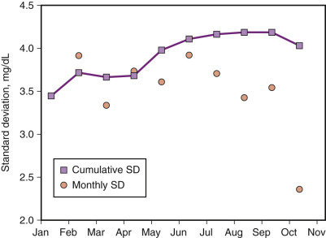

Figure 10-6 

Cumulative standard deviation (SD) versus single monthly values calculated from the data in [ **Figure 10-9** ](<#f0050>) . 

SD is the conventional way to express method variability and assumes the QC data can be described by a Gaussian (normal) distribution even though non-Gaussian components of variability influence the QC results. The statistical QC packages in instrument and laboratory computer systems are designed with the assumption that the SD for a Gaussian distribution is used for the QC rules criteria. Because there are non-Gaussian components to measurement variability over time, it is very important that they be represented in the data used to estimate an SD. We use an estimate of SD to make conclusions regarding the acceptability of an individual QC value so the SD must be as realistic as possible to represent the variability expected for a method when its performance meets its specifications. 

It is important to include all valid QC results in the calculation of SD to ensure that the SD correctly represents expected method variability. A valid QC result is one that was, or would have been in the case of preliminary value assignment, used to verify acceptable assay performance and reporting of patient results. Only QC results that were, or would have been, responsible for not releasing patient results should be excluded from summary calculations. If inappropriate editing of QC results occurs, the method SD may be inappropriately small, which will produce inappropriately small evaluation limits and an increase in false QC alerts, with concomitant reduction in the effectiveness of statistical QC evaluation. 

When a method has been established in a laboratory, and a new lot of QC material is being introduced, the target value for the new lot of QC material is used along with the well-established SD from the previous lot. This practice is appropriate because in most cases measurement imprecision is a property of the method and equipment used and is unlikely to change with a different lot of QC material. If target values for the old and new lots are substantially different, a different SD may occur, and adjustment to the SD may be necessary as additional experience with the new lot is accumulated. 

If a new method is introduced for which no historical performance information is available, the SD for stable performance must be established using data available from the method validation and target value assignment of the QC materials. In this case, the initial SD is likely to be too small, and evaluation criteria will need to be monitored closely and adjustments made as additional experience allows measurement imprecision from all sources to be reflected in the cumulative SD. 

 

##  Performance of a Measurement Procedure for Its Intended Medical Use 

It is important to understand how a test's performance impacts clinical decision making in order to determine the optimal QC frequency and criteria used to assess acceptability. The sigma metric is commonly used to assess how well a method performs relative to the medical requirement. Sigma is the Greek letter used to denote standard deviation. The sigma scale compares the variability in a measurement process in standard deviations to the variability that is acceptable because it will not cause an error in diagnosis or treatment of a patient. 

For laboratory measurements, the sigma metric is calculated as: 

 (  TE  a  − |  bias  |  )  /  SD 

where TE  a  is the total error allowed based on medical interpretation requirements, and the absolute value of bias and SD refer to performance characteristics of the laboratory method. The SD is estimated from the QC data as previously described. It is critically important that the SD estimate uses QC data that represent all or most components of variability that occur over an extended time period. It is difficult for a laboratory to estimate true bias because it requires comparison with a reference method that is not usually a feasible approach. In practice, QC results are used to determine if a change in bias has occurred compared to the condition established by calibration of a method. Consequently, the bias is usually assumed to be zero for calculating sigma. 

TE  a  can be estimated in several ways. The preferred way to set the TE  a  is from laboratory practice guidelines. For example, the National Cholesterol Education Program recommends that total cholesterol be measured with a TE  a  of 9% or less (  National Institutes of Health, 1990  ), and the National Kidney Disease Education Program recommends that creatinine be measured with a TE  a  of less than approximately 0.10 mg/dL in the concentration range 1 to 1.5 mg/dL (  Myers et al, 2006  ). When practice guidelines are not available, the recommended way to estimate the TE  a  is to consult clinicians to determine the magnitude of change in a laboratory result that will prompt a patient care decision. Another approach is to base the TE  a  on a fraction of the within and between individual biologic variations for an analyte (  Fraser, 2001  ;  Lund et al, 2014  ). Tables of optimal, desirable, and minimal TE  a  based on biological variation are available (  Perich et al, 2014  ). However, biological variation–based estimates of TE  a  should be used with caution because the estimates of biological variation in many cases are based on minimal data, and the experimental designs of the estimates and the process to select the listed estimates have been challenged (  Roraas et al, 2012  ;  Aarsand et al, 2014  ). For example, reports of biological variation for AST, ALT, and GGT varied between 11% and 58%, 3% and 32%, and 4% and 14%, respectively, among different studies (  Carobene et al, 2013  ). In addition, the biological variability has typically been derived from data for nondiseased individuals and may be different for pathological conditions. 

Because sigma assumes a Gaussian or normal distribution for repeated measurements, the probability of a defect—that is, an erroneous laboratory result—can be predicted as shown in [ Table 10-2 ](<#t0015>) . The sigma metric represents the probability that a given number of erroneous results—which could cause risk of harm to a patient—are expected to occur when the test method is performing to its specifications. The phrase “six sigma” refers to a condition when the variability in the measurement process is sufficiently smaller than the medical requirement that erroneous results are very uncommon. A “four sigma” method would be less robust and have a higher probability that erroneous results could be produced but still at a fairly low frequency. A “two sigma” method would produce enough erroneous results even though it met its performance specifications that it would not be very reliable for patient care. 

TABLE 10-2 

Probability of Acceptable or Erroneous Results Based on the Sigma Scale 

Sigma Value  |  Percent of Results within Specification  |  Percent of Results with an Error (Defect)  |  Errors (Defects) Per Million Opportunities   
---|---|---|---  
1  |  68  |  32  |  317,311   
2  |  95.5  |  4.5  |  45,500   
3  |  99.7  |  0.3  |  2,700   
4  |  99.994  |  0.006  |  63   
5  |  99.99994  |  0.00006  |  0.6   
6  |  99.9999998  |  0.0000002  |  0.002   
  
[ Figure 10-7 ](<#f0040>) shows how the sigma metric describes the performance of a laboratory test. Part A shows the performance of a “six sigma” test that has the TE  a  limits six SD away from the center point of the expected distribution of variability in measurements when the test procedure is performing to its analytic specifications. In the “six sigma” situation, some bias or increased imprecision will have little influence on the number of erroneous results produced, and less stringent QC will be appropriate because the risk of producing an erroneous result even with some loss of performance is very low. Part B shows the performance of a “three sigma” test that has the TE  a  limits three SD away from the center point of the expected distribution of variability in measurements when the test procedure is performing to its analytic specifications. In the “three sigma” situation, a small amount of bias or increased imprecision will cause the number of erroneous results to increase substantially, and more stringent QC is needed to identify when such an error condition occurs. Note that no amount of QC will improve the performance of a marginal measurement procedure. However, more frequent QC and more stringent acceptance criteria will allow the laboratory to identify when small changes in performance occur so they can be corrected to minimize the risk of harm to a patient from erroneous results being acted on to make clinical care decisions. 

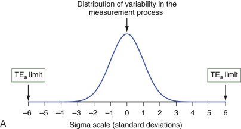

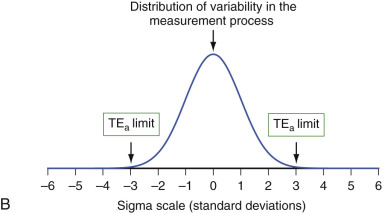

Figure 10-7 

Test performance relative to the sigma scale to describe how well performance meets medical requirements. 

Part **A** shows a “six sigma” method, and part **B** shows a “three sigma” method. Note that the measurement SD is the same in both cases, but the fraction of the TEa consumed by the SD is different. _TE a  , _ Allowable total error. 

 

##  Establishing Rules to Evaluate Quality Control Results 

The acceptable range and rules for interpreting QC results are based on the probability of detecting a significant analytic error condition with an acceptably small false alert rate. The desired process control performance characteristics must be established for each analyte before the appropriate QC rules can be selected. 

The conventional way to express QC interpretive rules is by using an abbreviation nomenclature popularized among clinical laboratories by  Westgard and colleagues (1981)  and summarized in [ Table 10-3 ](<#t0020>) . Note that fractional standard deviation intervals are permissible, as in the 2  2.5S  example. Statistical procedures such as cumulative sum (CUSUM) or exponentially weighted moving averages (EWMA) are preferred to monitor for bias trends (  Ryan, 1989  ). It is recommended to use one of these more advanced trend detection procedures if supported by an available computer system because they are more powerful than the 8  1S  , or similar approaches based on sequential observations exceeding a specified bias from the target value. EWMA and CUSUM must be carefully implemented to avoid being too sensitive to small changes that may cause an excessive frequency of false alerts. 

TABLE 10-3 

Abbreviation Nomenclature for Quality Control Evaluation Rules 

Rule  |  Meaning  |  Detects   
---|---|---  
1  2S  |  One observation exceeds 2 SD from the target value. The 1  2S  rule is not recommended because it has an excessive false alert rate.  |  Not recommended except for "low sigma" methods   
1  3S  |  One observation exceeds 3 SD from the target value.  |  Imprecision or systematic bias   
2  2S  (2  2.5S  )  |  Two sequential observations, or observations for two QC samples in the same run, exceed 2 SD (or 2.5 SD) from the target value in the same direction.  |  Bias   
R  4S  |  Range between observations for two QC samples in the same run, or for two sequential observations of the same QC sample, exceeds 4 SD.  |  Imprecision   
10  x  or 10  m  |  Ten sequential observations for the same QC sample are on the same side of the target value (x or mean). The 10  x  rule is not recommended because it has an excessive false alert rate.  |  Not recommended   
8  1S  (8  1.5S  )  |  Eight sequential observations for the same QC sample exceed 1 SD (or 1.5 SD) in the same direction from the target value.  |  Bias trend   
CUSUM  |  Cumulative sum of SDI for a specified number of previous results.  |  Bias trend   
EWMA  |  Exponentially weighted moving average with newer results having more influence (weight).  |  Bias trend   
  
_CUSUM_ , Cumulative sum; _EWMA_ , exponentially weighted moving averages; _QC_ , quality control; _SD_ , standard deviation; _SDI_ , standard deviation interval. 

Power function graphs have been used to express the probability that a QC interpretive rule will detect an analytic error of a given magnitude (  Westgard & Groth, 1979  ). Westgard's statistical model assumed Gaussian (normal) error distributions and, despite the fact that non-Gaussian error distributions exist in measurement systems, has provided useful guidance for selecting rules to interpret QC results. Other literature reports have addressed rule selection criteria using other statistical models and assumptions regarding distribution of errors (  Linnet, 1989  ;  Parvin, 1997  ;  Parvin and Gronowski, 1997  ). 

[ Figure 10-8 ](<#f0045>) shows a power function graph that plots the probability to detect a measurement error ( _y_ -axis), which is the probability that a result will exceed a particular interpretive rule, versus a systematic bias of known magnitude in a result ( _x_ -axis) with a fixed random imprecision of 1 SD when there are two QC samples being measured along with the group of patient samples. The three lines in [ Figure 10-8 ](<#f0045>) represent the probabilities of different interpretive rules to detect systematic biases of various magnitudes. For example, for the 1  2S  rule, a result with a systematic bias of 1 SD ( _x_ -axis) has a 0.35 (35%) probability ( _y_ -axis) of violating the rule (i.e., of having a result more than 2 SD from the target value). Note that this figure shows only systematic bias as SD on the _x_ -axis, and a result with 1 SD systematic bias will also have an imprecision component that may cause the 1  2S  rule to be exceeded. Thus a 1  2S  interpretive rule has a 35% probability to detect a systematic error that is 1 SD in magnitude. Similar graphs can be created for other interpretive rules for both systematic bias and imprecision error conditions. 

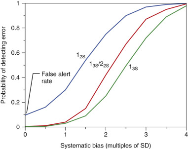

Figure 10-8 

Power function graphs for the ability of different quality control interpretive rules to detect systematic error using two controls. 

Systematic error is expressed as number of standard deviations (SDs) from the target value. 

(Adapted from Westgard JO, Groth T: Power functions for statistical control rules, _Clin Chem_ 25:863–9, 1979; used with permission.) 

Note in [ Figure 10-8 ](<#f0045>) that none of these interpretive rules has a 100% probability to detect a systematic bias until the error becomes relatively large. The 1  2S  rule has a good probability of detecting errors (e.g., almost 90% probability of detecting a 2.5 SD bias) but has a high false alert rate, as indicated by the _y_ -intercept (because of imprecision, the probability of indicating an error condition for zero bias is approximately 10%). Because of this high false alert rate, it is generally not recommended to use a 1  2S  rule unless the assay has marginal performance (i.e., is a “low sigma” method) and the laboratory desires to identify small biases that could cause inappropriate risk for a patient care decision. The 1  3S  rule has a low false alert rate but a lower probability to detect an error (e.g., a 50% probability to detect a 2.5 SD bias). It is recommended to improve the efficiency of QC interpretive rules by combining two or more rules and applying them simultaneously as multirule criteria. For example, the 1  3S  /2  2S  multirule identifies an error condition if one control exceeds ±3 SD from the target value, or if two controls exceed ±2 SD in the same direction from the target value. The 1  3S  /2  2S  multirule has a low false alert rate similar to the 1  3S  rule but improved probability to detect an error (e.g., a 65% probability to detect a 2.5 SD bias and a 90% probability to detect a 3.2 SD bias). In this multirule example, the 1  3S  component is sensitive to imprecision or large systematic bias, while the 2  2S  component is sensitive to systematic bias. 

A challenge in selecting interpretive rules for evaluating QC results is that the different sources of variation listed in [ Table 10-1 ](<#t0010>) occur in most contemporary automated assay systems but at various frequencies that cause longer-term cyclic and step fluctuations in performance to occur at different times in the course of using an assay system. These types of variability are not adequately described by Gaussian models for rules selection. At certain periods of time, the short-term SD will be noticeably smaller than the long-term cumulative value (see [ Fig. 10-6 ](<#f0035>) ). One must avoid concluding that the SD used for evaluation is too large because over time the cumulative value will be more consistent with method performance as periodic sources of variability are encountered. 

[ Figure 10-9 ](<#f0050>) shows how non-Gaussian error sources influenced results for a single lot of QC material used over a 10-month period for an automated glucose method. The glucose method stability and performance over the 10 months were considered acceptable for clinical use. Data for the first 49 days are the same as in [ Figure 10-5 ](<#f0030>) and represent the initial experience with this lot of QC material. Examination of these data shows several fluctuations that cannot be described by a Gaussian statistical model. The first reagent lot change caused a step shift to higher values that was too small to initiate a change in target value (see later section on [ Verifying Quality Control Evaluation Parameters Following a Reagent Lot Change ](<#s0100>) ). The second reagent lot change had no effect on QC results. Between March and April, a transition to lower values occurred that did not correspond to any maintenance, reagent lot change, or calibration events. Throughout the 10-month period, intervals of several weeks' duration occurred when the imprecision was better or worse than at other time periods (also see [ Fig. 10-6 ](<#f0035>) calculated from the same data). 

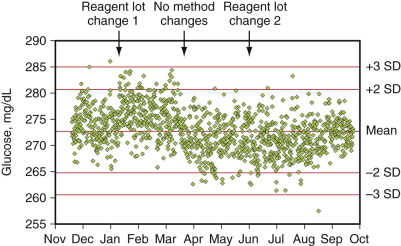

Figure 10-9 

Levey-Jennings plot of quality control (QC) results (N = 1232) for a single lot of QC material used over a 10-month period. 

_SD,_ Standard deviation. 

(Reprinted with permission from Miller WG, Nichols JH: Quality control. In Clarke WA, editor: _Contemporary practice in clinical chemistry_ , ed 2, Washington DC, 2010, AACC Press.) 

In practice, empirical judgment is frequently used to establish acceptance criteria (rules) to evaluate QC results based on data acquired over a long enough time to adequately quantify the expected variability when a method is working correctly. It is recommended not to select QC rules based only on Gaussian models of imprecision because the rules will not correctly accommodate all the types of variability observed for many analytic systems. 

[ Table 10-4 ](<#t0025>) gives an example of an empirically developed multirule based on the data in [ Figure 10-9 ](<#f0050>) . This multirule had 0.6% false alerts when applied to the data in [ Figure 10-9 ](<#f0050>) , using the mean from the November to January (see [ Fig. 10-4 ](<#f0025>) ) period as the target value and the SD for the 10-month period to represent overall imprecision. If a 2  2S  rule was used instead of a 2  2.5S  rule, the false alert rate would increase to 1.2%, but the rule would detect slightly smaller biases. An 8  1.5S  rule was used to provide detection of bias trends because it had a 0% false alert rate (compared with 0.5% for an 8  1S  rule) and was adequate to detect a developing trend before it became clinically important because the SD was small, 4.0 mg/dL, at a concentration of 274 mg/dL. If a 10% TE  a  is considered acceptable for glucose at this concentration, then the sigma for this method is 6.8, suggesting that it has a very low error rate and these QC rules with a low false alert rate will be suitable to alert the laboratory to an error condition that might affect patient care decisions. At other clinical concentration ranges, or for other analytes, a2  2S  , 8  1S  , or 6  1.5S  rule may be more appropriate. A 10  x  rule was not used because it would have increased the false alert rate to 11%. A 10  x  rule generally is not recommended because this condition does not infer a problem with clinical interpretation of patient results when the magnitude of the difference from the target value is small. 

TABLE 10-4 

Empirical Multirule for the Quality Control Data in [ Figure 10-9 ](<#f0050>)

Multirule Components  |  Type of Variability Detected   
---|---  
1  3S  |  Imprecision or bias   
2  2.5S  |  Bias   
R  4S  |  Imprecision   
8  1.5S  |  Bias trend   
  
Whatever statistical approach is used, the balance between false alerts and the probability of detecting an error is improved when multiple rules are used in combination. When establishing rules to interpret QC results, it is important to remember that statistical process control can only verify at a point in time that a measurement system is producing results that conform to the expected variability when the system is performing in a stable operating condition. It is important to remember that periodic measurement of QC samples does not identify random events (e.g., a temporary clot in a sample pipette, a random reagent pipette error) that do not persist until the next QC sample is measured. QC rules are chosen to detect changes in calibration and changes in imprecision that are significant enough to require correction before patient results are reported. 

It may be determined in the process of reviewing statistical parameters for QC data that a method's performance is marginal or inadequate to meet medical requirements. Determining the sigma metric is helpful to make this assessment because the sigma value gives a prediction of the number of erroneous results expected. If the method performance cannot be improved and a better method is not available, the laboratory can either discontinue the test if the performance is inadequate or apply more stringent QC practices when the performance is marginal. In addition, the method limitations should be communicated to patient care providers. 

More stringent QC practices include selecting rules that will give an alert at smaller error conditions, using additional rules in a multirule set, assaying QC more frequently, using more than two QC samples, and not releasing patient results until QC assessment is complete for the time interval during which patient samples were measured. For lower sigma methods, the more stringent QC rules will cause more QC alerts, some of which will be false alerts, in order to detect error conditions that could affect interpretation of a patient result. It is important to recognize that more stringent QC will not improve method performance but is intended to identify smaller changes in method performance that could affect patient care decisions based on the results. 

A plan for statistical QC using surrogate samples specifies the number of controls, the concentration levels of the controls, the acceptance rules, and the frequency to test the QC samples. The choice of the parameters will depend on the performance characteristics of the measurement procedure, the number of potentially erroneous patient results that could occur before the next QC event, and the risk of harm to a patient if potentially erroneous results were used in clinical care decisions. The relationship between these components of a QC strategy has been reviewed by  Yundt-Pacheco and Parvin (2013)  . 

 

##  Corrective Action When a Quality Control Result Indicates a Measurement Problem 

A QC alert occurs when a QC result fails an evaluation rule, which indicates that an analytic problem may exist. A QC alert means there is a high probability that the assay is producing results unreliable for patient care. When this condition occurs, it is necessary to take corrective action to investigate the cause of the QC alert. [ Figure 10-10 ](<#f0055>) presents a generalized troubleshooting sequence. Repeating the QC measurement on the same QC sample is not recommended because, with properly designed control rules, it is more likely that a measurement system problem exists than the QC result was a statistical outlier. However, QC materials can deteriorate after opening caused by improper handling and storage or because of unstable analytes. Thus repeating the measurement on a new sample of the QC material is a useful step to determine if the alert was caused by deteriorated QC material rather than by a method problem. In this situation, if the result for the new QC sample is acceptable, testing of patient samples can resume. If the repeat result is near acceptability limits, it is important to consider that the repeat and original results may be essentially of the same magnitude. In this situation, the probability is fairly high that a measurement problem exists, and this possibility should be investigated. In addition, current and preceding QC results should be examined for a trend in bias that indicates a measurement issue that needs to be corrected. These precautions in evaluating repeat results for a new QC sample can be challenging or impossible for automated evaluation by computer systems, thus requiring the laboratory technologist to be vigilant in reviewing results. 

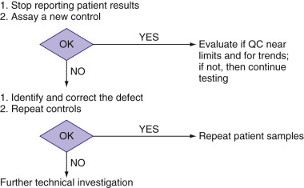

Figure 10-10 

Generalized troubleshooting sequence following an unacceptable quality control result. 

(Reprinted with permission from Miller WG, Nichols JH: Quality control. In Clarke WA, editor: _Contemporary practice in clinical chemistry_ , ed 2, Washington DC, 2010, AACC Press.) 

When repeat testing of a new QC sample does not resolve the alert situation, the instrument and reagents should be inspected for component deterioration, empty reagent containers, mechanical problems, and so on. In many cases, it will be necessary to recalibrate (or verify calibration). When the problem is identified and corrected, QC samples should be assayed to verify the correction, and all patient samples since the time of the last acceptable QC results should be reassayed. The laboratory director must establish acceptable criteria to determine if the repeat results agree adequately to permit reporting of original results without issuing a corrected report. Otherwise, corrected results must be reported. As an example, [ Table 10-5 ](<#t0030>) lists empirical criteria used in the author's laboratory for this purpose. The criteria for acceptability of repeated tests are based on method performance characteristics, population served, and clinical requirements of the medical services. 

TABLE 10-5 

Example for Selected Chemistry Analytes of Empirical Criteria for Patient Test Result Agreement between Repeated Assays and for Agreement among Results for a Single Patient Sample Measured on Multiple Instruments 

Analyte  |  Acceptance Criteria (Difference between Results)   
---|---  
Albumin  |  0.4 g/dL   
ALP  |  10 U/L or 10% [ * ](<#hl0000469>)  
ALT  |  10 U/L or 10% [ * ](<#hl0000469>)  
Amylase  |  15 U/L or 10% [ * ](<#hl0000469>)  
AST  |  10 U/L or 10% [ * ](<#hl0000469>)  
Bilirubin, total  |  0.3 or 10% [ * ](<#hl0000469>)  
Calcium, total  |  0.5 mg/dL   
Chloride  |  4 mmol/L   
Cholesterol  |  5%   
CK  |  10 U/L or 10% [ * ](<#hl0000469>)  
CO  2  |  4 mmol/L   
Creatinine  |  0.2 mg/dL or 10% [ * ](<#hl0000469>)  
GGT  |  10 U/L or 10% [ * ](<#hl0000469>)  
Glucose  |  6 mg/dL or 5% [ * ](<#hl0000469>)  
Iron  |  10 µg/dL or 10% [ * ](<#hl0000469>)  
Lactate  |  0.32 mmol/L   
LD  |  10 U/L or 10% [ * ](<#hl0000469>)  
Lipase  |  10 U/L or 10% [ * ](<#hl0000469>)  
Magnesium  |  0.3 mg/dL   
Phosphorus  |  0.4 mg/dL   
Potassium  |  0.3 mmol/L   
Protein, total  |  0.4 g/dL   
Sodium  |  4 mmol/L   
Triglycerides  |  10%   
Urea nitrogen (BUN)  |  3 mg/dL or 10% [ * ](<#hl0000469>)  
Uric acid  |  0.4 mg/dL   
  
_ALP_ , Alkaline phosphatase; _ALT_ , alanine aminotransferase; _AST_ , aspartate aminotransferase; _BUN_ , blood urea nitrogen; _CK_ , creatine kinase; _CO_ 2  , carbon dioxide; _GGT_ , γ-glutamyl transferase; _LD_ , lactate dehydrogenase. 

 * Whichever is greater. 

In some cases, sample volume may not be adequate (quantity not sufficient [QNS]) for repeat testing. In these situations, no results can be reported unless it is documented that the impact of the method defect on the original results was small enough to have minimal effect on clinical interpretation. A protocol to evaluate the clinical impact of the methodological problem is to repeat those samples that have adequate volume. The repeated samples must represent the concentration range of the QNS samples, must represent the time span since the previous acceptable QC results, and should include a substantial proportion of the total samples originally assayed while the method was in the unacceptable condition. If the repeat results for this sample group are within established criteria for repeat testing of patient samples, the original results for the QNS samples can be reported. Otherwise, the original results for the QNS samples are considered erroneous; no results can be reported, and the original results already reported need to be corrected to a “no result” condition. 

 

##  Reviewing Quality Control Data 

The immediate impact of QC data is to determine if patient results can be reported and used for clinical decision making. In addition, QC data must be reviewed by laboratory management on a regular schedule. Typical review schedules are weekly by senior technologists and/or supervisors and at least monthly by the laboratory director. The weekly review process should determine that correct follow-up of any QC alerts was conducted, that all patient samples that may have had erroneous results were repeated, and that the process was properly documented in QC records. The monthly review should include any issues identified by the weekly review process, as well as examination of the Levey-Jennings chart or other tool to identify trends or changes in assay performance that may need to be addressed. Note that automated systems to assist in the review of QC data are acceptable, and individual Levey-Jennings charts do not need to be examined every month. A report that compares the mean and SD for QC results over a defined time interval, such as 1 month, to the expected values consistent with stable assay performance can be useful to focus the review on assays that may need attention. For example, the report might identify QC statistical values that deviate more than a specified amount, such as a mean over 1 SD from the target value or an SD that exceeds its expected value. QC values that are identified as needing further examination can then be followed up with review of a Levey-Jennings chart or other records of method conditions such as maintenance, calibration, and reagent change. The monthly review should also include consistency of reagent lot changes, calibrator lot changes, and any patient data–based QC procedures described in the following sections. 

The QC review process serves two major functions: It verifies that test procedures are stable and meet performance specifications, and it identifies test procedures that may need intervention to address trends in performance deterioration. In addition, other adjustments can be made, such as QC frequency, QC acceptance criteria, calibration and maintenance frequency, and so on. Quality indicators from the quality management program such as number of QC failures, number of result corrections, or number of patient samples that are repeated due to QC issues can be very helpful in determining if changes may be needed to the QC plan. The QC review is an opportunity to examine any aspect of assay performance that is relevant for a given measurement procedure to provide results that meet the requirements for clinical care decisions. 

,  

##  Verifying Quality Control Evaluation Parameters Following a Reagent Lot Change 

Changing reagent lots can have an unexpected impact on QC results. Careful reagent lot crossover evaluation of QC target values is necessary. Because the matrix-related interaction between a QC material and a reagent can change with a different reagent lot, QC results may not be a reliable indicator of a method's performance for patient samples following a reagent lot change. In a large study of 661 reagent lot changes for 8 QC materials assayed for 82 analytes using 7 different instrument platforms, 41% of 1483 QC material–reagent lot combinations had significant differences in QC values between the reagent lots that were not observed for patient samples (  Miller et al, 2011b  ). In the example in [ Figure 10-11 ](<#f0060>) , QC values for the high concentration control shifted following the change to a new lot of reagents, but there was no change in results for the low control. A comparison of results for a panel of patient samples assayed using the new and old reagent lots, as shown in [ Figure 10-12 ](<#f0065>) , verified that patient results were the same when either lot of reagents was used. Patient results spanned the analytic measurement range and had nearly identical values, as indicated by the slope of 1.00 and the small intercept of −3 mg/dL. Consequently, the change in QC values for the high concentration material was due to a difference in matrix-related bias between the QC material and each of the reagent lots. 

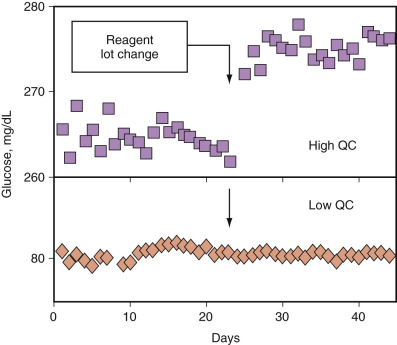

Figure 10-11 

Levey-Jennings plot showing impact of a reagent lot change on matrix bias with quality control (QC) samples. 

(Reprinted with permission from Miller WG, Nichols JH: Quality control. In Clarke WA, editor: _Contemporary practice in clinical chemistry,_ ed 2, Washington DC, 2010, AACC Press.) 

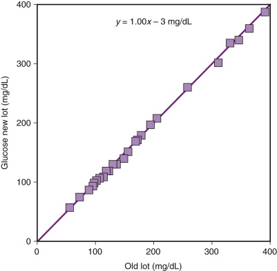

Figure 10-12 

Deming regression analysis of results from a patient sample comparison between the same old and new lots of reagent shown in [ **Figure 10-11** ](<#f0060>) for quality control samples. 

It is necessary to use clinical patient samples to verify the consistency of results between old and new lots of reagents because of the unpredictability of a matrix-related bias being present for QC materials. [ Figure 10-13 ](<#f0070>) presents a procedure to verify or adjust QC material target values following a reagent lot change. A group of patient samples and the QC samples are assayed using both the current (old) and new reagent lots. The first step is to verify that results for a group of patient samples assayed with the new reagent lot are consistent with results from the current (old) lot. The patient sample results, not the QC results, provide the basis for verifying that the new reagent lot is acceptable for use. If a problem is identified, the calibration of the new reagent lot must be investigated and corrected, or the new reagent lot may be defective and should not be used. When evaluating the patient results, keep in mind that the calibration of the old reagent lot may have drifted and should be verified before concluding that the new reagent lot is not giving acceptable results for the patient samples. 

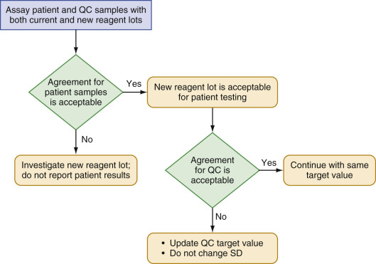

Figure 10-13 

Process for assessment of potential matrix impact on quality control (QC) target values following a reagent lot change. 

_SD,_ Standard deviation. 

The number of patient samples to use for verifying the performance of a new reagent lot will depend on the analytic measurement range, the imprecision of an assay, and the concentrations at which key clinical decisions are made. CLSI document EP26 (  CLSI, 2013  ) recommends a minimum of 3 patient samples and possibly more, depending on the number of key clinical decision concentrations and the imprecision of an assay. This CLSI guideline includes a statistical analysis to determine if a difference in patient results is less than a critical difference that would represent risk for an inappropriate patient care decision based on a particular laboratory test result. An alternate approach is to select 10 or more patient samples that span the analytic measurement range and use Deming regression analysis (  Cornbleet & Gochman, 1979  ;  Linnet, 1993  ) that allows assessment of average performance over the range of concentrations represented by the patient samples. 

There are no well-established clinical acceptance criteria for agreement between results; consequently, the laboratory must establish acceptance criteria consistent with the relatively small number of samples used, the analytic capability of a method, and the clinical requirements for interpreting results. As an example, empirical acceptance criteria used in the author's laboratory for assessment of individual results are provided in [ Table 10-5 ](<#t0030>) . 

Once the results for patients are acceptable, the second step in [ Figure 10-13 ](<#f0070>) evaluates results for each QC material to determine if its target value is correct for use with the new lot of reagent(s). If the target value has changed, it must be adjusted to correct for the change in matrix-related bias between old and new lots of reagent(s). This adjustment keeps the expected variability centered around the QC target value so that QC interpretive rules will remain valid. Failure to make a target value adjustment will introduce an artifactual bias in subsequent QC results, causing both an increased false alert rate and a decreased ability to detect some error conditions. These effects are illustrated in [ Figure 10-14 ](<#f0075>) , where the shift in target value would cause some of the results shown by green symbols to exceed the old upper 1-3S threshold, when in reality there is no defect in patient results because the QC results are artifactually increased due to the matrix-related bias with the new reagent lot. Similarly, the increased magnitude of the gap to the old lower 1-3S limit will permit a low-bias condition, as shown by the last two green points, to be undetected until the low bias becomes larger than the QC rule is intended to detect. 

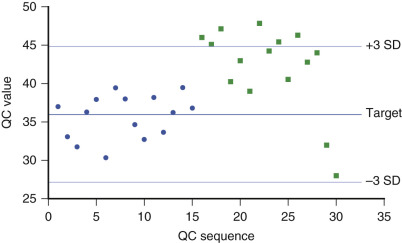

Figure 10-14 

Influence on the failure rate for a quality control (QC) rule when failing to adjust the target value for a matrix-related shift. 

A new reagent lot was introduced at sequence number 16. _SD,_ Standard deviation. 

The SD used to evaluate QC results will not typically change when a new lot of reagent(s) is put into service. The SD represents expected variability when the method is stable and is performing according to specifications. In most cases, the variability of a method will be the same with any lot of reagent(s). However, occasional exceptions may occur—for example, if the new reagent lot is a reformulation, it may be necessary to adjust the SD after additional numbers of QC results are accumulated with the new reagent lot. A reagent lot verification is typically performed on a single day and will likely provide only a few QC results from which to evaluate if the target value has changed. Consequently, it is necessary to carefully monitor QC results as more data are acquired using the new reagent lot and, if needed, to further refine the new target value. 

Note that a reagent lot–induced matrix-related change in the numeric values for the QC results will cause an artifactual increase in the cumulative SD such that the cumulative SD may be larger than the inherent measurement variability and not suitable for use in QC rules. For this reason, it is recommended to use the cumulative SD from a single reagent lot or from reagent lots that did not have a matrix-related change in QC target value when determining the SD to use for interpreting QC rules. 

Experience in clinical laboratories has shown that there are changes, other than reagent lot changes, in measurement systems that can also affect the QC values but not the results for patient samples. Such changes could be caused by maintenance, component replacement, or other causes. In theory, there should be an assignable cause for such effects, but such a cause is not always identifiable. In practice, any condition that affects QC results but does not affect patient results is treated in the same manner as described for reagent lot changes. The important quality control principle is that if the results for patient samples are consistent between the two conditions, then the target value for the QC sample should be adjusted, if necessary, to reflect its value under the new condition. Failure to adjust the QC target value will cause inappropriate acceptability criteria to be used for evaluating the QC results. 

,  

##  Verifying Method Performance Following Use of a New Lot of Calibrator 

When a new lot of calibrator is used, with no change in reagents, there is no change in matrix interaction between the QC material and the reagents. In this situation, QC results provide a reliable indication of calibration status with the new lot of calibrator. If the QC results indicate a bias following use of a new lot of calibrator, the calibration has changed and needs to be corrected to ensure consistent results for patient samples. 

Some methods are packaged as kits that include reagents, calibrators, and QC materials. In this case, QC results could fail to identify a calibration shift when a new kit lot is used, and it is necessary to assay patient samples with the old and new kit lots to verify consistency of patient results. When possible, it is recommended to use QC materials that are independent of the kit lot and to avoid changing lots of QC material at the same time as changing lots of reagent or calibrators. Assaying patient samples always provides a reliable approach to verify the consistency of results following changes in lots of reagents or calibrators. 

,  

##  Using Patient Data in Quality Control Procedures 

Results from patient samples are used in four principal ways to support the QC processes in a laboratory: 

  * •

To verify consistency of patient results when changing lots of reagent or calibrators for a method (discussed in the previous section) 

  * •

To identify inconsistent results using a delta check with a previous result for a patient 

  * •

To verify consistency of patient results when an analyte is measured using more than one instrument or method in a health care system 

  * •

To verify method performance using results from patient samples in a statistical QC scheme 

 

##  Delta Check with a Previous Result for a Patient 

Some types of laboratory errors can be identified by comparing a patient's current test result to a previous result for the same analyte. This comparison is called a _delta check_ . The previous result is taken from a specified time interval in the past during which the result is not likely to have changed physiologically. This limitation restricts the analytes that can be effectively monitored with a delta check. Delta checks are most useful to detect mislabeled samples and samples altered by dilution with IV fluid during collection from a patient. Consequently, an effective delta check process can be established using a limited number of analytes. The difference between results that causes a delta check alert must be sufficiently large to avoid excessive numbers of false alerts and adequate to allow identification of samples that may be compromised and require follow-up investigation. [ Table 10-6 ](<#t0035>) shows, as an example, the delta check parameters for automated chemistry used in the author's laboratory designed to identify compromised patient samples. 

TABLE 10-6 

Example Delta Check Criteria Intended to Identify Samples That Are Potentially Mislabeled or Contaminated with IV Fluids Due to Incorrect Collection 

Test  |  Delta Criteria   
---|---  
Sodium  |  5% change within previous 48 hours   
Urea nitrogen  |  60% change within previous 48 hours   
Creatinine  |  50% change within previous 48 hours   
Calcium  |  25% change within previous 48 hours   
Osmolality  |  5% change within previous 48 hours   
  
Delta checks can detect analytic errors; however, the threshold values necessary to identify analytic errors will be fairly small compared to physiologic changes and may cause a large number of false alerts that reduce the efficiency of laboratory workflow. A well-designed statistical QC plan will be more effective to detect analytic errors. However, delta checks might be useful to identify an interfering substance—for example, from a new drug—that may appear in a patient's sample.  Kazmierczak (2003)  has reviewed and presented recommendations for using delta check and other patient data–based quality control procedures. CLSI has published guideline EP33 for using delta checks in the clinical laboratory (  CLSI, 2015b  ). 

 

##  Verify Consistency of Results between More Than One Instrument or Method 

Another common use of patient results in a QC process is to verify consistency of patient results when an analyte is measured using more than one instrument or method within the same health delivery system. Good laboratory medicine requires that multiple instruments or methods for the same analyte be calibrated to produce the same results for patient samples whenever possible. It may be necessary to modify the calibration settings of one measurement system to match another system's results. This strategy allows a common reference interval to be used, provides continuity in results between different laboratory testing locations, and avoids clinical confusion regarding interpretation of laboratory results. 

As illustrated in [ Figure 10-15 ](<#f0080>) , consistency of patient results is verified by assaying clinical patient sample aliquots using each of two or more methods (or analyzers) to evaluate and if necessary adjust the calibration as needed to achieve agreement in results for patient samples. Such an analysis design is called a _round robin_ . One method/analyzer may be chosen to represent the primary method to which others will be adjusted to achieve equivalent results. The primary method should be chosen based on quality and reliability of results with consideration of its calibration traceability to national or international standards, its performance stability, its analytic specificity for the analyte, and its susceptibility to interfering substances. An alternate approach is to evaluate each method for agreement with the mean of all methods and to adjust the calibration of any methods/analyzers as necessary to produce equivalent results among the group. When like analyzers in a group are compared, if results for one analyzer are different from results for the others, that analyzer's calibration is adjusted to conform to that of the group. 

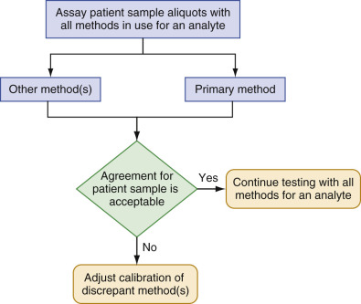

Figure 10-15 

Process used to evaluate agreement between methods and to adjust calibration, if necessary, to achieve equivalent results from different methods. 

There are no well-established guidelines regarding the number of samples to use for a round robin exchange. The laboratory needs to establish the frequency of evaluation and the number of samples based on the stability of the methods, the frequency of reagent and calibrator lot changes, and the clinical requirements of the health delivery system. Common practices include a round robin exchange of one or more individual patient samples or a pool prepared from several samples on a weekly basis for high-volume methods; on a monthly or quarterly basis for lower-volume or very stable methods; or the regulatory minimum of every 6 months. CLIA regulations, section 493.1281, require that the relationship between test results from different methods or from multiple locations should be evaluated at least twice a year (  Department of Health and Human Services, 2003  ). For frequent comparisons with one or two samples, concentrations should be chosen to evaluate the analytic measurement range over a period of several examinations. For less frequent comparisons, a larger number of samples is recommended to cover the analytic measurement range. When establishing interpretation criteria, the laboratory needs to consider the limited statistical power for the number of results available. CLSI document EP31, _Verification of Comparability of Patient Results within One Healthcare System_ , provides a statistical approach suitable for using one to five samples in a comparison (  CLSI, 2012  ). 

[ Table 10-5 ](<#t0030>) provides, as an example, empirical criteria used in the author's laboratory for evaluation of agreement among results for a single patient sample assayed weekly among multiple analyzers. These criteria were established based on the expected imprecision of the methods used and the clinical impact of discrepant results. To allow for the limitations of a single measurement of a single sample in a comparison, a result outside a criterion is typically not acted on unless the magnitude of a difference is much larger than the criterion or the situation persists for 2 or more weeks. 

It is recommended to use patient samples to verify agreement between multiple methods or analyzers. Results for QC materials should not be used for the purpose of verifying consistency of results for patient samples assayed using different methods or analyzers. As discussed in an earlier section, QC materials are not validated to be commutable with patient samples between different methods. Even when more than one method/analyzer from the same manufacturer is used, differences may be seen in the measured value for QC materials between different reagent lots. In principle, if more than one of the same model analyzer with the same reagent lots are used, all should have the same results for the same lot of QC material. In practice, differences in measurement details among different analyzers cause small differences in QC results. The acceptance criteria can be set to allow for such differences. However, more reliable conclusions will be drawn when patient samples are used to evaluate agreement among different analyzers. 

 

##  Using Patient Data for Statistical Quality Control 

Patient results can be used in a statistical QC process to monitor method performance. For a sufficiently large number of results, the mean (or preferably median) value may be sufficiently stable to be used as an indicator of method consistency over time. This approach can be used on a periodic basis by extracting data for a specified time period (e.g., 1 month), calculating the mean and SD for the distribution of results, and comparing one time period versus another to determine whether any changes have occurred. This type of periodic evaluation can identify changes in calibration stability or in overall imprecision for a method. The mean and SD can also be compared for consistency among multiple methods for the same analyte. 

An important limitation for using patient data to evaluate consistency within a single method, or between different methods for the same analyte, is the physiologic homogeneity of results. Important considerations include parameters likely to influence the reference interval, such as disease status, pediatric versus adult, gender, and ethnic differences. [ Figure 10-16 ](<#f0085>) shows an example of the potential impact of a nonhomogeneous sample of patients on distribution of albumin results for hospital general medicine inpatients compared with a student health outpatient clinic. The histograms are very different because the two patient groups differ in severity of disease and in recumbent versus supine position for blood collection, which influences vascular water volume and the concentration of albumin. 

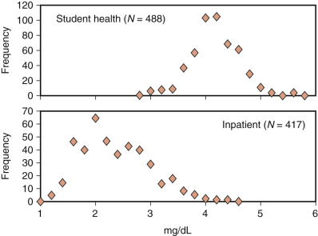

Figure 10-16 

Histograms for distribution of sequential patient results for albumin from a student health outpatient clinic and a hospital general medicine inpatient unit. 

Automated approaches to determine the mean (or median) for groups of sequential patient results used as a continuous process control parameter have been described. These methods are called _average of normals (AON)_ or _moving average_ techniques and are suitable for use in higher-volume assays in chemistry and hematology (  Cembrowski et al, 1984  ;  Smith & Kroft, 1996  ;  Westgard et al, 1996  ;  Ye et al, 2000  ;  Kazmierczak, 2003  ). In general, these approaches evaluate sequential patient results over time intervals, such as several hours to 1 or more days. The time interval that can be confidently used depends on the number of results in the time interval and the relative homogeneity of the clinical conditions represented in the patients. For some analytes, patients may need to be partitioned to obtain subgroups whose results are expected to be homogeneous. Consideration of influences for partitioning includes age, gender, ethnicity, and disease conditions. Some approaches have arbitrarily trimmed abnormal results in an attempt to restrict results to more normal health conditions. Trimming approaches must be used with caution because excessive trimming will create an artificial subset of results that may not reflect a method's calibration condition. The median is not influenced by extreme values and is recommended as the most robust estimate for tracking method stability over time based on patient results. 

The median, mean, or other statistical parameter for a group of results is tracked over sequential time intervals to monitor method performance. Statistical procedures such as cumulative sum or exponentially weighted moving average are used to monitor trends in method calibration status. These approaches can be useful for supplementing traditional statistical QC techniques to monitor a method's calibration stability and to monitor calibration uniformity between multiple methods in higher-volume settings. However, patient-based monitoring procedures have not been widely adopted because of lack of consensus guidelines for their use and lack of computer support from instrument and laboratory information system suppliers. 

,  

##  Proficiency Testing 

Proficiency testing (PT) (or external quality assessment) is a program to evaluate method performance by comparison of results versus those of other laboratories for the same set of samples (  Miller et al, 2011a  ). PT providers circulate a set of samples among a group of laboratories. Each laboratory assays the PT samples as if they were patient samples and reports the results for the PT samples to the PT provider for evaluation. The PT provider assigns a target value to the PT samples and determines if the results for an individual laboratory are in close enough agreement with the target value to be consistent with acceptable method performance. PT allows a laboratory to verify that its results are consistent with those of other laboratories and to verify that it is using a method in conformance with the manufacturer's specifications. 

PT is not available for some analytes because a particular test may be new to the clinical laboratory or is not commonly performed or because analyte stability makes it difficult to include in a PT material. In these situations, the laboratory should use an alternate approach to periodically verify acceptable performance of the method. CLSI has a guideline GP27 that provides approaches for verifying method performance when formal PT is not available (  CLSI, 2015c  ). 

QC material manufacturers may provide a data analysis service that compares results from different laboratories using the same QC material by calculating group statistics for performance evaluation. As with PT evaluation, this type of interlaboratory QC data analysis allows a laboratory to verify that it is producing QC results that are consistent with those of other laboratories using the same method. This information can be helpful for troubleshooting method issues and for assessing performance of a new method being introduced to a laboratory. 

 

##  Noncommutability of Proficiency Testing Materials and Peer Group Grading 

The materials commonly used for PT samples are derived from blood or urine but are altered in the process to manufacture PT samples such that the matrix is modified and the samples do not have the same measurement characteristics as observed for unaltered clinical patient samples (  Miller et al, 1993  ;  Ross et al, 1998  ;  Miller, 2003  ;  Miller et al, 2005  ;  Miller et al, 2008  ;  Miller et al, 2011a  ). In addition, some PT samples—for example, cerebrospinal fluid or blood gas—are prepared as synthetic materials that are not derived from patient fluids. Consequently, many PT samples, as for QC samples, are noncommutable with authentic patient samples. A commutable PT sample will have a relationship between results for the PT sample measured by different methods that is in close agreement to the relationship observed for results from patient samples. The results for a noncommutable PT sample will have a different relationship in their numeric values among different methods than would be observed for patient samples. 

Because PT samples are frequently noncommutable with patient samples, it is a common practice for PT providers to organize results into “peer groups” of methods that represent similar technology expected to have the same result for a PT sample. The mean value of the peer group results is the target value. Because the peer group mean value may be influenced by a matrix-related bias, that value can only be used to evaluate labs using the same method(s) and cannot be used to evaluate laboratories using other methods or to evaluate if different methods agree with one another. [ Figure 10-17 ](<#f0090>) illustrates the effects of noncommutable materials on interpretation of PT results and demonstrates why “peer group” evaluation is used. In this older but still valid example, pooled patient sera and PT samples were assayed by the duPont Dimension Analyzer and by the Abell-Kendall reference method for cholesterol (  Naito et al, 1993  ). The Abell-Kendall method was shown to be unaffected by matrix-induced changes in PT samples (  Ellerbe et al, 1990  ). The patient samples showed excellent agreement between the two methods (average bias = 0.2%). However, the PT samples had a large negative bias (−9.5%) between methods, caused by a matrix-related bias with the duPont method that was not present with the reference method (  Kroll & Chesler, 1990  ). 

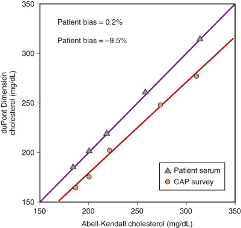

Figure 10-17 

Example of noncommutable results between proficiency testing materials and pooled patient samples for a specific method. 

(Adapted from Naito HK, Kwak YS, Hartfiel JL, et al: Matrix effects on proficiency testing materials: Impact on accuracy of cholesterol measurement in laboratories in the nation's largest hospital system, _Arch Pathol Lab_ Med 117:345–351, 1993; used with permission.) 

In this example, the routine method was correctly calibrated and produced results for patient samples that were traceable to the reference method. However, PT results gave an incorrect impression of the method's calibration relationship to the reference method. If the routine method's calibration had been erroneously adjusted on the basis of PT results, the results for patient samples would then be incorrect. PT results were useful for evaluating the performance of all laboratories using the duPont method, because the matrix-related bias was uniform within this peer group. Consequently, if an individual laboratory's results agreed with those of the peer group, the individual laboratory could conclude that the method was performing in conformance with the manufacturer's specifications. In general, an individual laboratory depends on the manufacturer to correctly calibrate a clinical laboratory routine method to be traceable to the reference system for an analyte. 

 

##  Reporting Proficiency Testing Results When One Method is Adjusted to Agree with Another Method 

It is good laboratory practice (and consistent with CLIA regulations section 493.1281) to adjust the calibration of different methods for the same analyte used within a health delivery system, so the results for patient samples are consistent, irrespective of which method is used. Such harmonization of results is important for uniform use of reference intervals and decision thresholds within a health delivery system. In this situation, it is important to report PT results such that they can be properly evaluated against the peer group target value. The peer group target value will reflect the method calibration established by the method manufacturer. For an individual laboratory's PT result to be evaluated against the peer group mean, that individual result must be reported to the PT provider after removing any calibration adjustments so the reported result is consistent with the manufacturer's nonadjusted calibration. The most convenient way to remove a calibration adjustment is to first assay PT samples with the method calibration adjustment applied to the measurement system, as would be the usual assay process for patient samples. After the assay, adjust the PT results “in reverse” by mathematically removing the calibration adjustment factors and report the results with any adjustment factors removed. One should not recalibrate the instrument with a new set of calibrators for the purpose of assaying PT samples, because this practice would violate regulations requiring the PT material to be assayed in the same manner as patient samples. 

For example, a laboratory has performed a patient sample comparison between Method A used in the main laboratory and Method B used in a satellite laboratory, as illustrated in [ Figure 10-15 ](<#f0080>) . Method B consistently gave 10% higher results. Method B was adjusted to agree with Method A by putting the adjustment factor 0.9091 (calculated as 1/1.10) in the Method B instrument to automatically multiply each measured result by 0.9091 to lower the reported result by 10%. When PT results from Method B are reported, it is necessary to remove the 0.9091 factor to allow the reported result to be compared with the peer group mean of results from all laboratories using Method B. Removing the 0.9091 factor is accomplished by multiplying the reported PT result from Method B by the factor 1.100 (calculated as 1/0.9091) to increase its numeric value by 10% to the nonadjusted value that was actually measured by the instrument according to the manufacturer's defined calibration procedure. This process allows the PT result measured by Method B to be appropriately evaluated in comparison with its peer group mean, which will reflect the manufacturer's established calibration. This process permits the PT sample to be assayed in the same manner as patient samples and the numeric result reported to the PT provider to reflect the actual measured result using the manufacturer's recommended calibration settings. 

 

##  Interpretation of Proficiency Testing Results 

Many countries have regulations (e.g., CLIA in the United States) requiring PT and specifying the evaluation criteria for acceptable performance. When criteria are not set by regulations, the PT provider sets evaluation criteria on the basis of clinically acceptable performance and/or the analytic capability of the methods in use. PT evaluation criteria are designed to evaluate the total error of a single measurement. The acceptability limits for PT include bias and imprecision components considered clinically acceptable for an analyte, plus other error components that are unique to PT samples, such as between-laboratories variation in calibration; homogeneity of the PT material vials; stability variability in the PT material both in storage/shipping and after reconstitution or opening in the laboratory; and variable matrix–related bias with different lots of reagent within a peer group. Consequently, the acceptability limits for PT samples are frequently larger than what might be expected for clinically acceptable total error with patient samples. 

[ Figure 10-18 ](<#f0095>) is an example of a typical evaluation report sent to a participating laboratory. Each reported result is compared with the mean result for the peer group using the same method. The report also includes the SD for the distribution of results in the peer group, the number of laboratories in the peer group, and the SDI (also called a _z-score_ ), which expresses the reported result as the number of SDs it is from the mean value [SDI = (result – mean)/SD]. The limits of acceptability are shown. Acceptability criteria may be a number of standard deviations from the mean value, a fixed percent from the mean value, or a fixed concentration from the mean value. In [ Figure 10-18 ](<#f0095>) , calcium acceptability criteria are ±1 mg/dL from the mean value, and iron criteria are ±20% from the mean value. 

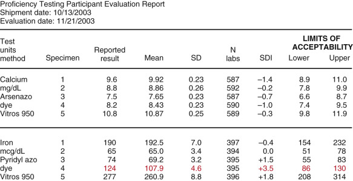

Figure 10-18 

Example of an external proficiency testing evaluation report sent to a participating laboratory. 

_SD,_ Standard deviation; _SDI,_ standard deviation interval. 

Peer group evaluation allows a laboratory to verify that it is using a method according to the manufacturer's specifications and is producing patient results that are consistent with those of other laboratories using the same method (  Miller et al, 2011a  ). In [ Figure 10-18 ](<#f0095>) , the calcium results are in close agreement with the peer group mean (SDI ranges from −0.2 to −1.4). However, the iron results show greater variability, with one result +3.5 SDI. Although that iron result is within the acceptability criteria, it is recommended to investigate the method, as discussed in the next paragraph. 

If an unacceptable PT result is identified, the method must be investigated for possible causes and any necessary corrective action taken. Even when a PT result is within acceptability criteria, it is good laboratory practice to investigate PT results that are more than approximately 2.5 SDI from the peer group mean. When the SDI is 2.5, there is only a 0.6% probability that the result will be within the expected distribution for the peer group; consequently, the probability is reasonable that a method problem may need to be corrected. In addition, PT results that have been near the failure limit for more than one PT event, even if the results have passed the PT acceptance criteria, should initiate a review of systematic problems with the method. These practices support identification of potential problems before they progress to more serious situations. When results are investigated, a limitation of SD-based grading criteria should be considered. Very precise methods may have a very small SD, and a result may be outside an SD limit when the magnitude in reporting units is small and may be of no concern regarding the use of results for clinical care decisions. 

Common causes for PT failure are listed in [ Box 10-1 ](<#b0010>) . Incorrect handling and reporting are frequently unique to PT events and may not reflect the same process used in the laboratory for patient samples. Nonetheless, these situations reflect attention to detail, which is a necessary attribute for quality laboratory testing. Occasionally, the PT material may have a defect that causes it to perform inappropriately for all or a subgroup of methods. In this case, the PT provider should identify the situation and not grade participants for that sample. 

Box 10-1 

Classification of Potential Problems Identified When Investigating Unacceptable PT/EQA Results [ _a_ ](<#fn0010>)

a This classification scheme assists in developing an appropriate corrective action plan. Reprinted with permission from Miller WG, Jones GRD, Horowitz GL, et al: Proficiency testing/external quality assessment: Current challenges and future directions, _Clin Chem_ 57:1670–80, 2011. 

  * 1.

Clerical errors: 

    * Incorrectly transcribed PT result from the instrument readout to the report form 

    * The PT sample was mislabeled in the laboratory 

    * Incorrect instrument or method was reported on the results submission form 

    * Incorrect units were reported 

    * Decimal point was misplaced 

  * 2.

Methodological problems: 

    * Inadequate standard operating procedure 

    * Problem with manufacture or preparation of reagents or calibrators (e.g., unstable) 

    * Lot-to-lot variation in reagents or calibrators 

    * Incorrect value assignment of calibrators 

    * Method lacks adequate specificity for the measurand 

    * Method lacks adequate sensitivity to measure the concentration 

    * Carryover from a previous sample 

    * Inadequate QC procedures used 

  * 3.

Equipment problems: 

    * Obstruction of instrument tubing/orifice by clot 

    * Misalignment of instrument probes 

    * Incorrect instrument data processing functions 

    * Incorrect instrument setting 

    * Automatic pipettor not calibrated to acceptable precision and accuracy 

    * Equipment component malfunction (e.g., light source, membrane, fluidics, detector) 

    * Incorrect instrument conditions (e.g., water quality, surrounding temperature) 

    * Instrument maintenance not performed appropriately 

  * 4.

Technical problems caused by personnel errors: 

    * Did not operate equipment correctly or did not conform to method standard operating procedure 

    * Incorrect storage, preparation, or handling of reagents or calibrators 

    * Delay causing evaporation or deterioration of the PT sample 

    * Failure to follow recommended instrument function checks or maintenance 

    * Pipetting or dilution error 

    * Calculation error 

    * Misinterpretation of test result 

  * 5.

A problem with the PT material, such as: 

    * Incorrect storage, preparation, or handling of PT materials 

    * Differences between PT samples and patient samples (e.g., matrix, additives, stabilizers) 

    * Sample deteriorated in transit or during laboratory storage 

    * Sample had weak or borderline reaction 

    * Sample contained interfering factors (that may be method-specific) 

    * Sample was not homogeneous among vials 

PT results are usually received several weeks after the date of testing. Consequently, investigation of unacceptable results requiring review of quality control, reagent, calibration, and maintenance records for the date of the test and the preceding several weeks or months is necessary. It is common practice to save any remaining PT samples for use to investigate an unacceptable result. Care must be taken to store the residual PT samples to preserve the stability of the analytes. In some cases, the analyte will not be stable for storage. In addition, when reassaying stored samples, degradation may have occurred during storage, or possibly before storage while still being used in the laboratory for the PT event, and may affect any remeasured value. If review of these records suggests a stable operating condition and review of the PT material handling and documentation does not identify a cause for the erroneous PT result, it may be concluded that the PT failure was a random event. Investigative steps, data reviewed, and conclusions from the review must be documented in a written report of the unacceptable PT result and reviewed by the laboratory director. 

 

##  Limitations in Interpreting Proficiency Testing Results 

PT providers also prepare a summary report, which includes the mean and SD for all peer groups represented by the participants' results. Similar reports are available from interlaboratory QC programs. Summary reports are very useful but must be interpreted with consideration of the limitations of noncommutable samples. The peer group mean and SD are useful for evaluating the uniformity of results between laboratories using the same method, to confirm that an individual laboratory is using the method correctly as designed by the manufacturer, and to evaluate the consistency of an individual laboratory's method performance relative to the peer group over time intervals from one PT event to the next (trend monitoring). Summary information also allows evaluation of the imprecision of various method groups, and the number of users in each method group reveals which methods are commonly used. 

The frequent occurrence of noncommutability of PT materials makes it incorrect to use PT summary reports to compare an individual laboratory's result with the peer group mean for another method group, to compare method peer group mean values to each other, or to compare an individual method peer group value to a value from a reference measurement procedure. The noncommutability limitation prevents PT (or QC) results from being used to infer agreement, or lack of agreement, for patient results among different methods for the same analyte. 

 

##  Accuracy-Based Proficiency Testing Programs 

In some cases, PT providers use commutable samples in PT programs (  Miller et al, 2011a  ). Commutable samples are typically prepared by pooling clinical patient samples with minimal processing or additives to avoid any alteration of the sample matrix. To achieve samples with abnormal values for analytes, donors are identified with known pathologic conditions, or blood and serum units from a general donor population can be prescreened for selected analytes. Supplementing patient samples or pools with purified analytes may be acceptable in some cases but has not been rigorously evaluated. When commutable PT samples can be prepared, the results reflect what would be expected if patient samples were sent to each of the different laboratories. Thus agreement among different laboratories and methods (called harmonization) can be correctly evaluated. The agreement between an individual laboratory result and a reference measurement result (accuracy) and the agreement between a method group mean value and the reference measurement result (called trueness) can be evaluated when a reference measurement procedure is available for an analyte. 

For example, the College of American Pathologists glycohemoglobin survey for many years has used pooled, freshly collected whole blood from both normal and diabetic donors. The target values for the pooled blood are assigned by reference measurement procedures for hemoglobin A  1c  . In this survey, the accuracy of individual laboratory results and the trueness of method group means versus the reference measurement procedure values can be evaluated because the PT samples are commutable with clinical patient samples. Method group trueness can be used by the respective method manufacturers to monitor the effectiveness of their calibration processes. 

Preparing commutable materials for use in large PT programs has been challenging. However, use of commutable materials adds substantial value to the information obtained from the results (  Miller et al, 2011a  ). Procedures have been developed to validate the commutability of QC, PT, and reference materials (  CLSI, documents EP30-A, 2010  , and  EP14-A3, 2014a  ). 

,  

##  Quality Management 

Quality management (QM) refers to the overall process used to ensure that laboratory results meet the requirements for health care services to patients. The components of a QM system shown in [ Figure 10-4 ](<#f0025>) were derived from the CLSI document QMS01-A4, _Quality Management System: A Model for Laboratory Services_ (  CLSI, 2011b  ), and are consistent with the ISO document 15189:2012, _Medical Laboratories —Requirements for Quality and Competence _ (  ISO, 2012  ). Laboratories are required to develop procedures to monitor and ensure quality in all aspects of laboratory services. A QM program is an accreditation requirement, and good documentation of the metrics, the review process, and the improvements made is necessary. 

Statistical quality control and proficiency testing, covered in detail in this chapter, are two important components of a QM program that address measurement procedures. Metrics related to QC activities may be evaluated as part of monitoring the performance of a measurement system. The following may be useful indicators of method performance issues: 

  * •

Frequency of QC alerts 

  * •

Frequency of recalibration based on QC alerts 

  * •

Number of reagent changes due to QC alerts 

  * •

Number of times controls were repeated because of QC alerts 

  * •

Frequency of unscheduled maintenance due to QC alerts 

  * •

Number of patient samples repeated based on QC alerts 

  * •

Frequency that patient samples are repeated based on QC alerts 

  * •

Number of patient results corrected 

Directly related to the quality of test results are preanalytic components such as patient preparation; sample collection, transportation, storage, and preparation for testing; and postanalytic components such as result reporting, critical value notification, and provision of interpretive information. All of the quality system essentials listed in [ Figure 10-4 ](<#f0025>) are important to ensure that quality laboratory results are available for patient care. In some cases, the quality requirements extend outside the laboratory and require cooperation with health care partners who order laboratory tests and act on the results. 

A QM program defines data-based quality indicators or metrics that are monitored at regular recurring intervals to provide information on the adequacy of important influences on laboratory quality. The CLSI document QMS01-A4 includes an appendix with examples of quality indicators for all of the quality system essentials. An IFCC working group has also recommended a number of specific quality indicators for laboratory testing (  Plebani et al, 2014  ). A QM committee oversees the development of metrics and their regular review and initiates quality improvement actions in response to metrics that indicate a need for improved performance in a particular aspect of laboratory management. A QM committee is typically chaired by a laboratory director or section director and includes senior-level representation from all service areas, including the laboratory information system. Monthly meetings to review data collected from the previous month are typical. However, automation of data management can make some metrics available close to real time for more immediate monitoring and intervention. For example, turnaround time from specimen receipt to result reporting can be monitored continuously with a scrolling computer display report to assist medical technologists in tracking stat requests. 

[ Table 10-7 ](<#t0040>) provides a list of some typical quality indicator metrics that could be included in a QM program. In addition to the metrics, thresholds for acceptable values are defined for most metrics. Thresholds are established on the basis of what is considered good laboratory practice and may be different in different situations. Metrics that meet thresholds confirm that the laboratory is meeting its quality goals for those service requirements. Metrics that exceed thresholds require analysis and a plan for corrective and preventive action. The example thresholds in [ Table 10-7 ](<#t0040>) are illustrative and should not be taken as recommendations. It is not possible to have zero mistakes in laboratory service; consequently, thresholds need to be realistic and can be changed as quality improvement programs are applied to reduce and prevent errors of various types. The total number of observations examined by a metric should be recorded, along with the data for a given reporting interval. 

TABLE 10-7 

Examples of Quality Indicators (Metrics) 

Quality Indicator (Metric)  |  Threshold  |  Total Number Reviewed  |  Example Data  |  Analysis and Action Plan   
---|---|---|---|---  
**Result Reporting**  
Gram stain correlation with culture (% disagreement)  |  ≤1%  |  1513  |  0%  |   
Blood culture contamination  |  ≤3%  |  2468  |  2.7%  |   
Percent bone marrow cases reviewed in consensus conference  |  ≥10%  |  146  |  28.8%  |   
Number of bone marrow cases with disagreements  |  2  |  146  |  0  |   
PT reports; number flagged unacceptable (list by laboratory section)  |  0  |  |  |   
POCT: Glucose meters, QC failures  |  ≤3%  |  9058  |  2.3%  |   
POCT: Glucose meter, critical value not confirmed by repeating on meter  |  ≤5%  |  439  |  2.5%  |   
Turnaround times in minutes for 90% completed (shown as in-laboratory/total); examples shown, recommend for all applicable work shifts; threshold is for in-laboratory  |  |  |  |   
Potassium, stat, day shift  |  45 min  |  1477  |  47/91  |  Reviewed, no action indicated   
Troponin I, ED, stat, day shift  |  60 min  |  476  |  60/121  |   
Hb, stat, day shift  |  45 min  |  520  |  40/81  |   
PT, stat, day shift  |  60 min  |  528  |  41/94  |   
Urinalysis pH, stat, day shift  |  60 min  |  240  |  56/106  |   
Bacterial vaginosis, ED, Gram stains  |  60 min  |  231  |  40/91  |   
Critical value callback delay; minutes for 90% completed; examples shown  |  |  |  |   
Critical value delay, hemoglobin, inpatient  |  30 min  |  215  |  14  |   
Critical values not called Hematology  |  0  |  2474  |  4  |  SOP reviewed with medical technologist   
Result corrections (list by laboratory sections)  |  |  |  |   
Specimens rejected/corrected at log-in (list by receiving location and type of problem; examples shown)  |  |  |  |   
Lost/not received  |  <5  |  109,851  |  5  |   
Incomplete label or form  |  <20  |  109,851  |  25  |   
Hemolyzed  |  <50  |  109,851  |  19  |   
Clotted  |  <100  |  109,851  |  289  |   
QNS  |  <100  |  109,851  |  204  |   
Exceeds time limit  |  <20  |  109,851  |  8  |   
Improper collection, container, specimen  |  <20  |  109,851  |  32  |   
Improperly ordered  |  <20  |  109,851  |  16  |   
Interfering substance  |  |  109,851  |  25  |   
Mislabeled specimens (identified by delta check or by notification from clinical staff; list by receiving location)  |  <20  |  109,851  |  83  |   
Blood bank: Emergency units not accounted for in ED and OR  |  0  |  35  |  0  |   
Sweat chloride QNS specimens, %  |  ≤5%  |  18  |  0%  |   
**Customer Satisfaction**  
Client services: % calls lost  |  ≤5%  |  5932  |  7%  |  See below   
Client services: Calls answered within 60 seconds  |  ≥90%  |  5932  |  89%  |  Consider if additional staff needed   
Service delivery reports from clinical units (number received/number laboratory responsible)  |  0  |  |  10/7  |  See attached report (each incident has an individual review)   
**Personnel**  
Safety (number of incidents)  |  |  |  |   
Infectious agent exposure  |  0  |  |  1  |  See attached report   
Chemical exposure  |  0  |  |  0  |   
Job-related injury/illness  |  0  |  |  2  |  See attached report   
On-call utilization (number of instances a person was called in; list by laboratory section)  |  |  |  |   
Overtime utilization (hours paid; list by laboratory section)  |  |  |  |   
Vacancies and staff in training status (graph by laboratory section)  |  |  |  |   
Continuing education (total hours CE received/number staff receiving CE/total number staff); list by laboratory section)  |  |  |  |   
  
_CE_ , Continuing education; _ED_ , emergency department; _Hb_ , hemoglobin; _OR_ , operating room; _POCT_ , point-of-care testing; PT, prothrombin time; _QC_ , quality control; _QNS_ , quantity not sufficient; _SOP_ , standard operating procedure. 

It is recommended that the metrics be reported to allow trends to be identified—for example, by showing data for 6 or more months on a page. Graphic presentation is very effective to monitor trends and can easily include 1 or more years on a single graph. Many metrics are useful to track indefinitely to document that laboratory service continues to meet performance expectations, and to have an alert mechanism if a change in the environment has adversely affected laboratory service. Data cannot be collected for all possible metrics, and the QM committee needs to determine which aspects of laboratory performance are most critical or in need of improvement and should develop suitable metrics to drive a quality improvement process. Specific interventions should be documented with a written report that describes the quality issue, the data used to understand the issue, the improvements made, and the data that document the effectiveness of the improvement. 

,,
