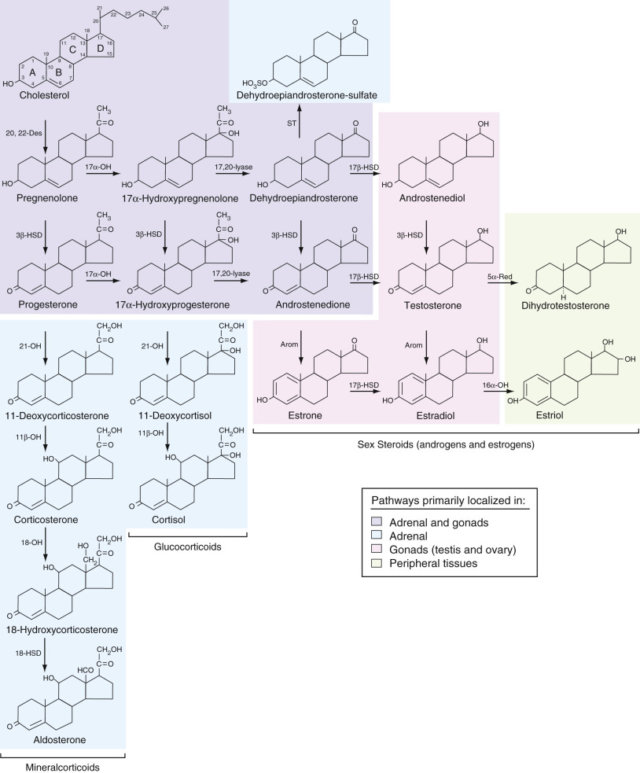
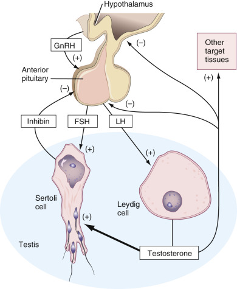
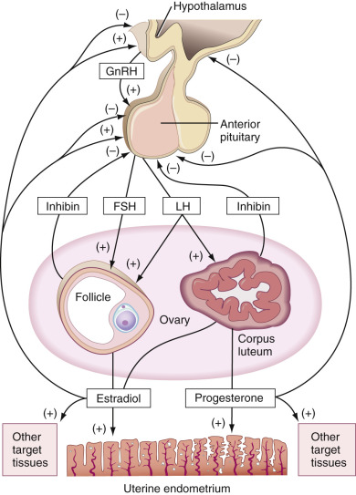
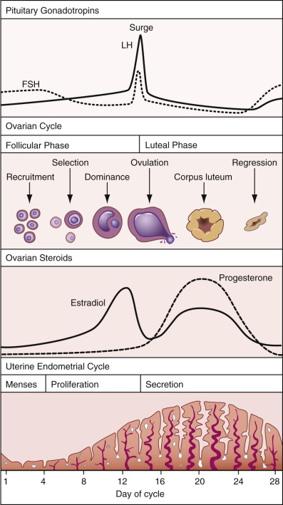
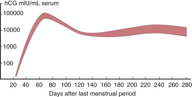
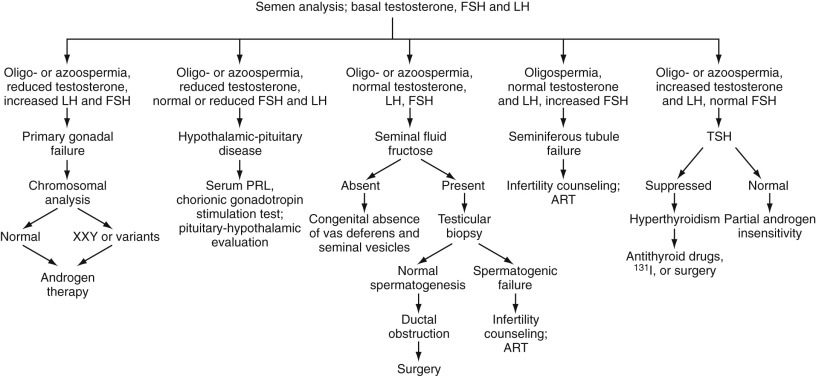
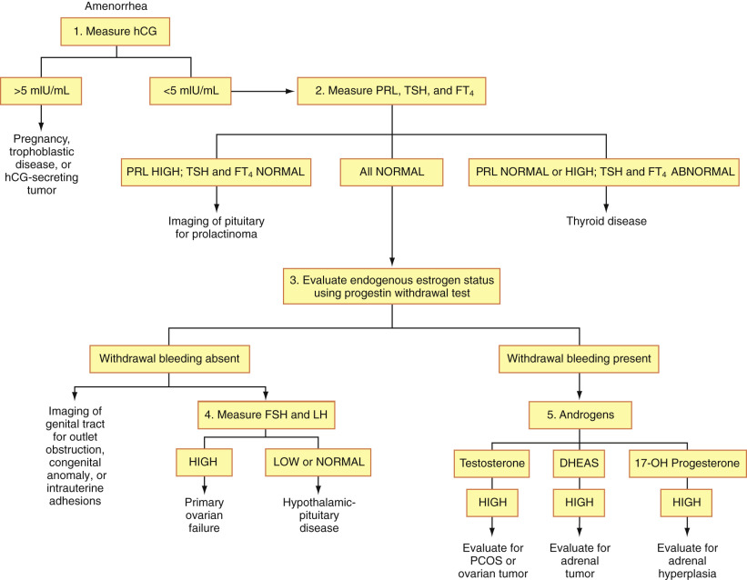
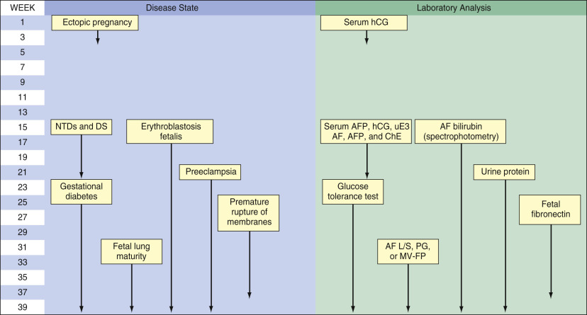
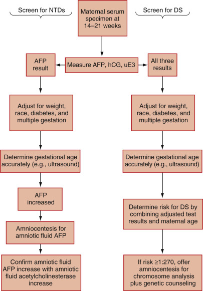
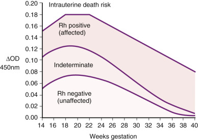

## Key Points

  * •

Reproductive function and pregnancy are regulated by the complex interaction of a variety of hormones; they are synthesized and secreted by the testis (testosterone), ovary (estradiol and progesterone), pituitary (follicle-stimulating hormone [FSH] and luteinizing hormone [LH]), hypothalamus (gonadotropin-releasing hormone), and placenta (human chorionic gonadotropin [hCG], estrogens, and progesterone). 

  * •

Laboratory evaluation of reproductive function in the male typically begins with semen analysis. If the results are normal, further evaluation may be unnecessary. If the results are abnormal, then serum hormone measurements, particularly of testosterone, FSH, and LH, are important. 

  * •

Reproductive dysfunction in the female is often indicated by amenorrhea and/or infertility. Laboratory evaluation, as in the male, involves serum hormone measurements, particularly of hCG, prolactin, thyroid-stimulating hormone, free thyroxine, FSH, LH, and androgens. 

  * •

Infertility can be treated by several assisted reproductive technologies. These involve a variety of clinical manipulations, all of which are directed at externally controlling as much of the reproductive process as possible to achieve pregnancy and bring it to term. Laboratory monitoring of serum hormone levels (estradiol, progesterone, and hCG) plays an important role in these protocols. 

  * •

Early pregnancy is monitored by measuring serum hCG concentrations and determining that the pattern of dramatic increase during the first trimester is as expected. 

  * •

The risk for the most common birth defects, neural tube defects, and chromosomal aneuploidy is determined during the first- and second-trimester screenings. 

  * •

Fetal hemolytic disease is monitored by spectrophotometric estimation of the level of bilirubin in amniotic fluid or Doppler measurements of peak systolic velocity in the fetal middle cerebral artery. 

  * •

The status of fetal lung maturation is estimated from the evaluation of pulmonary surfactant in amniotic fluid. This can be accomplished by several methods, including determination of (1) the lecithin/sphingomyelin ratio and phosphatidyl glycerol by chromatography, or (2) microviscosity by fluorescence polarization. 

  * •

Toxemia of pregnancy, or preeclampsia, is characterized by hypertension and proteinuria, and consequently can be monitored by urine protein measurements. 

  * •

Risk for preterm delivery and the need for medical intervention can be evaluated by checking levels of fetal fibronectin in the cervical secretions. 

,  

##  Normal Physiology 

Normal reproductive function is mediated by a variety of hormones synthesized and secreted by the gonads (testes and ovaries), adrenals, pituitary, hypothalamus, and placenta. In addition, peripheral nonglandular tissues can contribute to hormone synthesis. Paracrine and autocrine mediators are also involved, but in almost all cases their exact roles are not well understood. 

 

##  Sex Steroids 

The testes and ovaries synthesize sex steroids (androgens and estrogens) from cholesterol via the same initial pathway used in the adrenal glands to synthesize mineralocorticoids, glucocorticoids, and androgens ( [ Fig. 25-1 ](<#f0010>) ). The specific hormone secreted by an endocrine gland depends on the presence and relative activities of various enzymes in the steroid pathway. Whereas the adrenal synthesizes androgens like dehydroepiandrosterone (DHEA), DHEA-sulfate (DHEAS), and androstenedione, the testis metabolizes these steroids primarily to testosterone. The ovary converts testosterone to estradiol, and androstenedione to estrone. In addition, testosterone gets converted to estradiol in peripheral tissues such as adipose cells by the enzyme aromatase. Peripheral tissues (including those targeted by androgens) reduce testosterone to dihydrotestosterone (DHT). Because DHT is two to three times more potent than testosterone, this process yields an enhanced or activated androgenic effect. Peripheral tissues, such as liver, also hydroxylate estradiol to estriol, a metabolite with only one-hundredth the estrogenic potency of its precursor. Thus this conversion is an inactivation process. During pregnancy, estriol is synthesized via a different pathway, and it may play a different role than estradiol (see later). Peripheral tissues also convert adrenal androgens to testosterone and androgens to estrone and estradiol, the latter occurring in adipose tissue. Estrone is about one-tenth as potent as estradiol, which likely further modulates estradiol potency. Note that although progesterone serves as an intermediate in the synthesis of all other steroid hormones, it also functions as a sex steroid in its own right in females. 

Figure 25-1 

Steroid hormone synthesis. 

_Arom_ , Aromatase; _16 α-OH _ , 16α-hydroxylase; _17- α-OH _ , 17α-hydroxylase; _5 α-Red _ , 5α-reductase; _3 β-HSD _ , 3β-hydroxysteroid dehydrogenase; _17 β-HSD _ , 17β-hydroxysteroid dehydrogenase; _11- β-OH _ , 11-β-hydroxylase; _20,22-Des_ , 20,22 desmolase; _18-HSD_ , 18-hydroxysteroid dehydrogenase; _18-OH_ , 18-hydroxylase; _21-OH_ , 21-hydroxylase; _ST_ , sulfotransferase. 

As with any hormone, sex steroids act at tissue sites distant from their sites of synthesis and secretion. Once in the blood, most of the hydrophobic sex steroids become reversibly and noncovalently bound to plasma proteins. This interaction includes low-affinity, nonspecific binding to hydrophobic sites on albumin and high-affinity binding to specific transport proteins that are synthesized by the liver. Sex hormone–binding globulin (SHBG) transports androgens and estrogens, and corticosteroid-binding globulin (CBG) transports progesterone (as well as glucocorticoids). In blood, only about 1% to 2% of the sex steroids are free (unbound). About half of the remainder are bound to SHBG or CBG, and about half are bound to albumin. Only the free fraction is biologically active, because only the free hormone can exit the vascular system (by diffusion) and interact with target cells. 

Each steroid binds with high affinity to specific receptor proteins that activate or inactivate genes in the target cell. Thus the same hormone can elicit a different response in each type of target cell. The potency of a steroid's hormonal effect (e.g., androgenic effect) is primarily a function of its affinity for the specific receptor protein and the affinity of that complex for the chromatin acceptor sites. Thus DHT is a more potent androgen than testosterone. DHEA and androstenedione bind only weakly, if at all, to the androgen receptor; hence their androgenic effect is low, and most, if not all of their androgenic activity derives from their peripheral conversion to testosterone. 

 

##  Regulation of Male Reproduction 

[ Figure 25-2 ](<#f0015>) summarizes the regulation of reproduction in the human male. Gonadotropin-releasing hormone (GnRH) is a decapeptide that is synthesized and secreted by neuroendocrine cells of the hypothalamus, primarily in the arcuate nucleus. GnRH binds to specific cell membrane receptors on gonadotrophs in the anterior pituitary, resulting in the synthesis and secretion of two protein hormones—FSH and LH—both named for their effects in females. Both FSH and LH are similar to thyroid-stimulating hormone (TSH), in that all three consist of two subunits and all of them share the same α subunit. Each has a different β-subunit, however, which thus confers their functional specificity. 

Figure 25-2 

Regulation of reproduction in the male. 

_FSH_ , Follicle-stimulating hormone; _GnRH_ , gonadotropin-releasing hormone; _LH_ , luteinizing hormone. 

The seminiferous tubules of the testis contain cells in various stages of spermatogenesis (spermatogonia, spermatocytes, spermatids), along with Sertoli cells and Leydig cells. FSH induces Sertoli cells to synthesize and secrete androgen-binding protein into the lumen of the seminiferous tubule, and this maintains the high testosterone concentration required for normal spermatogenesis. LH induces Leydig cells to synthesize testosterone; some enters the general circulation and is transported to other target tissues, such as skeletal muscle, where it has an anabolic effect. Some is also transported to the hypothalamus and anterior pituitary, where the testosterone has a negative-feedback effect—that is, it decreases and helps control the synthesis and secretion of GnRH, FSH, and LH, and this in turn decreases testosterone synthesis by Leydig cells. Sertoli cells also synthesize and secrete another protein hormone—inhibin—that is a dimeric protein composed of an alpha and a beta subunit. It interacts with gonadotrophs in the anterior pituitary, where it also has a negative feedback effect by decreasing the synthesis and secretion of FSH, but not LH. Androgens also stimulate inhibin production, which locally helps regulate spermatogenesis. However, the exact role of inhibin in the regulatory process is not understood. 

 

##  Regulation of Female Reproduction 

[ Figure 25-3 ](<#f0020>) summarizes the regulation of reproduction in the human female. As in the male, GnRH from the hypothalamus increases the synthesis and secretion of FSH and LH from the anterior pituitary. Unlike in the male, however, the regulatory process in the female is cyclic and is referred to as the menstrual cycle. Pituitary, ovarian, and uterine changes that occur during the menstrual cycle are summarized in [ Figure 25-4 ](<#f0025>) . As illustrated, the cycle begins with menses, or shedding of uterine endometrium, which is considered day one. During this period in the ovary, a cohort of follicles is recruited to begin further growth and development. From this cohort, one to two (usually) is selected to be the dominant follicle and to continue to grow and develop. The other recruited follicles undergo regression, or atresia. These processes occur during the follicular phase of the ovarian cycle, primarily as a result of the action of FSH. As the follicle grows, increasing amounts of estradiol are synthesized and secreted from them. Estradiol restores the endometrium via cell proliferation and growth—hence the proliferative phase of the uterine endometrial cycle. Estradiol also has a negative-feedback effect on the hypothalamus and the anterior pituitary, causing a decline in FSH levels during the latter part of the follicular phase. 

Figure 25-3 

Regulation of reproduction in the female. 

_FSH_ , Follicle-stimulating hormone; _GnRH_ , gonadotropin-releasing hormone; _LH_ , luteinizing hormone. 

Figure 25-4 

Pituitary, ovarian, and uterine changes during the human menstrual cycle. 

_FSH_ , Follicle-stimulating hormone; _LH_ , luteinizing hormone. 

Near the end of the follicular phase, when estradiol levels are at their highest, its feedback effect on the hypothalamus and anterior pituitary switches to positive. The exact mechanism for this change to positive feedback is not understood. Its effect, however, is dramatic. It causes a surge in the secretion of GnRH, FSH, and particularly LH, which culminates in ovulation. The LH surge causes final oocyte maturation with the completion of meiosis. The oocyte enters the oviduct. Owing to disruption of the follicle, estradiol synthesis and secretion drop dramatically. The disrupted follicle begins to differentiate into the corpus luteum; thus begins the luteal phase of the ovarian cycle. The corpus luteum synthesizes estradiol and progesterone as a result of the action of LH. The combination of the two steroids acts on the uterine endometrium to cause development of numerous exocrine glands, producing the secretory phase of the uterine endometrial cycle. This phase prepares the endometrium for implantation, should fertilization and early development occur. LH levels decline gradually during the luteal phase, indicating restoration of negative-feedback regulation of the hypothalamus and anterior pituitary by estradiol and progesterone. 

As in the male, inhibin has a selective negative-feedback effect on FSH. In the female, however, there are two different forms. One is synthesized and secreted by the developing follicles (inhibin B), and the other is from the corpus luteum (inhibin A) (  Welt et al, 1999  ). Inhibin B reaches a peak in the early- to midfollicular phase and a second peak at ovulation. Inhibin A reaches its peak in the midluteal phase. Again, the exact regulatory roles they play are not understood. 

In an infertile cycle, the corpus luteum begins to regress near the end of the luteal phase. This then results in a decrease in estradiol and progesterone synthesis and secretion. Because these steroids are required for maintenance of the secretory endometrium, it begins to deteriorate and is ultimately shed during menstruation. With the drop in estradiol and progesterone, their negative-feedback effects decrease, and FSH and LH rise to begin another cycle. 

 

##  Pregnancy 

If the oocyte is fertilized during its transit down the oviduct, it develops into a multicellular blastocyst by the time it reaches the uterus. Around the time of implantation (about 7 to 9 days after ovulation), and before the corpus luteum begins to regress, increasing amounts of an LH-like hormone, human chorionic gonadotropin (hCG), are found in maternal blood. hCG is synthesized and secreted by the syncytiotrophoblast cells of the developing placenta. It is a dimeric protein hormone that has the same α subunit as LH, FSH, and TSH, but a different β-subunit. The β-subunit of hCG is very similar to that of LH, but larger. Hence, hCG can interact with LH receptors on luteal cells. This interaction prevents regression of the corpus luteum and allows it to continue synthesis and secretion of estradiol and progesterone, both of which are required for appropriate maintenance of the uterine endometrium throughout pregnancy. 

During the first trimester of pregnancy, hCG increases from less than 5 mIU/mL serum to possibly more than 100,000 mIU/mL ( [ Fig. 25-5 ](<#f0030>) ). This increase is responsible for the similarly dramatic increases in the levels of estradiol and progesterone. By the end of the first trimester, however, hCG levels begin to plauteau at first and then decline significantly. Estradiol and progesterone continue to increase, because, by this time, the placenta has assumed most steroid synthesis, including significant amounts of estrone and estriol. Unlike hCG, these steroid levels increase as placental mass grows. Steroid intermediates from the fetal adrenal gland and the fetal liver also contribute to this process. For example, estriol is synthesized not by hydroxylation of estradiol (see [ Fig. 25-1 ](<#f0010>) ) but rather by conversion from fetal 16-hydroxy-DHEAS; this is why maternal estriol measurements were historically used to assess fetal well-being in late pregnancy (  Carr & Rehman, 2004  ). The estrogenic potency of estriol is only about one-hundredth that of estradiol and only one-tenth that of estrone. However, estriol promotes uteroplacental blood flow as potently as other estrogens, and this may be the reason for its dramatic increase during the last two trimesters (  Resnik et al, 1974  ). 

Figure 25-5 

Serum hCG levels during normal pregnancy. 

_hCG_ , Human chorionic gonadotropin. 

(From Lau HL: Testing for pregnancy. In _Practice of medicine,_ vol II. Hagerstown, Md., 1975, Harper & Row, Chapter 29; and Braunstein GD, Rasor J, Adler D, Danzer H, Wade ME. _Am J Obstet Gynecol_ 126:678, 1976.) 

Another hormone synthesized in large quantities by the placenta during the last two trimesters is human placental lactogen (HPL). It is structurally similar to both prolactin and growth hormone and has both lactogenic and growth-promoting activities, although both are relatively weak. In addition, HPL is an insulin antagonist and thus may play a role in maternal glucose utilization. However, its exact role is unclear because apparently normal pregnancies have been described in which HPL is not detectable in maternal blood or placenta (  Sideri et al, 1983  ). Unlike hCG, the increase in HPL also parallels the steady increase in placental mass (  Carr & Rehman, 2004  ). 

The placenta also synthesizes inhibin. Whereas gonadal (testicular and ovarian) inhibin functions as an endocrine inhibitor of pituitary FSH secretion, placental inhibin may function as a paracrine or autocrine inhibitor of placental hCG secretion (  Mesiano & Jaffe, 2013  ). Its exact regulatory role, however, has not been elucidated. It is also used as a marker in fetal testing (described later). 

Parturition is the process by which the fetus is expelled from the internal environment of the maternal uterus to the external environment. This occurs as a result of a change in the activity of the uterine myometrium (smooth muscle), from irregular, long-lasting, low-frequency contractions to regular, high-intensity, high-frequency contractions. The initiation of this process in humans is not well understood and seems to differ from that in other mammals. For example, progesterone inhibits uterine contractions during gestation, and in most other mammals, the onset of parturition is preceded by a significant decrease in maternal plasma progesterone; in humans, however, this does not occur. A **parturition cascade** has been postulated for humans that involves multiple and redundant endocrine, paracrine, and autocrine mediators. These mediators are thought to include fetal cortisol and DHEAS; placental estriol, oxytocin, prostaglandins, and corticotropin-releasing hormone; and maternal oxytocin. The effects of these mediators may also be modulated by changes in their receptor levels (  Norwitz, 2013  ). 

Parturition is followed by lactation. Initial development of the mammary gland occurs at puberty, when estradiol causes growth and branching of the ducts and progesterone causes formation of the alveoli. Similarly, during pregnancy, the high concentrations of estrogens and progesterone cause further branching of the ducts and growth of the alveoli. The secretory capability of the alveolar epithelial cells is induced by prolactin, which increases during pregnancy, and by HPL. At parturition, the decrease in estrogen and progesterone eliminates their inhibitory effects on milk secretion, which still requires prolactin. Milk ejection, however, requires oxytocin, acting as part of a neuroendocrine reflex. This reflex is initiated by the suckling stimulus, which generates nerve impulses that travel from the nipple to the hypothalamus. There they cause secretion of oxytocin from neuroendocrine cells in the posterior pituitary. The oxytocin travels to the mammary gland, where it stimulates the contraction of smooth muscle cells surrounding the alveoli, causing milk ejection. Prolactin also participates in this neuroendocrine reflex, in that nerve impulses reaching the hypothalamus also inhibit the synthesis and secretion of dopamine, which functions as a prolactin release-inhibiting hormone. This then promotes the release of prolactin from the anterior pituitary, which then travels to the mammary gland, where it stimulates milk secretion, to replace that lost by ejection. As long as lactation continues, plasma prolactin concentrations remain elevated. This postpartum hyperprolactinemia causes postpartum amenorrhea due to interference with normal regulation by GnRH of FSH and LH secretion. Although this hypogonadotropic state will prevent pregnancy, it is not considered a reliable means of contraception, particularly in modern societies where breastfeeding is variable and not consistent. 

,  

##  Laboratory Evaluation of Reproductive Function 

[ Table 25-1 ](<#t0010>) describes laboratory findings in various male and female reproductive disease states typically categorized according to (1) hormone deficiency or excess and (2) primary (gonad) or secondary (pituitary) dysfunction. In primary disease states, gonadal steroid levels are inversely related to pituitary gonadotropin levels, whereas in secondary disease states, they are directly related (e.g., both high or both low), as discussed in the endocrine section of [ Chapter 8 ](<##!/content/3-s2.0-B9780323295680000085?scrollTo=%23c00008>) and in [ Chapter 24 ](<##!/content/3-s2.0-B9780323295680000243?scrollTo=%23c00024>) . These changes occur because gonadal steroids provide negative feedback to gonadotropins. For example, in primary ovarian failure or menopause, the decrease in estradiol reduces its negative-feedback effect on the hypothalamic-pituitary axis, resulting in increases in FSH and LH. 

TABLE 25-1 

Changes in Reproductive Hormone Levels in Different Disease States 

DISEASE STATE  |  HORMONE LEVEL   
---|---  
Classification  |  Example  |  FSH  |  LH  |  Testosterone  |  Estradiol   
**Male**  
Primary deficiency  |  Klinefelter's syndrome  |  High  |  High  |  Low  |  –  
Secondary deficiency  |  Panhypopituitarism  |  Low  |  Low  |  Low  |  –  
Primary excess  |  Testicular tumor  |  Low  |  Low  |  High  |  –  
Secondary excess  |  Precocious puberty  |  High  |  High  |  High  |  –  
Other  |  Seminiferous tubule failure  |  High  |  Normal  |  Normal  |  –  
Other  |  Partial androgen insensitivity  |  Normal  |  High  |  High  |  –  
**Female**  
Primary deficiency  |  Menopause  |  High  |  High  |  – |  Low   
Secondary deficiency  |  Sheehan's syndrome  |  Low  |  Low  |  – |  Low   
Primary excess  |  Feminizing ovarian tumor  |  Low  |  Low  |  – |  High   
Secondary excess  |  Gonadotropin-producing tumor (rare)  |  High  |  High  |  – |  High   
Other  |  Polycystic ovarian syndrome  |  Normal  |  High  |  High  |  –  
Other  |  Masculinizing ovarian tumor  |  Low  |  Low  |  High  |  –  
  
_FSH_ , Follicle-stimulating hormone; _LH,_ luteinizing hormone. 

From Nickel KL: The gonads. In Kaplan LA, Pesce AJ, editors: _Clinical chemistry —Theory, analysis, and correlation _ , 3rd ed. St Louis, 1996, Mosby, pp 892–911, with permission. 

 

##  Male Evaluation 

The evaluation of reproductive dysfunction in the male usually begins with semen analysis, because it is a cost-effective and relatively simple procedure. In addition, if the results are normal, further evaluation is often unnecessary. If semen analysis is abnormal, then hormone analyses are performed, which include FSH, LH, and testosterone levels. 

 

##  Semen Analysis 

In addition to its use in the evaluation of reproductive dysfunction, particularly infertility, semen analysis is used to select donors for therapeutic insemination and to monitor the success of surgical procedures, such as varicocelectomy and vasectomy. Semen analysis consists of microscopic and macroscopic components, and the latter include measuring physical (e.g., volume) and chemical (e.g., pH) properties. Useful guides and references for the procedure are available (  Gilbert et al, 1992  ;  Mortimer, 1994  ;  Tomlinson et al, 1999  ;  World Health Organization, 1999  ;  Andrade-Rocha, 2003  ;  Rylander et al, 2009  ). 

 

##  Sample Collection 

The patient should be instructed to collect semen after 2 to 5 days of sexual abstinence to ensure the sperm count will be at its highest and improve the reliability of the test. Longer periods of abstinence usually result in a higher semen volume but reduced sperm motility. In such a case, a second semen specimen may be collected 2 hours after the first sample is collected. The bladder should be evacuated before ejaculation occurs. For semen collection, the laboratory should provide a preweighed sterile plastic (polypropylene) container with a screw top. The semen specimen should be delivered to the laboratory within 1 hour of collection and kept warm during transportation. A postejaculate urine sample may be collected at this time if retrograde ejaculation is suspected. Two specimens collected within 2- to 3-week intervals should be used for evaluation, and if they are markedly different, additional specimens should be collected. Ideally, semen specimens should be collected in the privacy of a room adjacent to the laboratory, because some samples require sperm to be separated from seminal plasma as soon as possible. Assisted reproductive technologies (ARTs; see later), such as in vitro fertilization (IVF), require that motile sperm be isolated from seminal plasma within 1 hour of ejaculation to protect sperm from the inhibitory effects of seminal plasma on fertilization. Semen should be obtained by masturbation, and if circumstances preclude such collection, special Silastic condoms should be made available for semen collection with intercourse. Incomplete semen specimens should not be analyzed because they can give inaccurate values. 

 

##  Examination 

Macroscopic examination should be performed after liquefaction, which usually occurs in less than 20 minutes at room temperature. Failure to liquefy may indicate inadequate prostate secretion. Semen should be thoroughly mixed before examination, and its viscosity recorded. The volume of ejaculate can be measured by weighing the collection cup before and after specimen collection. The appearance of a yellow hue in a semen specimen is associated with pyospermia, and a rust color is due to small bleedings in the seminal vesicle. The pH ranges from 7.2 to 7.8, but it may be 8.0 or higher with acute infection in the prostate, seminal vesicle, or epididymis. The pH will be 7.0 or lower if there is contamination with urine or an obstruction in the ejaculatory ducts, or if the specimen consists of mainly prostatic fluid. 

Microscopic examination should be performed to obtain estimates of sperm concentration, motility, and agglutination. Other cellular elements such as polygonal cells of the urethral tract and round cells such as spermatogenic cells and leukocytes can also be observed when sperm are counted in a hemocytometer. Because sperm motility and velocity are temperature dependent, these parameters must be assessed on a microscope with a warm stage. Typically, 8 µL of semen (of normal viscosity) placed under a 22 × 22–mm glass coverslip will yield a wet preparation that is 16.5 µm deep. Alternatively, 4 µL of sample added to disposable slides with two wells (used with thick glass coverslips) produces a 20-µm-deep preparation. A hemocytometer or microchamber may be used for the sperm count. At least four different fields in each of the two specimen aliquots should be counted, and the mean of the eight separate readings recorded. Total sperm count is then calculated by multiplying the dilution factor (normal concentration range, 15-50 million/mL) by its volume (normal range, 2-5 mL). 

Progressive motility (normal range 32% or above) is expressed as the percentage of sperm that move. In addition, forward movement is graded. Sperm that move rapidly in a straight line with little yaw and lateral movement are grade 4, or if they move more slowly, grade 3. Grade 2 sperm move even more slowly and with substantial yaw. Grade 1 sperm have no forward progression. Zero progression denotes absence of any motility. If motility is less than 50%, a viability stain of eosin Y with nigrosin as a counterstain is done. In bright-field microscopy, dead sperm will stain red, whereas live sperm will exclude the dye and appear unstained. In samples with no visible sperm, such as postvasectomy semen, the entire sample should be centrifuged and the pellet examined for intact or damaged sperm fragments. The analysis should be repeated in 4 to 6 months. 

Agglutination occurs when motile sperm stick to one another in an orientation that is reproducible within a given specimen, such as head to head, tail to tail, midpiece to midpiece, or mixed ways, depending on the specificity of sperm antibodies. Agglutination suggests an immunologic cause of infertility, and a description of the type of agglutination should be recorded. This can usually be distinguished from clumping due to bacterial infection or tissue debris, which typically involves nonspecific orientation of the sperm. 

Round cells should be differentiated into two classes: immature germ cells with a single or double highly condensed nucleus with a relatively large area of cytoplasm, and polymorphonuclear leukocytes, which are smaller than the germ cells and have a lower nuclear/cytoplasmic ratio. Peroxidase staining specifically identifies the polymorphonuclear leukocytes in the presence of lymphocytes and other cells that normally occur in semen. Bacterial contamination should be noted, as should the presence or absence of epithelial cells. If no sperm are seen in association with a low semen volume, a fructose test should be performed to confirm the presence of fluid from the seminal vesicle, and the same test should be performed on postejaculate urine to rule out retrograde ejaculation. However, the significance of a fructose test result has declined over the years because of the availability of more direct diagnostic tools such as transrectal ultrasonography. 

Sperm morphology can predict fertility (  Ombelet et al, 1997  ). In 2010, the World Health Organization (WHO) standardized the new normal values based on data from men with proven fertility. These men were defined as men who were known to help their partners conceive in the previous 12 months. Typically, more than 4% of the sperm in a semen specimen should exhibit normal morphology.  Kruger and colleagues (1988)  developed strict criteria for normal sperm morphology. Morphologically abnormal sperm usually have multiple defects, and the average number of defects per sperm, designated as the teratozoospermic index, is a significant predictor of sperm function both in vivo and in vitro. A strict morphology score of greater than 4% of normal indicates excellent fertilizing capacity. Scores between 0% and 3% predict probable inability to fertilize. Wide variability in the size of the acrosomal cap is the most obvious characteristic of abnormal sperm. An acrosomal cap less than one-third of the head surface is considered abnormal, as are retention of a cytoplasmic droplet greater than one-half of the head size and a tail less than 45 µm long. Of particular note is the direct relationship between acrosome size and the frequency of fertilization or pregnancy. 

 

##  Immunologic Tests 

Sperm antibody binding to head or tail antigens is considered specific for immunologic infertility. The antibodies are usually of the immunoglobulin (Ig)A or IgG class and, rarely, the IgM class; IgA antibodies are the most clinically significant. Current methods detect sperm-bound antibodies by direct or indirect mixed agglutination reaction (MAR) tests for IgG and IgA, or by immunobead assay, which detects all classes but with varying sensitivity. Both tests require motile sperm. The direct MAR test can be performed on fresh semen, and the result can be read within a few minutes with a light microscope. 

Semen is mixed with latex particles coated with nonspecific human IgG, and then monospecific antisera to human IgG is added. The anti-IgG bridges the sperm-bound IgG, if present, and the particle-bound IgG to form mixed agglutinates. In the absence of sperm-bound IgG, the anti-IgG agglutinates only the latex particles. Under light microscopy, localized binding of the particles identifies the antibody as specific to head, tail, or any other region of the sperm structure. An indirect test can also be done with this reagent to detect the presence of sperm antibody in semen, cervical mucus, or serum. 

The immunobead assay can detect all three immunoglobulin classes when beads are coated with monospecific antisera to each class. Therefore, sperm are washed to remove all free immunoglobulin before the beads are added. An indirect assay can also be designed with this reagent. The test is best read under phase microscopy. Increased risk of men developing sperm antibody is associated with vasectomy, repeat prostate gland infections, obstruction of the ducts, cryptorchidism, varicocele, testicular biopsy, trauma, torsion, cancer, and genetic predisposition (  Gilbert et al, 1992  ;  Chamley & Clarke, 2007  ). In women, sperm antibody is usually associated with intense mucosal inflammation of the genital tract, but all causes are not fully understood. 

Genital tract infections (see Part 7) may have significant adverse effects on male and female fertility (  Pellati et al, 2008  ). For example, _Escherichia coli_ can cause sperm agglutination and immobilization, and adherence of _E. coli_ to sperm is mediated by mannose and mannose-binding cell surface structures present on both cell types (  Sarkar et al, 1974  ;  Wolff et al, 1993  ). Special precautions should be taken when collecting a semen specimen for detection of bacteria or yeast to eliminate the possibility of external sources of contamination. Seminal plasma cultures may help diagnose male accessory gland infection, particularly of the prostate. If the concentration of bacteria exceeds 1000 colony-forming units per milliliter, the colonies should be identified and tested for antibiotic sensitivity. 

 

##  Accessory Glands 

Seminal vesicle, prostate, and epididymis function can be evaluated by analyzing unique constituents of each. Prostate secretions, for example, are acidic and contain acid phosphatase. Seminal fluid that is more alkaline than normal (pH >8.0) and that has reduced acid phosphatase suggests prostate dysfunction. Fructose is a measure of seminal vesicle secretory function. In azoospermia caused by the congenital absence of vasa deferentia, a low fructose level may indicate an associated dysgenesis of the seminal vesicles as in some patients born with cystic fibrosis. Ejaculatory duct obstruction, or agenesis of the vasa deferentia and seminal vesicles, may result in the production of semen with low volume, low pH, lack of coagulation, and absence of characteristic semen odor. Neutral α-glucosidase originates solely from the epididymis, and its measurement is of diagnostic value for distal ductal obstruction when considered with hormonal and testicular findings. 

 

##  Image Analysis 

Routine semen evaluation can be carried out by an automated image analysis system that uses sperm head movement to derive the magnitude of various swimming parameters. However, human sperm are extremely heterogeneous with respect to morphology, swimming characteristics, and sperm DNA content. Thus no reference is made to evaluating specimens as normal or abnormal, fertile or infertile. Hence, semen evaluation by manual methods performed by trained technical staff remains a standard practice of andrology laboratories. 

 

##  Hormone Analysis 

If multiple semen analyses demonstrate azoospermia (no sperm), oligospermia (<15 million sperm per mL), or another abnormality, then hormone analyses are performed to help identify the specific dysfunction. An example of a diagnostic algorithm is shown in [ Figure 25-6 ](<#f0035>) . 

Figure 25-6 

A diagnostic algorithm for male hypogonadism. 

_ART_ , Assisted reproductive technology; _FSH_ , follicle-stimulating hormone; _LH_ , luteinizing hormone; _PRL_ , prolactin; _TSH_ , thyroid-stimulating hormone. 

(From Braunstein GD: Testes. In Greenspan FS, Gardner DG, editors: _Basic and clinical endocrinology_ , ed 7, New York, 2004, Lange Medical Books/McGraw-Hill, pp 478–510, with permission.) 

Decreased testosterone accompanied by increased LH and FSH indicates primary testicular failure. This can be an acquired or a genetic disease (Klinefelter's syndrome; see [ Chapter 69 ](<##!/content/3-s2.0-B9780323295680000693?scrollTo=%23c00069>) ). Decreased testosterone accompanied by decreased or inappropriately normal LH and FSH indicates hypothalamic-pituitary disease, resulting in secondary testicular failure. When LH and FSH levels are normal, secondary disease can be confirmed with an hCG stimulation test. hCG interacts with LH receptors, and in the male, such interaction stimulates Leydig cells, if they are normal, to synthesize and secrete testosterone. Thus administration of hCG should cause an increase in serum testosterone in secondary testicular failure but not in primary testicular failure. 

If hypothalamic-pituitary disease is suspected, then prolactin (PRL) should also be measured. Hyperprolactinemia interferes with the normal regulation of FSH and LH secretion by GnRH, and prolactinomas are the most common type of pituitary tumor. However, if prolactin is elevated, primary hypothyroidism must be excluded as a possible cause. In primary hypothyroidism, TSH and thyrotropin-releasing hormone (TRH) are elevated. Although the function of TRH is to stimulate the synthesis and secretion of TSH, TRH also stimulates the synthesis and secretion of prolactin. Thus an elevated TSH suggests that primary hypothyroidism is the cause of the hyperprolactinemia, whereas a normal TSH suggests that a prolactinoma is the cause. If the latter were the case, then imaging techniques with MRI would be used to further evaluate the hypothalamic-pituitary axis. 

If normal testosterone, LH, and FSH levels accompany oligospermia or azoospermia, then seminal fluid fructose should be evaluated. Its absence suggests the congenital absence of vasa deferentia and seminal vesicles. Its presence suggests ductal obstruction or spermatogenic failure, which can be distinguished using testicular biopsy. Oligospermia accompanied by normal testosterone and LH along with increased FSH suggests seminiferous tubule failure. The increase in FSH is likely due to reduced negative-feedback inhibition by decreased Sertoli cell inhibin. Increased testosterone and LH with normal/or elevated FSH suggest partial or complete androgen insensitivity. Testosterone provides negative feedback on GnRH secretion at the level of the hypothalamus through androgen receptors. Genetic mutations of androgen receptors in hypothalamic neurons result in increased pituitary release of LH, resistance to testosterone, hypogonadism, and oligospermia. 

In evaluation protocols such as that shown in [ Figure 25-6 ](<#f0035>) , it is becoming more common to measure not just total testosterone but also free and/or bioavailable testosterone. The latter represents the sum of free testosterone plus that bound weakly to albumin. The remaining testosterone is bound tightly to SHBG. Free or bioavailable testosterone more accurately represents the biologically active hormone in conditions where the concentration of SHBG is altered. For example, SHBG levels are increased with decreased testosterone, increased estrogen, hyperthyroidism, and liver disease, whereas they are decreased with increased testosterone, hypothyroidism, and acromegaly. Thus, if SHBG is high, total testosterone may be normal, but free or bioavailable hormone may be low. Conversely, if SHBG is low, total testosterone may be normal, but free or bioavailable hormone may be high (  Ismail et al, 1986  ;  Yeap, 2009  ). Methods for measuring total testosterone are readily available on automated immunoassay analyzers, but methods for measuring free and bioavailable testosterone are much more labor intensive. Consequently, free and bioavailable testosterone analyses are usually performed in a reference laboratory. The same considerations apply to testosterone measurements in females (see later). 

Gynecomastia, or breast development in males, is thought to be due to a relative imbalance of androgen (decreased) and estrogen (increased) acting at the mammary gland. The decrease in androgen action can be due to a concentration deficiency and/or a receptor deficiency (insensitivity). The condition is not uncommon during the neonatal and pubertal periods. A variety of other causes have been identified, including endocrine abnormalities, tumors, systemic diseases, and many drugs. Discontinuing or changing medications can exclude drug-induced disease, and liver or kidney disease can be identified through biochemical blood screens. Measuring serum testosterone, estradiol, LH, hCG, prolactin, and TSH can reveal an endocrine abnormality or hormone-secreting tumor. Results from these tests together with imaging methods can help differentiate among the following as possible causes of gynecomastia: primary or secondary testicular failure, hyperthyroidism, androgen resistance, prolactinoma, testicular or extratesticular germ cell tumor, Leydig or Sertoli cell tumor, or adrenal tumor (  Braunstein, 2004  ). 

 

##  Female Evaluation 

Evaluation of the female reproductive system can be simplified to confirmation of ovulation and normal female reproductive anatomy (  Strauss & Lessey, 2013  ). The abnormal menstrual cycle pattern is one of the best predictors of anovulation. Amenorrhea can be defined as the absence of menstrual flow by age 16, or by age 14 if no breast development occurs (  Speroff & Fritz Marc, 2010  ). In patients who have not exhibited menses by age 16, this is often due to a genetic and/or anatomic abnormality. In such cases, however, an endocrine abnormality is still a possible cause, and the presence or absence of secondary sexual characteristics (e.g., breast development) is an important indicator in the evaluation. An endocrine abnormality is a more likely cause in patients who have a history of menstruation but have not experienced menses for more than 3 months. A stepwise approach to evaluating amenorrhea ( [ Fig. 25-7 ](<#f0040>) ) is based on measuring hCG, PRL, TSH, free thyroxine (FT  4  ), FSH, LH, and androgen levels and assessing estrogen status. 

  * _Step 1:_ CG is measured to exclude the most common cause of secondary amenorrhea: pregnancy. Although a result of greater than 5 mIU/mL is typically indicative of pregnancy, an elevated result can also be obtained with trophoblastic disease or an hCG-secreting tumor. 

  * _Step 2:_ PRL, TSH, and FT  4  are measured to exclude the endocrine disorders. Increased prolactin accompanied by normal TSH and FT  4  results suggests a prolactinoma, which would be further evaluated by imaging techniques. Hyperprolactinemia, however, can also be caused by primary hypothyroidism, as indicated by high TSH and low FT  4  (see Male Evaluation, earlier). The mechanism by which increased prolactin causes amenorrhea is the same as that discussed previously for postpartum amenorrhea in females and for hypogonadism in males. Low TSH and FT  4  suggest secondary hypothyroidism, in which case the patient should be evaluated for panhypopituitarism, a deficiency of all anterior pituitary hormones. Hyperthyroidism (increased FT  4  ) can also be associated with amenorrhea. 

  * _Step 3:_ If hCG, PRL, TSH, and FT  4  are all normal, then endogenous estrogen status is evaluated with the progestin withdrawal test. Progestin may be administered orally for 5 to 10 days or in one intramuscular injection (progestin dissolved in oil). The presence of withdrawal bleeding within 7 days after treatment indicates (1) that the outflow tract is intact and (2) that sufficient estrogen was present at the outset to stimulate endometrial growth. If withdrawal bleeding is absent, the genital tract should be evaluated using imaging techniques. 

  * _Step 4:_ Serum FSH and LH levels should be determined. Elevated FSH and LH indicate primary ovarian failure, whereas low or inappropriately normal FSH and LH indicate secondary ovarian failure. The latter is of hypothalamic-pituitary origin and can result from a variety of clinical disorders, including Sheehan's syndrome, eating disorders, weight loss, and stress. If withdrawal bleeding is present, then Step 5 is followed. 

  * _Step 5:_ Androgen excess should be evaluated. Elevated testosterone (>150 ng/mL) indicates a tumor or polycystic ovarian syndrome. The latter is a clinical entity often associated with enlarged ovaries and infertility, as well as amenorrhea. Increased DHEAS suggests an adrenal tumor. 17-OH progesterone is an androgen precursor (see [ Fig. 25-1 ](<#f0010>) ), and an increase in serum levels can indicate congenital or adult-onset adrenal hyperplasia due to 21-hydroxylase deficiency. These abnormalities may be accompanied by hirsutism (i.e., male pattern of hair growth in females). 

Figure 25-7 

A diagnostic algorithm for amenorrhea. 

Sequential steps in the evaluation are numbered. _DHEAS_ , Dehydroepiandrosterone-sulfate; _FSH_ , follicle-stimulating hormone; _FT_ 4  , free thyroxine; _hCG_ , human chorionic gonadotropin; _LH_ , luteinizing hormone; _PCOS_ , polycystic ovarian syndrome; _PRL_ , prolactin; _TSH_ , thyroid-stimulating hormone. 

The tests in Step 5 can also be used to evaluate hirsutism when it is the primary clinical presentation. Because amenorrhea or oligomenorrhea is often associated with infertility (  Lobo et al, 1997  ;  Speroff & Fritz Marc, 2010  ), the latter can be evaluated with the type of diagnostic algorithm shown in [ Figure 25-7 ](<#f0040>) . Evaluation of the ovulatory function is an important step in the infertility workup. One of the methods used to confirm ovulation is monitoring the basal body temperature. A rise in progesterone after ovulation increases basal body temperature by 0.4° F to 0.8° F, but it is not as reliable or used as often. More reliable are urinary ovulation predictor kits, which measure urinary luteinizing hormone by colorimetric assay. 

Testing should be started 2 to 3 days before the LH surge and should be continued daily. LH has a short half-life and is rapidly excreted in the urine. In most cases, the test will be positive for only 1 day of the menstrual cycle. This test is not as reliable in patients who have polycystic ovarian syndrome because they have a baseline elevated LH that will cause a false positive. Another method that is reliable and widely available involves measurement of midluteal phase serum progesterone levels on day 21 of the menstrual cycle. Values above 3 ng/mL indicate ovulation and production of progesterone by the corpus luteum (  Besser & Thorner, 2002  ). Inadequate progesterone levels result in luteal phase deficiency, in which maturation of the secretory endometrium is delayed so implantation of the blastocyst does not occur. In many cases, but not all, such an out-of-phase endometrium can be demonstrated by histologic evaluation of an endometrial biopsy from the late luteal phase (  Noyes et al, 1975  ). However, endometrial histologic dating is not a valid diagnostic tool and should not be considered in management of the infertile patient (  Speroff & Fritz Marc, 2010  ). When the diagnosis of ovarian failure is suspected, the level of FSH in the early follicular phase (on day 3) should be determined, because, as mentioned earlier, it will be elevated. Concentrations greater than 10 mIU/mL are associated with diminished ovarian reserve, which is defined by low numbers of normal oocytes and the presence of poor-quality oocytes. Diminished ovarian reserve is associated with decreased probability of live birth with a natural or IVF cycle (  Scott & Hofmann, 1995  ; and  Speroff & Fritz Marc, 2010  ). Additional information can be obtained by measurement of estradiol levels on the same day of each menstrual cycle (  Buyalos et al, 1998  ). Levels greater than 80 pg/mL are considered abnormal and indicate ovarian stimulation of steroidogenesis by elevated FSH, which is typically seen in ovarian failure. 

More extensive testing of ovarian reserve includes the clomiphene citrate challenge test. Clomiphene citrate, the nonsteroidal estrogen receptor modulator, is administered on day 5 through day 9 (or days 3 to 7) of the cycle; this is followed by measurements of estradiol and FSH on day 3 and on day 10. Women with a poor cohort and aging follicles cannot generate enough estradiol or inhibin B to suppress FSH. Therefore, FSH remains high. 

 

##  Assisted Reproductive Technology 

Infertility is defined as 1 year of unprotected intercourse without conception (  Speroff & Fritz Marc, 2010  ). Initial treatments may include artificial insemination with washed and concentrated sperm and/or ovulation induction with clomiphene citrate or letrozole, nonsteroidal aromatase inhibitor. If these are unsuccessful, then one of several ARTs may be attempted. ARTs involve techniques of direct manipulation of oocytes that are performed to control as much of the reproductive process as possible to achieve pregnancy and bring it to term (  Trounson & Gardner, 2000  ). Much of this external control requires significant monitoring through laboratory analyses. 

Indications for ART include male infertility, ovarian failure, unexplained infertility, polycystic ovarian syndrome, tubal disease, and endometriosis. It is not uncommon for several causes of infertility to be present in one couple. ART can also be applied in infertile couples requiring oocyte donation. The latter involves two distinct groups of patients: females without gonadal function because of gonadal dysgenesis, premature menopause (which may occur spontaneously or after surgical castration or castration induced by chemotherapy or radiotherapy), or resistant-ovary syndrome, and women with functional ovaries who do not wish to use their own oocytes to become pregnant because of the risk of transmitting chromosomal abnormalities to the offspring (e.g., if there is a history of autosomal dominant disease or X-linked disease, or when both partners are carriers of an autosomal recessive disease) (  Van Steirteghem et al, 1992  ;  Pados et al, 1994  ). The most common form of ART is IVF; other forms involve gamete intrafallopian transfer, zygote intrafallopian transfer, or tubal embryo transfer, all performed with the use of laparoscopy, but they are not as commonly practiced. 

A typical ART protocol has four steps: ovarian stimulation with exogenous gonadotropins, retrieval of oocytes from ovaries, fertilization in the laboratory, and transfer of embryos into the uterus. Initially, a GnRH analog (Lupron) or antagonist may be given to suppress normal FSH and LH synthesis and secretion, although this is not always necessary. Lupron downregulates FSH and LH secretion by paradoxically inducing initial hypersecretion of these two hormones, which, however, ultimately results in their depletion. The next step is to stimulate follicular growth using a human menopausal gonadotropin preparation, which will have FSH and LH activity or predominantly FSH activity, depending on the specific material used. Unlike a normal reproductive cycle in which typically only one dominant follicle matures, in an ART cycle multiple follicles undergo growth and maturation. The number of follicles and their increase in size are monitored by regular ultrasound analysis. The function of the developing follicles is monitored by sequential serum estradiol measurements. When sufficient follicular maturation is achieved, according to ultrasound and estradiol analyses, a bolus of hCG is administered. This hCG functions as a surrogate LH surge, and the hCG interacts with follicular LH receptors to initiate the process of oocyte maturation and ovulation. This process is not allowed to progress to completion. Ovulation would normally occur approximately 48 hours after hCG administration. Therefore, 12 hours before induced ovulation, the oocytes are “retrieved” from the stimulated follicles. Each oocyte is then mixed with sperm. ART also includes methods for assisted fertilization by intracytoplasmic sperm injection obtained from ejaculate or extracted from epididymis or testis. They may be incubated together for up to 48 hours or longer (day 3 versus day 5 embryos); the resulting embryos are then transferred to the uterus. 

Oocyte retrieval disrupts the follicles, as does normal ovulation, and, as a consequence, estradiol levels drop immediately afterward. As the follicles differentiate into corpora lutea, however, estradiol levels rebound and serum progesterone increases. This process may require “boosting” but with additional injections of hCG (lower dose than that used for oocyte retrieval) and/or injections of progesterone. As in a normal cycle, estradiol plus progesterone is required to prepare the uterine endometrium for implantation. Therefore, serum levels of the two steroids are monitored after transfer. Serum hCG measurements begin about 10 days after transfer to determine whether pregnancy has been achieved. About 20 days after transfer, ultrasound examination can be used to confirm the presence of a gestational sac. 

ART may offer the use of a technology called preimplantation genetic diagnosis (PGD). PGD can be performed on polar bodies removed from oocytes before fertilization or on blastomeres removed from embryos before transfer. Preimplantation genetic testing may be indicated to detect chromosomal abnormalities and inherited single-gene disorders, as well as to determine gender. However, conventional prenatal diagnosis is still recommended later in pregnancy (  Speroff & Fritz Marc, 2010  ). 

,  

##  Laboratory Evaluation of Pregnancy 

On a patient's first visit to an obstetrician, ideally early in the first trimester, a number of clinical laboratory tests are routinely ordered to identify disorders that can be treated or prevented (  Willett, 1994  ). At the initial visit and throughout the pregnancy, a routine number of tests are ordered for the healthy pregnant female ( [ Table 25-2 ](<#t0015>) ). Simple, inexpensive blood and urine tests are carried out for anemia, red cell alloimmunization, and suspected viral or bacterial infection. Sometimes, the clinical history, physical examination, or test results indicate additional studies for genetic disease, disorders of coagulation or thrombosis, causes of spontaneous abortion, and other conditions. Laboratory procedures used routinely to monitor pregnancy are summarized in [ Figure 25-8 ](<#f0045>) . 

TABLE 25-2 

Prenatal Tests Ordered by Trimester and Visit 

LABORATORY TESTS  |  VISIT TYPE   
---|---  
|  First Visit  |  First Trimester  |  Second Trimester  |  Third Trimester   
Hematocrit or hemoglobin  |  X  |  |  X  |   
Blood type and Rh factor  |  X  |  |  |   
Antibody screen  |  X  |  |  X [ * ](<#hl0000361>) |   
Pap smear screening  |  X  |  |  |   
Fetal aneuploidy screening  |  |  X  |  X  |   
Neural tube defect screening  |  |  X  |  X  |   
Cystic fibrosis screening  |  X  |  |  |   
Urine culture  |  X  |  |  |   
Rubella serology  |  X  |  |  |   
Syphilis serology  |  X [ † ](<#hl0000364>) |  |  |   
HIV serology  |  X [ † ](<#hl0000364>) |  |  |   
Hepatitis B serology  |  X [ † ](<#hl0000364>) |  |  |   
Gonococcal screening  |  X  |  |  |  X   
Chlamydial screening  |  X  |  |  |  X   
Group B Streptococcus screening  |  |  |  |  X   
  
 * Performed if indicated. 

 † Repeat in high-risk patients every trimester. 

Figure 25-8 

Approximate gestational weeks for laboratory evaluation of major disease states in pregnancy (when clinically indicated). 

_AChE_ , Acetylcholinesterase; _AF_ , amniotic fluid; _AFP_ , α-fetoprotein; _ChE_ , cholinesterase; _DS_ , Down syndrome; _hCG_ , human chorionic gonadotropin; _L/S_ , lecithin/sphingomyelin ratio; _MV-FP_ , microviscosity by fluorescence polarization; _NTDs_ , neural tube defects; _PG_ , phosphatidyl glycerol; _uE3_ , unconjugated estriol. 

 

##  hCG and Early Pregnancy 

Elevated hCG in maternal serum and urine is a reliable indicator of pregnancy. The first assays for urine hCG, developed in the early part of the twentieth century, were cumbersome bioassays. Starting in 1960, these were supplanted by simple immunoassays, usually based on agglutination inhibition. The discovery of monoclonal antibodies in the late 1970s led to the development of the current generation of quantitative hCG immunoassays, which typically use a pair of monoclonals to measure either the β-subunit of hCG or the intact hCG α-β dimer. These assays can quantify hCG as low as 1 to 2 mIU/mL. Serum hCG increases above the reference interval (typically 4 to 6 mIU/mL) by implantation, 6 to 12 (mean, 9.1) days after ovulation (  Wilcox et al, 1999  ). Urine hCG levels are commonly measured by qualitative immunoassay test kits with detection limits of approximately 20 mIU/mL. These methods can detect elevated urine hCG 2 to 3 days later than serum methods. 

Serum hCG increases dramatically during the first trimester, reaching a peak at about 16 weeks of gestation (see [ Fig. 25-5 ](<#f0030>) ). Throughout pregnancy, intact hCG is the predominant form present. However, a small quantity of free β-subunit is present in the first trimester. Free α subunit appears in the second trimester and steadily increases in the last trimester (  Ozturk et al, 1987  ). 

Some cancers and medical conditions may be associated with increased levels of hCG. These include germ cell tumors and gestational trophoblastic disease. Tumor production often includes significant amounts of free β-subunit, in addition to intact hCG. The use of hCG as a tumor marker is discussed more fully in [ Chapter 74 ](<##!/content/3-s2.0-B9780323295680000747?scrollTo=%23c00074>) . False-positive hCG is usually due to interference by heterophilic Ig antibodies; it is characterized by large molecular weight and is not filtered by renal glomeruli. Serum concentrations of hCG are typically less than 150 mIU/L with negative urine testing. 

Quantitative measurements of hCG are indicated when a patient presents with early gestational vaginal bleeding or abdominal pain that may suggest the presence of ectopic pregnancy or spontaneous abortion. A simple protocol using only ultrasound and quantitative hCG examinations allows more accurate diagnosis and sound management than are obtained by clinical judgment alone (  Koh & Yeo, 1997  ). Because hCG concentrations rise quickly in normal early pregnancy, serial measurements can be used to ensure that an intrauterine implantation has occurred. Doubling of hCG in 2 days provides a greater than 80% probability of intrauterine implantation of the fertilized ovum. Increases in serum hCG of less than 53% in 2 days indicate abnormal pregnancy with 99% sensitivity (  Barnhart et al, 2004  ). 

Because circulating hCG increases very rapidly in the first days postimplantation, it is important to consider diverse causes of low-level quantitative results, including normal production of hCG in the pituitary, especially in postmenopausal females (  Odell & Griffin, 1987  ); early abortion (“microabortion”) (  Wilcox et al, 1988  ); use of hCG as a drug; and assay interference, as mentioned previously. 

When hCG concentrations exceed discriminatory zone values of 1500 to 2000 mIU/mL, an intrauterine gestational sac becomes visible on ultrasound examination in a normal singleton pregnancy (  Kadar et al, 1994  ). Multiple gestations have higher hCG levels than singletons, and hCG levels may rise above 2000 mIU/mL before ultrasound findings of intrauterine gestational sac are obtained (  Goldstein et al, 1988  ). Absence of an intrauterine gestational sac and failure to double the serum hCG or the presence of an adnexal mass indicate a possible ectopic pregnancy. Furthermore, failure to double the serum hCG may suggest an ectopic pregnancy. 

Estradiol and progesterone measurements may provide additional information. Low serum progesterone (<15 ng/mL) or estradiol (<200 ng/mL) indicates a blighted ovum with 90% likelihood. If hCG is less than 1000 mIU/mL in a patient with vaginal bleeding, a progesterone value of less than 5 ng/mL is 94% predictive of an abnormal pregnancy. 

Progesterone measurements may provide additional information about abnormal pregnancy. Serum levels higher than 20 ng/mL usually are associated with normal intrauterine pregnancy. Low serum progesterone—less than 5 ng/mL—indicates an abnormal pregnancy with a specificity of 100% (  Stovall et al, 1992  ). Serum progesterone levels are not helpful in assessment of the ectopic pregnancy because most of the time values range between 10 and 20 ng/mL. 

Medical intervention using intramuscular methotrexate for compliant patients with unruptured ectopic pregnancy is less costly than surgery, may be a less complicated procedure, and may improve the patient's fertility. Cases may be selected for methotrexate treatment by using ultrasound to ascertain a tubal implantation and differentiate it from an interstitial one, for which methotrexate is not indicated. Ultrasound also ensures a small volume (<3 cm) of conceptual tissue with absent fetal heart motion. A serum progesterone decrease to less than 1.5 ng/mL may be a better predictor of resolution because hCG concentrations do not decline as rapidly after surgery (  Saraj et al, 1998  ). 

The laboratory can provide testing to help determine why an early pregnancy aborted spontaneously. For example, recurrent abortion caused by the antiphospholipid syndrome can be diagnosed by the presence of anticardiolipin and specific phospholipid antibodies in the first trimester. Recurrent abortion, defined as three or more, due to inherited thrombophilia may be diagnosed by detection of factor V Leiden gene mutation, beta 2 glycoprotein, antithrombin III, prothrombin gene mutation, levels of proteins C and S, and activated protein C activity. 

 

##  Neural Tube Defects 

Neural tube defects (NTDs) are among the most common congenital malformations in the United States and worldwide. The incidence of NTDs in the United States has been reported at approximately 1 per 1000 pregnancies. Caucasians in the United States have an average occurrence of 0.96 per 1000, and Hispanics 1.2 per 1000; the lowest prevalence was reported in African Americans, with an incidence of 0.75 per 1000 (  Feuchtbaum et al, 1999  ). An increased risk of recurrence has been noted in families. For example, when a couple has had one offspring with an NTD, the risk in each subsequent pregnancy for any type of NTD increases to approximately 1% to 3% (  Toriello & Higgins, 1983  ). However, data suggest a decline in these rates due to increased education within the medical community and toward women of childbearing age regarding the benefits of folic acid consumption along with the mandated fortification of grain products in certain states (  New York State Department of Health, 2013  ; for review see [ http://www.health.ny.gov/diseases/congenital_malformations/2013/docs/cmr_25.pdf ](<http://www.health.ny.gov/diseases/congenital_malformations/2013/docs/cmr_25.pdf>) ). 

NTDs result from failure of the neural tube to close by the twenty-seventh day after conception. Anencephaly comprises 50% of NTDs and involves absence of the calvarium, cranial vault, and cerebral hemispheres; it is incompatible with life. Abnormalities of the caudal portion of the neural tube, known as spina bifida, present as a lumbar (or cervical) meningomyelocele, with herniation of meninges, spinal cord, and nerve roots. The severity of complications such as paralysis or muscle weakness, fecal and/or urinary incontinence, and intellectual impairment is dependent on the vertebral level and extent of spina bifida, which may be open in 80% of cases (referring to whether the defect is completely uncovered or is covered only by a very thin membrane) or closed (covered by skin or a thick membrane). This distinction is important because maternal serum screening will detect only open defects. 

Screening for fetal structural defects using maternal serum biochemical markers has become routine obstetric practice. The  American College of Obstetricians and Gynecologists (ACOG) (2003)  recommends that all pregnant women should be offered second-trimester maternal serum α-fetoprotein (MSAFP) screening at 15 to 20 weeks gestational age. NTDs are sporadic in 90% of cases and represent isolated defects with a multifactorial origin, involving both genetic and nongenetic factors. The incidence of NTD is associated with geographic region, ethnicity, diet, teratogen exposure (mainly from drugs, such as maternal valproic acid ingestion), maternal diabetes, and first-trimester maternal hyperthermia. Although NTDs are typically isolated defects, it is important to rule out fetal chromosomal abnormalities and single-gene disorders that may be associated with a different prognosis and a different recurrence risk. 

 

##  Folic Acid Prevention 

Of great interest is the finding that folic acid is a major preventive agent against NTD. Many clinical studies have established that folic acid supplementation before conception reduces the recurrence of fetal NTDs (  Pitkin, 2007  ). The largest of these studies was a randomized prospective study by the British Medical Research Council (  MRC Vitamin Research Group, 1991  ), which found that preconceptional folic acid supplementation decreased the recurrence of NTDs by 72%. 

 

##  Screening for NTD 

The now well-established finding that AFP is a maternal serum marker for NTD was first reported in 1974 (  Brock et al, 1974  ). AFP, produced initially by the fetal yolk sac and later by the fetal liver, is the most abundant protein in fetal serum. Its concentration increases in both fetal serum and amniotic fluid until about 13 weeks' gestation, after which the liver gradually shifts to production of albumin. In NTDs, AFP becomes elevated because fetal serum from exposed neural membranes and blood vessels leaks into amniotic fluid (AF), producing a concentration in AF that is approximately 100-fold less than in fetal serum. Small amounts of AFP are also transferred across the placenta from fetal serum and across the amniotic membranes from AF to maternal serum (MS), where concentrations of AFP are nearly 1000-fold less than in AF. Amniotic fluid AFP peaks at 13 to 14 weeks and decreases in the second trimester by about 10% per week. Assays for AFP are based on immunochemical determinations using monoclonal antibodies against AFP and are available on autoanalyzers. 

In the second trimester, when maternal screening is performed, MSAFP levels increase by approximately 15% per gestational week. This MSAFP increase, while AF levels are decreasing (see earlier), is due to combined changes in transfer to MS and maternal clearance (  Ashwood, 1999  ). This measurable increase serves as the basis of midtrimester MSAFP screening for open NTDs (  UK Collaborative Study, 1977  ). 

MSAFP screening is based on comparison of serum AFP levels from pregnant women in the midtrimester of pregnancy versus median AFP values from women with normal fetuses at comparable gestational ages. These comparisons are subsequently expressed as multiples of the median (MoM). Median values are based on data from the reference population that is screened. Expressing patient results as MoMs normalizes the values, allows for direct comparison of results between laboratories, and adjusts for the large changes in expected values with increasing gestational age. The goal of any maternal serum-screening program is to identify those women at sufficient risk for a fetal disorder to warrant further evaluation and follow-up. Large prospective trials of MSAFP screening showed that most affected pregnancies can be identified by elevated MSAFP levels greater than 2.5 times the normal median for singleton pregnancies. Most laboratories set the cutoff at 2.0 to 2.5 MoM, such that the detection rate is about 85% of all NTDs with a false-positive rate less than 5% (  Wald et al, 1977  ;  Milunsky, 1980  ). Only 2% of all women with positive test results are carrying affected fetuses. Thus further evaluation and testing with genetic counseling should be considered. 

If MSAFP screening suggests an increased risk for an NTD, then a detailed fetal anatomic survey has to be performed in addition to offering the patient an amniocentesis. Normal findings on ultrasound results usually indicate the need for further evaluation, and the patient should be offered diagnostic amniocentesis to determine the amniotic fluid AFP and the fetal karyotype. If amniotic fluid AFP is elevated, then the presence or absence of acetylcholinesterase is determined. Acetylcholinesterase (AChE) is an enzyme that is derived only from neural tissue (see [ Chapter 20 ](<##!/content/3-s2.0-B9780323295680000206?scrollTo=%23c00020>) ) and is consequently present in very high concentration in cerebrospinal fluid. The presence of AChE and elevated AFP are diagnostic for fetal NTDs and discriminate NTDs from other fetal defects with increased AFP, such as open ventral wall defects (gastroschisis and omphalocele), congenital nephrosis, benign obstructive uropathy, and fetal skin anomalies. Placental abnormalities can result in elevated MSAFP levels because of compromise in the fetomaternal membranes or placental structure. Elevated MSAFP levels that are not explained by a genetic or congenital problem are frequently associated with obstetric complications during pregnancy, including threatened abortion, low birth weight, preeclampsia, and oligohydramnios (  Burton, 1988  ). 

Clinical factors must be considered when patient-specific results are calculated (  Ashwood, 1999  ). Laboratories routinely adjust for the following factors: 

  * 1.

Maternal weight: MSAFP concentration decreases with increasing maternal weight. Although the fetus itself produces a constant amount of AFP, the maternal blood volume will vary according to the weight of the mother. Failure to adjust for maternal weight causes increases in both false-positive and false-negative results and affects the sensitivity and specificity of the test (  Johnson et al, 1990a  ). 

  * 2.

Race: Although the reasons are not known, African American women have MSAFP values that are approximately 10% to 15% higher than those of Caucasian women (  Johnson et al, 1990b  ). It is necessary to mathematically correct for this difference or to correct by comparing African American patients versus normal median values generated from that reference population. 

  * 3.

Insulin-dependent diabetes mellitus (IDDM): MSAFP levels in otherwise normal women with IDDM are approximately 20% lower than in the general population; therefore, the MoM values must be adjusted upward to reflect this phenomenon. This is typically accomplished by multiplying the initial MoM value by a factor, using a mathematical constant to increase the initial MoM result. 

  * 4.

Multiple gestation: Multiple gestation (e.g., twins) will yield higher MSAFP levels because each fetus contributes its own AFP to the maternal blood. The MSAFP level is approximately proportional to the number of fetuses, and the effect can be factored into the laboratory calculation and interpretation of the results. Screening for fetal defects is not as reliable as for single pregnancies, in that one cannot determine the individual AFP contributions of each fetus. Therefore, the NTD detection rate is lower for multiple pregnancies than for single ones. The same principle applies to MoM adjustments for serum analytes in second-trimester screening for fetal chromosomal abnormalities (see later). 

  * 5.

Gestational age determination: To establish a valid MoM value, a reliable estimate of gestational age is essential. The most common reason for abnormal MSAFP screening results is incorrect estimation of gestational age. Typically, laboratories follow specific protocols based on information obtained from the obstetric care provider to determine the most reliable gestational age. If pregnancy is initially dated using ultrasound, the sensitivity and specificity of the screening are accurate (  Wald et al, 1994  ). Pregnancies with positive screening results that originally were dated by using the last menstrual period should have the gestational age verified by ultrasound. If the two estimated gestational ages differ by a defined amount (7 days for a first trimester ultrasound, 10 to 14 days for a second trimester ultrasound, and 3 weeks for a third trimester ultrasound), then the results are recalculated based on the ultrasound results. 

  * 6.

Fetal viability: Fetal demise raises the MSAFP levels. In cases of fetal demise, MSAFP does not have diagnostic value. 

An algorithm for detection of NTD is summarized in [ Figure 25-9 ](<#f0050>) . 

Figure 25-9 

A diagnostic algorithm for the simultaneous screening of fetuses for neural tube defects (NTDs) and Down syndrome (DS). 

_AFP_ , α-Fetoprotein; _hCG_ , human chorionic gonadotropin; _uE3_ , unconjugated estriol. 

 

##  Down Syndrome 

All women should be offered screening for fetal chromosomal abnormalities before age 20 weeks, regardless of maternal age (  ACOG, 2007  ). Many multicenter trials have evaluated the different approaches to screening for aneuploidy in the first and second trimesters. First-trimester screening, performed between 12 and 13 weeks, includes nuchal translucency measurement combined with two maternal serum analytes: free β-subunit of hCG with pregnancy-associated plasma protein A (PAPP-A) and maternal age. An increase in the size of nuchal translucency, which refers to a fluid collection at the back of the fetal neck in the first trimester, is characteristic of fetal chromosomal and structural abnormalities. Patient data are converted to MoM based on population and gestational age. PAPP-A is a glycoprotein produced by the trophoblast; its levels are reduced to 0.48 MoM in affected pregnancies, whereas levels of free β-subunit are elevated to 1.98 MoM in comparison with normal pregnancies (  Spencer et al, 1999  ). Nuchal translucency, as a single ultrasonographic marker, has a detection rate of 64% to 70% for Down syndrome, trisomy 18, trisomy 13, and Turner's syndrome. Adding the calculation of maternal serum PAPP-A and β-hCG improves the detection rate to 82% to 87%. Women with increased risk of aneuploidy or advanced maternal age (age 35 or greater at the time of delivery) on first-trimester screening should be offered genetic counseling and the option of diagnostic testing, such as chorionic villous sampling or second-trimester amniocentesis (  ACOG, 2007  ). In 2012, ACOG released guidelines for noninvasive fetal testing called cell-free fetal DNA. This test is done on maternal plasma and is used as a screening test. Indications for offering this test include maternal age 35 or greater at delivery, increased risk for aneuploidy on another screening test, history of previous pregnancy with aneuploidy, and parental balanced robertsonian translocation with increased risk of fetal trisomy 13 or 21 (  ACOG  2012  ). 

Other approaches to screening for fetal chromosomal abnormalities include the second-trimester triple screen with MSAFP, hCG, and unconjugated estriol performed between 15 and 20 weeks. The level of MSAFP in pregnancies with Down syndrome is reduced to 0.74 MoM and the uE3 level to 0.75 MoM, whereas hCG is increased to 2.06 MoM (  Wald et al, 2003  ). The detection rate of triple screen can be improved from 69% to 81% by adding the inhibin A (quadruple screen) dimeric protein produced by placenta and fetus. The level of inhibin A shows the same trend as hCG and is increased in pregnancies with Down syndrome at 1.77 MoM (  Spencer et al, 1999  ). 

Adjustments can be made to the multiple of median for special populations in which analytes are affected differently. For example, serum concentrations of each biomarker are approximately double in twin pregnancy but cannot be interpreted in higher-order multiples. In pregestational diabetes, MSAFP, E3, and inhibin A levels are reduced. As body weight increases, analyte levels decrease. In smokers, MSAFP and inhibin A levels are higher, while E3 and hCG levels are lower. An algorithm for detecting Down syndrome is shown together with that for NTD in [ Figure 25-9 ](<#f0050>) . 

Several strategies incorporating the results of first- and second-trimester screening have been proposed by the American College of Obstetricians and Gynecologists. The highest sensitivity rate with the lowest false-positive rates is achieved by using integrated first- and second-trimester screening with a detection rate of 94% to 96% and a 5% false-positive rate (  Malone et al, 2005  ). Cell free fetal DNA can identify approximately 98% of cases of Down syndrome with a false-positive rate of less than 0.5% (  ACOG  2012  ). Results of the first- and second-trimester screening are reported to the patient after first- and second-trimester screening is completed. Those found to have increased risk of aneuploidy should be offered amniocentesis. With another approach, called sequential screening, the patient is informed about first-trimester results. Early diagnostic testing (chorionic villous sampling) is offered after a positive result, whereas patients with negative results may undergo additional second-trimester screening and may benefit from its higher sensitivity. The advantage of integrated and sequential screening is a lower false-positive rate that leads to fewer diagnostic procedures. Additionally, all patients who elected to have only first-trimester screening for chromosomal abnormalities should undergo neural tube defect screening in the second trimester (  ACOG, 2007  ). 

 

##  Erythroblastosis Fetalis 

Severe hemolytic disease in a fetus is marked by anemia accompanied by normoblastic hyperplasia (erythroblastosis) and may be followed by congestive heart failure (hydrops) and intrauterine death. The role of transfusion medicine in the management of immunized (sensitized) RhO-negative mothers is reviewed in [ Chapter 36 ](<##!/content/3-s2.0-B978032329568000036X?scrollTo=%23c00036>) . Detection of fetal blood in maternal circulation has conventionally been identified by Kleihauer-Betke testing in the setting of incompatibility (i.e., Rh-negative mother carrying an Rh-positive fetus). However, flow cytometry has been reported as an effective alternative in this regard (  Kim & Makar, 2012  ). 

Hemoglobin (Hb), released by hemolysis, is catabolized to unconjugated bilirubin. A fetus with hemolytic disease does not develop hyperbilirubinemia or become jaundiced because the placenta normally removes the bilirubin. However, some bilirubin appears in the amniotic fluid. The measurement of amniotic fluid bilirubin levels using spectral analysis at 450 nm (ΔOD  450  ) was introduced to clinical practice by  Liley in 1961  and has been the accepted method of assessing the severity of erythroblastosis in utero. This has been predominantly replaced by assessing MCA Doppler responses for fetal anemia as a screening test first, and in the rare event that confirmation is needed, then the Liley test is utilized. Bilirubin absorbs light maximally at a wavelength of 450 nm and imparts a yellow color to AF. Some of the absorbance at this wavelength is due to Hb. Both bilirubin and Hb can be maternal and fetal in origin, so pigmentation will not discriminate between a hemolytic process in the mother and one in the child. 

In erythroblastosis, the net absorbance of light at 450 nm (A or ΔOD) due to bilirubin correlates with the severity of anemia (or hemolytic rate). Bilirubin is bound to albumin; its concentration is dependent on the turnover of the protein, and its concentration in AF does not change rapidly. To determine whether the net bilirubin concentration in amniotic fluid is elevated, a specimen of AF (5 mL) is collected, protected from light, and centrifuged or filtered. Light absorbance of the AF is scanned continuously between wavelengths 350 nm and 700 nm. The resulting spectrophotometric curve can be used to determine whether or not the fluid contains bilirubin and/or other pigmented products of hemolysis and to quantify the bilirubin pigment that is present as follows. 

Because the absorbance at 450 nm is due to both bilirubin and Hb, if hemolysis occurs, both of these molecules will be elevated in concentration above the background values for their combined absorbance at 450 nm. To determine whether the bilirubin in AF is elevated, both background absorbances at 450 nm must be determined, and the contribution of Hb must also be computed. 

To determine the background absorbance of the AF (i.e., what the absorbance would have been with no hemolysis and hyperbilirubinemia), a straight line is drawn between the two absorbances from the scan—at 350 nm and 700 nm. Absorbances at these two wavelengths are not affected by bilirubin or Hb, and, in normal AF, absorbance changes linearly with wavelengths between 350 and 700 nm. The absorbance from the straight line at 450 nm is therefore subtracted as the background value from the observed absorbance at 450 nm. This net absorbance still contains a contribution from Hb. 

To correct for Hb absorbance, use is made of the fact that Hb uniquely absorbs at 410 nm—a wavelength at which bilirubin does not absorb. From scans of the absorbance of Hb versus wavelength, it is known that the absorbance of Hb at 450 nm is 0.05 of its absorbance at 410 nm. Thus by knowing the net absorbance of Hb at 410 nm, its absorbance at 450 nm can be calculated as 0.05 × absorbance at 410 nm. To obtain the net absorbance of Hb at 410 nm, the background absorbance at 410 nm must be subtracted from the observed absorbance. This value, similar to the one at 450 nm, is obtained from the straight line drawn between the absorbances at 350 and 700 nm. The net absorbance at 410 nm is then multiplied by 0.05 to obtain the Hb contribution at 450 nm. The resulting value is subtracted from the net absorbance at 450 nm to obtain the net absorbance of bilirubin in AF. These computations may be summarized in the following equation: 

 A  Bili  450  =  (  A  450  − A  450  background  )  − 0.05  (  A  410  − A  410  background  ) 

where the background values are determined from the straight line between 350 nm and 700 nm as described previously. 

The net bilirubin absorbance is recorded on a so-called Liley graph ( [ Fig. 25-10 ](<#f0055>) ), which denotes weeks of gestation on the linear abscissa and net absorbance on the log scale ordinate (  Ashwood, 1999  ). Spectrophotometry of aspirated fluid is most accurate after 26 to 28 weeks. Net absorbance at 450 nm decreases as the duration of an unaffected pregnancy increases after 28 weeks (before 26 weeks, background absorbance is relatively constant). Decreasing absorbance reflects fluid dilution by fetal urine and accounts for the negative slopes of lines demarcating Liley's prediction zones (lower = zone 1, mid = zone 2, upper = zone 3) for mild, moderate, and severe hemolysis, respectively, as shown in [ Figure 25-10 ](<#f0055>) . The greater the net absorbance at 450 nm, the greater the hemolysis. Although Liley's method originally applied only to the third trimester of pregnancy, a modified curve for the second trimester has been proposed by  Queenan and colleagues (1993)  and involves four zones instead of three (see [ Fig. 25-10 ](<#f0055>) ). Serial testing (every 14 days or less often) allows for trending of net absorbance values. 

Figure 25-10 

Graph for interpretation of net absorbance at 450 nm of amniotic fluid. 

The four zones are indicative of the relative level of fetal hemolytic disease. 

(From Queenan JT, Tomai TP, Ural SH, et al: Deviation in amniotic fluid optical density [OD] at a wavelength of 450nm in Rh-immunized pregnancies from 14–40 weeks gestation: A proposal for clinical management. _Am J Obstet Gynecol_ 168:1370–1376, 1993, with permission.) 

Trends are usually unidirectional, either paralleling the negatively sloped lines on Liley's graph or showing a positive slope. A rising or plateauing trend of ΔOD  450  values that reaches the 80th percentile of zone two on the Liley curve or enters the intrauterine transfusion zone of the Queenan curve necessitates investigation by fetal blood sampling. Cordocentesis is performed with blood readied for intrauterine transfusion if the fetal hematocrit is found to be less than 30%, or delivery is indicated if gestational age is 35 weeks or greater. If no rise in ΔOD  450  values is detected, the last amniocentesis should be performed at 37 weeks with testing for fetal lung maturity and anticipated induction of labor (  Moise, 2002  ). 

Maternal and fetal acid-base imbalances can alter AF pH and shift the wavelengths of pigment absorbance maxima. Pigments that may be present other than bilirubin and that may affect the results include Hb, methemalbumin, and meconium. Each produces a characteristic spectrophoto­metric effect. Blood contamination (with interference by hemolysis) is encountered frequently. Less often, in vivo maternal jaundice or hemolysis can cause misinterpretation. The presence of fetal red cells in AF indicates worsening of anemia by blood loss, or it may explain a rise in maternal antibody titer (anamnestic response to a new fetomaternal hemorrhage), development of new antibodies, and subsequent increase in the net absorbance of AF at 450 nm. Exposure of AF to light and maternal use of steroids, markedly increased AF Hb concentration, or poor calibration of a spectrophotometer may cause inaccurate net absorbance measurements. 

The current trend in the management of Rh immunization is the use of Doppler measurements of peak systolic velocity in the fetal middle cerebral artery (MCA). This has proved to be an accurate noninvasive method of assessing and monitoring the degree of fetal anemia in pregnancies complicated by Rh immunization (  ACOG  2006a  ). Based on one study, a value above 1.5 MoM for gestational age detects all cases of anemia, with a false-positive rate of only 12% (  Mari et al, 2000  ). A rise in peak velocity of fetal MCA greater than 1.5 MoM is an indication for fetal blood sampling. If Doppler measurements were used as the method of fetal monitoring during pregnancy, ΔOD  450  spectrophotometry with fetal lung maturity testing should be considered after 35 weeks to assess fetal status, because higher false-positive rates have been reported with determination of MCA after 35 weeks of gestation, followed by induction of labor at 37 to 38 weeks (  Moise, 2002  ). 

 

##  Gestational Diabetes 

Any glucose intolerance in a pregnant woman is termed gestational diabetes (see [ Chapter 16 ](<##!/content/3-s2.0-B9780323295680000164?scrollTo=%23c00016>) ), regardless of the state of glucose tolerance antepartum or postpartum. Prompt diagnosis and treatment of gestational diabetes may help to avoid maternal and fetal complications such as preeclampsia, fetal congenital malformation, fetal macrosomia (abnormally large body size), and fetal demise. In addition, for a patient who is a known diabetic, an HbA  1c  should be ordered preconception and maintained at a level of 6.0% or below for healthy pregnancy outcomes. 

 

##  Fetal Lung Maturity 

Fetal lung maturation is marked by production of surface-active phospholipid compounds called surfactant. The presence of surfactant decreases surface tension within the alveolar space during inspiration, allows continuous and effective gas exchange, and prevents alveolar collapse during expiration. It is produced by type II pneumocytes in the form of lamellar bodies. Deficiency of surfactant leads to neonatal respiratory distress syndrome (RDS), a disorder that results in hypoxia, acidemia, and vascular protein transudation into alveolar air spaces (hyaline membrane disease). Fetal lung maturity testing should be performed before scheduled delivery at less than 39 weeks and uncertain gestational age. It is contraindicated when delivery is necessary for maternal or fetal indications, or before 32 weeks, when most results show immaturity (  ACOG, 2008  ). Although exogenous surfactant is available for prophylaxis and therapy in newborn RDS, the incidence and severity of the disease can be prevented by maternal antenatal steroid administration to enhance fetal lung maturity. 

In the third trimester, fetal respiratory activity allows the passage of surfactant into amniotic fluid, and its quantity may be evaluated using tests of amniotic fluid samples. Before 35 weeks' gestation, the major component of surfactant is α-palmitic β-myristic lecithin. After that time, dipalmitic lecithin predominates, and phosphatidyl glycerol (PG) appears about a week later. PG increases until term and maintains alveolar stability. Minor phospholipid components of surfactant include phosphatidyl inositol, phosphatidyl ethanolamine, phosphatidyl serine, and sphingomyelins. The concentrations of components of surfactant are determined by biochemical tests that measure the phosphatidyl glycerol presence and the lecithin/sphingomyelin ratio. Biophysical tests, like fluorescence polarization, lamellar body counts, foam stability index, and optical density, use the surface-active properties of the phospholipids. The lecithin/sphingomyelin ratio (L/S) test was the first practical chemical test to assess fetal pulmonary status (  Gluck et al, 1971  ). It estimates the ratio of lecithin to sphingomyelin in amniotic fluid. Concentrations of sphingomyelin remain constant throughout the pregnancy, and levels of lecithin are increasing. Following extraction and purification with solvents, amniotic fluid surfactant lipids are chromatographed on thin-layer silica (see [ Chapter 23 ](<##!/content/3-s2.0-B9780323295680000231?scrollTo=%23c00023>) for discussion of this technique). The phospholipids are made visible by heat charring or staining. Densitometric quantification determines the L/S ratio. L/S ratios greater than 2.0 usually indicate maturity, and ratios less than 1.5 indicate immaturity. In the presence of newer tests, assessment of L/S ratios becomes less cost effective with longer turnaround time; hence it is only of importance if the lamellar body count is shown to be immature. It uses the standard hematologic counter to establish lamellar body concentrations. The most commonly accepted cutoffs with high negative predictive value for RDS are 50,000 or higher. Some believe that the test is unsatisfactory in diabetic women, in whose neonates RDS can occur when L/S ratios are greater than 2.0 (  Dubin, 1992  ). 

The presence of phosphatidyl glycerol on the thin-layer chromatogram, in addition to an L/S ratio greater than 2.0, indicates fetal pulmonary maturity with virtual certainty in any patient. The presence of phosphatidyl glycerol can be determined using a newer slide agglutination test with antisera specific to phosphatidylglycerol. 

Overall, the following factors may affect fetal lung maturity tests: 

  * 1.

Blood contamination appears to increase the number of false-positive test results (  Carlan et al, 1997  ), except for those using phosphatidyl glycerol presence. 

  * 2.

Meconium does not affect lamellar body counts and determination of phosphatidyl glycerol. 

  * 3.

Amniotic fluid volumes: L/S ratios, lamellar body counts, and phosphatidyl gylcerol levels are lower in polyhydramnios (  Piazze et al, 1998  ). 

  * 4.

Diabetes mellitus: Studies have shown delayed production of phosphatidyl glycerol in the fetuses of pregnant women with diabetes; however, the same thresholds apply to pregnancies of diabetic and nondiabetic women (  Melanson et al, 2007  ). 

  * 5.

Method of collection of AF: Comparing the AF collected vaginally with that collected by amniocentesis shows whether results of fluid collected vaginally are mature. The test is more reliable (  Edwards et al, 2000  ). 

Comparison of previous tests in many studies has shown similar characteristics, with high sensitivity between 81% and 92%, and typical negative predictive value from 95% to 100% (  Neerhof et al, 2001  ;  Winn-McMillan & Karon, 2005  ;  Haymond et al, 2006  ). 

 

##  Preeclampsia 

Preeclampsia is a syndrome characterized by hypertension of 140 mm Hg or greater systolic or 90 mm Hg or greater diastolic on two separate occasions four hours apart, or 160 mm Hg or greater systolic or 110 mm Hg or greater diastolic minutes apart. In addition, proteinuria greater than 0.3 g/L in a 24-hour urine specimen that occurs after 20 weeks of gestation in previously normotensive women, protein/creatinine ratio greater than or equal to 0.3, or urine dipstick of +1 when other resources are unavailable (  National High Blood Pressure Education Program Working Group, 2000  ;  ACOG, 2013  ) is diagnostic. If there is an absence of proteinuria, then the presence of new onset elevation of BP along with (1) thrombocytopenia of 100,000/microliters or less, (2) renal insufficiency defined as serum creatinine of 1.1 mg/dL or doubling of serum creatinine in the absence of other renal disease, (3) elevated liver transaminases of twice the normal concentrations, (4) pulmonary edema, or (5) cerebral or visual defects is diagnostic. 

The incidence of preeclampsia is 5% to 8% of all pregnant women. Preconceptional risk factors associated with preeclampsia include first pregnancy, chronic hypertension, renal disease, antiphospholipid syndrome, diabetes, obesity, advanced maternal age, thrombophilia, partner who fathered preeclamptic pregnancy in another woman, and history of preeclampsia in previous pregnancies. 

Conditions that can mimic preeclampsia include systemic lupus erythematosus, idiopathic thrombocytopenic purpura, thrombotic thrombocytopenic purpura, hemolytic-uremic syndrome, cholestasis of pregnancy, and fatty liver disease (  Sibai, 2004  ). 

Life-threatening manifestations of preeclampsia that remain a cause of maternal mortality are eclampsia and HELLP syndrome (stands for **h** emolytic anemia, **e** levated **l** iver enzymes, **l** ow **p** latelet count). Eclampsia, which is defined as new onset of grand mal seizures in women with preeclampsia, may result in intracranial hemorrhage. 

The cause of preeclampsia remains unknown. Pathophysiologic abnormalities include abnormal trophoblastic invasion by the placenta, resulting from an imbalance between proangiogenic and angiogenic factors (  Barton & Sibai, 2008  ). Impaired uteroplacental flow causes intrauterine growth restriction, oligohydramnios, and placental abruption. The interaction of various vasoactive agents such as prostacyclin, thromboxane A  2  , nitric oxide, and endothelins causes the vasospasm that leads to depleted intravascular volume and hepatic and renal changes. Hematologic changes usually are seen as hemoconcentration, thrombocytopenia, and hemolysis. Hepatic involvement manifests as elevation of aminotransferases, usually twice above the normal limit. Lactate dehydrogenase (LD) is increased primarily because of hepatic disease (mostly LD  5  ) or as the result of hemolysis with increases in LD  1  and LD  2  . Hyperbilirubinemia occurs in the presence of hemolysis as well. The proteinuria in preeclampsia is of a glomerular type (mostly albumin), and the urine sediment contains hyaline and finely granular casts. Mild to moderate increases in urea (>15 mg/dL) and creatinine (>0.8 mg/dL) are noted, as is a marked increase in uric acid. 

Preeclampsia or gestational hypertension with severe features is diagnosed if one or more of these criteria are met: blood pressure systolic of 160 or greater, diastolic of 110 or greater, proteinuria of 5 g or higher in a 24-hour urine specimen, oliguria (<500 mL/24 hours), cerebral or visual disturbances, pulmonary edema, right upper quadrant pain, impaired liver function, thrombocytopenia (<100 K/µL), or fetal growth restriction (  ACOG, 2013  ). 

In the past decade, many biophysical and biochemical markers have been proposed to predict which women are likely to develop preeclampsia, but none of the screening tests has been found to be reliable and cost effective. Several studies have analyzed the levels of angiogenic factors in preeclampsia. Results revealed decreased levels of placental growth factor, placental protein-13, and pregnancy-associated plasma protein A, along with elevation of fms-like tyrosine kinase-1, endoglin (a transmembrane receptor that is vital for angiogenesis), and dimethylarginine (a marker for atherosclerotic heart disease) (  Levine et al, 2006  ). However, because of differences in study design and methods of analysis, these markers have poor predictive value and specificity. A more promising test is Doppler velocimetry of the uterine arteries (  Espinoza et al, 2007  ). 

Preeclampsia can be managed expectantly and followed by delivery at 37 weeks. Delivery at any gestational age is indicated for eclampsia, HELLP, placental abruption, nonreassuring fetal heart pattern, pulmonary edema, severe hypertension, worsening of renal function, persistent symptoms of headaches, visual disturbances, and epigastric pain. 

 

##  Premature Rupture of Membranes 

Premature rupture of membranes is rupture of membranes before the onset of labor. It may be followed by a variety of complications, including chorioamnionitis, fetal pulmonary hypoplasia, placental abruption, and neonatal respiratory distress. The diagnosis of membrane rupture is made upon visualization of fluid passing from the cervical canal on the sterile speculum examination. Amniotic fluid constitutes part of the posterior vaginal fluid pool, and identification of the amniotic component is optimally carried out within 2 hours of membrane rupture. Unlike vaginal secretions, whose pH is acidic (pH, 4.5-5.5), amniotic fluid is alkaline, with pH of 7.0 to 7.5. The vaginal pool aspirate can be tested with nitrazine paper to estimate pH visually. A positive test is indicated by a blue color, and a negative one by a yellow-green color. Among false-positives, 5% are related to the presence of blood, mucus, semen, bacterial vaginosis, alkaline urine, or soap. False-negatives are less likely (1%) but may be seen with membrane rupture that occurred more than 24 hours earlier or if sampling was inadequate. The nitrazine test is usually performed at the bedside and is said to have an overall accuracy of about 90% in the absence of bloody show, vaginal discharge, or prolonged membrane rupture (  Friedman & McElin, 1969  ). An aliquot of the aspirated fluid can be applied to a glass microscope slide, dried for 5 minutes, and examined microscopically for arborization (ferning), which indicates the presence of amniotic fluid in the vaginal fluid pool. False-positive ferning occurs in less than 2% of cases and is associated with the presence of blood, urine, or cervical mucus. False-negatives occur in less than 5% of cases. An alternative method for detecting amniotic fluid in vaginal secretions is rapid immunoassay of proteins present in amniotic fluid. A test for placental alpha-1 microglobulin is currently marketed as the AmniSure  ® test (Qiagen, Hilden, Germany), whereas a test for alpha-fetoprotein and placental protein 12 is marketed as ROM Plus (Clinical Innovations, Murray, Utah). 

 

##  Preterm Labor 

Numerous biochemical markers and biophysical tools have been evaluated for predicting preterm delivery. In 1991, Lockwood and colleagues discovered an association between the presence of fetal fibronectin (fFN) in cervical secretions and the risk of preterm delivery. fFN is a glycoprotein produced by fetal membranes and is found in the choriodecidual junction amniotic fluid; it is released as cervical secretions at up to 20 weeks of gestational age. It has been identified in malignant cell lines and is recognized by antibody FDC-6 (  Lockwood et al, 1991  ). Fibronectin is responsible for the cellular adhesiveness of placenta and membranes to the decidua. Disruption of the chorion from the decidual layer of the uterus leads to the release of intact or degraded chorionic components of the extracellular matrix into the cervical and vaginal secretions. The fFN enzyme immunoassay is a U.S. Food and Drug Administration–approved test for assessment of the risk for preterm delivery in women between 24 and 35 weeks gestational age. The purposes of the test are to identify asymptomatic women who are at risk for preterm delivery and to predict the risk of delivery in symptomatic women with preterm contractions. The specimen is collected during sterile speculum examination with a swab from the posterior fornix of the vagina or the region of the external cervical os for 10 seconds. Concentrations of fFN in the cervicovaginal fluid greater than 50 ng/mL are considered positive (  Garite & Lockwood, 1996  ). The swab should be performed before procedures that may disrupt the cervix, such as the digital examination, Papanicolaou smear, cervical culture, and vaginal ultrasound. The following criteria should be met: cervical dilation less than 3 cm, intact membranes, absence of uterine bleeding, sexual intercourse more than 24 hours before, and absence of cervical cerclage. A meta-analysis of many studies on patients with symptoms suggestive of preterm labor showed that cervicovaginal fFN is an effective predictor of preterm delivery (  Leitich et al, 1999  ). Testing for fFN can reduce unnecessary hospitalization and avoid intervention in symptomatic pregnant women. Detection of fFN can also help in the management of pregnancy in asymptomatic women who have known risk factors for preterm labor, such as previous preterm delivery or short cervix. 

It appears to be most valuable in ruling out imminent delivery in patients with symptoms with negative predictive values for delivery within 7, within 14, and at less than 37 weeks (99.5%, 99.2%, and 84.5%, respectively) (  Peaceman et al, 1997  ). The test is often performed with sonographic assessment of cervical length. An fFN test has limited application for screening of asymptomatic women and those with no risk factors because of the low incidence of preterm labor in this population (  Leitich et al, 1999  ). Currently, it is used in conjunction with cervical length; when the cervical length is less than 20 mm, ffN is the more indicative test. 

 

##  Intrapartum Assessment of Fetal Status 

The goal of intrapartum fetal surveillance is to recognize if the fetus with a nonreassuring fetal heart tracing on external monitoring is acidotic and at risk for neurologic impairment or death. Usually, episodes of hypoxemia are transient and well tolerated by the fetus. However, prolonged or repeat episodes may lead to hypoxic-ischemic encephalopathy. Available tests can help to ensure fetal well-being and reduce false-positive findings on external fetal heart monitoring. Noninvasive and preferred tests, such as digital scalp stimulation and vibroacoustic stimulation of the fetus, followed by the presence of reassuring fetal heart monitoring, indicate that the fetus is not acidotic. The direct method for evaluation of fetal acid-base status is fetal scalp blood sampling. This test is performed using the amnioscope with a light source; blood is collected from a punctured fetal scalp and is transferred in a heparinized capillary tube. A pH value less than 7.20 identifies fetal acidosis. However, the test has low sensitivity (36%) and poor predictive value (9%) in predicting fetal acidemia of pH less than 7.0 (  Kruger et al, 1999  ). The use of fetal scalp pH assessment is decreasing in many institutions because of the difficulty involved in obtaining and processing samples and in obtaining standardized laboratory equipment. 

Another method of predicting fetal acidosis involves the measurement of fetal lactate concentrations with the use of rapid enzymatic assays. Blood samples are collected by using techniques similar to those used in fetal scalp pH. A large, multicenter, randomized trial compared the effectiveness of pH analysis of fetal scalp blood versus use of lactate levels in identifying hypoxia at birth and showed no differences between the two groups in obstetric and neonatal outcomes (  Wiberg-Itzel et al, 2008  ). 

The most objective tool for determining intrapartum fetal status and obtaining information related to obstetric management is umbilical cord sampling. Immediately after delivery, arterial blood is drawn from a segment of clamped umbilical cord to a heparinized capillary syringe and is analyzed for cord blood pH and blood gas values. ACOG (2006b) recommends analysis of umbilical cord blood in neonates with low Apgar scores to differentiate hypoxia from metabolic acidemia and other causes of low Apgar scores. Significant metabolic acidosis is defined by umbilical cord blood pH values less than 7.0; base deficits of 12 mmol/L or greater are predictive of adverse neurologic outcomes and are included in the criteria for an acute intrapartum hypoxic event. 

 

##  Other Evaluations 

 

##  Infection during Pregnancy 

Viral, bacterial, and parasitic infections can have a significant impact on the mother, fetus, or both. Important examples are human immunodeficiency virus, hepatitis virus (A, B, and C), rubella virus, varicella virus, parvovirus B19, cytomegalovirus, _Chlamydia trachomatis,_ group B _Streptococcus_ , _Neisseria gonorrhoeae,_ syphilis, tuberculosis, toxoplasmosis, and malaria. These are discussed in Part 7 of this text. 

 

##  Hematologic and Coagulation Disorders 

Various disorders can have a negative effect on mother, fetus, or both, including maternal anemias (nutritional, sickle cell), maternal and fetal thrombocytopenias (idiopathic thrombocytopenic purpura, fetal alloimmune thrombocytopenia, thrombotic thrombocytopenic purpura), maternal coagulopathies (acute disseminated intravascular coagulation, von Willebrand disease), and maternal thrombophilias. These are described in Parts 4 and 5. 

,,
