## Key Points

  * •

The primary structure of a protein is its linear sequence of amino acids with different side groups, which determine how the protein folds on itself (secondary and tertiary structures) and how it reacts with other molecules and cells (i.e., its molecular identity). 

  * •

Methods to quantitate and fractionate proteins are based on turbidimetry, colorimetry, absorption spectrophotometry, dye binding, column chromatography, electrophoresis, and immunoassays. 

  * •

Protein electrophoresis separates proteins according to their electrical charges (usually at pH 8.6). 

  * •

The major proteins in plasma that contribute to the electrophoretic pattern are albumin, α 1  -antitrypsin, α 2  -macroglobulin, haptoglobin, β-lipoprotein, transferrin, complement C3, fibrinogen, and immunoglobulins. 

  * •

Several minor components of plasma proteins, such as ceruloplasmin, C-reactive protein, prealbumin, and protease inhibitors, have clinical utility in diagnosing and monitoring diseases and are quantitated by immunoassays. 

  * •

Patterns of protein electrophoresis in serum and urine are characteristic of specific diseases primarily involving changes in synthetic rates (liver), loss (renal), or inflammatory states. 

  * •

Hereditary deficiency of some plasma proteins leads to significant diseases (e.g., α 1  -antitrypsin). 

  * •

Proteins in plasma play several roles, including maintaining oncotic pressure, transporting small molecules, and promoting or inhibiting inflammatory reactions. 

  * •

The major clinical use of serum and urine protein electrophoresis is to screen for monoclonal gammopathies. 

Examination of the proteins in plasma can provide information reflecting disease states in many different organ systems. The most frequently performed measurement—that for total protein—is usually performed on serum, which has no fibrinogen and no anticoagulant that may slightly dilute proteins in plasma. Although total protein determination gives the physician some information as to a patient's general status regarding nutrition or severe organ disease (as in protein-losing states), further fractionations yield far more clinically useful information. 

Additional quantitation of albumin, for example, is more informative regarding nutritional status, liver synthetic capacity, and protein-losing nephropathy or enteropathy. It allows the clinician to interpret high or low calcium and magnesium levels, because albumin binds about one-half of each of those ions on a molar basis. Calculated differences between total protein and albumin represent the value of all globulins, a com­posite of the other fractions that individually may rise several-fold in severe disorders. 

Protein electrophoresis separates the globulins from albumin and resolves the major proteins of serum into patterns that may be highly specific for some diseases. High-resolution techniques can provide a display of all components in concentrations down to about 1 g/L (0.1 g/dL in traditional units); however, at that level, quantitation by scanning of stained proteins is not highly reliable, and alternative methods should be employed. Such techniques, involving immunologic detection of individual proteins, have the dual advantages of specificity and sensitivity over electrophoresis (see [ Chapter 44 ](<##!/content/3-s2.0-B9780323295680000449?scrollTo=%23c00044>) ). 

Yet, there is much to be appreciated from visual inspection of an electrophoretogram of proteins, because the human eye is highly efficient at detecting subtle variations in individual proteins, as well as alterations in protein patterns. Identification of these patterns is a useful screening method to be followed by more specific confirmatory procedures to identify and quantitate aberrant protein bands. Protein electrophoresis also can be a useful tool for monitoring patients over long periods of time when marked alterations are noted in levels of particular proteins, such as in myeloma, nephrotic syndrome, cirrhosis, or extensive body burn. 

This chapter reviews protein structure, methods of measurement and separation, the major plasma proteins (except coagulation factors, immunoglobulins, and the complement system, which are covered in [ Chapter 39 ](<##!/content/3-s2.0-B9780323295680000395?scrollTo=%23c00039>), [ Chapter 46 ](<##!/content/3-s2.0-B9780323295680000462?scrollTo=%23c00046>), [ Chapter 47 ](<##!/content/3-s2.0-B9780323295680000474?scrollTo=%23c00047>) ), and some of the patterns encountered in particular disease states. 

,  

##  Protein Structure 

The backbone of all protein molecules is a continuous chain of carbon and nitrogen atoms joined together through peptide bonds between adjacent amino acids. At one end (the amino-terminus) is a free amino group, and at the other end (the carboxy-terminus) is a free carboxyl group. Whereas the peptide backbone is qualitatively invariant between different proteins (its total length is equivalent to the total number of amino acids in a particular protein), proteins have structural identity by virtue of the side groups or residues of the constituent amino acids. The average molecular weight of an amino acid is 120 Da. Serum proteins range in size from roughly 66 kDa to over 700 kDa. These amino acid side chains are conventionally grouped according to chemical nature: hydrogen (glycine), aliphatic (alanine, valine, leucine, and isoleucine), hydroxymethylamino (serine and threonine), aromatic (tyrosine, phenylalanine, and tryptophan), imino (proline and hydroxyproline), acidic (aspartate and glutamate), basic (arginine, histidine, and lysine), amides (asparagine and glutamine), and sulfur-containing (cysteine and methionine). These different side chains may be charged, polar, or hydrophobic, resulting in the tendency for them to be relatively soluble or insoluble in water, respectively. 

The linear sequence of amino acids in a protein is called its _primary structure_ ; this sequence of amino acids determines the identity of a protein, what its molecular structure is, what functions it can perform, how it can bind to other molecules, and how it can participate in the processes of recognition between molecules and cells. These biologic interactions are guided by reactivities between charged groups on one molecule and those on another, and similarly by hydrophobic interactions between molecules. Analytic processes such as chromatography, electrophoresis, dye binding, light absorbance, and others also depend on the primary amino acid sequence. 

The _secondary structure_ refers to specific regular three-dimensional conformations into which portions of the polypeptide chain fold. Three such structures have been identified (  Branden & Tooze, 1991  ). First is the α-helix, in which the chain forms a regular helix such that the backbone C O of the _i_ th peptide group participates in a hydrogen bond with the N H of the ( _i_ +4)th peptide unit. The second is β-pleated sheets in fully extended structures, in which the chain forms a flat structure such that the side chains of adjacent amino acids point in opposite directions. In this conformation, two or more extended chains can associate so that the maximum number of C O●●●H N bonds form between them. β-Pleated sheets can have their individual β-strands in parallel or antiparallel orientations. Finally, a third grouping of structures is the bend conformation, in which the direction of the polypeptide chain reverses itself, thereby allowing long primary structures to bend back on themselves and assume compact conformations. 

The core of a protein molecule typically consists of combinations of α-helices and β-strands linked by loops of various lengths and shape. This inner core generally contains hydrophobic amino acids, whereas the loops and other surface portions of the protein molecule are richer in polar and charged amino acids that are hydrophilic. Upon degradation, some proteins (e.g., serum amyloid–associated protein, immunoglobulin light chains, prealbumin) release fragments rich in β-regions. These fragments are capable of coming together spontaneously in vivo to form deposits of β-sheets in fibrils that constitute amyloid. Recent work has shown an association between the genotype of apolipoprotein E (especially the allele apoE-4) and the progression of late-onset Alzheimer's disease, in which cerebral plaques of amyloid form within the brain. These genetic findings suggest that Alzheimer's disease may be understood and treated as a disease that has a biochemical basis in β-pleated sheet generation (  Roses, 1994  ;  Hayashi et al, 2004  ). 

Molecular regions with clusters of hydrophobic side groups tend to remain on the interior of a protein that is soluble in water, whereas those regions with clusters of charges or other hydrophilic moieties tend to appear on the protein's surface. Conversely, proteins that are membrane bound usually have a distinct hydrophobic segment that protrudes to anchor the protein molecule in the lipid phase of the membrane. The actual three-dimensional structure or folding pattern of the protein, uniquely determined by its amino acid sequence, is termed its _tertiary structure_ . Individual proteins or monomeric subunits may form more stable complexes, such as dimers, trimers, and tetramers; this is termed _quaternary structure_ . 

The sulfhydryl group on a cysteine residue can form a disulfide (covalent) bond with another cysteine within the same protein to hold different segments tightly together. This action helps stabilize the whole structure from disruption by mechanical, thermal, or other forces. These intramolecular disulfide bonds most likely form after spontaneous protein folding along the linear amino acid sequence into most thermodynamically stable conformations. Disulfide bonds can also form between cysteine residues on different molecules, thereby stabilizing multimeric molecular structures (e.g., haptoglobin, von Willebrand antigen). 

The acidic and basic amino acids determine the net charge on a protein and thus its electrophoretic mobility. The charge on carboxyl and amino groups is a function of pH (i.e., whether a hydrogen ion is bound to or dissociated from the group). Combining all the different side groups and their different degrees of dissociation, the pH at which a particular protein has net charge equal to zero is called its isoelectric point (pI). Proteins with pI less than 7 are acidic and tend to have carboxyl side groups exposed, whereas those with pI greater than 7 are basic (e.g., histones that, in turn, bind to the external helical structure of DNA that is negatively charged with phosphate groups). 

Proteins are synthesized from the amino end to the carboxyl end by ribosomes translating from the information encoded in messenger RNA. The initial translation product of some proteins is acted on before secretion by proteolytic enzymes that convert a preform to the mature protein by removal of a signal peptide (generally hydrophobic) that otherwise holds the new protein molecule to the endoplasmic reticulum. Release of a preprotein from the endoplasmic reticulum entails passage through a membrane pore with the participation of various translocation factors (  Brodsky, 1998  ). The correct assembly of a protein may critically depend on the function of so-called molecular chaperones, which are other proteins that guide the folding of nascent proteins in concert with proteases that remove selective segments to achieve functional conformations (  Wickner et al, 1999  ). Many genetic diseases are due to harmful mutations in DNA, leading to alterations in the amino acid sequence of a protein that may block this complex assembly process or that may render any assembled protein molecules nonfunctional (  Kuznetsov & Nigam, 1998  ). 

Additional modifications to protein structures occur posttranslationally (i.e., after joining of the amino acids is complete) (  Harding, 1985  ). Phosphorylation consists of the enzymatically regulated attachment of phosphate groups to serine and threonine groups as well as tyrosine (e.g., by tyrosine kinases) in the peptide backbone, thereby forming phosphoproteins with a more negative charge that can alter protein functions and state of activation. Glycosylation may occur spontaneously, in the presence of sugar molecules, or in a directed manner under enzymatic control, in which oligosaccharides, frequently terminating with sialic acid (which carries a negative charge), are attached to the protein (  Van den Steen et al, 1998  ). These species of molecules are termed glycoproteins. Linkages are generally to asparagine residues through _N_ -acetylglucosamine or to serine and threonine residues through _N_ -acetylgalactosamine. Proteolysis results in the cleavage or removal of short segments of the peptide backbone that can open up catalytic sites of a zymogen (e.g., plasminogen to plasmin) or facilitate recognition by a receptor molecule (e.g., proinsulin to insulin). Many of these posttranslational steps are unique to eukaryotic cells and do not occur in prokaryotic cells; this point is very important to the biotechnology industry, which uses cloned genes to produce human proteins in bacteria, yeast, or other artificial cell types, and so must take additional steps to synthesize accurate molecules (  Jenkins et al, 1996  ). Posttranslational changes in the structure of proteins influence their antigenicity, specific chemical or catalytic activities, abilities to bind to receptors, and electrophoretic mobilities. 

Proteins that normally remain intracellular ultimately undergo degradation and clearance by the proteasome enzyme complex. This normal breakdown is essential to prevent accumulation of aging of otherwise faulty protein molecules and to allow newly synthesized fully functional proteins to take their place. Prior to degradation, protein molecules are tagged by conjugation with ubiquitin (ubiquitinylation), a small (8.5 kDa) protein that is found in all eukaryotic cells. Attachment of ubiquitin also directs proteins to other parts of the cell, as well as modifies their molecular interactions. Conjugation with a single ubiquitin molecule is followed by attachment of further ubiquitin molecules, leading to a polyubiquitin chain that binds to the proteasome, which then degrades the protein into peptides and amino acids to be used to synthesize new proteins. This crucial proteasome action is the target of the inhibitor bortezomib, which has had clinical application for treatment of multiple myeloma and mantle cell lymphoma (  Merin & Kelly, 2015  ). 

,  

##  Techniques of Protein Separation 

 

##  Electrophoresis 

Modern understanding of the protein composition of serum and plasma derives from the electrophoretic techniques introduced by Tiselius. He separated proteins dissolved in an electrolyte solution by application of an electric current through a U-shaped quartz tube that held the protein solution. At pH 7.6, four serum protein fractions, designated albumin, α, β, and γ, were identified and quantified optically by change in refractive index at the boundaries among these bands. Because separation was achieved in a homogeneous solution without solid support medium, convective forces prevented resolution into distinct zones. Hence this technique has been termed _moving boundary_ or _frontal electrophoresis_ . Introduction of filter paper as an anticonvection support medium permitted separation of the protein fractions into discrete bands or zones in a process termed _zonal electrophoresis_ . On solid support medium and at pH 8.6, the α fraction further splits into two groups of proteins: α 1  and α 2  . Other support media, such as cellulose acetate membrane, agarose gel, starch gel, and polyacrylamide gel, have been used. Cellulose acetate and agarose have predominated in the clinical laboratory because of ease of use, low cost, and commercial availability (  Jeppsson et al, 1979  ). 

Application of samples can be done in wells that are cut into the gel, but this process typically leaves an artifact that can interfere with the scan. A method to get around this problem involves soaking the sample into the gel by means of an overlying template. Each end of the gel is then immersed into separate buffer chambers in which electrodes are mounted. A voltage is applied between the electrodes, generating a current that passes through the gel, usually for a period of about 30 minutes, to achieve desired resolution. The ionic strength of the buffer determines the amount of current and the movement of the proteins for a fixed voltage. If ionic strength is low, relatively more current is carried by the charged proteins. If ionic strength is high, less current is carried by the proteins, which move a shorter distance. If the electrodes are not properly aligned, the current may be denser on one side of the gel than on the other; proteins will migrate farther on the side with more current. If electrophoresis proceeds too long, the proteins may migrate off the gel into the buffer. If there is a break in the electrical circuit and no current passes, the proteins will not move from the point of application. Frequently, gels show the “smile artifact,” in which samples at the center of the gel migrate farther than those at the edges. 

After electrophoresis, the gel is treated with a mild fixative, such as acetic acid, that precipitates the proteins at the positions to which they have migrated. They are then stained, and the gel is dried and cleared of excess stain. Protein patterns can be inspected visually for qualitative identification of abnormal proteins. Densitometric scanners are used to generate tracings and to quantitate the relative percentages of protein in each fraction. Those percentages are then multiplied by the total protein (separately measured) in the sample to yield the concentration of protein in each fraction. 

When an electrophoretic support medium has a negative charge, the electromotive force to which it is subjected tends to move it toward the anode (positive pole; [ Fig. 19-1 ](<#f0010>) ). However, the solid support medium is fixed, so it cannot move. The complementary positively charged ions in the surrounding buffer are free to move under the electromotive force, and they carry with them molecules of the solvent water, which are clustered around their charges. The net result is flow of buffer toward the cathode. This buffer flow is termed _electro-osmosis_ or _endosmosis_ , which also carries the proteins with it to some extent by mechanical flow, not by charge. The actual distance traveled by a particular protein migrating in an electrical field is determined by the combined magnitudes of the electromotive force (a feature of the protein itself and the pH) and the electro-osmotic force (a function primarily of the support medium). When the electro-osmotic force is greater than the electrophoretic force acting on weakly anionic proteins (e.g., γ-globulins), those proteins move from the application point toward the cathode, even though their charge is slightly negative. 

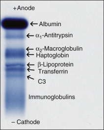

Figure 19-1 

Positions of major serum proteins in a normal person using electrophoresis in agarose. 

Individual proteins separate according to their electrical charge between the anode (positive pole) and the cathode (negative pole). 

Through critical manipulations of buffer salt composition, endosmotic properties of the medium, and means of sample application, commercially available electrophoretic agarose plates now achieve consistently high-resolution quality that allows routine separation of all major serum protein species ( [ Fig. 19-2 ](<#f0015>) ). Because of variability in the chemical formulations of gels, it should not necessarily be expected that each manufacturer's electrophoretic system will yield identical protein separation patterns. Furthermore, optimal separation of isoenzymes generally requires different buffer and gel composition compared with the conditions for best resolution of serum proteins versus lipoproteins versus hemoglobins. A significant variation in conditions for protein electrophoresis is that for optimizing the separation of the γ-region to resolve and detect oligoclonal bands of immunoglobulin in cerebrospinal fluid (CSF). In this case, the endosmosis is set high to maximize the cathodal movement of immunoglobulins from the point of application over a span of the gel that is convenient for visual inspection. 

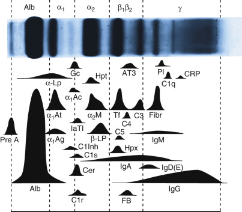

Figure 19-2 

Plasma protein electrophoresis pattern in agarose gel is composed of five fractions, each composed of many individual species. 

Some of the major proteins are shown here in an artist's rendition for clarity. α _ 1  Ac, _ α 1  -Antichymotrypsin; α _ 1  Ag, _ α 1  -acid glycoprotein; α _ 1  At, _ α 1  -antitrypsin; α _ 2  -M, _ α 2  -macroglobulin; α _-Lp,_ α-lipoprotein; _Alb,_ albumin; _AT3,_ antithrombin III; β _-Lp,_ β-lipoprotein; complement components _C1q, C1r, C1s, C3, C4, C5,_ as designated; _C1Inh,_ C1 esterase inhibitor; _Cer,_ cerulosplasmin; _CRP,_ C-reactive protein; _Gc,_ Gc-globulin (vitamin D–binding protein); _FB,_ factor B; _Fibr,_ fibrinogen; _Hpt,_ haptoglobin; _Hpx,_ hemopexin; immunoglobulins _IgA, IgD, IgE, IgG, IgM,_ as designated; _I_ α _TI,_ inter-α-trypsin inhibitor; _Pl,_ plasminogen; _Pre A,_ prealbumin; _Tf,_ transferrin. 

(Adapted from Laurell CB. Electrophoresis, specific protein assays, or both in measurement of plasma proteins? _Clin Chem_ 19:99, 1973, with permission.) 

Polyacrylamide is an inert support medium whose porosity is easily adjusted by changing the composition of acrylamide before polymerization. Although polyacrylamide gel electrophoresis (PAGE) is applicable to standard separation of native proteins, it can also be used for separating proteins according to molecular weight when they are denatured in the presence of sodium dodecyl sulfate (SDS). SDS-PAGE is at present the most widely used protein electrophoretic technique for research in molecular biology. However, its very power for resolving proteins and separating them into multitudinous subunits has virtually excluded it from routine use in the clinical laboratory. Nevertheless, there is promise for clinical application of two-dimensional electrophoresis (2-DE), which uses standard separation in one direction followed by SDS-PAGE in the perpendicular direction. 2-DE results in perhaps hundreds of identifiable protein peaks, from which it may be possible to obtain important diagnostic information by sophisticated pattern analysis. 

Isoelectric focusing affords superior resolution of closely migrating proteins or various forms of a single protein that differ in charge owing to minor modification (e.g., posttranslational) (see [ Chapter 4 ](<##!/content/3-s2.0-B9780323295680000048?scrollTo=%23c00004>) ). By this technique, proteins migrate through a gel containing a gradient of pH established with a mixture of ampholytes. As each protein reaches the gel location where the pH is equal to its pI, the net charge on it becomes zero. It no longer has electromotive force acting on it, and it comes to rest. Thus the final pattern is strictly according to pI. 

 

##  Precipitation 

Chemical precipitations of serum proteins have been devised to resolve albumin and the globulins into two or more fractions that can then be measured for protein content. With the addition of sodium sulfate, sodium sulfite, ammonium sulfate, or methanol, the globulins tend to precipitate, leaving albumin in solution. By measuring total protein in the original serum and protein in the precipitate or the supernatant, values for albumin and globulin can be derived. The ratio of these values (A/G ratio) has been used extensively because it accentuates abnormalities in serum protein composition, which in disease generally involve depression of albumin and elevation of one or more globulin fractions. Albumin may be depressed owing to decreased synthesis (malnutrition, malabsorption, liver failure, diversion to synthesis of other proteins) or increased loss (proteinuria, accumulation of ascites fluid, enteropathy). Globulins may be elevated owing to increased synthesis of many different proteins as part of acute or chronic reactions to disease. Lowering of albumin and elevation of globulins tend to occur simultaneously in disease, thus leading to exaggerated changes in the A/G ratio as the numerator and denominator move in opposite directions. Precipitation methods are not as accurate as zonal electrophoresis, because some α-globulins may fail to precipitate, thus leading to an overestimate of the albumin fraction. 

Preparative procedures for the isolation of a single minor protein constituent usually begin with a precipitation step to remove the bulk of other undesired serum proteins. The next step in protein isolation typically involves a column that separates on the basis of molecular size (gel filtration) or charge (ion exchange). 

 

##  Column Separations 

Gel filtration media such as Sephadex or agarose beads are rated according to pore size, which in turn determines what size molecules can pass through the interior of each bead or particle of the column. After application of a sample composed of various-sized proteins in aqueous solvent containing buffer and salt, more of the buffer is applied to drive the sample through the column. Very large molecules tend to flow through interstices of the column without entering the beads and emerge first from the bottom of the column in the void volume. Slightly smaller molecules enter the largest pores before being washed through and so are slightly retarded in passing through the column. Small protein molecules pass into still smaller pores and are retained still longer. Finally, particles the size of dissolved salt penetrate farthest into the interior of gel filtration beads and come out after all the proteins have emerged in an amount of applied buffer called the salt volume. Thus in gel filtration, the order of protein elution is by molecular weight or size, from largest first to smallest last. Because all protein species continuously move through a gel filtration column all at the same time but at different rates, it is necessary to apply the sample in a small and uniform volume to optimize separation between peaks. Gel filtration requires that the medium be inert and not interact chemically or by charge with the proteins. It is not a method to be employed for high-resolution separation. 

Ion-exchange chromatography, on the other hand, takes advantage of the charge on proteins to bind them to beads of a support medium with positively charged components such as diethylaminoethyl or quaternary aminoethyl. In anion-exchange chromatography, proteins are usually applied at a basic pH such as 8.6, at which they may be negatively charged (albumin and α 1  -, α 2  -, and β-globulins are anions) or may have no net charge (γ-globulins). The neutral proteins pass immediately through an anion-exchange column, whereas the anionic ones stick to the positively charged column matrix. If a buffer with a higher salt concentration is washed through, anions of the salt displace the anionic proteins and exchange for them by binding to the support medium. The proteins then elute from the column. By using a steadily increasing gradient of salt concentration in the eluting buffer, the proteins can be resolved according to charge. The ones with a small amount of charge will elute first, whereas those with the greatest charge (e.g., albumin) elute only when displaced by higher salt levels. 

Alternatively, if pH is lowered while salt concentration is held low, anionic proteins acquire a net neutral or slightly positive charge and pass through the column. A gradient of falling pH can be used to resolve anionic proteins, with the order of elution being roughly β-, α 2  -, and α 1  -globulins, and albumin. Note that this order of elution is the reverse order of electrophoretic migration at pH 8.6, because in anion-exchange chromatography, mobility is retarded according to net negative charge, whereas in electrophoresis, mobility is enhanced by that charge. 

Cation-exchange chromatography begins at an acid pH, with the proteins having positive charge (cations) and adhering to a negatively charged column matrix such as carboxymethylcellulose. They can be displaced by the cations of high salt in an eluting buffer or by increasing the pH, which will reverse the charge on the proteins to negative. By cation exchange, albumin should elute first, followed by α 1  -, α 2  -, β-, and γ-globulins. 

Another separation modality by column is hydrophobic chromatography, in which samples are applied at high salt and are eluted with low salt. The support medium interacts with proteins with a hydrophobic nature; this is a good complementary technique to follow ion-exchange chromatography, in which the sample was eluted with high salt. 

Affinity chromatography is based on specific binding between a protein of interest and another protein that has been covalently linked to the solid support medium of a column. For example, coagulation factor VIII complexed with von Willebrand factor (vWF) can be selectively removed from the other plasma proteins by passing plasma through a column that contains monoclonal anti-vWF antibody linked to the solid phase matrix. The factor VIII-vWF complex selectively binds to the column as other plasma proteins wash through. The factor VIII is then dissociated from the vWF, thereby allowing it to elute in a purified fraction suitable for transfusion therapy. Such antigen–antibody interactions may be disrupted by high salt concentration, change in pH, or a chemical denaturant, such as urea, in different applications. Other affinity chromatography gels use a binding phenomenon that mimics naturally occurring molecular interactions. Thus some dyes coupled to agarose are able to bind albumin, thereby removing it selectively from serum. Therapeutic antibodies or their Fab portions are concentrated with affinity columns containing their intended target antigens (e.g., Digibind for digoxin, CroFab for crotalid snake venom). Immunoglobulins can also be absorbed from a sample by staphylococcal protein A coupled to the gel matrix. Many other separation schemes can effect a high degree of purification in a single step with affinity chromatography medium coupled to dyes, drugs, nucleotide cofactors, and sugars. A clinical test using affinity chromatography is quantitation of glycosylated hemoglobin using a dihydroxyboronate affinity matrix that selectively binds molecular species of hemoglobin to which glucose has been covalently attached, while allowing the nonglycosylated forms to pass through the column. The glycosylated hemoglobin is then separately eluted and quantitated. 

Capillary electrophoresis is a separation method based on flow through a capillary tube that can be tailored to resolution of different molecules based on size, hydrophobicity, or stereospecificity. It is applicable to large molecules such as DNA or proteins, as well as to small ones such as hormones or therapeutic drugs. Physically, the method is similar to high-performance liquid chromatography (HPLC), in which solvent is pumped through a column that retains or passes solutes according to chemical interactions. Capillary electrophoresis for serum proteins employs a column with properties similar to agarose, so the separation of proteins is comparable with that from electrophoresis. This analysis can be automated with a detector at the effluent end that detects and quantitates protein bands without the need for staining and separate scanning. Although equipment costs are relatively high for capillary electrophoresis, reagent and labor costs are low, and the procedure is fast and very quantitative, leading to the promise of more widespread clinical applications in the future (  Chen, 1991  ;  Brinkman et al, 2004  ). When a monoclonal immunoglobulin band is suspected by capillary electrophoresis, further treatment of the specimen with anti-IgG, anti-IgA, anti-IgM, anti-kappa, and anti-lambda antisera is done in separate aliquots prior to performing the electrophoresis again; the monoclonal protein type is identified as the band that disappears with that antiserum. This approach is satisfactory for relatively high concentrations of monoclonal proteins, but it does not have good detection and quantitation power at lower concentrations of those proteins (  Huang et al, 2014  ). 

,  

##  Protein Detection and Quantitation 

The ultimate reference method for determining concentration of protein is the analysis for nitrogen content. Nitrogen is present uniformly along the peptide bonds throughout the length of a protein and more irregularly in the side groups, wherever tryptophan, arginine, lysine, histidine, asparagine, or glutamine is present. The Kjeldahl technique consists of acid digestion to release ammonium ions from nitrogen-containing compounds. The ammonium can then be quantitated by conversion to ammonia gas and titration as a base, or by nesslerization, in which double iodides (potassium and mercuric) form a colored complex with ammonia in alkali. Although determination of nitrogen content can be extremely precise, its use for calculation of protein concentration depends on the exact protein composition of a sample, because each protein has a somewhat different nitrogen content according to amino acid composition. However, for a sample of a purified protein, nitrogen content is highly accurate for estimating protein concentration when the nitrogen content on a molar basis is already known for that purified protein. Knowledge of a protein's exact amino acid sequence allows an accurate calculation of what the nitrogen content should be. Because clinical samples consist of unpredictable mixtures of different proteins, and measurement of nitrogen content is not a simple procedure, it is not commonly used in clinical laboratories. 

Refractive index can be accurate for measuring serum protein concentration as dissolved solute for levels above 2.5 g/dL. Hemolysis, lipemia, icterus, and azotemia produce erroneously high results. Refractive index cannot be used for urine protein measurements because of excess amounts of solutes in relation to the protein. 

Specific gravity (and thus, by inference, protein content) can be estimated by pipetting drops of serum or blood into a graded series of copper sulfate solutions. A protein–copper shell forms about the drop to prevent dissolution for a short interval, during which time the drop falls to the bottom, remains stationary, or rises to the top. The protein concentration of a sample is estimated from the specific gravity of the copper sulfate solution in which the drop remains stationary. This technique is simple and has been used widely as a screening test for hemoglobin concentration in whole blood. 

Proteins in solution absorb ultraviolet light at 280 nm (A  280  ), owing mostly to tryptophan but also to tyrosine and phenylalanine (  Layne, 1957  ). For accurate conversion of A  280  readings to protein concentration, the molar absorptivity must be used, because each protein contains a different amount of these three amino acids. However, the A  280  of a mixture of proteins is not a perfect measure of protein content because molar absorptivities vary greatly among different proteins. Because nucleic acids (which absorb strongly at 260 nm and also somewhat at 280 nm) may be present in protein preparations, a better estimate of protein concentration in the presence of nucleic acids is given by the formula: 

 Protein concentration  (  mg  /  mL  )  =  1.55  × A  280  − 0.76  × A  260 

Direct measurements of absorbance can be used for quantitating proteins in the range of 0.05 to 1.5 mg/mL. 

Turbidimetric methods are often used for a similar concentration range in CSF or urine. Protein forms precipitate on the addition of trichloroacetic acid, sulfosalicylic acid, or other acid reagent. The resulting turbidity can be used for protein quantitation by increment in optical density in comparison with similarly treated standards. However, these techniques are not specific to proteins, because other acid-insoluble substances, such as nucleic acids, can also precipitate. 

A colorimetric technique highly specific for proteins and peptides is the Biuret method, by which copper salts in alkaline solution form a purple complex with substances containing two or more peptide bonds. Interferences are minimal, although ammonium ion may acidify the reaction, while hemoglobin and bilirubin absorb in the same region as the Biuret complex (540 to 560 nm). The Biuret method is extensively used in clinical laboratories, particularly in automated analyzers in which protein concentration can be measured down to 10 or 15 mg/dL. 

Greater sensitivity can be obtained using the Folin-Ciocalteu reagent (or phenol reagent, phosphotungstomolybdic acid), which oxidizes phe­nolic compounds such as tyrosine and, in addition, tryptophan and histidine to give a deep blue color. 

Lowry and colleagues (1951)  used the Biuret method, followed by the phenol reagent, which greatly enhanced color formation, because the phenol reagent can react with Biuret complexes involving all peptide bonds. The Lowry assay has been extensively used for consistently accurate determinations of protein concentration. Further sensitivity for detection down to 1 µg of protein can be obtained using Coomassie brilliant blue dye, which is free of interferences from a very wide range of substances. 

Comparable sensitivity is obtained with ninhydrin, which develops a violet color by reacting with primary amines. This reagent is widely used for detection of peptides and amino acids after paper chromatogaphy and amino acid analyses from ion-exchange columns, as well as for detection of drugs on toxicology screens using thin-layer chromatography (see [ Chapter 23 ](<##!/content/3-s2.0-B9780323295680000231?scrollTo=%23c00023>) ). 

Quantitation of albumin in the presence of other proteins is possible by virtue of the specific binding of albumin to certain dyes such as bromphenol blue, methyl orange, hydroxybenzeneazobenzoic acid, bromcresol purple, and bromcresol green (BCG). BCG is used extensively in automatic analyzers for determining serum albumin in parallel with Biuret reagent for total protein. Dyes bound to albumin absorb maximally at slightly different wavelengths, thus allowing direct spectrophotometric quantitation of the albumin. 

The standard dyes used for staining electrophoresis are Coomassie brilliant blue, Ponceau S, and amido black. For detection of minor components in high-resolution gels, silver staining is very sensitive down to nanogram quantities (  Merril et al, 1981  ). In addition, special dyes, such as Oil Red O and Sudan black, stain lipoproteins, and periodic acid–Schiff stains glycoproteins separated in special electrophoretic applications. 

Because electrophoresis followed by staining does not afford explicit identification of serum proteins, immunologic measurements have been instituted for quantitation of individual proteins (  Laurell, 1966  ). Nephelometry detects the turbidity produced usually within minutes or less by the precipitation of a reagent antibody with its target protein in a serum sample (  Maachi et al, 2004  ). The major serum proteins are now widely measured by this method on automated immunochemistry analyzers that have supplanted former measurements by radial immunodiffusion. Owing to the specificity of the antibody reagent, nephelometry has great specificity for quantitating individual proteins, even in the presence of others. Proteins present in lower concentrations may be quantitated by immunologic methods, such as radioimmunoassay (RIA) or enzyme-linked immunosorbent assay. 

,  

##  Specific Plasma Proteins 

 

##  Major Components 

The major serum proteins are those components that are readily resolved and detected on electrophoretic gels stained by conventional clinical laboratory techniques ( [ Table 19-1 ](<#t0010>) , and see [ Fig. 19-1 ](<#f0010>) ). 

TABLE 19-1 

Characteristics of Major Plasma Proteins 

Protein  |  Concentration Range (g/L)  |  Molecular Weight  |  Actions   
---|---|---|---  
Prealbumin  |  0.15-0.36  |  62,000  |  Binds thyroxine; transports vitamin A   
Albumin  |  39-51  |  66,000  |  Oncotic pressure; amino acid reservoir; carries small molecules   
α 1  -Antitrypsin  |  2.0-4.0  |  54,000  |  Protease inhibitor   
α 2  -Macroglobulin  |  1.5-3.5  |  725,000  |  Protease inhibitor   
Haptoglobulin  |  0.4-2.9  |  100,000 (Type 1-1)  |  Binds hemoglobin   
β-Lipoprotein  |  2.7-7.4  |  380,000  |  Lipid transport   
Transferrin  |  2.0-4.0  |  80,000  |  Transports iron   
C3  |  0.6-1.4  |  185,000  |  Component of complement system   
Fibrinogen  |  1.0-4.0  |  340,000  |  Clot formation   
Immunoglobulin A  |  0.4-3.5  |  160,000  |  Surface immunity   
Immunoglobulin D  |  0.1-0.4  |  180,000  |   
Immunoglobulin E  |  50-600 (µg/L)  |  180,000  |  Binds to mast cells; hypersensitivity reactions   
Immunoglobulin G  |  7-15  |  150,000  |  Humoral immunity   
Immunoglobulin M  |  0.25-2.0  |  850,000  |  Humoral immunity primary response   
  
 

##  Prealbumin 

Prealbumin is defined electrophoretically as the fraction that migrates in a position faster than albumin toward the anode. Prealbumin has a tetrameric structure with a total molecular weight of 62,000 Da, making it one of the smaller serum proteins. Each monomer can bind a molecule of thyroxine. As such, it is also called thyroxine-binding prealbumin (TBPA) or transthyretin (TTR), although only a small fraction of thyroxine is actually bound to TBPA in normal individuals, because thyroxine-binding globulin has a 100-fold greater affinity for thyroxine (  Oppenheimer, 1968  ). However, at least one molecular variant of prealbumin, inherited in a familial pattern, has a greatly increased affinity for thyroxine, resulting in elevated serum thyroxine content, although those individuals have normal free thyroxine concentrations and so are euthyroid (  Moses et al, 1982  ). 

Prealbumin plays a significant role in the metabolism of vitamin A by complexing with the retinol-binding protein (RBP), which, in turn, complexes with vitamin A to transport it through the body (  Peterson, 1971  ). RBP is a small protein of only 182 amino acids, so it would be rapidly removed from the circulation by filtration through the kidney if it were not held in the plasma by the larger protein prealbumin, which is not cleared into the glomerular filtrate. The complex of retinol, RBP, and transthyretin appears to be assembled in the endoplasmic reticulum of hepatocytes (  Gaetani et al, 2002  ). 

Prealbumin is rich in tryptophan (sometimes called tryptophan-rich prealbumin) and has considerable β-pleated sheet conformation. A portion of prealbumin is the source of the β-fibrillar amyloid component in type I familial amyloidotic polyneuropathy (  Glenner, 1980  ). This hereditary amyloidosis derives from a mutation in the prealbumin gene that produces a protein (e.g., TTR Met 30 variant or FAP V30M) susceptible to proteolytic cleavage to create the β-structured fragments that are the building blocks of amyloid in nerve fibers (  Saraiva et al, 1989  ;  Ii et al, 1991  ). More than 80 different mutations in transthyretin have been recognized, mostly affecting nerve or heart with amyloid. These pathogenetic variants of prealbumin cannot be distinguished from normal by standard protein electrophoresis. Current diagnosis is based on analysis at the DNA level. A different variant of prealbumin (TTR T60A leading to FAP T60A) presents with a slightly different clinical picture in which disease appears later in life and in which cardiac amyloidosis is more frequent than in FAP V30M. Liver transplantation alone to remove the source of variant prealbumin did not reverse the cardiac amyloid, partly because these patients have significant involvement of multiple organs; consequently, a more favorable outcome might occur with the use of inhibitors of amyloid formation (  Sattianayagam et al, 2012  ). 

Prealbumin has a relatively short half-life in the circulation (roughly 2 days) compared with other major serum proteins. Its synthetic rate is also exquisitely sensitive to intake of adequate nutrition and to alterations in hepatic function where it is produced. Therefore, prealbumin concentrations in serum fluctuate more rapidly in response to alterations in synthetic rate than do those of other proteins such as albumin. For this reason, quantitation of serum prealbumin has major clinical utility as a marker for nutritional status (  Gofferje, 1978  ). Because of the rapid dynamics of its synthesis and clearance, prealbumin is considered to be a better early indicator of change in nutritional status than other commonly used markers, such as albumin and transferrin, which are more abundant but whose levels respond to other factors as well and at slower time scales. In a study of 7815 hemodialysis patients, low levels of prealbumin were associated with greater risks of mortality and hospitalization for infection that were independent of other risk factors, including serum albumin (  Chertow et al, 2005  ). Thus prealbumin measurements can be very important for planning patient management. 

Because of its compactness, prealbumin crosses more easily into the CSF than do the other serum proteins. Therefore, concentrating CSF before electrophoresis allows visualization of a distinct prealbumin band in CSF. CSF normally contains a major peak of albumin plus prealbumin and a small amount of transferrin. Electrophoresis of CSF is usually requested for detection of oligoclonal bands of immunoglobulin, and the presence of a distinct band of prealbumin is used only as a landmark to confirm that the specimen was likely CSF. True prealbumin is generally below the level of detection by serum electrophoresis; instead, it is best quantified by immunologic measurements such as nephelometry. A protein band frequently appears in the prealbumin position of serum from patients who have had heparin therapy. In the circulation, heparin activates and releases lipoprotein lipase activity, which attacks triglycerides in lipoprotein fractions, thereby greatly enhancing their electrophoretic migration anodally. Protein stain reveals apolipoproteins in the prealbumin position but no β-lipoprotein fraction. This is an in vivo effect that does not occur if heparin is added to samples already collected. 

 

##  Albumin 

The single most abundant protein in normal plasma is albumin, usually constituting up to two-thirds of total plasma protein (  Peters, 1975  ). For this reason, depressions in albumin level due to impaired synthesis (e.g., malnutrition, malabsorption, hepatic dysfunction) (  Rothschild et al, 1972  ) or to losses (e.g., ascites, protein-losing nephropathy or enteropathy) result in serious imbalance of intravascular oncotic pressure. This loss is manifested clinically by the development of peripheral edema (  Slater et al, 1975  ). However, the congenital absence of albumin (analbuminemia) generally does not lead to such problems, presumably because of lifelong compensatory mechanisms that control hydrostatic pressures (  Waldman et al, 1964  ). Albumin also serves as a mobile repository of amino acids for incorporation into other proteins. A third function ascribed to albumin is that of a general transport or carrier protein. Many organic and inorganic ligands (e.g., thyroxine, bilirubin, penicillin, cortisol, estrogen, free fatty acids, warfarin [Coumadin], calcium, magnesium, heme) are complexed with different regions of the albumin molecule in covalent (e.g., δ-bilirubin) (  Lauff et al, 1982  ) or dissociable binding (  Koch-Weser et al, 1976  ). These binding interactions with very different ligands are possible because of a wide variety of binding sites on the albumin molecule, which consists of 585 amino acids arranged in nine loops held together by the disulfide bonds between cysteine residues (  Meloun et al, 1975  ). The primary sequence of albumin contains three major regions with three peptide loops each, suggesting that it arose from gene duplication of some ancestral gene in a tandem rearrangement process (  Peters, 1977  ;  Sevall, 1986  ). It is also interesting to note that α-fetoprotein has regions of homology with serum albumin, which may indicate a common ancestral gene origin for these two proteins. 

In addition to the genetic abnormality of analbuminemia, many hereditary variants of albumin differ from the most common allotype, albumin A, by single amino acid substitutions. These variants can be rapid or slow migrating compared with albumin A, leading to two distinct albumin peaks (bisalbuminemia) in the heterozygous state ( [ Fig. 19-3 ](<#f0020>) ). None of the variant albumins appears to affect health, but one variant does have greatly enhanced affinity for thyroxine, which leads to elevated thyroxine content in the serum of such persons, who nevertheless remain euthyroid (  Ruiz et al, 1982  ). At least 77 different mutations in albumin are recognized, 65 of which lead to bisalbuminemia; 12 cause analbuminemia, and 3 have strong binding of thyroid hormones, whereas others show variations due to frameshifts, with modifications near the carboxy terminus of the albumin molecule (  Minchiotti, 2008  ). 

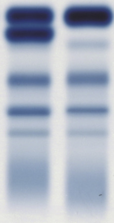

Figure 19-3 

Bisalbuminemia. 

Serum protein electrophoresis with normal pattern in right lane and bisalbuminemia consisting of two equal intensity bands of albumin in left lane. The additional band of albumin in this patient migrated more slowly than normal albumin into the α 1  -region. 

Up to 8% of albumin circulating in normal persons becomes glycosylated nonenzymatically, whereas up to 25% becomes glycosylated during hyperglycemia in analogy with glycosylated hemoglobin (  Guthrow et al, 1979  ). The half-life of circulating albumin is about 17 days, so measurements of the glycosylated form may be useful in monitoring diabetic control during an interval of a few weeks. Measurement of glycosylated albumin (also called fructosamine) can be very useful for assessing diabetic control in patients with hemolytic anemias (e.g., sickle cell disease, thalassemia, autoimmune hemolysis), whose red cell survival is greatly shortened and in whom measurement of glycosylated hemoglobin is unreliable. Glycosylated albumin measurements may not be reliable for assessing diabetic control in patients with protein-losing nephropathy, in which albumin clearance is accelerated. Diabetic patients on hemodialysis can be monitored with glycosylated hemoglobin or glycosylated albumin (  Ghacha et al, 2001  ). 

Analysis of newly synthesized albumin from intracellular sites has revealed the existence of a precursor proalbumin, which has an additional hexapeptide at its amino-terminal end. The primary structure of albumin consists of 35 cysteine residues, of which 34 form intramolecular disulfide bonds and one remains free. On storage for many days, albumin forms covalently linked dimers through the free cysteines, resulting occasionally in an extra band of albumin on electrophoresis. 

Clinical measurements of albumin are very frequent, with determinations of total protein and albumin often included in chemistry panel profiles. Organ- or disease-oriented panels of chemistry tests in current use include the following measurements: comprehensive metabolic panel has albumin and total protein; renal function panel has albumin; and hepatic function panel has albumin and total protein. 

Elevations of serum albumin concentration are infrequent, although they do occur in dehydration as the plasma water phase shrinks. Following rehydration, the albumin level should fall to within the normal reference range. Elevation of serum albumin may also occur artifactually as the result of prolonged application of a tourniquet for venipuncture. In this instance, increased hydrodynamic pressure from venous backup forces water and small solutes out of the intravascular space, thereby concentrating cellular elements, micellar forms of lipoproteins, and proteins such as albumin. 

Depression of albumin concentrations is frequent in sick individuals, and a review of hospitalized patients reveals that a substantial proportion of albumin measurements are below healthy reference ranges (see [ Fig. 19-7 ](<#f0040>) ). Although some of these decreases are likely dilutional, owing to the administration of intravenous fluids, others are caused by loss of albumin into urine, ascitic fluid, or the gastrointestinal tract in enteropathies, or by decreased synthesis in the liver caused by hepatic disease such as cirrhosis or by secondary effects on synthesis resulting from compromised nutrition or diversion of synthetic capacity to other proteins. This sensitive but nonspecific reduction of albumin in so many different conditions has led to its being termed a “negative acute phase reactant” (  Post et al, 1991  ). Measurements of albumin concentrations are vital to the understanding and interpretation of calcium and magnesium levels because these ions are bound to albumin, so decreases in albumin are directly responsible for depression of their concentrations, too. In some disease states, decreases in albumin are at least partially compensated for by increases in other serum proteins, thereby stabilizing oncotic pressures intravascularly. In particular, cirrhosis shows a major polyclonal increase of immunoglobulins in the γ-fraction ( [ Fig. 19-4, _A_ ](<#f0025>) ) and nephrotic syndrome shows high levels of α 2  -macroglobulin ( [ Fig. 19-4, _B_ ](<#f0025>) ). In acute heart failure of elderly patients, increased albumin has been shown to be associated with decreased 180-day mortality in patients over 80 years old (  Metra et al, 2014  ). 

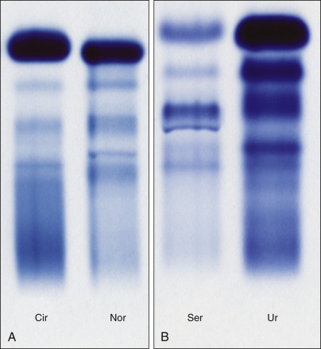

Figure 19-4 

**A,** Serum protein electrophoresis in cirrhosis (Cir) shows more rapidly migrating albumin compared with normal serum (Nor) because of the additional negative charge from covalently linked conjugated bilirubin (i.e., δ-bilirubin). The γ-globulins are broadly increased in the polyclonal elevation characteristic of cirrhosis of the liver. **B,** Protein electrophoretic patterns of serum (Ser) and concentrated urine (Ur) in a patient with nephrotic syndrome. Smaller molecular-sized proteins such as albumin are preferentially lost from blood into urine. Larger proteins such as α 2  -macroglobulin and β-lipoprotein are retained in the blood and constitute major bands in the serum pattern. 

Body fluids that form normally, such as CSF, or pathologically, such as filtrates of plasma (e.g., ascites), contain albumin as the major component, with very little contribution from other plasma proteins. The presence of albumin in the urine is generally considered abnormal even in trace amounts, although some healthy individuals exhibit albuminuria following intense exercise. Progression of diabetic nephropathy can be assessed by the quantitative measurement of albuminuria, as it tends to appear ahead of the other serum proteins in urine during the course of renal glomerular damage. Immunologic measurement of microalbumin in urine is now considered a standard of care for management of diabetes mellitus and the early detection of diabetic complications. The nephrotic syndrome, which is marked by extensive hypoalbuminemia, is often due to diabetic nephropathy or one of several other primary glomerular diseases (  Orth & Ritz, 1998  ). 

 

##  ** α ** 1  -Antitrypsin 

The major component of the α 1  -globulins is the protease inhibitor α 1  -antitrypsin (AAT), which has the capacity to combine with and inactivate trypsin (  Eriksson, 1965  ;  Berninger, 1985a  ). The first clue to this function came with the discovery that the serum of some young adults with pulmonary emphysema was deficient in α 1  -globulin. Further investigation revealed a similar deficiency of AAT in children with cirrhosis (  Sveger, 1976  ). Usually, no appreciable circulating levels of trypsin are found in blood, but other related proteases, such as elastase, are released from leukocytes responding to irritants or inflammation. AAT is able to neutralize the activity of these proteases, too, and thus is an intrinsic factor in the homeostatic mechanism modulating endogenous proteolysis within the body and preventing inappropriately severe biochemical response to inflammation (  Cox, 1986  ). 

AAT is coded for by the gene _SERPINA1_ on chromosome 14. A majority of people are homozygous for the normal fully active _M_ allele of AAT, or phenotype MM (  Lieberman et al, 1972  ). About 10% of Caucasians (and fewer of other races) are heterozygous for _M_ and some other allele of the protease inhibitor or Pi system. More than 2% carry the _PiZ_ allele and exhibit the phenotype MZ. Although these individuals have somewhat reduced levels of trypsin inhibitory capacity in serum, they are generally asymptomatic; however, their homozygous ZZ offspring (who have very low levels of AAT) are susceptible to pulmonary or hepatic disease. The ZZ phenotype occurs in about 1 in 4000 individuals. Another common variant is the _PiS_ allele, which shows moderate reduction in synthesis. Although the MS phenotype does not show related disease, both SS and SZ phenotypes are suspected to have increased risk of lung or liver disease. Another allele that may need special attention to detect is the null variant that produces no AAT protein. 

Although AAT deficiency can be recognized on serum protein electrophoresis, an efficient diagnostic algorithm employs measurement of AAT concentration followed by phenotyping with isoelectric focusing electrophoresis and genotyping with molecular assays designed to detect specific mutations (  Snyder et al, 2006  ;  Bornhorst et al, 2007  ). Definitive typing may require analysis of the DNA sequence for the _AAT_ gene. At least 75 different alleles exist for _AAT_ . About 17 alleles have sufficiently low protein production to lead to pulmonary disease, and only a few are responsible for liver disease (  Cox, 1986  ). 

Therapy for pulmonary emphysema secondary to AAT deficiency has been greatly advanced by intravenous replacement of AAT, using concentrates or recombinant protein to bring circulating levels into ranges sufficient for antielastase protection to the lungs (  Snider, 1989  ). Further replacement has also been successful with AAT inhalation for patients in whom pulmonary disease has not yet become extensive (  Hubbard et al, 1989  ). Avoidance of cigarette smoking by homozygous individuals is essential, because cigarette smoke is a major source of irritants that trigger leukocytes in the lung to release proteases (  Gelb et al, 1977  ). The cirrhosis in young children is treated by hepatic transplant, because the liver is the site of AAT synthesis. An interesting aspect of cirrhosis and the ZZ phenotype is the presence of unsialylated mutant-type AAT granules in the hepatocytes, implying a defect of secretion in those alleles. Cirrhosis secondary to AAT abnormality has not been improved by replacement therapy. Children with this disorder can develop progressive, severe cholestasis, prompting liver transplantation. Following transplant, the recipient takes the AAT phenotype of the donor. One approach suggested for treatment of AAT ZZ phenotype is to enhance the secretion of that abnormal molecule with a chemical chaperone and so reverse or prevent the intracellular deposits of AAT that cause damage to hepatocytes (  Chanprasert & Scaglia, 2015  ). 

AAT is one of the serum glycoproteins that rise in response to acute inflammation, but such elevations lack clinical specificity. The α 1  -fraction never appears completely empty in AAT deficiency, because other proteins (e.g., α-lipoprotein, α 1  -acid glycoprotein) migrate there but do not resolve into distinct bands. Genetic screening for AAT deficiency may be useful in targeted populations, resulting in early diagnosis, improved outcomes, and guidance for affected kindreds (  Aboussouan & Stoller, 2009  ). 

 

##  α 2  -Macroglobulin 

α 2  -Macroglobulin (AMG) is the largest major nonimmunoglobulin protein in plasma, with a molecular weight of 725,000 Da (  Roberts, 1985  ). The serum concentration in normal individuals is comparable with that of the other major protease inhibitor, AAT, although women have higher levels than men in response to estrogen (  Horne et al, 1970  ). The concentration of AMG rises tenfold or more in the nephrotic syndrome when other lower molecular weight proteins are lost (  Beetham & Cattell, 1993  ). The loss of AMG into urine is prevented by its large size. The net result is that AMG reaches serum levels equal to or greater than those of albumin (≈2 to 3 g/dL) in the nephrotic syndrome, which has the effect of maintaining oncotic pressure (see [ Fig. 19-4, _B_ ](<#f0025>) ). Synthesis of AMG in nephrotic syndrome may also be enhanced, which accounts for its absolute increase in concentration. AMG inactivates proteases by complexing with them and forming covalent bonds to them. Its own conformation is thereby altered, which enhances clearance by the reticuloendothelial system. At least four molecular forms of AMG differ in sialic acid, mannose, and galactose content and can be separated by isoelectric focusing. Other molecular variations probably are the result of proteases linked to AMG before removal from the circulation. The spectrum of inhibition by AMG is very wide, including virtually all types of serine, carboxyl, thiol, and metal proteases. AMG complexes with prostate-specific antigen (PSA) in a form that is not detected by immunoassay for PSA (see [ Chapter 74 ](<##!/content/3-s2.0-B9780323295680000747?scrollTo=%23c00074>) ). Although AMG function is certainly important for maintaining balance in the ebb and flow of proteolysis, no specific deficiency with associated disease has been recognized, and no disease state is generally attributed to low concentrations of AMG. Mild but distinct elevations of AMG can be observed on serum protein electrophoresis early in the course of diabetic nephropathy. 

AMG inactivates proteases through a molecular trap mechanism using a bait region to bind proteases that then are bound to AMG and cleared by macrophage receptors (  Armstrong, 2006  ). AMG also has separate binding sites for β-amyloid peptide, transforming growth factor-β, nerve growth factor-β, and platelet-derived growth factor-BB. Polymorphisms of AMG may be important in the modulation and clearance of these substances, leading to varying risk for disorders such as Alzheimer's disease (  Mettenburg & Gonias, 2005  ). 

 

##  Haptoglobin 

The other major protein migrating in the α 2  -region is haptoglobin, which has the function of combining with hemoglobin released by lysis of red cells to preserve body iron and protein stores. The circulating half-life of haptoglobin, free of hemoglobin, is roughly 4 days. Hemoglobin–haptoglobin complexes are removed from the circulation within minutes by the reticuloendothelial system, where the hemoglobin is broken down into globin and heme, which further degrades to iron and bilirubin. Haptoglobin–hemoglobin complexes bind to the CD163 monocyte/macrophage scavenger receptor for removal from the circulation by endocytosis (  Buehler et al, 2009  ). When the hemoglobin-binding capacity of haptoglobin is exceeded, free hemoglobin enters the glomerular filtrate as α-chain–β-chain dimers that are subsequently reabsorbed in the proximal renal tubules and converted to hemosiderin. 

Haptoglobin has two heavy chains and two light chains linked by disulfide bonds in analogy to the basic structure of immunoglobulins. Some persons have a light chain gene that is duplicated in a head-to-tail arrangement (Type 2). Normal haptoglobin (Type 1-1) gives rise to a single molecular species of molecular weight 100,000. Heterozygous individuals (1-2) have, in addition to Type 1-1 haptoglobin, a series of multimers (e.g., dimers, trimers) by virtue of intermolecular disulfide linkages through the duplicated light chain. Type 2-2 haptoglobin consists of a different series of multimers, because the Type 2 light chain has a different molecular weight from the Type 1 light chain (  Konigsberg, 1974  ). These different forms of haptoglobin can be distinguished by high-resolution electrophoresis ( [ Fig. 19-5 ](<#f0030>) ). 

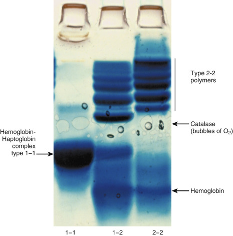

Figure 19-5 

Phenotyping of haptoglobin. 

Patient serum specimens were mixed with free hemoglobin from erythrocytes lysed in vitro and electrophoresed in a polyacrylamide gel with high resolution of different molecular weight proteins. After electrophoresis, the gel was developed in a solution of substrate 3,3′,5,5′-tetramethylbenzidine and hydrogen peroxide. Hemoglobin exhibits pseudoperoxidase activity that converts substrate to a blue product wherever it has migrated, including complexes with haptoglobin. Bubbles of oxygen formed in the gel at the location of catalase, which is also present in the lysate. Type 1-1 haptoglobin _(arrow in left lane)_ migrated deeply into the gel _(from top to bottom),_ although unbound hemoglobin migrated even farther. Type 2-2 haptoglobin showed no band in the 1-1 position but migrated as a series of high molecular weight polymers, each binding hemoglobin _(bar next to right lane)._ Type 1-2 haptoglobin _(middle lane)_ showed a minor band of 1-1 plus a series of high molecular weight polymers different from the bands observed with 2-2. 

Haptoglobin can be quantitated in terms of its hemoglobin-binding capacity or by immunologic means, especially nephelometry. Owing to steric hindrance between molecular sites on the multimers, the different phenotypes of haptoglobin yield measurements of antigen- or hemoglobin-binding capacity that may be discrepant with the absolute amount of haptoglobin protein present in a sample. Accordingly, the reference range for haptoglobin is broader for an entire population of different phenotypes than within individual phenotypes. For this reason, interpretation of haptoglobin concentrations is soundest for serial measurements in the same individual. However, very high levels can readily be distinguished from very low ones, which can be important in the first-time evaluation of a patient for hemolysis. Congenital deficiency of haptoglobin appears not to have clinical consequences (  Manoharan, 1997  ). 

In diabetes mellitus, patients with Type 2-2 haptoglobin have shown higher risk for vascular complications, perhaps owing to different ability to clear hemoglobin, thus leading to altered iron handling and heightened oxidative load (  Van Vlierberghe et al, 2004  ;  Levy et al, 2010  ). 

Serum haptoglobin rises in response to stress, infection, acute inflammation, or tissue necrosis, probably by stimulation of synthesis (see later under Acute Phase Reactants). After a hemolytic episode, haptoglobin concentrations fall as the complexes with hemoglobin are cleared from the circulation. This effect is dramatic following massive hemolysis in situations of hemolytic transfusion reaction, thermal burns, or autoimmune hemolytic anemia. It is also a useful measurement for serially monitoring patients who have a slow but steady rate of red cell breakdown such as by mechanical heart valves, hemoglobinopathies, or exercise-associated trauma. Low haptoglobin concentrations may accompany liver disease when hepatic synthetic capacity is impaired. There are also individuals with congenital deficiency of haptoglobin who apparently use other mechanisms to conserve body iron stores. Serum samples from blood hemolyzed in vitro during phlebotomy or processing show a displaced band of haptoglobin–hemoglobin complex on protein electrophoresis. 

It should be noted that myoglobin does not bind to haptoglobin; therefore, release of large amounts of myoglobin by rhabdomyolysis does not diminish haptoglobin levels in serum. This difference can be useful in the workup of a positive dipstick test for blood (actually a test for pseudoperoxidase activity of heme in hemoglobin or myoglobin) in urine with no coexisting red cells. In this case, low serum haptoglobin suggests hemoglobinuria (hemolysis), whereas high serum haptoglobin suggests myoglobinuria. Lactate dehydrogenase (LD) isoenzyme 1 in serum is also associated with hemolysis, whereas LD5 and creatine kinase are released in rhabdomyolysis. 

 

##  β-Lipoprotein 

β-Lipoprotein (low-density lipoprotein [LDL]) migrates with a characteristic sharp leading cathodal edge and feathery trailing region more ano­dally. Although it is better quantitated by stains for lipid, apoprotein content is sufficient to be a distinct band on staining for protein. The exact position of the β-lipoprotein band is sensitive to recent ingestion of fatty foods; thus samples from fasting versus postprandial collections will show the β-lipoprotein in slightly different positions. The other lipoproteins (very-low-density lipoprotein, high-density lipoprotein, and chylomicrons) are relatively small in intensity, and they occur in overlapping electrophoretic positions with other serum proteins, so these fractions generally are not appreciated on protein stain. Administration of heparin activates postheparin lipoprotein lipase, which degrades triglycerides in the circulating lipoprotein fractions. Consequently, heparinized patients transiently demonstrate an anomalous band of β-lipoprotein that can migrate very rapidly and unevenly across the electrophoretic path, even into the prealbumin region. Elevations of LDL, with greater staining intensity to the β-lipoprotein band, occur in hypercholesterolemia. Lipoproteins are discussed more thoroughly in [ Chapter 17 ](<##!/content/3-s2.0-B9780323295680000176?scrollTo=%23c00017>) . 

 

##  Transferrin 

The major β-globulin is transferrin (siderophilin), which transports ferric ions from the iron stores of intracellular or mucosal ferritin to bone marrow, where erythrocyte precursors and lymphocytes have transferrin receptors on their surfaces (  Irie & Tavassoli, 1987  ). 

Transferrin consists of 687 amino acids with a calculated molecular weight of 79,550 Da (  MacGillivray et al, 1982  ). Analysis of the amino acid sequence shows that transferrin has two homologous domains that may have arisen by contiguous duplication of an ancestral transferrin gene. Each domain has a binding site with very high affinity for iron. Transcription of mRNA for transferrin synthesis in the liver is regulated by the concentration of iron in the circulation and surrounding the hepatocytes. 

In normal serum, transferrin ranges in concentration from 200 to 400 mg/dL, which is conveniently measured as iron-binding capacity (IBC) (  Tsung et al, 1975  ). In response to short-term iron deficiency, transferrin levels rise markedly to twice normal levels or higher. Because transferrin is a single molecular species with a tight electrophoretic mobility, an elevated level can have the appearance of a paraprotein (pseudoparaproteinemia) in cases of severe iron deficiency (  Zawadzki, 1970  ). At least some iron deficiency and elevation of transferrin should be expected with pregnancy (  Mendenhall, 1970  ). Administration of iron to deficient patients increases saturation; this is followed by return of transferrin to normal. 

Chronic saturation of transferrin occurs in idiopathic hemochromatosis and transfusional hemosiderosis. Because almost no unsaturated IBC is found in those syndromes, iron cannot be mobilized normally for excretion, resulting in excess deposition in tissues that is toxic. Current strategies to screen for hemochromatosis include measurement of serum iron and serum transferrin (usually by nephelometric immunoassay), with the calculation of percent saturation as the best index for identifying previously unrecognized cases. Hemochromatosis is a hereditary disorder that results in cirrhosis, diabetes, cardiomyopathy, arthritis, and other endocrine disorders owing to the toxic effects of excess free iron. Screening for hemochromatosis is desirable because disease progression can be halted by lowering the body burden of iron by such means as phlebotomy or chelation therapy. 

Transferrin may also demonstrate an antibacterial effect by complexing iron and removing it from bacteria that require iron for growth (  Reddy et al, 1970  ;  Weinberg, 1978  ). Congenital deficiency of transferrin (atransferrinemia) is a rare disorder characterized by microcytic anemia and iron overload (  Aslan et al, 2007  ). In protein-losing nephropathy of sufficient severity, transferrin is lost from the circulation into the urine, carrying iron with it. This loss may contribute to the development of hypochromic anemia. 

Electrophoretic variants of transferrin occur occasionally in serum owing to allotypic variation in the amino acid sequence and thus have a different charge on the molecule. In this case, the heterozygous state shows a doublet in place of a single electrophoretic band for transferrin (  Kamboh & Ferrell, 1987  ). 

Transferrin is a glycoprotein in which various sugar molecules are added to newly synthesized protein molecules in the liver. Persons who engage in heavy alcohol consumption demonstrate abnormal carbohydrate-deficient transferrin (CDT) in their serum (  Stibler, 1991  ). These aberrant molecules of disialo- and asialotransferrin as opposed to normally glycosylated tetrasialotransferrin may be due to failure of glycosyltransferases in hepatocytes, to increased sialidase activity in serum, or to a combination of the two (  Xin et al, 1995  ). CDT can be detected by anion-exchange chromatography or isoelectric focusing of isoforms in serum followed by immunoblotting. Other methods include HPLC, capillary zone electrophoresis, mass spectrometry, and turbidimetric immunoassay (  Bean et al, 2001  ). Although CDT is generally considered to be a highly specific marker for chronic alcohol abuse (  Arndt, 2001  ), false negatives can occur in women, in nonsmokers, and in persons who have a high body mass index (both overweight and obese) (  Whitfield et al, 2008  ). 

A variant of transferrin has been recognized in CSF (  Zaret et al, 1992  ), aqueous and vitreous humor of the eye (  Tripathi et al, 1990  ), and perilymph of the ear (  Thalmann et al, 1994  ). Chemically, it lacks sialic acid in glycosylation compared with the transferrin found in plasma (  Hoffmann et al, 1995  ); it is called asialotransferrin, τ protein, or β 2  -transferrin, which has slightly different electrophoretic migration (toward the cathode), because it carries less negative charge than plasma transferrin (  Blennow & Fredman, 1995  ). CSF contains both forms of plasma transferrin and asialotransferrin, whereas plasma contains only one form. Consequently, detection of asialotransferrin in fluid from a fistula or drainage is presumptive evidence for the presence of CSF in cases of skull fracture or other head trauma with nasal drainage (  Solomon et al, 1999  ), or for the presence of perilymph in fistula fluid from otologic procedures such as cochlear implants (  Delaroche et al, 1996  ). Asialotransferrin reacts immunologically as transferrin, so it can be readily detected by immunoblotting following electrophoresis (  Roelandse et al, 1998  ). This procedure is easily done by adapting commercially available agarose gel electrophoresis systems already used in many laboratories for direct immunofixation of immunoglobulins (  Normansell et al, 1994  ); using an antitransferrin antibody demonstrates a single band of transferrin in serum samples, but two bands if the specimen contains CSF ( [ Fig. 19-6 ](<#f0035>) ). It is necessary to include serum in addition to test fluid from the patient to rule out allelic variants of transferrin that could cause false positives if not recognized (  Sloman & Kelly, 1993  ). The presence of CSF in drainage fluid may require surgical repair or antibiotic therapy, so detection of asialotransferrin as a marker for CSF can have a substantial clinical impact. 

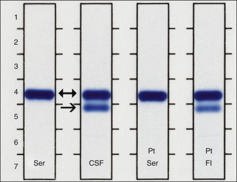

Figure 19-6 

Immunofixation with transferrin antibody to test for presence of cerebrospinal fluid (CSF). 

_Ser,_ Normal serum showing position of transferrin (Tf; _double-headed arrow_ ); _CSF,_ normal position of Tf and asialotransferrin (aTf, _single-headed arrow_ ); _Pt Ser,_ patient serum included to rule out electrophoretic variant of Tf; _Pt Fl,_ unknown fluid from patient demonstrating bands of both Tf and aTf that confirm the presence of CSF in that fluid. 

 

##  Complement 

A separate fraction of β-globulin consists of the C3 component of complement. Although this protein can be resolved easily with a fresh serum sample, in stored specimens and commercial control serum that has been lyophilized, C3 is cleaved to form C3c, which migrates anodally to native C3 as a band nondistinct from other β-globulins. Depression of C3 occurs in autoimmune disorders when the complement system is activated and C3 becomes bound to immune complexes deposited in tissues, thereby removing them from plasma. Thus C3 (and also C4) concentration is a convenient marker for assessing disease activity in rheumatic disorders such as lupus erythematosus and rheumatoid arthritis. C4 is not appreciated on serum protein electrophoresis because its concentration is normally only about one-fifth that of C3. Both C3 and C4 are now easily quantitated by nephelometry for monitoring rheumatic disease activity. No particular diagnostic significance is ascribed to higher than normal levels of C3 or C4, except as mild indicators of an acute phase response. The complement system and its inhibitors are discussed further in [ Chapter 47 ](<##!/content/3-s2.0-B9780323295680000474?scrollTo=%23c00047>) . 

 

##  Fibrinogen 

Plasma contains 100 to 400 mg/dL of fibrinogen, which is the most abundant of the coagulation factors and which forms the fibrin clot. With an overall molecular weight of 340,000 Da, fibrinogen is a dimer consisting of three pairs of peptide chains (A-α, B-β, and γ) linked with multiple disulfide bonds near their amino-terminal ends (  Doolittle, 1975  ;  Doolittle et al, 2001  ). This region of the molecule is termed the _E domain_ or _disulfide knot_ . The chains extend outward into two other identical domains (D) at their carboxyl ends, where all three chains are intertwined. Thrombin cleaves fibrinopeptides A and B from the amino ends of the A-α and B-β chains, thereby resulting in a fibrin monomer that polymerizes into fibrils that macroscopically form a fibrin clot. Factor XIII then produces covalent bonds between lysine and glutamine residues on adjacent γ-chains of different fibrin molecules, making the fibrin clot essentially a single molecule. A cross-linked clot is refractory to dissolution by chemical denaturants and is mechanically very stable. 

Numerous hereditary variants of fibrinogen (dysfibrinogenemias) have been identified, in which a functionally abnormal fibrinogen molecule is synthesized with altered amino acid sequence owing to genetic mutation. Some dysfibrinogenemias exhibit impairment of clotting and a hemorrhagic diathesis, whereas others show increased tendency to thrombosis (  Menache, 1973  ). Congenital afibrinogenemia, in which essentially no fibrinogen is synthesized, results in a hemorrhagic disorder that paradoxically is not as severe as the hemophilias in terms of joint abnormalities secondary to hemorrhage (hemarthroses). 

Fibrinogen levels become elevated with the other acute phase reactants, occasionally to over 1.0 g/L. In such instances, the erythrocyte sedimentation rate (ESR) is also markedly elevated owing to fibrinogen content directly. Fibrinogen levels also rise with pregnancy and use of contraceptive medications. Low levels generally indicate extensive activation of coagulation with consumption of fibrinogen. During this process, plasminogen is also activated into plasmin, which degrades fibrin and fibrinogen into split products that are measured for the assessment of intravascular coagulation. Normally, clots that form are removed by the action of plasmin, which, in turn, is inactivated by antiplasmin and the other protease inhibitors. 

Fibrinogen is absent from normal serum but should appear in plasma electrophoresis as a distinct band between the β\- and γ-globulins ( [ Fig. 19-7 ](<#f0040>) ). Not infrequently, blood drawn from heparinized patients does not fully clot, so a fibrinogen band is present on electrophoresis. It can be distinguished by examining the specimen for a fine clot and by repeat electrophoresis of a thoroughly clotted sample. This maneuver is important to distinguish a residual fibrinogen band from a monoclonal spike of immunoglobulin that can migrate in the same electrophoretic position. 

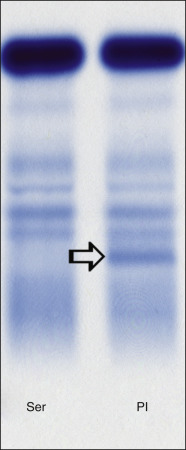

Figure 19-7 

Comparison of serum (Ser) and citrated plasma (Pl) from the same individual demonstrates the position of fibrinogen _(arrow)_ in plasma that should not be confused with a monoclonal immunoglobulin. 

 

##  Minor Components 

The next group of individual proteins consists of those that are not usually detected by standard protein electrophoresis owing to low levels in serum. Their quantitation is typically performed by immunologic methods. 

 

##  Ceruloplasmin 

Migrating with the α 2  -globulins is a copper-binding protein, ceruloplasmin, which contains most of the copper in plasma and exhibits ferroxidase activity that is important in iron metabolism (  Hellman & Gitlin, 2002  ). Synthesized in the liver, it has a molecular weight of 132,000 Da and consists of a single polypeptide chain. Although lower at birth (  Al-Rashid & Spangler, 1971  ), serum levels are 20 to 40 mg/dL in normal adults, with twofold elevations found in oral contraceptive therapy and pregnancy (  Burrows & Pekala, 1971  ) or as an acute phase reactant. Each molecule of ceruloplasmin can bind six atoms of copper, which imparts a blue color to the protein. The combination of this blue with the yellow from other chromogens of plasma imparts a greenish color to plasma with elevated ceruloplasmin concentrations (  Schenker et al, 1971  ); this green appearance is frequently noted in bags of plasma donated for transfusions. Iron is oxidized from ferrous to ferric ions by ceruloplasmin, which may be a means of releasing iron from ferritin for binding to transferrin (  Roeser et al, 1970  ). 

Wilson's disease (hepatolenticular degeneration) results from disordered copper metabolism, in which hepatic excretion of copper into the bile is impaired, leading to toxic deposition of copper in tissues. Normal metabolism of copper includes incorporation by the liver into ceruloplasmin (about six to seven copper atoms per molecule), which is then secreted into the plasma. In Wilson's disease, this process is impaired, and copper that has been absorbed by the body and transported to the liver fails to reenter the circulation as part of ceruloplasmin. Normal excretion of copper through the bile is diminished, with an overall increase in body copper deposits that are toxic to liver, brain, cornea, kidneys, bones, and parathyroids. Diagnosis is usually made in childhood or adolescence, when damage to the liver is first noticed. Other affected persons may present later in life when neurologic changes also occur. Treatment is long-term chelation with penicillamine or, in severe cases, liver transplantation, which may be curative. 

Diagnosis of Wilson's disease is based on physical findings (liver disease, neurologic signs, Kayser-Fleischer ring in the cornea), measurement of low serum ceruloplasmin level, and increased copper concentrations in urine and on liver biopsy. The oxidase activity of ceruloplasmin can be used in a colorimetric assay, with _p_ -phenylenediamine as substrate, for quantitation. Additionally, immunochemical methods are used, because the band is too faint to be used reliably on protein electrophoresis. Because no single clinical or laboratory finding is sufficient to make the diagnosis of Wilson's disease, a combination of them is necessary (  Ferenci, 2004  ). Mutations in the ceruloplasmin gene leading to aceruloplasminemia result in iron overload affecting the pancreas, liver, and brain with a spectrum of neurologic disease (  McNeill et al, 2008  ). 

 

##  Gc-Globulin 

Vitamin D binds to the group-specific component (Gc)-globulin (vitamin D–binding protein [DBP]) (  Daiger et al, 1975  ;  Bikle et al, 1986  ), which migrates as an α 1  -globulin and has a molecular weight of about 51,000 Da. Normal serum concentration is 20 to 55 mg/dL. It may be decreased in severe liver disease. Gc-globulin has two autosomal codominant alleles expressed as three phenotypes: 1-1, 2-2, and 1-2 (  Giblett, 1969  ). Congenital absence of this protein may be a lethal mutation, owing to impairment of vitamin D transport, because vitamin D has low solubility in aqueous media. Gc-globulin binds vitamin D and its metabolites on a mole-per-mole basis, but in plasma, it probably is not fully saturated. Nephrotic syndrome results in urinary loss of DBP, some of which is complexed with vitamin D. This loss of vitamin D may contribute to subsequent problems of calcium metabolism encountered in nephrotic syndrome (  Goldstein et al, 1981  ). As a minor component of plasma proteins, Gc-globulin can be quantitated by radioimmunoassay, radioimmunodiffusion, or rocket immunoelectrophoresis (  Walsh & Haddad, 1982  ;  Westwood & Werrett, 1986  ). More recent studies with immunonephelometry have shown lower levels of Gc-globulin in trauma patients who develop organ dysfunction and sepsis (  Dahl et al, 2003  ). Plasma concentrations of 25-hydroxyvitamin D are affected by polymorphisms of the vitamin D–binding protein (  Sinotte et al, 2009  ) presumably caused by varying levels of this protein associated with the different phenotypes (  Lauridsen et al, 2001  ). 

 

##  Hemopexin 

The β-migrating globulin hemopexin binds heme released by degradation of hemoglobin (  Muller-Eberhard, 1970  ). By this means, this small porphyrin molecule with its iron atom is protected from excretion, thereby contributing to the preservation of body iron stores. Among plasma proteins, hemopexin has the strongest binding affinity for heme, which probably helps to limit the toxicity of free heme (  Tolosano & Altruda, 2002  ). Normal serum concentration is 50 to 120 mg/dL, so it must be quantitated by immunologic means. It has a molecular weight of 70,000 Da, of which 20% is carbohydrate and consists of a single polypeptide chain. Although low levels of hemopexin can occur with nonspecific urinary loss or as the result of decreased synthesis in liver failure, the most profound decreases occur following intravascular hemolysis, when the amount of free hemoglobin exceeds the binding capacity of haptoglobin. The circulating plasma hemoglobin can then degrade to release heme, which is bound molecule per molecule by hemopexin. Heme–hemopexin complexes are cleared from the circulation by hepatocytes, which markedly lower hemopexin concentration in serum. Excess heme then binds to albumin as methemalbumin. As more hemopexin is made available by new synthesis, heme passes from methemalbumin to hemopexin, which continues to depress the hemopexin level. As such, this can be an additional aid for diagnosing hemolysis at an earlier time, after haptoglobin levels have returned to normal but before full clearance of the heme (  Wochner et al, 1974  ). Hemopexin can also be decreased in porphyrias and in rhabdomyolysis and chronic neuromuscular disease (  Delanghe & Langlois, 2001  ). 

 

##  α 1  -Acid Glycoprotein 

This protein, also known as orosomucoid, has a very high carbohydrate content, which minimizes its visualization by standard protein stains (  Alvan, 1986  ). With a molecular weight of roughly 44,000 Da, it passes into the glomerular filtrate to a large extent, resulting in a half-life of only about 5 days in the circulation. Serum levels are normally 40 to 105 mg/dL, with elevations during pregnancy (  Schmid, 1975  ). It is an acute phase reactant, but its biologic function is not known. As a binder of progesterone, it may be important in the transport or metabolism of that steroid hormone. It also binds some drugs (e.g., lidocaine) and keeps them in an inactive circulating pool. Measurements of this protein have clinical utility in interpreting levels of drugs, such as lidocaine, that may achieve high serum concentrations without expected therapeutic effect owing to being complexed in inactive form to higher than normal amounts of α 1  -acid glycoprotein. Some genetic polymorphisms of this protein may be additionally complicated by isomorphic forms from specific tissue sources, although the primary site of its synthesis appears to be the liver. Although measurements of this protein have not been widely employed, its ability to bind various drugs such as the tyrosine kinase inhibitor STI571 (Gleevec, used in chronic myeloid leukemia) has led to concerns over possible drug-refractory states through binding and drug inactivation (  Jorgensen et al, 2002  ;  Le Coutre et al, 2002  ). 

 

##  C-Reactive Protein 

This serum constituent was discovered by mixing the serum of patients who had recovered from pneumococcal infections with C-polysaccharide of that bacterium. Visible flocculates formed, which allowed extensive study and purification of the C-reactive protein (CRP) from serum in the 1940s. It was found that CRP is present in the serum of patients with disorders other than pneumococcal infection but that it rises strikingly whenever there is tissue necrosis. Many other substances react with CRP, such as DNA, nucleotides, various lipids, and other polysaccharides (  Hokama, 1982  ). Thus it appears to serve as a general scavenger molecule. Its molecular weight is between 118,000 and 144,000 Da, with substantial carbohydrate content. The normal serum concentrations are about 100 ng/mL at birth, 170 ng/mL in children, and 470 to 1340 ng/mL in adults. Despite these low concentrations, CRP has major significance as a highly sensitive acute phase reactant (  Deodhar, 1989  ). It is generally measured by its capacity to precipitate C-substance or by immunologic methods, including nephelometry, precipitations, RIA, and enzyme immunoassay (  Saxstad et al, 1970  ;  Claus et al, 1976  ). By electrophoresis, CRP is a γ-migrating protein that may form a minor but distinct monoclonal-appearing band in patients having a severe inflammatory response. CRP levels are sometimes used as a rapid test for presumptive diagnosis of bacterial infection (high CRP) versus viral infection (low CRP) (  Clyne & Olshaker, 1999  ). CRP is often used by rheumatologists to monitor the progression or remission of autoimmune disease. The gene for CRP has been localized to human chromosome 1 (  Whitehead et al, 1983  ). Recent epidemiologic studies have shown that a high-sensitivity assay for CRP can add to the predictive value of serum lipids for identifying individuals at risk of cardiovascular events, presumably owing to the role that inflammation plays in atherogenesis (  Ridker et al, 2000  ). Persons with high normal CRP concentrations are at greater risk for stroke or myocardial infarction than those with low normal values (discussed in greater detail in [ Chapter 18 ](<##!/content/3-s2.0-B9780323295680000188?scrollTo=%23c00018>) ). 

Serial measurements of CRP over a 14-month period in a test subject undergoing personal omics profiling showed marked elevations of CRP corresponding to periods of infection with two different viruses: human rhinovirus and respiratory syncytial virus. This intense profiling demonstrated the continuing utility of CRP for assessing inflammatory responses (  Chen et al, 2012  ). 

 

##  Protease Inhibitors 

In addition to α 1  -antitrypsin and α 2  -macroglobulin, which have already been considered, other distinct inhibitors of different proteases are present in plasma. They include α 1  -antichymotrypsin (AAC) (  Berninger, 1985b  ), inter-α-trypsin inhibitor (IATI) (  Daniels, 1975  ), antithrombin III (AT3), antiplasmin, C1 esterase inhibitor (  Prograis et al, 1985  ), protein C (  Stenflo, 1984  ), and plasminogen activator inhibitor-1 (PAI-1) (  Nilsson & Tengborn, 1984  ). None of these proteins attains plasma concentrations appreciable on stained protein electrophoresis. Whereas the other inhibitors show inhibition over a rather wide range of proteases, AAC is highly specific for neutralizing chymotrypsin, which cleaves peptide bonds at the carboxyl side of tyrosine and phenylalanine residues. AAC has a molecular weight of 68,000 Da, with about 25% carbohydrate content. Normal serum concentration is 40 to 60 mg/dL, but AAC can rise rapidly to five times normal as an acute phase reactant that remains elevated throughout a period of inflammation (  Kosaka & Tazawa, 1976  ). AAC complexes with prostate-specific antigen, measured as the bound form of PSA by immunoassay (see [ Chapter 74 ](<##!/content/3-s2.0-B9780323295680000747?scrollTo=%23c00074>) ). It can be lost along with other low molecular weight serum proteins in the proteinuria of nephrotic syndrome. 

IATI is a glycoprotein of molecular weight 160,000 Da. Its concentration normally is about 50 mg/dL. IATI does not rise appreciably as an acute phase reactant. Its role in disease states is probably similar to that of the major protease inhibitors in preventing autodigestion of tissues by endogenous cellular enzymes (  Daniels, 1975  ). 

AT3 is of special clinical interest because of the role it plays in neutralizing thrombin, which normally becomes activated intravascularly from prothrombin during clot formation. This 62,000-Da protein forms a covalently bonded complex with thrombin over a period of several minutes when mixed in solution. On addition of heparin, the complex formation occurs almost instantaneously (  Rosenberg, 1975  ;  Rosenberg et al, 1985  ;  Rosenberg & Bauer, 1987  ). Although AT3 is probably essential for successful therapeutic administration of heparin, only those rare individuals with marked deficiencies seem to have thrombotic disorders (  Carvalho & Ellman, 1976  ). The action of AT3 extends to other coagulation factors (IX, X, XI, XII, and kallikrein). Serum levels of AT3 may be depressed in severe liver disease or in protein-losing disorders when the similar-sized molecule albumin is lost and also in disseminated intravascular coagulopathy (DIC). A new experimental protocol for treating DIC involves replacing AT3 by infusion of concentrates when the patient's AT3 level falls to very low concentrations as part of the consumptive coagulopathy. Presumably, return to normal levels of AT3 has the effect of blocking further thrombosis systemically. AT3 levels are lower in heparin therapy and slightly elevated in oral anticoagulant therapy owing to increased and reduced turnover, respectively. 

Although AAT, AMG, and AT3 provide the bulk of plasmin-neutralizing activity in serum (  Harpel & Rosenberg, 1976  ), a distinct antiplasmin migrates as an α 2  -globulin (  Lijnen & Collen, 1985  ). This cross-reactivity of serum protease inhibitors for plasmin illustrates the difficulty in sorting out the precise physiologic function of each molecular species, because each one appears capable of substituting for another in different instances. However, antiplasmin binds quantitatively to the majority of plasmin that is generated from plasminogen in human plasma that undergoes clotting. Antiplasmin thus serves as one of the critical checks within the joint coagulation–fibrinolytic system, which maintains hemostasis by balancing clot formation against dissolution. By this mechanism, clot formation and breakdown are generally contained within local regions of the vasculature without extending to the entire circulation. Hereditary deficiency of antiplasmin results in a bleeding disorder due to relatively unlimited fibrinolysis. 

PAI-1 acts to prevent activation of plasminogen, thereby blocking fibrinolysis at an early step. Deficiency of PAI-1 results in less inhibition, leading to greater fibrinolysis and potentially a bleeding disorder. Elevated levels of PAI-1 prevent fibrinolysis, leading to thrombotic disorders and to the progression of atherosclerosis. Protein C (with its cofactor protein S) inactivates activated coagulation factors V and VIII. Deficiency of protein C or S (  Griffin et al, 1987  ) allows prolonged activity in vivo of procoagulant factors, leading to thrombotic disorders. 

The C1 esterase inhibitor is capable of inhibiting activated complement components C1r and C1s, plus some other coagulation and fibrinolytic factors. It rises as an acute phase reactant. Hereditary deficiency of C1 esterase inhibitor allows activation of complement to proceed relatively unabated, a disorder termed _hereditary angioedema_ . The complement system and its inhibitors are described in depth in [ Chapter 47 ](<##!/content/3-s2.0-B9780323295680000474?scrollTo=%23c00047>) . 

 

##  Acute Phase Reactants 

The acute phase reactant proteins share the property of showing elevations in concentrations in response to stressful or inflammatory states that occur with infection, injury, surgery, trauma, or other tissue necrosis (  Daniels et al, 1974  ;  Laurell & Jeppsson, 1975  ;  Dowton & Colten, 1988  ). They include AAT, α 1  -acid glycoprotein, haptoglobin, ceruloplasmin, fibrinogen, serum amyloid A protein, and CRP. Others are factor VIII, ferritin, lipoproteins, complement proteins, and immunoglobulins. It is easy to see how such a response of the plasma proteins would be advantageous to the body: Inflammation causes release from leukocytes of proteolytic enzymes in tissue that must be neutralized by enzyme inhibitors to limit their extent of destruction; scavenger proteins (haptoglobin, CRP) help collect and transport cellular debris and breakdown products to phagocytic cells (reticuloendothelial system) to process them and conserve vital substances (e.g., iron); and healing of wounds requires a large amount of fibrin, which arrives via the circulation as fibrinogen. Thus the humoral response of the acute phase reactants can be viewed as a phenomenon that is geared to handle extensive insult each time it is triggered, even though not all components will be needed on every occasion. The elevation of acute phase reactants is likely a response to the cytokines, including interleukin-1, tumor necrosis factor, interferon-γ, and interleukin-6. The total physiologic response includes induction of fever, recruitment of leukocytes, catabolism of muscle, and a shift in protein synthesis patterns with reduction in albumin production. 

For clinical use in diagnosis, other parameters in fact may be as sensitive as these and far easier to measure (e.g., fever, leukocytosis, ESR). However, these proteins provide another dimension of quantitation that can be useful for monitoring the course of a patient by serial determinations (  Van Oss et al, 1975  ). Of course, those patients with congenital deficiencies (  Gitlin & Gitlin, 1975  ), those with other impairment of synthesis due to drugs or organ disease, and newborns who normally have lower levels of many constituents (  Gitlin & Biasucci, 1969  ) may not show the dramatic increases expected. However, a generally useful acute phase reactant for monitoring response is CRP, which is the fastest-rising acute phase reactant and one that returns to normal quickly following successful therapies (  Fischer et al, 1976  ). CRP is frequently applied to the detection and preliminary classification of occult infections, because bacterial infections can stimulate much higher levels of CRP than viral ones. It is also widely used for assessing disease activity in autoimmune disorders, because it is rarely elevated persistently without continued inflammatory response. Elevations of CRP can be up to 1000 times normal levels, which greatly assists in detecting abnormal states compared with the other acute phase reactants, which may rise at most only several-fold in such responses, although ferritin levels may occasionally rise to values greater than 20,000 ng/mL. 

,  

##  Patterns of Protein Abnormalities 

Some of the most frequently encountered patterns of protein abnormalities in electrophoresis are shown as densitometric scans in [ Figure 19-8 ](<#f0045>) . Scanning allows quantitation of each fraction, but visual inspection of the electrophoretic strip provides more detailed information about individual proteins separated in high-resolution systems (  Ritzman & Daniels, 1975  ). Interpretation of electrophoretic results depends on visual inspection to identify abnormal patterns or aberrant bands and on quantitation by scan to gauge the relative quantities of individual fractions. 

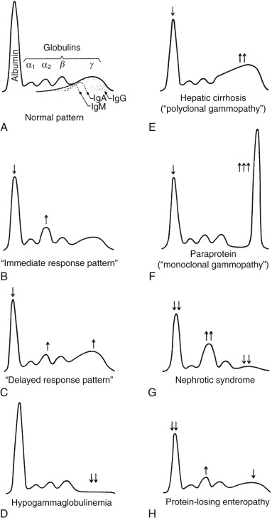

Figure 19-8 

Serum protein electrophoresis: clinicopathalogic correlations. 

(Courtesy of Dr. A. E. Krieg.) 

Patterns of hypoproteinemia due to malnutrition or gross loss of protein show decreases in all fractions, but the most dramatic reduction is often seen in albumin compared with its normally high value as the most abundant serum protein ( [ Fig. 19-9 ](<#f0050>) , lane 3). Severe starvation, malabsorption, or inanition associated with severe chronic disease will show marked reduction in albumin to levels below 20 g/L. The other serum proteins, including AAT, AMG, haptoglobin, transferrin, and C3, appear even fainter on electrophoresis. Reduction in staining intensity for the β-lipoprotein parallels a marked decrease in serum cholesterol concentration. The immune system is strongly affected by severe starvation, with decreased synthesis of immunoglobulins resulting in hypogammaglobulinemia and impaired resistance to bacterial and other infections. Protein-losing enteropathy ( [ Fig. 19-8, _H_ ](<#f0045>) ) shows a variation in the hypoproteinemia pattern, in which most fractions are diminished owing to the combination of decreased synthesis and increased loss, although α 2  may be relatively higher owing to a coexisting acute phase response (haptoglobin) or to preferential retention of larger molecules (α 2  -macroglobulin). 

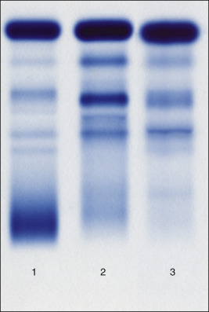

Figure 19-9 

Serum protein patterns in (1) chronic inflammation with decreased albumin and increased γ-globulins; (2) acute inflammation with increased α 2  -fraction (haptoglobin) and decreased C3 due to activation and consumption of complement; and (3) inanition post–spinal cord injury with hypoproteinemia of several fractions. 

Specific loss of proteins into the urine as in nephrotic syndrome occurs on a molecular weight basis, with smaller proteins being lost more rapidly than larger ones. Accordingly, albumin appears early in the course of protein-losing nephropathies, followed by smaller quantities of AAT, transferrin, and, ultimately, immunoglobulins ( [ Fig. 19-10 ](<#f0055>) , lanes 1 and 2). The very large molecule AMG is retained, as are the large micelles of β-lipoprotein. The result is complementary patterns of proteins in the serum (decreases in albumin and α 1  -, β-, and γ-globulins; increased α 2  -macroglobulin and elevated β-lipoprotein) versus those in urine (see [ Fig. 19-4, _B_ ](<#f0025>) ) (glomerular proteinuria with albumin, α 1  -, β-, and γ-fractions present but without α 2  -macroglobulin in the urine sample). Tubular proteinuria that is due to impaired renal tubular reabsorption of small proteins shows a pattern of α, β, and γ in the urine with only minimal albumin loss into the urine (  Killingsworth, 1982  ) (see [ Fig. 19-10 ](<#f0055>) , lane 4). In addition to glomerular and tubular patterns of proteinuria (  Maachi et al, 2004  ), it is important to recognize the important pattern of a monoclonal gammopathy in urine (see [ Fig. 19-10 ](<#f0055>) , lane 3, and [ Fig. 19-11 ](<#f0060>) ). A similar pattern of a single large band occurs in hemoglobinuria (see [ Fig. 19-10 ](<#f0055>) , lane 5), which must be distinguished from a monoclonal immunoglobulin or free light chains. 

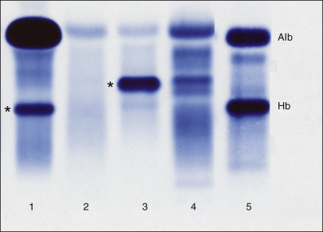

Figure 19-10 

Patterns of urine protein electrophoresis in different disorders. 

(1) Severe glomerular proteinuria with a major band of albumin plus a secondary one of transferrin (*). (2) Trace proteinuria with a faint band of albumin and other diffuse proteins. (3) Immunoglobulin light chains in a case of multiple myeloma (*). (4) Tubular proteinuria with multiple bands that do not correspond to major serum proteins. (5) Hematuria with a major band of hemoglobin (not to be confused with monoclonal gammopathy), in addition to albumin. 

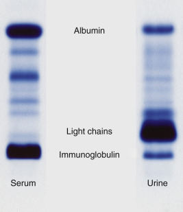

Figure 19-11 

Serum and urine protein electrophoretic patterns in a patient with multiple myeloma. 

Serum demonstrates a predominance of the larger complete immunoglobulin; the urine has a large amount of the smaller-sized light chains, with only a small amount of the whole immunoglobulin. 

Acute phase or immediate response patterns have the greatest effect on serum protein electrophoresis by increasing the amount of haptoglobin, while slightly decreasing the concentration of albumin. Increases in haptoglobin usually indicate some form of response, whether acute or chronic, to stressful stimuli (see [ Fig. 19-9 ](<#f0050>) ). Other proteins such as AAT can contribute to this response; minor components such as CRP do not contribute significantly to this protein stain pattern, although immunologic measurement of CRP may show up to 1000-fold elevations. If the haptoglobin has been depleted in a patient as a result of active hemolysis, an independent band of hemoglobin may be migrating in the β\- or α 2  -region. Hemolysis of a sample in vitro may show a red band (on the unstained gel) of the haptoglobin–hemoglobin complex that migrates differently from hemoglobin alone. The pattern of delayed response or chronic pattern is an extension of the acute phase response (high haptoglobin, slight reduction in albumin) with greater decrease in albumin and polyclonal increase in immunoglobulins broadening the γ-region. 

A striking elevation of transferrin in the β-region sometimes occurs in patients suffering from iron deficiency anemia. The increase in transferrin corresponds to increased IBC, and the percent saturation is low (  Koerper & Dallman, 1977  ). This variation may be confused with a myeloma protein because the transferrin band forms a narrow, clonal-appearing band. 

Cirrhosis of the liver creates a protein pattern that is recognizable ( [ Fig. 19-4, _A_ ](<#f0025>) ). Hepatocellular damage from cirrhosis results in diminished capacity to synthesize albumin. Furthermore, the imbalance of hemodynamic pressures in portal hypertension secondary to cirrhosis leads to the formation of ascitic fluid, which contains almost exclusively albumin. This decreased synthesis, coupled with increased loss, greatly reduces serum albumin concentrations. The loss of albumin is balanced to some extent by marked polyclonal increase in immunoglobulins with a γ-fraction that may contribute significantly to oncotic pressures. The increase in γ-globulin involves all immunoglobulins; the increase in immunoglobulin A (IgA) in the slow β-region shows a continuum with the γ (also termed β–γ bridging). 

In contrast to polyclonal increases, oligoclonal bands consist of only a few clones of distinct immunoglobulins that migrate in defined positions. This pattern is seen in serum in cases in which an immunologic disorder is present, or in some patients treated with chronic immunosuppression for organ transplantation (  Myara et al, 1991  ). Oligoclonal bands in the CSF are used to indicate immunologic activity in the central nervous system and occur in infectious diseases or autoimmune or demyelinating disorders (see [ Chapter 46 ](<##!/content/3-s2.0-B9780323295680000462?scrollTo=%23c00046>) ). 

Hypogammaglobulinemia is manifested as a nearly to completely absent γ-fraction. It occurs normally in neonates before maturation of the immune system. It also occurs in some congenital immunodeficiency states such as Bruton's agammaglobulinemia and other states involving B cell function. Perhaps more commonly, this pattern is seen in adults with lymphoreticular disorders in whom normal plasma cells have been displaced by lymphocytic proliferations, and to some extent after chemotherapy for eradication of malignancies, as well as in hypoproteinemic states (see [ Fig. 19-9 ](<#f0050>) , lane 3). 

The single most important and widespread clinical application of serum protein electrophoresis is used for the detection of monoclonal gammopathies. This very explicit pattern comes from a paraprotein (immunoglobulin) secreted by a monoclonal proliferation of plasma cells and is generally found without normal amounts of polyclonal γ as normal plasma cells are replaced by the malignant clone (see [ Fig. 19-11 ](<#f0060>) ). The presence of a paraprotein with normal polyclonal γ suggests a possible plasmacytoma that has not yet spread throughout the bone marrow. Laboratory evaluation of myeloma should include serum and urine protein electrophoreses to detect aberrant clonal bands, immunoelectrophoresis or immunofixation to type the heavy and light chains of the paraprotein, and quantitation of immunoglobulins to provide a baseline for monitoring the patient's response to therapy or disease progression. Other proteins that may sometimes be mistaken for monoclonal bands of immunoglobulin on serum protein electrophoresis include haptoglobin–hemoglobin complexes, C3 and its variants, β-lipoprotein, transferrin, fibrinogen, immune complexes, CRP, and occasionally, α 2  -macroglobulin. Immunoglobulins, disorders of the immune system, and abnormalities of complement are discussed further in [ Chapter 46 ](<##!/content/3-s2.0-B9780323295680000462?scrollTo=%23c00046>), [ Chapter 47 ](<##!/content/3-s2.0-B9780323295680000474?scrollTo=%23c00047>), [ Chapter 51 ](<##!/content/3-s2.0-B9780323295680000516?scrollTo=%23c00051>) . 

,,
