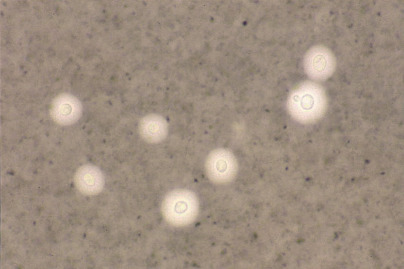
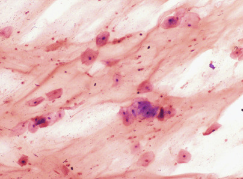
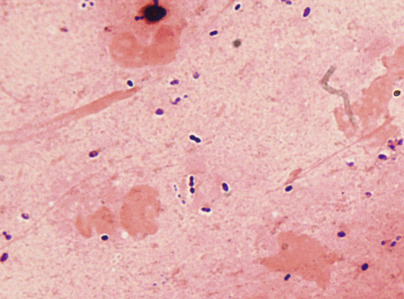
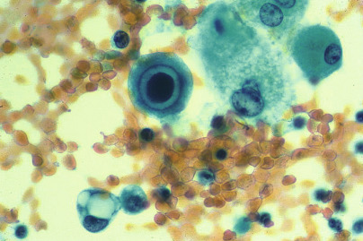
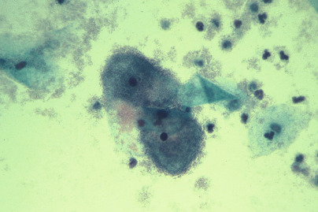
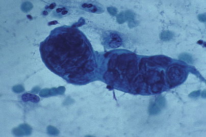

## Key Points

  * •

Collect specimens from site of infection before initiating therapy. 

  * •

Collect adequate volume of sample for testing required. 

  * •

Tissue, fluid, or aspirates are always superior to a swab specimen. The only exception is collecting culture material from a hard to reach spot such as a throat or cervix. 

  * •

Use required collection and transport materials to preserve specimen integrity. 

  * •

Communicate clear orders and source information. 

  * •

Expedite the transport of specimens to the laboratory, and do not allow them to sit in collection areas. 

We gratefully acknowledge the contributions of Ann C. Croft and Gail L. Woods, who authored this chapter in previous editions. 

Appropriate specimen collection, transport, and processing are crucial preanalytical steps in the accurate diagnosis of infectious diseases. Guidelines for specimen handling are discussed in this chapter. General principles are reviewed first, followed by discussion of the most common types of specimens submitted to the clinical microbiology laboratory for testing. 

,  

##  General Principles 

 

##  Timing of Specimen Collection 

For optimal detection of the pathogens responsible for an infectious disease, specimens should be collected at a time when the likelihood of recovering the suspected agent is greatest. For example, the likelihood of recovering most viruses is greatest in the acute phase of the illness. Specimens for recovery of bacteria should ideally be collected before antimicrobial therapy is started. 

 

##  Specimen Volume 

The volume of specimen collected must be adequate for performance of the microbiological studies requested. If insufficient volume is received, the health care worker caring for the patient should be notified; either an additional sample can be obtained, or the physician must prioritize the requests. 

Very little specimen is obtained with a swab and much of the specimen is retained within the swab tip. Swabs should not be used as collection devices unless the specimen source is the throat, cervix, or other difficult to reach area. If a swab is used to collect the specimen, a polyester-tipped swab on a plastic shaft is acceptable for most organisms. Calcium alginate should be avoided for collection of samples for viral culture, because it could inactivate herpes simplex virus (HSV); cotton may be toxic to _Neisseria gonorrhoeae;_ and wooden shafts should be avoided, because the wood may be toxic to _Chlamydia trachomatis_ . Swabs are not optimal for detection of anaerobes, mycobacteria, or fungi, and they should not be used when these organisms are suspected. An actual tissue sample or fluid aspirate is always superior to a swab specimen for the recovery of pathogenic organisms. 

 

##  Specimen Collection 

Specimens should be obtained from the site of infection with minimal contamination from adjacent tissues and organ secretions and, with the exception of stool, should be collected in a sterile container. All specimens should be labeled with the name and identification number of the person from whom the specimen was collected, the source of the specimen, and the date and time it was collected. 

 

##  Specimen Transport 

After collection, specimens should be placed in a biohazard bag and transported to the laboratory as soon as possible. If a delay is unavoidable, urine, sputum and other respiratory specimens, stool, and specimens for detection of _C. trachomatis_ or viruses should be refrigerated to prevent overgrowth of normal flora. Cerebrospinal fluid (CSF) and other body fluids, blood, and specimens collected for recovery of _N. gonorrhoeae_ should be held at room temperature, because refrigeration adversely affects recovery of potential pathogens from these sources. 

 

##  Unacceptable Specimens 

Each laboratory director must establish criteria for rejecting specimens unsuitable for culture. Most clinical microbiologists agree that the following specimens should be rejected: 

  * •

Any specimen received in formalin 

  * •

24-hour sputum collections 

  * •

Specimens in containers from which the sample has leaked 

  * •

Specimens that have been inoculated onto agar plates that have dried out or are outdated 

  * •

Specimens contaminated with barium, chemical dyes, or oily chemicals 

  * •

Foley catheter tips 

  * •

Duplicate specimens (except blood cultures) received in a 24-hour period 

  * •

Blood catheter tips submitted for patients without concomitant positive blood culture 

The following specimens should be rejected for anaerobic culture: 

  * •

Gastric washings 

  * •

Urine other than suprapubic aspirate 

  * •

Stool (except for recovery of _Clostridium difficile_ for epidemiologic studies or for diagnosis of bacteria associated with food poisoning) 

  * •

Oropharyngeal specimens, except deep tissue samples obtained during a surgical procedure 

  * •

Sputum 

  * •

Swabs of ileostomy or colostomy sites 

  * •

Superficial skin specimens 

 

##  Standard Precautions 

Safety is the responsibility of the laboratory director and, per the Clinical Laboratory Improvement Amendments (CLIA), cannot be delegated to others. The laboratory director should collaborate with infection control, institutional safety committees, environmental services, engineering, and others within the hospital and department to ensure that there are current and necessary policies and procedures, engineering controls, personal protective equipment, and a trained work force. The laboratory director is also responsible for making sure the policies and procedures are followed. Specimen processing can have additional challenges because this workforce often has the least amount of formal technical education. 

Universal Precautions were designed to protect workers from infectious substances in blood and body fluids. Body Substance Isolation Precautions were designed to protect workers from transmission of organisms from moist body surfaces. In 1996, the U.S. Hospital Infection Control Practices Advisory Committee unified these into “Standard Precautions.” As described in _Biosafety in Microbiological and Biomedical Laboratories_ (BMBL), Standard Precautions apply to (1) blood; (2) all body fluids, secretions, and excretions except sweat, regardless of whether or not they contain visible blood; (3) non-intact skin, and (4) mucous membranes (  Wilson & Chosewood, 2009  ). Standard Precautions must be followed when handling all specimens. A risk assessment should be performed in each laboratory area; it will detail the particular risks with each procedure. The safety recommendations for engineering controls, personal protective equipment, and work practices can be tailored to the risk (  Callihan et al, 2014  ). Appropriate barriers are used to prevent exposure of skin and mucous membranes to the specimen. Gloves and a lab coat must be worn at all times when handling patient specimens, and masks, goggles (or working behind a plastic shield), and impermeable gowns or aprons must be worn when there is a risk for splashes or droplet formation. Optimally, all specimen containers but, at a minimum, those containing respiratory secretions and those submitted specifically for detection of mycobacteria or fungi, should be opened in a biological safety cabinet. Specimens collected for virus isolation should be handled in a biological safety cabinet to prevent contamination of the cell cultures. 

 

##  Referral Testing 

When specimens or cultures must be shipped to a reference laboratory, they must be packaged according to dangerous goods shipping guidelines (see International Air Transport Association website, available at: [ http://www.iata.org/whatwedo/cargo/dgr/Pages/index.aspx ](<http://www.iata.org/whatwedo/cargo/dgr/Pages/index.aspx>) ). Specimens must be limited to no more than 40 mL. Cultures of bacteria and fungi should be grown on solid media in tubes. The cap of the primary container (tube or vial) should be sealed with waterproof tape and inserted into a second container, surrounded by sufficient packing material to absorb the entire volume of the culture or specimen if the primary container were to leak or break. If several primary tubes are placed in a second container, they must be either individually wrapped or separated so as to prevent contact between them, and there must be secondary packaging, which must be leakproof. The second container should be capped and placed in a shipping container made of corrugated fiberboard or hard plastic. An itemized list of contents must be enclosed between the secondary and outer packaging. The secondary and outer containers should be of sufficient strength to maintain their integrity at temperature and air pressures to which they will be subjected. If a specimen must be shipped on dry ice (which is considered to be a hazardous material), it must be marked “Dry ice, frozen medical specimen.” The dry ice should be placed outside the second container with the packing material in such a way that the container does not become loose inside the outer container as the dry ice evaporates. All infectious shipping packages must be labeled with an official label containing the address and contents as well as the name and telephone number of the person responsible for the shipment. All laboratorians who package and ship materials that are known or reasonably expected to contain a pathogen must have documentation of training. There are several commercial and government-based resources for training. 

,  

##  Blood 

Detection of blood-borne pathogens is one of the most important functions of the microbiology laboratory. Culture of blood is essential in identifying bacteria responsible for bacteremia, sepsis, infections of native and prosthetic valves, suppurative thrombophlebitis, mycotic aneurysms, and infections of vascular grafts. Blood cultures also are useful in diagnosing invasive or disseminated infections caused by certain bacteria or fungi, especially _Cryptococcus neoformans_ , _Candida_ spp., _Fusarium_ spp., and _Histoplasma capsulatum_ . Parasites are detected in blood by microscopic examination of peripheral smears. In general, blood should be collected for culture before beginning antimicrobial therapy when any one or a combination of the following are present: fever (38° C or greater), hypothermia (36° C or lower), leukocytosis (especially with a left shift), granulocytopenia, or hypotension. 

 

##  Specimen Collection 

Timely detection and accurate identification of organisms in the blood depend on appropriate collection, transport, and processing of the specimen. Germane to the detection of all microorganisms in the blood is the phlebotomy technique. To minimize contamination of blood specimens by skin flora, the venipuncture site should be prepared with a bactericidal agent. The skin first is cleaned with alcohol (70% isopropyl or ethyl alcohol) and then with a 1% to 2% iodine solution, an iodophor, or chlorhexidine. For maximum antisepsis, the area should dry for 1 to 2 minutes before venipuncture of the selected peripheral vein. The phlebotomist needs to understand that the skin flora are not killed instantaneously and the 1- to 2-minute wait period will reduce his or her contamination rate. Each set of peripheral blood cultures must be drawn from a separate venipuncture so that if an organism usually regarded as a contaminant is present, the risk for bacteremia from an organism can be evaluated. 

Compared to venipuncture, the risk for contamination is doubled when blood cultures are drawn from an indwelling vascular device. Although it might seem advantageous to save the patient the discomfort of a venipuncture, a contaminated blood culture can cause even more diagnostic cultures, unnecessary antibiotics, and a prolonged stay in the hospital. If it is necessary to draw a culture through an intravenous line, another blood culture should be collected simultaneously from a venipuncture to aid in the interpretation of a contaminated line culture (  Baron et al, 2005  ). 

 

##  Appropriate Timing for Detection of Bacteremia and Fungemia 

The optimal time to draw blood for cultures when bacteremia or fungemia is suspected is just before a chill but, because this is not predictable, most blood cultures are collected after the onset of fever and chills. Blood is drawn with a needle and syringe and, without changing needles, is injected directly into bottles of culture media or other blood culture system (  Krumholz et al, 1990  ). The inoculated bottles are immediately inverted several times to ensure mixing, and then they are transported to the laboratory at room temperature as soon as possible after collection. Blood cultures should never be refrigerated. 

 

##  Specimen Volume 

In adults with bacteremia, the number of colony-forming units (CFU) per milliliter of blood is frequently low. Therefore, for adults, collecting 20 to 30 mL of blood per culture set is strongly recommended (  Ilstrup & Washington, 1983  ;  Washington & Ilstrup, 1986  ;  Cockerill et al, 2004  ). In infants and children, the concentration of microorganisms in blood is higher, and collection of 1 to 5 mL of blood per culture is adequate. 

 

##  Specimen Draws 

Recommendations concerning the number of blood specimens to collect are based on the nature of the bacteremia: _transient, intermittent,_ or _continuous._ Transient bacteremia follows manipulation of a focus of infection (e.g., an abscess, a furuncle, or cellulitis), instrumentation of a contaminated mucosal surface (as occurs during dental procedures, cystoscopy, urethral catheterization, suction abortion, or sigmoidoscopy), or a surgical procedure in a contaminated site (e.g., transurethral resection of the prostate, vaginal hysterectomy, colon resection, and debridement of infected burns). Transient bacteremia also occurs early in the course of many systemic and localized infections such as meningitis, pneumonia, pyogenic arthritis, and osteomyelitis. Most intermittent bacteremias are associated with an un­drained abscess, whereas continuous bacteremia is the hallmark of intravascular infection, such as bacterial endocarditis, mycotic aneurysm, or an infected intravascular catheter. Continuous bacteremia also occurs during the first few weeks of typhoid fever and brucellosis. 

The optimal number of blood cultures for detection of bacteremia in patients without endocarditis is controversial. Most authorities agree that two or three 20-mL blood samples drawn over a 24-hour period and equally distributed into aerobic and anaerobic blood culture bottles will detect most bloodstream infections. One investigator demonstrated that 80% of bacteremias were detected with two blood cultures and 96% with three blood cultures. All bacteremias were detected with four blood cultures, but the routine collection of four blood cultures (up to 80 mL of blood) should be weighed against the risk for anemia. (  Cockerill et al, 2004  ). The optimal time interval between cultures is unknown, but 30 to 60 minutes for the first two sets has been suggested, with another one to two sets drawn over the remaining 24 hours if symptoms of septicemia persist (  Cockerill et al, 2004  ). However, if initiation of antimicrobial therapy is deemed urgent, cultures should be collected before therapy is begun, from separate sites within a few minutes. 

Organisms such as the coagulase-negative staphylococci, viridans streptococci, _Corynebacterium_ species, _Bacillus_ species, and _Propionibacterium_ species are frequent blood culture contaminants but may also be true pathogens. Collecting two sets of blood cultures per febrile episode helps distinguish probable pathogens from contaminants. If two sets are drawn from different venipuncture sites, the odds of both sets being contaminated by skin flora are very low. If two sets are drawn at the same time and only one set contains a skin contaminant, it is safe to assume that the culture was contaminated during collection. If only one set is drawn and a contaminant is present, it can be difficult to _not_ treat the organism, especially if the patient has had recent surgery. 

 

##  Recovery of Microorganisms 

Host factors such as antibodies, complement, phagocytic white blood cells, and antimicrobial agents may impede recovery of microorganisms from blood; therefore, various approaches have been used to counteract these factors. Diluting the blood specimen in broth medium in a 1 : 10 ratio provides optimal neutralization of the serum bactericidal activity (  Washington & Ilstrup, 1986  ). Incorporating 0.02% to 0.05% sodium polyanethol sulfonate in the blood culture medium inhibits coagulation, phagocytosis, and complement activation, and inactivates aminoglycosides. Methods that counteract the presence of antimicrobial agents include using antibiotic-adsorbent resins or the lysis-centrifugation system. 

 

##  Blood Culture Systems 

Several blood culture systems, each with advantages and disadvantages, are available (  Baron et al, 2005  ). Continuously monitored automated detection systems have essentially replaced manual systems. All systems use nutritionally enriched liquid media, which are capable of supporting growth of most bacteria. Traditionally, two bottles, an aerobic and an anaerobic, are inoculated. 

 

##  Manual Blood Cultures 

Two commercial manual blood culture systems are available in the United States. The Septi-Chek system (BBL : BD Diagnostic Systems, Sparks, Md.), consists of an adult or pediatric bottle with broth medium. After inoculation, the cap is replaced with a slide coated on both sides with three different agars. The agar is inoculated by tipping the bottle, allowing the blood-broth mixture to coat the agar media. Colonies on the agar medium are used for identification and susceptibility testing. This system can recover yeasts and aerobic and facultative bacteria, but not anaerobic bacteria (  Baron et al, 2005  ). The Isolator system (Wampole Laboratories, Cranbury, N.J.) is a lysis-centrifugation blood culture system. It consists of a tube containing reagents that inhibit coagulation and the complement cascade, lyse blood cells, and provide a cushion for the microorganisms during centrifugation. Blood is added to the tube, which is inverted several times to prevent clotting and transported to the laboratory as soon as possible. Ideally, the specimen is processed immediately, but processing can be delayed for up to 8 hours without adversely affecting recovery of microorganisms. To process the culture, the tube is centrifuged for 30 minutes at 3000 _g_ , the supernatant is discarded, and the sediment is mixed on a vortex mixer and plated onto agar media. Smaller tubes for low-volume samples, from infants and young children, are also available. Advantages of lysis-centrifugation include excellent recovery of _Staphylococcus aureus,_ some Enterobacteriaceae, and fungi (especially _H. capsulatum_ ); the direct availability of colonies for identification and susceptibility testing; and the ability to carry out quantitative cultures. Moreover, this system is flexible because special media can be inoculated to recover organisms with specific growth requirements, such as _Legionella_ spp _._ and mycobacteria. However, the system is labor-intensive, is less likely to recover _Streptococcus pneumoniae_ , _Haemophilus influenzae_ , or anaerobes, and the risk for contamination is increased. 

 

##  Automated Blood Culture Systems 

Three major automated continuously monitoring blood culture systems are available commercially in the United States (  Baron et al, 2005  ). All such systems are much less labor-intensive than the “manual” systems described earlier. Additionally, with these systems the usual incubation period can be shortened from 7 to 5 days (  Woods, 1994  ;  Reisner & Woods, 1999  ). The BacT/ALERT 3D system (bioMerieux, Inc., Lille, France and St. Louis, Mo.) is based on the colorimetric detection of carbon dioxide (CO  2  ) produced during microbial growth. A CO  2  sensor is bonded to the bottom of each blood culture bottle and is separated from the broth medium by a membrane that is impermeable to most ions and to components of media and blood, but freely permeable to CO  2  . Inoculated bottles are placed in cells in the instrument, which provides continuous rocking of both aerobic and anaerobic bottles. If bacteria are present, they generate CO  2  , which is released into the broth medium; the pH then decreases, causing the sensor to change color from green to yellow. Color changes are monitored once every 10 minutes by a colorimetric detector. This system supports the growth of aerobic and anaerobic bacteria; bottles are available to support the growth of mycobacteria. This system has received FDA clearance for monitoring bacterial contamination of platelets. 

The BACTEC continuous-monitoring system (BD Diagnostics, Sparks, Md.) is based on fluorescent technology. Bonded to the base of each vial is a CO  2  sensor that is impermeable to ions, medium components, and blood but freely permeable to CO  2  . If organisms are present, they release CO  2  into the medium; it then diffuses into the sensor matrix and generates hydrogen ions. The subsequent decrease in pH increases the fluorescence output of the sensor, changing the signal transmitted to the optical and electronic components of the instrument. The computer generates growth curves, and data are analyzed according to growth algorithms. Inoculated bottles are placed in individual cells of the instrument and rocked continuously. Adult and pediatric aerobic and anaerobic bottles are available, as well as a bottle for the recovery of yeasts and mycobacteria. The VersaTREK system (Trek Diagnostic Systems, Cleveland, Ohio) detects growth of organisms in broth by measuring gas consumption and/or gas production. Each inoculated vial is fitted with a disposable connector that contains a recessed needle. The needle penetrates the bottle stopper and connects the bottle headspace to the sensor probe. The sensor monitors changes within the headspace in the consumption and/or production of all gases (CO  2  , N  2  , and H  2  ) by growing organisms and creates data points internally in the computer. Media are available to identify aerobic and anaerobic bacteria, including mycobacteria. 

 

##  Detection of Rarely Encountered or Fastidious Bacteria 

Detection of some bacteria requires prolonged incubation or special media. For example, when brucellosis is suspected, blood should be collected early in the disease and cultures should be incubated for 2 to 3 weeks, although with the automated systems, _Brucella_ spp. often grow in less than 1 week (  Bannatyne et al, 1997  ). Infections with _Borrelia_ spp., except _Borrelia burgdorferi_ (the etiologic agent of Lyme disease, most commonly diagnosed serologically), are diagnosed by detecting spirochetes in the peripheral blood during febrile periods. Organisms are visualized in wet preparations made by mixing 1 drop of blood with 1 drop of sodium citrate, and examining it with light or dark-field microscopy, and in thin and thick blood films stained with Wright's or Giemsa stains, examined by light microscopy. To isolate _Leptospira interrogans_ from blood, a few drops of fresh or anticoagulated blood collected during the first week of illness are added to each of three to four tubes of leptospiral semisolid culture medium (Fletcher's medium or Ellinghausen-McCollough-Johnson-Harris medium). Some clinicians continue to request extended incubation protocols for _Brucella_ spp. and other bacteria known as the HACEK group _(Haemophilus_ , _Aggregatibacter [formerly Actinobacillus]_ , _Cardiobacterium_ , _Eikenella_ , _Kingella)_ . These organisms needed prolonged incubation times when manual methods predominated, but they can be detected during the routine incubation times of the automated instruments. 

Two methods may be used to recover mycobacteria from blood specimens. With the lysis-centrifugation technique, (1) a concentrate is prepared, (2) the sediment is inoculated to solid and/or liquid media, and (3) the cultures are incubated for up to 8 weeks. An alternative and perhaps more rapid approach is direct inoculation of the liquid medium developed by the manufacturer of automated and semi-automated broth culture systems specifically for recovery of mycobacteria. 

 

##  Detection and Notification of Positive Cultures 

Positive blood cultures containing commonly isolated aerobic organisms are usually detected within 12 to 36 hours of incubation. Until recently, the initial report was limited to a Gram stain; identification and susceptibility results could be expected no sooner than 24 to 48 hours after the Gram stain report. Both the FilmArray blood culture identification panel (BioFire Diagnostics, Salt Lake City, Utah) and the Verigene system (Nanosphere, Northbrook, Ill.) use molecular methods to identify over 90% of the organisms in the time when a Gram stain would be reported. They can also identify the presence or absence of mecA, allowing empiric therapy to be tailored. (  Bhatti et al, 2014a  ). The use of Matrix-Assisted Laser Desorption Ionization–Time of Flight Mass Spectrometry (MALDI-TOF MS) has shortened the time to identification. Although most laboratories allow for overnight incubation before testing mature colonies, an aliquot of the positive culture can be centrifuged and the pellet inoculated onto prewarmed plates. About 95% of isolates can be identified with the MALDI-TOF after 4 hours of incubation (  Bhatti et al, 2014b  ). Although more labor-intensive, the reagents of this method are much less expensive than the molecular methods. Cultures containing anaerobes are usually not detected for 48 to 72 hours, and identification is not available for 3 to 4 days. Fastidious organisms, such as those found in the HACEK group, may not be detected until 3 to 5 days. 

In a small percentage of cases, no organisms will be seen on a Gram stain from a positive blood culture. It is vey important to inoculate and monitor media in these cases. _Brucella_ spp. can be difficult for an inexperienced eye to note on Gram stain; the colonies will be visible on solid media a few days later. Conversely, some organisms such as the nutritionally deficient streptococci will be visible on Gram stain but not on routine media. These organisms will grow on chocolate agar or sheep blood agar with a _Staphylococcus aureus_ streak (  Baron et al, 2005  ). 

 

##  Detection of Viruses 

With regard to viruses, blood specimens are most commonly collected to monitor response of infection with human immunodeficiency virus (HIV), hepatitis C virus (HCV), hepatitis B virus (HBV), or cytomegalovirus (CMV) to antiviral therapy by using quantitative polymerase chain reaction (PCR) to measure viral load. Such assays are commercially available for each of these viruses, and in all cases manufacturer's guidelines for specimen collection and transport should be followed. For HIV and HCV, blood specimens also may be collected for genotyping (commercial assays are available), and PCR (qualitative or quantitative PCR) generally is used to confirm an initial positive HCV antibody result. As with viral load, manufacturer's guidelines regarding specimen collection and transport should be followed. 

In addition to assessing response to antiviral therapy, measuring viral load in a blood specimen is useful for monitoring disease and for diagnosis of disease in specific situations. In immunocompromised patients, especially transplant recipients but also patients with acquired immunodeficiency syndrome (AIDS), determining the level of CMV deoxyribonucleic acid (DNA) in blood is used to predict those at high risk for development of CMV disease and direct the initiation of preemptive therapy (  Herrmann et al, 2004  ;  Kalpoe et al, 2004  ;  Meyer-Koenig et al, 2004  ;  Lugert et al, 2009  ). Monitoring the level of Epstein-Barr virus (EBV) DNA in serum or plasma by quantitative PCR is indicated in transplant recipients at high risk for EBV-associated lymphoproliferative disease (  Rowe et al, 2001  ). Quantitative PCR from whole blood or peripheral blood mononuclear cells is useful for diagnosis of disease due to HHV-6 or HHV-7 in transplant recipients and is the test of choice for diagnosing disease caused by parvovirus B19 in immunosuppressed patients or in the fetus. If a commercial quantitative PCR assay is used, guidelines for specimen collection and transport should be followed. If, on the other hand, an assay developed and validated in-house is used, guidelines published by that laboratory should be followed. 

 

##  Detection of Parasites 

Blood specimens are useful for diagnosis of malaria, babesiosis, trypanosomiasis, and some filariasis (  Rosenblatt, 2009  ). Specimens should be collected in tubes with anticoagulant and transported promptly to the laboratory. If smears must be sent to a reference laboratory, they should follow the reference laboratory's instructions for fixation soon after they are made. The techniques used in the laboratory for detecting the aforementioned parasites are the same and are discussed here in order of the simplest to the most complicated. 

Standard Precautions need to be used when preparing smears and reading fresh (unfixed) smears. Additional fixation time in methanol could be recommended depending on the patient's travel history. The simplest technique for detecting parasites in a sample of blood is the direct mount, prepared by placing 1 drop of blood on a glass slide, covering it with a cover glass, and examining it immediately. Direct mounts are excellent for diagnosis of trypanosomiasis or filariasis because the trypomastigotes and the microfilariae easily can be seen moving, often with low or medium power. Stained smears make the definitive diagnosis. 

The thin smear, made as for hematologic work and stained in a similar manner, is the standard preparation for speciating _Plasmodium_ spp., _Babesia_ , _Trypanosoma_ , and microfilaria. Thin smears for parasitologic work are fixed and then preferably stained manually with Giemsa stain, but automated hematologic staining is adequate. Smears are first scanned at low power to detect microfilariae, which are large objects (between 100 and 200 µm) and easily seen, usually at the lateral edges of the smear. After they are located, microfilariae should be studied under oil immer­sion for identification. Following scanning with low power, the smear is examined with a high dry objective, searching for trypanosomes; and finally under oil immersion, to find and identify _Plasmodium, Babesia,_ and _Trypanosoma_ . 

Thick smears are useful for detecting all the parasites mentioned earlier, and are part of the minimum laboratory workup for their diagnosis. A drop of blood is placed on a clean glass slide and, with the corner of another slide, is gently spread to cover 1 cm square. The preparation is allowed to dry and without fixation is stained with Giemsa stain, allowing for its dehemoglobinization. 

,  

##  Body Fluids 

 

##  Cerebrospinal Fluid 

CSF is collected to diagnose meningitis and, less frequently, viral encephalitis. Infectious meningitis, a medical emergency requiring early therapy to prevent death or serious neurologic sequelae, is divided into acute, subacute, and chronic clinical syndromes, based on duration of symptoms. Potential pathogens are listed in [ Table 64-1 ](<#t0010>) . Enteroviruses are the agents most commonly responsible for meningitis, and they should be considered first in the differential diagnosis of meningitis in a child or adolescent during the late summer and early fall. The pyogenic bacteria responsible for meningitis vary with the age of the affected individual ( [ Table 64-2 ](<#t0015>) ). 

TABLE 64-1 

Infectious Meningitis Syndromes 

Syndrome  |  Onset/Duration  |  Probable Pathogens   
---|---|---  
Acute  |  <24 hours  |  Pyogenic bacteria   
Subacute  |  1-7 days  |  Enteroviruses, pyogenic bacteria   
Chronic  |  Persisting at least 4 weeks  |  _Mycobacterium tuberculosis_  
_Treponema pallidum_  
_Brucella_ spp.   
_Leptospira interrogans_  
_Borrelia burgdorferi_  
_Cryptococcus neoformans_  
_Coccidioides immitis_  
_Histoplasma capsulatum_  
  

TABLE 64-2 

Common Bacterial Causes of Acute Meningitis by Age 

Age  |  Organisms   
---|---  
Neonates-3 months  |  Group B streptococcus   
_Escherichia coli_  
_Listeria monocytogenes_ [ * ](<#hl0000148>)  
_Streptococcus pneumoniae_  
4 months-6 years [ † ](<#hl0000151>) |  _Streptococcus pneumoniae_  
6-45 years  |  _Neisseria meningitidis_  
>45 years  |  _Streptococcus pneumoniae_  
_Listeria monocytogenes_  
Group B streptococcus   
  
 * May cause meningitis in immunocompromised individuals in all age groups. 

 † Incidence of meningitis due to _Haemophilus influenzae_ type b in the United States has declined dramatically as a result of vaccination. 

 

##  Sample Collection and Transport 

CSF is usually obtained by lumbar spinal puncture, but sometimes it is aspirated from the ventricles or collected from a shunt. As when collecting blood for culture, careful skin antisepsis is essential for collection of CSF, which typically is submitted to the laboratory in three or occasionally four tubes. Suggestions for tests performed on fluid in each tube are as follows: tube 1, protein and glucose; tube 2, preparation of smears to stain with the Gram stain or other stains and for culture; tube 3, cell counts; and, if indicated, tube 4, special tests such as the cryptococcal antigen, serologic test for syphilis, molecular tests or other serologic studies, and cytology. The parameters of normal CSF and the usual changes that occur during meningitis caused by different organisms are listed in [ Table 64-3 ](<#t0020>) . 

TABLE 64-3 

Normal Cerebrospinal Fluid Parameters and Changes in Infectious Meningitis 

Condition  |  WBCs (cells/µL) [ * ](<#hl0000204>) |  Protein (mg/dL)  |  Glucose (mg/dL)   
---|---|---|---  
Normal  |  5 (lymphocytes)  |  14-45  |  45-100 (  serum)   
Meningitis   
Acute/subacute bacterial  |  >500 (PMNs)  |  ↑ |  ↓  
Chronic bacterial  |  200-2000  |  ↑ |  ↓  
Tuberculous, fungal  |  (lymphocytes)  |  ↑ |  ↓  
Enteroviral  |  200-2000 (PMNs early; lymphocytes later)  |  ↑ |  Normal   
  
↑, Increased; ↓, decreased; _PMNs,_ polymorphonuclear leukocytes; _WBCs,_ white blood cells. 

 * Cell type listed usually predominates. 

CSF should be transported promptly to the laboratory and processed as rapidly as possible. If a brief delay in processing is unavoidable, the specimen should be held at room temperature unless viral culture is requested, in which case a portion (preferably 1 mL but no less than 0.5 mL) may be refrigerated for a short time. Specimen processing differs for bacteria, fungi, viruses, and parasites and is discussed separately for each group of organisms. 

 

##  Sample Processing for Bacterial and Fungal Culture 

Processing CSF for routine bacterial culture includes concentration (if 1 mL or more of specimen is received), preparation of a smear by cytocentrifugation for staining with Gram stain, and culture. Concentrate the fluid by centrifugation at a minimum of 1500 _g_ for 15 minutes. The supernatant is decanted into a sterile tube, leaving about 0.5 mL of sediment and fluid, which is thoroughly mixed on a vortex mixer or by forcefully aspirating up and down into a sterile pipette. 

Diagnosis of chronic bacterial meningitis requires specific requests because the CSF is handled differently for each entity. To diagnose brucellosis, the CSF is processed as described earlier for routine bacterial culture, but the media are incubated for 2 to 3 weeks. For leptospirosis, _Leptospira interrogans_ may be cultured from the CSF during the first few weeks of illness. Special media (listed in the “Blood” section earlier in the chapter) are inoculated with a few drops of CSF and incubated as outlined in [ Chapter 57 ](<##!/content/3-s2.0-B9780323295680000577?scrollTo=%23c00057>) . The diagnosis of neurosyphilis is based on the following findings in the CSF: pleocytosis, elevated protein concentration, and a positive Venereal Disease Research Laboratory (VDRL) test (CSF VDRL), which currently is the only useful method for detecting antibodies to _Treponema pallidum_ in the CSF (see [ Chapter 59 ](<##!/content/3-s2.0-B9780323295680000590?scrollTo=%23c00059>) ). The CSF VDRL test is indicated only if the person has a positive serum test for syphilis (  Albright et al, 1991b  ). The specimen should be refrigerated until it is tested. Involvement of the central nervous system by _B. burgdorferi_ (Lyme disease) also is diagnosed serologically, by detection of specific IgM and IgG antibodies in CSF and serum. 

Processing CSF for detection of mycobacteria is indicated only for samples with pleocytosis, or decreased glucose, or elevated protein values (  Albright et al, 1991a  ). For optimal recovery, culture of at least 5 mL is recommended. The fluid is centrifuged at 3000 to 3600 _g_ for 30 minutes, the supernatant is decanted, and the sediment is thoroughly mixed on a vortex mixer and used to prepare smears for staining and to inoculate appropriate media (see [ Chapter 60 ](<##!/content/3-s2.0-B9780323295680000607?scrollTo=%23c00060>) ). Nucleic acid amplification, using a modification of a commercial assay or an assay developed in-house and validated, may be useful for direct detection of _Mycobacterium tuberculosis_ complex in CSF (  Cloud et al, 2004  ). 

Processing CSF for detection of fungi is similar to that described for detecting bacteria. Organisms are concentrated by filtration or by centrifugation. A cytocentrifuge preparation or a smear of the sediment stained with Gram stain is examined, and appropriate media (e.g., brain-heart infusion or SABHI agar without antibiotics) are inoculated for culture. 

 

##  Additional Diagnostic Tests 

In addition to smears stained with Gram stain and bacterial culture, the supernatant of a centrifuged specimen or the original fluid may be used to perform latex agglutination tests for detection of antigens of _Streptococcus agalactiae, S. pneumoniae,_ some serotypes of _Neisseria meningitidis, Escherichia coli_ (the K1 capsular antigen cross-reacts with that of _N. meningitidis_ type B), and _H. influenzae_ type b. These latex tests are most useful in diagnosing partially treated meningitis (  Bhisitkul et al, 1994  ;  Maxson et al, 1994  ) and in confirming a positive Gram-stained smear. The routine use of latex tests should be discouraged because, compared with smears stained with Gram stain, their sensitivity is not significantly greater and they are much more expensive (  Kiska et al, 1995  ;  Perkins et al, 1995  ). Although the value of latex tests for diagnosis of bacterial meningitis is questionable, an immunochromatographic test that detects the C polysaccharide cell wall antigen, which is common to all serotypes of _S. pneumoniae,_ has been shown to be very useful for rapid diagnosis of pneumococcal meningitis when testing CSF (  Werno & Murdoch, 2008  ). 

Two types of rapid tests are available for diagnosis of meningitis caused by _C. neoformans:_ those specific for the capsular antigen (latex agglutination and enzyme-linked immunosorbent assay [ELISA]) and the nonspecific India ink preparation, which allow visualization of encapsulated yeast cells ( [ Fig. 64-1 ](<#f0010>) ). The sensitivity of the India ink stain, performed by mixing 1 drop of CSF sediment with 1 drop of India ink (available at art supply stores), is low, except in HIV-infected persons. Therefore, the cryptococcal latex agglutination test or the ELISA, both of which are highly specific and have sensitivities of more than 90%, is recommended for diagnosis. Supernatant of a centrifuged specimen or unspun CSF can be used for these latter two tests. False-positive latex agglutination results occur, due to the presence of _Trichosporon asahii_ or to the introduction of trace amounts of condensation from agar into the test fluid. To avoid the latter problem, the latex test should be performed before culture or, better, on a separate sample (  Heelan et al, 1991  ). 

Figure 64-1 

India ink preparation of cerebrospinal fluid showing encapsulated yeast forms of _Cryptococcus neoformans._

(400×.) 

 

##  Sample Processing for Diagnosis of Viral and Parasite Infections 

Currently, nucleic acid amplification tests are used most often for diagnosis of viral infections of the central nervous system. Other diagnostic methods are conventional cell culture (primarily for detection of enteroviruses, although PCR is preferred) and serologic tests for viruses that cause encephalitis (western equine, eastern equine, Venezuelan equine, St Louis, Japanese, and La Crosse and West Nile). 

CSF is occasionally sent to the laboratory for diagnosis of African trypanosomiasis ( _Trypanosoma gambiense_ and _Trypanosoma rhodesiense_ ) or infection with free-living amebae ( _Naegleria fowleri_ and _Acanthamoeba_ spp _._ ). Once the specimen is received in the laboratory, it should be processed immediately. Wet preparations are prepared directly from the specimen and from the sediment, by first shaking the tube gently (a step necessary because the parasites often stick to the wall of the tube) and then centrifuging the specimen at 250 _g_ for 10 minutes. Preparations are examined under the microscope with the condenser in a low position to allow visualization of trophozoites or, preferably, by phase contrast microscopy. 

Cultures of free-living amebae from CSF are done on nonnutrient agar plates covered with a suspension of _E. coli_ or _Enterobacter aerogenes_ . The fluid is centrifuged at 250 _g_ for 10 minutes, the supernatant is removed with a sterile pipette, and the sediment is mixed with 0.5 mL of saline solution and poured at the center of the plate. The culture is incubated at 37° C and examined for amebae daily for 10 days using a microscope, under a 10× objective (  Martinez & Visvesvara, 1991  ). 

 

##  Other Body Fluids 

Fluid is collected from the pericardial, thoracic, or peritoneal cavity, or from joint spaces, by aspirating with a needle and syringe. A volume of 1 to 5 mL is adequate for isolating most bacteria, but 10 to 15 mL is optimal for recovery of mycobacteria and fungi, which are generally present in low numbers. Moreover, to diagnose peritonitis associated with chronic ambulatory peritoneal dialysis, collection of at least 50 mL of fluid may improve recovery of the responsible pathogen (  Dawson et al, 1985  ). To transport the fluid, it is aspirated into a sterile container and delivered promptly to the laboratory. Alternatively, peritoneal fluid may be directly inoculated into blood culture bottles at the patient's bedside; however, submission of fluid in blood culture bottles eliminates the possibility of direct Gram staining and delays the identification and susceptibility testing of any pathogens isolated. Clinicians should be advised to send fluid in a sterile container as well as in blood culture bottles to allow for the performance of a Gram stain and faster identification if the culture is positive. 

Enteroviruses, primarily Coxsackie viruses A and B, are among the most common causes of infectious pericarditis. These viruses may be detected in pericardial fluid by conventional cell culture but, because they are not recovered in all cases, collection of throat washings and stool (which are more likely to yield the virus), in addition to pericardial fluid, is strongly recommended for virus isolation from persons with suspected enteroviral pericarditis. Other viruses (HSV, varicella zoster virus [VZV], CMV, EBV, HBV, mumps virus, and influenza virus) are infrequent agents of pericarditis and usually are not detected in pericardial fluid. 

 

##  Sample Processing for Bacterial Culture 

Processing fluid from body cavities for detection of bacteria involves preparing a smear for Gram stain and inoculating appropriate media for culture. As mentioned earlier, the sample may be inoculated into blood culture bottles at the bedside, although this is not optimal, or it may be processed in the laboratory. In the laboratory, the fluid is centrifuged at 1500 to 2500 _g_ for 20 to 30 minutes. The supernatant is removed, leaving about 0.5 mL of fluid in addition to the sediment, which is mixed thoroughly and then used to prepare smears and inoculate media. Alternatively, a small volume of noncloudy, nonviscous fluid (about 0.1 mL) may be removed before centrifugation and used to prepare a cytocentrifuged smear. 

Fluid specimens submitted for detection of mycobacteria are processed as described earlier for CSF. Fluids for fungal culture should be concentrated by centrifugation as described for bacteria. The supernatant is removed, leaving 1.5 to 2.0 mL, in which the sediment is thoroughly mixed. A smear of the sediment is prepared for staining with Gram or Calcofluor white. Ideally, 0.5 to 1.0 mL of sediment is inoculated to primary fungal planting media (as for CSF), but lesser volumes are acceptable. 

 

##  Parasitologic Examination 

Body fluids are rarely collected for detection of parasites; however, _Entamoeba histolytica_ may be found in the pericardial, pleural, or peritoneal cavity as a result of rupture of an abscess of the liver (into the peritoneal, pleural, or pericardial cavity) or of the lungs (into the pleural or pericardial cavity) or to perforation of amebic ulcers (into the peritoneal cavity). Hydatid cysts are infrequently diagnosed by examination of body cavity fluid, also due to rupture of a cyst into a viscus contiguous to the cavity in question. The fluid collected is usually clear and contains hydatid sand (see [ Chapter 62 ](<##!/content/3-s2.0-B9780323295680000620?scrollTo=%23c00062>) ) but rarely is turbid because of superimposed bacterial infection. Uncommonly, in individuals with a filarial infection, examination of wet preparations of a body cavity fluid may demonstrate the microfilariae; in patients with _Strongyloides_ hyperinfection, larvae may be detected in body cavity fluids. 

,  

##  Tissues 

Tissue specimens obtained surgically are procured at great expense and at considerable risk to the patient; therefore it behooves the surgeon to obtain an amount of material that is adequate for both histopathologic and microbiological examination. Swabs are rarely adequate for this purpose. The histopathology of the lesion serves not only to differentiate between infection and malignancy but also to distinguish between a suppurative and a granulomatous process. In some cases, special stains are helpful in establishing the etiology of the process. In chronic lesions, the differential diagnosis includes disease due to actinomycetes, brucellas, mycobacteria, and fungi, any one of which may be present only in small numbers, again emphasizing the need for obtaining adequate samples for examination and culture. 

 

##  Specimen Collection and Processing 

Tissue obtained surgically for culture should be placed into a sterile, wide-mouthed, screw-capped container. As a general rule, tissue should be bisected aseptically by the surgeon in the operating room, and material representative of the pathologic process should be submitted for both histopathologic and microbiological examination. Good communication between anatomic pathologist and microbiologist is important, especially in cases of fever of unknown origin for which an exploratory laparotomy is being performed and multiple biopsy specimens are taken. 

Tissue received in the laboratory is finely minced with sterile scissors or scalpels, added to a small volume of broth, and then rendered homogeneous either in a tissue grinder, mortar and pestle, or Stomacher to provide a 20% suspension. This suspension is used to inoculate all of the necessary culture media and is then stored under refrigeration for at least 2 weeks before being discarded. 

,  

##  Eye 

 

##  Conjunctival Specimens 

Conjunctival scrapings or swab specimens are collected to determine the etiologic agent of conjunctivitis. Bacteria are the most common etiologic agents of infectious conjunctivitis, and those most frequently implicated are _S. pneumoniae_ and _Staphylococcus aureus_ in adults; and _H. influenzae, S. pneumoniae,_ and _S. aureus_ in children. Trachoma, caused by _Chlamydia trachomatis,_ is a leading cause of blindness worldwide _. C. trachomatis_ also may cause inclusion conjunctivitis in newborns and, less commonly, in adults. Viruses are responsible for about 15% to 20% of cases of acute infectious conjunctivitis, and in the United States, most epidemics of viral conjunctivitis (pinkeye) are caused by adenoviruses or herpes simplex virus. Rarely, parasites are causes of conjunctivitis. 

 

##  Specimen Collection and Processing 

Conjunctival cells are obtained from the superior and inferior tarsal conjunctiva by using a swab moistened with broth or a sterile platinum spatula. Ideally, smears are prepared and, if a bacterial or fungal infection is suspected, culture media are inoculated directly by the individual collecting the sample. If direct preparation of smears and inoculation of media is not possible, swab specimens may be collected. Smears should be air-dried and promptly transported, with the inoculated media, to the laboratory. If viral culture is requested, a second sample (swab or scrapings) is collected, placed in viral transport medium, and delivered promptly to the laboratory, or refrigerated for a short time and then transported on wet ice. A rapid diagnosis may be provided by direct or indirect immunofluorescent staining of smears of conjunctival cells with virus-specific antibodies, but cell culture is the most sensitive method for detecting potential viral pathogens and always should be done. 

To detect _C. trachomatis,_ a smear prepared directly from conjunctival scrapings may be stained with Giemsa stain and examined for epithelial cells with basophilic intracytoplasmic inclusions diagnostic of _C. trachomatis,_ or preferably with monoclonal antibodies, which are more sensitive and specific than Giemsa. For optimal results with the direct fluorescent antibody test, the collection kit provided by the manufacturer should be used (see [ Chapter 56 ](<##!/content/3-s2.0-B9780323295680000565?scrollTo=%23c00056>) ). The swab is rolled across the surface of the glass slide provided, the material is fixed, and the slide is transported promptly to the laboratory and held at room temperature or refrigerated for a short time. Slides are stained according to the manufacturer's directions and examined with a fluorescent microscope for elementary bodies (see [ Chapter 56 ](<##!/content/3-s2.0-B9780323295680000565?scrollTo=%23c00056>) ). Specimens containing fewer than 10 columnar or metaplastic squamous cells are considered inadequate, and results should be reported as inconclusive, with an explanation, and another specimen should be requested. Culture is the reference method for detection of _C. trachomatis_ and should be performed when a diagnosis of chlamydial conjunctivitis is strongly suspected and the direct fluorescent antibody test is negative. 

 

##  Corneal Specimens 

Corneal scrapings and biopsy specimens are useful in determining the etiologic agent of keratitis, an infection that can potentially produce loss of vision and requires immediate attention. Bacteria account for 65% to 90% of cases of keratitis, and in the United States, _Staphylococcus aureus, Streptococcus pneumoniae, Pseudomonas aeruginosa,_ and _Moraxella_ spp. are most frequently implicated. Contamination of contact lens storage cases is a predisposing factor for keratitis; outbreaks have infrequently been caused by _Fusarium_ spp. and _Acanthamoeba_ . Viral keratitis is most often associated with sun exposure, stress, and illness and is most commonly caused by recurrent herpes simplex virus type 1; varicella-zoster virus, Epstein-Barr virus, and the adenoviruses are less frequent causes. Postsurgical infections can be due to _S. aureus,_ coagulase-negative staphylococci, and the _Mycobacterium chelonae/Mycobacterium abscessus_ group. If keratitis follows a traumatic event, the laboratory should culture for environmental contaminants such as _Nocardia_ spp., molds, and _P. aeruginosa,_ in addition to the organisms often present as normal flora, such as _S. aureus,_ coagulase-negative staphylococci, _S. pneumoniae,_ and _Propionibacterium_ spp. (  Gray et al, 2011  ). 

 

##  Specimen Collection and Transport 

Corneal scrapings are collected with a sterile platinum spatula and are used for preparation of smears by directly transferring them to glass slides for staining, and for inoculation to appropriate media for culture. If a viral culture is requested, scrapings should be placed directly into viral transport media and delivered promptly to the laboratory or refrigerated for a short time and transported on wet ice. Frequently, the conjunctiva and the eyelids of the involved and the uninvolved eye are cultured concomitantly to determine the normal flora, useful in assessing the results of the corneal cultures. When the culture of scrapings of a suspicious corneal ulcer is negative, a superficial keratectomy or corneal biopsy specimen may be obtained by the ophthalmologist, an approach especially useful for detection of fungi and _Acanthamoeba_ . 

,  

##  Respiratory Tract 

 

##  Nasopharyngeal Specimens 

The explosion of rapid molecular methods for the diagnosis of respiratory infections has resulted in the closure of many traditional viral culture laboratories. The FilmArray Respiratory Panel (Salt Lake City, Utah) simultaneously detects 20 viral and bacterial targets in just over 1 hour. Its ease of use has moved diagnosis from a specialized bacteriology or virology laboratory to the specimen-processing area. Nasopharyngeal aspirates, washings, and swab specimens are collected predominantly for diagnosis of viral respiratory infections but also pneumonia due to _C. trachomatis_ or _Chlamydophila pneumoniae,_ pertussis, and rarely diphtheria. Specimens from the nose also are used to identify carriers of methicillin-resistant _S. aureus_ (MRSA). 

 

##  Specimen Collection, Transport, and Processing 

Nasopharyngeal aspirates and washings are superior to swabs for recovery of viruses, but swabs frequently are submitted because they are more convenient. Washings or swab specimens are collected for detection of _Bordetella pertussis;_ a swab is the preferred specimen for _C. trachomatis, C. pneumoniae,_ and _Corynebacterium diphtheriae_ . An aspirate is collected with a plastic tube (e.g., one used to feed premature infants) attached to a 1-mL syringe or a suction catheter with a mucus trap. A wash is obtained with a rubber suction bulb by instilling and withdrawing 3 to 7 mL of sterile phosphate-buffered saline. To collect nasopharyngeal cells with a swab, all mucus from the nasal cavity is removed, and then a small flexible nasopharyngeal swab is inserted along the nasal septum to the posterior pharynx and rotated against the mucosa several times. 

To detect viruses, nasopharyngeal specimens are placed into an appropriate transport medium, with or without antibiotics, and transported promptly to the laboratory or stored briefly in the refrigerator and packed in ice for transport as soon as possible. Viral detection methods are discussed in more detail in [ Chapter 55 ](<##!/content/3-s2.0-B9780323295680000553?scrollTo=%23c00055>) . 

For detection of _C. trachomatis,_ a nasopharyngeal swab specimen is collected with a polyester-tipped swab, which may be used for culture or for preparation of a smear for direct fluorescent antibody staining. Detection methods are discussed in [ Chapter 56 ](<##!/content/3-s2.0-B9780323295680000565?scrollTo=%23c00056>) . For culture of _C. trachomatis_ or _C. pneumoniae,_ the swab should be placed in an appropriate transport medium and transported to the laboratory as soon as possible or refrigerated for a short time. 

To detect _B. pertussis_ by culture, inoculation of washings or swab specimens (preferably collected with a calcium alginate swab) at the bedside is optimal. If this is not possible, the sample is placed into sterile casamino broth, transported promptly to the laboratory, and processed within 1 to 2 hours for culture. If the sample must be sent to a reference laboratory for culture, the swab should be inoculated into and left in a solid transport media such as Regan-Lowe or Jones-Kendrick, incubated at 37° C for 48 hours, and then shipped at ambient temperature. The direct fluorescent antibody staining method, which provides a rapid diagnosis but is associated with false-positive and false-negative results (  Friedman, 1988  ), can be performed on a smear prepared from a nasopharyngeal swab or washing. Currently, the recommended medium for culture is Regan-Lowe agar (composed of Oxoid charcoal agar and 10% horse blood and containing cephalexin), rather than the traditional Bordet-Gengou agar (potato infusion agar with 20% sheep blood). However, the most sensitive method for detecting _B. pertussis_ is PCR, for which the optimal sample is a nasopharyngeal swab specimen collected with a Dacron swab (alginate fibers and aluminum in the shaft are inhibitory). If the sample must be transported to a reference laboratory for PCR, the swab should be shipped dry or in saline. 

Carriers of MRSA may be detected within a few hours by commercial nucleic acid amplification assays or after 24 to 48 hours using MRSA-specific chromogenic agar media (  Tacconelli et al, 2009  ;  Bischof et al, 2009  ;  Bocher et al, 2008  ). Nasal secretions are collected from the anterior nares with a polyester-tipped swab, which is placed in a tube transport system and promptly delivered to the laboratory. If a nucleic acid amplification assay is used, the specimen must be collected with the swab recommended by the manufacturer. 

 

##  Throat Specimens 

Throat swabs can be used to diagnose pharyngitis, as well as epiglottitis, gonorrhea, Vincent's angina, and diphtheria. Group A streptococcus (GAS) is the cause of pharyngitis in less than one third of cases, but GAS needs to be identified and treated to prevent acute rheumatic fever, suppurative sequelae, transmission to others, and worsening of signs and symptoms. _Corynebacterium diphtheriae_ and _Neisseria gonorrhoeae_ are the other bacterial causes of pharyngitis for which antimicrobial therapy has been demonstrated to be effective. Other streptococci (Group C and Group G) also cause pharyngitis, but the utility of identifying them from culture is controversial. Antibiotics have been given to lessen the duration of symptoms, but controlled studies demonstrating evidence of a clinical response are lacking (  Shulman et al, 2012  ). 

Throat swab specimens may also be helpful in determining the etiologic agent of epiglottitis, a rapidly progressing cellulitis with the potential to cause obstruction of the airway (almost always due to _H. influenzae_ type b, but occasionally _S. aureus_ or _S. pneumoniae_ ) and in diagnosing gonorrhea, _Mycoplasma pneumoniae_ pneumonia, diphtheria, and Vincent's angina. Throat washings or swab specimens are useful for detection of viruses shed in oral secretions without causing pharyngitis (HSV, CMV, or enteroviruses). 

 

##  Specimen Collection and Transport 

Throat swab specimens are collected by depressing the tongue with a tongue blade, introducing the swab between the tonsillar pillars and behind the uvula without touching the lateral walls of the buccal cavity, and swabbing back and forth across the posterior pharynx. Swab specimens collected for detection of viruses should be placed in a viral transport medium, and those for detection of bacteria should be placed in a tube transport system containing modified Stuart's medium. Throat washings for diagnosis of viral infections are obtained by gargling with 5 mL of viral transport medium containing antibiotics. Throat washings and swab specimens should be delivered promptly to the laboratory, or refrigerated for a short time if a delay in transport is unavoidable. 

 

##  Specimen Processing 

For diagnosis of group A streptococcal pharyngitis, culture is most sensitive; however, this requires overnight incubation. GAS grows well on sheep blood agar. The hemolysins in GAS produce the characteristic complete hemolysis (beta-hemolysis) of the agar; some of these hemolysins are stable in the presence of oxygen, but others are not. Because some strains have only oxygen-labile hemolysins, the technician plating the specimen should stab the agar a few times to provide anaerobic conditions, allowing hemol­ysis to develop. Use of a selective medium increases the recovery of _S. pyogenes_ by inhibiting overgrowth of normal flora; but because the amount of growth of _S. pyogenes_ on selective media at 24 hours often is insufficient for testing, plates may need to be reincubated an additional day before confirmatory testing can be performed. For rapid diagnosis, there are many commercially available point-of-care tests. These tests have a high specificity, so a throat culture does not need to follow a positive result. Their sensitivity is lower; hence the recommendation detailed later that a negative rapid test for strep throat be confirmed with a culture. A commercial direct probe is the most sensitive of the rapid tests, but this test is not usually used as a point-of-care test (  Shulman et al, 2012  ;  Waites et al, 2006  ). 

Other rapid, direct tests for group A streptococcus (several are commercially available) are less sensitive (as low as 70%); therefore, if one of these is used, two throat swab specimens should be collected. If the direct test is positive, the second swab may be discarded; but if the direct test is negative in children, a confirmatory culture must be performed using the second swab. In adults, because the incidence of streptococcal infection and the risk for rheumatic fever are low, diagnosis of group A streptococcal pharyngitis on the basis of a rapid, direct test, without confirming a negative result with culture, is an acceptable alternative (  Shulman et al, 2012  ). 

To determine the etiologic agent of epiglottitis, a swab specimen should be collected by a physician in a setting where intubation of the patient may be performed immediately if necessary. To detect _N. gonorrhoeae_ in the throat, the swab specimen should be inoculated at the bedside or transported to the laboratory within 2 hours and inoculated as soon as possible onto a selective medium, such as modified Thayer-Martin agar. If a delay in processing is unavoidable, the swab should be held at room temperature. For diagnosis of diphtheria, both nasopharyngeal and throat swab specimens are collected and transported to the laboratory immediately. If laboratory personnel are not experienced in the recovery and identification of _C. diphtheriae,_ the specimens should be sent in a semisolid transport media (e.g., Amies) to a reference laboratory. A differential inhibitory medium containing potassium tellurite, such as Tinsdale medium, is optimal for cultivating _C. diphtheriae_ . This medium, however, is expensive, has a short shelf-life, and is difficult to obtain from commercial vendors; therefore it is seldom used in clinical laboratories. Colistin–naladixic acid blood agar (CNA) is an acceptable alternative for the cultivation of _C. diphtheriae,_ but because CNA is not a differential medium, all diphtheroid colony types must be evaluated to exclude _C. diphtheriae_ when this agent is suspected. In addition, a sheep blood agar plate should be inoculated and examined for group A streptococci. 

Vincent's angina is an acute necrotizing ulcerative tonsillitis that may be caused by _Fusobacterium necrophorum_ and other anaerobes. An illness with this clinical presentation may presumptively be called _Vincent 's angina _ if gram-negative fusiform bacilli and spirochetes are seen in smears prepared from a swab specimen of the ulcerated lesion and stained with Gram stain. Cultures of the involved area are not usually helpful because many species of anaerobes are present in the oral cavity. However, blood cultures should be collected because the illness is commonly accompanied by sepsis. 

 

##  Sputum and Tracheal Aspirates 

Microbiological studies of sputum (expectorated and induced) and tracheal aspirate specimens are done primarily to determine the etiologic agents of pneumonia. The Infectious Diseases Society of America and the American Thoracic Society have published guidelines for the diagnosis of community-acquired pneumonia. Although routine sputum cultures are of questionable utility in many cases of community-acquired pneumonia, they should be performed if an unusual pathogen is suspected that, if present, would alter the antimicrobial management. Clinical indications such as ICU admission, failure of outpatient therapy, cavitary infiltrates, among others, support the utility of sputum culture (  Mandell et al, 2007  ). Tracheal aspirates represent lower respiratory secretions collected in a Lukens trap from patients with tracheostomies. Patients with tracheostomies rapidly become colonized with Gram-negative bacteria and other potential nosocomial pathogens, and because bacteria colonizing the respiratory tract cannot be differentiated from bacteria causing invasive disease by culture of tracheal aspirates, interpretation of routine culture results is difficult. Culture for _Legionella,_ mycobacteria, and fungi must be requested separately from routine culture, as each of these requires special media for cultivation. 

 

##  Specimen Collection and Transport 

Optimally, expectorated sputum is collected early in the morning before eating. The individual rinses his or her mouth with water and then expectorates a specimen, preferably 5 to 10 mL, resulting from a deep cough. If the specimen is being collected for mycobacterial culture, the patient should not rinse his or her mouth before producing a specimen. The environmental mycobacteria that can be found in tap water such as _Mycobacterium gordonae_ or _M. avium-intracellulare_ could be introduced into the specimen following drinking of tap water. For persons with a nonproductive cough, a specimen may be induced by allowing the individual to breathe aerosolized droplets of a solution of 15% sodium chloride and 10% glycerin for about 10 minutes or until a cough reflex is initiated. Sputum and tracheal aspirate specimens should be delivered promptly to the laboratory or refrigerated for a short time if a delay is unavoidable. 

 

##  Specimen Processing 

Sputum and tracheal aspirates should be screened before they are plated for routine bacterial culture to determine whether they are representative of lower respiratory secretions or of saliva. A smear prepared from a portion of the specimen consisting of purulent material is stained with the Gram stain. In general, specimens with more than 10 epithelial cells per low-power field by screen ( [ Fig. 64-2 ](<#f0015>) ) are considered to have significant contamination with saliva and should be rejected. Specimens with fewer than 25 epithelial cells and more than 25 neutrophils per low-power field are probably acceptable (  Murray & Washington, 1975  ). The number of neutrophils is not usually considered when determining specimen quality, because the individual from whom the sputum was collected may be neutropenic. Induced and expectorated sputum samples submitted for detection of _M. pneumoniae, Legionella_ spp., and mycobacteria to assess their quality is not generally required (  Ingram & Plouffe, 1994  ;  Havlik & Woods, 1995  ;  McCarter & Robinson, 1996  ). The Gram-stained smears prepared from specimens that are acceptable for culture are examined under oil immersion to determine the relative amounts of organisms. The quantity of organisms (rare, few, moderate, or many) is estimated for each kind of bacterium (e.g., gram-positive cocci in pairs [ [ Fig. 64-3 ](<#f0020>) ], chains, or clusters; gram-positive bacilli; gram-negative diplococci; and gram-negative rods), noting whether or not they are intracellular. Tracheal aspirates for which no organisms are observed in the Gram-stained smear should probably be rejected (  Gilligan, 1999  ). Portions of acceptable specimens containing purulent material are inoculated as outlined in [ Chapter 57 ](<##!/content/3-s2.0-B9780323295680000577?scrollTo=%23c00057>) . For specimens from persons with cystic fibrosis, also inoculating a medium selective for _Burkholderia cepacia_ is recommended. 

Figure 64-2 

Gram stain of a sputum specimen demonstrating greater than 10 squamous epithelial cells per low-power field, which is unacceptable for culture. 

(10×.) 

Figure 64-3 

Gram stain of a sputum specimen showing encapsulated, lancet-shaped, gram-positive diplococci, consistent with _Streptococcus pneumoniae._

(100×.) 

When Legionnaires' disease is suspected, _Legionella_ culture and a rapid, direct test (fluorescent antibody on a respiratory specimen or _Legionella_ antigen on a urine specimen) are recommended. Direct fluorescent antibody staining, which can provide results in several hours rather than the 3 to 7 days required for culture, should be used to supplement but not replace culture. PCR also can be performed but is considerably more expensive than culture, direct fluorescent antibody (DFA), or urine antigen testing. Culture is the most sensitive of these methods and should always be performed. Several drops of the specimen should be inoculated onto each selective and nonselective buffered charcoal yeast extract agar plate. Use of the selective agar inhibits the growth of most other respiratory flora; however, some strains of _Legionella_ are susceptible to the medium's inhibitory agents. Thus a nonselective plate should always be included. 

For optimal detection of mycobacteria in sputum, collection of three samples, at least one of which is an early morning specimen, is recommended. Sputum and other respiratory secretions must be decontaminated to prevent the normal respiratory flora from overgrowing the slower-growing mycobacteria. This process and detection methods are discussed in [ Chapter 60 ](<##!/content/3-s2.0-B9780323295680000607?scrollTo=%23c00060>) . All specimens submitted for mycobacterial stain, culture, and molecular testing should be processed in a biological safety cabinet, preferably in an isolated room with negative air pressure (level 3 laboratory). 

All specimens submitted for fungal culture should also be handled as described for mycobacteria. The quality of the specimens should be determined by screening with smears stained with Gram stain (as described earlier for bacteria). Acceptable expectorated sputum, induced sputum, and tracheal aspirate specimens should be inoculated onto culture media for recovery of fungi. In general, to culture fungi, media with and without blood enrichment and media containing antimicrobial agents should be used. However, when making media selection, the laboratory director also should consider cost and the types of fungus usually encountered in the patient population served by the laboratory. 

 

##  Bronchoscopy Specimens 

Bronchoalveolar lavage fluid and protected brush specimens are useful for diagnosis of bacterial pneumonia in ventilated patients who have not received antimicrobial therapy, and for detection of opportunistic pathogens in immunocompromised patients with pneumonia (  Baselski & Wunderink, 1994  ;  Carroll, 2002  ). Data indicate that culture of bronchoalveolar lavage specimens is also useful for diagnosis of acute bacterial pneumonia (  Baselski & Wunderink, 1994  ). Although many have advocated quantitative cultures to improve the specificity of cultures from the lower respiratory tract, recent reviews have not shown an improvement in outcome for intubated patients as compared to qualitative cultures (  Caliendo et al, 2013  ). Only protected brush specimens are suitable for anaerobic culture (  Baselski & Wunderink, 1994  ). For culture of _Legionella_ spp., sputum specimens are preferable because bronchoalveolar lavage samples are diluted with saline and may contain small amounts of the anesthetic used locally, which inhibits the organism. 

 

##  Specimen Collection and Transport 

The protected brush sample is collected with a small brush that holds 0.001 to 0.01 mL of secretions, placed in a catheter, within a double cannula. The outer cannula has a displaceable polyethylene glycol plug at the tip. To obtain a specimen, the cannula is inserted to the desired area via bronchoscopy, the inner cannula is pushed out, dislodging the protective plug (water-soluble), and the brush is extended even farther, beyond the inner cannula. Once the sample is taken, the brush is pulled back into the inner cannula, and both brush and inner cannula are pulled into the outer cannula to prevent contamination of the brush when the catheter is removed. The brush then is placed in 1 mL of sterile saline or broth. The specimen should be transported immediately to the laboratory and proc­essed as soon as possible. If a delay is unavoidable, the specimen should be stored in the refrigerator. 

To collect bronchoalveolar fluid, the tip of the bronchoscope is carefully wedged into an airway lumen. A volume of saline (usually >140 mL) in three to four aliquots is injected through the lumen, sampling an estimated 1 million alveoli. The total volume returned varies based on the volume instilled, but is typically 10 to 100 mL. The transport time to the laboratory should be minimal (<30 minutes) and, once it is in the laboratory, the specimen should be processed as soon as possible. If a delay cannot be avoided, the fluid should be stored in the refrigerator. 

 

##  Specimen Processing 

To process the protected brush specimen, the fluid in which the brush is suspended is agitated on a vortex mixer and the resulting suspension is used for a cytospin preparation and for culture inoculum. The use of quantitative cultures is controversial, and pathologists should review their use with the clinical staff. The intent of this type of culture is to improve the specificity of the culture. Using a calibrated 0.01-mL inoculating loop, the suspension is plated onto appropriate media and carefully streaked for isolation. Colony counts of more than 1000 CFU/mL of potential pathogens (corresponding to 10  6  organisms/mL of the original specimen) appear to correlate with infection (  Baselski & Wunderink, 1994  ). The bronchoalveolar sample should be examined for small pieces of tissue; if present, they should be placed in a sterile container, kept moist with sterile saline, and processed in addition to the fluid (  Sharp et al, 2004  ). The bronchoalveolar sample is inoculated onto agar media by using a 0.001-mL calibrated inoculating loop (as used for urine cultures, described in the following section). The presence of more than 10,000 CFU/mL of fluid correlates with disease. Staining cytocentrifuge preparations of the fluid with Gram stain is recommended; visualizing one or more bacteria without squamous epithelial cells per oil immersion field strongly suggests acute bacterial pneumonia (  Kahn & Jones, 1987  ;  Baselski & Wunderink, 1994  ). 

Processing bronchoalveolar lavage specimens for detection of viruses includes direct microscopic examination and conventional cell culture. Examination of cytocentrifuge preparations stained with Papanicolaou stain allows detection of cytopathic changes, especially useful for diagnosis of CMV pneumonia ( [ Fig. 64-4 ](<#f0025>) ) (  Woods et al, 1990  ). Cytospin preparations also may be stained with an acid-fast stain; with specific antibodies, such as those for detection of _Legionella_ species or _P. jiroveci_ ; or with nonspecific stains (e.g., silver stain, Calcofluor white, or Giemsa) for detection of _P. jiroveci_ or other fungi. For detection of mycobacteria, the specimen should be decontaminated and handled as described in [ Chapter 60 ](<##!/content/3-s2.0-B9780323295680000607?scrollTo=%23c00060>) . To recover fungi, the sediment of a centrifuged specimen should be inoculated onto primary fungal media. 

Figure 64-4 

Cytologic preparation of bronchoalveolar lavage fluid shows an enlarged cell with intranuclear and intracytoplasmic inclusions, consistent with cytomegalovirus. 

(Papanicolaou stain, 250×.) 

(Courtesy of Vicki J. Schnadig, MD, Department of Pathology, University of Texas Medical Branch, Galveston, Tex.) 

,  

##  Urinary Tract 

The urinary tract above the urethra is sterile in healthy humans, but the urethra is normally colonized with many different bacteria, so urine specimens collected by a noninvasive method (e.g., clean-catch, midstream specimen) become contaminated during their passage. Commensal bacteria are differentiated from potential pathogens by quantitative cultures of urine, a procedure initially promoted by  Kass (1956)  . Originally, growth of ≥10  5  CFU of bacteria per milliliter of urine was considered highly indicative of infection, but this criterion has been modified for different situations. For example, in young, sexually active women with the acute urethral syndrome (dysuria, frequency, and urgency), as few as 10  2  CFU/mL is considered significant in the presence of concomitant pyuria (  Stamm et al, 1982  ). True urinary infections associated with fewer than 10  5  CFU/mL may occur in infants and children; in males; and in persons who are catheterized, were recently treated with antimicrobial agents, drink large amounts of fluids (which dilutes urine), have symptoms and concomitant pyuria, have urinary obstruction, or have pyelonephritis acquired from hematogenous spread (especially infections due to yeast and _S. aureus_ ). Consequently, proper interpretation of urine culture results requires communication between clinicians and laboratory personnel. 

  

##  Specimen Collection and Transport 

Acceptable methods of urine collection include midstream clean catch (preferably a first-voided morning specimen), catheterization, and suprapubic aspiration. In general, 24-hour urine specimens should be rejected, except when detection of _Schistosoma haematobium_ is requested specifically. Most commonly, the midstream flow of a clean-catch urine is collected. For women, the periurethral area and perineum is first cleansed with soapy sterile gauze pads in a front-to-back motion, rinsed with a moistened sterile gauze pad, and dried with a dry sterile gauze pad. For men, cleansing the genital area may not improve the detection of bacteriuria significantly and may not be necessary (  Lipsky et al, 1984  ). During voiding, women should hold the labia apart and men who are not circumcised should hold back the foreskin. The first few milliliters of urine are passed into the toilet bowel or a bedpan, to flush out bacteria normally colonizing the urethra, and the midstream portion is collected in a sterile container with a wide mouth and tightly fitting lid. 

Catheterization is associated with the risk for inducing a nosocomial infection and should therefore be restricted to persons who are unable to produce a midstream sample; for example, individuals with an altered sensorium or those unable to void for neurologic or urologic reasons. Using strict aseptic technique, the catheter is inserted into the urethra, the first few milliliters of urine passed are discarded to clear organisms that may have entered the tip of the catheter during placement, and the midportion of the sample is obtained for culture. Urine may be collected from an indwelling catheter by aspirating with a 28-gauge needle and syringe through the rubber connector between the catheter and the collecting tubing, taking care to first disinfect the puncture site. Urine should not be collected from catheter bags, and Foley catheter tips should not be accepted for culture because they almost always are contaminated with urethral organisms. 

Suprapubic aspiration is used primarily for neonates. The procedure requires a full bladder; the overlying skin is disinfected, the bladder is punctured above the symphysis pubis with a 22-gauge needle on a syringe, and about 10 mL of urine is aspirated. 

All urine specimens should be transported promptly to the laboratory and should be processed within 2 hours after collection. If a delay in transport or processing cannot be avoided, specimens may be refrigerated up to 24 hours. Collection kits containing preservatives to maintain the bacterial population stable for 24 hours at room temperature are commercially available but offer no advantage over refrigeration. 

 

##  Specimen Processing 

Quantitative bacterial culture of a urine specimen is done by inoculating appropriate media (see [ Chapter 57 ](<##!/content/3-s2.0-B9780323295680000577?scrollTo=%23c00057>) ) with a measured amount of urine, most commonly with a plastic or wire-calibrated loop designed to deliver a known volume. A 0.001-mL loop is used to inoculate all urine specimens except those collected from women with suspected acute urethral syndrome and suprapubic aspirates. Both the latter are inoculated with a 0.01-mL loop. The appropriate loop is inserted vertically into the well-mixed urine sample, and the loopful of urine removed is spread over the surface of the agar plate as illustrated in [ Figure 64-5 ](<#f0030>) . Without reflaming, the loop is again inserted vertically into the urine, and the removed sample is inoculated onto a second plate. 

Figure 64-5 

Technique for inoculating urine onto agar plates. 

(Redrawn from Woods GL, Gutierrez Y, editors: _Diagnostic pathology of infectious diseases._ Philadelphia, 1993, Lea & Febiger, p. 602.) 

Some bacteria are not detected by routine culture of urine and, when these pathogens are suspected, specific tests must be requested. For example, urine is an acceptable specimen for detection of _N. gonorrhoeae_ and _C. trachomatis_ by nucleic acid amplification. The manufacturer's directions for urine collection and processing must be followed. _Leptospira interrogans_ may be detected in urine after the first week of illness and for several months thereafter. To detect _L. interrogans_ in urine, the specimen should be processed as soon as possible after collection, because acidity may harm the organisms. One or two drops of undiluted urine, and urine diluted 1 : 10 in broth, are inoculated to 5 mL of Fletcher's medium or Ellinghausen-McCullough-Johnson-Harris medium containing 5-fluorouracil. Culture of urine for mycobacteria is discussed in [ Chapter 60 ](<##!/content/3-s2.0-B9780323295680000607?scrollTo=%23c00060>) . Yeasts may be recovered from urine on the media plated for routine bacterial culture but, if fungal culture is specifically requested, the sediment of a centrifuged urine specimen should be plated onto media such as inhibitory mold or SABHI agar containing antibacterial agents. 

Urine specimens collected for culture of viruses should be submitted in liquid media containing antibiotics (e.g., penicillin, gentamicin, and amphotericin B), or antibiotics should be added to the sample when it is received in the laboratory, to minimize bacterial contamination of cell cultures. Cell lines are selected for inoculation based on the viruses most commonly isolated—CMV, adenovirus, and HSV. Detection of BK virus in urine may be requested; however, PCR, rather than culture, is recommended. Because BK virus PCR is offered primarily by reference laboratories, it is best to contact that laboratory for collection and shipping requirements. 

More than half of urine specimens submitted to the clinical laboratory for culture yield no growth or have bacterial counts below levels considered clinically significant. Therefore, screening tests that can quickly identify urine samples yielding “negative” culture results have been evaluated as a means to provide rapid results, eliminate negative specimens, and allow more time for positive specimens, thus improving efficiency and cost. In general, urine screen and culture results correlate well when 10  5  CFU/mL or greater is the reference, but they compare less favorably in the presence of lower colony counts. Commercial automated screening methods have been developed but are either no longer available or not actively marketed. Screening urine specimens by staining with Gram stain is economical, but because examination of smears is tedious and time-consuming, this approach rarely is adopted in the clinical laboratory. The commercial dipstick test that combines nitrate reductase (an enzyme present in most of the gram-negative bacilli that cause urinary tract infections) and leukocyte esterase (an enzyme produced by neutrophils) is rapid, inexpensive, and simple to perform, and is most useful as a tool to exclude urinary tract infection if both markers are negative, especially in symptomatic patients (  Deville et al, 2004  ; St.  John et al, 2006  ). 

,  

##  Genital Tract 

Specimens from genital sites are submitted for detection of microorganisms responsible for several clinical syndromes, each of which are associated with certain pathogens. The syndromes each have a distinctive clinical presentation and require specific collection, transport, and testing procedures. For many tests, the manufacturer's collection and transport devices must be used for optimal detection of the responsible pathogen. 

 

##  Vaginal Secretions 

Vaginal secretions are useful in determining the etiologic agent of vulvovaginitis and bacterial vaginosis (so named because the condition is noninvasive). In postpubescent females, the most common pathogens are _Gardnerella vaginalis_ (in association with anaerobes such as _Mobiluncus_ spp.), _Candida_ spp., and _Trichomonas vaginalis_ . A wet-mount preparation is the most valuable diagnostic test and may be performed by the attending physician; cultures are not necessary for diagnosis. A swab of the discharge is placed in a tube containing about 1 mL of normal saline and transported to the laboratory. In the laboratory, the swab is removed from the saline, and the tip is firmly pressed against a glass slide to express liquid and cellular material. The slide is coverslipped and examined under low- and high-power magnifications, looking for “clue cells” (epithelial cells covered with small coccobacillary bacteria) ( [ Fig. 64-6 ](<#f0035>) ), consistent with the diagnosis of nonspecific vaginosis; pseudohyphae, suggestive of vaginal candidiasis; and motile trichomonads. Detection of all three pathogens also can be accomplished with a commercial vaginal pathogen PCR test (  Briselden & Hillier, 1994  ). Swabs and transport tubes supplied by the test manufacturer must be used. 

Figure 64-6 

“Clue cells” in a smear of vaginal discharge. 

(Papanicolaou stain, 400×.) 

(Courtesy of Vicki J. Schnadig, MD, Department of Pathology, University of Texas Medical Branch, Galveston, Tex.) 

Other useful diagnostic tests are vaginal pH and the _whiff test,_ both of which can be done by the clinician examining the patient. The vaginal pH is usually about 4.5 in women with vulvovaginal candidiasis but is above 4.5 in those with bacterial vaginosis or trichomoniasis. A positive whiff test is determined by the generation of a pungent, fishy odor after addition of 10% potassium hydroxide to a drop of vaginal discharge placed on a slide or on the speculum. This is associated predominantly with bacterial vaginosis but occasionally occurs with trichomoniasis. 

 

##  Endocervical and Urethral Specimens 

Endocervical specimens are collected to determine the etiologic agents of cervicitis and to identify asymptomatic persons infected with an organism that causes sexually transmitted disease. Endocervical specimens are obtained after the cervix is visualized with the aid of a speculum moistened only with warm water, because lubricants may contain antibacterial agents. If a Papanicolaou smear is indicated, that sample should be collected first. 

Specimens for microbiological studies are generally collected with a swab. As discussed earlier, using a polyester-tipped swab with a plastic shaft is recommended. If a nonculture test kit is used for organism detection, the specimen must be collected with the swab supplied or specified by the manufacturer. Before collecting specimens for detection of _N. gonorrhoeae_ and _C. trachomatis,_ all secretions and discharge must be removed from the cervical os. The swab or brush then is inserted 1 to 2 cm into the endocervical canal (past the squamocolumnar junction), rotated firmly against the wall for 10 to 30 seconds, withdrawn without touching the surface of the vagina, and placed in the appropriate transport medium or tube system used to prepare a slide for direct fluorescent antibody staining (for _C. trachomatis_ ) or used to immediately inoculate an agar medium for recovery of _N. gonorrhoeae_ . 

Specimen handling varies based on the organism sought. To isolate _N. gonorrhoeae,_ direct inoculation of a selective agar medium, such as modified Thayer-Martin, within a container to which a CO  2  -generating tablet is added, is optimal. Alternatively, the swab specimen can be placed in a tube transport system and delivered to the laboratory within 2 hours. If a delay in transport cannot be avoided, the swab should be left at room temperature, never refrigerated. If a DNA probe or nucleic acid amplification test is used for detection of _N. gonorrhoeae,_ the collection kit provided by the manufacturer must be used and the storage and transport instructions followed. 

For detection of _C. trachomatis,_ culture or nonculture methods may be used (see [ Chapter 56 ](<##!/content/3-s2.0-B9780323295680000565?scrollTo=%23c00056>) ). For chlamydial culture, the specimen should be transported in an appropriate transport medium containing antibiotics to inhibit overgrowth of bacteria and fungi (e.g., M4 medium). To maintain the viability of _Chlamydia_ organisms, the specimen should be transported to the laboratory immediately or stored in the refrigerator if immediate transport is not feasible. In the laboratory, the specimen should be processed as soon as possible. If a delay in processing is unavoidable, specimens should be stored in the refrigerator if they can be processed within 48 hours. To detect chlamydial elementary bodies by DFA staining, the collection kit provided by the manufacturer must be used and the directions followed. The swab specimen is rolled over the microscope slide, allowed to dry, and the fixative provided is applied. For enzyme immunoassay, DNA probes, and nucleic acid amplification, the collection kit/transport system provided by the manufacturer must be used, unless the manufacturer specifically states that an alternative transport system is acceptable. Manufacturers' guidelines concerning transport conditions, storage requirements, and time to processing must also be followed. 

For optimal detection of HSV, nucleic acid amplification or cell culture is recommended. For nucleic acid amplification, specimen collection and transport guidelines provided by the manufacturer or reference laboratory to which the sample is being sent should be followed. For culture, the swab specimen is placed in viral transport medium such as M4 and transported as soon as possible to the laboratory. If immediate delivery is not feasible, the specimen should be stored in the refrigerator. For patients who have visible lesions on the cervix, viral cytopathic changes may be seen in smears prepared from scrapings of the lesion base. Smears are fixed immediately and stained with Wright's or Giemsa stain (Tzanck preparation), which will not distinguish HSV and VZV, or with a monoclonal antibody. 

Genital tract infection with human papillomavirus (HPV) is thought to be the most common sexually transmitted disease in the United States, and infection with a high-risk type is the major risk factor for development of cervical carcinoma. Because it is not possible to culture the virus in vitro, other diagnostic methods must be used. Squamous cell changes can be visualized on exfoliated cell samples (Papanicolaou smear), but molecular techniques (e.g., nucleic acid hybridization with signal amplification and PCR) are more sensitive. Kit manufacturers' collection and transport instructions must be followed. 

To detect _C. trachomatis_ and _N. gonorrhoeae_ in males, a urethral swab specimen or first-voided urine sample, depending on the detection method used, should be obtained. Optimally, urethral swab specimens are collected at least 2 hours after the patient has voided. Samples for _N. gonorrhoeae_ are obtained first. The conditions concerning types of swab and specimen transport are the same as those described for endocervical swab specimens, although the smaller urogenital swabs are used. The swab is inserted into the urethra for 2 to 4 cm, rotated in one direction for 5 seconds, withdrawn, and placed in the appropriate transport medium or used to prepare smears for direct fluorescent antibody staining to detect _C. trachomatis_ or for Gram staining to diagnose gonorrhea. (Detection of intracellular gram-negative diplococci in a smear of urethral discharge from symptomatic men provides a presumptive diagnosis.) 

 

##  Vesicles 

Vesicular genital lesions are sampled to confirm HSV infection. The vesicle fluid is aspirated with a small-gauge needle on a tuberculin syringe. If only a small vesicle is present, it is unroofed and the base is firmly scraped with a Dacron swab or tongue depressor to ensure collection of cells. Vesicle fluid or swab specimens should be placed in a viral transport medium and processed for conventional cell culture or tested by nucleic acid amplification (  Strick & Wald, 2006  ). HSV may also be detected directly in clinical specimens by direct staining of smears, but this is less sensitive than nucleic acid amplification or culture, so a negative result does not exclude the diagnosis. To make a smear, cells collected with a tongue depressor or a Dacron swab are spread on a glass slide, and the material is fixed in acetone. The smear may be stained with Papanicolaou, Wright's, or Giemsa stain for detection of cytopathic changes typical of HSV (VZV has an identical appearance) ( [ Fig. 64-7 ](<#f0040>) ), or with specific monoclonal antibodies. 

Figure 64-7 

Multinucleate giant cell with intranuclear inclusions consistent with herpes simplex virus in a smear of endocervical cells. 

(Papanicolaou stain, 400×.) 

(Courtesy of Vicki J. Schnadig, MD, Department of Pathology, University of Texas Medical Branch, Galveston, Tex.) 

 

##  Ulcers 

Material from genital ulcers is collected to identify the responsible pathogen; HSV, _Haemophilus ducreyi, T. pallidum, C. trachomatis_ (serogroups L1, L2, L3), and _Klebsiella_ (formerly _Calymmatobacterium_ ) _granulomatis_ should be considered in the differential diagnosis. Collection, transport, and proc­essing of material from ulcerative lesions for detection of HSV are identical to the protocol discussed for vesicles. In general, the sensitivity of the direct tests previously described and recovery of the virus are lower in ulcerative lesions. 

If infection with _H. ducreyi_ is suspected, material from the base of the ulcer is collected on two cotton or Dacron swabs. One swab is used to inoculate a chocolate agar plate at the bedside. If bedside inoculation is not possible, the swab should be transported in modified Stuart's medium to the laboratory and held at room temperature until processed. The second swab is used to prepare a smear for staining with Gram stain. Observing many small pleomorphic gram-negative coccobacilli arranged in groups of chains resembling a “school of fish” suggests _H. ducreyi_ . Culture, however, is more sensitive and is necessary for confirmation. 

_T. pallidum_ spirochetes may be detected in genital or other lesions, but syphilis is usually diagnosed serologically. Gloves should be worn when examining lesions of suspected syphilis and when handling specimens obtained from those lesions. To collect the specimens, the surface of the lesion (if multiple lesions are present, the youngest should be selected) is cleaned with saline and blotted dry, and crusts are removed if present. The lesion is superficially abraded until slight bleeding occurs, and gentle pressure is applied to its base. The clear serum exudate from the subsurface is collected by touching the fluid with a glass slide or by using a capillary pipette and transferring the fluid to a glass slide. A coverslip is placed on the fluid, and the specimen is examined immediately by darkfield microscopy. Alternatively, lesion material is aspirated with a 26-gauge needle inserted at the base, after which a drop of saline is drawn into the needle. The material then is expressed onto a glass slide, covered with a cover glass, and examined immediately by darkfield microscopy. The spirochetes of _T. pallidum_ are 10 to 13 µm long by about 0.15 µm wide, have a regular tight coil, and are pointed at the ends. 

Serogroups L1, L2, and L3 of _C. trachomatis_ may be detected by cell culture in a biopsy of the ulcerated lesion or in cellular material collected by first removing any exudate from the lesion and then firmly rotating a swab (on a plastic stick) against its base. Specimen transport and processing are the same as discussed for endocervical swab specimens. For optimal detection of _K. granulomatis,_ subsurface tissue from an area of active granulation is biopsied and immediately transported to the laboratory in a sterile, dry container or in one containing a small amount of sterile saline without preservatives. Smears are prepared from a crushed piece of the tissue and stained with Giemsa or Dieterle's stain. The diagnosis is based on finding characteristic, encapsulated _K. granulomatis_ organisms within macrophages. 

,  

##  Feces 

Feces and, in some cases, rectal swab specimens are useful for determining the etiologic agent of infectious diarrhea or food poisoning, confirming the diagnosis of diarrhea due to _Clostridium difficile_ or botulism, and diagnosing infections caused by adenoviruses, enteroviruses, some sexually transmitted pathogens, intestinal protozoa and helminths, and, in some instances, helminths of the respiratory and biliary tracts. Collection, transport, and processing of these specimens are different for viruses, bacteria, and parasites and are discussed separately for each group. Nevertheless, just as molecular and mass-spectrometry methods have changed the proc­essing and diagnosis of blood and respiratory specimens, they are having the same effect on stool specimens. There are several commercial molecular methods for the identification of _C. difficile;_ there is also a FilmArray Gastrointestinal Panel (Biofire Diagnostics, Salt Lake City, Utah) that has 23 targets for the rapid identification of bacterial, protozoal, and viral causes of diarrhea. Theoretically, this can eliminate routine stool cultures and ova and parasite examinations. However, as laboratories convert to rapid molecular methods and discard culture methods, they must be aware of local regulations regarding the sending of specimens or isolates of public health significance to public health laboratories and the need to perform susceptibility testing of certain pathogens (e.g., _Shigella_ spp. and _Salmonella_ spp. recovered from select age groups). Many jurisdictions are asking that laboratories continue to send the patient's specimen for epidemiologic analysis as necessary. 

The routine availability of these types of panels will lead laboratories to question some of the traditional recommendations for specimen collection. This includes the recommendation not to perform cultures for bacteria 3 days into a hospitalization. 

 

##  Viruses 

 

##  Specimen Collection and Transport 

Stool is preferred for detection of enteroviruses and the viruses responsible for gastroenteritis. Specimens should be collected in a clean container with a tight lid. If feces cannot be obtained, a swab is inserted beyond the anal sphincter, rotated, withdrawn, and placed in viral transport medium. Deliver specimens promptly to the laboratory; if not, refrigerate for a short time and transport on wet ice. If the specimen must be mailed to a reference laboratory, store at –70° C, and ship on dry ice. 

 

##  Specimen Processing 

Cell culture is recommended for detection of enteroviruses. To detect rotaviruses and enteric adenoviruses, an ELISA or molecular method is used most commonly. Latex agglutination kits also are available but appear to be less sensitive. Specimens are processed according to the manufacturer's directions. Direct examination of stool specimens by electron microscopy is the reference method for detection of rotavirus and is useful for detection of caliciviruses, astroviruses, and noroviruses. Noroviruses and sapoviruses can be detected by PCR. 

 

##  Bacterial Pathogens 

 

##  Collection and Transport 

Stool also is preferred for detection of bacteria responsible for infectious diarrhea, but a rectal swab specimen is an acceptable alternative. Stool cultures for patients who have been hospitalized for more than 3 days are inappropriate unless the patient has been consuming food brought into the hospital. Stool specimens should be collected in a clean container with a tight lid, and the specimen should not be contaminated with urine, barium, or toilet paper. Rectal swab specimens, obtained as described earlier for viruses, are placed in a tube transport system containing modified Stuart's medium. Both specimen types should be transported promptly (within 2 hours) to the laboratory and processed as soon as possible, because the drop in pH that occurs as the stool cools may inhibit the growth of some pathogens, especially _Shigella_ . If a delay in processing is unavoidable, or if the specimen must be mailed to a reference laboratory, transport of an aliquot of the specimen in transport media such as Cary Blair is recommended. For diagnosis of _C. difficile_ disease, 20 to 50 mL of liquid stool should be submitted in a sterile container. The stool specimen is stable for 2 days, refrigerated, or frozen for 1 week. 

 

##  Specimen Processing 

Processing stool or rectal swab specimens for detection of bacteria is based on the organism or group of organisms expected to be present. Specimens received for “routine” bacterial culture should be processed to allow recovery of _Shigella, Salmonella,_ and _Campylobacter jejuni/coli_ by plating to appropriate differential, inhibitory, and noninhibitory media (see [ Chapter 57 ](<##!/content/3-s2.0-B9780323295680000577?scrollTo=%23c00057>) ). The microbiology laboratory director also might consider routinely examining stool for shiga-like toxin–producing _E. coli_ (STEC) and _Aeromonas_ species, depending on the prevalence of disease caused by these bacteria. The prevalence of gastroenteritis caused by _Yersinia enterocolitica, Vibrio cholerae,_ or other _Vibrio_ species _,_ or _Plesiomonas shigelloides_ is low in most parts of the United States; therefore, specific requests for their detection are most cost-effective. The patient population, season, and locale cause different laboratories to look for different pathogens. For this reason, every report from a stool culture should list the organisms that were identified or ruled out by the laboratory's protocol. 

To detect STEC, the stool specimen is inoculated onto sorbitol-MacConkey agar (containing 1%  d  -sorbitol instead of lactose), a medium that differentiates isolates of STEC, which do not ferment sorbitol, from almost all other _E. coli,_ which are sorbitol-positive. A more sensitive method than culture for detection of STEC is detection of toxin in the stool or stool filtrate by enzyme immunoassay or PCR (  Gavin et al, 2004  ;  Pulz et al, 2003  ). When isolation of _Y. enterocolitica_ is requested, CIN agar is inoculated and incubated at room temperature. The organism also can be recovered by inoculating media typically used for routine bacterial culture (see [ Chapter 57 ](<##!/content/3-s2.0-B9780323295680000577?scrollTo=%23c00057>) ). A MacConkey plate may be incubated at room temperature for 48 hours. Colonies of _Y. enterocolitica_ are purple and pinhead in size. _Vibrio_ spp. frequently grow on the media used for routine stool culture, but, for their optimal recovery, thiosulfate citrate bile salts sucrose agar is inoculated. _Plesiomonas shigelloides_ also grows on media used for routine culture, but because up to 30% of _P. shigelloides_ isolates ferment lactose, their colonies do not appear sufficiently distinct to be recognized on these media, and screening all colonies for _Plesiomonas_ is not cost-effective. For this reason, culture of stool or rectal swab specimens for _P. shigelloides_ should be requested specifically. Use of the selective-differential medium inositol brilliant-green bile salts agar has been suggested but is not essential. 

Rectal swab specimens submitted for detection of _C. trachomatis_ are placed in transport medium and delivered promptly to the laboratory or are refrigerated for a short time. Rectal swab specimens collected to diagnose gonorrhea are treated as discussed earlier for endocervical specimens. 

Stool specimens or gastric contents collected from persons with short-incubation food poisoning should be evaluated for toxins from _S. aureus_ and _Bacillus cereus,_ and specimens from patients with long-incubation food poisoning should be evaluated for _C. perfringens_ . This testing is normally conducted by experts at public health laboratories, who should be contacted regarding appropriate specimen collection and transport. The clinical diagnoses of food-borne botulism and infant botulism may be confirmed by detecting botulinal toxin, _Clostridium botulinum,_ or both in feces. Most clinical laboratories are not properly equipped to process specimens from persons with suspected botulism. In the United States, when a case of botulism is identified, investigators at the Centers for Disease Control and Prevention should be notified to ensure appropriate specimen collection and transport, diagnosis, treatment, and investigation of the potential outbreak. 

Diseases associated with _C. difficile,_ such as pseudomembranous colitis and antibiotic-associated diarrhea, are caused by the toxins produced by the organism and are diagnosed by detecting toxin A and/or B or the _toxin B_ gene in feces. The most sensitive method for detecting the presence of toxin is culture followed by testing colonies of _C. difficile_ for toxin production. The reference method for detection of the cytotoxin is cell culture assay. To extract toxin, the stool specimen is clarified by centrifugation at 2000 _g_ for 20 minutes or 10,000 _g_ for 10 minutes and filtered through a 0.45-µm membrane filter. Serial dilutions are prepared and inoculated to cell monolayers, which are incubated for 24 to 48 hours. Alternatively, toxin A or both toxins A and B may be detected in stool samples by ELISA testing, which provides results within a few hours. The sensitivity and specificity of different commercial ELISAs, however, vary (  Eastwood et al, 2009  ). Tests for detection of the common antigen glutamate dehydrogenase (GDH) are also commercially available. These tests, like bacterial culture, do not distinguish isolates that produce toxin from those that do not. Even so, the common antigen, which has a turnaround time of 15 to 45 minutes, has been shown to be a useful screening test in certain institutions. Specimens yielding negative results require no further testing, whereas GDH-positive specimens should be tested for toxins. Most recently, commercial PCR tests for detection of the toxin B gene have been shown to be considerably more sensitive than ELISAs (  Eastwood et al, 2009  ;  Kvach et al, 2010  ). Although many laboratories are using PCR because of its increased sensitivity, clinicians need to realize that the test is detecting the presence of the _toxin B_ gene, not the production of toxin. 

For epidemiologic studies, _C. difficile_ may be isolated from stool or from rectal swab specimens placed in an anaerobic transport system. Because many bacteria are present in stool, procedures that select for _C. difficile_ must be used. The most effective medium for this purpose is cycloserine cefoxitin fructose egg yolk agar (CCFA), with or without horse blood. The organism grows more quickly and luxuriantly on formulations containing horse blood. The medium is incubated anaerobically for 48 hours, and the plates are examined for colonies that have a peripheral fringe and a “horse stable” odor. Alternatively, _C. difficile_ may be isolated by using an alcohol spore selection procedure, where 1 mL of the original specimen is mixed with 1 mL of absolute ethanol. The mixture is allowed to stand for 1 hour at room temperature, followed by subculture to CCFA and incubation anaerobically. 

With regard to mycobacterial culture, stool specimens usually are submitted for isolation of _Mycobacterium avium_ complex (primarily from patients with AIDS), but _M. tuberculosis_ complex and other _Mycobacterium_ spp. also may be recovered. Processing the specimen (1 to 2 g of formed stool or 5 mL of liquid stool) involves decontamination and concentration, preparation of smears, and inoculation of media as discussed in [ Chapter 60 ](<##!/content/3-s2.0-B9780323295680000607?scrollTo=%23c00060>) . 

 

##  Parasites 

The backbone of diagnostic parasitology in the clinical laboratory is examination of stool samples for parasitic protozoa and helminth eggs or larvae. Laboratories performing such tests should have adequate facilities for handling stool samples and a good microscope with a calibrated micrometer to measure the organisms found. Staining of fecal smears is also required for identification of intestinal protozoa. 

 

##  Specimen Collection and Transport 

The specimen (usually collected by the patient) can be collected in a clean, dry, wide-mouthed container. A portion of the sample is then aliquoted into two vials containing preservatives; one with modified polyvinyl alcohol (PVA) and the other with 10% formalin. Fecal specimens should not be collected from the toilet bowl and should not be contaminated with urine, water, mineral or castor oil, antidiarrheal compounds, or radiologic contrast medium. Once collected and preserved, the sample should be delivered to the laboratory at the patient's convenience. The use of fresh stool is optimal for examination for _E. histolytica_ trophozoites; however, it is usually very difficult to transport a fresh specimen to the laboratory and into the hands of the microbiologist within the 30 to 60 minutes after collection required to visualize motile trophozoites. Although it is rarely possible to perform wet mounts on fresh stools for motile trophozoites, they can still be identified on stained preparations, and the use of preserved specimens for examination minimizes the exposure of laboratory personnel to live organisms. 

Several kits, some single vial and some consisting of two vials (one with formalin for helminth eggs and protozoan cysts, and the other with PVA for preparation of smears for staining), are commercially available for collection and transport of fecal samples. The question of how many fecal specimens are required for identification of all individuals with intestinal protozoa or helminths is still without a definitive answer. It has been advised that a minimum of three specimens collected every other day be examined (  Garcia et al, 2003  ;  CLSI, 2005  ). For cost containment, the clinician should request examination of only one specimen, because about 90% of all infections are diagnosed in the first sample (  Montessori & Bischoff, 1987  ). If a parasite is not detected in the first sample, a second or third should be requested. If two or more specimens collected on different days are received in the laboratory at the same time, it has been suggested they be pooled and evaluated as one (  Peters et al, 1988  ). This practice, however, is controversial. Stool examinations for parasites in patients who have been hospitalized for more than 3 days are inappropriate (  Siegel et al, 1990  ), unless they are immunocompromised. 

 

##  Specimen Processing 

The examination of stool samples for parasites includes preparation of saline solution and of iodine (Lugol's)-stained wet mounts of freshly collected samples (i.e., those that can be examined within a few hours of collection). This is followed by concentration of cysts and helminth eggs, and finally by preparation of smears for staining with the trichrome stain. The wet preparations, if performed, should be made and examined before doing the concentration and trichrome staining. Even if a parasite is seen in the wet mount, examination of a concentrated specimen is recommended because specimens submitted for ova and parasite examination not uncommonly contain multiple parasites. In particular, helminth eggs are often only visible in the concentrate. 

The standard fecal smear, which has about 2 mg of feces, is made from a fresh fecal sample as follows: 1 drop of saline solution is placed on a clear glass slide; with an applicator stick, a small amount of feces is picked up and with circular movements is mixed thoroughly with the saline (until enough sample is dissolved), and the mixture is covered with a 22-mm square cover glass. A good wet smear prepared as described, if placed on a paper with small print, should allow the print to be read through the smear. The smear stained with iodine is prepared in the same manner. Both the saline solution and the iodine solution wet preparations can be made on the same glass slide, at the same time mixing the feces with the saline solution first and then with the iodine solution. The saline solution smear will show trophozoites and cysts of protozoa, plus all the helminth eggs and larvae. The smear stained with iodine does not show trophozoites, because they are destroyed by the iodine unless the sample was previously fixed. The main advantage of the iodine stain is that it allows better visualization of some morphologic characteristics of cysts. The saline solution shows movement of trophozoites, which is useful for their identification. To prepare wet mounts from formalin-fixed material, the contents are mixed well and 1 drop is placed directly onto the glass slide and onto 1 drop of iodine solution. 

Examination of the saline solution smear is carried out with medium power (10× objective) at first. Beginning at the upper-left corner of the cover slide, the slide is moved horizontally from right to left. The operation is repeated until the entire 22-mm square cover glass is examined. All helminth eggs or larvae and all protozoal cysts should be noted. Examination with the high-power objective is done next for detection and identification of protozoa, looking randomly for about 5 to 10 minutes per preparation. 

The concentration technique, which can be done both on fresh and fixed specimens, is particularly useful because it allows detection of organisms present in low numbers. The concentration methods used for routine evaluation are described in detail in [ Chapter 62 ](<##!/content/3-s2.0-B9780323295680000620?scrollTo=%23c00062>) . Also discussed in that chapter are special stains required for detection of _Cryptosporidium,_ microsporidia, and _Cyclospora_ . 

,  

##  Skin and Subcutaneous Lesions 

 

##  Vesicles, Bullae, and Pustules 

 

##  Specimen Collection and Transport 

Fluid is the optimal specimen and may be collected from a vesicle or bulla by aspirating with a needle and syringe, removing the needle, capping the syringe, and transporting the syringe to the laboratory. If a viral culture is desired, inoculate a portion of the fluid into an appropriate transport medium. Vesicles and bullae may also be sampled by unroofing the lesion and vigorously rubbing the base with a swab, and then submitting the swab for testing. 

Pustules are similarly sampled with a swab after removing any crusted material. Gram stain and culture are recommended to identify streptococci and methicillin-resistant _Staphylococcus aureus_ in the skin lesion of impetigo and ecthyma. Gram stain and culture of pus for abscesses and carbuncles is also recommended to guide therapy (  Stevens et al, 2014  ). A minimum of two swab specimens should be collected, one for culture, the other for preparation of smears for staining. However, if detection of more than one group of organisms (e.g., viruses and bacteria, or bacteria and fungi) is requested, collecting at least three swab specimens is optimal. For suspected viral infection, the individual collecting the specimen should prepare a smear at the bedside by rolling the entire surface of the swab over a glass slide and allowing the material to air-dry. 

All swabs for bacterial or fungal testing may be placed in tube transport systems containing modified Stuart's medium; if anaerobic culture is ordered, one swab should be placed in an anaerobic transport device. Transport smears, fluid, and swab specimens promptly to the laboratory. 

 

##  Specimen Processing 

Processing specimens from vesicles or pustules for detection of viruses involves cell culture; and for VZV, and possibly HSV, examination of stained smears is helpful. Specimens for culture are refrigerated for a short time until they are processed. Swab specimens received in viral transport medium are vigorously agitated on a vortex mixer, and then the swab is removed and discarded. Processing specimens for detection of bacteria and/or fungi involves preparation of a smear for staining with Gram stain (for bacteria) or Calcofluor white (for fungi) and inoculation of appropriate media for culture, as discussed in [ Chapters 57 ](<##!/content/3-s2.0-B9780323295680000577?scrollTo=%23c00057>) and [ 61 ](<##!/content/3-s2.0-B9780323295680000619?scrollTo=%23c00061>) . 

 

##  Cutaneous Ulcers 

Aspirates and swab specimens are collected from cutaneous ulcers for microbiological studies. Lesions may be primary (e.g., those caused by viruses, _Bacillus anthracis, C. diphtheriae, Francisella tularensis, P. aeruginosa,_ mycobacteria, or fungi), or decubitus ulcers may become secondarily colonized or infected with aerobic and anaerobic bacteria. 

Collection, transport, and processing of swab specimens obtained from cutaneous ulcers for detection of viruses are identical to what were described earlier for vesicles and pustules. Handling of specimens obtained from cutaneous ulcers differs for bacteria and fungi and is discussed separately for each of the organisms that cause primary lesions and for the bacteria associated with chronic ulcers. 

_B. anthracis_ causes anthrax, a rare disease in the United States, limited to persons working with raw imported wool and other animal products contaminated with spores of _B. anthracis_ and persons exposed to spores through an act of bioterrorism. Cutaneous anthrax begins as a painless papule but becomes vesicular, then hemorrhagic, necrotic, and covered with an eschar. For optimal diagnosis, sending specimens to a public health laboratory where nucleic acid amplification can be performed is recommended. Instructions for specimen collection and transport provided by the public health laboratory should be followed. If specimens are processed in the clinical laboratory, they must be handled in a biological safety cabinet. The swab for culture is inoculated onto sheep blood agar, which is incubated in ambient air. 

_C. diphtheriae_ is the cause of cutaneous diphtheria, an ulcerative lesion covered with a layer of necrotic debris resembling a membrane. For optimal diagnosis, a smear for staining with methylene blue is prepared from material collected from the edge of the membrane, and two swab specimens from the membrane are collected. One swab is used for routine bacterial culture and the other for inoculation of media selective for _C. diphtheriae_ (e.g., cysteine tellurite agar) if available. 

Ecthyma gangrenosum is an ulcerative cutaneous lesion that almost always occurs during bacteremia with _P. aeruginosa_ but rarely develops during bacteremia with other gram-negative bacilli. Ideally, two swab specimens are collected from the ulcer base; one is used to prepare a smear for staining with Gram stain and the other to inoculate media for culture. 

The diagnosis of the ulceroglandular form of tularemia requires the collection of a swab specimen from material at the base of the ulcer. The swab is processed in a biological safety cabinet for routine bacterial culture, and the plates are held for a full 7 days, as _F. tularensis_ is a slowly growing bacterium, producing pinpoint colonies in 3 to 5 days on chocolate agar, but does not grow on sheep blood agar. Suspicious isolates should be referred immediately to the nearest public health laboratory for identification. 

Mycobacteria most commonly isolated from cutaneous ulcers include _Mycobacterium fortuitum, Mycobacterium abscessus, Mycobacterium chelonae, Mycobacterium marinum,_ and _Mycobacterium haemophilum. Mycobacterium ulcerans_ is a common cause of skin lesions in some parts of the world but is rather difficult to culture. Exudate aspirated with a needle and syringe or a tissue sample is optimal for recovery of mycobacteria. To transport the aspirate, the material is expelled into a sterile tube, which is tightly capped and delivered promptly to the laboratory. Tissue samples are placed on sterile, moist gauze in a sterile container, which is tightly capped. Swab samples are not acceptable for processing for mycobacteria, as mycobacteria become entrapped in the fibers of the swab and are difficult to dislodge. Specimens may be refrigerated for a short time until they are processed (see [ Chapter 60 ](<##!/content/3-s2.0-B9780323295680000607?scrollTo=%23c00060>) ). Because some species of mycobacteria infecting the skin and extremities grow better at lower temperatures or with additional growth factors, it is important that those setting up the specimens are aware of the specimen source. 

Many aerobic, facultative, and anaerobic bacteria colonize chronic skin ulcers. To identify the organisms responsible, cultures of deep tissues or a deep aspirate of purulent material collected with a needle and syringe provide the most useful bacteriologic information. To transport aspirated pus, remove and discard the needle, cap the syringe, and deliver it promptly to the laboratory. If transport will be delayed, inject a portion of the aspirate into an anaerobic gel transport tube. Tissue samples are transported in a sterile cup with moist sterile gauze to keep tissue from drying out. Processing the specimen involves preparing a smear for staining with Gram stain and inoculating appropriate media for aerobic and anaerobic culture. 

An aspirate of the exudate from the active margin of an ulcer (transported as described earlier for bacteria) or a tissue sample is optimal for detection of fungi. A swab specimen of the exudate is suboptimal and should be discouraged. Processing the specimen for detection of fungi involves preparing a smear for direct microscopic examination (potassium hydroxide or Calcofluor white preparation) and inoculation of appropriate media for culture, such as brain-heart infusion, inhibitory mold, or SABHI agar containing antibiotics and cycloheximide. 

 

##  Wound Infections and Abscesses 

Ideally, purulent material is aspirated with a needle and syringe and transported as described earlier for ulcerative lesions. If an aspirate cannot be obtained, swab specimens of exudate collected from the deep portion of the lesion are acceptable. For routine bacterial culture, two swab specimens are optimal: one to prepare a smear for staining with Gram stain and one for culture. To recover anaerobes, an additional swab specimen must be collected and placed in an anaerobic transport system. All specimens should be delivered promptly to the laboratory and processed as soon as possible. If a delay in processing is unavoidable, specimens may be stored in the refrigerator, except those for recovery of anaerobes, which should be maintained at room temperature. 

,,
