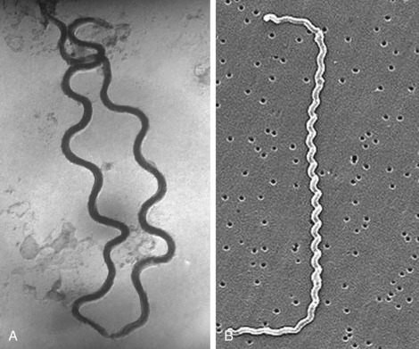
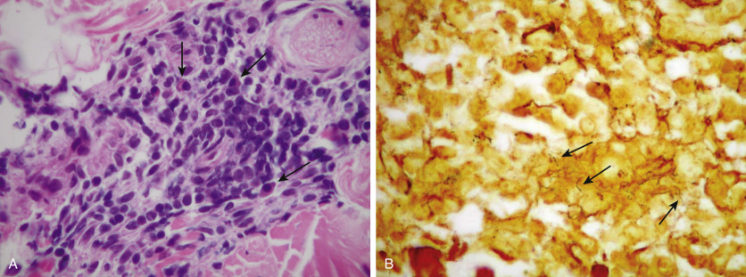
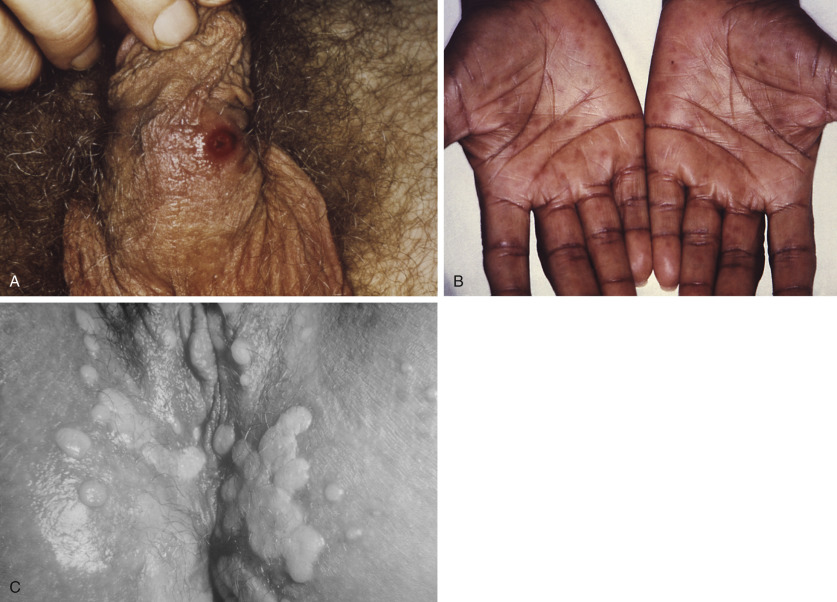
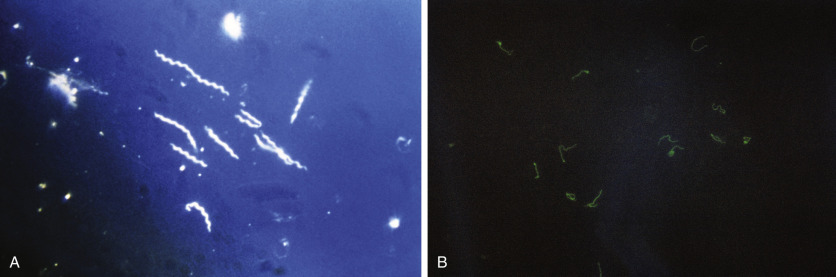
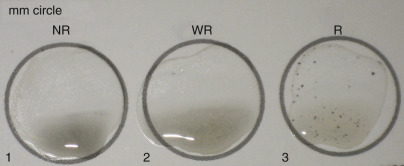
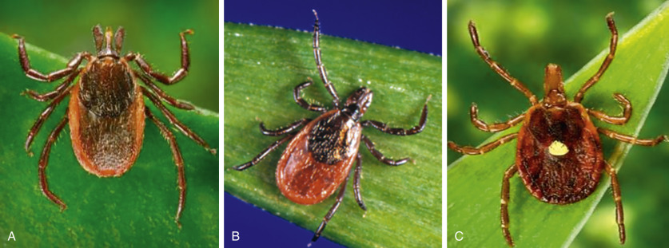
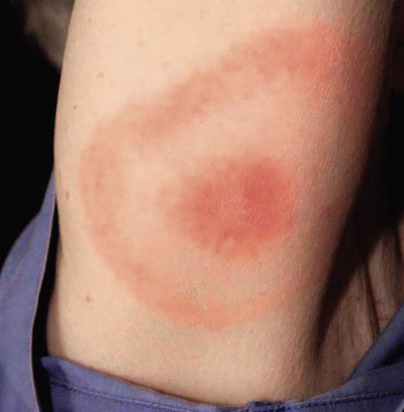
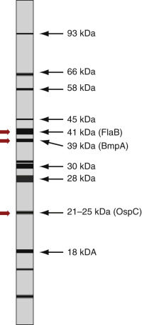
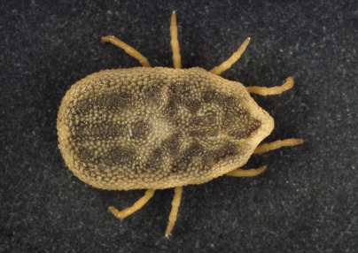
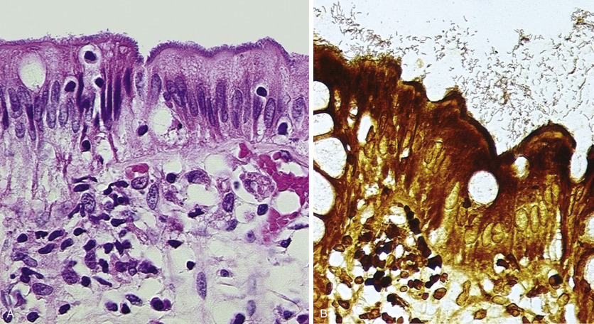

## Key Points

  * •

Human disease caused by spirochetes typically follows a clinical course that reflects three sequential phenomena: (1) early, local proliferation of the organisms at the site of introduction, (2) spirochetemia with systemic dissemination, and (3) persistence of small numbers of microbes at various, often immune, “privileged” sites. 

  * •

Direct detection of pathogenic spirochetes is sometimes possible by microbiologic culture, microscopy, or genomic amplification, but diagnosis more often relies upon the demonstration of a patient's serologic response to the offending agent. 

  * •

Venereal syphilis is a historic sexually transmitted disease caused by _Treponema pallidum_ subspecies _pallidum._

  * •

In the early stages of disease, venereal syphilis may be diagnosed using direct microscopic visualization. 

  * •

Serologic detection of syphilis, by far the most common mode of diagnosis, comprises methods that semiquantitatively measure antibody to various lipoproteins, as well as methods that detect antibody to treponeme-specific antigens. Serologic testing algorithms may begin with a non-treponemal assay, or with a treponeme-specific assay (referred to as the _reverse algorithm_ ). 

  * •

Yaws, endemic syphilis (bejel), and pinta are not sexually transmitted, are endemic to various tropical and Middle Eastern regions, and are caused by _T. pallidum_ subsp. _pertenue, T. pallidum_ subsp. _endemicum,_ and _T. carateum_ , respectively. 

  * •

Presumptive diagnosis of the endemic treponematoses can sometimes be made on the basis of clinical and epidemiologic data; however, as with venereal syphilis, serologic and direct microscopic techniques may prove useful. 

  * •

The most common tick-borne disease in North America and Europe, Lyme disease is caused chiefly by _Borrelia burgdorferi_ sensu stricto, _Borrelia garinii,_ and _Borrelia afzelii_ . 

  * •

Typical clinical manifestations of Lyme disease include erythema migrans (early localized disease), neuroborreliosis (early disseminated or late-stage disease), and/or Lyme arthritis (late-stage disease). 

  * •

Because no single laboratory test performs sufficiently in all clinical scenarios, a diagnosis of Lyme disease must be based on a combination of (1) clinicoepidemiologic characteristics, (2) host serologic response (as measured by enzyme-linked immunosorbent assay/immunofluorescence assay and immunoblot), (3) molecular evidence, and/or (4) culture results. 

  * •

Epidemic, louse-borne relapsing fever has a worldwide distribution and is caused by _Borrelia recurrentis._

  * •

Endemic, tick-borne relapsing fever has a limited geographic distribution and is caused by several _Borrelia_ species, including _Borrelia hermsi_ and _Borrelia turicata_ . 

  * •

Acute onset of high fever and constitutional symptoms followed by cycles of evanescence and recrudescence is frequently recognized in both forms of relapsing fever. 

  * •

Diagnosis of relapsing fever is most often established through the demonstration of spirochetes in peripheral blood smears stained by a Giemsa technique. 

  * •

One of the most common zoonotic diseases throughout the world, leptospirosis is caused by various serovars of different species within the genus _Leptospira_ . 

  * •

Although leptospirosis is usually subclinical or mild and flulike, a small proportion of patients develop severe symptoms related to gastrointestinal/hepatic disease, meningitis, renal failure, and/or myocarditis (also referred to as _Weil 's disease _ ). 

  * •

Although _Leptospira_ spp. can be cultivated in vitro, diagnosis is usually made by demonstrating seroconversion. 

  * •

_Brachyspira aalborgi_ and _Brachyspira pilosicoli_ have been demonstrated in and isolated from the colon of humans with diarrheal disease, but their pathogenicity has not been firmly established. 

  * •

Demonstration of spirochetes along the colonic epithelial cell borders using routine, immunohistochemical, or in situ hybridization microscopy from biopsy material is more commonly performed than cultivation or genomic amplification assays. 

We gratefully acknowledge the contribution of Mike Smith, Gail Woods, and others who authored this chapter in previous editions. 

Spirochetes (“spiro” means “coiled,” and “chaete” means “hair”) are slender, spiral-shaped bacteria containing one or more complete rotations that form a helix. They are gram-negative but can be visualized only by darkfield or phase microscopy, silver impregnation, and immunohistochemical stains in tissue sections. Flagella-like organelles called _periplasmic fibrils_ or axial filaments are attached near the poles of the bacteria and permit a corkscrew-like motility. Many commensal and nonpathogenic species of spirochetes exist, and human disease is limited primarily to infection by members of three genera: _Treponema, Borrelia,_ and _Leptospira_ . Widely diverse from an epidemiologic standpoint, spirochetes within these genera demonstrate a number of pathogenic, and hence clinical, similarities upon acquisition by humans (  Schmid, 1989  ). Although _Brachyspira_ species have been associated with gastrointestinal syndromes, definitive causation of disease by these bacteria has not been universally accepted. 

,  

##  Treponema 

The genus _Treponema_ contains two species responsible for disease in humans. _Treponema pallidum_ is divided into three subspecies, each of which is the etiologic agent of a distinct clinical entity: subspecies _pallidum, pertenue,_ and _endemicum_ are the etiologic agents of venereal syphilis, yaws, and endemic syphilis (bejel), respectively. Pinta is caused by the second closely related species, _Treponema carateum_ . Controversy exists even to this day concerning the origins of the sexually transmitted form of infection. Previously, the debate focused largely on deducing geographic regions of disease occurrence (e.g., Old World vs. New World) based on morphologic skeletal abnormalities of excavated remains that were presumably a result of _T. pallidum_ subsp. _pallidum_ infection. More recent work utilizing phylogenetic molecular methods seems to support the “Columbian” theory, that is, that a form of venereal infection was acquired during exploration of the New World and was subsequently introduced into Europe (  Harper et al, 2008b  ). 

 

##  Classic Treponemal Disease 

 

##  Syphilis 

 

##  Description 

_T. pallidum_ subsp. _pallidum,_ the etiologic agent of venereal syphilis, is a thin (0.2 µm) spirochete, 6 to 20 µm in length with 10 to 13 coils ( [ Fig. 60-1, _A_ ](<#f0010>) ). The disease appears to have spread rapidly throughout Europe during the 16th century, and its absence in the medical literature prior to this period suggests that the organism was brought from the New World. 

Figure 60-1 

Electron photomicrographs of pathogenic spirochetes. 

**A,** Two spiral-shaped _Treponema pallidum_ bacteria (36,000×); **B,** _Leptospira interrogans_ strain RGA bound to a 0.2-µm filter. 

(CDC/PHIL file photo.) 

 

##  Epidemiology 

Man is the only natural reservoir for _T. pallidum_ subsp. _pallidum._ Transmission occurs by direct contact with active lesions, largely through sexual contact. Vertical transmission across the placenta, the second most common mode of infection, may result when a latently infected female becomes pregnant, or when a pregnant woman becomes infected (  Wicher & Wicher, 2001  ). Infection may also rarely be transmitted by nonsexual contact with an active lesion, by transfusion of fresh blood products from an infected person (although organisms do not survive >48 hours under typical blood bank storage conditions), by accidental needlestick, or when infectious specimens are handled in the laboratory. 

The incidence of venereal syphilis in the United States declined dramatically with the advent of penicillin following World War II and remained stable until the mid 1980s, when the incidence began to increase once again, presumably as the result of increased intravenous drug use and sexual promiscuity. A continuous decline in infection rates was observed among women of childbearing age throughout the 1990s, and was paralleled by a comparable decrease in the incidence of congenital syphilis (  Centers for Disease Control and Prevention [CDC], 2004  ). Following a nadir in disease incidence in 2000 that marked the lowest rate of syphilis in the United States during recorded history, numbers of cases have been steadily increasing, predominantly among men who have sex with men ( [ Fig. 60-2 ](<#f0015>) ) (  CDC, 2012  ). In 2006, the National Plan to Eliminate Syphilis from the United States was updated to reflect a new target of reducing the incidence of primary and secondary syphilis to <2.2/100,000 population, and of congenital syphilis to <3.9/100,000 live births by 2010 (  CDC, 2006  ). As of 2013, however, the goals remained elusive (5.3 reported cases of primary and secondary syphilis/100,000 population) (  CDC, 2014  ). 

Figure 60-2 

Number of syphilis infections in gay and bisexual men: United States, 2007-2012. 

(From Centers for Disease Control and Prevention: 2014 Sexually transmitted diseases surveillance. Available at: http://www.cdc.gov/std/stats12/figures/30.htm. Accessed October 22, 2015.) 

 

##  Pathogenesis and Pathology 

_T. pallidum_ subsp. _pallidum_ penetrates an intact mucous membrane or gains access to tissue through abraded skin, multiplies at the inoculation site, and then enters the lymphatic and circulatory system and spreads throughout the body. In laboratory animals, infections have been produced with as few as four spirochetes (  Cumberland & Turner, 1949  ). Clinical lesions appear when a critical mass of organisms is reached locally (≈10  7  spirochetes); therefore, the incubation period is directly related to the size of the initial inoculum and varies from 3 days to 3 months (  Magnuson et al, 1956  ). 

The host immunologic response to _T. pallidum_ subsp. _pallidum_ is influenced by the structure of the bacterium. The outer membrane is a phospholipid bilayer that lacks lipopolysaccharide and has few demonstrable protein antigens. The lack of exposed outer membrane proteins as well as the presence of antigenetically unique organisms within _T. pallidum_ subsp. _pallidum_ populations are key factors in the organism's ability to evade opsonization and clearance by macrophages (  Cruz et al, 2012  ). 

This delayed and attenuated immune response allows _T. pallidum_ subsp. _pallidum_ to disseminate and to produce a chronic infection. The course of syphilis can be divided into predictable stages. Its primary stage, the development of a chancre, occurs at a median of 3 weeks post-inoculation, although a primary lesion may not develop in all patients. Additionally, because of its painless nature, the lesion may go unnoticed in a proportion of cases. Upon healing within 2 to 8 weeks, the chancre gives rise to the secondary stage. Typically manifesting about 6 weeks after inoculation (range, 2 to 12 weeks), this stage is characterized by widespread dissemination of spirochetes via the bloodstream and the development of mucocutaneous and organ involvement with the presence of constitutional symptoms. Upon resolution of the secondary stage, the infection enters a period of latency, during which time the patient exhibits minimal manifestations of infection. The first year of this stage, termed the _early latent period,_ may be characterized by occasional relapses, whereas relapse is not common during the late latent period. Following a period of 10 to 25 years, approximately one third of untreated patients develop tertiary syphilis, the most serious manifestations of which involve the cardiovascular system or the central nervous system (CNS). 

Whatever organ is involved or whatever stage of the disease is reached, the histologic hallmark of syphilis is obliterative endarteritis, demonstrating concentric endothelial and fibroblastic proliferations with an associated mononuclear cell infiltrate rich in plasma cells ( [ Fig. 60-3, _A_ ](<#f0020>) ). Endarteritis results from the binding of spirochetes to endothelial cells via fibronectin molecules that have attached to the surface of the bacteria (  Thomas et al, 1986  ). Treponemes may be demonstrable in tissues with silver impregnation (see [ Fig. 60-3, _B_ ](<#f0020>) ) and immunohistochemical stains, particularly during the first and second stages of disease (  Martin-Ezquerea et al, 2009  ). With progression, both the plasma cell infiltrate and the concentration of treponemes lessen in intensity. Although commonplace in the pretreatment era, syphilitic gummas, or large visceral necrotizing granulomas, develop as tertiary-stage manifestations but are now rarely seen (  Fargen et al, 2009  ). 

Figure 60-3 

Histologic photomicrographs of a secondary syphilis case. 

**A,** Superficial dermis showing a dense, perivascular lymphomononuclear infiltrate containing many plasma cells _(arrows)_ (hematoxylin & eosin [H&E], ≈400×), which was confirmed in **B** to contain numerous argyrophilic spirochetes _(arrows)_ (Steiner silver impregnation technique, 400×). Patient was subsequently shown to have a high rapid plasma reagin (RPR) titer. 

Elucidation of the complete genomic sequence of _T. pallidum_ subsp. _pallidum_ has provided insight into the pathogenesis and molecular epidemiology of this organism (  Fraser et al, 1998  ). Molecular typing tools have identified geographically specific strains (  Smajs et al, 2012  ). Multiple sequences of _T. pallidum_ repeat _(tprK)_ have been found in patient samples, suggesting the coexistence of multiple strains of _T. pallidum_ subsp. _pallidum_ during infection (  Heymans et al, 2009  ). 

 

##  Clinical Manifestations 

Syphilis is a chronic infection with a multiplicity of expressions, primarily related to the stage at which it manifests. The primary chancre is characteristically ulcerated with raised, firm edges and a smooth base and is notable for absence of an exudate or pain ( [ Fig. 60-4, _A_ ](<#f0025>) ). Although these are typically solitary, multiple chancres can occur in up to one third of patients. Patients with previous infection can present with atypical lesions, such as a small papule, or may not develop a lesion at all. Regional lymphadenopathy, with moderately enlarged, rubbery, nonsuppurative lymph nodes, is seen in some patients. 

Figure 60-4 

Clinical manifestations of venereal syphilis. 

**A,** Penile chancre. **B,** Secondary syphilitic lesions involving the palms. **C,** Condylomata lata lesions involving the vulvar and anal region. 

(CDC/PHIL file photos.) 

Dissemination marks the secondary stage, and patients present with signs and symptoms of a systemic illness. More than 90% develop a rash that begins on the trunk and extremities (although any body surface can be involved) as small macules that progress to papules, and in some patients to pustules, over a period of weeks. The appearance of the rash on the palms and soles is characteristic (see [ Fig. 60-4, _B_ ](<#f0025>) ), and enlargement and coalescence of papules produce the pale plaques of condyloma lata (see [ Fig. 60-4, _C_ ](<#f0025>) ). Approximately 90% of patients also exhibit generalized lymphadenopathy, and as many as three fourths may suffer fever, malaise, anorexia, arthralgia, pharyngitis, and weight loss. Mucous patches are seen in up to one third of cases. About 40% of persons develop CNS symptoms during this stage, particularly among those coinfected with human immunodeficiency virus (HIV), although only 1% to 2% present with acute meningitis (  Lukehart et al, 1988  ;  CDC, 2007  ). The remainder may experience headache and meningismus, uveitis, sensorineural hearing loss, and cranial nerve involvement. 

The tissue destruction of tertiary syphilis usually becomes evident decades after the primary infection. Cardiovascular syphilis occurs as a result of weakening of the tunica media and results in an aneurysm of the ascending aorta with aortic valve insufficiency and narrowing of the coronary artery ostia. Syphilitic gummas may involve the skin, brain, skeletal system, or mucocutaneous tissues, although any organ can be affected. Both cardiovascular syphilis and syphilitic gummas became much less frequent after the advent of antibiotic treatment. Meningovascular syphilis occurs 5 to 10 years after initial infection and clinically presents as seizures, stroke, and aphasia. Multiple small infarcts due to endarteritis in the CNS are the cause of this form. Parenchymatous neurosyphilis, which presents 15 to 30 years after initial infection, is a degenerative process with loss of neurons and myelinated tracts resulting in a complex of neurologic and psychiatric manifestations, including general paresis, tabes dorsalis, and pupillary abnormalities. Some patients lack clinical signs or symptoms altogether but demonstrate cerebrospinal fluid (CSF) abnormalities such as pleocytosis, increased protein, a reactive Venereal Disease Research Laboratory (VDRL) test, or antibody against _T. pallidum_ indicating CNS infection. 

Congenital syphilis occurs clinically as two forms: an early or infantile form (<2 years of age) and a late form following a period of latency (few years to several decades). Although transplacental passage of spirochetes can occur during any trimester, congenital acquisition during early gestational age results in stillbirth more often than does acquisition during late gestation or parturition (  Harter & Bernischke, 1976  ). As may be expected, congenital transmission is more frequent during the primary, secondary, and early latent periods of maternal infection (  Woods, 2009  ). Necrotizing funisitis, or inflammation of the umbilical cord, is characteristic of congenital syphilis, although it is typically present in only the most severe cases. In the infantile form, a diffuse rash with sloughing of the skin, osteochondritis, and periostitis are characteristic; however, affected newborns may be asymptomatic (  Dorfman & Glaser, 1990  ). Diffuse fibrosis of the liver (hepar lobatum) and lung (pneumonia alba) is also seen. After a latent period, the late form presents in childhood or adulthood with a wide variety of signs and symptoms; however, the triad of interstitial keratitis, Hutchinson's teeth, and eighth nerve deafness is classic. Periostitis, saber shins, and saddle deformity of the nose are also seen frequently. 

Syphilis and HIV infection are increasingly seen as coinfections because these diseases share common risk factors and may even potentiate one another. Through several mechanisms, syphilis increases the risk for acquisition and transmission of HIV. The disrupted mucosal barrier at the chancre can facilitate HIV infection and transmission. The inflow of host immune cells to the site of syphilis infection increases the number of targets available for HIV infection. In addition, recruited monocytes express increased amounts of the HIV coreceptor CCR5 (  Sheffield et al, 2007  ). While the clinical presentation of syphilis in HIV-infected persons is usually similar to that in individuals without HIV, cases of more severe primary and secondary lesions, as well as unusual presentations, have been reported (  Stevenson & Heath, 2006  ). Patients with AIDS have a high incidence of eye involvement, with anterior uveitis being the most common manifestation of _T. pallidum_ infection in this setting (  Stevenson & Heath, 2006  ). HIV infection status may affect laboratory tests for syphilis, and vice versa. Early syphilis infection is associated with an increase in plasma HIV viral load and a decrease in the CD4 cell count (  Buchacz et al, 2004  ). A multicenter prospective study showed that CSF nontreponemal tests were more likely to remain positive (“serofast”) following syphilis therapy in HIV-infected individuals than in HIV-uninfected patients (  Marra, 2004a  ). It remains to be seen, however, if such laboratory evidence of treatment failure is a true reflection of potential clinical relapse. What does seem clear, as evidenced by multiple studies, is that anti-HIV therapy itself improves the likelihood of serologic response following syphilis treatment in HIV-positive patients (  Marra et al, 2008  ;  González-López et al, 2009  ). 

 

##  Yaws 

Yaws (also called _frambesia tropica, pian, parangi, paru, buba,_ or _bouba_ ) is a chronic disease caused by _T. pallidum_ subsp. _pertenue_ and is the most prevalent of the nonvenereal treponematoses. This disease, which has afflicted residents of the tropics since antiquity, is common in rural areas of tropical countries with heavy rainfall. After a decline in the 1950s due to large campaigns to control the treponematoses, the incidence of yaws has increased in some areas (  Engelkens et al, 1991a  ;  Antal et al, 2002  ). 

Yaws is contracted chiefly during childhood by direct contact, with breaks in the skin allowing entry of treponemes. Early lesions generally appear about 3 weeks later but may not develop for months. One or several papules appear, most frequently on the lower extremities, and then ulcerate or progress to papillomatous lesions. Numerous treponemes are found in these lesions. Spontaneous resolution is usual; however, relapses preceded by malaise, fever, and generalized lymphadenopathy followed by disseminated skin lesions are common. Most patients enter a period of latency during which no clinical signs or symptoms are evident. For most, the disease shows no additional manifestations; however, approximately 10% develop late yaws, which shows irreversible, destructive lesions of bone, cartilage, soft tissue, and the skin (  Engelkens et al, 1991a  ;  Antal et al, 2002  ). Cardiovascular and CNS lesions similar to those seen in syphilis have been reported to occur (  Roman & Roman, 1986  ). 

 

##  Endemic Syphilis 

Endemic syphilis (bejel) is a nonvenereal chronic infection caused by infection with _T. pallidum_ subsp. _endemicum._ The disease is ancient and, although it is no longer as widespread as it once was, still occurs in the Middle East and Africa in hot, dry climates. In Sahelian Africa, the disease has been increasing in prevalence (  Engelkens et al, 1991b  ). Endemic syphilis is transmitted by direct contact with active lesions, contaminated fingers, and eating or drinking utensils. Crowded living conditions and poor hygiene are common associated factors. Children 2 to 15 years of age are primarily infected, although the disease can be found in adults in the same family, and those adults who did not suffer from the disease in childhood can be infected by their children. The inoculum is small and the primary lesions of early endemic syphilis, most frequent on the oropharyngeal mucosa, often are not apparent. Initial clinical manifestations of the disease are usually seen in a secondary stage, with mucous patches, condyloma lata, angular stomatitis, generalized lymphadenopathy, and painful osteoperiostitis. This is followed by a latent period of variable length. The late stage is characterized by tissue destruction of the skin, bones, and cartilage, with a predilection for the nose and palate (so-called _gangosa_ ), and sometimes laryngeal involvement. 

 

##  Pinta 

Pinta (carate, mal de pinto, azul) is caused by infection with _T. carateum_ . The disease is endemic in rural tropical Central and South America and has reappeared in Mexico and Colombia following eradication efforts in the 1950s (  Engelkens et al, 1991b  ). Children younger than 5 years of age are primarily infected. Inoculation is thought to occur via nonvenereal skin or mucous membrane contact. Characterization of the pathogenesis of the disease is difficult because, unlike other treponematoses that are pathogenic in humans, an animal model is unavailable and the treponeme cannot be cultured continuously. A primary papule or plaque develops at the site of inoculation after weeks to months, with or without localized lymphadenopathy. The primary lesion resolves, and several months to years later, disseminated secondary lesions, or pintids, which resemble scaly psoriasiform plaques, appear and remain for long periods or resolve and recur. In late pinta, lesions demonstrate hypopigmentation and skin atrophy or hyperkeratosis, which can persist for life. The skin appears to be the only organ affected in this disease (  Antal et al, 2002  ). 

 

##  Laboratory Diagnosis of Treponematoses 

Because the etiologic agents of the human treponematoses cannot be isolated easily by routine culture methods, testing for disease generally is completed directly by visualization of the organisms in material from lesions or indirectly by immunologic methods. Consequently, different stages of the treponematoses often require a particular testing modality. In the early stages when lesions are present, highly specific microscopic techniques are used. Upon resolution of lesions, a variety of serologic tests are employed for diagnosis. It is important to remember that none of these laboratory tests is capable of distinguishing between the closely related species and subspecies of pathogenic treponemes, so differentiating between them requires clinical, epidemiologic, and, when possible, genomic information (  Harper et al, 2008a  ). 

 

##  Darkfield Microscopy 

When direct sampling of lesions is possible, such as in primary, secondary, or early congenital syphilis (chancres, mucous patches, or condyloma lata), the lesion should be cleansed with sterile water (no soap or antiseptic) and gently abraded. Pressure is applied, causing serous exudate to collect in the lesion. A drop of the fluid is placed on a slide, and a coverslip is placed over the fluid. The specimen must be examined within ~20 min, as visualization of motility is necessary for definitive identification. Because of their narrow width, treponemes cannot be visualized by conventional light microscopy. Instead, darkfield microscopy is necessary. This technique makes use of a patch stop, which creates the microscopist's “dark field,” and a condenser lens that targets the spirochetes with light waves at an oblique angle, some of which are scattered into the objective, giving the appearance of bright organisms in a dark background ( [ Fig. 60-5, _A_ ](<#f0030>) ). The darkfield examination can be positive several weeks before a positive serologic test and has a sensitivity of 80% in diagnosing syphilis (  Larsen et al, 1995  ). Highly skilled microscopists are required to avoid false positives. Because of possible confusion with commensal treponemes in the mouth, however, it is not recommended that this technique be utilized for oral lesions. Additionally, three _Treponema_ spp. that are normal inhabitants of the genital region _(T. phagedensis, T. refringens,_ and _T. minutum)_ could potentially be confused with _T. pallidum_ on darkfield examination. Careful cleaning of the area is important in reducing the likelihood of this occurrence. The characteristic motility of _T. pallidum_ is an important feature that distinguishes it from saprophytic spirochetes. 

Figure 60-5 

In vitro diagnostic modalities for venereal syphilis detection. 

**A,** Darkfield microscopy technique (400×) reveals the presence of motile spirochetes. **B,** Positive fluorescent treponemal antibody absorption (FTA-ABS) test for antibody response in patient with syphilis. 

(CDC/PHIL file photo.) 

 

##  Fluorescence Microscopy 

Fluorescein isothiocyanate (FITC)-labeled antibodies specific for _T. pallidum_ can be used for direct detection of treponemes in lesions, obviating the need to observe motility of the bacteria. The test can be applied to tissue fluid that has been dried and fixed to the slide (direct fluorescent antibody [DFA-TP]) or paraffin-embedded tissue sections (direct fluorescent antibody tissue test [DFAT-TP]). Monoclonal antibodies are commercially available and can be used in these tests in place of the older and less specific Reiter treponeme adsorbed polyclonal antibodies obtained from syphilitic rabbits and humans. When used on fluid from fresh lesions, both DFA-TP and DFAT-TP have a sensitivity of approximately 100% (  Larsen et al, 1995  ). Because these tests are specific for the pathogenic treponemes and reduce the risk for laboratory-acquired syphilis, they are preferred for examination of oral lesions. 

 

##  Immunohistochemical Microscopy 

In a manner similar in principle to fluorescence microscopy, monoclonal and polyclonal antibodies with specificities for spirochetes, treponemes, or _T. pallidum_ have been used by pathologists for detection in paraffin-embedded tissues (  Martin-Ezquerra et al, 2009  ). In contrast to immunofluorescence, immunohistochemistry does not require the use of expensive fluorescent microscopes. With this technique, antitreponemal antibodies bound to spirochetes in tissue sections are detected after a series of immunologic reactions typically consisting of a primary, biotinylated antibody conjugate with organism specificity followed by an enzyme-conjugated streptavidin complex. After development of the enzyme with an appropriate chromogenic substrate, organisms are highlighted against a pale counterstained background. This allows for easy detection of rare bacteria and affords the capability for histologic localization. The procedure reportedly offers improvement in sensitivity and specificity over silver impregnation stains for the detection of treponemes, but this is largely dependent upon the source of primary antibody. 

 

##  Nontreponemal Serologic Tests 

The nontreponemal assays detect antibodies to lipoprotein material and cardiolipin released from cells damaged by treponemes. As a consequence, they are not specific for _Treponema_ . These tests have been used traditionally to screen for disease and to monitor the course of the disease after treatment. Standard tests include the VDRL, rapid plasma reagin (RPR), unheated serum reagin (USR), toluidine red unheated serum (TRUST), and enzyme-linked immunosorbent assay (ELISA). All these tests use a phospholipid antigen, some fortified with lecithin and cholesterol. Flocculation is the endpoint for the manual standard tests, whereas absorbance values are calculated spectrophotometrically in the ELISA. Serum is the preferred specimen for each. Heating of the serum to eliminate nonspecific reactions is required in the VDRL, whereas the addition of choline chloride to the RPR and USR eliminates the need for heating, making these popular choices among diagnostic laboratories. Antibody-antigen reactions in the VDRL and USR are assessed using a microscope at 100×, and the addition of charcoal to the RPR and dye to the TRUST makes the reactions macroscopically visible ( [ Fig. 60-6 ](<#f0035>) ). 

Figure 60-6 

Rapid plasmin reagin test card showing nonreactive, weakly reactive, and strongly reactive serum samples (wells 1 to 3) with their respective agglutination patterns. 

Antibodies detected by these tests generally develop 1 to 4 weeks after the appearance of the primary chancre. The time at which the specimen is taken during the primary stage, therefore, will affect assay sensitivity. The titer rises, remains high during the first year of infection, and then gradually declines. The tests will ultimately revert to negative in most patients in the absence of therapy, particularly during the late latent stage. Thus, these tests are general markers of disease activity. False-negative nontreponemal tests may also be associated with very high titers of antibody (prozone phenomenon), which are seen most commonly in secondary syphilis. This condition is easily resolved by diluting the specimen prior to testing. False-positive results may occur with acute illnesses such as hepatitis, other viral infections, and pregnancy; or chronically with the connective tissue diseases (  Larsen et al, 1995  ). 

Standard nontreponemal tests afford the capability of semiquantitative reporting by testing serial twofold specimen dilutions (i.e., titers). Follow-up titers are used to determine the efficacy of treatment, with a fourfold decrease in titer considered an adequate response (  CDC, 2010  ). Follow-up testing by the same method is necessary, because titers between different nontreponemal tests cannot be directly compared. Patients treated in early syphilis are more likely to revert to negative than those treated in late syphilis (  Brown et al, 1985  ). In a small minority of patients, nontreponemal tests will remain positive despite adequate therapy—a situation known as the _serofast response_ . 

Reports have documented various aberrant nontreponemal test results with patients coinfected with HIV and syphilis, including delayed seroconversion; however, seronegative syphilis does not appear to be prevalent in AIDS patients (  Flores, 1995  ). The false-positive rate is reportedly increased in AIDS patients (4% vs. 1% in non-AIDS); however, the increased rate of positivity may be associated with intravenous drug abuse rather than HIV infection itself (  Flores, 1995  ;  Larsen et al, 1995  ;  Hernandez-Aguado et al, 1998  ). False-negative results also occur in AIDS patients with syphilis because of an exaggerated nontreponemal antibody response that occurs in some patients, with the resultant prozone effect (  Gourevitch et al, 1993  ). Furthermore, as mentioned previously, a small number of AIDS patients may experience minimal to no decline in nontreponemal antibody titers despite presumably adequate therapy, although this may be related to the stage at which treatment was initiated rather than HIV coinfection (  Larsen et al, 1995  ). The sensitivity of nontreponemal tests varies based on the disease stage. During primary, secondary, latent, and late syphilis, sensitivity is approximately 75% to 88%, 100%, 88% to 100%, and 71% to 73%, respectively. Specificity varies based on population, but is usually >96% ( [ Table 60-1 ](<#t0010>) ). 

TABLE 60-1 

Sensitivities of Serologic Tests for Syphilis in Different Stages of Disease 

Test  |  STATE OF SYPHILIS, % SENSITIVITY (RANGE)  |  % Specificity (Range)   
---|---|---  
Primary  |  Secondary  |  Latent  |  Late   
**Nontreponemal**  
VDRL  |  78 (74-87)  |  100  |  95 (88-100)  |  71 (37-94)  |  98 (96-99)   
RPR  |  86 (77-100)  |  100  |  98 (95-100)  |  73  |  98 (93-99)   
**Treponemal**  
FTA-ABS  |  84 (70-100)  |  100  |  100  |  96  |  97 (94-100)   
MHA-TP  |  76 (69-90)  |  100  |  97 (97-100)  |  94  |  99 (98-100)   
TPPA  |  88 (86-100)  |  100  |  100  |  NA  |  96 (95-100)   
IgG ELISA  |  100  |  100  |  100  |  NA  |  100   
CLIA  |  98  |  100  |  100  |  100  |  99   
  
_CLIA,_ Chemiluminescent immunoassay; _ELISA,_ enzyme-linked immunosorbent assay; _FTA-ABS,_ fluorescent treponemal antibody absorption; _MHA-TP,_ microhemagglutination assay for antibodies to _Treponema pallidum_ ; _NA,_ not available; _RPR,_ rapid plasma reagin; _TPPA, T. pallidum_ particle agglutination; _VDRL,_ Venereal Disease Research Laboratory. 

Data from Larsen SA, Steiner BM, Rudolph AH: Laboratory diagnosis and interpretation of tests for syphilis, _Clin Microbiol Rev_ 8:1, 1995; Sena AC, White BL, Sparling PF: Novel Treponema pallidum serologic tests: a paradigm shift in syphilis screening for the 21st century, _Clin Infect Dis_ 51:700, 2010. 

 

##  Treponemal Serologic Tests 

Treponemal tests detect the presence of antibodies to treponemal antigens and have traditionally been used to confirm a positive nontreponemal screening test, or to confirm infection in the face of a negative nontreponemal test in late or latent disease stages, which can occur in up to 30% of patients with tertiary syphilis (  Larsen et al, 1995  ). Recently, treponemal tests have been used more frequently as a primary screening test (  CDC, 2008  ;  Loeffelholz & Binnicker, 2012  ;  Marangoni et al, 2009  ;  Sena et al, 2010  ;  Sokolovskiy et al, 2009  ). The fluorescent treponemal antibody absorption (FTA-ABS) test is an indirect fluorescent antibody test. It involves the addition of heated patient serum, which has been absorbed with antigen of the nonpathogenic Reiter treponeme for removal of cross-reactive antibodies to a slide on which _T. pallidum_ subsp. _pallidum_ (Nichols strain) has been fixed, followed by the addition of FITC-labeled antihuman globulin. Visible treponemes on fluorescent microscopy indicate the presence of antibody to the pathogenic treponemal species in the patient's serum (see [ Fig. 60-5, _B_ ](<#f0030>) ). Another test, preferred by some laboratories because of its relative simplicity, is the microhemagglutination assay for antibodies to _T. pallidum_ (MHA-TP). Absorbed serum is added to sheep red blood cells sensitized with _T. pallidum_ (Nichols strain) sonicate in a microtiter tray. Agglutination of red blood cells is produced by syphilis-specific antibody. The _T. pallidum_ particle agglutination (TPPA) test is based on the agglutination of gel particles sensitized with sonicated Nichols strain _T. pallidum_ antigens. Anti- _T. pallidum_ antibodies react with the gel particles to form a smooth mat in microtiter plate wells. In the absence of specific antibodies, the gel particles form a button at the bottom of the well. ELISA and chemilumenescent immunoassay (CLIA) test formats utilizing treponeme-specific antigens (e.g., sonicated lysates, recombinant proteins) have become available for use in clinical laboratories. These offer the advantages of automation for high-volume testing and an objective, numeric output to aide in interpretation. Generally, the MHA-TP, FTA-ABS, and TPPA tests are equivalent, except in the primary stage of syphilis, where the TPPA test shows highest sensitivity, and the FTA-ABS test is slightly more sensitive than MHA-TP (  Augenbraun et al, 1998  ;  Sena et al, 2010  ). IgG ELISA and CLIA formats are at least as sensitive and specific as the traditional treponemal tests. Importantly, they show improved sensitivity during the primary stage of syphilis (  Sena et al, 2010  ). Sensitivities and specificities of the various nontreponemal and treponemal serologic tests are summarized in [ Table 60-1 ](<#t0010>) (  Larsen et al, 1995  ). 

Treponemal-specific antibody develops in primary syphilis and persists indefinitely in most patients, although as many as 20% may eventually serorevert (  Romanowski et al, 1991  ). AIDS patients have shown a greater tendency to revert to seronegativity following treatment (  Haas et al, 1990  ). The FTA-ABS usually is the first test to become positive, followed by the MHA-TP, and then the nontreponemal tests shortly thereafter. False-positive FTA-ABS results occur in ≈1% to 3% of patients, most often in older adults, in persons with connective tissue disease, and in those infected with related organisms, such as _Borrelia_ spp. (  Larsen et al, 1995  ). The frequency of false-positive results with the MHA-TP is reportedly lower than with the FTA-ABS test and TPPA (  Larsen et al, 1995  ;  Sena et al, 2010  ). 

Because of the advantages offered by their automated formats, IgG ELISAs and CLIAs have been implemented as primary screening assays in some laboratories in the United States (the “reverse algorithm”) (  CDC, 2008  ;  Loeffelholz & Binnicker, 2012  ) and Europe (  Marangoni et al, 2009  ;  Sokolovskiy et al, 2009  ). Because these tests do not distinguish past from active infection, follow-up testing for positive results includes semiquantitative nontreponemal tests. As with all immunoassays, treponemal ELISAs and CLIAs will produce occasional false-positive results. The proportion of false positives relative to all positive results varies depending on the patient population tested (CDC, 2011b). When follow-up RPR is nonreactive, further testing using a traditional treponemal assay is usually necessary. ELISA and CLIA formats generate a numeric value, the strength of which can be used with high accuracy to predict when the second treponemal assay will be positive, thereby reducing unnecessary follow-up testing (  Loeffelholz et al, 2011  ;  Yen-Lieberman et al, 2011  ). 

Immunoassays with IgM-specific detection capability are also available and may have some utility in the diagnosis of congenital syphilis and primary infection (  Stoll et al, 1993  ;  Larsen & Johnson, 1998  ;  Sena et al, 2010  ). Finally, several rapid, point-of-care assays that incorporate treponemal or nontreponemal antigens have been described (  Greer & Wendel, 2008  ). Their utility lies chiefly in areas with high prevalence rates and low likelihood of patient follow-up, where patients with positive results can be treated presumptively at the time of testing. 

More highly complex tests, such as the immunoblot and the PCR, are available in some reference laboratories. The immunoblot has been integrated into the diagnosis of congenital syphilis or as confirmation for treponemal-specific antibody screening by some laboratories (  Larsen et al, 1995  ;  Wang & Li, 2009  ). PCR may be useful in the diagnosis of primary infection, when serologic tests are often still negative (  Gayet-Agaron, 2013  ). PCR has been advocated for the diagnosis of neurosyphilis, particularly in AIDS patients, although some studies have not demonstrated advantages over currently used methods (  Marra et al, 1996  ). Neither immunoblot nor PCR is used extensively in the diagnostic setting, as standardization remains poor (  Wicher et al, 1999  ). 

Serologic screening for syphilis requires the use of particular specimens and/or tests, depending on the population and/or disease manifestation. For example, in congenital syphilis screening, antepartum maternal serum is the ideal specimen, and all women should be tested at least once during pregnancy (  U.S. Preventive Services Task Force, 2009  ). In high prevalence areas or among women with potential risk factors, repeat testing may be indicated in later trimesters. Confirmation of congenital syphilis, however, may require a combination of clinical and radiologic examinations, placental analysis, and testing of neonatal serum. The latter is typically performed semiquantitatively using nontreponemal tests, and is compared with maternal serologic titer to determine the source of the antibody (i.e., to exclude transplacentally derived maternal antibody). Another example is the diagnosis of neurosyphilis, which requires a positive serum treponemal test in addition to a positive VDRL on CSF or some other CSF abnormality (e.g., pleocytosis, elevated protein level) (  CDC, 2002  ). The VDRL applied to CSF is highly specific for the diagnosis of neurosyphilis but is also insensitive. It is negative in 22% to 69% of patients with active neurosyphilis, and its sensitivity in inactive neurosyphilis may be as low as 10% (  MacLean & Luger, 1996  ). By contrast, the CSF FTA-ABS is reported to have high sensitivity and negative predictive value for neurosyphilis, so some experts advocate using this as a means of excluding the diagnosis (  Marra et al, 2004b  ). Its low specificity limits its positive predictive value, however. 

 

##  Treatment of Treponematoses 

_T. pallidum_ subspecies and _T. carateum_ are uniformly susceptible to penicillin and other β-lactam antibiotics. Treatment for primary, secondary, and early latent syphilis is a single intramuscular injection of benzathine penicillin G. The dosage and length of treatment depend on the stage of infection (  CDC, 2010  ). Yaws, pinta, and endemic syphilis are treated with the same antibiotic, although often at a lower dose (  Engelkens et al  1991a  ). Household contacts of patients with the latter three diseases usually are also treated. For patients who are allergic to penicillin, doxycycline or tetracycline may be used. A pronounced worsening in clinical course, termed the _Jarisch-Herxheimer reaction,_ may be seen upon treatment of venereal syphilis patients, although symptoms frequently are not as severe as in treatment of relapsing fever spirochetes (  Griffin, 1998  ). For late latent syphilis or syphilis of unknown duration, benzathine penicillin G is given in multiple doses in a course of several weeks. Stage of disease does not affect treatment for yaws, pinta, or endemic syphilis (  Engelkens et al  1991a  ). A 10- to 14-day course of high-dose intravenous aqueous penicillin G is indicated for neurosyphilis and congenital syphilis (  CDC, 2010  ). For patients coinfected with HIV and _T. pallidum,_ current CDC guidelines do not recommend any significant deviation in therapy (  CDC, 2010  ). Indeed, prospective studies have failed to show any benefit of “enhanced” or alternative therapies for early syphilis and neurosyphilis, respectively, among HIV-infected persons (  Rolfs et al, 1997  ;  Marra et al, 2000  ). On the other hand, some authorities suggest that, given a propensity to develop neurosyphilis even in the face of treatment for primary syphilis, AIDS patients should be treated with higher doses of penicillin (  Musher, 1991  ). 

 

##  Other Treponemal Diseases 

 

##  Description 

A number of spirochetes belonging to the treponeme molecular group-1, previously referred to as _pathogen-related oral spirochetes,_ and various species of _Treponema_ (e.g., _Treponema denticola, Treponema socranski_ ) have been recovered with increased frequency and in higher numbers from the gingiva of patients with ulcerative gingivitis and chronic periodontitis compared with patients with healthy gingiva (  Riviere et al  1995  ;  Loesche & Grossman, 2001  ). Using very sensitive nucleic acid amplification coupled with electrospray ionization mass spectrometry analysis, _Treponema denticola_ genes have also been reported in high proportions of patients undergoing prosthetic joint revisions, the significance of which remains to be determined (  Jacovides et al, 2012  ). Although originally thought to resemble _T. pallidum_ on the basis of immuno–cross-reactivity and in vitro invasive properties, these putative pathogens are rather genetically heterogeneous and only distantly related to _T. pallidum_ (  Choi et al, 1996  ;  Riviere et al, 1999  ). 

 

##  Pathogenesis 

A definitive causal relationship between the spirochetes and these diseases has not been firmly established; however, their presence in significant numbers, more commonly in diseased than in healthy tissue, suggests at least an association with gingivitis/periodontitis. Because a number of other nontreponemal bacterial genera (e.g., _Prevotella_ , _Actinobacillus_ , _Porphyromonas_ ) have also been associated with these clinical manifestations, research continues as to whether culpability belongs to specific virulent organisms among them or rather to the overall diversity of organisms contained within the plaque biofilm (  Loesche & Grossman, 2001  ). 

 

##  Diagnosis 

As with the commensal species of _Treponema_ found in the genital area, some oral _Treponema_ species can be cultured under strict anaerobic conditions using a variety of specialized, enriched broth media (  Choi et al, 1996  ;  Riviere et al, 1999  ). Other species, including most of those associated with periodontal disease, have not been cultured in vitro (  Loesche & Grossman, 2001  ). These organisms have been detected with monoclonal antibodies against _T. pallidum_ , with which they cross-react. Other investigators have employed a variety of genetic amplification tools in an effort to identify and characterize them (  Paster et al, 2001  ;  Hutter et al, 2003  ). These “molecular expeditions” are conducted by using primers that target conserved bacterial sequences and either PCR to amplify ribosomal (rRNA) genes or reverse-transcriptase PCR to amplify the rRNA itself. Resultant products can then be cloned in _Escherichia coli_ and sequenced to determine phylogenetic relationships. 

 

##  Treatment 

For years, treatment has been aimed primarily at reducing the overall bacterial burden by removing the plaque biofilm, both above and below the gumline, through physical manipulation (e.g., surgical debridement). Recently, the addition of various antimicrobial regimens, including systemic antibiotics and locally applied agents, has been shown to be a potentially beneficial adjunct (  Loesche & Grossman, 2001  ). 

,  

##  Leptospira 

 

##  Description 

The genus _Leptospira_ is composed of at least 20 genomic species, many containing both pathogenic and nonpathogenic strains, and more than 260 serovars (  Ko et al, 2009  ;  Brenner, 1999  ). Previously, _Leptospira_ was divided into only three species, _L. interrogans_ (pathogenic), _L. biflexa_ (nonpathogenic), and _L. parva_ (nonpathogenic), based on biochemical properties. However, it has become evident that antigenic properties and pathogenic potential are not consistently predictive of genetic relatedness (  Levett, 2001  ;  Ko et al, 2009  ). Leptospires are members of the phylum _Spirochaetes_ and exhibit tightly coiled forms that measure 0.1 µm in width by 6 to 20 µm in length and demonstrate spinning motility. Unique among the pathogenic spirochetes described in this chapter, leptospires have a characteristic “hook-like” or “question-mark” appearance by electron microscopy (see [ Fig. 60-1, _B_ ](<#f0010>) ) and have the ability to exist as free-living organisms in alkaline fresh water and moist soil. 

 

##  Epidemiology 

Leptospirosis is perhaps the most widespread global zoonosis; and although it was identified nearly 100 years ago, it is still considered an important emerging disease. Individual serovars show geographic preferences, as well as particular ecologic niches. The organism is carried by many rodents and feral and domestic animals; however, murids are among the most frequent reservoirs and serve as an important source of infection in man. Reservoir hosts harbor high concentrations of leptospires in renal tubules without significant untoward effect, and shed high numbers in their urine. Contact with urine-contaminated water or soil followed by entry of bacteria through cuts or mucosal surfaces is a frequent mode of acquisition. Some occupations (e.g., miners, farmers and field workers, veterinarians, fish farmers, sewage workers) and recreational pursuits (e.g., camping near or swimming in infected waterways) increase exposure risk. The incidence in the United States is 40 to 120 cases per year with <1 hospitalization per 1 million population (  Traxler et al, 2014  ); however, the disease is probably significantly underreported (  Farr, 1995  ). 

 

##  Pathology and Pathogenesis 

Upon entry, leptospires quickly gain access to the bloodstream and disseminate widely to sites such as the CNS, eye, liver, kidneys, lungs, and/or other viscera. Damage to endothelium in infected tissues may result in local ischemia, hemorrhage, and proinflammatory cytokine upsurge, potentially leading to end-organ (e.g., hepatocellular, renal tubular, alveolar) damage (  Ko et al, 2009  ). The liver exhibits a characteristic yellow-green color, but histologic changes are nonspecific and include ballooning degeneration, acidophilic bodies, regeneration, and cholestasis; leptospires can be found in around 25% of cases (  Dooley & Ishak, 1976  ). Interstitial nephritis, necrosis of proximal tubules, and granular or hyaline casts have been described in renal pathology, with intratubular leptospires present in ~65% of cases (  Arean, 1962  ). Pulmonary findings include congestion and edema, alveolar hemorrhage, pleu­ral effusion, and occasional hyaline membrane formation (  Arean, 1962  ;  Ramachandran & Perera, 1977  ). Myocarditis, meningitis/encephalitis, and myositis may also be seen (  Arean, 1962  ). The specific mechanisms for endothelial, hepatic, and renal damage are unknown but are likely immune mediated. 

 

##  Clinical Manifestations 

Typically, infection with leptospires is subclinical or manifests as a mild, influenza-like illness (anicteric form) 2 to 20 days following organism acquisition. Symptomatic cases are often biphasic, characterized initially by the abrupt onset of nonspecific symptoms such as chills, fever, headache, myalgia, back pain, abdominal pain, anorexia, nausea, and vomiting. This phase lasts 4 to 7 days and is marked by bacteremia with systemic dissemination. Following a short remission of several days, the immune phase begins, which is characterized by the appearance of antibodies to the organism, uveitis, rash, and hepatic and renal damage. As many as one half of patients have clinical signs of meningitis and a CSF pleocytosis during this second phase of illness. A more severe monophasic form of disease (called the icteric form or Weil's disease) also affects a minority of patients. This is characterized by fever, jaundice, and bleeding, followed by oliguric renal failure, shock, and myocarditis. Mortality has been reported to be 5% to 10% in Weil's disease (  Edwards & Olmm, 1960  ;  Arean, 1962  ;  Levett, 2001  ). 

 

##  Laboratory Diagnosis 

Although not commonly performed in diagnostic laboratories, leptospires can be isolated from CSF, blood, and tissues early in the bacteremic phase (first 10 days) and from urine during the immune phase (second week to up to 30 days). Culture requires a specialized medium (e.g. Fletcher's or Ellinghausen-McCullough-Johnson-Harris) and prolonged incubation at 25° to 30° C. Leptospires growing below the surface of the medium may be detected by darkfield microscopic examination in which characteristic spinning leptospires with hooked ends are visualized. 

The majority of leptospirosis cases are diagnosed serologically. Agglutinating antibodies appear during the first week of illness, peak at around 3 to 4 weeks, and may persist for years. Antibodies can be detected using bacterial antigens by a macroscopic or microscopic agglutination test, a hemagglutination test, or ELISA testing. The microscopic agglutination test, which employs antigen from live bacteria, is the established serologic reference method. A modified dipstick immunoassay that detects _Leptospira_ -specific antibodies has been used with success in settings with minimal laboratory facilities (  Gussenhoven et al, 1997  ;  Yersin et al, 1999  ). Molecular methods, including hybridization techniques and PCR, have also been used to detect leptospiral DNA in infected patients but are not readily available in most clinical laboratories (  Vinetz et al, 1996  ;  Levett, 2001  ). 

 

##  Treatment 

Severe disease requires aqueous penicillin G or ampicillin given intravenously, and less severe disease can be treated with oral ampicillin, amoxicillin, or doxycycline. Prophylaxis with doxycycline provides protection for individuals in high-exposure environments (  Farr, 1995  ). Immunization of domestic livestock and pets has reduced the danger of infection from these animals to high-risk populations such as veterinarians and farmers. Risk is not completely eliminated, as infection has been shown to occur in immunized animals with successful transmission of the agent to humans (  Feigin et al, 1973  ). 

,  

##  Borrelia 

The genus _Borrelia_ contains several species that form two phylogenetic clades: the Lyme borreliosis group (or _Borrelia burgdorferi_ sensu lato [s.l.]) and the relapsing fever group. The former has been divided into multiple genospecies by molecular analyses, three of which are clearly associated with human disease: _B. burgdorferi_ sensu stricto (s.s.), _Borrelia garinii,_ and _Borrelia afzelii_ . The relapsing fever group contains many species that can be isolated from argasid (soft) ticks (e.g., _Borrelia hermsii, Borrelia turicatae_ ), ixodid (hard) ticks (e.g., _Borrelia lonestari, Borrelia miyamotoi_ ), and the human body louse _(Borrelia recurrentis)._ Members of the _Borrelia_ genus are helical bacteria ranging in size from 5 to 30 µm long by 0.2 to 0.5 µm wide; are actively motile, containing 7 to 22 periplasmic flagella; and multiply by binary fission. Unlike _Treponema_ spp., _Borrelia_ exhibit a multitude of immunogenic proteins on their outer membrane surfaces, and many species can be cultivated in/on artificial media. Moreover, the intricacies of the _Borrelia_ genome, with its 910-kB linear chromosome and 21 linear and circular plasmids, render it a more genetically complex genus than _Treponema_ (  Brisson et al, 2012  ). 

What follows is a description of the two major clinical disease forms of human borreliosis, both of which are vector-borne. As a result, they must often be considered, both from an epidemiologic and from a clinical standpoint, in conjunction with other infectious agents transmitted by similar or identical vectors. Examples include the flaviviral agents of tick-borne encephalitis and various bacteria of the _Rickettsiaceae, Ehrlichiaceae,_ and _Francisellaceae_ families, as well as the protist _Babesia microti_ . Clinical and diagnostic information related to these and other vector-borne diseases may be found elsewhere in this volume. 

 

##  Lyme and Lyme-Like Diseases 

The most common tick-borne illness in North America and Europe today (  Bacon et al, 2008  ), Lyme disease (Lyme borreliosis) was so named during the 1970s following an epidemic of oligoarticular arthritis encompassing several communities in eastern Connecticut, chief among them the town of Old Lyme (  Steere et al  1977a  ). Epidemiologic inquiry quickly established an association between Lyme disease (then referred to as _Lyme arthritis_ ) and the hard tick _Ixodes scapularis_ (formerly _Ixodes dammini_ ) (  Steere et al, 1978  ). Within 4 years, Burgdorfer and colleagues had successfully (1) isolated a novel spirochete species from an _Ixodes_ tick sp. collected in New York, (2) reproduced the characteristic primary dermal lesions of Lyme disease in tick-fed rabbit models, and (3) demonstrated seroreactivity to antigens of this novel spirochete both in the rabbit model and in convalescent sera from human cases (  Burgdorfer et al, 1982  ), thus fulfilling a contemporary “immunologic” variation of Koch's postulates (  Fredricks & Relman, 1996  ). The implicated organism was subsequently recognized as a member of the genus _Borrelia_ and named _B. burgdorferi_ in recognition of its discoverer. In retrospect, different aspects of the multisystem inflammatory ailment now commonly known as Lyme disease had been recognized and described both in Europe (  Afzelius, 1910  ;  Bannwarth, 1941  ) and in the United States (  Scrimenti, 1970  ) prior to the epidemic in Connecticut. Yet the present body of knowledge pertaining to Lyme borreliosis can be attributed largely to the establishment and identification of its infectious origin spawned by the New England outbreak. 

 

##  Epidemiology and Pathogenesis 

A total of 18 different genospecies of _Borrelia_ that form the Lyme borreliosis group have been characterized (  Stanek & Reiter, 2011  ). The well-established human pathogens include _B_ . _burgdorferi_ s.s., which causes Lyme disease in North America, Europe, and Asia, and _B_ . _garinii, B_ . _afzelii, B. spielmanii,_ and _B. bavariensis,_ which cause similar but subtly different illnesses in Europe and/or Asia (  Stanek et al, 2012  ;  Stanek & Reiter, 2011  ). Other _Borrelia burgdorferi_ s.l. species have been isolated from a variety of geographic locations and both vertebrate and invertebrate hosts, yet their role as etiologic agents of human disease remains in various stages of elucidation (  Oliver et al, 2008  ;  Rudenko et al, 2011  ). 

In the United States, the incidence of Lyme disease varies with the geographic distribution and prevalence of causative _Borrelia_ spp., which in turn are regionally dependent on natural transmission cycles and the number, type, and density of tick vectors, animal reservoirs, and incidental hosts. Disease onset exhibits a seasonal peak, which parallels the questing periods of the predominant tick vector in a given region (  Falco et al, 1999  ). Nearly 30,000 cases are passively reported each year in the United States, although a recent CDC report that examined test results performed during 2008 from seven large commercial laboratories suggests that actual annual incidence may exceed 240,000 cases (  Hinckley et al, 2014  ). The vast majority of cases occur in the Northeast, Upper Midwest, and Northwest regions where _B. burgdorferi_ s.s. is endemic. Here, incidence rates vary from 10 to 100 cases/100,000 population ( [ Fig. 60-7 ](<#f0040>) ). The relative lower incidence observed in the Northwest can be explained by different feeding habits of the two primary tick vectors there: _I. spinipalpis,_ which maintains enzootic transmission but seldom feeds on or transmits to humans, and the Western black-legged tick, _I. pacificus_ ( [ Fig. 60-8, _A_ ](<#f0045>) ), which more commonly feeds on humans but plays little role in the enzootic cycle (and hence is rarely infected) (  Girard et al, 2009  ). In the Midwest and Northeast, the black-legged tick (or “deer tick”), _I. scapularis_ (see [ Fig. 60-8, _B_ ](<#f0045>) ), serves both these roles. Its promiscuous feeding habits permit it to transmit _B. burgdorferi_ s.s. between primary reservoir hosts (the white-footed mouse) as well as to humans. A number of recent studies report an expansion of _I. scapularis_ geographic distribution, some with concomitant increases in _B. burgdorferi_ s.s isolation and/or Lyme disease rates (  Pepin et al, 2012  ;  Wang et al, 2014  ;  Brinkerhoff et al, 2014  ). In Europe and Asia, the most important tick vectors include _I. ricinus_ (sheep tick) and _I. persulcatus,_ respectively, and primary animal reservoirs for _B. afzelii_ and _B. garinii_ comprise small rodents, voles, and/or various avian species (  Parola & Raoult, 2001  ). 

Figure 60-7 

Average rate (per 100,000 population) of Lyme disease by county of residence—United States, 1998-2006. 

(From Bacon RM, Kugeler KJ, Mead PS: Surveillance for Lyme disease—United States, 1992-2006, _MMWR Surveill Summ_ 57:1–9, 2008.) 

Figure 60-8 

Hard-tick vectors of _Borrelia_ in the United States. 

**A,** Adult female, Western black-legged tick, _Ixodes pacificus_ . **B,** Adult female, black-legged tick (or “deer tick”), _Ixodes scapularis_ . **C,** Adult female, lone star tick, _Amblyomma americanum._

(Courtesy James Gathany, CDC/PHIL file photos.) 

Other important epidemiologic factors contributing to transmission dynamics of _B. burgdorferi_ s.l. and incidence of Lyme disease include the density and infection rate of local vectors, the abundance and infectivity of reservoir hosts, and the likelihood and duration of human exposure to tick vectors (  Parola & Raoult, 2001  ). Amplification hosts, such as the white-tailed deer in the Northeastern United States, may also increase vector population density, thereby indirectly affecting disease rates regionally (  Steere, 2005  ). Another key transmission variable relates to the developmental stage of the tick and its duration of attachment during feeding. Hard-tick life cycles consist of three stages (called _instars_ )—larvae, nymphs, and adults. Each instar requires a single blood meal before molting to the next stage (or ovipositing, in the case of adult females). Because _B. burgdorferi_ s.l. is not efficiently transmitted vertically in _Ixodes_ spp., larvae acquire the spirochete from an infected host upon feeding and, hence, play no role in human transmission (  Rollend et al, 2013  ). Rather, only nymphal and adult forms infected during a prior blood meal may transmit the spirochete to humans. Because nymphs are small and likely to go unrecognized while attached, they are believed to account for the greatest number of human infections (  Falco et al, 1999  ;  Nadelman et al, 2001  ). The process for tick transmission is most efficient with feeding durations exceeding 24 to 48 hours (  Piesman et al, 1987  ;  Hojgaard et al, 2008  ), yet more rapid transmission has been documented (  Cook, 2014  ). 

As with _T. pallidum,_ several complete genome sequences of _B. burgdorferi_ s.l. have been characterized and compared (  Fraser et al, 1997  ;  Glöckner et al, 2006  ), revealing some fairly conserved genes important in survival, transmission, and virulence as well as some biosynthetic gaps. The former include a group of plasmid-encoded outer surface proteins (Osp A–F), which are differentially expressed in vector and mammal environments and are highly immune-stimulatory (de  Silva & Fikrig, 1997  ;  Porcella & Schwan, 2001  ). The lipoprotein VlsE (for “variable major protein-like sequence expressed”) has the capability to undergo extensive antigenic variation (  Zhang, 1998  ;  Porcella & Schwan, 2001  ), although a conserved portion of this peptide forms the basis of some newer serological tests (see later). Animal models of Lyme borreliosis have been useful for investigating the dynamics of _Borrelia_ dissemination (e.g., tissue localization within heart, skin, and joints), specific cellular interactions, and details of immunologic responses and virulence mechanisms (  Steere, 2005  ;  Munson et al, 2012  ;  Whooten & Weis, 2001  ). In a recent investigation using Rhesus macaques to study spirochete persistence following antimicrobial therapy,  Embers and colleagues (2012)  described recovery of viable _Borrelia_ (in addition to evidence of persistent DNA, RNA, and protein antigen) from some ticks that fed on monkeys 7 to 11 months following treatment (so-called _xenodiagnoses;_ see later). While these observations raise important questions regarding the potential use of xenodiagnosis for human disease and about the actual rate of _Borrelia_ eradication following standard treatment regimens, the authors' study design, methodology, and interpretations have drawn sharp criticism (  Wormser et al, 2012  ), so definitive conclusions should await further investigation. 

 

##  Clinical Manifestations 

Similar to syphilis, the clinical progression of Lyme borreliosis can be divided into three general stages: (1) an early localized phase in which a primary lesion develops at the inoculation site, (2) an early disseminated phase marked by spirochete spread systemically, producing a variety of cardiac, neurologic, and/or dermatologic manifestations, and (3) a late phase heralded by rheumatologic disease as well as further neurologic and/or dermatologic phenomena. Asymptomatic seroconversion or subclinical disease has also been reported to occur in as many as 7% of persons within endemic areas (  Steere et al, 2003  ). 

The earliest clinical stage begins ≈1 week following the bite of an infected tick, at which time a characteristic rash, descriptively termed _erythema migrans,_ develops near the inoculation site in approximately 75% of patients. The lesion appears as a painless red macule or papule and subsequently expands to become an erythematous patch measuring up to 70 cm in extreme cases (  Nadelman et al, 1996  ). An area of central pallor may develop, imparting a “target-like” or “bull's-eye” appearance ( [ Fig. 60-9 ](<#f0050>) ). Lesions are often accompanied by nonspecific symptoms such as fever, fatigue, headache, and myalgia, as well as regional lymphadenopathy (  Nadelman et al, 1996  ;  Smith et al, 2002  ). If biopsied, histologic analysis reveals superficial, perivascular dermatitis comprising lymphocytes, macrophages, and abundant plasma cells, with organisms occasionally visualized by silver impregnation stains or by immunohistochemical techniques (  Duray & Chandler, 1997  ). Unlike the lesions of syphilis, vasculitis is not a typical histologic feature of erythema migrans. 

Figure 60-9 

Characteristic “bull's-eye” lesion, erythema migrans, observed at the site of spirochete inoculation in ≈80% of patients with Lyme disease. 

(Courtesy James Gathany, CDC/PHIL file photo.) 

Dissemination of _Borrelia_ portends the second stage of clinical illness, in which many organ systems may be affected. Smaller, secondary erythema migrans lesions arising in multiple sites are one of the more common signs of early dissemination (  Murray & Shapiro, 2010  ). Neurologic manifestations (neuroborreliosis) affect up to 15% of U.S. patients, with symptoms including cranial nerve palsy (commonly cranial nerve VII), lymphocytic meningitis, and a variety of peripheral neuropathies (  Steere, 2001  ;  Halperin, 2008  ). These manifestations are collectively referred to as **Bannwarth syndrome** in some European countries  (Kaiser, 1998)  . Somewhat rarer, cardiac involvement in the form of transient atrioventricular block or myocarditis is also reported in about 5% of U.S. patients (  Steere, 2001  ). Other sites potentially affected include the liver (e.g., mild, transient hepatitis) and eyes (e.g., conjunctivitis, neuroretinitis) (  Lesser, 1995  ;  Steere, 2005  ). 

In the United States, the most common manifestation of untreated, late-stage Lyme disease is arthritis, which develops in over half of untreated patients (  Steere, 2005  ). Typically monoarticular or oligoarticular in extent, large joints such as the knee are frequently involved (  Steere et al, 1977a  ;  Steere, 2001  ). Symptoms of pain and swelling begin acutely several weeks to months following spirochete inoculation and may last for days to months (median, 1 week) (  Steere et al, 1977b  ). Some patients continue to experience intermittent recurrences of migratory arthritis followed by prolonged disease-free periods (  Puius & Kalish, 2008  ;  Nadelman & Wormser, 1998  ). Conversely, late-stage manifestations of persistent Lyme borreliosis in European patients more commonly involve neurologic or cutaneous organs. The former may overlap clinically with early disseminated neuroborreliosis and include lymphocytic meningitis and peripheral neuropathies (e.g., sensory polyneuritis, pareses). In addition, CNS manifestations such as myelitis and spastic-ataxic gait disturbances as well as short-term cognitive dysfunction, have been noted (  Kaiser, 1998  ;  Halperin, 2008  ). A dermatologic phenomenon known as acrodermatitis chronica atrophica has also been associated with late Lyme borreliosis in Europe. These lesions are present on hands, wrists, elbows, and feet, are often symmetric and characterized histologically by a lymphomononuclear and, to a lesser extent, granulocytic infiltrate with progressive epidermal thinning, hyperkeratosis, and dermal atrophy (  Aberer et al, 1991  ;  Duray & Chandler, 1997  ). Other well-established or controversial long-term dermatologic manifestations include _Borrelia_ lymphocytoma, cutaneous B cell lymphoma, morphea, and lichen sclerosus et atrophicus (  Duray & Chandler, 1997  ;  McGinley-Smith & Tsao, 2003  ). 

Some of the variations in late-stage clinical manifestations may be attributable to inherent traits of different _Borrelia_ species themselves. For instance, _B. afzelii_ has been disproportionately isolated from lesions of erythema migrans and acrodermatitis chronica atrophica in Europe as compared with other genospecies (van  Dam et al, 1993  ;  Balmelli & Piffaretti, 1995  ;  Wang et al, 1999  ;  Stanek & Reiter, 2011  ). By contrast, _B_ . _garinii_ is more frequently implicated in European cases of neuroborreliosis (  Stanek & Reiter, 2011  ;  Balmelli & Piffaretti, 1995  ;  Wang et al, 1999  ). Other studies demonstrate that particular molecular subtypes of _B. burgdorferi_ s.s. are more frequently associated with invasive properties and spirochetemia (  Dykhuizen, 2008  ;  Wormser et al, 1999  ). Additional observations corroborating the notion that disease course is influenced by virulence properties of the specific _Borrelia_ strain include (1) serologic responses among patients with particular clinical symptoms may be preferential toward antigens from specific _Borrelia_ spp.; and (2) certain genospecies appear to have different properties in vitro (  Dressler et al, 1994  ;  Norman et al, 1996  ;  Wang et al, 1999  ). 

In the vast majority of patients, clinical manifestations of Lyme disease respond to appropriate antibiotic therapy (  Seltzer et al, 2000  ;  Wormser et al, 2006  ;  Aucott et al, 2013  ). Yet, a small subset may continue to experience persistent symptoms such as musculoskeletal pain, fatigue, and neurocognitive deficits despite treatment—a condition that has variably been termed _post –Lyme disease syndrome, chronic Lyme disease, _ or _treatment-resistant borreliosis_ (  Klempner, 2002  ;  Halperin et al, 2011  ). Without exception, prospective studies have shown little benefit of prolonged antibiotic therapy over placebo in reducing the symptoms of this syndrome. Further, isolation of _Borrelia_ or amplification of _Borrelia_ genes is often unsuccessful among patients with this disorder (  Klempner, 2002  ); and retrospective case-controlled studies illustrate that the frequency of objective signs among such patients is no different to that of age-matched controls without a history of Lyme disease (  Seltzer et al, 2000  ). An international panel of subject experts has summarized the evidence, or lack thereof, in support of a link between _B. burgdorferi_ and this chronic syndrome (  Feder et al, 2007  ). It should be noted that despite the existence of only one body of medical literature, strong opposition to this viewpoint exists. Adamant dissent is evidenced not only by the many correspondence letters referencing the report by  Feder and colleagues (2007)  , but also by the advocacy group International Lyme and Associated Diseases Society, which issued its own management recommendations distinct from those of the Infectious Disease Society of America (IDSA) (  Cameron et al, 2014  ) and contributed testimony in an antitrust investigation brought against IDSA by the state of Connecticut. The investigation culminated in an agreement by IDSA to allow review of the guidelines by an independent arbiter, which ultimately upheld essentially all of the initial recommendations (  Lantos et al, 2010  ). 

A number of reports have documented erythema migrans–like lesions in patients residing in the Southern United States, the Midwest, and other areas beyond the Lyme endemic regions (reviewed in  Masters et al, 2008  ). Referred to as _Southern tick-associated rash illness_ (STARI) or _Master 's disease, _ the skin lesions are preceded by the bite of the lone star tick, _Amblyomma americanum_ (see [ Fig. 60-8, _C_ ](<#f0045>) ) yet are clearly not caused by _B. burgdorferi_ s.l. infection (  James et al, 2001  ;  Wormser et al, 2005a  ;  Masters et al, 2008  ). Although a putative relapsing-fever group agent, _B. lonestari,_ had been tentatively implicated (  Varela et al, 2004  ), failure to reproduce this association in multiple subsequent studies suggests that the true etiology remains elusive. Given the clinical overlap of STARI and Lyme disease (  Wormser et al, 2005b  ) as well as the distribution of _A. americanum_ in many Lyme-endemic regions, misclassification of these entities may be especially problematic in the absence of confirmatory diagnostic testing (  Feder et al, 2011  ). 

 

##  Laboratory Diagnosis 

In the United States, Lyme disease is a reportable disease, with both laboratories and clinical providers passively reporting to public health agencies (  Bacon et al, 2008  ). According to the 2011 CDC surveillance definition, a confirmed case requires documentation of compatible clinical findings (e.g., erythema migrans, arthritis, myelitis) in combination with either (1) laboratory evidence of infection (i.e., positive culture or antibody test), or (2) potential tick exposure within a Lyme-endemic region (  CDC  2011  ). In the absence of objective clinical signs/symptoms, laboratory data, and/or endemic exposure, cases may only be considered as “suspected.” Accordingly, laboratory testing is not an acceptable standalone diagnostic modality, but should serve rather as a tool to assist in confirming or refuting clinical suspicions (  Tugwell et al, 1997  ;  Brown et al, 1999  ). Reports highlighting the concepts of pretest probability based on epidemiologic and clinical factors, as well as likelihood ratios and test predictive values, thoroughly demonstrate the futility and high cost of a standalone laboratory-based approach (  Seltzer & Shapiro, 1996  ;  Tugwell et al, 1997  ;  Nichol, 1998  ). In fact, Lyme disease testing for patients with only nonspecific symptoms like fatigue, headache, or myalgia, even in endemic areas using accurate laboratory assays, can lead to more false-positive than true-positive results (  Tugwell et al, 1997  ). Exacerbated by widespread anxiety on the part of the public and a general misunderstanding by many health care providers, the current diagnostic confusion surrounding Lyme borreliosis can perhaps be best dealt with by taking a thorough look at the indications for and limitations of laboratory testing. 

 

##  Culture 

Culture usually serves as the gold standard in diagnostic testing for infectious diseases in which the causative agent does not also asymptomatically colonize humans. Yet, despite the fact that cultivation of _Borrelia_ spp. is readily achievable and often is not as time-consuming as for other pathogenic microorganisms (  Reed, 2002  ), most clinical and commercial diagnostic laboratories do not offer this testing alternative. Several modifications of the broth-based Barber-Stoenner-Kelly medium have been shown to be useful in the recovery of _Borrelia_ spp. from biopsy tissue of erythema migrans lesions and large-volume plasma collections during the early, acute phase of disease (  Nadelman et al, 1996  ;  Wormser et al, 2001  ). Given the specificity of organism isolation and the absence of measurable antibody in most Lyme disease patients during the early phase of illness, culture would seem to be a very practical diagnostic modality. However, reliance on subjective endpoints (e.g., darkfield microscopy or fluorescent antibodies) for the detection and identification of positive cultures, high media and reagent costs, wide reported sensitivity ranges, and a requirement that invasive procedures be performed on the patient (e.g., tissue biopsy) have probably all contributed to the test's general unpopularity outside research settings. It is important to note that recovery of _Borrelia_ from CSF, synovial fluid, or other samples collected beyond the early phases of disease is so frequently unsuccessful as to be of little diagnostic utility. An exception was recently reported from a single laboratory in Connecticut in which _Borrelia_ isolates were recovered from human serum in 94% of infected patients (  Sapi et al, 2013  ). However, a subsequent investigation by CDC of sequence data reported by this laboratory called into the question the validity of their test methodology (  Johnson et al, 2014  ). For these reasons, other laboratory testing modalities for Lyme borreliosis remain important adjuncts. 

 

##  Xenodiagnosis 

In addition to culture of specimens collected from an infected person, recovery of _B. burgdorferi_ s.s. can be accomplished by xenodiagnosis. In this technique, uninfected ticks are allowed to feed on patients with suspected infection. Upon repletion, ticks are then analyzed for viable _Borrelia_ . While the method performs well in murine studies (  Hua et al, 2003  ) and appears safe in human clinical trials (  Marques et al, 2014  ), the ultimate value for diagnosing human infection remains to be determined given the marked differences in dissemination within murine (i.e., reservoir-like) and human (i.e., dead-end) hosts (  Bockenstedt & Radolf, 2014  ). 

 

##  Serologic Tests 

Detection of _Borrelia_ -specific antibody production during Lyme disease may be accomplished using a variety of methods that express results in terms of total or class-specific IgG or IgM. Immunofluorescent antibody (IFA) assays, which typically contain antigen from whole cell _B. burgdorferi_ s.s. fixed to glass slides, were popular in the 1980s but have been largely superseded by the more automated and less subjective ELISA, which may incorporate whole-cell–derived or select antigens produced recombinantly or from partially purified extracts of _Borrelia_ . 

As with any serologic response to infectious agents, many variables affect the performance of assays developed to detect them. Early in the course of Lyme disease, levels of antibody below the limit of detection produce false-negative results. This is circumvented in part with assays that detect IgM specifically, because IgM production precedes the development of an IgG response (  Reed, 2002  ). As disease progresses, antibody test sensitivity increases (  Engstrom et al, 1995  ;  Brown et al, 1999  ;  Steere et al, 2008  ). In fact, the duration of illness itself is of greater importance for serologic detection than is test method or format (  Wormser et al, 2008  ). Specificity of the IFA and ELISA may also be adversely affected by cross-reacting antibodies to other microorganisms and host-derived proteins, including pathogenic spirochetes (e.g., relapsing fever group of _Borrelia_ and treponemes), other bacteria (e.g., _Helicobacter pylori_ ), viruses (e.g., Epstein-Barr), as well as antinuclear antigens present in autoimmune disorders such as systemic lupus erythematosus (  Brown et al, 1999  ;  Reed, 2002  ). Previous immunization with the OspA subunit Lyme disease vaccine may lead to false-positive ELISA and IFA results as well (  Steere et al, 1998  ). Other factors that may contribute to test variability include the particular antigen composition of the assay, stringency of quality control, optical density or index value thresholds utilized, bacterial strain responsible for infection, and the patient's individual immune response. 

In an effort to increase the accuracy of serologic testing as a whole, the CDC proposed the use of a two-tiered algorithm in which all positive and indeterminate results obtained by ELISA or IFA are subsequently tested by immunoblot (  CDC, 1995  ), which provides the capability to discern antibodies against particular _Borrelia_ proteins. Interpretation is somewhat subjective; and, although strict criteria for defining positive results have been outlined by the CDC (  CDC, 1995  ; [ Fig. 60-10 ](<#f0055>) ), some laboratories use modified criteria, which alters overall performance (  Fallon et al, 2014  ). Within 4 weeks of symptom onset, most patients with Lyme disease will have developed an IgG response, so diagnostic reliance upon IgM assays alone is not recommended beyond this time point (  CDC, 1995  ). 

Figure 60-10 

Ten major bands and respective molecular weights of antigens identified in _Borrelia burgdorferi_ immunoblot assays. 

For positivity according to Centers for Disease Control and Prevention (CDC) recommendations, immunoglobulin (Ig)G-specific blots require the presence of 7 of 10 bands, whereas IgM-specific assays require 2 of 3 _(red arrow)_ bands. _BmpA,_ Basic membrane protein A; _FlaB,_ flagellin; _kDa,_ kilodaltons; _OspC,_ outer surface protein C. 

While the “two-tiered” approach incorporates a highly sensitive first-round test followed by a highly specific assay that excludes false-positive results (  Dressler & Whalen, 1993  ;  Ledue et al, 1996  ), the high degree of interlaboratory and intralaboratory variability coupled with a wide range of reported performance suggest that this approach is also imperfect (  Engstrom et al, 1995  ;  Aguero-Rosenfeld, 2005  ;  Ledue et al, 1996  ;  Fallon et al, 2014  ). The single major caveat is that immunoblot results are significantly influenced by the stage of disease during which testing is performed, as detailed earlier (  Engstrom et al, 1995  ;  Johnson et al, 1996  ;  Steere et al, 2008  ). Further, because _Borrelia_ -specific IgG and IgM detection may persist for many years after successful eradication of the spirochete, there is little role in monitoring antibody levels during convalescence for determination of disease activity and response to therapy or in assessing IgM positivity as a means of establishing the timing of infection (  Hilton, 1997  ;  Kalish, 2001  ). Incorporation into, or perhaps replacement of, the two-tiered algorithm by newer ELISAs that utilize recombinant, highly conserved, and immunodominant VlsE antigen or portions thereof (i.e., 26-mer peptide from the sixth invariable region [C6 peptide]) may ultimately serve to increase test accuracy, particularly during the early stages of disease (  Branda et al, 2010, 2011  ;  Wormser et al, 2013  ;  Branda et al, 2011  ;  Embers et al, 2007  ). 

Several other laboratory-based immunologic techniques have been evaluated for potential use in the diagnosis of Lyme disease. Reports have indicated that _Borrelia_ -specific antibodies detected by IFA, ELISA, and/or immunoblot in CSF and synovial fluid samples may be useful in confirming neuroborreliosis and Lyme arthritis, respectively, particularly when compared with serum levels (  Cruz et al, 1991  ;  Hansen & Lebech, 1991  ). To our knowledge, no commercially available kits have been cleared for such use by the FDA, however. A new luciferase immunoprecipitation technique for detecting _Borrelia_ -specific antibody offers comparable sensitivity and specificity to C6-peptide based ELISA but with the added advantage of a much broader dynamic range, potentially affording reproducible quantitative results in the future (  Burbelo et al, 2010  ). Finally, an antigen capture assay used on CSF or urine has been reported (  Coyle et al, 1995  ;  Klempner et al, 2001  ) but is not presently recommended for diagnostic purposes without additional validation studies (  Tugwell et al, 1997  ). 

 

##  Molecular Tests 

Given the overall low sensitivity of culture and poor performance of serologic confirmation in early disease, alternative testing methods for Lyme borreliosis have been highly sought after. Genomic amplification techniques for Lyme diagnostics surfaced in the early 1990s as a potential solution. Since that time, several modifications of the PCR using various genetic targets and amplicon detection methods have been applied to a variety of specimen types in search of _Borrelia_ nucleic acids, though to date none have been cleared by the FDA for clinical use. 

Samples from which _B. burgdorferi_ s.l. could not be readily isolated were the focus of early investigations on PCR utility. Analyses on joint aspirate specimens from patients with Lyme arthritis demonstrated high sensitivity and specificity rates when several primer sets were used (  Nocton et al, 1994  ;  Dumler, 2001  ). After the results were compared with clinical information, it became apparent that (1) detection of _Borrelia_ nucleic acids was more frequently associated with a history of absent or inadequate antimicrobial therapy, and (2) PCR positivity disappeared following appropriate treatment (  Nocton et al, 1994  ). Further inquiry into a performance discrepancy of primer sets targeting genomic (e.g., _rRNA_ genes) versus plasmid-derived (e.g., _OspA, OspB_ genes) DNA revealed that the latter is present in higher quantities within joint spaces in Lyme arthritis (  Persing et al, 1994  ). This phenomenon, termed **target imbalance,** seems to be unique to the inflammatory spirochete milieu of synovial fluid in Lyme arthritis and probably accounts for the higher sensitivity observed with primers targeting the _OspA_ gene (  Lebech, 2002  ). By contrast, studies of amplification assays on CSF from patients with acute neuroborreliosis or late-stage neurologic disease have demonstrated only minimal to moderate improvement in sensitivity over culture (  Nocton et al, 1996  ;  Dumler, 2001  ). Apart from variable study inclusion criteria, wide reported sensitivity ranges are also likely due to the low numbers of _Borrelia_ genomic copies in CSF of affected patients (  Schmidt, 1997  ). As a general rule, successful amplification occurs more frequently during the early stages of neurologic disease (  Lebech, 2002  ). 

PCR likewise has been applied to specimens collected during the primary and early disseminated stages of Lyme borreliosis. Nucleic acid detection in tissue from erythema migrans lesions has been successful; and such an approach may offer improvement in both sensitivity and turnaround time over culture (  Dumler, 2001  ). Testing of blood and plasma has also been attempted but is limited by the timing of sample collection (  Schmidt, 1997  ). Initial reports of urine testing by PCR were encouraging because of the ease of specimen collection and the high sensitivity, but these findings have not been consistently reproduced (  Brettschneider et al, 1998  ;  Lebech, 2002  ). Additionally, detection of _Borrelia_ genetic material extracted directly from ixodid tick vectors may be useful from an epidemiologic standpoint but cannot be relied upon for diagnosis or management of patients from whom the ticks were removed (  Dumler, 2001  ;  Wormser et al, 2006  ). 

As with most amplification techniques, use of PCR for diagnosis of Lyme disease is limited by many factors, including polymerase inhibitors, low target concentrations, potential for contamination, and choice of primer, among others. Whatever the application, the sensitivity and specificity of molecular tests are imperfect. Accordingly, negative results alone cannot be used to exclude a diagnosis, and positive results out of context do not confirm a diagnosis. Misinterpretations such as these may lead to dismal consequences if not resolved early (  Patel et al, 2000  ;  Molloy et al, 2001  ). It is important to note that because most patients with late manifestations of Lyme disease will have evidence of seroreactivity by the time of presentation (thereby fulfilling the CDC case definition), PCR studies probably are best used during early Lyme disease prior to seroconversion. Of utmost importance is the correlation of laboratory data with clinical impression, irrespective of whether such data are derived through serologic or molecular means. 

 

##  Treatment and Prevention 

The IDSA has published guidelines for the management of patients with suspected or proven Lyme borreliosis (  Wormser et al, 2006  ). To summarize, a large body of evidence confirms that a 2- to 3-week course of oral doxycycline or ampicillin is highly effective in the treatment of early, uncomplicated Lyme disease. In patients unable to tolerate any of these regimens, or for whom such regimens would be contraindicated, macrolide therapy may be an acceptable alternative. Extended treatment courses of this standard oral regimen are also considered to be effective in most patients with Lyme arthritis in the absence of neurologic manifestations. However, parenteral therapy with ceftriaxone (or penicillin as an alternative) may be used in cases of arthritis relapse. This same intravenous regimen is recommended for patients with third-degree heart block and/or neuroborreliosis. Of note, most of the prospective therapeutic trials upon which IDSA recommendations are based have endpoints defined in terms of clinical responses (i.e., disappearance of symptoms) rather than the eradication of _Borrelia_ . 

A somewhat more contested issue surrounds the use of prophylactic antibiotic therapy following recognition and removal of a feeding tick. Early prospective studies employing 10-day oral regimens of antimicrobial prophylaxis failed to establish any benefit over placebo (  Warshafsky et al, 1996  ). Factors confounding the matter include (1) the extremely low success rate of _Borrelia_ transmission to humans (1% to 3%), even in hyperendemic areas where tick infection rates may exceed 50% (  Shapiro et al, 1992  ;  Nadelman et al, 2001  ); (2) the frequency with which tick bites are not recognized among patients with Lyme disease (up to 75% of patients) (  Nadelman et al, 1996  ); (3) the inaccuracy of tick species identification and estimates of feeding duration by non-entomologists (  Falco et al, 1998  ); and (4) the potential costs of widespread antibiotic use (e.g., financial, unanticipated side effects, bacterial resistance). One investigation demonstrated that a single 200-mg dose of doxycycline administered after removal of an _I. scapularis_ tick significantly reduced the incidence of subsequent development of erythema migrans (  Nadelman et al, 2001  ). Although interpretations of the study were varied (  Bellovin, 2001  ;  Leenders, 2001  ;  Shapiro, 2001  ), the most recent IDSA guideline states that prophylaxis “may be offered” if the epidemiologic findings (e.g., tick species, stage and duration of feeding, confirmed area of acquisition) are compelling. 

Primary Lyme disease prevention strategies that are generally agreed upon include interventions that decrease both the likelihood and the duration of vector attachment and feeding. Use of insect repellents, acaricides, and barrier clothing such as long pants and long-sleeved shirts and the performance of daily “tick checks” have a theoretical if not proven value in reducing human cases of ixodid tick–borne disease (  Poland, 2001  ;  Hayes et al, 2003  ). The single most widely accepted and thoroughly tested prevention strategy, human vaccination, is no longer commercially available, however (  Hitt, 2002  ). This subunit vaccine containing a lipidized, recombinant OspA antigen was shown to significantly reduce the incidence of Lyme borreliosis following a three-step immunization schedule (  Steere et al, 1998  ). Because of low sales and perhaps an unfounded fear of complications, the product was withdrawn from the market in 2002. 

 

##  Relapsing Fever 

Relapsing fever can be divided into two categories based on microbiologic and epidemiologic features. Epidemic louse-borne relapsing fever (LBRF) occurs worldwide, reflecting the ubiquitous distribution of its transmission vector, _Pediculus humanus,_ the human body louse (  Rhee & Johnson, 2005  ). Although the disease has been largely eradicated from most developed nations, documented occurrences persist in parts of east Africa and South America (  Cutler et al, 2009  ;  Raoult & Johnson, 1999  ). Humans are the only known reservoir for the causative agent, _B. recurrentis_ . By contrast, endemic tick-borne relapsing fever (TBRF) has a narrower geographic distribution, paralleling that of its primary transmission vectors, argasid ticks of the genus _Ornithodoros_ ( [ Fig. 60-11 ](<#f0060>) ). North American areas of disease endemicity include the Pacific Northwest, the Northern and Central Rocky Mountains, and parts of the Sierra range of California ( _Ornithodoros hermsi_ habitats), as well as the arid flatlands of Mexico, Texas, and New Mexico ( _Ornithodoros turicata_ habitats) (Dworkin, 2008) ( [ Fig. 60-12 ](<#f0065>) ). The disease is also well documented in parts of Africa and Europe where _B. duttonii_ and _B. crocidurae_ are common pathogens (  Parola & Raoult, 2001  ;  Cutler, 2010  ). _Borrelia_ spp. causing TBRF were traditionally named after the argasid tick species from which they were isolated (e.g., _B. hermsi_ and _B. turicatae_ associated with _O. hermsi_ and _O. turicata_ , respectively) (  Davis, 1942  ); yet, with the detection of several novel relapsing-fever group _Borrelia_ species, some from ixodid ticks (e.g., _B. miyamotoi_ and _B. lonestari_ ), such practice is no longer common (  Barbour, 2014  ). 

Figure 60-11 

Example of a member of the Argasidae family of “soft ticks,” which are responsible for transmission of endemic relapsing fever _Borrelia._

(Courtesy James Gathany, CDC/PHIL file photo.) 

Figure 60-12 

Location by county of 504 tickborne relapsing fever cases reported in the United States 1990-2011. 

Disease was reportable in all 12 shaded states. 

(From Forrester JD, Kjemtrup AM, Fritz CL, et al: Tickborne relapsing fever—United States, 1990-2011, _Morb Mortal Wkly Rep_ 64:58–60, 2015.) 

Epidemiologic factors and transmission dynamics associated with TBRF are considerably different from those of Lyme disease. Argasid ticks feed nocturnally and for much shorter durations than ixodid ticks (  Parola & Raoult, 2001  ). As a result, TBRF _Borrelia_ present in tick salivary secretions are successfully inoculated into a host within minutes of feeding (Dworkin, 2008). While _Ornithodoros_ ticks do not efficiently transmit _Borrelia_ vertically (transovarial), they are able to maintain spirochetes in nature for extended periods due to their longevity (life spans of many years), their ability to persist for long durations in the absence of a blood meal, and by their multi-host feeding habits (Dworkin, 2008). Human disease often occurs in small clusters following exposure to the vector while sleeping in rustic cabins or in seldom occupied rural dwellings _(O. hermsi)_ or in caves _(O. turicata)_ (  Forrester et al, 2015  ). By contrast, relapsing fever group _Borrelia_ spp. transmitted by ixodid ticks would presumably share many epidemiologic features with the Lyme borreliosis group (  Crowder et al, 2014  ), yet the overall impact on human health remains largely unknown. Although human infection caused by _B. miyamotoi_ has been reported (  Krause et al, 2013  ;  Hovius et al, 2013  ), it remains unclear whether the paucity of cases relates to inadequate diagnostic methods or to rarity of infection. 

Clinical features of TBRF and LBRF are similar in many ways. Following a five- to seven-day incubation period, infected patients experience an acute onset of high fever (38.9° to 40.0° C) accompanied by nonspecific symptoms such as headache, malaise, arthralgia, and fatigue (  Southern, 1969  ; Dworkin, 2008). Minor hemorrhagic manifestations, likely related to transient thrombocytopenia, may be noted. Hepatosplenomegaly is identified more frequently in patients with LBRF (  Southern, 1969  ). Neurologic involvement in the form of meningitis, seventh nerve palsy, myelitis, and encephalitis has also been reported (  Cadavid & Barbour, 1998  ). Almost as suddenly as they begin, symptoms subside after 3 to 6 days in most patients, only to relapse roughly 1 week later (  Rhee & Johnson, 2005  ). Similar episodes of symptomatic recurrence may continue up to as many as 13 times but more typically resolve after two or three relapses (  Southern, 1969  ). These waves of recrudescence result from the organism's extraordinary ability to vary its surface protein antigenic makeup temporally under immune selective pressure, thus producing cycles of epitope variation and immune escape followed by new antibody production and organism suppression (  Rich et al, 2001  ; Dworkin, 2008). Left untreated, LBRF appears to have a higher mortality rate than its tick-borne counterpart, but the contributive effects of other factors (e.g., malnutrition, war) often accompanying LBRF may bias this observation; and self-limited cases of probable TBRF have been reported (Dworkin, 2008). 

Microscopic examination of peripheral blood samples obtained during febrile episodes remains the best laboratory approach for diagnosis of relapsing fever. _Borrelia_ organisms may be visualized in wet mounts using a darkfield technique or in fixed smears stained with Wright-Giemsa, acridine orange, or specific fluorescent antibodies. Drawbacks to microscopy include (1) the requirement of a high spirochetemic burden for visualization, although this may be mitigated by collection of samples during febrile periods; (2) observer inexperience or unfamiliarity with morphology or clinical differential; and (3) the inability to identify causative _Borrelia_ to the species level. Cultivation of the spirochetes is also possible, although difficult, and is rarely performed in clinical settings. Demonstration of serologic response using techniques such as IFA, ELISA, and Western blot has met with variable success. The degree of _Borrelia_ antigenic variability limits serologic assay sensitivity, whereas cross-reactivity with other spirochetes, in particular those of the Lyme borreliosis group, affect specificity. Assays utilizing a 34-kDa recombinant protein, GlpQ, appear to be more specific for the relapsing fever spirochetes (  Schwan et al, 2003  ;  Porcella et al, 2000  ). At present, molecular methods such as PCR play little, if any, role in the routine diagnosis of relapsing fever. However, given their extreme power of strain and/or species discrimination (  Bunikis et al, 2004  ), these techniques may one day play a vital part in the elucidation of borreliosis etiology in regions where both relapsing fever and Lyme disease spirochetes are found. 

Successful treatment of LBRF may be accomplished using a single oral dose of tetracycline or erythromycin, whereas 5 to 10 days of therapy with either of these agents is recommended for TBRF (  Rhee & Johnson, 2005  ). Parenteral administration of a β-lactam may be considered in the case of meningitis or encephalitis (  Cadavid & Barbour, 1998  ). Whatever the antibiotic, symptoms of the Jarisch-Herxheimer reaction may be observed and can be particularly severe in the louse-borne form of disease. This reaction usually occurs within a few hours of antibiotic initiation and is typified by an increase in temperature (0.5° to 1° C) with rigors, systemic hypotension, and leukopenia. As with other shock-like syndromes, the proposed mechanism of Jarisch-Herxheimer reaction involves a cytokine “storm,” with tumor necrosis factor-α, interleukin-6, and interleukin-8 as major orchestrating components (  Griffin, 1998  ). 

Prevention strategies for TBRF include rodent-proofing rural cottages or cabins to avoid immigration and colonization by soft ticks, use of insecticides around such dwellings, use of topical repellents while sleeping, and altogether avoiding overnight excursions into known _Ornithodoros_ habitats. Prevention of LBRF may be effected through good personal hygiene and delousing procedures (  Rhee & Johnson, 2005  ). No vaccine is currently available. 

,  

##  Agents of Intestinal Spirochetosis 

 

##  Description 

Two species of spirochete, _Brachyspira aalborgi_ and _Brachyspira pilosicoli_ (formerly designated as a member of the genus _Serpulina_ ), have been identified in the human gastrointestinal tract. These organisms are gram-negative, 0.2 to 0.4 µm in diameter, and 4 to 8 µm in length. Four to six flagella are present subterminally at each end near the pointed ends of the bacteria. 

 

##  Epidemiology and Clinical Manifestations 

_B. pilosicoli_ and _B. hyodysenteria_ cause porcine intestinal spirochetosis, a diarrheal disease in young pigs; and similar organisms have been recovered from dogs, birds, and other animals (  Korner & Gebbers, 2003  ). It is unknown whether animals act as reservoirs for human infection. In contrast, _B. aalborgi_ was named after its isolation from the colon of a human patient (  Hovind-Hougen et al, 1982  ), but remains less well characterized overall. The association of intestinal spirochetes with disease is not firmly established, as the bacteria have been identified in both symptomatic and asymptomatic individuals. Prevalence rates appear higher among homosexual men and within different geographic populations (  Tsinganou & Gebbers, 2010  ). Symptoms often attributed to intestinal spirochetosis include diarrhea, abdominal pain, and rectal bleeding and discharge (  Teglbjaerg, 1990  ;  Tsinganou & Gebbers, 2010  ). Additionally, _B. pilosicoli_ has been isolated from the blood of critically ill and immunocompromised patients, the clinical significance of which is uncertain (  Trott et al, 1997  ;  Kanavaki et al, 2002  ). 

 

##  Pathology and Pathogenesis 

The spirochetes are easily seen on biopsy specimens as a dark blue “fringe” on the surface of colonic epithelial cells with sparing of the goblet cells ( [ Fig. 60-13, _A_ ](<#f0070>) ). Silver impregnation stains demonstrate the organisms well ( [ Fig. 60-13, _B_ ](<#f0070>) ). The epithelial cells appear normal without significant inflammatory infiltrate in the underlying lamina propria. Electron microscopy demonstrates that the bacteria attach to the surface of colonic epithelial cells end-on and are oriented perpendicular to the lumen (  Teglbjaerg, 1990  ). Invasion into epithelial and mucosal macrophages has been demonstrated in both symptomatic and asymptomatic patients (  Korner & Gebbers, 2003  ). Pathogenic mechanisms have not been established. 

Figure 60-13 

Colonic epithelium demonstrating **(A)** basophilic discoloration along the bowel luminal surface (hematoxylin & eosin [H&E], ≈400×), which is confirmed in **B** to be numerous argyrophilic spirochetes, consistent with intestinal spirochetosis (Steiner silver impregnation technique, 400×). 

(Images courtesy Hagen Blaszyk, MD.) 

 

##  Laboratory Diagnosis 

Spirochetes can be detected in stool by darkfield microscopy and cultured from stool or biopsy specimens on trypticase soy agar with 5% to 10% horse or calf blood. The addition of spectinomycin and polymyxin B makes the media selective (  Teglbjaerg, 1990  ). On media incubated anaerobically, pinpoint, weakly β-hemolytic colonies develop in 3 days to 4 weeks, depending on the strain. Fluorescent in situ hybridization assays and amplification techniques followed by RFLP analysis have been used for the detection and/or identification of spirochetes from tissue biopsy samples (  Calderaro et al, 2003  ;  Jensen et al, 2004  ). Moreover, amplification of _Brachyspira_ genes from DNA extracted directly from feces, fixed tissues, or isolates recovered from infected animals or persons has also been reported (  Atyeo et al, 1998  ;  Tsinganou & Gebbers, 2010  ). 

 

##  Treatment 

Although antimicrobial susceptibilities of _Brachyspira_ spp. have been published, standardized testing of a large number of isolates has not been described (  Karlsson et al, 2003  ). Patients suffering from symptoms of intestinal spirochetosis have reportedly responded to metronidazole (  Teglbjaerg, 1990  ). 

,,
