## Key Points

  * •

Flow cytometry is a powerful, rapid, and cost-effective technique for the identification and monitoring of hematopoietic neoplasms. 

  * •

Successful implementation of flow cytometry requires careful attention to details of instrument and reagent performance. 

  * •

Normal hematopoietic cells are characterized by a reproducible gain and loss of antigen expression with maturation. 

  * •

Hematopoietic neoplasms show deviation from the normal patterns of antigen expression, allowing for their diagnosis and classification. 

  * •

The flow cytometric detection of residual disease following therapy allows for the monitoring of therapeutic response. 

The diagnosis, classification, and posttherapeutic monitoring of hematopoietic neoplasms have greatly benefited from the widespread application of immunophenotypic studies over the past 2 decades. The subdivision of hematopoietic neoplasms by their correspondence to normal hematopoietic lineages and stages of differentiation is a basic tenet of current classification systems (e.g., the World Health Organization [WHO] classification) (  Swerdlow et al, 2008  ). This information is largely provided by immunophenotyping and has resulted in the incorporation of immunophenotypic data into the definition of many hematopoietic neoplasms to the extent that certain diagnoses cannot be confidently made without immunophenotypic studies. 

Flow cytometry is a rapid and convenient technique for generating immunophenotypic data. The ability to perform multiparametric analysis on an individual cellular basis is a unique feature of the technique and offers distinct advantages over competing immunophenotypic methods such as immunohistochemistry. Guidelines on the use of flow cytometry for the immunophenotyping of leukemic cells in the clinical laboratory have been published (  Clinical and Laboratory Standards Institute, 2007  ), and National Institutes of Health–sponsored consensus conferences on the flow cytometric analysis of leukemia and lymphoma were convened in 1995 (  U.S.-Canadian Consensus, 1997  ) and 2006 (  Davis et al, 2007  ;  Wood, 2007  ) to attempt standardization of clinical practice. Despite these efforts, considerable heterogeneity exists in the clinical application of this technique to the evaluation of leukemia and lymphoma, and this lack of standardization represents a significant challenge to the ability to consistently provide high-quality results. 

Medical indications for performing flow cytometry in the setting of hematopoietic neoplasms can currently can be divided into four basic areas: 

  * 1.

The diagnosis and classification of hematopoietic neoplasms. The ability to accurately identify abnormal subpopulations of cells, assign lineage, and determine maturational stage adds improved reproducibility to the diagnosis of hematopoietic neoplasms, particularly for chronic lymphoproliferative disorders and acute leukemias. Flow cytometry is widely used for this purpose. 

  * 2.

Detection of antigens used as therapeutic targets. A variety of immunologic reagents are now available for therapeutic use that specifically target antigens expressed by hematopoietic neoplasms (e.g., CD20, CD52, CD33). Confirmation of expression of the antigen of interest by the tumor is a necessary prerequisite for use of these expensive therapies. 

  * 3.

Detection of residual neoplastic cells following therapy. The ability of flow cytometry to routinely identify and quantitate the presence of abnormal hematopoietic cells with a sensitivity of 0.01% is increasingly being used as a surrogate measure of response to therapy and impending relapse in a variety of hematopoietic neoplasms (  Campana, 2003  ;  Borowitz et al, 2008  ;  Buccisano et al, 2012  ;  Paiva et al, 2015  ). 

  * 4.

Assessment of biological parameters associated with prognosis. This is perhaps the most controversial of the listed indications and is theoretical in many disease entities. However, the expression of specific molecules on the neoplastic population or comparisons between the neoplastic population and background cells made by flow cytometry at the time of diagnosis have been associated with clinical outcome in some settings. One example is the expression of CD38 or Zap-70 in chronic lymphocytic leukemia (CLL), where increased expression of either has been associated with poor long-term survival (  Damle et al, 1999  ;  Crespo et al, 2003  ). Another example is the demonstration by flow cytometry of residual normal plasma cells in patients with myeloma, a finding associated with improved clinical outcomes (  Paiva et al, 2009  ). As will be discussed below, in some settings the prognostic impact conferred by flow cytometry can be accounted for by genetic signatures, therefore further study will be needed to determine the evolving role of this potential indication. 

,  

##  Technical Considerations 

Several technical considerations critical for producing high-quality flow cytometric data are discussed later. Those interested in a more in depth discussion of validation of various pre- and post-analytical variables applicable in flow cytometry are referred to the “Practice Guidelines from the ICSH and ICCS” for the “validation of cell-based fluorescence assays” (  Barnett et al, 2013  ;  Davis et al, 2013  ;  Tanqri et al, 2013  ;  Wood et al, 2013  ). 

 

##  Instrumentation 

The basic principle of flow cytometry relies on the injection of a monodisperse suspension of particles (cells) into the center of a flowing stream of fluid (sheath) that then passes through a small quartz capillary tube at a constant velocity (  Shapiro, 2003  ). The sheath fluid serves to maintain the particles in the center of the flowing stream, where they may be illuminated by one or more focused light sources, typically lasers. The light scattered by the particles is collected by detectors positioned at a variety of angles around the capillary to obtain information about the cross-sectional area, and hence size (low-angle or forward scatter) or complexity/granularity (high-angle or side scatter) of each individual particle as it transits the capillary. In addition, if fluorescent molecules or fluorochromes are attached to the particles, they may be excited by the incident light, giving rise to fluorescent emission that can be collected with the use of additional detectors and optical filters ( [ Fig. 34-1 ](<#f0010>) ). The net result is a multiparametric analysis of each individual particle with the number of parameters evaluated dependent on the number of fluorescent molecules used and the complexity of instrument design. Modern clinical instru­mentation is capable of assessing up to 10 simultaneous fluorochromes (  Wood, 2006  ). 

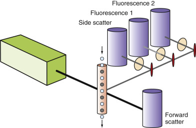

Figure 34-1 

Schematic of a flow cytometer. 

A flowing stream of particles _(center)_ is illuminated by a laser _(left)_ and the resulting low angle (forward scatter) or right angle (side scatter) light scatter is collected by appropriately positioned detectors. In addition, fluorescent molecules attached to the particles may be excited by the laser light and the resulting emission routed through a series of optical mirrors and filters to the appropriate detectors (fluorescence 1 and fluorescence 2). 

Optimization and standardization of instrument performance are critical for the success of any flow cytometric study, but are of particular importance in the analysis of hematopoietic neoplasms because of the wide range of signal intensities that must be detected. The preferred approach is to define a set of instrument conditions that allow for optimal instrument performance and perform daily quality control of the instrument to consistently achieve that level of performance. Adherence to a consistent and fixed level of instrument performance greatly simplifies quality control and provides reproducible data for interpretation. Daily assessment of the fluorescence intensity and coefficient of variation, using particles that have stable, moderately bright fluorescence and assessment of instrument noise using nonfluorescent particles, is the cornerstone of instrument quality control. 

The operator has control over relatively few instrument variables on a flow cytometer, principally detection threshold, detector gain, rate of sample flow and, for some multilaser instruments, laser delay time. The detection threshold or discriminator is associated with a single parameter and is the value that must be achieved for the system to recognize that a particle has passed through the capillary to initiate signal processing. Typically, forward scatter is used to identify particles that have a size greater than some desired value (e.g., cells equal to or larger than lymphocytes). Of particular importance is the gain or voltage supplied to each detector, commonly a photomultiplier tube, as this has a direct impact on the ability to separate signals of interest from background instrument noise (signal-to-noise ratio). The voltage applied to each detector should be adjusted to optimize the signal-to-noise ratio and allow detection of the weakest required signals for each detector. This often results in positioning of negative cellular populations in such a way that they completely occupy the lowest decade of a logarithmic scale. Finally, for instruments having multiple lasers that intersect the capillary stream at different points (spatially separated lasers), a parameter must be supplied to allow synchronization of signal processing to account for the different times at which a single particle encounters each laser as it transits through the capillary. This laser delay time should be adjusted to maximize signal intensity for each laser. It should be noted that the laser delay time is highly dependent on the transit time of the particle through the capillary, and so requires a stable fluidic system to remain constant—a problem historically on certain instruments. 

The rate at which the sample is introduced or aspirated through the system can be controlled by the operator but is limited by two factors: the rate at which the instrument electronics can process signals that are generated, and sample concentration. If particles pass through the instrument more rapidly than they can be processed by the electronics, the data for a subset of the particles will be lost, and another subset will show unusual and undesirable artifacts, typically variable loss of signal intensity over a wide range. It is critically important to select a sample aspiration rate and concentration appropriate to the instrument to be used. One additional phenomenon related to sample concentration is termed **coincidence,** the simultaneous presence of more than one particle in the laser, resulting in a single recorded event that has composite characteristics of the particles involved. Coincidence can represent a significant problem for rare event detection and can be minimized using methods for doublet discrimination during analysis—techniques beyond the scope of this chapter (  Wood, 2006  ). 

 

##  Reagents 

The identification of cellular characteristics beyond those provided by light scatter measurements commonly utilizes fluorochromes that directly interact with cellular structures such as DNA or that indirectly interact through conjugation to antibodies. Each fluorochrome has a unique excitation and emission spectrum that partly determines the performance characteristics of the reagent and dictates which fluorochromes may be used simultaneously ( [ Fig. 34-2 ](<#f0015>) ). In an effort to increase the number of usable simultaneous fluorochromes possible from a single excitation source, tandem fluorochromes have been devised (e.g., PE-Cy5) that rely on excitation of a primary fluorochrome that transfers its energy to a secondary fluorochrome (Cy5), providing the predominant fluorochrome emission at a longer wavelength. Tandem fluorochromes are required for high-level multicolor flow cytometry, but they have more complex emission spectra, as well as decreased fluorochrome stability under some circumstances. The other important fluorochrome characteristic, the intensity of emission, is related to the relative efficiency of excitation by the light sources utilized and the quantum efficiency of the fluorochrome itself ( [ Fig. 34-3 ](<#f0020>) ). Differences in emission intensity directly correlate with differences in detection sensitivity and are a key consideration in the design of reagent panels, as discussed later. 

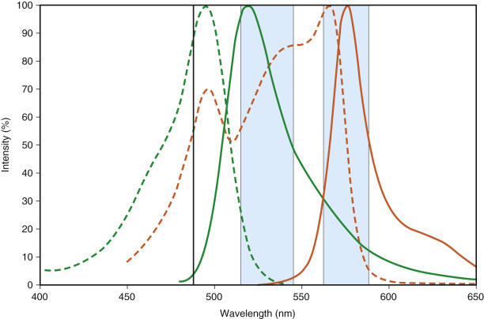

Figure 34-2 

Fluorochrome emission spectra. 

Each fluorescent molecule possesses a characteristic absorption _(dotted line)_ and emission spectrum _(solid line)_ whose wavelength maxima are spectrally separated; the degree of separation is termed the **Stokes shift.** Although a small amount of fluorescein emission occurs at the same wavelength as phycoerythrin, the fluorescence emission of fluorescein _(green)_ can be separated from that of phycoerythrin _(orange)_ using appropriate optical filters _(shaded areas)._ The 488-nm laser commonly used to excite each of these fluorochromes is indicated by a black, vertical line. 

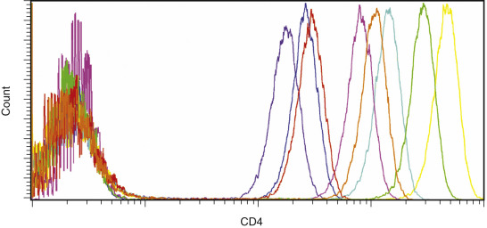

Figure 34-3 

Comparison of fluorochrome emission intensity. 

Fluorochromes are characterized by differences in relative intensity of emission that are important to take into account to achieve optimal sensitivity. The relative fluorescence intensity for CD4 expression on lymphocytes is pictured for fluorescein (FITC) _(blue),_ phycoerythrin (PE) _(green),_ PE-Texas-Red _(orange),_ PE-Cy5 _(yellow),_ PerCP-Cy5.5 _(red),_ PE-Cy7 _(light blue),_ allophycocyanin (APC) _(magenta),_ and APC-Cy7 _(purple)._ The actual intensities observed are dependent on the clone of antibody used, the ratio of fluorochrome to protein in the antibody conjugate, the method of specimen preparation used, the instrument performance characteristics, and the method of instrument setup. 

The use of multiple simultaneous fluorochromes (i.e., multicolor flow cytometry) is required for the analysis of leukemia and lymphoma. Although three was noted to be the minimum number recommended under prior consensus guidelines (  U.S.-Canadian Consensus, 1997  ), the use of more simultaneous fluorochromes is currently typical in most clinical flow cytometry laboratories. The use of four or greater simultaneous fluorochromes is now common, with 6 to 10 being utilized in some settings. The benefits of increased numbers of simultaneous fluorochromes is most pronounced in situations in which the abnormal population is small, the background is heterogeneous, and/or the abnormal population does not have uniform immunophenotypic characteristics. In addition, having more fluorochromes makes it possible to extract more information from limited samples. Because most fluorochromes have overlapping emission spectra, determination of the fluorescence due to a specific fluorochrome in a single detector requires subtraction of the portion of the signals contributed by each of the other fluorochromes in the sample, a process termed **compensation.** The appropriate amount of each signal to subtract (i.e., compensation coefficient) may be represented by an _n_ -by- _n_ matrix, where _n_ is the number of fluorochromes. Consequently, as the number of fluorochromes used increases, the number of compensation coefficients that must be determined increases geometrically, and software rapidly becomes required to do this process correctly. To determine the compensation coefficients, a series of samples singly labeled with each fluorochrome are evaluated, with the positive population as bright as the brightest signal one plans to evaluate. Because the spectral characteristics of the tandem fluorochromes can vary significantly between lots and manufacturers, separate compensation controls are often required for each lot and conjugate of these reagents. Software, either on the instrument or on offline computers, is used to analyze the resulting data and to calculate compensation coefficients. 

Although the process of determining and correctly applying compensation is now made simple through software, the use of multiple fluorochromes can result in significant display artifacts that are reflected in compromised low-level detection sensitivity (  Roederer, 2001  ). This is a particular problem when one attempts to detect low-level signals in the presence of brightly overlapping fluorochrome emissions. Understanding the impact of compensation-related effects represents a major challenge in interpretation of multicolor flow cytometry. The implications of overlapping fluorochrome emission have direct consequences for panel design and data interpretation ( [ Fig. 34-4 ](<#f0025>) ). When compensation settings are not appropriate for the reagents used, artifacts arise that can lead to both the misattribution of low-level positivity and an inability to recognize the presence of subpopulations ( [ Fig. 34-5 ](<#f0030>) ). The use of software compensation provides a nondestructive method for data collection and allows the adjustment of compensation settings following acquisition, thereby supplying a way to correct for inadvertent compensation errors. 

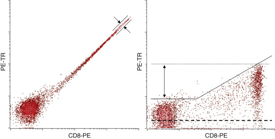

Figure 34-4 

Compensation. 

The fluorescence emission of lymphocytes labeled with CD8-PE appears in both PE and PE-Texas Red detectors as the result of emission of PE in both regions of the spectrum examined by these detectors. Note that no PE-Texas Red conjugated antibody is used in this experiment. Without compensation applied _(left),_ cells expressing abundant CD8 show bright signals for both PE and PE-Texas Red with a width to the population _(arrows)_ due to measurement errors inherent in the method. Once compensation is correctly applied _(right),_ the centers of the positive and negative populations have the same low level of PE-Texas Red emission _(dotted line),_ with many events lying on the horizontal axis. However, the PE-positive population shows a much broader degree of apparent PE-Texas Red background fluorescence than the PE-negative population _(solid line and arrow)._ If a PE-Texas Red conjugated antibody had been used, CD8-positive cells might have been erroneously interpreted as doubly positive, but this apparent “positivity” is a direct result of measurement errors and logarithmic data display. The practical result is that the sensitivity for the detection of low-level PE-Texas Red is compromised in the presence of bright PE fluorescence. 

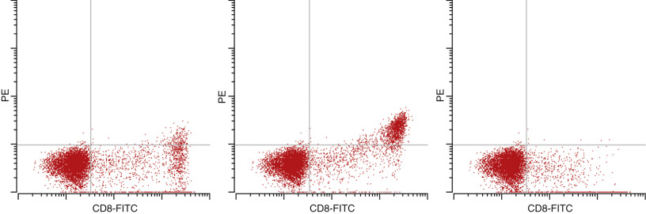

Figure 34-5 

Inappropriate compensation. 

The fluorescence emission of lymphocytes singly labeled with CD8-FITC shows minimal apparent PE fluorescence when 8% of the FITC signal is subtracted from the PE signal (i.e., appropriate compensation) _(left)._ If the degree of compensation is decreased to 7.2% _(center),_ the CD8-positive population appears to express low PE and could be misinterpreted as immunophenotypic aberrancy, depending on the PE antibody included. Note the lack of symmetry and the pointed end of the positive population as a clue to the inaccurate compensation. If the compensation is increased to 8.8%, the positive population is compressed on the _x_ -axis and appears not to exist. 

Antibodies are an integral part of the immunophenotypic evaluation of leukemia and lymphoma. It is important to determine the correct amount of each antibody to use by evaluating a series of samples labeled with different concentrations of antibodies (i.e., titering) (  Stewart & Mayers, 2000  ). The object of titering is to maximize the signal-to-noise ratio by providing as bright a signal as possible on positive populations, while maintaining a low level of background nonspecific binding. For high-specificity antibodies used for cell surface labeling, one should be able to achieve saturation, a consistent intensity on positive populations at higher antibody concentrations, without significant increases in background on negative populations. The inability to do so indicates a poor-quality antibody. For intracellular labeling, saturation typically is not achieved because of relatively high levels of nonspecific antibody binding by intracellular constituents, generally a linear function of antibody concentration, and optimization of signal-to-noise by titering becomes critical for adequate reagent performance. 

 

##  Panel Design 

The pairing of reagents with appropriate fluorochromes is a key factor in ensuring appropriate signal intensity and detection sensitivity. The following four steps can aid in the construction of appropriate reagent panels: 

  * 1.

Determine the purpose for each potential combination of reagents. Each reagent combination should have a clearly defined objective or should not be further pursued. 

  * 2.

Select a group of cellular targets. The selected group of targets or antigens should be able to successfully address the purpose of the reagent combination and should be relatively independent of fluorochrome or availability of commercial conjugates. The reagent combination should be the minimum needed to answer the question being asked. Antibodies are commonly combined in a variety of ways for use in the identification of abnormal hematopoietic populations, but these generally fall into one of the categories outlined in [ Table 34-1 ](<#t0010>) . 

TABLE 34-1 

Reagent Panel Design Strategies for the Detection of Hematopoietic Neoplasms 

Principle  |  Example Implementation   
---|---  
At least one reagent for population identification  |  CD45 for general cell type   
Lineage-associated antigen for specific cell lineage (e.g., CD19 for B cells)   
Multiple antigens of same lineage and maturational stage to identify inappropriate expression levels  |  Use of CD2, CD3, CD4, CD5, CD7, or CD8 simultaneously to evaluate mature T cells   
Multiple antigens of same lineage but different maturational stages to identify normal maturation and asynchronous expression  |  Use of CD13 and CD16 simultaneously to demonstrate neutrophilic maturation   
Separation of different cell lineages  |  Use of CD11b and CD15 simultaneously to separate monocytic and neutrophilic maturation   
Demonstration of clonality  |  Use of κ and λ in combination with a B cell lineage reagent (e.g., CD19)   
Identification of frankly aberrant antigen expression  |  Use of T or NK cell–associated antigens such as CD7 or CD56 in combination with CD34 to demonstrate aberrant nonlineage antigen expression on a myeloid blast   
  
_NK,_ Natural killer. 

  * 3.

Assign a fluorochrome to each target. The basic principle is that highly expressed antigens should be coupled with dim fluorochromes, and dimly expressed antigens should be coupled with bright fluorochromes. This principle provides reasonable signal intensities and avoids compensation problems due to excessively bright fluorescence. A second principle involves selecting fluorochrome combinations to avoid compensation problems. Three general classes of these problems include: (1) spillover from one fluorochrome into an adjacent fluorochrome detected at a higher wavelength (as in the example in [ Figure 34-4 ](<#f0025>) ); (2) cross-laser excitation, most commonly from direct excitation by the red laser of the cyanine dyes used in tandem conjugates (e.g., PE-Cy5 emitting as APC); and (3) tandem fluorochromes having variable emission of the parent fluorochrome (e.g., APC-Cy7 emitting as APC). For a more in-depth discussion of such considerations, the reader is referred to  Wood, 2006  . 

  * 4.

Test reagent combinations. The reagent combination must be empirically tested to ensure that signal intensities are as expected, that low-level sensitivity is appropriate where important, and that unexpected interactions between reagents do not occur. A sample prepared with all reagents of interest should be compared with the same sample prepared with a series of preparations, each lacking one of the component reagents (fluorescence-minus-one controls), as well as with a second series containing each single reagent independently (single-stained controls). Unexpected changes in intensity of one or more reagents indicate potential problems with the reagent combination. 

 

##  Specimen Handling and Sample Preparation 

Any specimen from which a single cell suspension can be generated is suitable for flow cytometric immunophenotyping, including peripheral blood, bone marrow, and lymph node, to name a few. Blood and bone marrow may be anticoagulated with ethylenediaminetetraacetic acid (EDTA), heparin, or acid citrate dextrose, with heparin generally preferred because of improved stability with specimen age. Tissue specimens are best transported and stored in tissue culture media, such as RPMI 1640, and a single cell suspension is generated by mechanical disaggregation using scalpel and forceps, needle and syringe, or wire screen mesh (  Braylan & Benson, 1989  ), followed by filtration through fine-gauge wire mesh to remove aggregates. Specimens of all types are commonly stored at room temperature before preparation, although refrigeration will retard degradation when preparation must be delayed. 

Analysis of white blood cells in peripheral blood or bone marrow requires erythrocyte removal for efficient evaluation. Density-gradient centrifugation (e.g., ficoll-hypaque) was historically used for this purpose, but it leads to selective loss of cellular subpopulations and gives relatively poor recovery on bone marrow specimens. Erythrocyte lysis using ammonium chloride or a variety of commercial preparations has become the standard technique for sample preparation in clinical laboratories (  Carter et al, 1992  ). Currently recommended methods involve the addition of antibodies to an aliquot of blood or marrow, followed by erythrocyte lysis and washing with a buffered salt solution such as phosphate-buffered saline to remove cell debris, the lysing reagent, and unbound antibody. Inclusion of a small amount of formaldehyde (0.25% to 0.5%) with the lysing reagent or following washing is a convenient way to stabilize both the specimen and antibody binding. When analysis of light chain expression on B cells is required, plasma immunoglobulin (Ig) must be removed by repeated washing before antibody addition. Once prepared, samples should be acquired on the instrument as soon as reasonably possible to avoid sample and fluorochrome degradation, although fixation and refrigerated storage will delay degradation. 

 

##  Data Acquisition 

As the prepared sample is evaluated on the flow cytometer, it is important to collect enough events to allow detection of the population of interest. For populations that represent a large percentage of the total, relatively few events need to be acquired, but infrequent populations require the acquisition of larger numbers of events. Because in the evaluation of hematopoietic neoplasms, one rarely knows what the likely population frequency will be for a given sample, it is most convenient to acquire a fixed number of total events that ensures the desired minimum level of sensitivity. For example, if a sensitivity of 0.1% is desired and 50 events are determined to be adequate for confident population identification, then 50,000 total white blood cell events will need to be acquired. The acquisition of fewer events will compromise the ability to detect low-frequency populations—an important consideration when evaluating for residual disease following therapy and in other situations in which the population of interest is present at low levels. 

Instrument carryover between samples becomes a significant concern when evaluating for the presence of small abnormal populations. Most commercial instruments have a manufacturer's specification for carryover of roughly 1%—a relatively high level when one is looking for infrequent populations. To minimize carryover, a small amount of water should be run between each aliquot of sample acquired until background returns to an acceptably low level. Failure to do so will result in the sporadic appearance of populations having unexpected immunophenotypes that can be mistaken for neoplastic disease. 

,  

##  Interpretive Considerations 

The identification of hematopoietic neoplasia by immunophenotyping relies on the principle that neoplastic cells express patterns of antigen expression that are distinctly different from those of their normal counterparts. Antigen expression in normal cells is a tightly regulated process, resulting in a characteristic pattern of antigen acquisition and loss with maturation that is cell-lineage specific. Neoplastic cells commonly show nonrandom alterations in antigen expression that include the following: 

  * 1.

Gain of antigens not normally expressed by cell type or lineage 

  * 2.

Abnormally increased or decreased levels of expression (intensities) of antigens normally expressed by cell type or lineage, including the complete loss of normal antigens in some instances 

  * 3.

Asynchronous antigen expression (i.e., expression of antigens normally expressed by cell type or lineage, but at an inappropriate time during maturation) 

  * 4.

Abnormally homogeneous expression of one or more antigens by a population that normally exhibits more heterogeneous expression 

The consequence is that the immunophenotypic identification of hematopoietic neoplasia rests on a thorough knowledge of the normal patterns of antigens expressed by hematopoietic cells. 

 

##  Normal Patterns of Antigen Expression 

All hematopoietic cells arise from the hematopoietic stem cell, a quiescent cell population that possesses long-term regenerative potential and is present at a low frequency in the bone marrow. The stem cell population in humans can be identified if a sufficient number of cells are evaluated and show expression of bright CD34 and CD133, intermediate CD45, dim to absent CD38, variable CD90, and dim CD123, CD117, HLA-DR, CD13, and CD33. Maturation toward lineage-committed progenitors is accompanied by a slight decrease in CD34 and CD45, loss of CD133 and CD90, and an increase in CD38 and HLA-DR. Further maturation along each lineage occurs in the bone marrow until mature, functional, albeit naïve progeny are released into the peripheral blood. The one exception is T cells, whose earliest precursors migrate to the thymus, where maturation to functional forms occurs. The patterns of antigenic change with maturation for B cell, T cell, neutrophilic, monocytic, and erythroid lineages have been elucidated by multiple investigators (  Loken et al  1987  ;  Inghirami et al, 1990  ;  Terstappen et al, 1990a  ;  Terstappen et al, 1990b  ;  Terstappen & Loken, 1990  ;  Terstappen et al, 1992b  ;  Harada et al, 1993  ;  Hoffkes et al, 1996  ;  Ginaldi et al, 1996b  ;  Almasri et al, 1998  ;  Lucio et al, 1999  ;  McClanahan et al, 1999  ;  Wood, 2004  ), and a summary of each lineage is presented in [ Figures 34-6 to 34-10 ](<#f0035>) . 

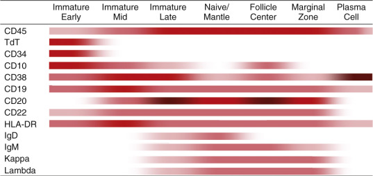

Figure 34-6 

B cell differentiation. 

The intensity of antigen expression throughout B cell maturation is depicted for antigens commonly used in the clinical laboratory. Normal mature B cells express κ or λ light chains, never both. Darker colors represent higher levels of antigen expression. 

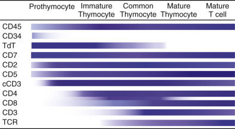

Figure 34-7 

T cell differentiation. 

The intensity of antigen expression throughout T cell maturation is depicted for antigens commonly used in the clinical laboratory. T cell maturation occurs largely in the thymus, and most maturational stages will not be seen outside of that organ. At the common thymocyte stage, immature T cells express both CD4 and CD8, with subsequent stages showing expression of one or the other, but not both. Darker colors represent higher levels of antigen expression. 

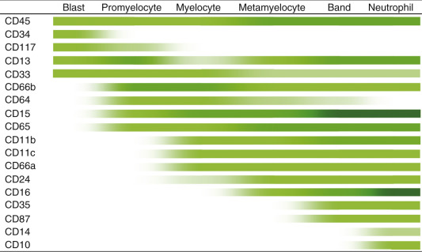

Figure 34-8 

Neutrophil differentiation. 

The intensity of antigen expression throughout neutrophil maturation is depicted for antigens commonly used in the clinical laboratory. Darker colors represent higher levels of antigen expression. 

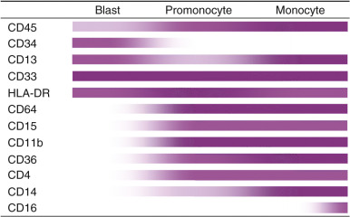

Figure 34-9 

Monocyte differentiation. 

The intensity of antigen expression throughout monocyte maturation is depicted for antigens commonly used in the clinical laboratory. Darker colors represent higher levels of antigen expression. 

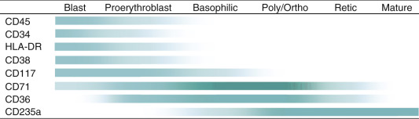

Figure 34-10 

Erythroid differentiation. 

The intensity of antigen expression throughout erythrocyte maturation is depicted for antigens commonly used in the clinical laboratory. Darker colors represent higher levels of antigen expression. 

 

##  Abnormal Patterns of Antigenic Expression in Hematopoietic Neoplasia 

Most hematopoietic neoplasms have abnormal immunophenotypes that are characteristic enough to allow their detection, even at relatively low levels of involvement. In some cases, the immunophenotype is characteristic enough to allow classification using immunophenotypic data alone. However, each group has sufficient variability that correct diagnosis relies on recognition of the overall immunophenotypic pattern, and not on the expression of individual antigens or the rigid application of immunophenotypic profiles. The following discussion emphasizes general immunophenotypic principles useful for the diagnosis and classification of hematopoietic neoplasia, as a complete discussion of the antigenic abnormalities seen in each subtype of disease is beyond the scope of this chapter (  Craig & Foon, 2008  ; Cherian and Wood, 2011). 

 

##  Acute Leukemia 

 

##  Diagnosis and Classification 

Flow cytometry plays a critical role in both identifying expanded progenitor populations (i.e., blasts or blast equivalents), allowing for a diagnosis of acute leukemia, and assigning lineage, thereby facilitating classification of acute leukemia. 

By flow cytometry, progenitor populations can be identified using a combination of CD45 versus side scatter characteristics and expression of markers of immaturity that may include the following: CD34, CD117, CD133, CD99, and terminal deoxynucleotidyl transferase (TdT). White blood cells express CD45 at distinct levels of intensity characteristic of both lineage and stage of differentiation that when used in conjunction with orthogonal light scatter (side scatter), allow delineation of the basic white blood cell populations (  Borowitz et al, 1993  ;  Stelzer et al, 1993  ) ( [ Fig. 34-11 ](<#f0060>) ). CD45 versus side scatter gating is particularly useful for the identification of progenitors, which express intermediate CD45 and low side scatter. CD45 versus side scatter analysis has become standard practice in the clinical laboratory for this purpose. However, CD45 versus side scatter gating should not be used in isolation for progenitor identification as not all populations of blast equivalents fall in the CD45 versus side scatter defined blast gate. For instance, the abnormal promyelocytes found in acute promyelocytic leukemia and immature monocytic cells that characterize acute leukemia with monocytic differentiation are often excluded from a standard CD45 versus side scatter defined blast gate. Further confounding analysis in some cases is the fact that some populations that are not blasts or blast equivalents can occupy the CD45 versus side scatter defined blast gate. Specifically, basophils, plasmacytoid dendritic cells, and hypogranular neutrophils, populations that can be increased in myeloid neoplasms, will be found within the CD45 versus side scatter defined blast gate. 

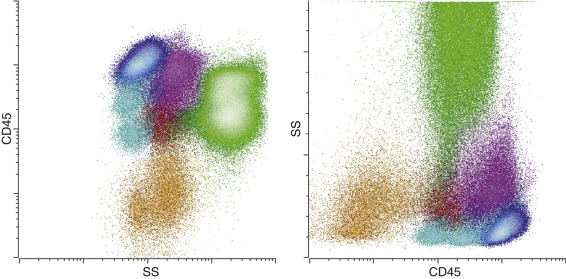

Figure 34-11 

CD45 versus side scatter. 

The display of CD45 versus side scatter is increasingly used in the clinical laboratory as a starting point for the identification of white blood cell populations. Data are commonly displayed with side scatter on a logarithmic _(left)_ or linear _(right)_ scale. Major white cell populations colored are lymphocytes _(blue),_ B cells _(light blue),_ monocytes _(purple),_ maturing neutrophils _(green),_ blasts _(red),_ basophils _(dark purple),_ and maturing erythrocytes _(orange)._

Using current (2008) WHO criteria, most acute leukemias show ≥20% blasts in the peripheral blood and/or bone marrow (  Swerdlow et al, 2008  ). Although flow cytometry is an excellent tool for identifying and characterizing expanded populations of progenitors, two issues suggest caution when utilizing flow cytometric blast percentages to make an initial diagnosis of acute leukemia. First, the blast percentage obtained from bone marrow specimens is often inaccurate because of a combination of peripheral blood dilution (artifactual decrease) and compromise of nucleated erythroid precursors during specimen processing using lysing reagents (artifactual increase). Second, progenitors identified by immunophenotyping do not always directly correspond to blasts as identified by morphology. This is true because leukemic populations, similar to normal populations, consist of a maturational continuum, and there is no perfect concordance between specific antigenic changes and the arbitrary morphologic changes that distinguish blasts from more differentiated cells. Nevertheless, if one takes into consideration these limitations, the diagnosis of acute leukemia can generally be correctly suggested by flow cytometry. 

In addition to facilitating the diagnosis of acute leukemia, flow cytometry can be extremely useful in excluding a diagnosis of acute leukemia when the marrow is populated by an expanded proliferation of cells that mimic acute leukemia. A common situation in which this can occur is the presence of increased normal B cell precursors (hematogones), which may be seen in a variety of reactive settings. Although hematogones may resemble primitive lymphoblasts morphologically, multiparameter flow cytometry can distinguish these normal immature precursors (hematogones) from acute leukemia (  Lucio et al, 1999  ;  Weir et al, 1999  ;  McKenna et al, 2001  ). Additionally, some nonhematolymphoid tumors such as small cell carcinoma or pediatric small round cell tumors can resemble leukemic blasts on smears but are readily distinguished from leukemic blasts by flow cytometry, where they appear as CD45-negative cells lacking specific markers of B cell, T cell, or myeloid lineage, often with higher side scatter than might be expected for a cell with so little cytoplasm (  Chang et al, 2003  ). 

The major role for flow cytometry in acute leukemia is classification. Classification is largely a matter of lineage assignment and correlation with normal maturational stage. The determination of lineage in particular is a decision of major therapeutic importance, with the primary distinction being whether the leukemia is of myeloid or lymphoid lineage. The immunophenotypic characteristics of acute myeloid leukemia (  Terstappen et al, 1992a  ;  Reading et al, 1993  ;  Bradstock et al, 1994  ;  Macedo  1995a  ;  Khalidi et al, 1999  ;  Weir & Borowitz, 2001  ;  Orfao et al, 2004  ) and acute lymphoblastic leukemia (  Farahat et al, 1995  ;  Khalidi et al, 1998  ;  Weir et al, 1999  ) and their similarities to normal populations have been well described in numerous publications. In general, it is the overall pattern of antigen expression rather than expression of any single antigen that allows determination of lineage. This is due in part to the lack of lineage specificity of many antigens commonly used for immunophenotyping. As a rule, the more closely an antigen is expressed to the level commonly seen in cells of that lineage, the more likely it accurately reflects lineage differentiation. For example, dim expression of the B cell antigen CD19 has relatively poor lineage specificity, as it may be seen in acute myeloid leukemia, but brighter and more uniform CD19 expression at the level seen on normal B cells is more typical of precursor B cell lymphoblastic leukemia. A subset of cytoplasmic antigens includes the most lineage-restricted antigens currently known, and these are used to arbitrate lineage assignment in cases in which the surface immunophenotype is unclear. [ Table 34-2 ](<#t0015>) lists antigens commonly used for lineage assignment. In rare cases, the leukemic cells may show differentiation along more than one lineage (  Hanson et al, 1993  ;  Bene et al, 1995  ;  Matutes et al, 1997  ;  Swerdlow et al, 2008  ), most commonly either myeloid and B cell or myeloid and T cell, as evidence of the stem cell nature of these forms of acute leukemia. If a single blast population shows such differentiation, it is commonly termed **biphenotypic acute leukemia;** if two abnormal blast populations are present, each having a distinct and different lineage, this is termed **bilineal acute leukemia.** Both biphenotypic acute leukemia and bilineal acute leukemia are considered mixed phenotype acute leukemia (MPAL) using 2008 WHO criteria. Examples of immunophenotypic patterns seen in acute leukemia are provided in [ Figures 34-12 to 34-15 ](<#f0065>) . A diagnostic algorithm for evaluating acute leukemia by flow cytometry is shown in [ Figure 34-16 ](<#f0085>) . 

TABLE 34-2 

Antigens Used for Lineage Assignment in Acute Leukemia 

|  AML  |  ALL–B Cell  |  ALL–T Cell   
---|---|---|---  
Definitive  |  Cytoplasmic MPO  |  None  |  Cytoplasmic CD3   
Surface CD3   
T cell receptor   
Strongly associated  |  CD117  |  Cytoplasmic CD79a   
Cytoplasmic CD22   
CD19   
CD10—bright  |  CD7—bright   
Moderately associated  |  CD13   
CD33  |  TdT—moderate to bright  |  CD5   
CD2   
  
_ALL,_ Acute lymphoblastic leukemia; _AML,_ acute myeloid leukemia. _MPO,_ myeloperoxidase. 

Using 2008 WHO criteria (  Swerdlow et al, 2008  ), if considering a diagnosis of mixed phenotype acute leukemia (MPAL), lineage is defined as follows: 

  * 1.

Myeloid: MPO or evidence of monocytic differentiation 

  * 2.

T cell: Cytoplasmic CD3 at the level of a mature T cell 

  * 3.

B cell: Strong CD19 and one additional B cell marker or weak CD19 and two additional B cell markers (can include CD22, CD79a, CD10) 

Note: These criteria need not be met to assign lineage outside the setting of MPAL. 

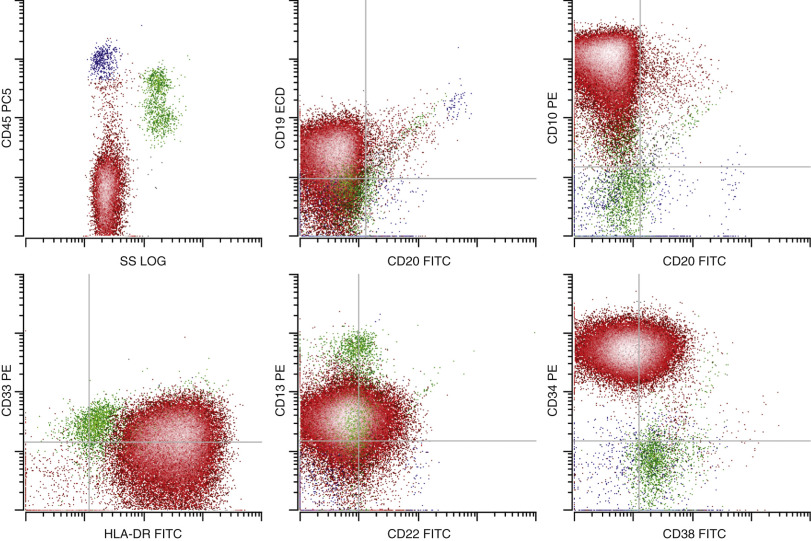

Figure 34-12 

Precursor B cell lymphoblastic leukemia/lymphoma (acute lymphoblastic leukemia). 

The neoplastic cell population _(red)_ in comparison with normal immature B cells shows abnormal expression of B cell–associated antigens CD19 (dim), CD22 (very dim), and CD10 (bright), along with aberrant expression of CD45 (absent), CD34 (bright), and CD38 (dim). In addition, the low-level expression of myeloid-associated antigens CD13 and CD33 is seen—a feature frequently seen in this neoplasm and not suggesting myeloid differentiation by itself. The cells have low side scatter, as is typical of lymphoid blasts. 

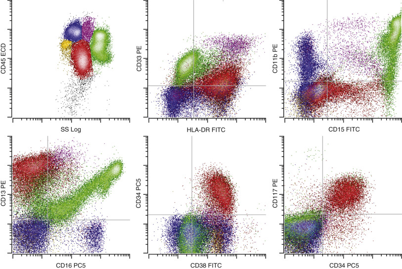

Figure 34-13 

Acute myeloid leukemia with differentiation. 

The neoplastic cell population consists of blasts _(red)_ showing abnormal expression of the myeloid-associated antigens CD33 (dim), CD13 (bright), and CD15 (dim partial) in association with immature antigens CD34 and CD117. The blasts do not express the more mature neutrophilic antigens CD11b and CD16, and are typical of the relatively immature forms seen in many cases of acute myeloid leukemia. Background maturing granulocytes _(green)_ , monocytes _(purple)_ , hematogones _(yellow),_ and lymphocytes _(blue)_ are present that are normal and are not part of the leukemic population. All plots show all viable cells. 

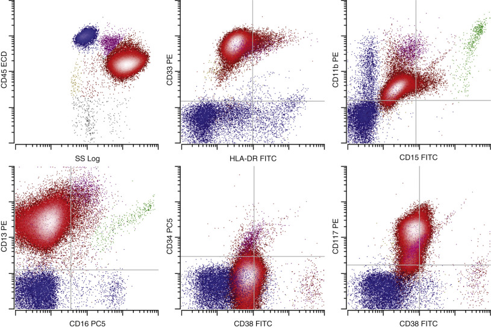

Figure 34-14 

Acute promyelocytic leukemia. 

The neoplastic cell population consists of promyelocytes _(red)_ showing abnormal expression of the myeloid-associated antigens CD33 (bright) and CD13 (intermediate), with high side scatter indicating abundant cytoplasmic granularity. The population lacks expression of CD34 and HLA-DR, antigens commonly present on true myeloid blasts, and retains expression of CD117, as is seen on a subset of normal promyelocytes. However, in contrast to normal promyelocytes, abnormal cells lack significant expression of CD15, a characteristic and common abnormality in this neoplasm. 

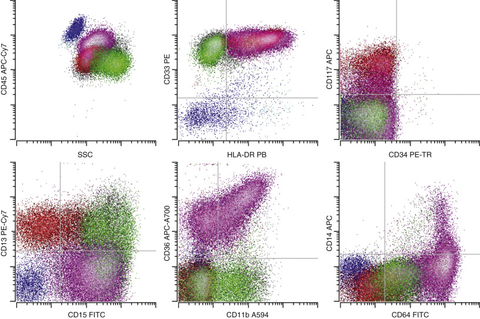

Figure 34-15 

Acute myelomonocytic leukemia. 

The neoplastic cells consist of a relatively small population of blasts _(red)_ with a larger population of cells showing monocytic differentiation _(violet)._ The blasts show abnormal expression of CD33 (bright), CD13 (intermediate), HLA-DR (intermediate), and CD117 (intermediate) without CD34. The monocytic differentiation is reflected in the acquisition of early monocyte antigens CD64 (bright) and CD36 (intermediate to bright), along with other more mature myelomonocytic antigens CD15 (intermediate) and CD11b (low to intermediate), without significant acquisition of the mature monocyte antigen CD14 (absent) or marked gain in the expression of CD45, as is seen in mature monocytes. This finding suggests differentiation to the promonocyte stage, a population usually included in morphologic blast counts. In addition, a lesser degree of neutrophilic differentiation _(green)_ is present. 

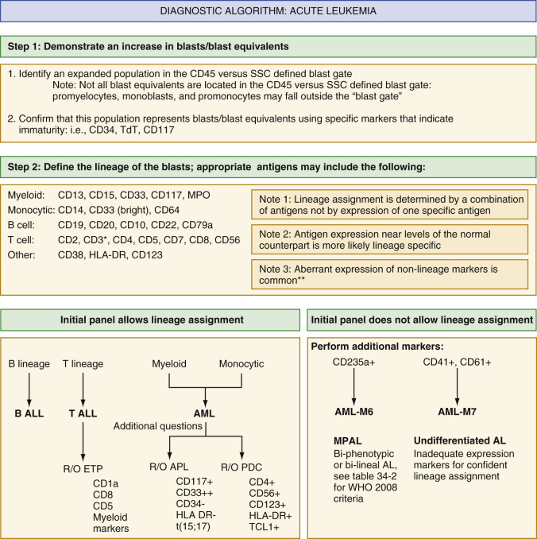

Figure 34-16 

This diagnostic algorithm can assist in diagnosis and classification of acute leukemia. 

_SSC,_ Side scatter; _AL,_ acute leukemia; _AML,_ acute myeloid leukemia; _ALL,_ acute lymphoblastic leukemia; _APL,_ acute promyelocytic leukemia; _ETP TALL,_ early thymocyte precursor T cell lymphoblastic leukemia; _PDC,_ plasmacytoid dendritic cell neoplasm; _R/O,_ rule out. 

*Surface and cytoplasmic. 

**Myeloid markers (often CD13 and CD33 and occasionally CD15) may be aberrantly coexpressed on ALL, while CD5, CD7, CD19, and CD56 may be aberrantly coexpressed on AML. When present, such nonlineage antigen expression may suggest an underlying genetic change. For instance, AML with t(8;21) often express CD19 and sometimes CD56, while B-ALL with an MLL rearrangement may express CD15. 

 

##  Prognostic Factors 

Although several reports have discussed the prognostic significance of particular surface markers in both acute lymphoid and myeloid leukemia (  Schabath et al, 2003  ;  Webber et al, 2008  ), for the most part, these have not stood the test of time, and they currently do not have a significant impact on therapy. One reason for this is that the presence of recurrent cytogenetic or molecular abnormalities in acute leukemia is now recognized as an important prognostic feature that has therapeutic implications; these are now an integral part of the WHO classification of acute leukemia (  Swerdlow et al, 2008  ). In many cases, the underlying cytogenetic abnormality is associated with characteristic immunophenotypic features that aid in suggesting an appropriate classification (  Porwit-MacDonald et al, 1996  ;  Orfao et al, 1999  ;  Hrusak & Porwit-MacDonald, 2002  ). With few exceptions, once cytogenetic abnormalities are accounted for, immunophenotype is no longer prognostic. For instance, AML with t(8;21) is associated with an improved prognosis as compared to AML with a normal karyotype. This subtype of AML typically shows coexpression of B cell markers such as CD19 with variable expression of CD56 in a subset of cases. CD56 expression in acute myeloid leukemia (AML) with t(8;21) (  Baer et al, 1997  ) has been associated with an adverse prognosis within that cytogenetically defined leukemia; however, more recently, it has been suggested that this prognostic disadvantage may be secondary to the association of cKIT-activating mutations and CD56 expression in t(8;21) AML (De et al, 2007). A summary of phenotypic features associated with cytogenetic or molecular abnormalities is provided in [ Table 34-3 ](<#t0020>) . 

TABLE 34-3 

Association of Immunophenotype with Cytogenetic Abnormalities in Acute Leukemia 

|  Immunophenotype   
---|---  
Acute Myeloid Leukemia  |   
t(15;17)  |  HLA-DR negative, CD15 low to absent [ * ](<#hl0000397>) , CD33 bright, CD34 low to absent   
t(8;21)  |  CD34 bright, CD56 positive, CD19 dim   
Acute Lymphoblastic Leukemia  |   
t(12;21) (by FISH)  |  CD10 positive, CD20 low to negative, CD9 low to negative   
MLL rearrangement (e.g., t[4;11])  |  CD10 negative, CD15 positive   
  
_MLL,_ Mixed lineage leukemia. 

 * This is a distinguishing feature from normal promyelocytes, which express relatively increased levels of CD15. 

 

##  Therapeutic Targets 

In AML, CD33 is the most commonly used therapeutic target that can be interrogated by flow cytometry and is the target of anti-CD33 (gemtuzumab ozogamicin). CD33 is expressed in the great majority of cases of AML, although its level of expression correlates with response to anti-CD33 therapy (  Walter et al, 2007  ). Relatively little is known about the role of monitoring changes in CD33 expression. 

In acute lymphoblastic leukemia (ALL), therapeutic trials have been described using either targeted monoclonal antibodies or T cells expressing chimeric antigen receptors with targets including CD19, CD20, and CD22. Flow cytometry can be used to determine the suitability of different targeted therapies in ALL. It is important to recognize potential implications that such therapies may have for population identification. For instance, CD19 would no longer be adequate for B cell identification in a patient undergoing anti-CD19 therapy. 

 

##  Residual Disease Monitoring in Acute Leukemia 

Many of the large number of antibodies that can be used to help classify acute leukemia are not, in and of themselves, essential for determination of lineage. However, a larger panel of antibodies, properly selected, can be very useful in identifying specific differences between the leukemic population and background normal elements, thereby enhancing the ability to use flow cytometry to detect small abnormal populations. Thus, the purpose of flow cytometric immunophenotyping in acute leukemia at diagnosis goes beyond simple assignment of lineage and extends to the description of a “leukemia-associated immunophenotype” characteristic of that leukemia, knowledge of which is useful in assessing follow-up samples (  Campana, 2003  ). An important caveat is that immunophenotypic changes between diagnostic samples and persistent or recurrent disease are frequently observed in both ALL (  Borowitz et al, 2005  ;  Galpa et al, 2008  ;  Roshal et al, 2010  ) and AML (  Baer et al, 2001  ;  Voskova et al, 2004  ). Accordingly, it is necessary that one monitor more than one antigenic pattern and not expect exactly the same immunophenotype seen at diagnosis to persist after therapy. The detection of minimal residual disease in acute leukemia has been demonstrated to be correlated with risk for relapse and overall survival for both AML (  San Miguel et al, 2001  ;  Feller et al, 2004  ;  Maurillo et al, 2008  ;  Loken et al, 2012  ) and ALL (  Coustan-Smith et al, 2000  ;  Dworzak et al, 2002  ;  Borowitz et al, 2008  ) and is increasingly used to guide therapeutic decision making. An example of minimal residual disease detection in ALL is shown in [ Figure 34-17 ](<#f0090>) . 

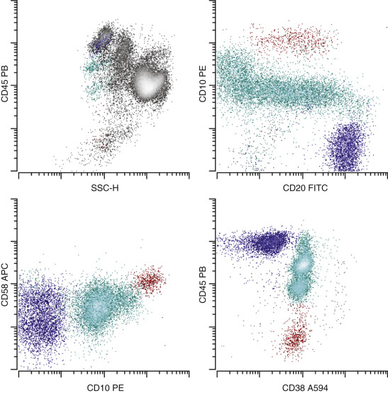

Figure 34-17 

Minimal residual disease detection. 

An abnormal population of immature B cells is identified _(red)_ that have abnormally increased expression of CD10 and CD58, abnormally decreased expression of CD45, and normal expression of CD20 and CD38. This composite immunophenotype is different from normal immature B cells _(cyan)_ or mature B cells _(dark blue),_ allowing its discrete identification at a level of 0.1% of white cells. 

 

##  Lymphoma 

 

##  Diagnosis and Classification 

As with leukemia, flow cytometry can contribute both to the diagnosis and to the classification of lymphoma. The immunophenotypic diagnosis of lymphoma relies on the identification of an expanded population of abnormal mature lymphocytes. The most common way in which such an expansion is assessed by flow cytometry is through the demonstration of light chain restriction in B cell proliferations. As with all neoplastic cells, neoplastic lymphocytes arise from a single precursor that undergoes clonal expansion. However, unlike most cells, each lymphocyte normally expresses one of a series of polymorphic molecules on its surface that provides a unique identity; in the case of B cells, this identifying molecule is Ig. Because individual Ig molecules contain one of two forms of light chain—κ or λ—reagents directed against light chains can be used as markers of clonality for B cells (  Braylan et al, 1993  ;  Geary et al, 1993  ;  Fukushima et al, 1996  ). 

In the case of T cell proliferations, the T cell receptor genetic locus is more complex, but a larger series of reagents directed against the β-chain families of the T cell receptor can be used to demonstrate clonality for T cells (  Lima et al, 2001  ;  Morice et al, 2004  ). The use of reagents directed against killer-inhibitory receptors (KIR antigens) has even been suggested to allow demonstration of natural killer cell clonality (  Morice et al, 2003  ). The assumption behind all of these assays is that clonality equates with malignancy. Although clonality is a necessary consequence of neoplasia, clonal expansion is also a normal and necessary component of the immune response following antigenic stimulation, so the demonstration of clonality by itself is not sufficient for the diagnosis of lymphoma. 

It is increasingly recognized that a subset of otherwise normal individuals may contain small clonal populations of lymphocytes, best documented in the case of B cells (  Rawstron et al, 2002  ;  Chen et al, 2004  ;  Kussick et al, 2004  ). It is not clear whether these clonal populations represent an early subclinical stage of disease, a precursor population without the full complement of genetic abnormalities required for neoplasia, or an incidental finding of no clinical consequence; however, a subset of individuals with such small clonal populations do appear to develop overt lymphoma over time (  Rawstron et al, 2008  ;  Shanafelt & Hanson, 2009  ;  Xochelli et al, 2014  ). The term **monoclonal B cell lymphocytosis** has been adopted to describe such small populations in the peripheral blood, and clinical and numeric criteria have been suggested to allow their distinction from true neoplasia (  Shanafelt et al, 2009  ). Consequently, it is necessary that flow cytometric findings suggesting lymphoma be put in a morphologic and clinical context before a definitive diagnosis of lymphoma is made. 

In addition to light-chain restriction or restricted T-cell receptor β-chain usage, lymphomas, like leukemias, show alterations in antigen expression that deviate from normal maturation. In many cases, these alterations also provide evidence of neoplasia. Moreover, specific alterations are seen in association with different categories of lymphoma, thereby permitting classification as well as diagnosis in many cases. For example, increased expression of the T cell–associated antigen CD5 is seen in CLL or mantle cell lymphoma (  Matutes et al, 1994b  ;  Tworek et al, 1998  ), while expression of the germinal center cell marker CD10 characterizes follicular lymphoma (  Mantei and Wood, 2009  ;  Ray et al, 2005  ). Alteration in the intensity of Ig expression is also a common abnormality in B cell lymphoma and can be useful in distinguishing normal and neoplastic B cells. With B cell lymphoma, Ig can be increased, decreased, or even absent (  Li et al, 2002  ). Similarly, T cell lymphoma often shows alterations in the expression of one or more T cell antigens (  Picker et al, 1987  ;  Ginaldi et al, 1996a  ). However, special care must be taken in interpreting small populations of phenotypically abnormal T cells, especially in unusual sites, because a large number of reactive conditions can be associated with expansions of populations that are not commonly seen in normal blood or lymph nodes (  McClanahan et al, 1999  ). 

An even more powerful method to diagnose lymphoma is to combine the detection of clonality with the ability to identify alterations in antigen intensity through multicolor flow cytometry. For instance, coupling the identification of follicle center B cells using CD19 and CD10 with the detection of κ and λ light chains in a four-color analysis allows one to identify the presence of light chain restriction specifically within the follicle center B cell population, greatly increasing both the specificity and the sensitivity of the analysis. Examples of immunophenotypic patterns seen in lymphoma are provided in [ Figures 34-18 to 34-23 ](<#f0095>) . [ Figure 34-24 ](<#f0125>) provides a diagnostic algorithm for classifying B cell lymphoma of small to intermediate sized cells. One important limitation of this type of analysis is that neoplasms containing relatively rare, large abnormal cells (e.g., Hodgkin lymphoma) may be difficult to recognize unless an appropriate antibody combination is used and a sufficiently large number of events are acquired (  Fromm et al, 2009  ). In this regard, the approach is essentially similar to minimal residual disease detection. An example of the flow cytometric detection of classical Hodgkin lymphoma is shown in [ Figure 34-25 ](<#f0130>) . 

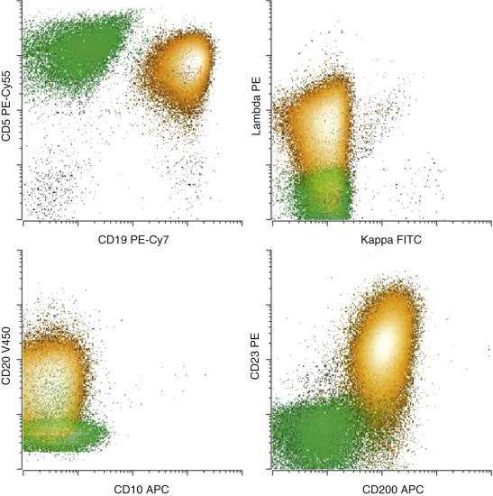

Figure 34-18 

Chronic lymphocytic leukemia/small lymphocytic lymphoma (CLL/SLL). 

The neoplastic B cell population _(gold)_ shows abnormal expression of the B cell antigens CD19 (intermediate) and CD20 (low) with surface λ light chain expression (low) and coexpression of CD5 and CD23 (intermediate) with CD200. The expression of CD5 with low-level light chain restriction, low-level CD20, and CD23 is characteristic of CLL/SLL. CLL/SLL is typically positive for CD200 without FMC7 _(data not shown)._ The immunophenotype of CLL/SLL should be contrasted with mantle cell lymphoma (see [ Fig. 34-19 ](<#f0100>) ). All plots show all lymphoid cells; background reactive T cells are shown in green. 

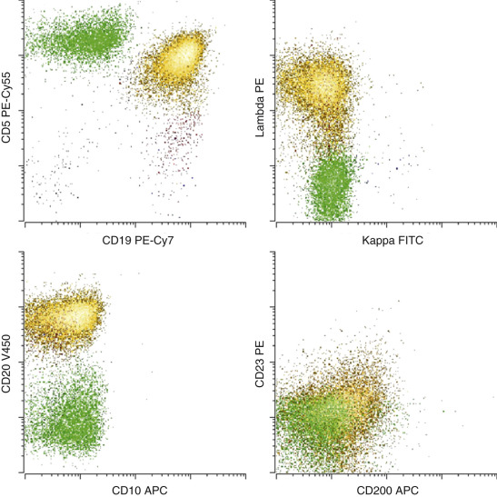

Figure 34-19 

Mantle cell lymphoma. 

The neoplastic B cell population _(gold)_ shows expression of B cell antigens CD19 (intermediate) and CD20 (intermediate) with κ light chain restriction (bright). CD5 (intermediate) is expressed by the neoplastic B cells, while CD23 and CD200 are very low to absent. Mantle cell lymphoma shows intermediate expression of FMC7 _(data not shown)._ Although both CLL/SLL and mantle cell lymphoma express CD5, the intensity of CD20 and light chain, coupled with the level of expression of CD23, CD200, and FMC7 allow distinction of these B cell neoplasms in most cases (contrast with [ Fig. 34-18 ](<#f0095>) ). Confirmation of a suspected diagnosis of mantle cell lymphoma requires demonstration of t(11;14) by FISH or cyclin D1 overexpression by immunohistochemistry. All plots show all lymphoid cells; background reactive T cells are shown in green. 

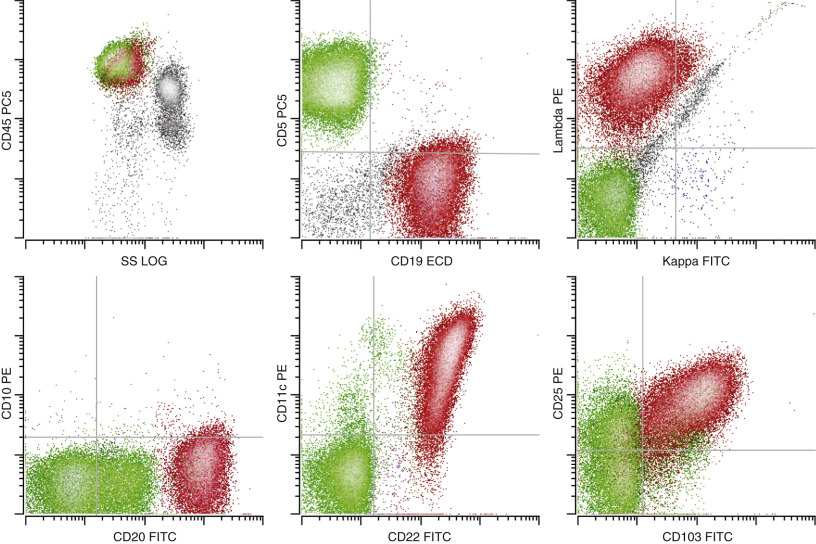

Figure 34-20 

Hairy cell leukemia. 

The neoplastic B cell population _(red)_ shows expression of B cell antigens CD19 (intermediate), CD20 (bright), CD22 (bright) and surface λ light chain restriction (intermediate) with aberrant expression of the adhesion molecules CD11c (variably bright), CD103 (intermediate), and CD25 (intermediate). This immunophenotype is diagnostic for hairy cell leukemia. Note the absence of monocytes by CD45 versus side scatter, a characteristic finding in hairy cell leukemia. 

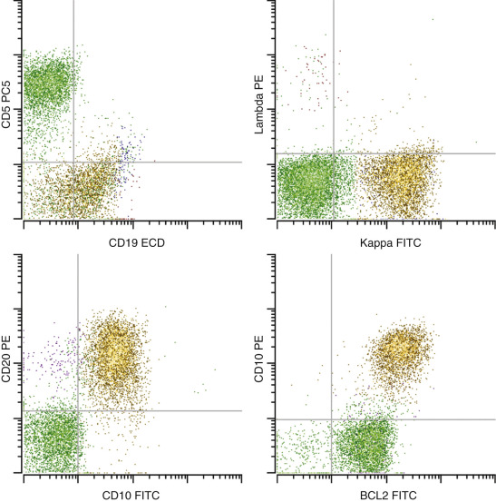

Figure 34-21 

Follicular lymphoma. 

The neoplastic B cell population _(gold)_ shows abnormal expression of the B cell antigens CD19 (dim), CD20 (intermediate), and surface κ light chain restriction (intermediate) with coexpression of the follicle center–associated antigen CD10 (intermediate). In addition, the neoplasm shows overexpression of cytoplasmic Bcl-2 due to the presence of the t(14;18) characteristic of follicular lymphoma (i.e., Bcl-2 is expressed at a higher level on the neoplastic population than on the normal background T cells) _(green)_ . Overexpression of Bcl-2 by itself is not diagnostic of follicular lymphoma, but its combined expression with CD10 is much more specific, as normal CD10-positive follicular B cells would be expected to be negative. All plots show all lymphoid cells. 

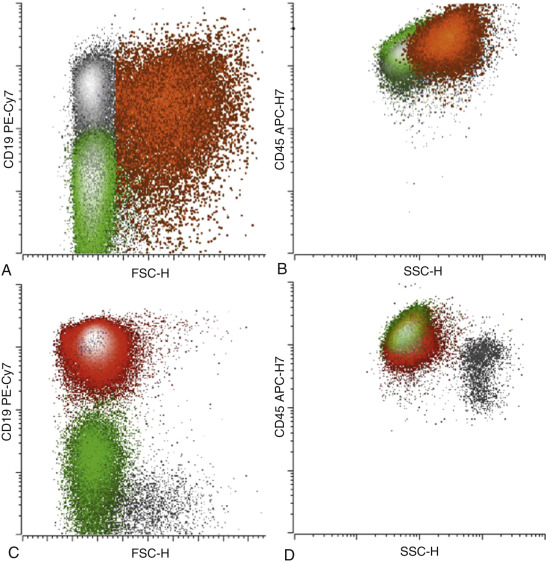

Figure 34-22 

Diffuse large B cell lymphoma. 

All plots show all viable cells. **(A, B)** The upper dot plots show an example of diffuse large B cell lymphoma. The neoplastic cells are colored orange and highlighted, while normal T cells are shown in green and normal B cells are shown in gray **(C, D).** The lower dot plots show an example of chronic lymphocytic leukemia (CLL) for comparison (neoplastic cells are shown in red, while normal background T cells are shown in green). The forward and side scatter characteristics of the abnormal cells in the case of diffuse large B cell lymphoma are increased compared to the background T cells, the background B cells, and the CLL cells. Note that the position of the abnormal large B cell population (panel B) on a CD45 versus side scatter plot overlaps with the typical CD45 versus side scatter position of monocytes rather than normal lymphocytes. A stringent lymphocyte gating strategy relying on side scatter with either CD45 or forward scatter would exclude the bulk of the abnormal population. 

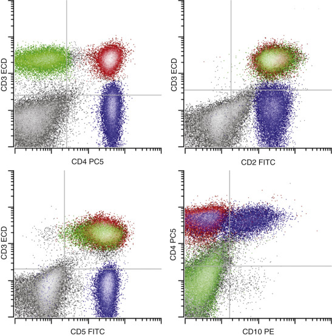

Figure 34-23 

Angioimmunoblastic T cell lymphoma. 

The neoplastic T cell population _(blue)_ shows expression of the T cell–associated antigens CD2 (intermediate) and CD5 (intermediate), along with the helper T cell antigen CD4, but without surface CD3. In addition, the neoplastic cells coexpress CD10. The composite immunophenotype is characteristic of that seen in angioimmunoblastic T cell lymphoma. All plots show all lymphocytes. Normal CD4- and CD8-positive T cells are shown in red and green, respectively. 

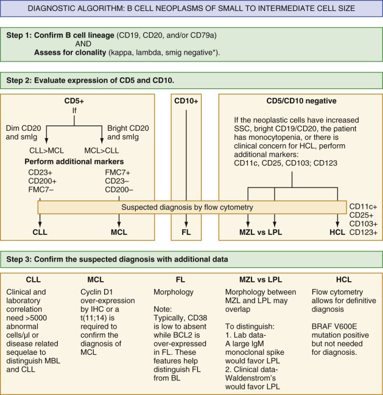

Figure 34-24 

This diagnostic algorithm outlines the steps in classification of B cell lymphomas composed of cells of small to intermediate size. 

_SmIg,_ Surface immunoglobulin; _CLL,_ chronic lymphocytic leukemia; _MCL,_ mantle cell lymphoma; _FL,_ follicular lymphoma; _MZL,_ marginal zone lymphoma; _LPL,_ lymphoplasmacytic lymphoma; _HCL,_ hairy cell leukemia; _MBL,_ monoclonal B cell lymphocytosis; _BL,_ Burkitt lymphoma. 

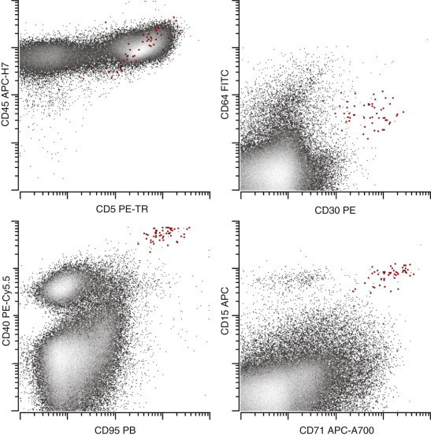

Figure 34-25 

Classical Hodgkin lymphoma. 

A discrete population of cells _(red)_ is identified that differs from normal lymphocytes and macrophages, having expression of CD15, CD30, high CD40, high CD71, and high CD95. This immunophenotype is typical for classical Hodgkin lymphoma. Note that these cells commonly show increased autofluorescence that appears as apparent low positivity for FITC-labeled reagents (CD64 in the current example). Also note that Hodgkin cells commonly are rosetted by T cells, giving apparent positivity for CD5 and CD45 _(top left panel)._

The classification of lymphoma relies on the recognition of specific patterns of antigenic expression that are similar to some normal maturational stage, yet deviate sufficiently to allow identification of the abnormal population. Among B cell lymphomas, there are two entities that can be both diagnosed and classified with a high degree of confidence based on immunophenotypic data alone: chronic lymphocytic leukemia/small lymphocytic lymphoma (CLL/SLL) and hairy cell leukemia. CLL/SLL is characterized by the coexpression of CD5 by abnormal B cells; decreased intensity of clonal light chain expression; decreased expression of a variety of mature B cell antigens, including CD20, CD22, and CD79b; presence of the activation antigen CD23 with the membrane glycoprotein CD200 but without significant expression of FMC7; and an activation epitope of CD20 (  Serke et al, 2001  ) (see [ Fig. 34-18 ](<#f0095>) ). This constellation of immunophenotypic findings is specific for CLL/SLL (  Matutes et al, 1994b  ;  Tworek et al, 1998  ;  Palumbo et al, 2009  ;  Alapat et al, 2012  ) and will allow for a definitive diagnosis if ≥5000 abnormal cells per microliter are identified in the blood. The only other B cell neoplasm that consistently expresses CD5 is mantle cell lymphoma, a more aggressive lymphoma that is important to distinguish from CLL/SLL. In contrast to CLL/SLL, mantle cell lymphoma shows relatively bright expression of mature B cell antigens such as CD20 and CD79b, expresses clonal Ig at a relatively normal to high level, and expresses FMC7 without significant CD23 or CD200 (see [ Fig. 34-19 ](<#f0100>) ). Although mantle cell lymphoma generally can be readily distinguished from CLL/SLL, because some other low-grade lymphoproliferative disorders can occasionally express CD5 and mimic the mantle cell phenotype, a definitive diagnosis of mantle cell lymphoma requires either fluorescent in situ hybridization (FISH) documenting a t(11;14) or demonstration of overexpression of cyclin D1 by immunohistochemistry. These other rare CD5-positive B cell neoplasms cannot be distinguished by their immunophenotypic criteria, and a combination of clinical history, morphology, and cytogenetic abnormalities is often required to reach a correct classification. 

Hairy cell leukemia is characterized by increased expression of a variety of B cell antigens, including CD19, CD20, and CD22; clonal surface light chain restriction; markedly increased expression of the cell adhesion molecules CD11c and CD103; expression of the α-chain of the interleukin-2 receptor CD25; and expression of the α-chain of the IL-3 receptor CD123 (see [ Fig. 34-20 ](<#f0105>) ) (  Robbins et al, 1994  ;  Matutes et al, 1994a  ;  Venkataraman et al, 2011  ). In addition, the cells exhibit a variable degree of increased side scatter caused by the abundant cytoplasm they possess, often giving the cells light scatter characteristics similar to those of monocytes. This finding, in combination with the monocytopenia that is common in this disorder, is a frequent cause of false-negative results, particularly when one relies on relatively tight gates to identify the lymphocyte population by light scatter parameters alone or with CD45 versus side scatter. 

Another immunophenotypic finding that aids in the classification of B cell lymphoma is expression of CD10, an antigen present on immature B cells and on normal mature B cells as they transit through the follicle center. Among B cell lymphomas, CD10 is expressed in most cases of follicular lymphoma (  Almasri et al, 1998  ) (see [ Fig. 34-21 ](<#f0110>) ), in a significant subset of large B cell lymphomas, and in Burkitt lymphoma, in each of these cases indicating origin from the follicle center. In follicular lymphoma, the expression of CD10 is often coupled with decreases in CD19 and CD38 intensity (  Ray et al, 2005  ;  Yang et al, 2005  ;  Mantei & Wood, 2009  ) that differ from the normal somewhat higher levels seen in reactive germinal center B cells. Demonstration of Bcl-2 overexpression by the CD10-positive B cell population can be useful in confirming neoplasia (  Cook et al, 2003  ), particularly in cases lacking surface light chain expression, and reflects the presence of an underlying t(14;18) characteristic of follicular lymphoma. Although CD10 positivity alone does not allow definitive classification, its presence significantly reduces the possible entities that must be considered, with morphology generally being required to allow definitive classification. 

The role of immunophenotyping in the classification of T cell lymphoma is less well described, although certain associations have been noted that require larger studies for validation. The majority of T cell lymphomas are composed of T cells that exhibit abnormal patterns of antigenic expression. T cell lymphomas can express CD4 or CD8 and rarely may be either negative for both CD4 and CD8 or positive for both these markers. 

Among T cell lymphomas, CD4 expression is most commonly seen. In angioimmunoblastic T cell lymphoma, abnormal T cells are CD4-positive and commonly show loss or decreased expression of surface CD3 (  Serke et al, 2000  ) with abnormal coexpression of CD10 (  Attygalle et al, 2002  ) (see [ Fig. 34-23 ](<#f0120>) ). In mycosis fungoides/Sézary syndrome, abnormal T cells are also typically CD4-positive and can show a variety of immunophenotypic abnormalities, commonly including alterations in the intensity of CD3 and CD4 and decreased expression or loss of CD7 (  Bogen et al, 1996  ;  Lima et al, 2003  ) and CD26 (  Kelemen et al, 2008  ). CD7 can, however, be variably decreased on CD4-positive T cells outside the setting of neoplasia. Decreased expression of CD7 is associated with a normal memory immunophenotype, and expanded subpopulations with this immunophenotype may be seen in a variety of reactive conditions, including inflammatory skin lesions (  Murphy et al, 2002  ). Consequently, demonstration of the loss of CD7 by itself does not allow definitive classification nor a definitive diagnosis of lymphoma and generally requires the presence of additional antigenic abnormalities to be informative. CD26 loss appears to be more common in Sézary syndrome than in mycosis fungoides; but, similar to CD7, is not specific for neoplasia (  Kelemen et al, 2008  ). Adult T cell leukemia/lymphoma characteristically expresses CD4 and also shows loss of CD7 and CD26. This entity often shows decreased expression of surface CD3 and is uniformly positive for CD25 (  Shao et al, 2010  ). The immunophenotype is not diagnostic in isolation, and confirmation of a suspected diagnosis requires demonstration of exposure to HTLV-1, usually via serology studies. T cell prolymphocytic leukemia is most often CD4-positive and can also coexpress CD8 or express CD8 without CD4 in some cases. Variable loss of pan–T cell antigens may be seen; however, the immunophenotype is not specific, and a suspected diagnosis can be confirmed by genetic testing for a _TCL1_ rearrangement (  Chen and Cherian, 2013  ). Anaplastic large cell lymphoma may also be positive for CD4 but is sometimes negative and can infrequently express CD8. Expression of CD30 (often strong) in combination with an aberrant pattern of T cell antigen expression on a population with forward scatter characteristics of large cells can be useful in the identification of anaplastic large cell lymphoma (  Juco et al, 2003  ;  Muzzafar et al, 2009  ). 

CD8 expression is less common in T cell neoplasms. Large granular lymphoproliferative disorder (large granular lymphocytic leukemia) is generally characterized by clonal expansion of CD8-positive T cells having variably decreased expression of CD5 or CD7 and expression of NK cell–associated antigens such as CD57 or CD16 (  Richards et al, 1995  ). However, similar clonal expansions may be seen in a wide variety of reactive conditions, and knowledge of the clinical context is required for an understanding of the clinical significance of an expanded large granular lymphocyte population. 

 

##  Prognostic Factors 

As noted earlier, flow cytometry can be used to assess markers of prognostic significance in CLL, including CD38 (  Damle et al, 1999  ) and ZAP-70 (  Crespo et al, 2003  ). Although these assays are widely available, problems with interpretation and standardization have been reported. The distribution of CD38 on CLL cells is often continuous, not discrete, and arbitrary criteria have been used to distinguish positive from negative cases. This problem is even greater in the case of ZAP-70 assessment, where expression is often very dim, and where questions have been raised about the best method to determine positivity. Nonetheless, most cases are either clearly positive or clearly negative for each of these markers, and many papers, using varying techniques, have demonstrated their prognostic significance (  Rassenti et al, 2008  ). Cases with borderline positivity are best considered as indeterminate for expression. To date, there are no prognostic markers in other types of lymphoma that are as well established as those in CLL/SLL. 

 

##  Therapeutic Targets 

The most widely used therapeutic antibody is anti-CD20 (rituximab). CD20 is expressed by the great majority of B cell lymphomas; however, determination of CD20 expression is essential to establish the suitability of this therapy. Following therapy, B cells may persist but show loss of CD20 expression. In such cases, assessment of samples using more than one B cell marker, for instance, a combination of CD19 and CD20, is helpful in demonstrating the presence of residual B cells lacking CD20. Anti-CD52 (alemtuzumab) is occasionally used to treat cases of refractory lymphoma. Because of the profound immunosuppression associated with this therapy, documentation of CD52 expression is important, although the great majority of lymphomas will indeed express CD52. 

 

##  Minimal Residual Disease Detection 

Detecting low levels of involvement can be important in accurately staging patients with lymphoma (  Douglas et al, 1999  ). This is particularly applicable to studies of bone marrow, where detection of small populations of light chain–restricted B cells can be seen in cases in which morphology is either negative or equivocal (  Duggan et al, 2000  ;  Palacio et al, 2001  ;  Sanchez et al, 2002  ;  Stacchini et al, 2003  ), although the cost-effectiveness of this approach has been questioned (  Hanson et al, 1999  ). Similarly, the peripheral blood may be evaluated for lymphoma to aid in the timing or advisability of stem cell collection, and the resulting harvested stem cell product may be tested for the presence of residual lymphoma to minimize the amount of tumor reinfused in patients undergoing bone marrow transplantation. In addition, as in acute leukemia, minimal residual disease studies have been used in patients with CLL and have demonstrated an association between the presence of residual disease following therapy and both event-free and overall survival (  Rawstron et al, 2001  ;  Moreton et al, 2005  ). In these cases, methods to demonstrate clonal populations of light chain–restricted B cells are not as sensitive as methods that rely on the presence of small phenotypically aberrant populations using principles similar to those used in acute leukemia. 

 

##  Plasma Cell Neoplasms 

Plasma cell neoplasms generally are not difficult to identify by flow cytometry (  Ruiz-Arguelles, 1994  ;  Ocqueteau, 1998  ;  Paiva et al, 2010  ;  Tembhare et al, 2014  ), and their immunophenotype at diagnosis (  Paiva et al, 2009  ) and detection following therapy are associated with outcome (  Paiva et al, 2008  ). The expression of bright CD38 and/or CD138 is used to identify the plasma cell population, with common abnormalities being decreased CD45, decreased CD19, mildly decreased CD38, and abnormal coexpression of CD56 or CD117 in combination with the identification of cytoplasmic light chain restriction. The abnormalities listed earlier may be seen in plasma cell neoplasms ranging from monoclonal gammopathy of undetermined significance (MGUS) to smoldering myeloma to multiple myeloma and do not allow confident distinction of these entities, although some studies suggest subtle differences in immunophenotype (  Tembhare et al, 2014  ). Distinction of normal and abnormal plasma cells in patients with plasma cell neoplasms appears to have some predictive value. MGUS and smoldering myeloma with a higher proportion of abnormal plasma cells is more likely to progress (  Perez-Persona et al, 2010  ), while persistence of normal background plasma cells has been associated with an improved prognosis in multiple myeloma (  Paiva et al, 2009  ). An example of immunophenotypic abnormalities seen in plasma cell neoplasms is presented in [ Figure 34-26 ](<#f0135>) . It is important to recognize that flow cytometric analysis typically underestimates the percentage of plasma cells present in a specimen, sometimes dramatically, possibly because of plasma cell aggregation, apoptosis, and peripheral blood dilution. With more sensitive methods, the role of flow cytometry in prognostication and minimal residual disease detection in plasma cell neoplasms is likely to grow in the future (  Rawstron et al, 2013  ; Paiva et al, 2014). 

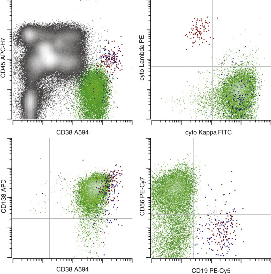

Figure 34-26 

Plasma cell neoplasm. 

The neoplastic plasma cell population _(green)_ is identified by the bright expression of CD38 and CD138, but both are slightly decreased in comparison with the few normal polyclonal plasma cells _(emphasized in blue and red)._ Abnormal plasma cells show abnormal expression of CD45 (low to absent) and CD19 (absent), express cytoplasmic κ light chain restriction, and demonstrate aberrant expression of CD56. This immunophenotype is characteristic of that seen in a variety of plasma cell neoplasms, including multiple myeloma, plasmacytoma, and monoclonal gammopathy of uncertain significance (MGUS). Definitive classification requires clinical and laboratory correlation. 

 

##  Myelodysplastic Syndromes and Myeloproliferative Disorders 

The same principles used to identify other hematopoietic neoplasms can be used to identify the chronic myeloid stem cell neoplasms, e.g., the myelodysplastic syndromes and myeloproliferative neoplasms (  Elghetany, 1998  ;  Stetler-Stevenson et al, 2001  ;  Wells et al, 2003  ,  Kussick & Wood  2003a  ;  Wood, 2007  ;  Matarraz et al, 2008  ). Abnormalities in antigen expression can be identified on myeloid blasts, maturing neutrophils, and maturing monocytes. Common abnormalities include (1) alterations in the intensity of expression of CD34, CD117, and HLA-DR, and aberrant expression of antigens such as CD7 or CD56 on myeloid blasts (  Wells et al, 2003  ;  Kussick & Wood, 2003b  ;  Matarraz et al, 2008  ), (2) abnormal patterns of CD13 and CD16 expression and decreased side scatter on maturing neutrophils, and (3) aberrant CD56 expression on maturing monocytes (  Wells et al, 2003  ;  Kussick & Wood, 2003b  ). Abnormalities in erythroid maturation have also been described (  Della Porta et al, 2006  ). Although abnormalities can be demonstrated in most chronic myeloid stem cell neoplasms having cytogenetic abnormalities, low-grade myelodysplasia predominantly affecting the erythroid lineage is not consistently identified by flow cytometry currently, and new methods are needed. An example of immunophenotypic abnormalities seen in myelodysplasia is presented in [ Figure 34-27 ](<#f0140>) . 

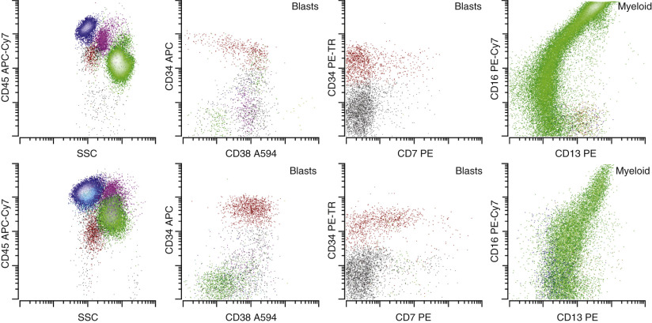

Figure 34-27 

Myelodysplasia. 

A sample from a patient with low-grade myelodysplasia _(lower row)_ is compared with normal bone marrow _(upper row)._ Myeloid blasts are shown in _red_ , maturing myeloid forms in _green_ , monocytes in _purple,_ and lymphocytes in _blue_ . Abnormalities commonly seen in myelodysplasia include neutrophil hypogranularity as indicated by decreased side scatter _(left),_ decreased CD45 expression by the blasts _(left),_ homogeneous expression of markers usually expressed at varying levels on myeloid blasts _(CD38, left center),_ acquisition of lymphoid-associated antigens (CD2, CD5, CD7, and CD56) by myeloid blasts _(right center),_ and abnormal patterns of myelomonocytic maturation, such as abnormal CD13 and CD16 on maturing neutrophilic forms _(right)._ Decreased side scatter is best noted by comparing the relative positions of neutrophils _(green)_ and monocytes _(purple)._ It is the combined presence of these abnormalities, rather than a single abnormality, that suggests a myeloid stem cell disorder, such as myelodysplasia. 

Among myeloproliferative neoplasms, chronic myeloid leukemia and myelofibrosis (primary or secondary) are most likely to show immunophenotypic abnormalities. By contrast, uncomplicated essential thrombocythemia and polycythemia vera are unlikely to show abnormalities by flow cytometry, and neither isolated thrombocytosis or erythrocytosis are considered to be indications for flow cytometry (  Davis et al, 2007  ). Although flow cytometry has been less well studied in the myeloproliferative neoplasms, the abnormalities seen in the blasts in this group of diseases are similar to the abnormalities described earlier in association with myelodysplastic syndromes and may be seen in conjunction with basophilia (  Kussick & Wood, 2003a  ). 

 

##  Paroxysmal Nocturnal Hemoglobinuria 

Certain nonneoplastic hematopoietic disorders can be diagnosed using the same principles used to identify hematopoietic neoplasms. Paroxysmal nocturnal hemoglobinuria (PNH) is an acquired clonal stem cell disorder characterized by the loss of a variety of cell surface proteins on all progeny of the hematopoietic stem cell, including erythrocytes, neutrophils, monocytes, lymphocytes, and platelets. The loss of these proteins is the result of a somatic mutation of a key enzyme required for synthesis of the glycosyl-phosphatidyl-inositol (GPI) linkage used to attach these proteins to the cell surface. Detection of the loss of GPI-linked proteins is readily accomplished by flow cytometry (  Richards et al, 2000  ,  Sutherland et al, 2014  ), and flow cytometry of the peripheral blood serves as the principal diagnostic method for this disorder. For clinical testing, it is recommended that at least two different cell lineages be evaluated (  Borowitz et al, 2010  ;  Fletcher et al, 2014  ). When considering white blood cells (namely granulocytes and monocytes), evaluation of at least two GPI-linked reagents, one of which should be the fluorescent derivative of bacterial proaerolysin (FLAER), is recommended (  Brodsky et al, 2000  ;  Borowitz et al, 2010  ). One recent recommendation is to use a four-color combination of FLAER, **CD24** , CD15, and CD45 for high-sensitivity testing of neutrophils; FLAER, **CD14** , CD64, and CD45 for monocytes; and two-color CD235a/ **CD59** for RBCs (  Fletcher et al, 2014  ). In these combinations, FLAER binds the GPI anchor and the antigens listed in bold are GPI-linked, while the remaining reagents are used for population identification. CD157 is another GPI-linked protein that may be used in a single-tube high-sensitivity assay to simultaneously asses for GPI-deficient monocytes and neutrophils (  Sutherland et al, 2014  ). Platelets and lymphocytes are generally not evaluated. An example of PNH is shown in [ Figure 34-28 ](<#f0145>) . 

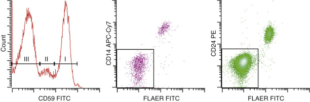

Figure 34-28 

Paroxysmal nocturnal hemoglobinuria. 

Erythrocytes _(left panel)_ identified by light scatter properties show differing levels of CD59 expression, corresponding to normal (Type I, 36%), partially deficient (Type II, 9%), and completely deficient (Type III, 54%) forms. A single 6 color tube is used for identification of GPI-deficient monocyte and granulocyte populations: FLAER, CD24, CD14, CD15, CD33, and CD45. Monocytes _(center panel),_ identified by a combination of CD45, CD15 (low), CD33 (high), and side scatter (intermediate), show a mixture of normal (positive for CD14 and fluorescent aerolysin [FLAER]) and GPI-deficient forms (gated, 81%). Granulocytes _(right panel),_ identified by a combination of CD45, CD15 (high), CD33 (low), and side scatter (high), show a mixture of normal (positive for CD24 and FLAER) and GPI-deficient forms (gated, 85%). Note the greater percentage of GPI-deficient monocytes and granulocytes compared with GPI-deficient erythrocytes, a common finding in PNH. 

,  

##  Summary 

Flow cytometry is a powerful, rapid, and cost-effective technique for the identification and monitoring of hematopoietic neoplasms. Successful implementation requires careful attention to instrument and reagent performance, as well as a strong working knowledge of normal patterns of antigenic expression on hematopoietic cells. 

,,
