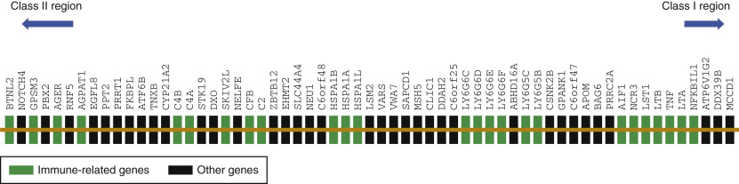
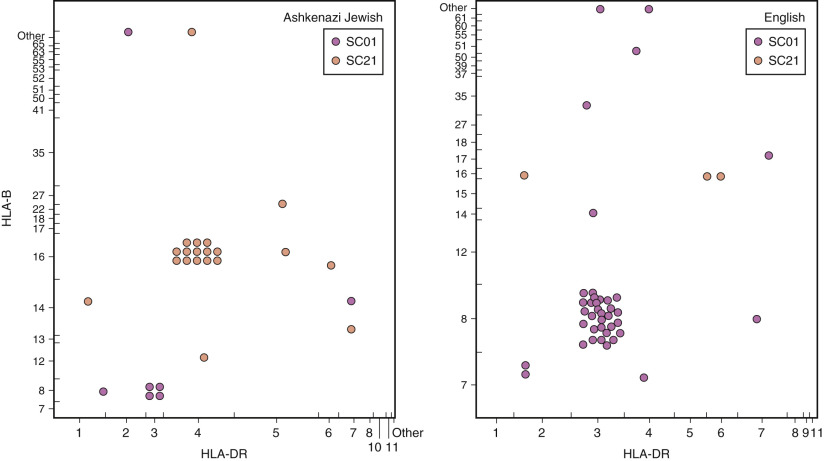

## Key Points

  * •

The major histocompatibility complex (MHC) genomic region contains many genes with immune-related functions, including the human leukocyte antigen (HLA) genes. 

  * •

Identification of several genes within the MHC has increased the possibility of defining the genetic basis of immunity. 

  * •

The clustering of immune-related genes in the MHC region may not be coincidental and may be the result of evolutionary forces joining genes with similar functions. 

  * •

The MHC is associated with more diseases than any other region on the human genome. 

  * •

Nonrandom associations of fixed stretches of MHC DNA (haplotypes) complicate the study of susceptibility genes but also provide the means for their identification. 

  * •

Methods are available for detecting associations or linkage between polymorphisms found with the MHC and disease. 

  * •

Although MHC class I– and class II–encoded proteins are distinguished by structural and functional similarities shared by the members of each class, class III molecules can be defined only as non-I and non-II, because their genes and their products have no common features and are not recognized by T cells. 

  * •

Despite convincing genetic association studies showing the importance of the class III region in health and disease, neither the genes responsible for disease nor the underlying mechanism of pathology is known for many of the associated conditions. 

  * •

Almost half of the genes within the MHC class III region play roles in the innate immune system, including members of the complement cascade ( _C4, C2, BF_ ), tumor necrosis factor ( _TNF, LTA, LTB_ ), and Lymphocyte Antigen-6 ( _LY6_ ) families. 

  * •

Deficiency of the second component of the complement system has been reported only in Caucasians, and it is the most common complement protein deficiency state in that population. 

  * •

Complete C4 deficiency is extremely rare. The level of C4 in the serum of patients with _C4 null_ alleles is extremely variable and cannot be used reliably to detect heterozygotes for complete deficiency because there is no correlation between the level of C4 and the number of expressed _C4_ genes. 

  * •

Extended haplotypes are highly characteristic of an ethnic subgroup and have lower frequencies or do not occur at all in other ethnic groups. 

  * •

It is critical to know the ethnic distribution of a disease-associated MHC allele to evaluate whether the allele in patients is increased compared with ethnically matched control populations and is in fact truly a marker for the ethnic distribution of the disease. 

  * •

A major problem with MHC gene associations is their incomplete penetrance, making ordinary formal segregation and linkage studies difficult to carry out. 

Understanding the role of the MHC in immune responses and in the pathogenesis of disease requires defining polymorphisms in the class I and class II regions, as well as genes in the central region of the MHC, sometimes called the _MHC class III region._ The strong interest in the MHC genomic sequence originates from its established role in regulating inflammation and the innate and adaptive immune responses. Several genes in the MHC play important roles in cellular discrimination of self and nonself that require an essential knowledge of the effects of the MHC system in transplantation medicine and in susceptibility to autoimmunity. Variants of class I and class II genes were described in detail in [ Chapter 49 ](<##!/content/3-s2.0-B9780323295680000498?scrollTo=%23c00049>) . In this chapter, we discuss the non–human leukocyte antigen (HLA) region genes, disease associations, and methods for detecting the association of diseases with genetic markers. 

,  

##  Overview of the Human Major Histocompatibility Complex DNA Sequence 

Completion of the MHC deoxyribonucleic acid (DNA) sequence preceded completion of the total human genome sequence by almost 4 years (  The MHC Sequencing Consortium, 1999  ). The rush to complete the entire MHC sequence followed the need to understand the biology and genetics of the mouse MHC (H-2) and HLA regions, which were initially provided by murine inbred experiments and serologic typing (  Klein, 1986  ). Although the MHC was discovered more than 50 years ago, its nature has been resolved only in the last 2 decades, with the advent of DNA cloning and discovery of the structure of class I and class II molecules (  Bjorkman et al, 1987  ;  Brown et al, 1993  ). 

The MHC located in the short arm of chromosome 6 spans approximately 4 Mb and contains more than 250 identified loci, by far the most gene-dense region of the human genome sequenced to date (  Shiina et al, 2009  ). It encodes the most polymorphic human proteins—the HLA class I and class II molecules, some of which have more than 12,000 allelic variants identified so far (  Marsh, 2014  ). More than 40% of the total expressed loci in the MHC are associated with immune-related functions. This clustering of immune-related genes in the MHC region may not be coincidental and may be the result of evolutionary forces joining genes with similar functions. 

Traditionally, the MHC region has been classified into three regions from telomere to centromere: HLA class I, non-HLA class (MHC class III), and HLA class II. HLA class I and class II gene functions were reviewed in detail in [ Chapter 49 ](<##!/content/3-s2.0-B9780323295680000498?scrollTo=%23c00049>) . We will concentrate on the MHC class III region and will later return to HLA class I and class II genes to discuss disease associations. 

,  

##  Genes in the Central or Class III Region 

The human MHC class III, or central MHC region, located between the HLA class I and class II regions, is the most gene-dense region of the human genome. Specifically, the MHC class III region contains 61 protein-coding genes in ≈900-kb sequence, with an average gene size of ≈8.5 kb (  Xie et al, 2003  ), compared with the entire human genome, which contains, on average, fewer than 11 genes per megabase and has an average gene size of 27 kb (  Lander et al, 2001  ). Although HLA class I– and class II–encoded proteins are distinguished by structural and functional similarities shared by the members of each class, MHC class III molecules can be defined only as non-I and non-II, because their genes and their products have no common features and are not recognized by T cells. [ Figure 50-1 ](<#f0010>) shows a gene map of the MHC class III region. 

Figure 50-1 

Gene map of the class III region of the major histocompatibility complex. 

Shown in order but not to scale are 55 genes from centromere to telomere. Genes presenting “immune loci” are marked by green boxes. 

Despite convincing genetic association studies showing the importance of the MHC class III region in health and disease, neither the genes responsible for disease nor the underlying mechanism of pathology is known for many of the associated conditions. One reason for this is the fact that the functions of nearly half the genes in the MHC class III region are not completely known. A high-throughput yeast two-hybrid system was used to look into the function of several intracellular proteins encoded within the MHC class III region (  Lehner et al, 2004  ). This study revealed that approximately one third of the analyzed proteins encoded within the MHC class III region may have a role in mRNA processing, which again suggests clustering of functionally related genes within this region of the human genome. Specifically, three proteins (STK19, PBX2, and NELFE) of the proteins in the MHC class III region interact with proteins implicated in transcriptional regulation. Four proteins (LSM2, DDX39B, DXO, and SKIV2L) are orthologs of yeast proteins involved in mRNA processing, and another five proteins (PRRC2A, STK19, CLIC1, PBX2, and ABHD16A) interact with proteins previously implicated in RNA proc­essing. Proteins involved in RNA processing are usually categorized as “housekeeping,” but they are often critical for innate immunity against viral RNA. Metabolism of intracellular nucleic acids is also critical for limiting autoimmunity against DNA and RNA. SKIV2L (superkiller viralicidic activity 2-like)-deficient patients have an elevated interferon response (  Eckard et al, 2014  ) and present with trichohepatoenteric syndrome, an inflammatory bowel disease–like intractable diarrhea (  Fabre et al, 2012  ). 

The region closer to HLA class II genes contains several genes of known function, including _TNXB_ (  Morel et al, 1989  ), which encodes tenascin X, a large extracellular matrix protein expressed in connective tissues, and NEU1, which encodes neuraminidase 1, a lysosomal sialidase. Mutations of _TNXB_ are a cause of Ehlers-Danlos syndrome (  Burch et al, 1997  ), primary myopathy (  Penisson-Besnier et al, 2013  ), and vesicoureteral reflux (  Gbadegesin et al, 2013  ;  Bonten et al, 1996  ). Mutations of the _NEU1_ gene are responsible for congenital sialidosis (  Bonten et al, 1996  ;  Canafoglia et al, 2014  ). 

Almost one half of genes within the MHC class III region play roles in the innate immune system, including members of the complement fixation cascade (C4, C2, CFB) and the tumor necrosis factor family (TNF, LTα, LTβ), which will be discussed in greater detail later in this chapter. Other members of the immunoglobulin superfamily are also located within the MHC class III regions: _NCR3_ (natural cytotoxicity triggering receptor 3) and the less characterized _LY6G_ genes (  Mallya et al, 2006  ). The _NCR3_ gene encodes the NKp30 protein responsible for triggering natural killer (NK) cells (  Pende et al, 1999  ), and it is involved in the killing of cells infected with _Plasmodium falciparum_ (  Mavoungou et al, 2007  ) and cytomegalovirus (  Arnon et al, 2005  ), fungi (  Li et al, 2013  ), and tumor cells (  Brandt et al, 2009  ), and contributes to the pathogesis of primary Sjögren's syndrome (  Rusakiewicz et al, 2013  ). Increased expression of NCR3 and the adjacent LST1 (leukocyte-specific transcript 1) gene has been found in the blood of rheumatoid arthritis patients (  Mulcahy et al, 2006  ). _LST1_ encodes a palmitoylated transmembrane signaling adaptor and membrane scaffolding protein in myeloid cells (  Draber et al, 2012  ;  Schiller et al, 2013  ). Both genes are also significantly upregulated in response to lipopolysaccharide, interferon-γ, and bacterial infection, suggesting a role for these gene products in autoimmune-related inflammation and dendritic cell/NK cell–associated functions. 

The _NFKBIL1_ (NF-κB-inhibitor–like 1) and _BTNL2_ (Butyrophilin-like protein 2) genes are also located in the MHC class III region (  Albertella & Campbell, 1994  ;  Stammers et al, 2000  ). Much interest has recently been focused on the NFKBIL1 (  An et al, 2013  ) and BTNL2 (  Swanson et al, 2013  ) proteins after single mutations in their promoter regions were linked to rheumatoid arthritis (  Okamoto et al, 2003  ) and sarcoidosis (  Valentonyte et al, 2005  ), respectively. Other immune-related genes (e.g., _LY6_ family members and _AIF1_ ) are likely to function as part of immune/inflammatory control (  Mallya et al, 2006  ;  Kadoya et al, 2014  ). Finally, the genes for the microsomal enzyme steroid P450 21-hydroxylase and three members of the major heat-shock protein 70 family are also contained in the MHC class III region and will be discussed later. 

 

##  Tumor Necrosis Factor and Lymphotoxin α and β Genes 

Tumor necrosis factor (TNF) and lymphotoxin α (LTα) are potent immunomodulatory cytokines produced in response to inflammatory stimuli. The biological functions of these cytokines and the laboratory methods used to measure them in body fluids were reviewed in great detail in [ Chapter 47 ](<##!/content/3-s2.0-B9780323295680000474?scrollTo=%23c00047>) . TNF and LTα proteins are each encoded by separate genes ( _TNF_ and _LTA_ ) and share approximately 34% amino acid identity (  Carroll et al, 1987  ). TNF and LTα are either maintained as cell surface molecules or released from cells. LTα is retained on the cell surface via a transmembrane region. Surface TNF results not from the presence of a transmembrane region, but rather from an association with lymphotoxin β (LTβ) (  Browning et al, 1993  ). LTβ encoded by _LTB_ has 21% and 24% amino acid identity with _TNF_ and _LT α _ , respectively. 

To date, several _TNF_ promoter polymorphisms have been identified and correlated with susceptibility to various autoimmune and infectious diseases. This work remains controversial both at the genetic level and, more importantly, with regard to functional relevance. As demonstrated for some of the _TNF_ promoter polymorphisms, these gene variations may be ethnic-specific markers for other linked and unidentified factors that may have an impact on host immune response in the development of autoimmune diseases and susceptibility or resistance to infectious diseases in a given population (  Delgado et al, 2002  ). Polymorphisms in the _TNF_ promoter region have been correlated in large-scale population studies with cerebral malaria (  McGuire et al, 1994  ), rheumatoid arthritis (  Criswell et al, 2004  ), coronary heart disease (  Nicaud et al, 2002  ), type 2 diabetes (  Kubaszek et al, 2003  ), Alzheimer's disease (  McCusker et al, 2001  ), ankylosing spondylitis (  McGarry et al, 1999  ), mortality to septic shock (  Mira et al, 1999  ), mucocutaneous leishmaniasis (  Cabrera et al, 1995  ), periodontitis (  Ding et al, 2014  ), immune thrombocytopenia (  Hajeer & Hutchinson, 2001  ;  Sarpatwari et al, 2011  ), inflammatory bowel disease (  Zipperlen et al, 2005  ), and various hematologic and nonhematologic malignancies (  He et al, 2014  ;  Ding et al, 2014  ;  Min et al, 2014  ). Similarly, large-scale analysis has linked both promoter and coding polymorphisms within the _LTA_ gene to myocardial infarction (  Ozaki et al, 2002  ), stroke (  Wang et al, 2009  ), sepsis (  Tiancha et al, 2011  ), and hematologic and nonhematologic malignancies (  Skibola et al, 2010  ;  Yu et al, 2014  ). 

 

##  Heat-Shock Protein 70 Genes 

Stress proteins, or heat-shock proteins, are expressed by cells in response to a variety of stress stimuli. This response has been observed in all species examined to date. The family of stress proteins, 70 kDa in size, has a highly conserved amino acid sequence identity as found from primitive eukaryotes to humans. Several studies have identified loci for heat-shock protein 70 (HSP70) on chromosomes 6, 14, and 21 (  Hunt & Morimoto, 1985  ;  Sargent et al, 1989  ). Three genes encoding members of the HSP70 family are located telomeric to the _C2_ locus ( _HSPA1L, HSPA1A,_ and _HSPA1B,_ formerly known as _HSP70-Hom, HSP70-1,_ and _HSP70-2,_ respectively). 

Sequence analysis of _HSPA1A_ and _HSPA1B_ genes has shown that they are intronless genes that encode an identical protein product of 641 amino acids. _HSPA1L_ is also an intronless gene that encodes a protein of 641 amino acids and has 90% sequence identity with _HSPA1A_ (  Milner & Campbell, 1990  ). Because of the high degree of sequence similarity between coding regions of the various _HSP70_ genes, DNA probes corresponding to coding regions tend to cross-hybridize. However, sufficient sequence differences have been observed between the 5′ and 3′ untranslated regions to design oligonucleotide primers and probes to allow specific amplification and hybridization of the three genes (  Milner & Campbell, 1992  ). 

Polymorphisms in the _HSP70_ gene cluster have been associated with the magnitude of the heat shock response (  Singh et al, 2006  ), schizophrenia (  Kowalczyk et al, 2014  ;  Pae et al, 2005  ), leukemia (  Ucisik-Akkaya et al, 2010  ), age-related cataract (  Zhang et al, 2013  ), and longevity (  Singh et al, 2010  ). Other polymorphisms in the _HSP70_ gene have been correlated to cytokine response in trauma (  Schroder et al, 2003  ), Parkinson's disease (  Wu et al, 2004  ), uveitis in patients with sarcoidosis (  Spagnolo et al, 2007  ), and risk for clozapine-induced agranulocytosis in Ashkenazi Jews (  Corzo et al, 1995  ). 

 

##  _C2, C4,_ and _CFB_ Genes and Typing 

The complement C2, C4, and factor B proteins encoded within the MHC class III demonstrate inherited structural variants that can be studied by using techniques that detect differences in net surface charge due to amino acid differences. Two methods are used to separate these proteins: (1) high-voltage agarose gel electrophoresis, which detects variations in mobility due to charge differences between proteins at a given pH, and (2) isoelectric focusing in thin-layer polyacrylamide gels, which shows differences in isoelectric points. Proteins can be visualized by immunofixation electrophoresis using insolubility of antigen-antibody complexes, or by detection of functional hemolytic activity with overlay gels, in which antibody-sensitized sheep erythrocytes are combined with complement-deficient serum (  Alper et al, 1983  ). 

At the protein level, C2 shows minor polymorphism by isoelectric focusing. The alleles for C2 are _C_ (common), a less common _B_ (basic) allele with three rare basic variants, and four rare _A_ (acidic) variants (  Jahn et al, 1990  ). The polymorphic site for the _C2*B_ allele is carried by the C2a complement fragment. The C2 protein is genetically polymorphic in a wide variety of ethnic groups, although _C2*C_ accounts for more than 90% of _C2_ genes in most populations (  Alper, 1976  ;  Meo et al, 1977  ). In Caucasian and Asian populations, _C2*B_ accounts for 5% to 10% of _C2_ genes. A nonexpressed allele ( _C2*QO_ ) is found in 2% of the Caucasian European population (  Truedsson et al, 1993a  ). For C2 typing, proteins are separated by isoelectric focusing in polyacrylamide gels and are visualized by C2-induced hemolysis in overlay gels. Diluted normal human serum can replace C2-deficient serum as a reagent, because C2 is the limiting factor in the classical complement pathway. 

Two distinct but closely related loci for the C4 protein ( _C4A_ and _C4B_ ), presumably the result of tandem gene duplication, encode for two forms of C4. The genetics of _C4_ is extraordinarily complex, not only at the genetic level, but also at the protein level. It has been shown that the number of _C4_ genes in humans varies from two to four, and in exceptional cases, six (  Chung et al, 2002  ;  Wu et al, 2007  ). The _C4_ gene duplication unit includes its neighboring genes _STK19_ at the 5′ region and _CYP21_ and _TNXB_ at the 3′ region (  Blanchong et al, 2000  ). Misalignments (unequal crossing-overs) of heterozygous mono-, bi-, or tri-modular chromosomes during meioises can cause further rearrangements and lead to congenital adrenal hyperplasia and Ehlers-Danlos syndrome by deleting _CYP21_ and _TNXB_ genes, respectively, in addition to changing the number of _C4_ genes. Three quarters of _C4_ genes carry endogenous retrovirus sequences that might confer intrinsic protection against exogenous retroviral infection (  Schneider et al, 2001  ). Recent data suggest a negative correlation between the presence of endogenous retrovirus sequences and the level of C4 proteins, as well as a direct relationship between the number of genes and C4 protein levels (  Yang et al, 2003  ). 

At the protein level, C4A and C4B differ only by four amino acid residues in the α chain between positions 1101 and 1106. C4B is several times more hemolytically active than C4A, but C4A is more active at inhibiting the formation and dissolution of immune complexes than C4B. C4A variants usually carry Rodgers antigenic determinants (a Val-Asp-Leu-Leu epitope of the C4A chain), and C4B variants carry Chido determinants (an Ala-Asp-Leu-Arg epitope of the α chain of C4B). Extensive genetic polymorphism is detectable in C4A and C4B proteins among populations; more than 35 variants have been observed by agarose gel electrophoresis and DNA-based typing methods (  Awdeh & Alper 1980  ;  Sim & Cross, 1986  ;  Schneider et al, 1996  ;  Hui et al, 2004  ). Among the C4A and C4B allotypes, the most common alleles are _C4A*3_ and _C4B*1_ . _C4A*4, C4A*2, C4B*2,_ and _C4B*5_ show a worldwide general distribution. _C4A*6_ is also observed in many populations, with the exception of some Mongoloid groups. _C4B*3_ is identified mainly in African and Caucasian groups. 

C4 typing requires a combination of several techniques (  Awdeh & Alper 1980  ): (1) Immunofixation electrophoresis after treatment with neuraminidase. The patterns produced show three bands for each variant with some overlap occurring between certain variants. Additional treatment of the sample with carboxypeptidase reduces each variant to a single band. (2) Detection of C4A versus C4B by functional hemolytic assay. This method distinguishes C4A and C4B overlapping patterns because C4B variants have 5 to 10 times the hemolytic activity of C4A variants. (3) Rodgers (C4A) or Chido (C4B) serologic reactivity. The serum is incubated with human anti-Rodgers or human anti-Chido to test for inhibition of agglutination with appropriate positive erythrocytes. Alternatively, C4 variants can be typed for Chido or Rodgers reactivity by immunoblotting. Null alleles of _C4_ heterozygotes can be detected in two ways. Electrophoresis of C4 null ( _C4A QO_ and _C4B QO_ ) samples demonstrates an absence of bands in homozygotes, but in heterozygotes requires quantification by visual inspection, crossed immunoelectrophoresis, or densitometric scanning of immunofixation patterns. An alternative method is to determine the presence and ratios of the C4A and C4B α chains after sodium dodecyl sulfate polyacrylamide gel electrophoresis of immunoprecipitates. More recently, DNA-based typing methods, including sequence-specific primer (SSP) amplification, restriction fragment length polymorphism analysis, real-time PCR, and direct DNA sequencing, have been used to complement inconclusive C4A and C4B protein allotyping (  Schneider & Mauff, 2003  ;  Wu et al, 2007  ). 

Factor B is synthesized by the _CFB_ gene. Human factor B is highly polymorphic, with more than 20 variants identified to date, including several dysfunctional proteins, those present in low concentration, and null alleles. Factor B typing is normally performed by combining agarose electrophoresis and/or isoelectric focusing at the protein level with polymerase chain reaction (PCR) analysis at the DNA level (  Geserick et al, 1998  ). By using these methods, it is possible to identify two very common alleles, _CFB*F_ and _CFB*S_ , two less common alleles, _CFB*F1_ and _CFB*S1_ , and a host of rare alleles. Variants are named for their decimal fraction migration in gel electrophoresis: CFB F to CFB F1 for fast variants, and CFB S to CFB S1 for slow variants. In European Caucasian populations, _CFB*F_ has a frequency of 0.2, _CFB*S_ of 0.77, _CFB*F1_ of 0.01, and _CFB*S1_ of 0.01; rare alleles account for only 0.002. _CFB*S_ is most common in Caucasian, Mongoloid, and Australoid populations, and _CFB*F_ is most common in Negroid populations. _CFB*F1_ is observed in African groups, as well as in some Caucasian populations. 

 

##  Disease Associations with _C2, C4,_ and _CFB_ Genes 

Deficiency of the second component of the complement system has been reported in about 1 in 10,000 Caucasians, and is the most common complement protein deficiency state in that population (  Silverstein, 1960  ;  Klemperer et al, 1966  ). People with complete C2 deficiency are homozygous for null C2 alleles ( _C2*Q0_ for quantity zero). _C2*Q0_ results from a 28-bp gene deletion that generates a frameshift and a stop codon 14 bp distal to the end of exon 6 (  Johnson et al, 1992  ). Remarkably, _C2*QO_ has a gene frequency of approximately 0.01 among Caucasians. Rarely, C2 deficiency is the result of missense mutations resulting in impaired C2 secretions that have been termed _C2 deficiency type II_ (  Wetsel et al, 1996  ). Although C2 deficiency can lead to disease, most patients remain asymptomatic. Up to 25% of homozygotes for C2 deficiency have increased susceptibility to bacterial infection due to immunoglobulin deficiency (  Densen, 1991  ;  Alper et al, 2003  ). Between 20% and 40% of reported patients with C2 deficiency have a systemic lupus–like disease (  Truedsson et al, 1993b  ;  Sullivan et al, 1994  ). A polymorphism in the _C2_ gene has been correlated with reduced risk for age-related macular degeneration (  Gold et al, 2006  ;  Maller et al, 2006  ). 

A high incidence of _C4 null_ alleles is seen in the general population. _C4A*Q0_ and _C4B*Q0_ result from gene deletions, premature stop codons, and other mutations that cause transcription failure (  Braun et al, 1990  ;  Barba et al, 1993  ;  Lokki et al, 1999  ). Thirty-five percent of individuals of all races do not express one _C4A_ or _C4B_ gene (i.e., carry _C4A*Q0_ or _C4B*Q0_ ), 8% to 10% carry two null alleles, and less than 1% do not express three alleles. Complete C4 deficiency (trans _C4A*Q0_ , _C4B*Q0_ ) haplotypes are extremely rare (  Hauptmann et al, 1986  ). The _C4A*Q0_ allele, particularly in homozygous individuals or those with complete C4 deficiency, has been associated with systemic lupus erythematosus (  Wilson & Perez, 1988  ;  Huang et al, 1995  ). This susceptibility is probably related to defective handling of immune complexes (  Fielder et al, 1983  ). Children homozygous for _C4B*Q0_ have a 3.5-fold greater incidence of bacterial meningitis (  Colten & Rosen, 1992  ). Homozygous C4B deficiency is described in families with non-SLE glomerulonephritis (  Ault et al, 1990  ;  Tsuda et al, 2007  ;  Soto et al, 2010  ), and the C4B*Q0 allele is thought to increase the risk for Henoch–Schönlein purpura (  Stefansson Thors et al, 2005  ). Increased frequency of the _C4B*Q0_ allele has been found in patients with severe coronary artery disease who underwent bypass compared with healthy controls (  Szalai et al, 2002  ). 

Absence of homozygous factor B deficiency in humans has led to the notion that the condition might be lethal during embryonic development. Based on inheritance patterns and serum levels, some heterozygotes from _CFB*Q0_ have been identified as having reduced protein products (  Siemens et al, 1992  ), and recently compound heterozygous loss-of-function mutations in CFB were identified in a patient with recurrent pneumococcal and meningococcal infections (  Slade et al, 2013  ). The _CFB F_ variant has been associated with higher protein concentration but lower hemolytic activity than _CFB S_ (  Lokki & Koskimies, 1991  ). Mutations in the _CFB_ gene have been associated with age-related macular degeneration (  Gold et al, 2006  ;  Maller et al, 2006  ), and hemolytic-uremic syndrome (  Goicoechea de Jorge et al, 2007  ). 

 

##  Complotypes 

The four genes of the complement region occupy approximately 120 kb of genomic DNA (  Carroll et al, 1984  ). The _C2_ and _CFB_ genes are located in very close proximity, separated by less than 2 kb, but _CFB_ and _C4A_ are separated by about 30 kb. _C4A_ and _C4B_ are about 10 kb apart. Alleles of the complement genes occur as a unit at the population level and show striking linkage disequilibrium in haplotypes determined by family studies. That is to say, they occur together as sets on the same chromosome more frequently than expected from the frequencies of their individual alleles and with no well-documented recombinations. For these reasons, haplotypes of the four complement loci have been called _complotypes,_ as an abbreviation for “complement haplotypes” (  Alper et al, 1983  ). Although their order from telomere to centromere is _C2, CFB, C4A, C4B_ (see [ Fig. 50-1 ](<#f0010>) ), the positions of _CFB_ and _C2_ are transposed for clarity in using variant alleles to designate complotypes. Thus, _CFB*S, C2*C, C4A*QO, C4B*1_ is a complotype that in abbreviated form is _SC01_ . More than a dozen complotypes in Caucasians have frequencies of about 0.01 or higher ( [ Table 50-1 ](<#t0010>) ). In most populations, the _SC31_ complotype is most common. In people of African descent, _FC31_ is common, as is _SC42_ in East and Southeast Asians. 

TABLE 50-1 

Common Complotypes in Normal Chromosomes of Caucasoid Populations [ * ](<#hl0000086>)

Complotype  |  Frequency, %   
---|---  
SC31  |  0.430   
SC01  |  0.127   
FC31  |  0.096   
SC30  |  0.053   
SC42  |  0.040   
SC61  |  0.034   
FC30  |  0.031   
FC01  |  0.029   
SC02  |  0.029   
SC21  |  0.022   
SB42  |  0.019   
SC33  |  0.014   
SC2(1,2) [ † ](<#hl0000091>) |  0.01   
3SC32  |  0.011   
  
 * Complotypes are given as abbreviated letters and numbers, with four alleles in arbitrary order: _CFB, C2, C4A_ , and _C4B_ . 

 † _C4B_ locus is heteroduplicated. 

,  

##  Extended Haplotypes 

Based on the study of the distribution of complotypes in relation to _HLA-B_ and _HLA-DR_ specificities on normal Caucasian haplotypes determined in family studies, striking linkage disequilibrium involving the whole region became evident. One could easily recognize _HLA-B,_ complotype, _DR_ allele sets that showed statistically significant three-point linkage disequilibrium ( [ Fig. 50-2 ](<#f0015>) ) and that define what are regarded as extended haplotypes (  Awdeh et al, 1983  ). A shorthand nomenclature for extended haplotypes has been designed by enclosing _HLA-B,_ complotype, and _HLA-DR_ variants in brackets. Thus, the most common extended haplotype in Caucasians is _[HLA-B8, SC01, DR3]_ . Extended haplotypes are highly characteristic of an ethnic subgroup and have lower frequencies or do not occur at all in other ethnic groups (  Alper et al, 1982  ;  Fraser et al, 1990  ). 

Figure 50-2 

The haplotype distribution of the complotypes (haplotypes of complement alleles) _SC01 (CFB*S, C2*C, C4A*QO, C4B*1)_ and _SC21 (CFB*S, C2*C, C4A*A, C4B*1)_ in relation to _HLA-B_ alleles on the ordinate and _HLA-DR_ alleles on the abscissa. 

Heights and widths representing HLA specificity are proportional to allele frequencies for the respective populations. Clustering represents linkage dysequilibrium and flags the extended haplotypes _[HLA-B16(38), SC21, DR4]_ in Ashkenazi Jews _[HLA-B8, SC01, DR3]_ and in the English and, to a much lesser extent, among Jews. _HLA,_ Human leukocyte antigen. 

(From Alper CA, Awdeh ZL, Yunis EJ: Conserved, extended MHC haplotypes, _Exp Clin Immunogenet_ 9:58, 1992, Figure 4. Copyright © S. Karger AG, Basel.) 

Initial studies defined extended haplotypes as the genomic interval between _HLA-B_ and _DR_ . It then became evident that other uncharacterized MHC alleles in the interval were likely to be included. Despite the fact that _HLA-A_ alleles have shown limited variation for extended haplotypes, only half such haplotypes show unique and significant _HLA-A_ allele associations (  Alper et al, 1982  ). The _HLA-Cw_ locus was by far the last to be characterized. Based on genetic distance and previously incomplete typing data of _HLA-B_ / _Cw_ pairs, it was evident that conserved haplotypes would also include the HLA-Cw genetic region. Thus, different _HLA-Cw_ alleles have been recently associated with different extended haplotypes ( [ Table 50-2 ](<#t0015>) ) (  Clavijo et al, 1998  ). Furthermore, several _TNF_ and _HSP_ allele systems and microsatellites have been studied in relation to extended haplotypes ( [ Table 50-3 ](<#t0020>) ). More recently, models have been created to describe the variable sizes of stretches of conserved DNA in the MHC, using the known frequencies of four different types of small blocks (<0.2 Mb) of relatively conserved DNA sequence: _HLA-Cw_ / _B; TNF;_ complotype _;_ and _HLA-DR_ / _DQ_ (  Yunis et al, 2003  ). Using HLA allele identification and TNF microsatellites, Yunis and colleagues have shown that some extended haplotypes extend to the _HLA-A_ and _HLA-DPB1_ loci, which form fixed genetic units of at least 3.2 Mb of DNA. Intermediate fragments of extended haplotypes also exist, which are, nevertheless, larger than any of the four small blocks. This complexity of genetic fixity at various levels should be taken into account in studies of genetic disease association, immune response control, and human diversity. 

TABLE 50-2 

Common Extended MHC Haplotypes [ * ](<#hl0000178>)

Extended Haplotype  |  HLA-Cw Allele  |  Ethnicity   
---|---|---  
_[HLA-B8, SC01, DR3, DQ2]_ |  0701  |  Northern Europe   
_[HLA-B7, SC31, DR2, DQ6]_ |  0702  |  Northern Europe   
_[HLA-B44, FC31, DR7, DQ2]_ |  1601  |  Europe   
_[HLA-B44, SC30, DR4, DQ7/8]_ |  0501  |  Europe   
_[HLA-B57, SC61, DR7, DQ2/3]_ |  0602  |  Northern Europe   
_[HLA-B14, SC22, DR1, DQ1]_ |  0802  |  Northern Europe   
_[HLA-B35, SC31, DR5, DQ3]_ |  0401  |  Southern Europe   
_[HLA-B38, SC21, DR4, DQ8]_ |  1203  |  Ashkenazi Jews   
_[HLA-B15, SC33, DR4, DQ8]_ |  0304  |  Northern Europe   
_[HLA-B18, F1C30, DR3, DQ2]_ |  0501  |  Basques, Sardinia, Spain   
_[HLA-B18, S042, DR2]_ [ † ](<#hl0000181>) |  1203  |  Northern Europe   
_[HLA-B42, FC(1,90)0, DR3]_ [ ‡ ](<#hl0000186>) |  1701  |  African   
  
_HLA,_ Human leukocyte antigen; _MHC,_ major histocompatibility complex. 

 * Data from normal Caucasoid population chromosomes from Boston. 

 † Data from patients with C2 deficiency (  Clavijo O, Delgado J, Awdeh ZL, et al  : HLA-Cw alleles associated with HLA extended haplotypes and C2 deficiency, _Tissue Antigens_ 52:282–285, 1998). 

 ‡ Data from chromosomes of normal black population living in Boston (Clavijo OP, Delgado JC, Yu N, et al: HLA-Cw*1701 is associated with two sub-Saharan African-derived HLA haplotypes: HLA-B*4201, DRB1*03 and HLA-B*4202 without DRB1*03, _Tissue Antigens_ 54:303–306, 1999). 

TABLE 50-3 

_TNF_ and _HSP_ Gene Polymorphisms in Relation to Common Extended Haplotypes [ * ](<#hl0000442>)

|  COMPLOTYPE  |  _HSP_ |  _TNF_ MARKERS   
---|---|---|---  
_HLA-DR_ |  _C4B_ |  _C4A_ |  _CFB_ |  _C2_ |  _1B_ |  _1A_ |  _e_ |  _d_ |  −308  |  −857  |  −863  |  _a_ |  _b_ |  _HLA-B_ |  _HLA-Cw_  
3  |  1  |  0  |  S  |  C  |  8.5  |  C  |  3  |  1  |  2  |  1  |  1  |  2  |  3  |  8  |  0701   
2  |  1  |  3  |  S  |  C  |  9  |  A  |  3  |  3  |  1  |  1  |  1  |  11  |  4  |  7  |  0702   
7  |  1  |  3  |  F  |  C  |  9  |  A  |  3  |  3  |  1  |  1  |  1  |  7, 8  |  4  |  44  |  1601   
4  |  0  |  3  |  S  |  C  |  9  |  A  |  3  |  3  |  1  |  1  |  1  |  6, 7  |  5  |  44  |  0501   
7  |  1  |  6  |  S  |  C  |  9  |  A  |  3  |  4  |  1  |  1  |  1  |  2  |  5  |  57  |  0602   
5  |  1  |  3  |  S  |  C  |  9  |  A  |  3  |  3  |  1  |  1  |  1  |  5  |  5  |  35  |  0401   
1  |  1, 2  |  2  |  S  |  C  |  9  |  A  |  1  |  4  |  1  |  1  |  2  |  2  |  1  |  14  |  0802   
4  |  1  |  2  |  S  |  C  |  9  |  A  |  3  |  3  |  1  |  2  |  1  |  10  |  4  |  38  |  1203   
4  |  3  |  3  |  S  |  C  |  9  |  A  |  1  |  4  |  1  |  1  |  2  |  2  |  1  |  62  |  0304   
2  |  2  |  4  |  S  |  0  |  9  |  A  |  3  |  3  |  1  |  2  |  1  |  10  |  4  |  18  |  1203   
3  |  0  |  3  |  F1  |  C  |  8.5  |  C  |  3  |  4  |  1  |  1  |  1  |  1  |  5  |  18  |  0501   
  
Adapted from Clavijo O, Delgado J, Awdeh ZL, et al: HLA-Cw alleles associated with HLA extended haplotypes and C2 deficiency, _Tissue Antigens_ 52:282–285, 1998. 

 * The numbers or letters under each column refer to a particular allele variant of the complement, heat-shock protein _(HSP)_ , tumor necrosis factor _(TNF)_ microsatellite, or _TNF_ promoter polymorphisms that are associated with the human leukocyte antigen _(HLA)_ specificities as noted. See text for explanation. In the case of _TNF-308_ , 1 and 2 represent the _ −308/G _ and _ −308/A _ variants, respectively. The _TNF-857/C_ allele is noted as 1, and the _TNF-857/T_ allele as 2. The _TNF-863/C_ TNF allele is noted as 1, and the _ −863/A _ as 2. 

Extended haplotypes, which account for at least 30% of normal Caucasian haplotypes, have relatively fixed gross structure and DNA sequence and carry very similar, if not identical alleles, even when they are found in apparently unrelated individuals. The frequency of extended haplotypes is more likely to be underestimated than overestimated because haplotypes must be determined from family studies involving thousands of unrelated index cases. The original MHC reference sequence (The  MHC Sequencing Consortium 1999  ) has been used as the starting point for numerous studies undertaken to ascertain multiple common and rarer extended haplotypes (  Walsh et al, 2003  ;  Stewart et al, 2004  ;  Smith et al, 2006  ;  Traherne et al, 2006  ), and now eight haplotypes have been completely sequenced, and the haplotype [ _HLA-A3, B7, DR15_ ] was designated as the new MHC reference sequence incorporated into the reference human genome assembly (  Horton et al, 2008  ). These studies will facilitate the identification of precise disease loci and may help us to better understand events such as recombination and polymorphism. 

,  

##  Mhc Disease Associations 

The MHC is associated with more diseases than any other region on the human genome. Identification of the key genetic association within the MHC has been proven difficult for at least four reasons: (1) MHC has the highest gene density in the genome, (2) and these large numbers of genes are often in strong linkage disequlibrium forming complex haplotype structures, (3) extended haplotypes contain multiple equally plausible candidate loci, and (4) the associated disease often show non-Mendelian inheritance. 

We have reviewed concepts about complotypes and extended haplotypes to enhance our understanding of the relevance of a rather extensive literature on MHC disease associations. Most of the MHC disease associations reported to date are contained within extended haplotypes. It is probably because of this simple fact that so many MHC-allele–associated diseases have been reported, because it is not a single base pair but more than 3 million base pairs of conserved DNA that constitute the marker. For example, complement alleles such as _CFB*F1_ and _C4B*3_ have been linked to type 1 diabetes, because the extended haplotypes that carry them, _[HLA-B18_ , _F1C30_ , _DR3]_ and _[HLA-B62_ , _SC01_ , _DR3]_ , are more common in these patients than in the general population. This association means that haplotypes comprising 3 million bases or more in length of conserved genomic DNA carry susceptibility alleles for type 1 diabetes. These 3 million base-long extended haplotypes often contain multiple candidate loci, best illustrated by psoriasis, a chronic inflammatory skin disorder. Psoriasis was associated with _HLA-Cw6_ over 30 years ago (  Russell et al, 1972  ), and many studies attempted since to identify the causal gene or genes. Although _HLA-C_ itself is the strongest candidate gene, multiple additional HLA class I and class II, and MICA/MICB variants appear to be independently associated with psoriasis (  Okada et al, 2014  ;  Gonzalez et al, 1999  ). Moreover, there are at least four genes (PSORS1C1-3, and CDSN) located next to _HLA-C_ that encode skin-expressed genes providing additional candidate genes for this complex skin disease (  Kumanovics & Fischer Lindahl, 2004  ). It is also critical to know the ethnic distribution of an associated MHC allele to evaluate whether the allele in patients is increased compared with that in ethnically matched control populations, or is in fact truly a marker for the ethnic distribution of the disease. Furthermore, it is more difficult to map the genes responsible for disease in Caucasian Americans than in African Americans or Asian Americans because the level of genetic diversity is lower in Caucasians. 

Most diseases associated with MHC are autoimmune and do not show clear-cut Mendelian inheritance. Many problems confound attempts to understand the inheritance mechanisms by which these diseases occur, and analysis of MHC markers in patients and their families has clarified the picture only marginally. A major problem with MHC gene associations is their incomplete penetrance, making ordinary formal segregation and linkage studies very difficult, if not impossible, to carry out. This is seen most clearly in monozygotic twins, who presumably have identical genes. If one such twin has one of these diseases (e.g., type 1 diabetes), the other twin does not necessarily have the same disease. For type 1 diabetes, the concordance rate appears to be no higher than 50% (  Rubinstein et al, 1977  ;  Barnett et al, 1981  ). This suggests that penetrance of a disease in a completely susceptible host is incomplete. Although there is excellent reason to consider genes in the MHC as determinants of type 1 diabetes susceptibility, only 15% of MHC-identical siblings of diabetic patients have insulin-dependent diabetes. This difference between 50% and 15% provides evidence for the influence of genes at a second, non–MHC-linked locus (or loci), and suggests the influence of other factors, such as environmental factors, in determining susceptibility. 

Incomplete penetrance makes assignment of a specific mode of inheritance difficult and makes the likelihood of finding families with more than one affected member within one or more generations low. Families are frequently used to determine modes of inheritance. Another complicating factor is the inability to determine whether we are studying a group of patients that are homogeneous in terms of genetic determination. About 5% to 6% of random families with a type 1 diabetic proband will have a second affected child. Of these sibling pairs, approximately 60% will be MHC-identical, 35% will be haploidentical, and a few percent will share no MHC haplotypes. This pattern suggests recessive inheritance of an MHC-linked susceptibility gene for the disease. At the very least, however, family studies provide highly useful haplotype data and usually allow the assignment of homozygosity for an HLA marker in probands. They have also established that MHC association in most diseases of interest is based on linkage between a susceptibility gene and the MHC. 

Yet another unknown is the number of different susceptibility alleles for a disease in any specific population. In this regard, extended haplotypes can be helpful because, if increased in patients, they probably represent a single susceptibility allele that could be anywhere in the region of fixity. However, some patients have only portions of these haplotypes, and this provides little information about the location of specific allele involvement. Furthermore, it appears likely that many MHC-associated diseases are polygenic. Because of this, we will first discuss diseases associated with mutations of a single MHC gene; this will be followed by a discussion of polygenic diseases. 

 

##  MHC Monogenic Disease Associations 

[ Table 50-4 ](<#t0025>) lists MHC monogenic disease associations and their genes. We will discuss the most common diseases. We have already reviewed two of these disorders earlier in the chapter: C2 and C4 protein deficiencies. 

TABLE 50-4 

MHC Monogenic Disease Associations 

Disease  |  MHC Gene  |  OMIM No. [ * ](<#hl0000509>)  
---|---|---  
Bare lymphocyte syndrome type 1  |  _TAP1, TAP2, TAPBP_ |  604571   
C2 deficiency  |  _C2_ |  217000   
C4 deficiency  |  _C4A, C4B_ |  120810   
Congenital adrenal hyperplasia  |  _CYP21A2_ |  201910   
Ehler-Danlos syndrome  |  _TNXB_ |  606408   
Hypotrichosis simplex of the scalp  |  _CDSN_ |  146520   
Sialidosis  |  _NEU1_ |  256550   
  
_MHC,_ Major histocompatibility complex. 

 * OMIM number provides disease and gene association information at [ http://www.ncbi.nlm.nih.gov/omim ](<http://www.ncbi.nlm.nih.gov/omim>) . 

 

##  Hereditary Hemochromatosis and the _HFE_ Gene 

Hemochromatosis is an autosomal recessive disease and is the most common hereditary metabolic disease in Caucasians. Hemochromatosis consists of an inherited metabolic defect in iron metabolism, resulting in failure to control iron absorption in the setting of increasing iron stores, leading to tissue iron overload and eventually to organ damage (  Adams et al, 2000  ). The most common manifestations of hemochromatosis are cirrhosis of the liver, hepatocellular carcinoma, diabetes mellitus, and cardiomyopathy. Discovery of the hereditary hemochromatosis _(HH)_ gene in the MHC was based on the early finding of increased frequency of the _HLA-A3_ allele in HH patients (  Simon et al, 1976  ). After years of effort in the vicinity of the _HLA-A_ locus, the _HFE_ gene was found several megabase pairs away (  Feder et al, 1996  ). _HFE_ encodes a 343–amino acid protein that belongs to a group named MHC class I–related molecules because of their similarities to HLA class I molecules. The HFE protein interacts with the transferrin receptor and modulates enteric absorption of dietary iron (  Waheed et al, 1999  ). 

The _HFE_ gene has two common missense mutations: the C282Y mutation, resulting in the substitution of a tyrosine for a cysteine, and the H63D mutation, resulting in the substitution of an aspartate for a histidine. Methods for diagnosis of hemochromatosis are discussed in detail in [ Chapter 71 ](<##!/content/3-s2.0-B9780323295680000711?scrollTo=%23c00071>) . The C282Y mutation, unlike the H63D mutation, interferes with protein interaction with β 2  -microglobulin, abolishing the cell surface expression of HFE (  Waheed et al, 1997  ;  Feder et al, 1997  ). A homozygous C282Y mutation is present in the majority of HH Caucasian patients. The C282Y mutation has a remarkably high allelic frequency in northern European populations (0.05% to 0.1%) and is rare in non-Caucasian populations. Penetrance of the C282Y homozygous state is as low as 10% or even 1% (  Beutler et al, 2002  ). For this reason, population screening for this mutation is not recommended. The H63D mutation is present at high frequency in control Caucasians (>0.1%) and was also found in non-Caucasian populations; however, its role in HH remains unclear. The C282Y mutation has been associated with susceptibility to diabetic retinopathy (  Peterlin et al, 2003  ) and increased risk for Alzheimer's disease (  Robson et al, 2004  ). 

 

##  Congenital Adrenal Hyperplasia Due to 21-Hydroxylase Deficiency 

Immediately 3′ to each _C4_ locus are two loci for the adrenal steroid enzyme 21 hydroxylase ( _CYP21A_ and _CYP21A2;_ the latter previously known as _CYP21B_ ) (  Carroll et al, 1985  ;  Higashi et al, 1986  ;  White et al, 1986  ). The two genes are highly homologous, but three mutations cause premature termination of transcription of the _CYP21A_ gene, rendering it a pseudogene (  White et al, 1988  ). Congenital adrenal hyperplasia is clinically heterogeneous, with a severe salt-wasting form, a milder late-onset form manifested largely by masculinization in girls, and a mild cryptic form. The MHC linkage of this disorder was discovered before any MHC associations were detected, and before it was known that the _CYP21_ loci were located within the MHC. Subsequently, studies found that 20% or more of European Caucasian patients with the salt-wasting form carried the rare extended haplotype _[HLA-A1_ , _Cw6_ , _B47_ , _FC(91)0_ , _DRB1*07_ , _DRB4*01:01_ , _DQA1*02:01_ , _DQB1*02:01]_ (  Fleischnick et al, 1983  ). It has been shown that this haplotype has a deletion of both _C4B_ and _CYP21A2_ , thus explaining the severity of symptoms and the complete deficiency of the enzyme in homozygotes for this haplotype. Among patients with milder and cryptic disease, a different extended haplotype is common: _[HLA-B65_ , _SC2(1,2)_ , _DR1]_ (  Sinnott et al, 1991  ). This haplotype is particularly common in southern Europe, and has a frequency of over 0.01% among Caucasians living in Boston. In all forms of 21-hydroxylase deficiency, the bulk of MHC haplotypes are not extended, and there is a great variety of complotypes, suggesting that many independent mutations have led to deletion or derangement of the _CYP21A2_ gene. 

 

##  Polygenic Diseases with MHC Associations 

[ Table 50-5 ](<#t0030>) lists some polygenic diseases and their MHC gene associations. This list is not exhaustive, and we will discuss only a few of the diseases in greater detail. 

TABLE 50-5 

Polygenic Diseases with MHC Associations 

Disease  |  MHC Gene  |  OMIM No. [ * ](<#hl0000576>)  
---|---|---  
Abacavir hypersensitivity  |  _HLA-B57:01_ |  142830   
Ankylosing spondylitis  |  _HLA-B27_ |  106300   
Autoimmune thyroid disease  |  _HLA-DR3_ |  608173   
Behçet disease  |  _HLA-B51_ |  109650   
Celiac disease  |  _HLA-DQ2, DQ8_ |  212750   
Multiple sclerosis  |  _HLA-DR, DQ_ |  126200   
Narcolepsy  |  _HLA-DQB1*06:02_ |  161400   
Rheumatoid arthritis  |  _HLA-DR4_ |  180300   
Type 1 diabetes  |  _HLA-DR, DQ_ |  222100   
  
_MHC,_ Major histocompatibility complex. 

 * OMIM number provides disease and gene association information at [ http://www.ncbi.nlm.nih.gov/omim ](<http://www.ncbi.nlm.nih.gov/omim>) . 

 

##  Ankylosing Spondylitis 

Ankylosing spondylitis (AS) is a common inflammatory rheumatic disease affecting the axial skeleton, causing inflammatory back pain, which can lead to structural and functional impairments and a decreased quality of life (  Braun & Sieper, 2007  ). A strong association has been noted between _HLA-B27_ and AS in several populations (  Khan & Kellner 1992  ). About 90% of Caucasian patients with AS have _HLA-B27,_ as compared with 5% to 10% of healthy controls (  Rubin et al, 1994  ). _HLA-B27_ shares sequence with proteins from enteric bacteria and peptides that both mimic and bind B27 and may constitute the molecular components of a mechanism for AS (  Scofield et al, 1995  ). Another hypothesis suggests that “auto-display” occurring within or between misfolded B27 molecules provokes an autoimmune attack in AS (  Luthra-Guptasarma & Singh, 2004  ;  Sharma et al, 2007  ). _HLA-B*27_ genotyping is frequently performed by flow cytometry. However, _HLA-B27_ screening is of limited usefulness given its poor positive predictive value, because among _HLA-B27_ –positive individuals in the population at large, only 2% will develop AS (  Gran & Husby, 1995  ). 

 

##  Celiac Disease 

Celiac disease (CD), also known as _celiac sprue_ and _gluten-sensitive enteropathy,_ is a disorder characterized by malabsorption resulting from inflammatory injury to the mucosa of the small intestine after ingestion of wheat gluten (  Green & Cellier, 2007  ). Among Caucasians, two HLA-DQ alleles ( _HLA-DQ2_ and _DQ8_ ) are found in more than 99% of individuals with CD (  Goggins & Kelleher, 1994  ;  Marsh, 1992  ). Gliadin peptides, which were previously shown to exacerbate CD lesions in vitro and in vivo, have been found to bind to DQ2, lending further credence to the role of this _HLA-DQ_ allele in the pathogenesis of CD (  Kim et al, 2004  ;  Fallang et al, 2009  ). This finding suggests that HLA-DQ2 could present the gliadin peptide to T cells for autoimmune recognition. Another possible explanation for susceptibility to CD in HLA comes from recent studies showing the binding of atypical invariant chain fragments to HLA-DQ2 (  Fallang et al, 2008  ;  Wiesner et al, 2008  ). These studies suggest that HLA-DM–mediated exchange of invariant chain variants and other HLA-DQ2 peptides might be reduced compared with other HLA-DQ molecules, which may provide a basis for the association of CD and _HLA-DQ2_ . 

HLA-DQ testing should be used to effectively rule out celiac disease in selected clinical situations. Examples of such clinical situations include: borderline celiac-associated antibody test results, ambiguous small bowel biopsy results, and patients with symptoms despite a gluten-free diet (  Rubio-Tapia et al, 2013  ). Testing negative for both HLA-DQ types in these situations makes celiac disease diagnosis very unlikely (negative predictive value >99%). HLA DQ testing should not be used routinely in the initial diagnosis of celiac disease. 

 

##  Narcolepsy 

Narcolepsy, also known as _cataplexy,_ is a sleep disorder characterized by attacks of disabling daytime drowsiness and low alertness. Most patients with narcolepsy carry the specific _HLA-DQB1*06:02_ allele (  Matsuki et al, 1992  ;  Mignot et al, 1997  ). However, 15% to 25% of individuals in the general population also carry this risk allele, suggesting that it is necessary but not sufficient for development of the disorder (  Hor et al, 2010  ). Patients with narcolepsy have a marked reduction of hypocretin-producing neurons in the hypothalamus compared with normal controls (  Matsuki et al, 1992  ;  Blouin et al, 2005  ). Findings of recent studies are consistent with immunologically mediated destruction of hypocretin-containing cells in patients with narcolepsy (  Mignot et al, 2001  ). HLA testing in patients with narcolepsy has an excellent negative predictive value (>99%) and is useful in ruling out the disease in patients with unexplained sleepiness (  Hong et al, 2006  ). 

 

##  Pharmacogenetics of Drug Hypersensitivity 

Idiosyncratic adverse reactions to drugs are unpredictable, dose-independent, and potentially life-threatening conditions. Clinical data have shown that such reactions involve immune mechanisms. Genetic association studies have identified strong associations with HLA alleles. Abacavir is a reverse transcriptase inhibitor used in combination with other antivirals in the treatment of human immunodeficiency virus (HIV) infection. A severe hypersensitivity reaction occurs in 5% of abacavir patients; is characterized by symptoms such as fever, rash, and acute respiratory symptoms; and can lead to potentially life-threatening hypotension if drug therapy is not discontinued (  Clay, 2002  ). Patients with the _HLA-B*57:01_ allele are at risk for an abacavir hypersensitivity reaction (  Hetherington et al, 2002  ;  Mallal et al, 2002  ). Abacavir binds to the _HLA-B*57:01_ allele, changing the repertoire of peptides binding this allele (  Illing et al, 2012  ). This results in selection of new endogeneous peptides with alteration in “immunological self,” producing polyclonal T cell activation responsible for the manifestations seen in patients with abacavir hypersensitivity. 

Carbamazepine is an aromatic anticonvulsant and mood-stabilizing drug used primarily in the treatment of epilepsy, bipolar disorder, and trigeminal neuralgia. Dermatologic reactions, ranging from benign rashes to severe manifestations including Stevens-Johnson syndrome and toxic epidermal necrolysis, have been reported in 5% to 10% patients in association with carbamazepine use. Patients with _HLA-B*15:02_ or _HLA-A*31:01_ alleles are at risk for carbamazepine hypersensitivity reactions (  Chung et al, 2004  ;  McCormack et al, 2011  ). The exact mechanism of how carrying _HLA-B*15:02_ or _HLA-A*31:01_ results in an increased risk for carbamazepine hypersensitivity is not clear, but a similar mechanism proposed for abacavir hypersensitivity is thought to play a role (  Illing et al, 2012  ). 

Recent studies have demonstrated the cost-effectiveness of _HLA genotyping_ screening to reduce the risk for hypersensitivity reaction to abacavir and carbamazepine (  Hughes et al, 2004  ;  Mallal et al, 2008  ;  Amstutz et al, 2014  ). 

 

##  Rheumatoid Arthritis 

Rheumatoid arthritis (RA) is an inflammatory disease, primarily of the joints, with autoimmune features and a complex genetic component. The association between MHC markers and RA is well documented (  Nepom & Nepom, 1992  ;  Ollier & Thomson, 1992  ;  Auger et al, 1998  ). For most of the populations studied, the primary associated marker is _HLA-DR4_ (  MacGregor et al, 1995  ). In Caucasians, for example, the most common RA-associated _DR4_ alleles are _DRB1*04:01_ and _DRB1*0404_ , and in Japanese, Israeli, and Chinese patients, it is _DRB1*04:05_ . Other _HLA-DR_ specificities are also associated with RA: _DR1_ has been reported in association with RA in Caucasian, Japanese, Spanish, Greek, and Israeli patients; _DR3_ in Kuwaitis; _DR6_ in Yakima American Indians; _DR9_ in Chileans; and _DR10_ in Spanish, Greek, and Israeli patients (  Zanelli et al, 2000  ). 

To explain this broad spectrum of different _HLA-DR_ associations with RA, it has been proposed that a shared DRB1 peptide epitope is involved in conferring RA susceptibility (  Penzotti et al, 1996  ). The alleles associated with RA share a highly conserved sequence of amino acids in their third hypervariable region (amino acids 67 to 74). Individuals with RA frequently have autoantibodies to citrullinated peptides. Citrullination of self-antigens increases the affinity between these peptides and HLA-DR molecules carrying the shared peptide epitope (  Hill et al, 2003  ;  Lundberg et al, 2005  ). Thus, if a citrullinated arthritogenic peptide exists, it may bind preferentially to molecules with the RA DRB1 sequence. An alternative explanation may involve molecular mimicry between the shared RA DRB1 and antigenic sequences of a pathogen that can induce RA (  Albani et al, 1992  ). Sequence homology has been found between the shared RA sequence and an HSP from _Escherichia coli_ (  Auger et al, 1998  ). 

Juvenile rheumatoid arthritis (JRA), also known as _juvenile idiopathic arthritis,_ is the most common type of arthritis in children. RA differs clinically from JRA, and HLA associations with JRA are different as well. Furthermore, other _HLA-DR_ associations vary among JRA clinical subsets (  Stastny et al, 1993  ). For example, it has been reported that the frequency of haplotype _HLA-DRB1*08:01_ , _DQA1*04:01_ , _DQB1*04:02_ is increased in the whole pauciarticular group and in patients with the persistent pauciarticular form. The haplotype _HLA-DRB1*13:01_ , _DRB3*01:01_ , _DQA1*01:03_ , _DQB1*06:03_ was also associated with patients with persistent pauciarticular JRA (  Fernandez-Vina, Fink & Stastny, 1994  ). In keeping with the view that the polyarticular form of JRA is RA occurrence in the young, _DRB1*04:01_ shows a strong association. 

 

##  Type 1 Diabetes 

The most studied of all MHC-linked diseases is type 1 diabetes mellitus (  Nepom & Erlich, 1991  ;  Thorsby & Ronningen, 1992  ;  Winter et al, 1993  ;  Lernmark, 1999  ). Type 1 diabetes is a disorder of glucose homeostasis that is characterized by susceptibility to ketoacidosis in the absence of insulin therapy. It is a genetically heterogeneous autoimmune disease affecting about 0.3% of Caucasian populations (  Todd, 1990  ). Alleles of the HLA class II genes _DQ_ and _DR_ in the MHC region are major determinants of genetic predisposition to type 1 diabetes. Several alleles of these loci are associated with susceptibility to or protection from disease. Striking increases have been noted in the frequency of _HLA-DR3_ and _HLA-DR4_ among Caucasian patients (  Thomson, 1984  ;  Jenkins et al, 1991  ). Using molecular-based HLA typing analysis, the increase in _DR4_ is found primarily in the subset of _DR4_ in linkage disequilibrium with _DQB1*03:02_ (  Kockum et al, 1993  ). Although the latter gene is now considered a major marker and perhaps a primary determinant of type 1 diabetes susceptibility, it is present in only 70% of Caucasian patients. Even among those who carry it, variability in the relative risk for diabetes is observed: _DRB1*04:01, DQB1*03:02_ and _DRB1*04:02,_ and _DQB1*03:02_ are highly associated with the disease, but _DRB1*04:04, DQB1*03:02_ is less so. 

In many Caucasian patient populations with type 1 diabetes, there is an excess of _DR3_ / _DR4_ heterozygotes over the number of _DR3_ or _DR4_ homozygotes predicted by the Hardy-Weinberg equilibrium (  Kockum et al, 1999  ). In addition, the relative risks for some _DR-DQ_ genotypes are not simply the sum or product of relative risks for the single haplotype. For example, risk for the _DRB1*03_ – _DQB1*02_ / _DRB1*04:01_ – _DQB1*03:02_ genotype is often found to be higher than for the individual _DRB1*03_ – _DQB1*02_ and _DRB1*04:01_ – _DQB1*03:02_ homozygous genotypes. It has been hypothesized that this synergy occurs through the formation of highly susceptible _trans_ -encoded HLA-DQB1 and HLA-DQA1 heterodimers (  Nepom et al, 1987  ;  Khalil et al, 1992  ). The DR-α molecules are not polymorphic, and mixed DR α-β dimers would not result in novel HLA molecules. On the other hand, both the α and β chains of _DQ_ are polymorphic, and a DQ α-β dimer composed of transcomplementing chains would be unique to a heterozygous individual and would not be expressed in either parent. In the mouse, such transcomplementation has been demonstrated structurally, and epitopes newly formed in the resulting hybrid molecules allow for an altered functional immune response different from that of either parent (  Charron et al, 1984  ;  Long et al, 1984  ). 

The _DRB1*15:01_ , _DQB1*06:02_ haplotype is negatively associated with type 1 diabetes. Individuals heterozygous for _DRB1*15:01_ , _DQB1*06:02_ who also carry a susceptibility gene for type 1 diabetes on the other haplotype are not at risk for the disease (  Noble et al, 1996  ). A recently proposed model for type 1 diabetes, which assumes that _DQB1_ is a direct determinant of susceptibility, suggests a hierarchy of affinities among different class II molecules that compete for binding to the same type 1 diabetes peptide (  Nepom, 1990  ). Susceptibility occurs if a gene product (e.g., DQB1*03:02) binds and presents the type 1 diabetes peptide. In the presence of a high-affinity competitor (DRB1*15:01), this event does not occur. Another model proposes that codon 57 of the _DQB_ -encoded chain plays a critical role in the pathogenesis of type 1 diabetes. The presence of a nonaspartic acid at position 57 of _DQB1_ has been suggested as an important determinant of susceptibility to type 1 diabetes mediated by the _DQB1_ genes (  Lee et al, 2001  ;  Siebold et al, 2004  ). The excess presence of valine or serine at this position in diabetic patients carrying the _HLA-DR3_ or _DR4_ haplotype supports this concept. 

,  

##  Methods of Detecting Association or Linkage of Disease with Genetic Markers 

 

##  Genetic Polymorphism 

Genetic polymorphism is defined as the occurrence of two or more alleles at one gene, each with appreciable frequency in the same population. The frequency has been arbitrarily defined to be higher than 1%. Two groups of genetic polymorphisms are known: balanced or stable, and transient. A balanced or stable polymorphism occurs when two or more alleles are maintained in a population by selection. The heterozygous advantage is the classic example of a balanced polymorphism. A transient polymorphism represents a phase of allelic changes driven by genetic drift or by selection. Polymorphism of a gene can be stable in one population and transient in another, depending on the effect of selection. 

 

##  Gene and Phenotype Frequencies 

To determine genetic polymorphism, it is necessary to find a representative sample of the population, assess the individuals, count the genes, and estimate the number of genes contained in the entire population. For example, assuming that a population of 100 individuals has been studied for a particular genetic trait or allele at a given gene, we can define the phenotype frequency as the number of individuals carrying the trait or the genetic variant. To calculate the frequency _(f)_ of a given allele, divide the number of times that allele occurs ( _x_ ) by the total occurrences of all alleles of that gene in the population ( _x_ \+ _y_ \+ _z_ \+ …): 

 f  (  x  )  =  x  /  (  x  \+  y  \+  z  \+  … ) 

It is possible to calculate the gene frequency ( _g_ ) without knowing the mode of inheritance by using the following formula: 

 g  =  1  − f 

 

##  Strength of Association 

Several methods have been devised for detecting the degree of association of genetic markers with hypothesized genes for disease susceptibility. One method is to compute the risk for disease among individuals carrying a specific allele of a polymorphic system. In this computation, the relative risk (RR), or odds ratio, calculates the risk for carrying a marker in a population of diseased individuals compared with a control population. This strength of association is the delta of Bergston and Thomson (  Svejgaard et al, 1983  ), which is the same as the etiologic fraction (EF) (  Miettinen, 1976  ). If, in a patient population, “a” individuals carry the specific character but “b” individuals do not, and in the control (normal) population, “c” individuals carry the character, we may write the information conveniently in the 2 × 2 table as follows: 

|  Character-Positive  |  Character-Negative   
---|---|---  
Patient  |  a  |  b   
Control  |  c  |  d   
  
The frequency of the character in this patient population ( _h_ p  ) is: 

 h  p  =  a  a  \+  b 

The RR, or odds ratio, is defined as follows: 

 RR  =  a  × d  b  × c 

Etiologic fraction is defined as follows: 

 EF  =  RR  − 1  RR  × a  a  \+  b  =  RR  − 1  RR  × h  p 

Similarly, in decreased risk, for which the RR is less than 1, the preventive factor (PF) can be used: 

 PF  =  (  1  − RR  )  h  p  RR  (  1  − h  p  )  \+  h  p 

EF and PF fraction can vary between 0 (no association) and 1.0 (maximal association). Apart from providing estimates of having a marker if one already has a disease, these calculations ignore the mode of genetic determination of the disease in question. This is particularly problematic for recessive or more complicated modes, in which both haplotypes are important for determining disease, but heterozygotes and homozygotes for a given marker are given the same weight, that is, both are positive for the marker. 

 

##  Analysis of Mode of Inheritance Based on Sibling Pairs 

Analysis of mode of inheritance based on sibling pairs was introduced to help overcome the problems of incomplete penetrance of disease genes and variations in the age of onset (  Penrose, 1935  ). This analysis is based on the assumption that if HLA and/or genes closely linked to HLA have no influence on the development of a disease, then the affected sibling pairs will share HLA haplotypes with a normal frequency: 25% will share both haplotypes, 50% will share one haplotype, and 25% will share no haplotypes. Thus, observed and expected distributions of haplotype sharing are compared. If susceptibility genes or their closely linked markers are rare and fully penetrant in a purely recessively determined disease, the distributions of two-, one-, and no-haplotype–sharing sibs would be 100, 0, and 0. For dominant determination, the ratios would be 33, 66, and 0. What is observed in diabetes, for example (  Rubinstein et al, 1977  ), is 60, 35, and 5—closer to recessive than dominant predictions. Once the mode of inheritance has been established, disease gene frequency and penetrance can be determined (  Thomson & Bodmer, 1977  ). 

 

##  Analysis of Mode of Inheritance Based on Population Studies 

Investigators (  Thomson & Bodmer, 1977  ) have devised a method for analyzing population data for markers closely linked to susceptibility loci for diseases with incomplete penetrance. In essence, this method predicts the proportions of homozygotes, heterozygotes, and noncarriers for the linked marker that are expected in cases of dominant or recessive inheritance. The greatest difference between the two modes of inheritance is observed in the proportions of individuals who are homozygous for the marker. Application of this method to _HLA-B27_ and AS led, on statistical grounds, to rejection of a recessive mechanism. Thus, it was concluded that susceptibility to AS is inherited as a dominant trait. 

The same method of analysis was applied to the distribution of _CFB*F1_ among 1107 patients with type 1 diabetes mellitus (  Raum et al, 1981  ). For dominant inheritance, 1.89 homozygotes were predicted, and for recessive inheritance, 6.2 homozygotes were predicted. Seven _CFB*F1_ homozygotes were found—a result that is consistent only with recessive inheritance. Other modes of inheritance that could be rejected by these observations include simple dominant, epistatic (disease resulting from the presence of nonallelic genes), and overdominant (disease with greater penetrance when two specific alleles are present than when other combinations, including homozygosity for each specific allele, occur). Although a mixed model with different penetrance for homozygotes and heterozygotes could not be completely ruled out, other considerations make such a model unsatisfactory. 

 

##  Lod Score Method 

The logarithm of the odds (LOD) score is a statistical measure of linkage between a marker locus, such as in the MHC, and a disease susceptibility gene (  Sutton, 1980  ). In the equation for calculating the LOD score, (1) the _Z_ value is the ratio of the maximum likelihood of finding linkage ( _P_ ( _F_ 1  /θ)) to that of no linkage at a particular recombination value of θ, and (2) the θ( _q_ ) value, or recombination frequency, is a measure of the distance from a given locus corresponding to maximum _Z_ value. The LOD score expresses the probability that alleles at two loci will segregate together, in terms of the ratio between the observed and the predicted recombination frequency if they assort independently. Various values of ( _q_ ) from 0 to 0.5 are substituted into the following equation: 

 P  (  F  1  /  θ )  =  1  /  2  [  θ r  (  1  − θ )  n  − r  \+  θ n  − r  (  1  − θ )  r  ] 

where _n_ = the number of children in a given family and _r_ = the number of recombinants. The probability of obtaining a pedigree for a given value of θ (recombination frequency from 0 to 0.5), which is expressed as the ratio of _P_ ( _F_ 1  /θ) in a family at a given recombination fraction θ (from 0 to 0.5) to _P_ ( _F_ 1  /0.5) in the same family assuming no recombination, can be expressed as the LOD score ( _Z_ ). The LOD score is the sum of all _z_ values where _Z_ is 

 z  =  log  10  P  (  F  1  /  θ )  P  (  F  1  /  0.5  ) 

Values of _Z_ greater than zero favor linkage, and those less than or equal to zero are against linkage. In general, a _Z_ value greater than 3 (for some values of θ <0.5) means that the odds in favor of linkage are 1000 to 1 ( _p_ value = 0.05), as opposed to no linkage or independence. It is easier to calculate linkage for codominant traits (e.g., HLA) than for recessive traits. In studies that examine the linkage of HLA and disease, the parents may have recessive or dominant impenetrant susceptibility genes. Basic problems have been noted in using the LOD score method to detect linkage of partially penetrant genes, apart from impenetrant susceptible siblings. If susceptibility genes are common, as appears to be the case in type 1 diabetes, for example, apparent cross-overs or nonidentical siblings could suggest additional susceptibility genes in a parent. 

,  

##  Summary 

The MHC comprises many alleles at many loci. The high-resolution typing of class I and class II MHC genes and the identification of genes between and near them have increased the possibility of defining the genetic basis for immune responses and diseases of unknown origin, such as autoimmune diseases in man. The nonrandom association of markers with immune responses or associations with autoimmune diseases due to the presence of fixed stretches of MHC DNA and extended haplotypes and their fragments in the population complicate the study of susceptibility genes but also provide the means for their identification. Even though the human MHC is the most intensively investigated region of the genome, the function of many of the genes within the MHC has not been identified. It is probable that some unknown MHC genes, rather than the one already characterized, are susceptibility genes for some human MHC-associated diseases. 

,,
