## Key Points

  * •

Testing for the presence of drugs in the blood and other body fluids of patients has undergone a vast increase over the past 20 years. 

  * •

Testing for the presence of drugs of abuse and/or poisons in patients has become mandatory both in the emergency room and in employment screening. 

  * •

Most drugs for which monitoring is standard can be assayed using homogeneous immunologic techniques. 

  * •

Gas chromatography–mass spectroscopy, which involves separation and identification of compounds in the gas phase from their mass/charge ratios and fragmentation patterns, is the “gold standard” for detection and quantitation of drugs in body fluids. 

  * •

The mechanisms of action of many therapeutic drugs have been at least partially elucidated. Many of these, such as the antiinflammatory, antiasthmatic, and immunosuppressive drugs, block specific points in signal transduction pathways. 

  * •

Ingestion of poisons causes life-threatening illness; poisons include cyanide, carbon monoxide, and a number of metals, such as lead, mercury, iron, and arsenic. If detected, the effects of these poisons can often be reversed. 

Toxicology is the study of substances introduced exogenously into the body. Elsewhere in this textbook, the analytic methods presented are concerned with determining the presence and levels of natural substances involved in normal body function. In this chapter, we discuss the biological effects and methods for detection of exogenous chemical compounds that profoundly influence bodily functions, often in a deleterious way but also for therapeutic benefit. 

Toxicology has become divided into four areas. The first two areas are the detection of drugs of abuse and the determination of levels of therapeutic drugs being administered to patients. Also, it has been recognized that certain environmental compounds that are mutagens and carcinogens such as benzpyrene and acetylaminofluorene cause mutations in critical sequences of human DNA, leading to the frank development of cancer. In the ongoing revolution in molecular biology, this field has now expanded into the detection of certain markers such as abnormal DNA sequences or the presence of mutated proteins or the presence of carcinogens bound to DNA. This rapidly expanding field is the subject of discussion in Parts 8 and 9, especially in the chapters concerning serum and solid tissue diagnostic markers for cancer and pharmacogenomics. Finally, there are numerous toxins to which individuals become exposed, such as carbon monoxide, cyanide, metals, and so forth, for which detection is vital if physicians are to be able to reverse the adverse acute physiologic effects. In this chapter, we discuss each of these divisions of toxicology with special reference to the detection of drugs and toxins in body fluids. 

,  

##  Basic Techniques for Detecting Drugs in Serum and Urine 

The techniques involved in detecting the presence and/or the level of particular drugs, whether they are drugs of abuse or therapeutic drugs, are of two basic types: immunochemical and chromatographic. 

 

##  Immunochemical Methods 

Much drug testing today is performed using the so-called **homogeneous immunoassay.** The term _homogeneous_ refers to the fact that these assays are all performed in solution, without any requirement for a phase separation that is traditionally used to separate bound from free ligand. This technology has revolutionized toxicology because it allows performance of rapid, stat analyses of blood and urine constituents. The technique is shown schematically in [ Figure 23-1 ](<#f0010>) . Here we show examples of two types of assays. In the first, the enzyme-mediated (or multiplied) immunologic technique (EMIT), the drug itself is covalently attached to an enzyme such as glucose-6-phosphate dehydrogenase ( [ Fig. 23-1, _A-1_ ](<#f0010>) ). When the drug-enzyme complex is incubated with an antibody to the drug, enzyme activity is markedly decreased as a result of blocking of the active site of the enzyme by the antibody. When, as in [ Figure 23-1, _A-2_ ](<#f0010>) _,_ exogenous drug (such as in serum) is added to the immune complex, this exogenous drug competes with the drug-enzyme complex for the antibody. Liberated drug-enzyme results in increased enzymatic activity. Increasing concentrations of drug in serum result in increased observed enzymatic activity. This method was pioneered largely by the Syva Corporation (now part of Siemens, Palo Alto, Calif.) and has been applied both to therapeutic drug monitoring and to detection of drugs of abuse. 

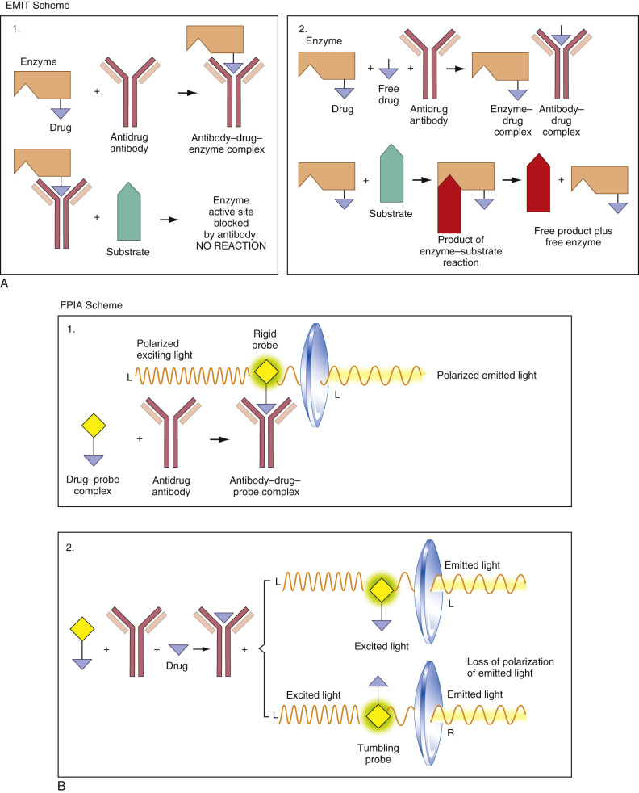

Figure 23-1 

Homogeneous methods for detecting qualitatively or quantitatively the levels of drugs in body fluids. 

**A,** In the enzyme-mediated immunologic technique (EMIT), a drug-enzyme complex is used as the marker. When bound to the antidrug antibody, the active site of the enzyme (linked to the drug) is blocked. Therefore, when substrate is added, no reaction will occur, as is shown in Part 1. However, if free drug (as in serum) is present, some or most of the enzyme-drug complex is displaced from the antidrug antibody. Now the active sites of the liberated enzyme-drug complexes are free, and the substrate undergoes reactions as indicated in Part 2. **B,** In the fluorescence polarization immunoassay assay (FPIA), the same general approach is used as in **A,** except that, in this method, the drug is attached to a fluorescent label or fluorophore. As shown in the upper scheme, Part 1, when the drug-label complex is bound to the antidrug antibody, it becomes immobilized _( “rigid probe”). _ When excited with polarized light _(shown as polarized to the left or “L”), _ the fluorophore emits light, which is likewise polarized to the left _(also seen as “L” in the figure). _ As shown in the lower scheme, Part 2, when displaced by free drug, as in serum or urine, the drug-probe complex is displaced from the antidrug antibody. It is no longer immobilized and therefore tumbles freely in solution. This results in loss of polarization of the emitted light (“L” and “R,” for left and right polarization), that is, in diminished fluorescence polarization. 

Fluorescence polarization immunoassay (FPIA) is the second type of homogeneous drug assay, as shown in [ Figure 23-1, _B_ ](<#f0010>) _._ Rather than being linked to an enzyme, as in [ Figure 23-1, _A_ ](<#f0010>) _,_ the drug is covalently attached to a fluorescent probe molecule. If a fluorescent molecule is excited with polarized light and is stationary (i.e., it does not “tumble” in solution), it will emit polarized light as a fluorophore. This emitted light has the same polarization as the exciting light. So, for example, if the exciting light is polarized to the left, the emitted light will also be polarized to the left. If a fluorophore tumbles freely in solution, however, the polarization is lost; that is, the emitted light is now polarized equally to the left and right. However, if the fluorophore is bound to a macromolecule such as an antibody, the polarization is strong, because attached to the nontumbling antibody it remains relatively stationary. In these assays, the probe-labeled drug is incubated with the antibody. The fluorescence polarization of the probe-labeled drug is, of course, high because the fluorescence probe is relatively immobilized when bound to the antibody directed against it ( [ Fig. 23-1, _B-1_ ](<#f0010>) ). Addition of exogenous drug, as in serum, to the incubated mixture results in displacement, by the exogenous drug, of some of the fluorescent probe-labeled drug molecules, as shown in [ Figure 23-1, _B-2_ ](<#f0010>) _._ These displaced molecules can now tumble freely in solution. The result is a decrease in fluorescence polarization. This decrease is directly related to the concentration of drug in serum. 

This assay can detect drug levels in the nanomolar range and is both highly sensitive and specific. Both Abbott Laboratories (Chicago), currently on the Architect Analayzer and formerly on the TDX, IMX, and AXSYM analyzers, and Roche Diagnostic Laboratories (Nutley, N.J.), on the COBAS and INTEGRA analyzers, have pioneered this effective technique in monitoring a wide variety of therapeutic drugs and drugs of abuse. 

 

##  Drug Binding to Antibodies 

In both of the homogeneous methods discussed previously, a nonlinear relationship exists between the concentration of drug in serum and the response of the system—that is, the color that results from the enzymatic reaction (see [ Fig. 23-1, _A_ ](<#f0010>) ) or the decrease in fluorescence polarization (see [ Fig. 23-1, _B_ ](<#f0010>) ). This nonlinearity in response is due to the phenomenon of binding (i.e., the drug must bind to antibody before it is detected). This phenomenon may be expressed by the following equilibrium: 

 D  \+  D  *  − Ab  ↔ D  − Ab  \+  D  * 

where D is the drug concentration in serum, D* is the “marker” drug (i.e., drug labeled with an enzyme or a fluorescent probe), and Ab is the antibody. The concentration of free D* is a measure of D–Ab, because both are equimolar. The concentration of D–Ab is, in turn, related to D; the more D is present, the more D–Ab is formed. However, because the concentration of Ab is fixed in a given experiment, at sufficiently high concentrations of D, all of the Ab will be saturated, so that at higher concentrations of D, no further D–Ab can form. The relationship between D and D–Ab is given by the Langmuir expression: 

 r  =  (  D  − Ab  )  /  (  Ab  0  )  =  nkD  /  (  kD  \+  1  ) 

where (Ab  0  ) is the total concentration of antibody, k is the equilibrium constant for formation of the D–Ab complex, n is the number of antibody-binding sites per molecule of antibody, and D is free drug concentration as defined earlier in the chapter. [ Equation 23-2 ](<#e0015>) is very similar to the Michaelis-Menten equation discussed in [ Chapter 20 ](<##!/content/3-s2.0-B9780323295680000206?scrollTo=%23c00020>) ( [ Equation 20-10 ](<##!/content/3-s2.0-B9780323295680000206?scrollTo=%23e0055>) ), except that there is no catalytic step here. This equation shows that the concentration of D–Ab is nonlinear in D, except where Kd ≪ 1\. Where kD ≫ 1, saturation is achieved. This equation can be linearized in the form used for a Scatchard plot, that is, 

 r  /  D  =  kn  − kr 

where r/D is plotted versus r. Given the results for a set of experiments, a least-squares–best-fit line is drawn through the points. The slope of the line is –k, and the intercept is nk, so that n (the number of sites on the antibody) is equal to the intercept/slope. Thus the values of n and k are readily determined. Once values for n and k are known, the value of D for any measured value of r can be directly computed from [ Equation 23-3 ](<#e0020>) . 

Two problems that arise in using [ Equation 23-3 ](<#e0020>) are that often the antibodies are nonhomogeneous, so that the Scatchard plot is nonlinear, and possible blockage of free antibody sites by drug molecules is seen in solid-phase immunoassays. The first problem was solved by  Rodbard and colleagues (1971)  , wherein the analysis mentioned previously was applied to multiple-binding equilibria. This analysis is used commonly in microprocessors that analyze the calibration curves in immunoassays. The second problem has been analyzed using a different theoretical approach (  Pincus & Rendell, 1981  ). [ Equation 23-3 ](<#e0020>) illustrates the basic principle of how the results of the drug immunoassay on serum are converted into drug concentrations in serum. 

 

##  Chromatographic Techniques 

Chromatographic procedures (see  Engelhardt, 2004  , for an excellent brief history of liquid chromatography) have been applied mainly to the qualitative detection of drugs of abuse and toxins, and less to the determination of levels of therapeutic drugs. The three major methods are thin-layer chromatography (TLC), high-performance liquid chromatography (HPLC), and gas chromatography–mass spectroscopy (GC-MS). Although GC-MS is considered the “gold standard” for detection and quantitation of volatile drugs and poisons, newer analytic techniques such as capillary electrophoresis (CE) and liquid chromatography–mass spectroscopy (LC-MS) and mass spectroscopy-mass spectroscopy (MS-MS) are available. These techniques are all discussed in turn. 

 

##  Thin-Layer Chromatography 

Many compounds can be separated from one another with this method, based on their relative affinities for a polar solid stationary phase (usually a hydrated silicate) and a mobile liquid phase that is nonpolar (such as 10% methanol in chloroform). Depending on these affinities, different compounds adsorb to the hydrated silicate at different positions as the nonpolar solvent migrates up the stationary hydrated silicate. This principle is illustrated in [ Figure 23-2 ](<#f0015>) . For a given solvent system, the ratio of the distance traversed by the compound to the distance traversed by the solvent front is a constant for the compound and can be used to identify the compound in a mixture. This ratio is called the **r f  . ** This technique is central to identifying different drugs of abuse, many of which can be separated from one another using TLC. The method has been packaged in the form of Toxi-Lab (Irvine, Calif.) kits in which the user is supplied with discrete strips of silicate, extraction solvents, and color-developing solutions. 

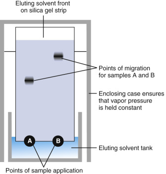

Figure 23-2 

Illustration of the principle of thin-layer chromatography (TLC). 

Two solutes, **A** and **B,** are applied to the polar silicate strip. **A** is more polar than **B** and has a higher affinity, therefore, for the polar stationary phase than for the nonpolar mobile phase (usually methanol in chloroform). Moreover, this relative affinity of **A** is higher than the affinity of **B** for the polar phase. Therefore, **A** separates out first on the strip, and **B** migrates further on the strip. 

 

##  Toxi-Lab Procedures 

The best specimen for drug detection by chromatography is urine because large quantities can be collected noninvasively. Once a urine specimen is collected, it is subjected to concentration and extraction procedures. In extraction procedures, acidic drugs are separated from basic ones. Almost all drugs of abuse are basic drugs, all of which are amine derivatives. The important **acid drugs** comprise almost exclusively the barbiturates. In aqueous solution, the basic drugs are charged because of the equilibrium in [ Equation 23-4, _A_ ](<#e0025>) _:_

 R  − NH  2  \+  H  \+  ↔ R  − NH  3  \+ 

 R  − NH  3  \+  \+  OH  − ↔ R  − NH  2  \+  H  2  O 

in which a primary amine (secondary and tertiary amines exhibit the same equilibrium) is represented by RNH  2  . The ammonium ion form (right side of [ Equation 23-4A ](<#e0025>) ) is soluble in water but not in nonpolar organic solvents. However, the amine-free base (left side of [ Equation 23-4A ](<#e0025>) ) is soluble in nonpolar organic solvents. Extraction procedures to isolate the basic drugs are aimed at treating the urine with base, so that significant amounts of the basic drugs will be uncharged as the amine-free base ( [ Equation 23-4B ](<#e0030>) ). This form can then be extracted into a nonpolar organic phase and applied to the silicate strip. The reverse process is carried out for acidic drugs (i.e., these are treated with acid and are extracted into nonpolar solvents). In practice, a small paper disk is added to the organic extraction mixture, and the solvent is then evaporated so that all basic drugs adsorb onto the paper disk. This disk is then applied to one end of the silicate strip, and the strip is placed in the migrating nonpolar solvent. A separate strip is used for each extraction; the A strip is used for basic drugs, and the B strip for acidic drugs. The chief utility of the B strip is in identifying the barbiturates, as is discussed subsequently. 

 

##  Identification of Specific Drugs 

After separation of the drugs on the plate, it is necessary to identify them. This objective is achieved by subjecting the drugs to standard color reactions for each separate compound. In this procedure for basic drugs, the strip is simply dipped successively in three different solvents, which results in characteristic color patterns for each drug. The strip is also subjected to ultraviolet (UV) light, which excites fluorescence in selected compounds. Similar procedures are used for the acidic drugs extracted onto the B strip. As shown in [ Figure 23-3 ](<#f0020>) , which is from the Toxi-Lab reference pattern book, each drug can be identified not only by its r  f  but also by its color and characteristic color change in different reagents. These patterns are reinforced by the fluorescence characteristics. As an example, notice in [ Figure 23-3, _A_ ](<#f0020>) on the Toxi-Lab A worksheet that morphine, the main metabolite of heroin, has a characteristic r  f  of 0.14 and a characteristic dark red or purple color in the first solvent that diminishes in intensity and changes color in the second solvent, water. It is nonfluorescent. If one or more of these characteristics differ(s) from this pattern, strong doubt about identification of the spot as morphine would exist. If all criteria are met, the sensitivity and specificity of the method are increased. 

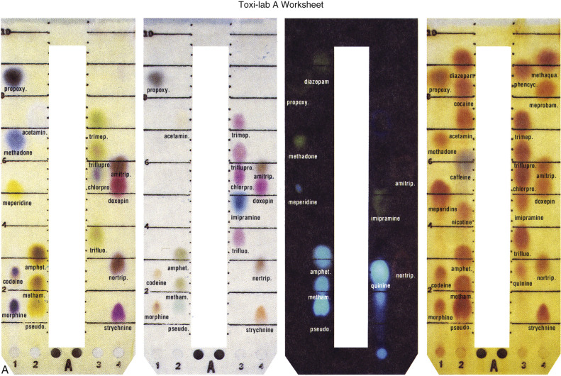

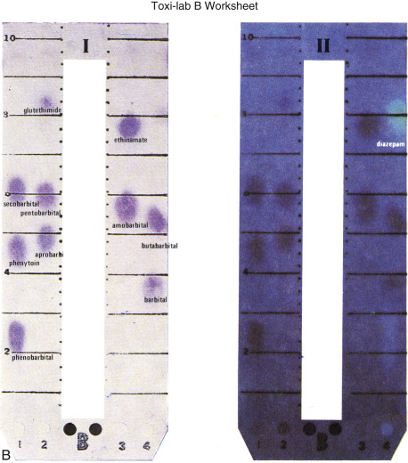

Figure 23-3 

A set of typical separations of the major drugs of abuse (and some therapeutic drugs) on Toxi-Lab thin-layer chromatography. 

Toxi-Lab **A** worksheet: Typical separation of basic drugs on the **A** strip, together with characteristic color changes. The third Toxi-Lab **A** strip shows characteristic fluorescence of different drugs. Note that amphetamine and methamphetamine on the lower left are both fluorescent. Toxi-Lab **B** worksheet: _Left:_ Typical separation of the more acidic drugs on the **B** strip with characteristic color changes. The major use of the **B** strip is to identify the presence of barbiturates. _Right:_ Fluorescence patterns of drugs on the **B** strip. 

 

##  Reliability of the Method 

Because the identification of each drug depends on the use of qualitative color changes and/or the presence of fluorescence, the sensitivity of the method is limited by the ability of the naked eye to detect these changes. Practically, the level of detection is on the order of 1 µg/mL of compound present on the strip. The chief value of the chromatographic method is confirmatory (i.e., confirmation of a positive immunoassay test result). The two methods are often performed together on a single specimen. 

The major problems that occur with this method are that extraction procedures are occasionally inefficient, so that insufficient amounts of drug are absorbed onto the disk. Also, the extraction and evaporation procedures are somewhat time-consuming, requiring approximately a half-hour for full processing. Furthermore, cocaine has a number of metabolites that are polar (e.g., ecgonine) and that barely migrate from the origin, so it is sometimes difficult to detect the presence of this drug of abuse because it has been converted completely to the polar metabolites before excretion. Some difficulty may also be encountered in distinguishing among various opiates, such as between morphine and other opiates, because the r  f  values of these drugs can be close to one another (see [ Fig. 23-3 ](<#f0020>) ). However, experienced personnel can make this distinction in most cases. Also, some nontoxic drugs may give characteristic color changes, and r  f  values that are similar to those for the drug of abuse. A case in point is that certain antihistamines appear on the A strip to be very similar to amphetamines. 

 

##  High-Performance Liquid Chromatography 

TLC allows direct qualitative detection of drugs in a panoramic way. HPLC allows quantitative detection of drugs and allows sharper separation of these same drugs. In HPLC, the stationary phase, which can be either polar (silicic acid) or nonpolar (such as the C-18 columns), in reverse-phase chromatography is composed of uniform, ultrafine particles that vastly increase its adsorptive surface area. This stationary phase is packed into a column. The resistance to flow in this column is high, so that large pressures are required to deliver constant reasonable flow rates. In the Waters HPLC instrument (Waters Corporation, Milford, Mass.), a constant pressure head is delivered to the column by the use of two pumps that operate so that as one withdraws, the other pushes forward (i.e., the two operate 180 degrees out of phase). The eluate from the column is monitored by a variety of detectors ranging from UV multiwavelength detectors to redox potential electrode detectors. It is the usual practice in performance of quantitative HPLC to use an internal standard—that is, a compound similar in structure to the drug(s) of interest, which is added to the specimen to be analyzed in a known concentration. By knowing how much of this marker compound or internal standard is placed on the column and how much is recovered from the column in the eluate, the percentage recovery from the column can be calculated for this compound and, by extrapolation, for all of the drugs of interest for which concentrations are being quantitated. Thus, losses due to the column (in addition to losses in extraction procedures) can be corrected for using this technique. Generally, HPLC has been used for the quantitation of specific therapeutic drugs but has found use in detection of cocaine and heroin in urine. The sensitivity of the method is in the nanomolar to micromolar range. 

One of the greatest uses of HPLC is in the separation and quantitation of the tricyclic antidepressants and their metabolites. These are among the most commonly prescribed drugs and are also used in excess as drugs of abuse in suicide attempts. It is often necessary to determine the levels not only of the parent tricyclic antidepressant but also of its active and inactive metabolites reviewed subsequently. [ Figure 23-4 ](<#f0025>) shows a typical separation on a silicate column. Protriptyline, a less inactive tricyclic compound, is the internal standard. It is clear that the separation among the metabolites and parent compounds is quite sharp. This separation is completely reproducible. 

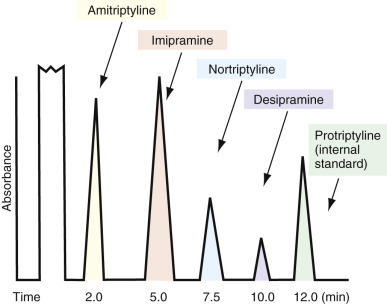

Figure 23-4 

Sketch of a typical separation of the major tricyclic antidepressants on high-performance liquid chromatography. 

A complete separation can be effected in 12 minutes. The concentration of each drug is on the order of 100 mcg/mL. 

A variant of TLC that includes the advantages of HPLC is CE (  Shihabi, 1993  ;  Tagliaro et al, 1998  ). In this method, a capillary tube lined with silicate, 10 to 100 µm in internal diameter and 100 to 1000 mm in length, is used as the solid support in an electrophoresis apparatus. Here, the driving force for separation is the voltage (on the order of 25 kV) rather than pressure, as in HPLC. Because of the vast surface area, separations are quite sharp. The system is highly versatile and can be used to separate serum proteins and small molecules. CE possesses a wide analytic spectrum (e.g., including biopolymers, pesticides, aromatic compounds, drugs, inorganic ions) because of high versatility in terms of separation modes. Different analyte selectivity is based on different physicochemical principles of separation without changes in instrumental hardware—a distinct advantage of this technique. Capillary zone electrophoresis, micellar electrokinetic capillary chromatography (MECK), capillary isotachophoresis, capillary isoelectric focusing, capillary electrochromatography, and capillary gel electrophoresis are different separation modes utilized in CE separations. For example, by adding a detergent to the buffer system, as with MECK, micelles will form. A neutral compound (such as a pesticide) will partition into the detergent, forming micelles, and the complex will separate out based on the mobility/charge of the micelle. In addition, new platforms such as chip-based CE and immunoaffinity CE are currently being developed. CE has not yet enjoyed as widespread use as the immunoassay techniques (discussed previously) in clinical toxicology but is commonly utilized in analytic forensic toxicologic studies, as well as in molecular diagnostic studies, and can easily be extended to other uses in clinical laboratory medicine (  Boone & Ensing, 2003  ;  Petersen et al, 2003  ;  Chiesl et al, 2009  ). 

 

##  Gas Chromatography–Mass Spectroscopy 

Testing for drugs of abuse has become one of the most rapidly developing areas in the clinical laboratory in view of the widespread and ever-expanding use of these drugs among large segments of the working population. In view of the increasing requirements for routine drug screening, it is necessary to have “gold standard” techniques to confirm the results obtained using screening methods such as EMIT and TLC. 

GC-MS has proved to be such a gold standard because of its great sensitivity and its reliability. This method, as its name implies, involves two techniques: gas-liquid chromatography and mass spectroscopy. In the former, compounds are directly heated into the gas phase or are derivatized to make them labile to facilitate heating them into the gas phase. They are then passed over a column containing the stationary phase, which often consists of a liquid, usually a hydrocarbon or silicone oil, that coats a solid support in the column and offers a large surface area for adsorption. Separation is based, much as in TLC, on the ability of each compound to adsorb to the stationary phase, which partially depends on the relative solubilities of the compound in the gas versus the liquid phase. Normally, the compounds eluting from the column could be detected by conventional techniques, as discussed previously, except that once the compounds are in the gas phase, where they are heated, advantage can be taken of another feature of the system—the ability of compounds that are heated to high temperatures to lose or gain electrons. 

At high temperatures, the highest energy electrons of a compound (i.e., the ones of lowest ionization potential) can be excited, such that the molecule can lose electrons and become charged. This process may be aided by such techniques as electron bombardment in a specially designed chamber that directly creates molecule-ions. Most of these resulting molecule-ions are single cations. Different molecule-ions in general have different sizes and different molecular weights. These molecule-ions decompose into characteristic fragments whose ratios with respect to one another and whose positions of migration relative to one another are also constant. The molecule-ions are then passed through an electric field generated by four rods that are subjected to rapidly alternating currents, the so-called **quadrupole detector.** Depending on the frequency of the alternating current, certain molecule-ions with specific mass/charge ratios can pass through the field to a detector. Thus, the molecule-ions can be separated on the basis of molecular weight or, more exactly, on their mass/charge ratios. The overall design of GC-MS is shown in [ Figure 23-5 ](<#f0030>) . 

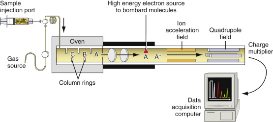

Figure 23-5 

A schematic view of the components of gas chromatography–mass spectroscopy instrumentation. 

On the left of the figure is the gas chromatographic system, where a volatilized compound is moved by an inert gas over a column consisting of rings coated with a liquid. Compounds C, B, and A separate on this column and are maintained in the gas phase by the oven that surrounds the column. The separated compounds then enter the mass spectrometer on the right side of the figure, where they are subjected to bombardment by electrons, resulting in molecule ion species. These ionic species then are accelerated in a field and are passed through an electric quadrupole field. Only those ions with a narrow range of mass/charge ratios (m/e ratios) will pass through the tuned field so that they strike the detector. The electric currents that result are digitalized and stored in a computer that analyzes the data (  Davis et al, 1989  ). 

The presence of the molecule-ion on the plate is detected by a charge multiplier detector system. The technique of GC-MS has become highly refined. Each molecule-ion created in the gas phase can undergo further changes, such as elimination reactions and rearrangements, and further degradation to small fragments that, in turn, ionize and give characteristic decomposition patterns. The patterns of thousands of compounds have now been determined. The position of the parent molecule-ion of the compound and the decomposition fragments give rise to a **fingerprint pattern** unique to the compound. These patterns are stored in a computer so that when a pattern for an unknown compound or group of compounds is obtained, the pattern is compared with the stored patterns to identify the compound(s) of interest. The entire method has been highly successful in detecting even low levels of cocaine and/or its metabolites in body fluids. A typical cocaine pattern is shown in [ Figure 23-6 ](<#f0035>) . Because single molecule-ion species give rise to significant currents in the detector, it is possible to detect very low levels of drugs, making this technique the ultimate reference method and the best confirmatory testing procedure available at present. 

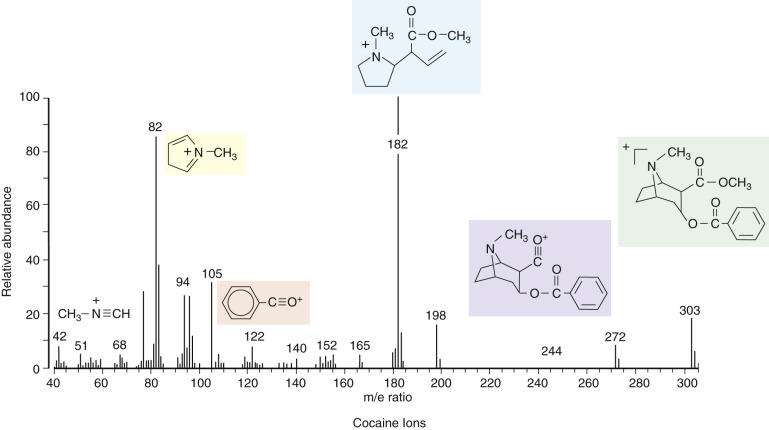

Figure 23-6 

Fragmentogram for cocaine using gas chromatography–mass spectroscopy. 

The specimen is urine. This figure shows the characteristic peaks for cocaine metabolites. m/e is the mass-to-charge ratio, which for most ions is a measure of the molecular mass. 

(Courtesy of Dr. Chip Walls, Onondaga County, N.Y., Medical Examiner's Office.) 

 

##  Liquid Chromatography–Mass Spectroscopy 

As discussed previously, GC-MS is the gold standard for the identification of volatile compounds. Nonvolatile compounds, however, can be detected utilizing LC-MS (  Davis et al, 1989  ;  Maurer, 1998  ;  Marquet, 2002  ;  Niessen & Tinke  1995  ). Unlike GC-MS, however, the coupling of LC with MS requires sophisticated interfaces between the LC and MS components. The interface must volatilize nonvolatile compounds that have been separated on the LC; must remove the liquid solvent from the LC; and must correct flow-rate incompatibility between the LC and MS. Two interface methods, electrospray (ES) and atmospheric pressure chemical ionization (APCI), appear to have become the gold standards for LC-MS. Both interface methods are utilized with atmospheric pressure ionization devices to facilitate removal of the mobile phase. They differ primarily in the range of analytes that can be accommodated and in how the solvent phase is nebulized. 

Ionizable analytes of high molecular weight and/or high polarity can be accommodated with ES, and APCI can be used for analytes of less polarity and lower molecular weight. At present, ES appears to have more clinical and forensic applications than APCI in toxicology. LC-MS can be used to confirm positive test results from a screening assay and has been used for confirmation of drugs-of-abuse assays, poisoning detection in acute or chronic intoxication, therapeutic drug identification and quantitation, and pharmacokinetic and drug metabolism studies. Although LC-MS has limitations when compared with GC-MS, it has become a powerful “mature and validated” (  Marquet, 2002  ) technique in analytic toxicology and a complementary method to GC-MS. 

 

##  Gas Chromatography Coupled with Infrared Spectroscopy 

Infrared (IR), or Fourier-transformed infrared, spectroscopy (FTIR) utilizes light of high wavelength (low frequency), which excites vibronic states of molecules involved in bond stretching and bond angle bending. Every compound has a characteristic IR “fingerprint,” that is, IR absorption pattern, so that even closely related compounds can be distinguished readily from one another by gas phase IR. Thus the fractions of patients' samples that elute from a GC or liquid chromatography column can be analyzed using this technique. As with mass spectroscopy, the FTIR spectra for different compounds can be stored in a computer attached to the GC-FTIR system; the spectra obtained from the eluates from the column are then analyzed for the presence of specific drugs of abuse. This method is particularly well suited for the detection of amphetamines (  Belal et al, 2009  ). 

 

##  Screening for Drugs of Abuse 

In most states of the United States, two levels of testing for drugs of abuse have become recognized: emergency room testing and employment screening/forensic testing. The former involves rapid, stat screening methods, in particular, EMIT (or FPIA) and TLC. The purpose of this type of screening test is to detect the presence of a drug or several drugs of abuse in the patient's urine. Rarely are the more sophisticated chromatographic procedures such as HPLC and GC-MS used for this purpose. Forensic testing, on the other hand, requires not only a screen but also an independent confirmatory method, which is almost always chosen to be GC-MS or, less commonly, HPLC. It should be noted that, strictly by law, any confirmatory method is valid, provided it is a completely different method from the primary one. Thus, TLC can confirm EMIT, whereas FPIA cannot confirm it because both EMIT and FPIA are immunochemical methods. Another important legalistic consideration in forensic testing is the **chain of custody** (  DeCresce et al, 1989  ;  Poklis, 2001  ). This process is used in the collection of urine from the individual from whom the specimen is taken. It may begin by observation of specimen collection by one person. Then, that person or another specifically designated individual, usually a police officer (in the case of prisoners or suspects) or some other designated official, accompanies the messenger, who brings the specimen from the individual to the laboratory. This individual is a witness to the testing (and must sign a legal document to this effect) of the specific urine sample collected. More than one designated individual may be involved as the witness in this chain. 

,  

##  The Drugs of Abuse 

 

##  General Aspects of the Mechanisms of Action 

The major drugs of abuse (  Sweetman et al, 2002  ;  Flomenbaum et al, 2006  ) are shown in [ Figure 23-7 ](<#f0040>) (  O'Neil et al, 2001  ;  Haroz & Greenberg, 2006  ). As may be seen in this figure, these drugs, with the exception of the barbiturates and the cannabinoids, are all basic amino group–containing compounds, most of which also contain benzene rings. The steric relationship of the amino group with respect to the aromatic benzene rings is rather similar, especially in cocaine, the opiates, and methadone. As might be expected, these compounds can cross-react, although with lower affinities, with each other's target receptors. The primary physiologic mechanisms of action of these drugs are not well understood, but some rudimentary knowledge has been gained as to some of the main targets of these drugs. Many of these drugs act directly on dopaminergic and norepinephrinergic neurotransmitter systems, especially the limbic system (sometimes referred to as the **smell brain** ). This system is a more primitive one associated with pleasure seeking and is discussed further later. 

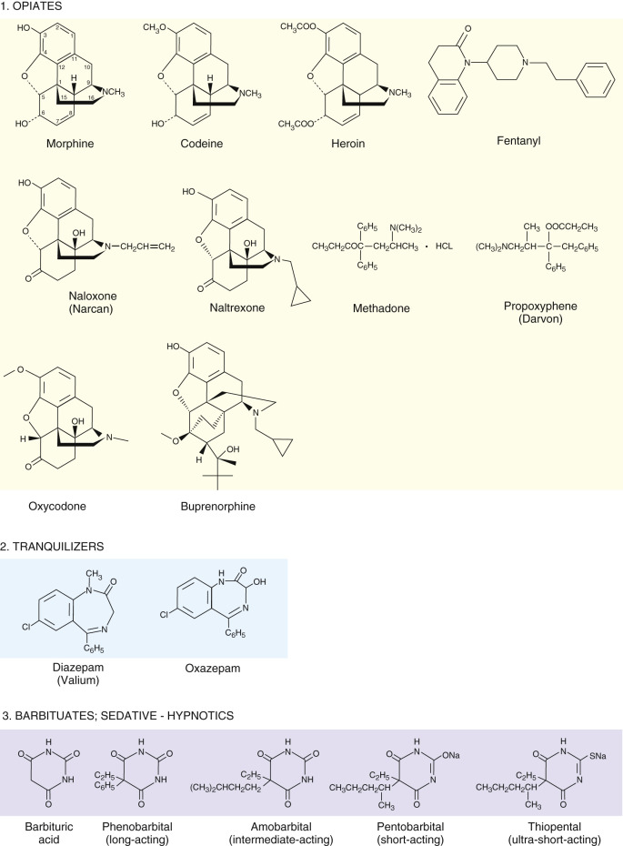

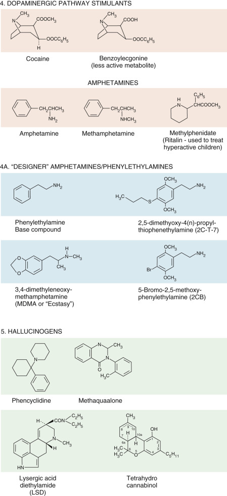

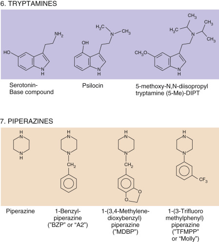

Figure 23-7 

Chemical structures for the major drugs of abuse. 

All of the opiates are seen to be basic compounds that are tertiary amines and that contain benzene rings. Notice that, in the barbiturate series, barbituric acid may be considered as a condensation product of urea and malonic acid. 

In [ Figure 23-8 ](<#f0045>) , possible effects of several of the most important drugs on this system are shown. It appears that the amphetamines, closely related structurally to dopamine and the catecholamines, and cocaine cause release of dopamine from the vesicles at the axonal side of the synapse, which may partially be responsible for their producing a pleasant sensation (a so-called **high** ) in many individuals (  Hurd et al, 1988  ). The tricyclic antidepressants stimulate pathways that utilize norepinephrine as the neurotransmitter. These pathways, like the dopaminergic pathways, are involved in arousal and pleasure seeking. In this case, the tricyclic antidepressants, rather than promoting release of the neurotransmitters, block the reuptake of norepinephrine into the vesicles on the axonal side of the synapse. They also may exert nonspecific reuptake blockade of dopamine in the dopaminergic pathways (  Baldessarini, 2006  ). It is of great interest that, paradoxically, the tricyclic antidepressants such as imipramine (Tofranil) have been used successfully to treat the effects of cocaine, although, as described later, benzodiazepine tranquilizers are now preferred. The major tranquilizers such as haloperidol (Haldol) and chlorpromazine, used to treat psychotic states such as schizophrenia, appear to block attachment of dopamine to the dendritic receptors in the synapse, thereby blocking the stimulatory effects of dopamine. Associated with many dopaminergic neurons are inhibitory neurons that use γ-aminobutyric acid (GABA) as their neurotransmitter. It appears that many benzodiazepine receptors exist on these neurons, causing potentiation of GABA at the synapses in this system, reducing the dopaminergic effects of the stimulatory pathways on the limbic system. Thus, some of the tranquilizing effects of diazepam (Valium) and other benzodiazepines can be explained. 

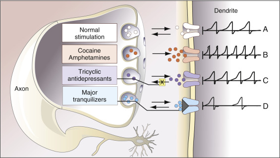

Figure 23-8 

Illustration of the possible mechanisms of action of drugs of abuse and some therapeutic drugs on sympathomimetic amine (dopamine and norepinephrine) pathways. 

_A,_ Normal neural transmission. A nerve impulse is conducted down the axon to the terminal boutons at the nerve ending. Vesicles, represented by the round gray structure, release their contents of neurotransmitter, here dopamine, represented by small white circles. Dopamine molecules traverse the synaptic cleft and bind to dendritic receptors, initiating action potentials _(at right under “dendrite”) _ in the dendrites. Notice the arrows showing that dopamine is both released and taken up by the vesicles. _B,_ In the presence of cocaine and amphetamines, enhanced release of neurotransmitter _(red circles)_ from vesicles occurs, increasing the rate of firing in the dendrites. _C,_ Tricyclic antidepressants block (arrow with “X” in yellow box) reuptake of the neurotransmitter _(purple circles),_ in this case norepinephrine and, less specifically, dopamine, causing more neurotransmitter to “recycle” to the dendritic receptors, resulting in increased firing. _D,_ Some of the neuroleptics act by blocking _(gray wedge)_ postsynaptic dendritic receptors for dopamine _(blue circles),_ causing decreased firing. 

Widely distributed throughout the central nervous system and periphery are a variety of opioid receptors classified mainly as µ-, δ-, κ\- and ε-receptors (  Tseng, 2001  ;  Snyder & Pasternak, 2003  ;  Fujii et al, 2004  ). The µ receptors appear to be specific for morphine and heroin, both of which produce a general analgesic state. These opioid receptors are discussed further in the following section. 

Many of the drugs of abuse also act on two other major pathways in the brain: those using serotonin (serotonergic) and those utilizing _N_ -methyl-  d  -aspartate (NMDA) as their neurotransmitter. Neurotransmission by serotonin occurs by its binding to the 5-hydroxytryptamine (5-HT) receptor on the dendritic side of the synapse. There is a rather wide range of 5-HT receptors, not all of which produce the same physiologic effects. The major ones appear to be 5-HT  1  and 5-HT  2  receptors. The serotonin pathways encompass a rather wide swath of the brain and even the spinal cord. This neurotransmitter is the principal one for the limbic system and, in addition, the basal ganglia, especially the amygdala that is involved in aggressive behavior. As mentioned earlier, the limbic system is involved in pleasure seeking and pleasure reinforcement. Serotonergic pathways also extend to the hippocampus and are involved in memory. As a neurotransmitter in the spinal cord, serotonin induces muscle contraction. NMDA pathways are more involved in nociceptive (pain) pathways and are involved in memory and neuronal plasticity (  Zhuo, 2009  ). They have been found to be involved in chronic pain reinforcement. Blockade of NMDA pathways by drugs of abuse can therefore remove this perceived undesirable effect. 

 

##  Extent of Use of Drugs of Abuse 

Overall, in the U.S. population as of 2012, there has been a general increase in the use of all drugs of abuse in individuals 12 years of age and older (about 24 million individuals) from 8.3% to 9.2% of this age group, mostly due to cannabinoid (marijuana) abuse (  Substance Abuse and Mental Health Services Administration, 2013  ). As might be expected, the highest number of drug abusers occurs in the 16- to 39-year age range, almost 75%. Interestingly, individuals in the 40- to 59-year bracket comprise most of the remainder, numbering over 20% of the overall number of drug abusers, a significant fraction. There were approximately 2.9 million new drug abusers in 2012. In this group, the most abused drugs were the cannabinoids (i.e., marijuana), comprising about 66% of the drugs abused. Pain relievers, as discussed later, constituted about 17%, inhalants (most popular among young teens) about 6%, stimulants (such as the amphetamines) 3.6%, hallucinogens 2%, and cocaine and heroin, each 0.1%. Over the time period from 2007 to 2012, the major increase in drug abuse is from marijuana use. Cocaine use has decreased in the last few years, from 2007 to 2012, dropping from 2.1 million to 1.7 million. Methamphetamine use has undergone a small decrease from 530,000 to 440,000 users over the same time period. 

 

##  Cocaine 

Cocaine is derived from the coca plant and has enjoyed much popularity as an additive to certain foods. At the beginning of the 20th century, it was used in Coca-Cola, but owing to its addictive effects, this practice was discontinued. Cocaine is a derivative of the alkaloid ecgonine (i.e., the methyl ester of benzoylecgonine), as shown in [ Figure 23-7 ](<#f0040>) (Group 4 drugs). The normal route of administration of cocaine is nasal (i.e., inhalation, called **snorting** ), such that the drug passes through the nasal membranes. A particularly potent form of cocaine, called **crack,** is the free-base form that passes rapidly across the nasal membranes such that, for a given dose, most or all of it enters the bloodstream rapidly. The half-life of cocaine is 1 to 2 hours, and the parent compound and its metabolites are usually cleared from the body within 2 days. 

It is estimated that as many as 25 million people in the United States have used cocaine at least once (  Jones & Wie, 2006  ); fortunately most of these individuals do not continue. Fatalities from cocaine abuse are of two types: direct toxicity of the drug (  Johanson & Fischman, 1989  ) and crime related to the illicit acquisition of the drug. Up to 25% of myocardial infarctions in patients between 18 and 45 years of age have been attributed to cocaine abuse (  Jones & Wie, 2006  ). 

Cocaine is used medically to induce local anesthesia during nasopharyngeal surgery. However, in large doses, it induces a euphoric state (the “high” experienced by the user) and may also induce hallucinatory states. It can also promote violent behavior (  Flomenbaum et al, 2006  ;  Hoffman, 2006  ). Many of these results can be explained by cocaine's dopaminergic effects. One study (  Azmitia et al, 1990  ) suggests that cocaine induces increased calcium ion influx in dopaminergic neurons. The increased intracellular calcium activates phospholipases that possibly act as second messengers in causing ultimate release of dopamine in synapses. Prolonged action of phospholipases, however, ultimately causes cell death. In the previously mentioned study, in fact, cocaine was found to be neurotoxic. It also has a general cytotoxic effect from formation of an _N_ -oxide free-radical produced in the metabolism of this compound in the liver. It appears then that, over time, cocaine induces neuronal loss. In addition, binding of cocaine to cell receptors in the limbic system induces synthesis of cyclic adenosine monophosphate (cAMP) that appears to be critical in activating cell processes involved in dopamine release (  Cami & Farre, 2003  ). Cocaine may also block the reuptake of dopamine at the axonal side of the synapse. As if becoming toxic from cocaine abuse was not sufficient, many cocaine abusers consume this drug together with alcohol. Ethanol becomes esterified to cocaine in the liver to form cocaethylene, which blocks reuptake of dopamine in dopaminergic pathways more effectively than does cocaine and causes pronounced vasoconstriction of the coronary arteries and induces increased myocardial oxygen demand. This cocaine derivative is deadlier than either cocaine or ethanol alone (  Jones & Wie, 2006  ). 

Studies (  Lange et al, 1989  ;  Lange & Hillis, 2001  ;  Frishman et al, 2003  ;  Jones & Wie, 2006  ) further indicate that prolonged use of cocaine results in cardiotoxicity—that is, cocaine can cause progressive atherosclerosis and causes constriction of the coronary arteries that can, in turn, induce myocardial ischemia and sometimes frank infarction. Cocaine has been found to induce sympathomimetic effects on the myocardium by increasing heart rate. At the same time, it induces increased vasoconstriction. The net effect is increased chronotropy and afterload, resulting in increased oxygen demand by the myocardium. At the same time, cocaine induces platelet aggregation and stimulates production of plasminogen activator inhibitor (  Jones & Wie, 2006  ). These events all predispose to development of myocardial infarction. 

One highly disturbing aspect of cocaine abuse is the fact that cocaine passes readily across the placenta and also into the lactating mammary gland and is readily passed from mothers to nursing infants. Often in the hospital setting, mothers receive the drug from dealers and breastfeed their newborn babies, who are therefore maintained on this drug. Cocaine causes mental retardation, delayed development, and strong drug dependence in newborns. It can also produce malformations in utero. 

Cocaine has not been considered classically to be an addictive drug, as it does not cause the true physical dependence typical of abusers of barbiturates and opiates. However, the high produced by the drug is extraordinarily reinforcing, so that the drug-seeking behavior of the cocaine and opiate abuser is similar. Evidence in experimental animals suggests that cocaine can induce the release of β-endorphins that bind to µ receptors in the limbic system (  Gianoulakis, 2004  ). This induces a pleasant and positive feeling of reinforcement. Clinically, patients who are overdosed with cocaine may become violent and irrational, requiring sedation. The treatment of choice for patients in hyperexcitable states with cardiac symptoms such as palpitations is one of the benzodiazepines. Thus, it is not uncommon to find cocaine and Valium in the urine of cocaine addicts. Occasionally, overdosed patients will become obtunded or comatose. The treatment for these patients is usually supportive. As noted in the previous section, antidepressants, including the tricyclics, and selective serotonin reuptake inhibitors (SSRIs), like fluoxetine (Prozac), have been found to inhibit some of the undesirable effects of cocaine and have been used in the treatment of cocaine abuse. 

 

##  Metabolism 

The half-life of cocaine, as stated previously, is approximately 1 to 2 hours. It is metabolized to more polar compounds that have significantly less potency than the parent compound. These metabolites have longer half-lives and, with techniques such as GC-MS, can be detected up to 48 hours after administration of the drug. The immunoassay methods can detect the drug for about 24 to 36 hours after administration. If a patient has inhaled cocaine free-base (“crack”), it is possible to detect the parent compound, cocaine, by TLC up to several hours after administration, owing to the high doses of drug present. 

 

##  The Opiates: Heroin, Morphine, Codeine, Oxycodone, Buprenorphine, and Fentanyl 

The primary medicinal use of opiates such as codeine and morphine is to diminish or eliminate pain in a patient. As noted earlier, there are several classes of opiate receptors that are involved in the modulation of pain. These receptors are classified as µ, κ, δ, and ε. The endogenous ligands for each of these receptors are the antinociceptive peptides: endomorphin (Tyr-Pro-Trp-Phe-NH  2  ) for µ receptors, dynorphins A (Tyr-Gly-Gly-Phe-Leu-Arg-Arg-Ile-Arg-Pro-Lys-Leu-Lys) and B (Tyr-Gly-Gly-Phe-Leu-Arg-Arg-Gln-Phe-Lys-Val-Val-Thr) for κ receptors, Met- and Leu-enkephalin (Tyr-Gly-Gly-Phe-Met and Tyr-Gly-Gly-Phe-Leu) for ε receptors, and deltorphin (Tyr-D-Met-Phe-His-Leu-Met-Asp-NH  2  ) and Met and Leu-enkephalin for δ receptors. Note that the first five amino acids of dynorphin are identical to those of Leu-enkephalin, suggesting a possible reason for the binding of enkephalin to κ receptors. The exogenous opiates (e.g., morphine, codeine, fentanyl) whose structures are shown in group 1 of [ Figure 23-7 ](<#f0040>) , are known to be agonists, primarily, for µ receptors. As can be seen in this figure, morphine, codeine, heroin, oxycodone, and buprenorphine have quite similar structures. In fact morphine is a metabolite of heroin, the diacteyl precursor of morphine. 

A major target for each of the endogenous opiate peptides and for the exogenous agents shown in [ Figure 23-7 ](<#f0040>) is the main pain pathway (i.e., the spinothalamic tract). This neural pathway carries nerve impulses from peripheral pain receptors to the peripheral nerves that innervate them to the posterior horn of the spinal cord where the nerves synapse to ascending fibers in the spinothalamic pathway. These nerves travel to the next spinal level where they cross the midline and then travel to the medulla as the lateral lemniscus that synapses in the thalamus (mainly in the ventro-posterior nucleus or VPN) and then projects to the cortex where pain perception takes place. Activation of the opioid receptors that occurs at these synapses results in hyperpolarization of the dendritic side of the synapses, blocking nerve conduction, thereby diminishing the sensation of pain. 

In addition, it appears that the opioid receptors also play another major role in pain modulation via the activation of descending tracts that emanate from the midbrain in the periaqueductal gray area and travel to nuclei in the median raphe of the medulla. After synapsing with these nuclei, these tracts synapse at interneurons in the posterior horn of the spinal cord where they activate the release of GABA, resulting in inhibition of nerve conduction in the spinothalamic tract. Normally these pathways are quiescent, but release of any of the endogenous antinociceptive peptides or introduction of exogenous drugs (e.g., morphine or codeine) results in removal of inhibition of these pathways, again resulting in inhibition of nerve conduction in the spinothalamic pathway with diminished perception of pain. 

 

##  Morphine and Heroin 

Morphine, a µ receptor agonist, in addition to acting on pain pathways as described earlier, further acts by binding to µ receptors in the limbic system (central nervous system [CNS]), mainly in the nucleus accumbens and the ventral tegmental area, resulting in an analgesic state. Binding of morphine and the other opiates to the µ receptor inhibits the release of GABA from the nerve terminal, reducing the inhibitory effect of GABA on dopaminergic neurons. The resulting increased activation of dopaminergic neurons results in sustained activation of the postsynaptic membrane, causing a sense of euphoria. On the molecular level, binding of morphine to these receptors activates a cell-signaling cascade via G-protein activation that results in elevated expression of many transcriptionally active proteins such as ERK, jun, and fos, and superactivation of adenyl cyclase, resulting in high intracellular levels of cAMP (  Tso & Wong, 2003  ). Besides being used as a major analgesic, morphine (Dilaudid) is important in treating acute congestive heart failure by lowering venous return to the heart (i.e., it is a powerful preload reducer by causing increased splanchnic pooling of blood). 

Heroin induces a pleasant, euphoric state and is highly addictive both physically and psychologically. As can be seen in [ Figure 23-7 ](<#f0040>) , heroin is a diacetyl form of morphine. This characteristic facilitates heroin's crossing the blood-brain barrier, allowing it to reach higher concentrations in the CNS. Withdrawal from this drug is exceedingly difficult, with a myriad of symptoms such as hypothermia, palpitations, cold sweats, and nightmares. This is a true physical dependence, the molecular basis for which is not fully understood. It appears that the dependence is strongly linked to the number of cell surface µ receptors (  Tso & Wong, 2003  ). 

This class of compounds exhibits certain important paradoxical effects on the parasympathetic nervous system. These drugs exert a procholinergic effect on the eyes and on blood vessels in the periphery (i.e., they cause constriction of pupils [ **pin-point pupils** ] and peripheral vasodilation). In contrast, in the gut they lower gastrointestinal (GI) motility (i.e., they exhibit anticholinergic effects in the GI tract). This fact enables rapid diagnosis of heroin or, in general, opiate abuse in a patient brought to the emergency room in an obtunded or comatose state. These patients typically have severe miosis (pupillary constriction). Although the sign is not useful in acute diagnosis, constipation commonly occurs. 

Administration of heroin occurs via the intravenous route. Addicts are readily recognized by the presence of needle tracks on their arms and hands and by extensive thrombosis of their peripheral veins. The half-life of heroin via the intravenous route is about 3 minutes, and the effects of the drug last approximately 3 hours. The major metabolites are _N_ -acetylmorphine and morphine. The half-life of morphine is about 3 hours. Overdoses of heroin are extremely dangerous and can cause severe obtundation, coma, respiratory arrest, hypotension (secondary to histamine release), and cardiac arrhythmias. One of the most common acute therapeutic modalities for heroin overdose is intravenous treatment with naloxone (Narcan) (see [ Fig. 23-7 ](<#f0040>) ), a strong competitive antagonist to the action of heroin. Heroin addiction, as a chronic problem, is treated pharmacologically with a partial agonist of heroin—methadone (shown in the group 1 structures in [ Figure 23-7 ](<#f0040>) ), which is discussed later. 

Another opiate antagonist is naltrexone, whose structure is shown in the group 1 structures in [ Figue 23-7 ](<#f0040>) . The primary effect of this drug is to lower the euphoria experienced by opiate abusers. However, it has no effect on opiate craving by drug abusers. On the other hand, it has been found to be effective in reducing the physical dependence of patients treated with the drug, but, to achieve abstinence, psychosocial support of the patient is required. Surprisingly, naltrexone has been found to be effective in the treatment of alcohol dependence; in particular, it has been found to to reduce relapse rates after abstinence and to reduce heavy drinking to lower levels of consumption. The half-life of naltrexone is about 4 hours. Treatment of opiate abuse requires daily administration of one 50-mg tablet per day (often missed by opiate drug abusers). Excretion is via urine. 

 

##  Codeine and Analogs 

The structure of codeine is similar to that of morphine and heroin (Group 1 structures in [ Fig. 23-7 ](<#f0040>) ). Codeine acts in a manner similar to that of morphine and is used as a milder analgesic and as an antitussive. The codeine analog, dextromethorphan (  d  -3-methoxy- _N_ -methylmorphine), is an antitussive agent that is a component of cough-suppressive medications. 

Dextromethorphan (  d  -3-methoxy- _N_ -methylmorphine), an analog of codeine, is the active component of cough syrups because of its antitussive effects. Recently, there has been a “run” on cough medicines by addicts, who can obtain them legally and then consume quantities sufficient to reach their desired euphoric state. Unlike codeine, dextromethorphan is believed generally not to be addictive, although cases of drug dependency have been documented. For therapeutic use, the recommended dose of dextromethorphan is 15 to 30 mg given three to four times per day. **Moderate intoxication** is achieved at about 100 to 200 mg, and **heavy intoxication** is reached at around 1500 mg (  Haroz & Greenberg, 2006  ). It is surprising to note that dextromethorphan does not have analgesic properties because of its lack of affinity for µ-, κ-, and δ receptors. It has been found to induce the release and to block the reuptake of serotonin. Similar to the action of phencyclidine (PCP), discussed later, dextromethorphan has also been found to block NMDA receptors that are critical for neuronal plasticity and memory and are involved in central pain pathways in the brain, as discussed earlier (  Zhuo, 2009  ). Dextromorphan is readily absorbed from the GI tract and, in about 85% of individuals, is rapidly metabolized to dextrophan, an active metabolite, and  d  -hydroxymorphinane via the 2D6 cytochrome P450 isozyme (  Haroz & Greenberg, 2006  ). It is dextrophan that has a high affinity for NMDA receptors, so that most individuals experience PCP-like effects (i.e., euphoria; tactile, auditory, and visual hallucinations; paranoia; altered time perception; and general disorientation). For the 15% of individuals who are slow metabolizers of dextromethorphan, these effects are much less pronounced and are replaced by sedation and dysphoria (  Haroz & Greenberg, 2006  ). Overdoses of dextromethorphan can result in mainly neurologic effects, such as lethargy, or, conversely, hyperexcitability; ataxia; slurred speech; tremors and fasciculations; hypertonia and hyperreflexia; and nystagmus, as well as either pupillodilation or pupilloconstriction. Diaphoresis may also occur. In addition, cardiovascular sequelae include tachycardia and hypertension. Unfortunately, a number of antitussives contain, in addition to dextromethorphan, anticholinergic agents such as chlorpheniramine. Thus, abuse of antitussive medication can give rise to such symptoms as tachycardia, mydriasis, flushed skin, urinary retention, and constipation. 

 

##  Oxycodone 

This drug is effective in reducing pain, especially pain associated with malignancy. Its structure is shown in the group 1 compounds in [ Figure 23-7 ](<#f0040>) , where it can be seen to be similar in structure to codeine, with the difference that there is a keto rather than a hydroxyl group at the 6 –position (lower cyclohexone ring in [ Figure 23-7 ](<#f0040>) ) and a hydroxyl group rather than a hydrogen atom at the carbon between the two bridgehead carbons. On an empty stomach, pain diminution commences within about 15 minutes after oral drug administration. Peak serum levels are achieved in about 1 hour. The slow release form of oxycodone is oxycontin, which achieves peak serum levels in about 3 hours. Although there is some controversy about the site of action of oxycodone, i.e., primary action on κ, rather than µ, receptors (  Smith, 2008  ), oxycodone does bind to µ receptors and one of its metabolites, oxymorphone, is known to have a high affinity for µ receptors (  Smith, 2008  ). The half-life for oxycodone is about 3.2 hours and for oxycontin is 4.5 hours. Metabolites of oxycodone are α\- and β-oxycodol, oxymorphone, α\- and β-oxymorphol and noroxymorphone, noroxycodone, and α\- and β\- noroxycodol and noroxymorphone (N-desmethyloxycodone). Most of the parent compound and its metabolites are excreted in the urine. 

As with morphine and codeine, oxycodone, especially at high doses, can induce euphoria and a sense of well-being, and, like the other opiates, it induces a true physical dependence. At high doses, side effects are particularly pronounced, and these include fatigue, dizziness, constipation, vomiting, anxiety, shallow breathing and apnea, hypotension, meiosis, circulatory collapse, and death. Withdrawal from oxycodone includes such symptoms as myositis, anxiety, nausea, insomnia, fever, hypogonadism and hormonal imbalance. Given the side effects and the physical consequences of withdrawal, it is difficult to fathom the appeal of abuse of this drug. Nonetheless, abuse of oxycodone has grown to the point where it has now been added to the roster of drugs of abuse that are routinely assayed for mainly in urine. 

 

##  Buprenorphine 

Although, like oxycodone, this prescription drug has become a drug of abuse, buprenorphine is a mixed agonist-antagonist on opiate receptors. It has some opiate activity on µ receptors, but it is purely an antagonist on κ and δ receptors. Its major use is the same as for methadone, as discussed later, in treating addiction to opiates, but it is also used in the treatment of pain. Since it has partial agonist activity, it does not cause life-threatening respiratory depression as is true of the agonists like morphine. It undergoes extensive metabolism in the liver and, therefore, excretion is via the hepatobiliary system, in contrast to oxycodone, whose excretion is almost completely via the urinary tract. Thus renal failure does not result in accumulation of buprenorphine in serum while it does cause increased levels of oxycodone. Treatment of patients with buprenorphine for addiction is carried out in programs where the patient has access to private and group counseling during and after the treatment period. Suboxone is a combined drug of buprenorphine and naloxone (see [ Figure 23-7 ](<#f0040>) ). As described earlier, naloxone is an antagonist at µ receptors and is administered with buprenorphine to block its toxic effects in patients who try to inject suboxone intravenously as a drug of abuse. The antagonism is limited due to the fact that the affinity of buprenorphine for the µ receptor is about five times that of naloxone. Buprenorphine is available as a transdermal patch. It is used to treat chronic, not acute, pain and has been found to be effective for this purpose. Buprenorphine has been found to be more effective than methadone in treating patients with depressive traits (  Gerra et al, 2004  ), a phenomenon that is thought to be associated with its pure antagonistic effects on κ receptors. Since it, like oxycodone, has become popular as a drug of abuse, screening for its presence in urine has become common. Toxic effects of this drug include nausea, vomiting, drowsiness, dizziness, headaches, memory loss, perspiration, dry mouth, miosis, orthostatic hypotension, impotence, decreased libido, and urinary retention. Constipation can occur but is less frequent than with morphine. Hepatic necrosis and hepatitis with jaundice, as with the major tranquilizers/neuroleptic drugs, have further been observed in patients with high levels of buprenorphine. The half-life of buprenorphine is 23 to 42 hours, while that of naloxone is 2 to 12 hours. This difference between the two drugs again limits the antagonistic effect of naloxone on buprenorphine. 

 

##  Fentanyl 

This opiate analgesic (Group 1 drugs in [ Fig. 23-7 ](<#f0040>) ) is about 80 times more potent than morphine in blocking pain. It can be taken orally as so-called **fentanyl lollipops,** smoked, inhaled, or administered by transdermal fentanyl patches (  Haroz & Greenberg, 2006  ). Overdose effects of this drug are the usual ones seen for opiate abuse and include respiratory depression and miosis. Treatment may involve irrigation of the bowel, and antiopiates such as naloxone may be administered. Hypotension is less common than with other opiates like morphine, because of the lack of histamine release. 

 

##  Methadone 

This interesting compound, whose structure is shown in the Group 1 drugs in [ Figure 23-7 ](<#f0040>) , is a nonbicyclic drug that binds competitively with morphine to µ receptors in the brain. However, although it can become addictive, the addictive effects are less than those of equivalent concentrations of heroin, possibly because its binding affinity is lower, so that it induces less of an effect than heroin. Thus, administration of methadone to heroin addicts allows them to experience the effects of heroin but in a modulated manner. By gradually lowering the methadone dose, physical dependence becomes reduced, and it appears that a trough serum methadone level greater than 100 ng/mL is adequate for effective methadone maintenance (  Bell et al, 1988  ). However, it should be noted that addiction to methadone can also occur. In toxicology laboratories, the most common request received for methadone screens comes from methadone clinics to test whether a patient is administering methadone or has relapsed into taking heroin. As can be seen in [ Figure 23-3 ](<#f0020>) , it is a simple matter to distinguish methadone from the opiates by TLC. Similarly, EMIT or FPIA detects each drug with high specificity. 

 

##  Amphetamines 

These compounds, as can be seen in [ Figure 23-7 ](<#f0040>) (Group 4 drugs), bear a close resemblance to the adrenergic amines such as epinephrine and norepinephrine and may be expected to exert sympathomimetic effects. They also resemble dopamine and may be expected to have effects on dopaminergic pathways. The amphetamines cause euphoria and increased mental alertness that may be attributed to their effects on these pathways. This group of drugs, however, also exerts pronounced stimulatory effects on γ\- and β receptors in the cardiovascular system and in the kidney to cause pronounced adrenergic effects such as increased heart rate, increased blood pressure, palpitations, bronchodilation, anxiety, pallor, and tremulousness. Studies indicate that amphetamines are also competitive inhibitors of the enzyme monoamine oxidase, which inactivates adrenergic neurotransmitters by oxidatively removing their amino groups. Blockage of this enzyme prolongs the effects of epinephrine and norepinephrine, with the attendant neurologic and cardiovascular sequelae. One particular amphetamine, 3,4-methylenedioxymethamphetamine (MDMA or **ecstasy** ), a derivative of methamphetamine (see Group 4A drugs in [ Fig. 23-7 ](<#f0040>) ), has become popular as a recreational drug of abuse because it has euphoric and psychedelic effects but minimal hallucinogenic effects (  Gill et al, 2002  ;  Haroz & Greenberg, 2006  ). 

 

##  Clinical Symptoms 

The pharmacologic action of amphetamines includes CNS and respiratory stimulation and sympathomimetic activity (e.g., bronchodilation, pressor response, mydriasis). Loss of weight may also occur as the result of an anorectic effect. Psychic stimulation and excitability, leading to a temporary increase in mental and physical activity, can occur; anxiety and nervousness can also be produced. 

 

##  Acute Toxicity 

Initial manifestations of an overdose may be cardiovascular in nature; symptoms may include flushing or pallor, tachypnea, palpitation, tremor, labile pulse rate and blood pressure (hypertension and hypotension), cardiac arrhythmia, heart block, circulatory collapse, and angina. Mental disturbances such as delirium, confusion, delusions, disorientation, and hallucinations may occur. Acute psychotic syndromes may be characterized by vivid auditory and visual hallucinations, restlessness, homicidal or suicidal tendencies, panic state, paranoid ideation, loosening of associations, combativeness, and changes in affect. A frequent and potential sign of acute intoxication is hyperpyrexia; rhabdomyolysis has also been associated with acute amphetamine overdose. Cardiovascular collapse is the usual cause of death. 

 

##  Chronic Usage 

Tolerance may be produced within a few weeks, and physical or psychic dependence may occur with prolonged usage. Symptoms of chronic abuse include emotional lability, somnolence, loss of appetite, occupational deterioration, mental impairment, and social withdrawal. Trauma and ulcer of the tongue and lip may occur as a result of continuing chewing or teeth-grinding movements. A syndrome with the characteristics of paranoid schizophrenia can occur with prolonged high-dosage use. Aplastic anemia and fatal pancytopenia are rare complications. 

 

##  Treatment 

No specific antidote for amphetamine overdose is known, and treatment of overdose is symptomatic with general physiologic supportive measures immediately implemented. When cardiovascular symptoms are noted, propranolol (Inderal), discussed subsequently under therapeutic drugs, can be used as an antidote. 

 

##  Detection 

Both Toxi-Lab (Irvine, Calif.) and EMIT (Syva, San Jose, Calif.) procedures are effective in detecting these drugs of abuse. Occasionally, on the Toxi-Lab A strip, amphetamines may be confused with antihistamines like diphenhydramine. 

 

##  “Designer” Amphetamines and Related Drugs of Abuse 

The quest for euphoria-producing drugs has resulted in the advent of synthetic phenylethylamines, so-called **designer drugs,** like MDMA, several further examples of which are shown in category 4A of [ Figure 23-7 ](<#f0040>) . With all of these drugs, the price for the sought-after effects of euphoria and hallucinations consists of headaches, nausea, vomiting, anxiety, agitation, violent behavior, tachycardia, hypertension, respiratory depression, and seizures, as discussed previously in the case of **standard** amphetamines. 

Other phenylethylamine derivatives shown in [ Figure 23-7 ](<#f0040>) , especially 2C-T-7 and 2CB, bind to 5-HT  2  receptors and induce hallucinogenic effects (  Haroz & Greenberg, 2006  ). These drugs have been taken orally or have been insufflated, smoked, administered intravenously, and even taken rectally. Death from overdose of these designer drugs has been reported but is uncommon. Unfortunately thus far, no specific assays are available for most of these drugs in urine. Their presence must be ascertained by history and/or symptoms reported in the absence of positive urine tests for standard amphetamines. On occasion, GC-MS is used to detect their presence. 

 

##  Tryptamines 

These drugs are derivatives of serotonin, whose structure is shown in the Group 6 drugs in [ Figure 23-7 ](<#f0040>) . These tryptamines, some of which occur in plants, are relatively simple to obtain and were not proscribed until relatively recently. An example is _N,N_ -dimethyltryptamine (DMT), which has strong hallucinogenic properties. Smoking DMT results in the rapid onset of hallucinogenic effects that are short-lived, giving rise to the term **businessman 's lunch. ** Other tryptamines contain modifications of the indole ring, as shown in the Group 6 drugs in [ Figure 23-7 ](<#f0040>) . These also allow them to interact with 5-HT receptors (  Haroz & Greenberg, 2006  ), and this interaction is thought to result in their hallucinogenic effects. However, the mechanism of action of this class of drugs is not well understood. Psilocin shown in this figure is a component of the so-called **Psilocybe,** called **magic mushrooms** because of their hallucinogenic effects. The hallucinogenic effects of these drugs are enhanced by the presence of monoamine oxidase inhibitors such as β-carbolines (  Haroz & Greenberg, 2006  ). The mixture of these two compounds is present in a South American tea called **ayahuasca,** which combines two plants—one containing DMT and the other carbolines, which themselves can induce nausea and vomiting. Like the amphetamines and other phenylethylamine derivatives, the tryptamines cause, in addition to the “desired” effects of euphoria and empathy, auditory and visual hallucinations, nausea, vomiting, diarrhea, and emotional distress. Symptoms further include agitation, tachycardia, hypertension, diaphoresis, salivation, dystonia, mydriasis, tremors, confusion, seizures, and, in a few cases, rhabdomyolysis and paralysis. Currently, no routine assays are available for these compounds. As with the amphetamines, many of the psychogenic and physiologic effects of the tryptamines can be countered with supportive therapy and the administration of benzodiazepines. 

 

##  Piperazines 

The structure of the parent compound, piperazine, is shown in Group 7 of [ Figure 23-7 ](<#f0040>) . Several of the derivatives of piperazine are also shown in this figure. Many of these piperazines were used as antihelminthics during the 1950s but were subsequently discontinued. However, their euphoria-producing effects were discovered, leading to a “legal” way of obtaining drugs of abuse. Two classes of piperazine derivatives have been identified: _N_ -benzylpiperazines, the parent compound of which is _N_ -benzylpiperazine (BZP), and phenylpiperazines. The former group includes 1-(3,4-methylenedioxybenzyl)piperazine, and the latter group includes 1-(3-chlorophenyl)piperazine, 1-(4-methoxyphenyl)piperazine, and 1-(3-trifluoromethylphenyl)piperazine (TFMPP). BZP (known as **A2** ) and TFMPP (known as **Molly** ) are among the most popular piperazines. Studies have shown that these piperazines produced effects that were similar to those of the amphetamines, suggesting that the target receptors of these drugs are the same. Both classes of piperazines have been found to increase dopamine and serotonin levels. TFMPP has been found to act as a partial agonist at 5-HT  2A  receptors and is a full agonist at other 5-HT receptors. Although TFMPP is three times less potent than MDMA, it produces a full MDMA effect when combined with BZP, with which it is synergistic (  Haroz & Greenberg, 2006  ). The TFMPP-BZP combination at low doses induces euphoria with decreased motor action, making the euphoric “experience” more pleasurable. The acute undesirable effects of piperazines are similar to those of the amphetamines and MDMA (i.e., hallucinations, psychomotor agitation, increased heart rate and blood pressure, and increased body temperature). Two deaths from BZP have been reported when combined with another drug like MDMA (  Haroz & Greenberg, 2006  ). Both TFMPP and BZP have skin-irritant properties, causing sore nasal passages and throats. As with the tryptamines and designer amphetamines, currently no standard assay method detects these drugs in urine; treatment is supportive, as described in the preceding section. 

 

##  Benzodiazepines 

Among this group of drugs, shown in [ Figure 23-7 ](<#f0040>) (Group 2), the most prominent is Valium; they are used therapeutically, as so-called **minor tranquilizers.** Their mechanisms of action appear to be potentiation of GABA, a neurotransmitter that _inhibits_ conduction in dopaminergic neurons, and facilitation of its binding to GABA receptors (  Campo-Soria et al, 2006  ). Benzodiazepines bind to the α subunit of the so-called **GABA A  receptor ** at a site that is distinct from that for GABA itself and cause an increase in the frequency of chloride ion channel opening at the GABA  A  receptor. Usually used as a therapeutic drug to produce calming effects at doses between 2.5 and 10 mg and to produce muscle-relaxing effects at higher doses, Valium has been used by drug addicts in high doses to counter the excitatory effects of other drugs of abuse or as a means of inducing tranquil states. Among some drug abusers, benzodiazepines are used to potentiate the effects of heroin (  Fraser, 1998  ). A number of drug abusers have become addicted to Valium when using high doses several times each day. Acutely, benzodiazepine overdose may produce somnolence, confusion, seizures, and coma. Rarely, hypotension, respiratory depression, and cardiac arrest may occur. Chronically, physical and psychological dependence occur. Sudden discontinuance of the drug may lead to anxiety, sweating, irritability, hallucinations, diarrhea, and seizures. Treatment is supportive. Gradual diminution of the benzodiazepine removes physical dependence. The half-life for Valium is 20 to 70 hours, but the half-life of one of its active metabolites is 50 to 100 hours. 

 

##  Phencyclidine 

This interesting tricyclic compound, shown in [ Figure 23-7 ](<#f0040>) (Group 5), has numerous effects on a variety of different neural pathways. Used almost exclusively as a drug of abuse, this drug is traded on the streets under the name of **angel dust** or **angel hair.** It is peculiar that the use of this drug appears to be periodic. The physiologic effects of PCP appear to be analgesic and anesthetic and, paradoxically, stimulatory. This drug has been found to interact with cholinergic, adrenergic, GABA-secreting, serotonergic, and opiate neuronal receptors. It has also been found to block NMDA receptors (  Hevers et al, 2008  ). Thus, a wide variety of bizarre and apparently paradoxical symptoms can be seen in the same patient. This drug has been shown to bind to specific regions of the inner chloride channels of neurons, apparently profoundly affecting chloride transport. It has also been found to bind strongly to a class of neural receptors called **sigma receptors** (  Schuster et al, 1994  ). This receptor binds strongly to the neuroleptic, antipsychotic drug haloperidol (Haldol)—a finding that may implicate the sigma receptor in some of the clinical findings of severe psychosis in patients suffering from overdose with PCP. 

Because of its varied actions, clinically acute manifestations vary from depression to euphoria and can involve catatonia, violence, rage, and auditory and visual hallucinations. Vomiting, hyperventilation, tachycardia, shivering, seizures, coma, and death are among the common occurrences that result from abuse of this drug. Most fatalities occur from the hypertensive effects of the drug, especially on the large cerebral arteries (  Bayorh et al, 1984  ). As can be inferred from this spectrum of possible symptoms, diagnosis based on clinical findings is impossible. Only the results of a drug screen can be diagnostic. Treatment of drug abuse with PCP is supportive, with the patient kept in isolation in a darkened, quiet room. Acidification of the urine increases the rate of PCP excretion. As might be expected from findings regarding the sigma receptor, treatment with Haldol results in sedation of the violent, hallucinating patient. 

 

##  Barbiturates: Sedative-Hypnotics 

An almost bewildering variety of these major sedative drugs is available. However, all are derivatives of barbituric acid, which may be regarded as the condensation product of urea and malonic acid, as indicated in [ Figure 23-7 ](<#f0040>) (Group 3 drugs). Depending on the substituents of the –CH  2  group of the malonic acid portion, the particular drug may be long acting, as is phenobarbital, with a benzene ring and ethyl group substituents on this carbon; short acting, as is pentobarbital, with neopentyl and ethyl groups at this position; or ultra-short acting, as is the case with thiopental. The long-acting barbiturate phenobarbital is a therapeutic drug that is used as an anticonvulsant, unlike the short- and ultra–short-acting drugs, and is discussed in the [ Therapeutic Drug Monitoring ](<#s0225>) section later in the chapter. All of the barbiturates are fat soluble and therefore pass easily across the blood-brain barrier. All of them seem to stabilize membranes such that depolarization of the membranes becomes more difficult. 

As with the benzodiazepines, the barbiturates are known to interact with GABA receptors. In particular, they bind to the α subunit of the GABA  A  receptor at a site that is distinct both from the GABA binding site and from the benzodiazepine binding site. Their effect is to increase the _duration_ of chloride ion channel opening at the GABA  A  receptor, potentiating the GABA effect (i.e., inhibition of dopamine-dependent nerve conduction). It is thought that this action of chloride channel opening, called **direct gating** of the chloride channel, is the basis for barbiturate toxicity, which is greater than for the benzodiazepines, which do not increase the **duration** of chloride channel opening but rather increase the **frequency** of channel opening, as discussed in the [ Benzodiazepines ](<#s0190>) section earlier in the chapter. In addition, at higher doses, barbiturates have been found to inhibit a subtype of glutamate receptors, called **AMPA receptors.** Glutamate is a major excitatory neurotransmitter. More generally, barbiturates have been found to block calcium ion–induced release of neurotransmitters. 

For unknown reasons, the short-acting and ultra–short-acting barbiturates seem to inhibit selectively the reticular activating system, which is involved with arousal, hence their sedative and hypnotic effects. The ultra–short-acting barbiturates rapidly diffuse out of the CNS, accounting for their rapid action. Phenobarbital, however, selectively reduces the excitability of rapidly firing neurons and is therefore a highly effective anticonvulsant. It may be more than coincidental that phenobarbital and the equally effective anticonvulsant phenytoin (Dilantin) bear structural resemblance to one another and may exert similar effects on rapidly firing neurons. The mechanism of action of phenytoin is discussed subsequently. 

Clinically, at low doses, the short-acting and ultra–short-acting barbiturates produce sedation, drowsiness, and sleep. They also impair judgment. At higher doses, anesthesia is produced. At very high doses, these drugs can cause stupor, coma, and death. The toxic manifestations of these drugs are depression, Cheyne-Stokes respirations, cyanosis, hypothermia, hypotension, tachycardia, areflexia, and pupillary constriction. Treatment of drug overdose is supportive and includes the standard treatment for shock. When administered within 30 minutes of drug ingestion, activated charcoal is an effective barbiturate chemoadsorbent. 

Diagnosis of drug abuse with short-acting and ultra–short-acting barbiturates is done by immunoassay and TLC screening procedures. HPLC has found some use in this regard but is not a standard method. The barbiturates are weak acids, the N-H protons being somewhat acidic, so they are acid extracted and placed on the B strip in Toxi-Lab (Irvine, Calif.) procedures. Their presence is easily detected by Toxi-Lab TLC, as shown in [ Figure 23-3 ](<#f0020>) , Worksheet B. Immunoassays for those drugs are also excellent, the one caveat being that high levels of phenobarbital in urine cross-react with antibodies against the short-acting barbiturates. Thus, it is important that TLC confirms a positive immunoassay result for sedative-hypnotic barbiturates. 

 

##  Propoxyphene (Darvon) 

This analgesic drug, whose structure is shown in the Group 1 drugs in [ Figure 23-7 ](<#f0040>) , has pharmacologic properties very similar to those of the opiates, like morphine. As can be seen in [ Figure 23-1 ](<#f0010>) (drug Group 1), the structure of propoxyphene is quite similar to that of methadone. This drug can be taken orally, so that the sedated, good feelings induced by opiates can be induced without the need to have recourse to the intravenous apparatus needed for infusion of heroin. A major cause of drug-related death is propoxyphene overdose alone or in combination with CNS depressants like barbiturates and alcohol. Toxic symptoms are similar to those seen with overdoses of opiates (namely, respiratory depression, cardiac arrhythmias, seizures, pulmonary edema, and coma). Nephrogenic diabetes insipidus may also occur. In addition, propoxyphene has been found to cause cardiac arrhythmias (  Barkin et al, 2006  ). Treatment for propoxyphene overdose is mainly supportive. Administration of naloxone (Narcan) reverses the toxic effect of the drug. 

 

##  Methaqualone (Quaalude) 

Methaqualone is a 2,3-disubstituted quinazoline (Group 5 drugs in [ Fig. 23-7 ](<#f0040>) ). Although not structurally similar to the barbiturates, it has many of the same sedative-hypnotic properties as the barbiturates. This compound also possesses anticonvulsant, antispasmodic, local anesthetic, antitussive, and weak antihistamine actions. Oral administration leads to rapid and complete absorption of the drug, with approximately 80% bound to plasma protein. Peak plasma concentrations are reached in approximately 2 to 3 hours, and almost all of the drug appears to be metabolized by the hepatic cytochrome P450 microsomal enzyme system, with only a small percentage (<5%) excreted unchanged in the urine. The serum half-life ranges from 20 to 60 hours. The dosages used for its hypnotic-sedative actions range from 150 to 300 mg daily. Toxic serum concentrations are generally reached at 10 µg/mL. Tolerance as well as dependence to some of its actions occurs, such that abusive dosages can be up to six to seven times greater than those employed therapeutically. Symptoms of overdose can be similar to barbiturate toxicity and produce CNS depression with lethargy, respiratory depression, coma, and death. However, unlike barbiturate overdose, muscle spasms, convulsions, and pyramidal signs (hypertonicity, hyperreflexia, and myoclonus) can result from severe methaqualone intoxication. Treatment for overdose includes supportive therapy, as well as delaying absorption of remaining drug with activated charcoal and drug removal by gastric lavage. 

 

##  Marijuana (Cannabis) 

This is one of the oldest and most widely used of the mind-altering drugs. Marijuana is a mixture of cut, dried, and ground portions of the hemp plant _Cannabis sativa_ . Hashish refers to a more potent product produced by extraction of the resin from the plant. The principal psychoactive agent in marijuana is considered to be δ-9-tetrahydrocannabinol (δ-9-THC) (Group 5 drugs in [ Fig. 23-7 ](<#f0040>) ), a lipid-soluble compound that readily enters the brain and may act by producing cell membrane changes. δ-9-THC binds to the presynaptic neural cannabinoid receptor CB1, which releases the inhibitory neurotransmitter GABA in the hippocampus, amygdale, and cerebral cortex (  Iversen, 2003  ). Different forms of THC have been found to cause distinctly different physiologic effects (  Fusar-Poli et al, 2009  ). δ-9-THC induces an increase in anxiogenic effects, and cannabidiol produces a diminution in anxiety. The latter derivative was found to attenuate blood oxygenation levels in the amygdala and the anterior and posterior cingulate cortex; δ-9-THC was found to modulate activation in frontal and parietal regions of the brain. 

Marijuana may be introduced through the lungs by smoking or through the gastrointestinal tract by oral ingestion in food. Once THC enters the body, it is readily stored in body fat and has a half-life of approximately 1 week. Biotransformation is complex and extensive, and less than 1% of a dose is excreted unchanged. About one third is excreted in the urine as, primarily, δ-9-carboxy-THC and 11-hydroxy-δ-9-THC. These metabolites may be detected in the urine from 1 to 4 weeks after the last ingestion, depending on both dosage and frequency of ingestion. 

Marijuana does not appear, in general, to cause physiologic dependence, but tolerance (  Martin et al, 2004  ) and psychological dependence do seem to occur, although a proportion of chronic users of this drug can develop physiologic dependence on it (  Iversen, 2003  ). Two major physiologic effects of marijuana are reddening of the conjunctivae and increased pulse rate. Muscle weakness and deterioration in motor coordination can also occur. The preponderant changes seen with cannabis intoxication are perceptual and psychic changes. These range from euphoria, relaxation, passiveness, and altered time perception, seen at low doses, to adverse reactions such as paranoia, delusions, and disorientation, which can be seen at high doses in psychologically susceptible individuals. 

The dosage, the route of administration, the individual's psychological makeup, and the setting are important determinants in each individual's reaction to cannabis intoxication. Thus, high doses in an individual unprepared or unaware of drug consumption may produce a disturbing experience. More commonly, experienced users report mild euphoria, enhancement or alteration of the physical senses, introspection with altered emphasis or importance of ideas, and heightening of subjective experiences. Heavy chronic use may produce bronchopulmonary disorders; although the relative safety of chronic use is controversial, acute panic reactions, delirium, and psychoses occur rarely (  Bryson, 1989  ). Few users seek treatment, and when this occurs in a distressed patient, medical intervention is generally conservative. However, following an acute episode, psychological evaluation may be necessary in an individual with an underlying psychiatric disturbance. Rarely, marijuana may be ingested by intravenous infusion of a boiled concentrate. Severe multisystem toxicity may be produced by this route of administration. Symptoms may include acute renal failure, gastroenteritis, hepatitis, anemia, and thrombocytopenia. 

 

##  Lysergic Acid Diethylamide (Lysergide) 

Lysergic acid diethylamide (LSD) (Group 5; see [ Fig. 23-7 ](<#f0040>) ) is a semisynthetic indolalkylamine and a hallucinogen. It is one of the most potent pharmacologic materials known, producing effects at doses as low as 20 mcg, and is equally effective by injection or oral administration. Comparison of the structure of LSD with that of 5-hydroxytrptamine (serotonin), as shown in the Group 6 drugs in [ Figure 23-7 ](<#f0040>) , reveals that LSD has a tryptamine-like nucleus, but it lacks the 5-hydroxyl group of serotonin. LSD has multiple complex effects in the CNS. In the locus coeruleus and the median raphe of the midbrain, which utilize serotonergic pathways, it has the paradoxical effect of **inhibiting** both the firing of neurons in these structures and the release of serotonin at the axonal sides of synapses (  Passie et al, 2008  ). This process, in turn, may produce a state of CNS hyperarousal. On the other hand, it actually acts as a serotonin **agonist** on postsynaptic HT  1A  receptors. It is a pure agonist on 5-HT  2  receptors in other serotonergic pathways. Recently, it has been found that the hallucinogenic effect of LSD is due to its agonistic effect on 5-HT  2  receptors, and that it behaves very much like the tryptamines (Group 6 drugs; see [ Fig. 23-7 ](<#f0040>) ) and phenylethylamines (Groups 4 and 4A drugs; see [ Fig. 23-7 ](<#f0040>) ), discussed previously, in producing this effect. In addition, it has been found to have both agonistic _and_ antagonistic effects on dopaminergic pathways. Thus it acts at multiple sites in the CNS in complex ways. LSD further affects both the sympathetic and parasympathetic nervous systems. However, the sympathetic effect appears to be greater, and initial symptoms include hypertension, tachycardia, mydriasis, and piloerection. 

The usual dosage of LSD is 1 to 2 mcg/kg; LSD produces an experience that begins within 1 hour of ingestion, usually peaks at 2 to 3 hours, and generally lasts 8 to 12 hours after ingestion. Metabolism occurs in the liver, whereas excretion occurs mainly in the bile. 

LSD is the most commonly abused drug in its class and is believed by its users to provide insights and new ways of solving problems. The psychic effects are usually intense and vary, depending on the user's personality, expectations, and circumstances. LSD acts on all body senses, but visual effects are most intense. Common perceptual abnormalities include changes in the sense of time, organized visual illusions or hallucinations, blurred or **undulating** vision, and synesthesias. Mood may become very labile, and dissolution and detachment of ego may occur. LSD toxicity levels are low, and deaths are generally due to trauma secondary to errors in the user's judgment. Panic reactions—a **bad trip** —are the most common adverse reactions. These may occur in any user and cannot be reliably predicted or prevented. Borderline psychotic and depressed individuals are at risk for the precipitation of suicide or a prolonged psychotic episode by the usage of LSD. Flashbacks, which are poorly understood, occur days to months after ingestion. This occurs when the user experiences recurrences of a previous hallucinogenic experience in the absence of drug ingestion. 

Acute panic reactions may be treated by frequent reassurance and a quiet and calm environment; diazepam may also be effective. However, except for treating specific complications, LSD abuse has no systematic program of treatment. 

,  

##  Therapeutic Drug Monitoring 

It has now become recognized that serum levels of many of the therapeutic drugs administered to patients must be frequently determined, both because of the possible toxic side effects of many of these medications and because, often, lack of patient compliance results in subtherapeutic levels of the drug, requiring intervention. Recent data suggests that the lack of adherence to medical therapeutic recommendations is a major cause of morbidity and mortality in multiple disease processes among all age groups (  Lieber et al, 2015  ). Furthermore, it is important for the physician, when initiating drug therapy, to ascertain when the serum levels of the drug have achieved a stable therapeutic level. It becomes important, therefore, to understand the principles, called **pharmacokinetics,** on which drug therapy is based. Some of the basic principles of pharmacokinetics and then the physiologic effects of specific classes of therapeutic drugs are presented in this section. The ones discussed are those whose specific levels are most commonly followed by clinicians and are most commonly assayed for in clinical laboratories. It should be noted that virtually all therapeutic drugs are assayed from specimens of serum, not urine, most commonly using immunoassay techniques such as FPIA. 

 

##  Pharmacokinetics 

[ Figure 23-9 ](<#f0050>) summarizes the two ways in which a therapeutic drug is administered to a patient: discontinuously or continuously (  Gerson  1987a  ). The former method is the most common. Most patients are treated with medications taken orally at fixed periods. For example, to achieve antiinflammatory effects, two aspirin tablets of 350 mg each are taken every 4 to 6 hours. In this case, the aspirin is taken at discrete times, between which a certain amount will be metabolized and/or excreted before the next dose is given. For contiuous administration, a patient will be infused with a drug intravenously such as with lidocaine (Xylocaine) in the intensive care unit for a cardiac arrhythmia, or with heparin to prevent thromboembolic events. In this case, while the drug is metabolized, a constant amount of the drug is being infused continuously. Eventually, with continuous infusion of a drug, a steady-state concentration of the drug is reached once the amount of drug infused in a unit of time equals the amount of drug eliminated in the same unit of time. A steady-state concentration of a drug that is discontinuously infused is also reached. However, repeated dosing (equal doses spaced equally apart) produces peak and trough serum concentrations that vary around a steady-state or average concentration. 

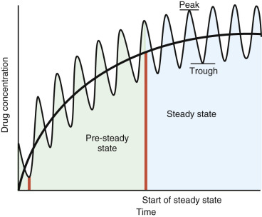

Figure 23-9 

Illustration of the time course of drug levels as a function of method of administration. 

In the discontinuous method, represented by the curve showing peaks and troughs, a constant dose of a drug is administered at regular intervals. After each drug dose, the drug level increases to a peak value, followed by a fall that continues to a trough level, at which time the next regular drug dose is given, resulting in another peak level. After approximately 4-5 half-lives, the drug levels achieve the steady state, as labeled in the figure, when constant peak and trough levels occur. Note that, if a loading dose can be given to the patient, equal to the peak steady-state value, the entire left portion (pre–steady-state) of the curve is eliminated. After the loading dose, the steady state is maintained by giving periodic maintenance doses. The black smooth curve shows a typical time course for drugs that are administered continuously, mainly by the intravenous route. The steady state is achieved as a continuing constant value rather than as peaks and troughs, as in the discontinuous method. 

For both discontinuous and continuous infusions, the ultimate drug level is determined by a battle between the amount infused and the amount excreted. All drugs are eventually excreted. They can be excreted unchanged in the urine, or may be excreted in urine as metabolites of the parent drug. These metabolic conversions occur predominantly in the liver. Occasionally, some drugs enter the enterohepatic circulation and are excreted in stool. Regardless of their mode of excretion, many but not all drugs have a half-life that is more or less independent of their concentrations. The half-life of a drug is the time taken for half the drug that was initially present in serum to be excreted. The reason that the half-life of a drug is independent of its concentration is that many drugs are excreted according to so-called **first-order kinetics,** as discussed in [ Chapter 20 ](<##!/content/3-s2.0-B9780323295680000206?scrollTo=%23c00020>) ( [ Equation 20-22 ](<##!/content/3-s2.0-B9780323295680000206?scrollTo=%23e0115>), [ Equation 20-23 ](<##!/content/3-s2.0-B9780323295680000206?scrollTo=%23e0120>) ). This process may be summarized as follows: 

 D  → k  E 

where D is the drug concentration, and E is the excreted and/or inactivated form of the drug. The constant, k, is the rate constant for the disappearance of D. The half-life, called  , is related to the rate constant, k, by the following relationship: 

 t  1  2  =  0.693  /  k 

As can be seen from this equation,  is a constant and does not depend on drug concentration. Thus, the half-life of the drug determines the time to reach the steady-state or average concentration. 

The object of all drug therapy is to achieve a constant serum level of the drug that will be therapeutic. If the half-life for a drug is known, it is possible to compute the divided dose of the drug that should be given and the time interval between doses so that this level will be achieved. As can be seen in [ Figure 23-9 ](<#f0050>) , at the beginning of drug administration, wide fluctuations in the drug level occur until, after a given period, the fluctuations give the same maxima (peaks) and the same minima (troughs), and the mean level of the drug becomes constant. The problem in dosing is to ensure that the maximum level of the drug will be in the therapeutic range and will not reach toxic levels and, at the same time, to ensure that the minimum level of the drug will remain in the therapeutic range and will not be subtherapeutic. 

In general, for discontinuous doses, the drug level at the end of the nth dosing period can be expressed as the sum of a geometric series: 

 D  =  (  D  0  r  N  − D  0  )  /  (  r  − 1  ) 

where D  0  is the constant dose given at each regular time period; r is the fraction of drug remaining after the constant time interval between doses; and n is the number of the dose (e.g., the second dose, the third dose). Note that, because r is a fraction less than 1, as N becomes large, the first term in [ Equation 23-7 ](<#e0045>) , D  0  r  N  , becomes small, so that 

 D  =  D  0  /  (  1  − r  ) 

For example, if the time interval between doses is chosen as the  , then r =  . If the time interval is chosen to be that for  of the drug to remain, then r =  . (This time can be calculated directly from the  as  × .) Suppose we take r =  . Then after four timed doses, the first term in the numerator of [ Equation 23-7 ](<#e0045>) is D  0  × (  )  4  = D  0  /16 or approximately 0.06 × D  0  , which is small compared with D  0  , and, in effect, 

 D  =  2  D  0 

This level is the maximum (peak) level shown in [ Figure 23-9 ](<#f0050>) . It is the level achieved just after the dose, D  0  , is given. Note that, at the end of the dosing period, just before the next dose, D  0  , is given, the drug level decreases to r × (2D  0  ). If r =  , then this level becomes D  0  . The problem then in pharmacokinetics is to determine what dose, D  0  , and what period, r, to choose, such that the peak and trough values lie within the therapeutic range for the drug. Frequently it is found that, to achieve the right peak and trough levels, the time required to achieve the steady state is too long, especially where the need for drug therapy is urgent. In these cases, a **loading dose** can be administered. Here, the peak level is administered; for the above example, this level would be 2D  0  . Then, after the usual time period, defined by r, elapses, a **maintenance dose** , D  0  , is given. This process is repeated every r-defined time period so that the peaks and troughs are maintained. This process obviates the entire dosing schedule shown in [ Figure 23-9 ](<#f0050>) (i.e., the entire left side of the curve is eliminated, leaving only the steady-state portion). The reason that this process is not performed uniformly is that not all patients can tolerate large initial doses of specific drugs. Therefore, giving loading doses may not always be possible. 

For continuous infusions ( [ Fig. 23-9 ](<#f0050>) ), for the simplest case where drug distribution is instantaneous, the rate of drug infusion is constant, and the drug is excreted in a first-order manner, the rate law is 

 dD  /  dt  =  k  1  − k  2  D 

where D is the drug concentration, k  1  is the constant rate of infusion, and k  2  is the first-order rate constant for excretion/inactivation of D. This equation can be solved for D: 

 D  =  (  k  1  /  k  2  )  (  1  − e  − k  2  t  ) 

From [ Equation 23-11 ](<#e0065>) , if t is large, the term  becomes small, and D approaches its steady state value, k  1  /k  2  . This value is approached when the rate of drug infusion equals the rate of drug disappearance. Another way to obtain this value is to note that, at steady state, as in the formation and disappearance of the enzyme-substrate complex in Michaelis-Menten kinetics (see [ Chapter 20 ](<##!/content/3-s2.0-B9780323295680000206?scrollTo=%23c00020>) , [ Equation 20-4 ](<##!/content/3-s2.0-B9780323295680000206?scrollTo=%23e0025>) ), dD/dt must = 0. Then, from [ Equation 23-10 ](<#e0060>) , 

 dD  /  dt  =  k  1  − k  2  D  =  0 

so that 

 D  steady state  =  k  1  /  k  2 

As in the case of periodic drug administration at constant intervals, 4 half-lives are sufficient to reach the steady-state condition. Because, as shown previously in [ Equation 23-6 ](<#e0040>) , k  2  = 0.693/(  ), after 4 half-lives when t =  , 

 D  =  (  k  1  /  k  2  )  ⋅ (  1  − e  − 2.772  ) 

where, in effect, D is close to k  1  /k  2  . Thus, for continuous infusions, the ratio of k  1  (the rate of drug infused per unit of time) to k  2  (the rate constant for the first-order disappearance of the drug) is the desired steady-state level of the drug (i.e., where the amount of drug delivered equals the amount of drug eliminated over the same unit of time). Unlike the situation with discontinuous infusion, the only parameter that is needed to achieve the steady-state level in a given time is k  1  , which includes drug concentration and infusion rates, whereas with discontinuous administration of the drug, both D  0  and r are needed. 

There are two major points from this presentation. First, it is a good rule of thumb to wait for 4 or more half-lives to achieve the steady-state level of a drug. Second, results of an assay for a drug level in the time period during which this steady state is being achieved should be interpreted with extreme caution—a rule often forgotten in clinical practice. Notice from [ Figure 23-9 ](<#f0050>) that if assays are performed in the pre–steady-state period (before achievement of 4 or more half-lives), erratic results are obtained owing to fluctuations in drug concentrations for the discontinuous case, and rising but persistently low values for the continuous case. It is also important to note that the pharmacokinetics of many drugs may be altered in patients with varied disease states as different diseases can affect blood flow to organs involved in drug elimination, as well as the protein or carrier binding kinetics in plasma, fluid, and tissue compartments (  Ogawa et al, 2013  ). 

 

##  Volume of Distribution 

When one is administering drugs, it is of vital importance to know whether the drug is stored in fat or other tissue, or whether it is all present in serum. Because a given dose of a drug is known and the concentration of the drug in serum can be determined, one can measure the total volume of body fluid in which the drug is dissolved by the following relation: 

 D  =  D  0  /  V  d  ​ ,  or V  d  =  D  0  /  D 

where D is the concentration of drug in serum, D  0  is the amount of drug administered, and V  d  is the volume in which D  0  must be dissolved to give the concentration D. This volume, V  d  , is referred to as the volume of distribution. If all of the drug is present in serum, V  d  is the blood volume that can be determined from conversion tables relating body weight to blood volume. If, however, some of the drug is stored in body tissue, a smaller amount is present in serum, so that the denominator in [ Equation 23-15 ](<#e0085>) (V  d  = D  0  /D) is reduced and V  d  will be larger than the expected blood volume, indicating that some drug is being stored in tissue. If this result occurs, it means that the drug will very likely be released continuously from storage depots (i.e., tissues), which can raise anomalously the level of drug in serum, potentially to toxic levels. Thus, before any drug is administered, the volume of distribution should be known. 

 

##  Metabolism in the Liver 

Many drugs are converted to metabolites, some of which are pharmacologically active and some inactive. Much of this conversion occurs in the extramitochondrial, microsomal system present in hepatocytes. This metabolic system is mainly an oxidative one that utilizes a series of oxidative enzymes that, in turn, utilize a special cytochrome system: cytochrome P450 (  Gonzalez & Tukey, 2006  ). This extremely critical cytochrome system has now been strongly implicated as predisposing particular individuals to develop cancer by metabolizing certain environmental compounds, such as benzopyrene, into frank carcinogens (see later). In addition, genetic polymorphism of the cytochrome P450 enzymes affects an individual's particular response to a drug, including toxicity and an adverse drug reaction (  Ingelman-Sundberg, 2004  ). As described in [ Chapter 73 ](<##!/content/3-s2.0-B9780323295680000735?scrollTo=%23c00073>) , it is now possible to test individuals for their abilities to metabolize specific drugs by amplification of their genes encoding cytochrome P450. Certain amino acid substitutions in this protein cause it to be very active in drug metabolism (i.e., rapid inactivation of the drug). This implies that the patient may need substantially higher doses to achieve a therapeutic level, or that it may be necessary to use another less rapidly metabolized drug. 

Because the excretion of many drugs depends on the integrity of the liver and the cytochrome P450 system, in patients with liver failure due to passive congestion, hepatitis, cirrhosis, and the like, the effective half-life of the drug is increased, making it necessary to lower the divided dose of the drug. Conversely, some drugs induce the intracellular synthesis of the microsomal enzymes, leading to diminished half-life values, so that it may be necessary to raise the divided dose. 

One example of drug induction of microsomal enzymes is phenobarbital. (Dilantin is another example of this phenomenon.) This drug induces its own metabolism (so that its concentration levels do not obey first-order kinetics). In instances in which the levels of a drug metabolized in the liver are higher than the highest therapeutic value, reductions in the levels may be induced by administering low levels of phenobarbital to induce the microsomal system. 

This summary of some of the general principles of drug administration should be helpful in the interpretation of values clinically and should permit a better understanding of the subsequent discussion of specific therapeutic drugs, most commonly measured or determined in the laboratory. [ Tables 23-1 to 23-7 ](<#t0010>) summarize the critical pharmacologic data for a number of commonly assayed drugs. 

TABLE 23-1 

Digoxin 

Purpose  |  Treatment of Congestive Heart Failure and Atrial Fibrillation-Flutter   
---|---  
General adult dose  |  Oral: 0.75-1.5 mg for digitalization, 0.125-0.5 mg/day for maintenance   
Usual bioavailability  |  Approximately 60%-85% for tablet or elixir; 90%-100% for liquid-filled capsules   
Half-life  |  Approximately 35-40 hours; however, prolonged in patients with decreased renal function   
General therapeutic range  |  0.5-2 ng/mL   
General toxic level  |  >2 ng/mL, but somewhat variable   
Transport  |  Approximately 20%-25% plasma protein bound   
Metabolism  |  Generally, only small amounts are metabolized (liver, lumen of large intestine)   
Elimination  |  Approximately 50%-75% unchanged in urine   
Steady state  |  Approximately 7 days in undigitalized patients with normal renal function   
Mechanism of action  |  Causes release of calcium ions in T-system of myocardium; slows AV node conduction   
Toxic effects  |  Gastric disturbances, nausea, vomiting, atrial and ventricular arrhythmias, irregular pulse   
  
_AV,_ Atrioventricular. 

TABLE 23-2 

Procainamide 

Purpose  |  Treatment of Supraventricular or Ventricular Arrhythmias   
---|---  
General adult dose  |  Oral: 4 g/day, in divided doses, for maintenance therapy   
Usual bioavailability  |  75%-95%   
Half-life  |  Approximately 3.5 hours in patients with normal renal function   
General therapeutic range  |  4-10 mcg/mL   
General toxic level  |  >12 mcg/mL   
Transport  |  Approximately 15% plasma protein bound   
Metabolism  |  Hepatic: _N_ -acetylprocainamide (active), with  approximately 7 hours in patients with normal renal function   
Elimination  |  Approximately 50%-60% unchanged in urine   
Steady state  |  Minimum of 12 hours   
Mechanism of action  |  Prolongation of atrial refractory period and decreased myocardial excitability   
Toxic effects  |  Reversible lupus erythematosus-like syndrome, irregular pulse, hypotension, rash, agranulocytosis   
  

TABLE 23-3 

Phenobarbital 

Purpose  |  Treatment of Generalized Tonic-Clonic Seizures, Simple Partial Seizures, Anxiety, Insomnia   
---|---  
General adult dose  |  Oral: 100-200 mg/day for seizure control; 30-120 mg/day for anxiety; 100-320 mg for sleep induction   
Usual bioavailability  |  Approximately 90%-100%   
Half-life  |  Approximately 5-6 days in adults; approximately 3-4 days in children   
General therapeutic range  |  15-30 mcg/mL for epilepsy control   
General toxic level  |  >40 mcg/mL, although tolerance may develop   
Transport  |  Approximately 40%-60% plasma protein bound   
Metabolism  |  Approximately 75% hepatic: _p_ -hydroxyphenobarbital, inactive   
Elimination  |  Approximately 25% unchanged in urine   
Steady state  |  Approximately 14-21 days   
Mechanism of action  |  Stabilizes damaged membranes and raises threshold for neuronal membrane depolarization   
Toxic effects  |  Drowsiness, depression, respiratory depression, coma, sedation, hypotension. Respiratory depression may be caused by rapid intravenous administration.   
  

TABLE 23-4 

Phenytoin (Dilantin) 

Purpose  |  Treatment of Generalized Tonic-Clonic Seizures, Simple Partial Seizures, Complex Partial Seizures   
---|---  
General adult dose  |  Oral: 300-400 mg/day maintenance dose   
Usual bioavailability  |  Variable: 30%-95%   
Half-life  |  24 ± 12 hours, and dose dependent   
General therapeutic range  |  10-20 mcg/mL   
General toxic level  |  >20 mcg/mL   
Transport  |  Approximately 90%-95% plasma protein bound   
Metabolism  |  Hepatic: 5-( _p_ -hydroxyphenyl)5-phenylhydantoin, inactive   
Elimination  |  Approximately 5% unchanged in urine   
Steady state  |  Approximately 7-8 days   
Mechanism of action  |  Appears to block sodium and calcium ion influxes into repeatedly depolarizing CNS neurons   
Toxic effects  |  Nystagmus, ataxia, diplopia, drowsiness, coma; rapid intravenous administration may produce cardiovascular collapse and/or CNS depression   
  
_CNS,_ Central nervous system. 

TABLE 23-5 

Carbamazepine (Tegretol) 

Purpose  |  Treatment of Generalized Tonic-Clonic Seizures, Simple Partial Seizures, Complex Partial Seizures, Trigeminal Neuralgia, and Glossopharyngeal Neuralgia   
---|---  
General adult dose  |  Oral: 0.8-1.2 g/day maintenance for seizure control; 0.2-1.2 g/day for neuralgia   
Usual bioavailability  |  70%   
Half-life  |  Initially approximately 35 hours; approximately 8-20 hours after 3-4 weeks of administration   
General therapeutic range  |  4-12 mcg/mL   
General toxic level  |  >12 mcg/mL   
Transport  |  60%-70% plasma protein bound   
Metabolism  |  Hepatic: carbamazepine-10,11-epoxide (active); carbamazepine-10,11-transdihydrodiol (inactive)   
Elimination  |  1%-2% unchanged in urine   
Steady state  |  3-7 days   
Mechanism of action  |  Decreases sodium and calcium ion influx into repeatedly depolarizing CNS neurons; reduces excitatory synaptic transmission in the spinal trigeminal nucleus   
Toxic effects  |  Drowsiness, ataxia, dizziness, nausea, vomiting, involuntary movements, abnormal reflexes, irregular pulse   
  
_CNS,_ Central nervous system. 

TABLE 23-6 

Theophylline 

Purpose  |  Treatment and Prevention of Moderate to Severe Asthma   
---|---  
General adult dose  |  Depends on body weight, route of administration, and age and condition of patient   
Usual bioavailability  |  Varies according to form, with about 100% for oral liquids and uncoated tablets   
Half-life  |  Varies: 8-9 hours in nonsmoking adults, 5-6 hours in adults who smoke, and 3-4 hours in children, but may vary widely   
General therapeutic range  |  10-20 mcg/mL   
General toxic level  |  >20 mcg/mL   
Transport  |  60% plasma protein bound   
Metabolism  |  Hepatic: caffeine; 1,3-dimethyluric acid; 1-methyluric acid; 3-methylxanthine   
Elimination  |  10% unchanged in urine   
Steady state  |  5 half-lives; 90% of steady state reached in 3 half-lives   
Mechanism of action  |  Increases intracellular cAMP by inhibiting phosphodiesterase; this causes the smooth muscle of the bronchial airways and pulmonary blood vessels to relax   
Toxic effects  |  Hypotension, syncope, tachycardia, arrhythmias, seizures, gastrointestinal bleeding   
  
_cAMP,_ Cyclic adenosine monophosphate. 

TABLE 23-7 

Methotrexate 

Condition  |  Usual Dose  |  Serum Level   
---|---|---  
Psoriasis  |  IM or IV: 7.5-50 mg/week   
Oral: 7.5-30 mg/week  |  <10 nM (  Roenigk et al, 1998  )   
Refractory rheumatoid arthritis  |  IM: 5-25 mg/week   
Oral: 7.5-15 mg/week  |  (  Tugwell et al  1987a and b  ) [ * ](<#hl0000500>)  
Malignant neoplastic diseases [ † ](<#hl0000503>) |  IM or IV: 25 mg/m  2  , 1-2 times/week   
Oral: 2.5-5 mg/day   
High-dose IV: 1.5 g/m  2  with rescue every 3 weeks (different regimens are available)  |  Approximately 50 nM   
  
_IM,_ Intramuscular; _IV,_ intravenous. 

 * Baseline monitoring of patient parameters (hemoglobin; white blood cell count; mean corpuscular volume; platelet count; urinalysis; blood urea nitrogen; and serum creatinine, transaminase, and alkaline phosphatase levels) is advocated. 

 † With high-dose therapy, methotrexate levels are followed, and leucovorin doses are adjusted until serum methotrexate levels are less than 50 nM (  Grem et al, 1995  ). 

In the following presentation, seven classes of the drugs most commonly assayed for are discussed: cardiotropic, anticonvulsant, anti­asthmatic, antiinflammatory, immunosuppressive, psychotropic, and chemotherapeutic. (Antibiotics are discussed in Part 7.) The emphasis in this discussion is on the mechanisms of action of these drugs. Common to most of these drugs is the fact that they interfere with specific steps in signal transduction pathways in cells, which are often remarkably similar to one another. Despite these similarities, specific drugs block signal transduction pathway steps that affect only specific cells and seem not to affect signal transduction in other cells. 

 

##  Cardiotropics 

These drugs are the ones most commonly used to treat congestive heart failure and cardiac arrhythmias (  Opie & Gersh, 2001  ;  Roden, 2006  ;  Frishman & Sica, 2011  ). 

Despite differences in the structures and properties of the drugs and their specific uses, all of them act on one or another phase of the action potentials in cells that are in the conduction system and in myocytes. Their net effect is to slow down electrical conduction. In addition, it is important to remember that the conduction tissue is innervated by both the sympathetic and parasympathetic (mainly vagal) nervous systems. The former increases the conduction rate, and the latter tends to slow conduction. The actions of each of the cardiotropic drugs are summarized in [ Figure 23-10 ](<#f0055>) . As shown in this figure, several major ion currents control the action potentials of the cells making up the pacemaker tissue of the atrioventricular (AV) node and the ventricular conduction bands (composed of Purkinje cells): first, rapid sodium influx current, and then decreased flux (shutoff of sodium conductance channels), as outlined in the red area in [ Figure 23-10 ](<#f0055>) ; second, a calcium ion influx that prolongs the action potential and then calcium channel shutoff, as outlined in the blue area in [ Figure 23-10 ](<#f0055>) ; and third, potassium ion efflux that promotes repolarization of the cell. As shown in [ Figure 23-10 ](<#f0055>) , there are four classes of drugs that act on one or more of these phases of the action potential, resulting in its prolongation. Class I drugs block sodium influx in phase I and include quinidine, procainamide, and lidocaine. These agents, especially lidocaine, act by blocking the rapid sodium influx of phase I, decreasing the rate of ventricular diastolic depolarization. Class II drugs include the β receptor blockers, like propranolol (Inderal), that inhibit the chronotropic effects of adrenergic neurotransmitters like epinephrine and norepinephrine. Class III drugs, like amiodarone, block repolarizing potassium currents, increasing the length of the action potential (represented by the black curve over the yellow area in [ Figure 23-10 ](<#f0055>) ), and increase the length of the refractory period. Class IV drugs, of which verapamil is an important member, slow calcium ion influx, resulting in action potential prolongation. In addition to these classes of drugs, digitalis cardiac glycosides have parasympathetic-like effects on the cells of the AV node, resulting in slowing of conduction. Both digitalis and amiodarone also have marked inotropic effects on the myocardium. Thus both are used in the treatment of congestive heart failure. In damaged myocardium, digitalis blocks sodium-potassium adenosine triphosphatase (ATPase), resulting in transient increases in sodium ion around the sarcolemma, which leads to the release of cytosolic calcium ion to the T-system. This allows increased myocardial contractility. We now discuss the key properties and actions of these cardiotropic drugs. 

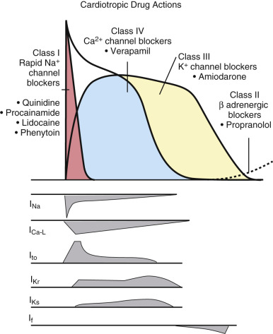

Figure 23-10 

Overview of the effects of different antiarrhythmic agents on the myocardial conduction system. 

The normal action potential is shown as the _black line_ that first spikes to a high voltage, mainly because of a rapid sodium influx into cells in the conduction system. This component of the action potential, caused by sodium ion influx, is shown enclosed in the _red area_ . The actual action potential is prolonged by a succeeding influx of calcium ions shown enclosed under the _blue area_ that overlaps somewhat with the red (sodium influx) area. Termination of the calcium ion influx and efflux of potassium ions results in repolarization, shown by the _curve bordered by the blue area_ . Class I channel blockers, as listed in the figure, block sodium influx, thereby diminishing the rate of depolarization. Class II blockers, like propranolol, block β-adrenergic (epinephrine and norepinephrine) stimuli, diminishing the rate of diastolic depolarization. Class III blockers, like amiodarone, block potassium channels, resulting in reduction in potassium efflux and slowing down repolarization. This results in prolongation of the action potential, as shown by continuation of the voltage curve over the _yellow area_ . Class IV blockers, like verapamil, block calcium channels, again prolonging the action potential ( _blue_ ), although this prolongation is not explicitly shown. By prolonging the action potential, Class III and IV agents slow down nodal conduction through prolonged refractoriness of the affected cells. Various ion currents induce the action potentials. 

(Redrawn from Opie LH, Gersh BJ: _Drugs for the heart_ , ed 5. Philadelphia, 2001, WB Saunders.) 

 

##  Cardiac Glycosides (Digitalis and Its Derivatives) 

 

##  Digoxin 

Because they slow conduction in the AV node, digoxin (also referred to as _digitalis,_ of which digoxin and the longer-lasting digitoxin are derivatives) and the other cardiac glycosides are often used to treat atrial arrhythmias, in particular atrial flutter and atrial fibrillation. However, there is recent support for their use in cancer treatment (  Slingerland et al, 2013  ). The mechanism of action for their antiarrhythmic effect in heart disease is to block rapid atrial conduction signals to the ventricles, thereby slowing ventricular response. This is due to their proparasympathetic effects, which include enhancement of blockade of depolarizing calcium currents and increased hyperpolarizing potassium currents in the AV node. These effects result in shortening action potential duration and increasing AV nodal refractoriness (  Roden, 2006  ). 

Their direct positive inotropic effect increases cardiac output in cardiac failure. This effect has been found to be due to increased intrasarcolemmal concentration of calcium, allowing it to activate proteins such as troponin C that are important in the contractile apparatus (  Rocco & Fang, 2006  ;  McMurray et al, 2012  ). This increase in calcium concentration is due to the binding of digoxin to the α subunit of sodium-potassium–activated ATPase, causing its inhibition and the consequent reduction of sodium efflux and diminution of the trans-membrane potential; as this potential increases, more calcium efflux occurs, resulting in less activation of muscle contraction. Blockade of sodium efflux therefore allows accumulation of intrasarcolemmal calcium and increased activation of contractile proteins (  Rocco & Fang, 2006  ). 

Digoxin ( [ Table 23-1 ](<#t0010>) ) has a rapid onset of action (within 1 to 2 hours when given orally) and a relatively short half-life (35 to 40 hours). Most patients will excrete approximately 50% to 75% of a dose unchanged in the urine. The general range of therapeutic serum levels is from 0.5 to 2 ng/mL. High concentrations of the drug are found in skeletal and cardiac muscle, as well as in liver, brain, and kidneys. It is important to note the recent impact of pharmacogenetics on the biology of digoxin as well as other drugs (  Talameh & Lanfear, 2012  ). Recent reports by  Neuvonen and colleagues (2011)  showed that the _ABCB1_ 3435T polymorphism provided higher serum drug concentrations of digoxin with a higher frequency among females, thus providing a possible explanation regarding the increased morbidity of females treated with digoxin compared with placebo. Digoxin is available as oral tablets, elixir, oral capsules, and intravenous solution, which have bioavailabilties of 70%, 80%, 90%, and 100%, respectively (  Ehle et al, 2011  ). Understanding the formulation administered in conjunction with patient compliance and comornidities can alert the clinician of suspected toxicity. 

 

##  Digitoxin 

In contrast, digitoxin has a longer half-life (4 to 6 days) with a relatively slower onset of action (within 1 to 4 hours when given orally, with maximal effect in 8 hours); 90% to 100% of a dose is absorbed, with approximately 95% bound to plasma protein. The general range of therapeutic serum levels is from 9 to 25 ng/mL. The drug is extensively metabolized in the liver (90%), with digoxin being the active metabolite. 

Toxic side effects of the digitalis glycosides include gastric disturbances, nausea, vomiting, and atrial and ventricular arrhythmias. It is crucial that levels of digoxin (or digitoxin) be monitored closely and accurately while the patient is initially being given this drug. As mentioned previously, the therapeutic range for digoxin is from 0.5 to 2 ng/mL (i.e., the range is narrow). Toxic levels exceed 2 ng/mL, so the difference between therapeutic and toxic doses is small. This difference necessitates careful digoxin assay. 

Digoxin toxicity is often treated with Digibind (GlaxoSmithKline, Research Triangle Park, N.C.), consisting of ovine Fab fragments. This antidote can interfere with determination of digoxin serum levels (  Valdes et al, 1998  ). Some assays have been reported to determine only the “free” digoxin level (i.e., that not bound to Digibind Fab), which inactivates digoxin. For other assays that determine total digoxin (i.e., free plus Fab-bound digoxin), it is recommended that an ultrafiltrate of serum be employed to determine the level of free or active digoxin. Alternatively, given that Digibind can cause spurious and erroneous results, it has been recommended that, because the half-life of Digibind is 15 to 20 hours, therapeutic levels of digoxin should be determined 2 to 4 days after the last Digibind dose. 

 

##  Procainamide (Pronestyl) 

Procainamide ( [ Table 23-2 ](<#t0015>) ) is a class I antiarrhythmic drug that is useful in treating supraventricular or ventricular arrhythmias. One of its major effects includes increased refractoriness of the atrium and decreased myocardial excitability by blocking open sodium channels and outward potassium currents, both of which prolong action potentials and increase refractoriness (  Roden, 2006  ). Because there is an effect on potassium currents, some of its effects resemble those of the Class III potassium current blockers. The bioavailability of procainamide is 75% to 95%. Approximately 15% is bound to plasma protein, and approximately 50% is excreted by the kidneys. The half-life is approximately 3.5 hours, with a general range of therapeutic serum level of 4 to 10 µg/mL. _N_ -acetylation to the major active metabolite _N_ -acetylprocainamide (NAPA) is the major metabolic pathway of biotransformation. NAPA, however, does not block open sodium channels but effectively prolongs action potentials (  Roden, 2006  ). Both drugs prolong the QRS and Q-T intervals on electrocardiography over time. 

Toxic side effects include a reversible lupus-like syndrome (  Zimetbaum et al, 2011  ) with elevated antinuclear antibody titers, urticaria, rash, agranulocytosis, and nephrotic syndrome. The lupus-like syndrome may be initiated by leukocyte metabolism of procainamide to a chemically reactive metabolite that could then covalently bind to monocyte/macrophage membrane proteins to stimulate production of autoantibodies. In addition, the tertiary amino moiety of the covalently bound procainamide metabolite might mimic a portion of histone protein, resulting in the production of antihistone antinuclear antibody (  Uetrecht, 1988  ). 

 

##  Quinidine 

Quinidine, also a class I antiarrhythmic, like procainamide, is used to treat supraventricular and ventricular arrhythmias and tachyarrhythmias. The prevention of ventricular tachycardia or frequent premature ventricular contractions and the maintenance of sinus rhythm after the conversion of atrial flutter or atrial fibrillation are its two major uses (  Valdes et al, 1998  ). Like procainamide, quinidine blocks sodium channels and outward potassium currents, especially the I  Kr  rectifier current, resulting in prolongation of action potentials and increased refractoriness, leading to prolongation of both the QRS complex and the Q-T interval (  Roden, 2006  ). 

The bioavailability of quinidine is 90% to 100%, with approximately 85% of the drug bound to plasma protein. Quinidine is 60% to 85% metabolized in the liver via hydroxylation reactions, with some metabolites being active. Urinary excretion is approximately 20%. The half-life of quinidine is 5 to 12 hours, and the general therapeutic range is 2.3 to 5 mcg/mL. Maximal serum levels are reached in 1 to 3 hours. Toxic side effects of quinidine include cinchonism (vertigo, tinnitus, headache, visual disturbances, and disorientation), fever, hepatitis, and blood dyscrasia. Ventricular arrhythmias, AV block, and ventricular fibrillation leading to syncope and sudden death can occur. 

 

##  Lidocaine 

Lidocaine (Xylocaine), another class I antiarrhythmic, can also be used as a local anesthetic. Its major use as an antiarrhythmic is in the acute control and prevention of ventricular arrhythmias after acute myocardial infarction. Its effect is to block sodium channels mainly in ventricular but not atrial tissue. Unlike procainamide and quinidine, lidocaine does not cause QRS and Q-T prolongation (  Roden, 2006  ). A loading intravenous dose of 50 to 100 mg is given over 2 to 3 minutes to treat ventricular arrhythmias in adults. These dosages may be repeated in 5- to 10-minute intervals of 25 to 50 mg, up to a maximum of 300 mg in a 1-hour period. Following loading, infusion is then continued at a rate of 1.4 to 3.5 mg/min for a 70-kg male. In children, 0.5 to 1 mg/kg can be given every 5 minutes for a maximum of three doses. Unfortunately, lidocaine can cause heart block and congestive heart failure, limiting its use in critical care patients (  Roden, 2006  ). 

Lidocaine is neither highly protein-bound nor appreciably stored in body tissues; it has a half-life of approximately 2 hours and a therapeutic serum range of 1.2 to 5.5 mcg/mL. The time to reach a maximum serum level is generally 5 to 8 hours. Ninety percent of a dose of lidocaine is metabolized in the liver via _N_ -dealkylation. Urinary excretion is 10%. Toxic side effects include convulsions, coma, and respiratory depression (CNS effects), as well as bradycardia and hypotension. 

 

##  Propranolol 

Propranolol, a class II antiarrhythmic β receptor–blocking drug that antagonizes the effects of epinephrine on the heart, on the arteries and arterioles of skeletal muscles, and on the bronchus, exerts its effects largely on the AV node and is used to treat sinus tachycardia, atrial tachycardia, and ventricular arrhythmias. Overall, blockade of β-1 receptors increases AV conduction time and reduces heart rate, myocardial contractility and output, and cardiac automaticity. Because it is a vasodilator, it is also used in the treatment of angina pectoris; hypertension; and symptomatic coronary artery disease, particularly after an acute myocardial infarction. Oral dosages vary from 40 to 320 mg daily in adults for antiarrhythmic activity, to as high as 480 mg daily in the control of hypertension. Both supine and standing blood pressures are also reduced. Bioavailability of propranolol is approximately 30%. The half-life of propranolol is 3 hours, with a therapeutic serum range of 50 to 100 ng/mL, and with maximum serum levels reached in approximately 6 hours. Approximately 93% is protein bound. Propranolol is metabolized in the liver, with 0.5% excreted in the urine unchanged. Toxic effects include bradycardia, arterial insufficiency (Raynaud's type), hypotension, AV block, nausea, vomiting, pharyngitis, bronchospasm, and thrombotic thrombocytopenic purpura. Marrow suppression occurs rarely. 

 

##  Amiodarone 

Amiodarone, a structural analog of thyroid hormone, is chiefly a class III antiarrhythmic drug, which markedly prolongs the action potential mainly by blocking potassium channels in cardiac muscle (see [ Fig. 23-10 ](<#f0055>) ). Its activity is complex in that it significantly blocks inactivated sodium channels by a poorly understood mechanism, thus exhibiting class I action, and also exhibits weak adrenergic- and calcium channel–blocking effects (  Roden, 2006  ). All of these actions prolong the effective refractory period along the conduction bands. Its indication for use is with life-threatening ventricular arrhythmias. The oral loading dose is 1200 to 1600 mg/day with a maintenance dose of 200 to 400 mg/day. Bioavailability is ≈35% to 65%. Amiodarone has two components in its half-life: a rapid component of 3 to 10 days (involving ≈50% of the drug) and a slow component of 25 to 110 days. The general therapeutic range is 1 to 2.5 mcg/mL, although this is not well defined, and the toxic level is >2.5 mcg/mL, again not well defined. Approximately 96% is plasma protein bound; the drug undergoes liver metabolism and shows extensive body distribution because of its hydrophobic (lipid-soluble) structure. Excretion is very slow by skin, biliary tract, and lacrimal glands. Toxic effects can be profound and include symptomatic bradycardia, heart block, fatal pulmonary fibrosis, hepatitis, visual field disturbances, optic nerve neuropathy (  Passman et al, 2012  ), photodermatitis, and mainly hypothyroidism but sometimes hyperthyroidism. New variations of antiarrhythmic medications including Dronedarone, Dofitilide, Vernakalant, and Ranolazine among others are being investiaged for their selective atrial specific activity as well as decreased extra cardiac side effects (for review see  Saklani & Skanes, 2012  ). 

 

##  Verapamil 

Verapamil is a class IV antiarrhythmic drug that blocks activated and inactivated calcium channels that are especially prominent in nodal tissue (particularly the AV node). Indications include angina, hypertension, and supraventricular arrhythmias. Unlike β-adrenergic receptor blockers, calcium channel blockers have not been found to reduce mortality after a myocardial infarction (  Roden, 2006  ). The oral dose is 120 to 480 mg/day in three to four divided doses. Bioavailability is ≈10% to 20%. The half-life is 2 to 8 hours but increases to 4.5 to 12 hours after repeated oral doses. The general therapeutic range is 80 to 400 ng/mL, although this is not well defined. Approximately 90% is plasma protein bound, and the drug undergoes extensive metabolism in the liver, where norverapamil, an active metabolite, is produced. Approximately 75% of the active components are eliminated by the kidney and ≈25% through the GI tract. Toxic effects include hypotension, ventricular fibrillation, constipation, and peripheral edema. 

 

##  Anticonvulsants 

Anticonvulsants are used in the treatment of seizure disorders, in particular grand mal, petit mal, and psychomotor seizures and other specialized seizure disorders such as tic douloureux (trigeminal neuralgia). Although the mechanisms of action of these drugs are incompletely understood, it appears that all of these agents, with the possible exception of phenobarbital, block sodium influx into neurons that have damaged membranes, as schematized in [ Figure 23-11 ](<#f0060>) . In addition, several of these agents, especially phenytoin, block secondary calcium influxes into such cells, which also seem to inhibit the rapid firing of these cells. Another effect of phenobarbital, and possibly also of phenytoin, is membrane stabilization through intercalation, as shown in [ Figure 23-11 ](<#f0060>) . Many of the anticonvulsants are effective against grand mal seizures but have no effects or adverse ones on petit mal seizures. Only drugs like ethosuximide (Zarontin) and valproic acid (Depakote) are effective against this condition. Thus, although the mechanism of action of these drugs appears to be similar, they differ in specificities. 

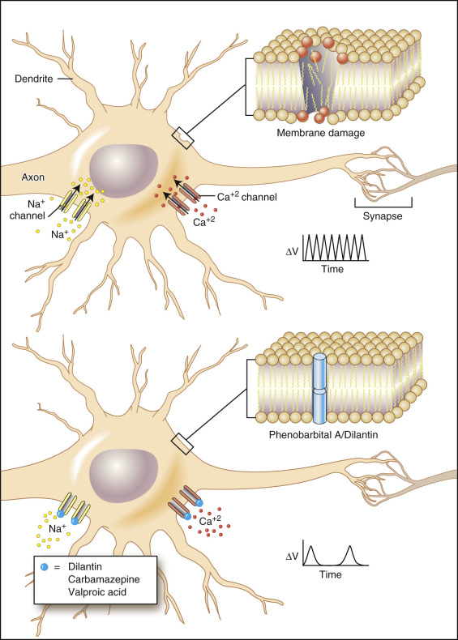

Figure 23-11 

Effects of anticonvulsants on neurons. 

_Top,_ Damaged neuronal membranes, as shown in the section in the upper right of the figure, result in sodium _(yellow circles)_ and calcium _(red circles)_ influxes via their respective channels that cause repeated firing, as shown in the voltage-time curve to the right of the figure. _Bottom,_ Anticonvulsants like phenytoin (Dilantin), carbamazepine (Tegretol), and valproic acid (Depakote; _represented by blue circles_ ) block sodium and calcium channels, resulting in a substantially diminished rate of firing, as shown in the voltage-time curve to the right of the figure. Both phenytoin and phenobarbital, shown as blue cylinders, are also thought to stabilize the damaged neuronal membrane, as shown in the membrane section schematized in the upper-right drawing. 

 

##  Phenobarbital 

Phenobarbital ( [ Table 23-3 ](<#t0020>) ), a long-acting barbiturate, is used in the treatment of generalized grand mal tonic-clonic seizures and simple partial seizures with motor or somatosensory symptoms, as well as for anxiety and insomnia. It is not used in the treatment of absence seizures (i.e., petit mal), which may be exacerbated by phenobarbital, or for complex partial seizures, which do not respond well. As discussed previously in the Barbiturates section, phenobarbital increases the duration of chloride ion channel opening at the GABA  A  receptor, thereby potentiating the GABA effect and raising the threshold for neuronal membrane depolarization, resulting in the diminished frequency of firing of action potentials (  Löscher & Rogawski, 2012  ). In addition, it can stabilize damaged neuronal membranes (see [ Fig. 23-11 ](<#f0060>) ). 

Phenobarbital is also given for withdrawal symptoms in infants born to opiate- or barbiturate-addicted mothers. Because phenobarbital enhances the metabolism of bilirubin by induction of cytochrome P450–dependent enzymes in the hepatic microsomal system, it has been used to treat patients with congenital hyperbilirubinemia (familial nonhemolytic, nonobstructive jaundice). The oral dose of phenobarbital for anxiety in adults is 30 to 120 mg daily in divided doses; for sleep induction in adults, 100 to 320 mg daily is generally used. For seizure control, divided doses of 100 to 200 mg/day in adults or 30 to 100 mg/day in children are generally used. 

Phenobarbital has a long half-life of 4 to 6 days. Oral doses are almost completely absorbed (90% to 100% bioavailability), and the optimal serum concentration for seizure control is generally 15 to 30 µg/mL; 40% to 60% is metabolized in the liver, whereas 10% to 40% may be eliminated unchanged in the urine. Approximately 40% to 60% is plasma protein bound, and the main site of storage is the brain. A steady state is reached in 14 to 21 days. Importantly, phenobarbital and, as discussed in the next section, phenytoin (dilantin), induce a number of the cytochrome P450 systems. Cytochrome P450 2B6 (CYP2B6) is specifically induced by phenobarbital via the CAR/RXR nuclear receptor heterodimer. This system is described at length in [ Chapter 73 ](<##!/content/3-s2.0-B9780323295680000735?scrollTo=%23c00073>) on pharmacogenomics. 

Toxic side effects include nystagmus, ataxia, stupor, respiratory depression, coma, and hypotension. Barbiturates are contraindicated in patients with acute intermittent porphyria (i.e., partial porphobilinogen deaminase deficiency), because barbiturates enhance the synthesis of δ-aminolevulinic acid synthetase and thus the synthesis of heme pathway intermediates in the liver. 

 

##  Phenytoin (Dilantin) 

Phenytoin is used to treat generalized tonic-clonic, simple partial, and complex partial seizures ( [ Table 23-4 ](<#t0025>) ). It is ineffective in treating myoclonus, absence (petit mal), and atonic seizures. It is usually given intravenously in addition to intravenous diazepam to terminate status epilepticus. Remarkably, phenytoin has no apparent effects on resting neurons or on normally firing neurons. It is thus specific for epileptogenic foci in the CNS (  Yaari et al, 1986  ). It is interesting to note that carbamazepine (Tegretol) exerts similar effects, as discussed later. Data on the mechanism of action of this drug strongly suggest that phenytoin blocks sodium and calcium influxes into repeatedly depolarizing neurons in the CNS and also into neurons that are partially depolarized. Reducing sodium and calcium influx into these cells reduces their excitability and prolongs their refractory period (  Yaari et al, 1986  ). In fact, phenytoin appears to bind selectively to fast-firing sodium channels in their refractory states, thereby prolonging their refractory periods (  Bazil & Pedley, 1998  ); that is, it slows the rate of recovery of inactivated sodium channels (  McNamara, 2006  ). This finding helps explain the ability of phenytoin to block only neurons that are firing rapidly and repetitively. 

Although the average daily maintenance dose in adults is 300 to 400 mg, the dosage must be tailored to the patient's response and serum drug concentrations. The usual therapeutic serum concentration is 10 to 20 µg/mL, with a steady state reached in 5 to 10 days (for plateau; see [ Figure 23-9 ](<#f0050>) ). The serum half-life is generally 24 hours, but it is dose dependent. Thus, its excretion is not a first-order process. Phenytoin is stored in the brain, is metabolized in the liver (95%), and is approximately 90% to 95% bound to plasma protein. Both aspirin and phenylbutazone can displace phenytoin from serum albumin and can significantly increase the serum concentration of phenytoin. Because phenytoin, like phenobarbital, is a relatively potent hepatic microsomal enzyme inducer and inducer of the CYP3A4 and CYP2C19 families of the P450 enzyme responsible for the hepatic degradation of various drugs, certain antibiotics, oral anticoagulants, quinidine, and oral contraceptives may be more rapidly metabolized, thus decreasing their effectiveness. 

Because the relationship between serum concentrations and daily dosage is not linear, small increases in dosage can greatly increase therapeutic serum concentrations. Symptoms of toxicity generally occur at serum concentrations greater than 20 µg/mL. Toxic side effects include nystagmus, ataxia, stupor, and coma. Arrhythmias can be produced by rapid intravenous administration. 

Fosphenytoin is a water-soluble parenteral formulation of phenytoin that is rapidly converted (half-life of 8 to 15 minutes) in vivo to phenytoin. The half-life is independent of plasma concentration, and it has identical pharmacodynamic, pharmacokinetic, and clinical properties to phenytoin. This prodrug offers improved flexibility and tolerability for the patient, as compared with intravenous phenytoin, and is indicated for the treatment of partial and generalized seizures in adults in whom intravenous administration is indicated (  Bazil & Pedley, 1998  ). 

 

##  Primidone (Mysoline) 

Primidone is used to treat generalized tonic-clonic, simple partial, and complex partial seizures. Its chemical structure is closely related to the basic structure of the barbiturates, and it is metabolized in the liver into two active metabolites: phenobarbital and phenylethylmalonamide. Thus some of its anticonvulsant effects are due to phenobarbital activity. Unlike phenobarbital, however, primidone may increase the threshold of membrane depolarization within the CNS. 

Oral doses range from 250 mg daily to 2 g/day in divided doses. Absorption is rapid and complete (100%), with a usual therapeutic serum concentration of 5 to 21 µg/mL. A steady state is reached in 4 to 7 days, and the half-life is approximately 12 hours. Plasma protein binding is relatively low (20%), with most of the drug remaining free in the serum, and with little drug being stored in body tissues. 

Sedation is a common toxic side effect. Dizziness, ataxia, and skin rashes have also been observed. Primidone, like phenobarbital, is contraindicated in patients with acute intermittent porphyria. 

 

##  Ethosuximide (Zarontin) 

Ethosuximide is the drug of choice for absence (petit mal) seizures unaccompanied by other types of seizures. It is preferred over valproic acid (see later), at least initially, because hepatotoxicity is a rare but serious side effect of valproic acid. Ethosuximide may depress the motor cortex and may reduce the frequency of neuronal firing. It also inhibits T-current spikes on the electroencephalogram that underlie bursts of action potentials in the thalamus but does not affect normal electrical conduction (  McNamara, 2006  ). The basis for its specificity, however, is not well understood. 

The oral dosage in adults is generally 500 to 1000 mg daily. Absorption is fairly rapid and complete (100%), with peak serum concentrations occurring in 1 to 4 hours. A steady state is reached in 8 to 10 days. The usual therapeutic serum concentration is 40 to 100 µg/mL, but it can be as high as 170 to 190 µg/mL in children. The serum half-life is generally 60 hours in adults and 30 hours in children. Ethosuximide is essentially free in serum and not protein bound. It is mainly metabolized in the liver (60% to 90%) to desmethylmethsuximide. Gastrointestinal disturbances are among the most common toxic effects and include nausea, vomiting, and gastric distress. Other effects include drowsiness and ataxia. Rare serious side effects, such as systemic lupus erythematosus, aplastic anemia, and pancytopenia have been reported. 

 

##  Carbamazepine (Tegretol) 

Carbamazepine ( [ Table 23-5 ](<#t0030>) ) is a primary antiepileptic drug that is used in the treatment of generalized tonic-clonic seizures and simple partial and complex partial seizures, as well as in combinations of these seizure types. Absence (petit mal), myoclonic, and atonic seizures may be exacerbated by this drug. This drug is also used to treat tic douloureux (trigeminal neuralgia) and glossopharyngeal neuralgia, and is, in fact, the drug of choice in the treatment of these neuralgias. 

Carbamazepine is a tricyclic compound (i.e., iminostilbene) that is chemically related to imipramine, a tricyclic antidepressant. It is believed that a reduction in excitatory synaptic transmission in the spinal tri­geminal nucleus is the basis for this drug's antineuralgic action. Its antiepileptic action is quite similar to that of phenytoin, that is, it decreases sodium and calcium influx into hyperexcitable neurons (  Yaari et al, 1986  ;  Bazil & Pedley, 1998  ). Like phenytoin, carbamazepine slows the rate of recovery of voltage-activated sodium channels from inactivation (  McNamara, 2006  ). 

Oral doses of carbamazepine are completely absorbed, and the usual adult maintenance dose is 0.8 to 1.2 g/day. Ninety-eight percent is biotransformed in the liver into two active metabolites: a 10,11-epoxide form, which is active (  McNamara, 2006  ), and a 10,11-dihydroxy form of carbamazepine. The usual therapeutic serum concentration is 4 to 12 µg/mL, and steady state is reached in 3 to 4 days. The serum half-life of Tegretol is 8 to 20 hours (after 3 to 4 weeks of administration), and 60% to 70% is plasma protein bound. The more common toxic reactions seen with this drug include drowsiness, ataxia, dizziness, nausea and vomiting, and lightheadedness. Rare hematologic reactions may occur and can be quite serious; they include aplastic anemia, thrombocytopenia, and agranulocytosis. 

 

##  Valproic Acid (Depakene) 

Valproic acid is commonly used in the treatment of generalized tonic-clonic seizures, absence seizures, myoclonic seizures, and atonic seizures. It is not effective for the treatment of infantile spasms. Although the mechanism of action is not definitely known, valproic acid is thought to enhance the activity of the GABA-mediated inhibitory system. In addition, its action is similar to that of phenytoin and carbamazepine in that it inhibits sustained, repetitive firing of depolarized neurons by prolongation of the refractory state of sodium channels (  Hardman et al, 2001  ;  McNamara, 2006  ). Like ethosuximide, it decreases T-current–induced action potentials (  McNamara, 2006  ). Absorption of valproic acid is rapid and complete. The average daily maintenance dose of valproic acid in adults is 15 to 30 mg/kg, when utilized alone, and 30 to 45 mg/kg in combination with other antiepileptic drugs. The usual therapeutic serum concentration is 50 to 100 µg/mL, and a steady state is reached in 1 to 4 days. Most (90% to 100%) of the drug is metabolized in the liver, and a high percentage (90%) is plasma protein bound. The serum half-life is 8 to 15 hours. 

Valproic acid has been shown to produce teratogenic effects in experimental animals; these included developmental abnormalities and skeletal defects. Thus, valproic acid should be used with caution in pregnant women. Toxic side effects include sedation, gastric disturbances, hema­tologic reactions, ataxia, somnolence, and coma. Rare fatal hepatotoxicity has occurred, and severe or fatal pancreatitis has been reported (  Sztajnkrycer, 2002  ). 

 

##  Newer Anticonvulsants 

Topiramate, lamotrigine (Lamictal), gabapentin (Neurontin), levetiracetam (Keppra), and felbamate (Felbatol) are additional anticonvulsant agents that are approved for use in the United States for patients whose response to the more established anticonvulsants is less than optimal. Therapeutic ranges and toxic concentrations for these drugs have not been determined. Topiramate and lamotrigine are utilized as adjunctive treatment for partial seizures in adults. Topiramate is a substituted sulfamate monosaccharide that induces hyperpolarizing potassium currents and enhances GABA  A  receptor currents at synapses (  McNamara, 2006  ). Lamotrigine is a triazine derivative that acts much in the same manner as phenytoin and carbamazepine. However, because it has broader antiseizure activity than either of these other two anticonvulsants, other mechanisms may be involved, one of which appears to be blockade of glutamate release at synapses using this amino acid as a neurotransmitter (  McNamara, 2006  ). 

Topiramate has a half-life of approximately 21 hours, with approximately 15% of the drug bound to protein. Lamotrigine has a variable half-life, depending on whether the drug is used as monotherapy or with an inducer. Approximately 55% of lamotrigine is protein bound. 

Gabapentin is also utilized as adjunctive treatment for partial seizures and for migraines, chronic pain, and bipolar disorder (  McNamara, 2006  ). As its name suggests, it was designed to act as a GABA-like drug, but it has been found that it does not have this effect but rather seems to induce cortical release of GABA from synaptic vesicles by a poorly understood mechanism (  McNamara, 2006  ). It has a half-life of 5 to 7 hours with less than 3% protein binding. 

Levetiracetam is used in benzodiazepine-resistant status epilepticus or where patients have allergic side effects to phenytoin. It does not appear to act through classical anticonvulsant pathways including voltage-dependent Na  \+  channels, GABAergic transmission, or affinity for either GABAergic or glutamatergic receptors. Rather, it is thought that the antiepileptic mechanism of action involves inhibitory effects on depolarization-induced and Ca  2+  -induced Ca  2+  release–associated neurotransmitter releases, GABA turnover rate in the striatum, removal of Zn  2+  -induced suppression of GABAA-mediated presynaptic inhibition (resulting in a presynaptic decrease in glutamate mediated excitatory transmission), and decreased levels of the amino acid taurine (a low-affinity agonist for GABAA receptors) in the hippocampus (  Deshpande & Delorenzo, 2014  ). 

Felbamate is a phenyl-substituted dicarbamate that not only inhibits NMDA-evoked responses but also enhances GABA-evoked responses (  McNamara, 2006  ). 

Common side effects of topiramate include fatigue, psychomotor slowing, somnolence, and difficulty with concentration and speech. Acute-angle glaucoma can also occur (  Asconape, 2002  ). Common side effects of lamotrigine include ataxia, CNS depression, diplopia, dizziness, abnormal thinking, nausea, nervousness, rash, and somnolence. An additional major toxic effect reported for lamotrigine is Stevens-Johnson syndrome (  Brodtkorb, 1998  ;  Warner et al, 1998  ). Common side effects of gabapentin include ataxia, dizziness, fatigue, and somnolence. Felbamate has been found to produce a relatively high incidence of aplastic anemia and hepatic failure (  Asconape, 2002  ). Thus, the drug is utilized in patients failing other treatments only when the potential clinical benefits outweigh the potential clinical risks (  Bazil & Pedley, 1998  ;  Brodtkorb, 1998  ;  Asconape, 2002  ;  McNamara, 2006  ). Attention to emerging anticonvulsants and the differences in their bioavailability may sensitize the clinician to variability of their side effects in infants, children, and pregnant women (  Tricco et al, 2014  ). 

 

##  Antiasthmatics 

Asthma is a form of chronic obstructive pulmonary disease that has a variety of causes, some of them allergenic in nature. As indicated in [ Figure 23-12 ](<#f0065>) , at the heart of asthma is bronchoconstriction due to contraction of smooth muscle fibers in bronchioles. This may be induced by allergenic causes that trigger inflammatory processes that, in turn, result in the release of histamine from mast cells. Histamine, when it binds to H  1  receptors in smooth muscle cells, induces second messengers such as inositol triphosphate and diacylglycerol that ultimately stimulate muscle contraction (see [ Fig. 23-12 ](<#f0065>) ). Opposing this process is the binding of epinephrine to β 2  receptors, resulting in stimulation of adenylate cyclase that induces synthesis of cAMP, a second-messenger molecule that induces blockade of muscle contraction. As part of a regulatory process, phosphodiesterase induces hydrolysis of cAMP and thus helps to remove inhibition of smooth muscle contraction. 

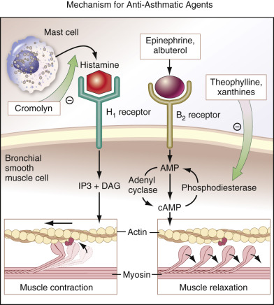

Figure 23-12 

Summary of the mechanisms of action of antiasthmatic agents. 

Three basic mechanisms are shown. Note that all three mechanisms result in promotion of smooth muscle relaxation in the small airways (i.e., fewer actin-myosin cross-bridges) _(arrows show loss of cross-bridges),_ as shown at the bottom of the figure. On the left, release of histamine from mast cells in response to allergenic stimulation results in histamine–H  1  receptor complexes that promote a signal transduction pathway in which inositol triphosphate (IP  3  ) and diacylglycerol (DAG), both second messengers, are induced and promote smooth muscle contraction. Histamine release is blocked _(minus sign in circle, next to green arrow)_ by the drug cromolyn. In the middle of the figure, epinephrine and albuterol are shown to form complexes with β receptors; these complexes induce adenyl cyclase activity such that cyclic adenosine monophosphate (cAMP) is synthesized; this second messenger blocks smooth muscle contraction. On the right, xanthines, such as theophylline, are shown to block the enzyme phosphodiesterase, resulting in prolonged lifetimes of cAMP, allowing it to function for prolonged periods in blocking smooth muscle contraction. 

As indicated in [ Figure 23-12 ](<#f0065>) , there are at least three different therapeutic strategies for blocking bronchiolar smooth muscle contraction. The first is blockade of release of histamine from mast cells by drugs such as cromolyn. This is not the only inflammatory process that can induce the bronchoconstriction of asthma. Other components of the inflammatory process may also be active in provoking bronchoconstriction. These are summarized in [ Figure 23-13 ](<#f0070>) , which shows that, among the agents promoting bronchoconstriction, the leukotrienes and the prostaglandins are quite prominent. To counter these effects, oral antiinflammatory agents, such as the leukotriene inhibitors zileuton and zafirlukast, have been found to be effective in asthma because they interrupt the leukotriene/arachidonic acid pathways involved in inflammation and bronchial reactivity. It is important to note that steroids have been found to be highly effective in blocking inflammation-induced bronchospasm. As indicated in [ Figure 23-13 ](<#f0070>) , these agents potently inhibit leukotriene, prostaglandin, and platelet-activating factor production (not shown in [ Fig. 23-13 ](<#f0070>) ) by inhibiting phospholipase A2 and the inducible cyclo-oxygenase-2 isoform. Lipid-soluble steroids, especially in aerosolized form, avoiding adverse systemic effects, have been found to be among the most effective agents against asthma. These agents include beclomethasone, flunisolide, and triamcinolone. Longer-acting lipid-soluble β 2  -agonists, such as formoterol and salmeterol, are also available and appear to be long acting because of their ability to dissolve into the bronchial smooth muscle membrane. 

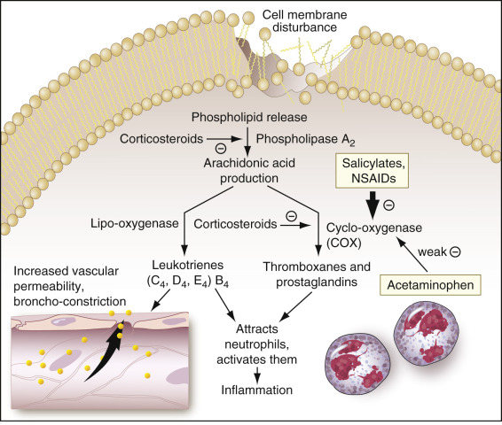

Figure 23-13 

Mechanisms of action of antiinflammatory drugs. 

The figure shows that the fundamental event in inflammation-induced cell death is membrane damage in cells that results in activation of phospholipase A  2  . This enzyme promotes the synthesis of arachidonic acid. This is a substrate for two critical enzymes: lipooxygenase, which promotes synthesis of leukotrienes, and cyclooxygenase (COX), which promotes synthesis of thromboxanes and prostaglandins. Both classes of compounds promote neutrophil chemotaxis _(lower right)_ with resulting phagocytosis of damaged cells and a further destructive inflammatory response. Leukotrienes themselves promote increased vascular permeability, causing increased migration of neutrophils to damaged cells, and smooth muscle contraction _(lower left)._ In this figure, corticosteroids such as prednisone and cortisone are shown to block _(black minus signs in circles, next to arrows)_ two key enzymes in this signal transduction inflammatory cascade: phospholipase A  2  and cyclooxygenase. Corticosteroids are also thought to stabilize damaged membranes. Nonsteroidal antiinflammatory drugs (NSAIDs) block predominantly cyclooxygenase; acetaminophen (Tylenol) blocks mainly COX in the central nervous system and only weakly blocks peripheral COX and is therefore more of an antipyretic than an antiinflammatory drug. 

Second, for severe asthmatic attacks, subcutaneous injection of epinephrine is effective in relieving bronchoconstriction on an acute basis via the mechanism shown in [ Figure 23-12 ](<#f0065>) . For more long-term treatment, β 2  receptor–binding agonist drugs, including albuterol (Proventil, Ventolin) and terbutaline (Brethine), are effective in reversing this process by the same mechanism. Both of these agents stimulate production of cAMP, as shown in the central pathway of [ Figure 23-12 ](<#f0065>) . Third, as shown in [ Figure 23-12 ](<#f0065>) , blockade of phosphodiesterase by such drugs as theophylline and the xanthines prevents hydrolysis of cAMP, allowing for continuous inhibition of bronchoconstriction. 

Although still a commonly prescribed antiasthmatic drug, theophylline is being replaced with other antiasthmatics such as steroid and β-adrenergic bronchial inhalers, used mainly for acute and subacute asthmatic attacks in adults. These latter agents have fewer toxic side effects (  Pesce et al, 1998  ). However, laboratory assays for therapeutic levels of antiasthmatics have been performed only for theophylline, predominantly because its therapeutic range is narrow, and potential side effects are serious, as discussed in the following section. 

 

##  Theophylline 

Theophylline ( [ Table 23-6 ](<#t0035>) ) is used as a bronchodilator for the treatment of moderate or severe asthma, both for the prevention of attacks and for the treatment of symptomatic exacerbations. Besides its main effect of inhibiting a variety of phosphodiesterases, theophylline also inhibits the bronchoconstrictive action of adenosine and activates histone deacetylases. The latter action may result in decreases in the transcription of proinflammatory genes. It also inhibits the release of proinflammatory agents, like histamine, from a variety of inflammatory cells (  Undem, 2006  ). 

Theophylline exerts additional actions such as vasodilation, diuresis, positive cardiac inotropic effects, and stimulation of diaphragmatic contraction. Owing to the latter stimulating effect, theophylline may be of benefit to some patients with emphysema. Theophylline has also been effective in the treatment of primary apnea of prematurity, in which the absence of respiratory effort lasts longer than 20 seconds in newborn infants. This latter effect is thought to be due to medullary stimulation by the drug. It has been found that caffeine is more effective for this purpose because it has diminished toxicity (  Pesce et al, 1998  ). 

In the treatment of asthma, the dosage is calculated on the basis of body weight and depends on the route of administration and the age of the patient. Because the therapeutic index (i.e., the closeness of toxic levels to therapeutic levels) of theophylline is low, cautious dosage determination is essential. Careful monitoring of patient response and serum theophylline levels is required because theophylline is metabolized at different rates for each patient. Theophylline levels can be estimated 1 hour after intravenous administration, 1 to 2 hours after oral administration, or generally 3 to 8 hours after extended-release administration from appropriately drawn blood samples. 

The therapeutic serum level is 10 to 20 mcg/mL, and the mean half-life is approximately 8.7 hours in nonsmoking adults (5.5 hours in smoking adults). However, the half-life may vary widely among individuals, again indicating the need for close supervision of the patient and appropriate monitoring of serum concentrations in each patient. Approximately 60% of the drug is protein bound, and about 90% is metabolized in the liver, with caffeine being one of the metabolites produced. Theophylline crosses the placenta and may be teratogenic in pregnant females. Other common side effects include tachycardia, arrhythmias, seizures, and gastrointestinal bleeding. Newer antiasthmatic options such as the nonsedating H  1  -receptor inverse agonist, Bilastine, as well as additional emerging pharmacopeia (  Braido et al, 2014  ) will provide additional treatment opportunities and may require drug monitoring by the clinical laboratory. 

 

##  Antiinflammatory and Analgesic Drugs 

As noted in the preceding section, and as shown in [ Figure 23-13 ](<#f0070>) , membrane damage, resulting from immune complexes, trauma, or other stress, induces, among other events, the release of phospholipids. These, in turn, become substrates for phospholipase A  2  , which results in the production of arachidonic acid. This centrally important compound may be converted into leukotrienes via lipooxygenase, or thromboxanes and prostaglandins via cyclooxygenase (COX). All of these agents provoke chemotaxis of neutrophils, resulting in their activation and, ultimately, in inflammation. In addition, they increase vascular permeability (inducing more influx of neutrophils) and smooth muscle contraction. As noted in the preceding section, and as shown in [ Figure 23-13 ](<#f0070>) , corticosteroids are powerful antiinflammatory agents that work through the blockade of cyclooxygenase, in addition to their blocking the formation of arachidonic acid. 

Although steroids are highly effective antiinflammatory agents, they provoke a number of undesirable side effects, including fluid retention, weight gain, osteoporosis, gastrointestinal bleeding, and mental changes. Other nonsteroidal drugs, including **nonsteroidal antiinflammatory drugs (NSAIDs),** have been found to be effective in blocking inflammation by similar mechanisms, as shown in [ Figure 23-13 ](<#f0070>) , without the undesirable side effects of the corticosteroids. These agents, most of which block COX specifically, include such drugs as naproxen (Naprosyn, Aleve), ibuprofen (Advil, Motrin), indomethacin (Indocin), and piroxicam (Feldene). These agents inhibit two forms of COX: COX-1 and COX-2. The former is involved in maintaining membrane integrity of mucosal cells in the gastrointestinal tract, and the latter is involved in the inflammatory process. Because all of these agents inhibit both forms of COX, they have the undesirable side effect of gastrointestinal tract toxicity and induce GI bleeding. Newer agents that more selectively inhibit COX-2 have recently become available, including celecoxib (Celebrex) and rofecoxib (Vioxx). Because some patients treated with Vioxx have been diagnosed with myocardial infarction, this drug was withdrawn. Other NSAIDs such as diflunisal (Dolobid) inhibit prostaglandin synthetase, but the exact mechanism of action is not clear. 

Acetylsalicylic acid (aspirin), a potent cyclooxygenase inhibitor, is an effective antiinflammatory agent and also has antipyretic and analgesic effects, which also result from cyclooxygenase inhibition. The latter two effects are thought possibly to be due to inhibition of COX in the CNS ( **COX-3** ), mainly in the hypothalamus, although this is not certain (  Burke et al, 2006  ). 

Acetaminophen (Tylenol) inhibits COX-3 but exerts little effect on COX-1 and COX-2. Thus it is non-antiinflammatory, does not result in gastrointestinal tract bleeding, and is an effective analgesic and antipyretic. 

Of all of these drugs, therapeutic drug monitoring is performed only with acetylsalicylic acid and acetaminophen. We will therefore discuss these two drugs further. 

 

##  Aspirin 

Acetylsalicylic acid (aspirin) is a nonsteroidal antiinflammatory compound that is used as an analgesic, an antipyretic, and, in larger doses, an antiinflammatory agent. In lower doses, it exhibits its anticoagulant activity due to its antiplatelet activity through inhibition of COX in platelets, resulting in blockade of platelet plug formation. It can be effective in the treatment of fever, neuralgia, headache, myalgia, and arthralgia, and in the management of some rheumatic diseases. 

Oral dosages of aspirin that are generally used for analgesia and antipyresis in adults range from 500 mg as necessary, to a maximum of 4 g/day. Increased dosages (3.5 to 5.5 g/day) are used for rheumatoid arthritis and osteoarthritis in adults, and for juvenile arthritis (up to 3.5 g/day) in children. 

The small intestine is the primary site of aspirin absorption, and absorption usually occurs rapidly following oral administration, with peak plasma levels established within 1 to 2 hours. Before entering the systemic circulation, aspirin is rapidly hydrolyzed to acetic acid and salicylic acid. Hydrolysis occurs partially by plasma esterase and partially by the liver. Both aspirin and salicylic acid enter the CNS. 

Approximately 70% to 90% of salicylic acid is plasma protein bound. The serum half-life is dose dependent and increases with the dose—from approximately 3 hours with 500 mg to approximately 15 hours with 4 g. Salicylic acid is cleared not only by metabolism but also by urinary excretion, and, as the half-life increases, the rate of urinary excretion decreases. This can produce toxic effects if the dosage interval is not increased appropriately. However, the rate of elimination can vary widely with the patient, necessitating individualization of dosage for large amounts of drug. Tinnitus, muffled hearing, and a sensation of fullness in the ears are the most common signs of chronic aspirin toxicity. In infants, young children, and patients with preexisting hearing loss, otic symptoms will not occur, and hyperventilation is the most common sign of overdose. 

As discussed in [ Chapter 14 ](<##!/content/3-s2.0-B9780323295680000140?scrollTo=%23c00014>) , overdoses of aspirin can cause metabolic acidosis. Because salicylate itself stimulates central respiratory centers, overdose causes an increased breathing rate, leading to a respiratory alkalosis that can predominate, so that the patient exhibits respiratory alkalosis subsequent to initial metabolic acidosis. Acute aspirin intoxication is a common cause of fatal drug poisoning in children. Toxic doses produce acid-base disturbances, direct CNS stimulation of respiration, hyperpyrexia and hypoglycemia, gastrointestinal bleeding, and nausea and vomiting. Acute renal failure, CNS dysfunction with stupor and coma, and pulmonary edema may develop. [ Figure 23-14 ](<#f0075>) summarizes the toxic levels of aspirin in children as a function of time after the toxic dose was taken. 

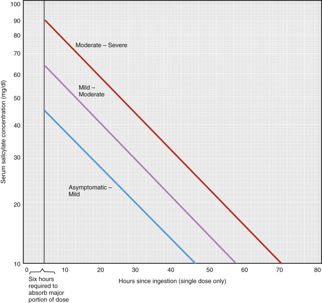

Figure 23-14 

Aspirin toxicity levels in children as a function of time. 

(  Howanitz & Howanitz, 1984  ; modified with permission from Done AK: Salicylate intoxication: significance of measurements of salicylate in blood in cases of acute ingestion, _Pediatrics_ 1960;26:800.) 

A serious toxic effect of aspirin, mainly in children but also recognized in adults, is hepatotoxicity leading to fulminant hepatic failure (i.e., Reye's syndrome). This occurs when a patient is treated with aspirin for fever during a viral illness. After apparent recovery, the patient becomes seriously ill from hepatic failure with signs and symptoms, including hepatic encephalopathy (described in [ Chapters 8 ](<##!/content/3-s2.0-B9780323295680000085?scrollTo=%23c00008>) and [ 21 ](<##!/content/3-s2.0-B9780323295680000218?scrollTo=%23c00021>) ). Although once almost always fatal, newer supportive measures have resulted in a significant increase in survival from this life-threatening condition, the basic cause of which is as yet undetermined. 

 

##  Acetaminophen 

Acetaminophen (Tylenol), or _N_ -acetyl- _p_ -aminophenol, is used as an analgesic and antipyretic to treat fever, headache, and mild to moderate myalgia and arthralgia. Acetaminophen is as effective as aspirin in its analgesic and antipyretic actions and is preferred over aspirin in patients with a bleeding/coagulation disorder or in children requiring only antipyretics or analgesics, because no association between acetaminophen and Reye's syndrome has been demonstrated. Furthermore, an accidental overdose in children may be less toxic than with aspirin; hepatotoxicity is rarely associated with acetaminophen overdose in children younger than 6 years of age. 

Oral doses of acetaminophen are rapidly and essentially completely absorbed from the GI tract. Generally, 325 to 650 mg at 4-hour intervals is prescribed for adults and children older than 12 years of age, with a maximum of 4 g daily. The plasma half-life is approximately 2 hours, with peak plasma levels of 5 to 20 µg/mL occurring in 30 to 60 minutes. Plasma protein binding is about 20% with therapeutic doses. The major metabolites of acetaminophen produced by the liver are glucuronide and sulfate conjugates, with minor metabolites being deacetylated and hydroxylated derivatives. The latter metabolite is thought to produce hepatotoxicity with overdose. 

At therapeutic levels, about 90% of acetaminophen is conjugated as glucuronides or sulfates in the liver. About 5% is converted to a toxic metabolite, _N_ -acetyl- _p_ -aminobenzoquinoneimime (NAPQI), which is hepatotoxic at high concentrations (  Rowden et al, 2006  ). It is this metabolite that causes toxic liver effects at high doses of acetaminophen in the liver by the cytochrome P450 mixed oxidase system. This metabolite is normally cleared by conjugation to glutathione (GSH) by glutathione-S-transferase (GST) in the liver. In cases of toxic levels of NAPQI, where the NAPQI levels overwhelm the GST system, acetylcysteine is administered. This compound conjugates to NAPQI, detoxifying it. 

Toxic doses of acetaminophen occur at acute ingestion levels of 140 mg/kg (  White & Wong, 1998  ). Acute manifestations of toxic doses generally occur within 2 to 3 hours after ingestion and include nausea, vomiting, and abdominal pain. A characteristic sign of toxicity is cyanosis of the skin, mucosa, and fingernails due to methemoglobinemia. However, this is seen more frequently with phenacetin poisoning. CNS stimulation followed by CNS depression may occur in severe poisoning, with vascular collapse, shock, and total seizures. Coma usually precedes death. At very high doses (as with suicide attempts), fulminant hepatic failure may occur, with maximum liver damage not becoming apparent until 2 to 4 days after drug ingestion (  Sunheimer et al, 1994  ). Chronic acetaminophen abuse may produce chronic toxicity and death. Anemia, renal damage, and gastrointestinal disturbances are usually associated with chronic toxicity. Toxic effects can be treated effectively with NAC (  Rowden et al, 2006  ). 

 

##  Immunosuppressives 

Although intact humoral and cell-mediated immunity is essential in preventing infection, it becomes vital to suppress functioning of these systems in some circumstances. These include aberrations of the immune system such as autoimmune disease (e.g., lupus erythematosus, Sjögren's syndrome) and normal functioning of the immune system (e.g., in tissue transplantation). In the latter circumstance, the most important component of the immune system is cell-mediated immunity. As shown in [ Figure 23-15 ](<#f0080>) , in host-versus-graft or in graft-versus-host disease, CD  4+  T cells become activated when a foreign antigen binds to the major histocompatibility class (II) Ia protein on the surface of macrophages (antigen-presenting cells). Specific T cell clones bind to the antigen using their T cell receptors (CD3), which recognize the antigen-Ia complex. Activation of the T cell receptor results in a signal transduction cascade that ultimately ends in engulfment via receptor-mediated endocytosis of the antigen by the macrophage and destruction in lysosomes. In this cascade, calcium ions are mobilized, resulting in the activation of calcineurin, a phosphatase that forms a complex with calmodulin. Activated calcineurin dephosphorylates cytosolic nuclear factor of activated T cells (NF-AT)  C  resulting in its activation, whereupon it translocates to the nucleus and binds to NF-AT from the nucleus (NF-AT)  N  . This transcriptionally active complex results in the synthesis of interleukin (IL)-2, which becomes secreted as an extracellular mitogen (i.e., an autocrine factor). It binds to the IL-2 receptor of the T cell, activating it toward the binding of a protein, called **target of rapamycin (TOR),** which serves to activate cyclin kinases that promote progression of the cell cycle from G1 to S and stimulate nucleotide synthesis. This ends in differentiation and proliferation of the T cell and ultimate antigen destruction. 

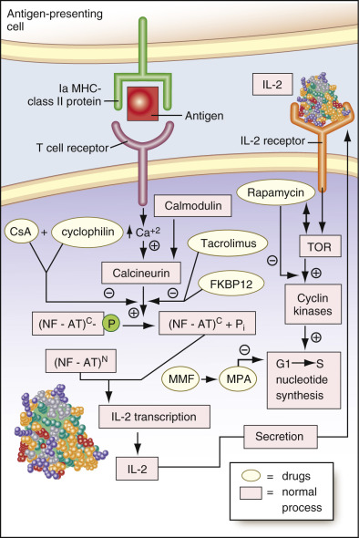

Figure 23-15 

Mechanisms and sites of action of immunosuppressive drugs. 

This figure shows two linked, centrally important signal transduction pathways induced by antigen, in this case foreign transplanted cells, for activation of cell-mediated immunity. In the first pathway, antigen is “presented” to antigen-specific (clonal) T cells by attachment of the antigen to the Ia molecule (major histocompatibility class [MHC] II—or DR in humans—protein). The formation of a ternary complex of antigen _(red box),_ Ia _(green receptor on the antigen presenting cell;_ i.e., macrophage), and the T cell receptor _(purple receptor, upper left)_ results in a signal transduction cascade that causes the synthesis of IL-2, shown as a space-filling model in the lower-left part of the figure. Critical to this pathway is activation, by calcium-activated calmodulin, of the phosphatase, calcineurin, which dephosphorylates cytosolic nuclear factor of activated T cells (NF-AT)  C  resulting in its activation; whereupon it translocates to the nucleus and binds to NF-AT from the nucleus (NF-AT)  N  , which directly promotes transcription of interleukin (IL)-2. In the second, linked, signal transduction pathway _(right side),_ newly synthesized IL-2 is then secreted by the T cell and acts as an autocrine factor in binding to the extracellular domain of the IL-2 receptor of the T cell to form a complex as shown in the upper-right part of the figure. This complex induces activation of a second signal transduction cascade in which target of rapamycin (TOR) protein is stimulated and, in turn, activates cyclin kinases that promote activation of cyclins, which, in turn, promote progression of the cell cycle from G1 to S necessary for blast transformation of clonal T cells that, with macrophages, engulf and destroy the antigen. All elements of the normal signal transduction pathways are shown as _pink boxes_ . The immunosuppressive drugs and their target proteins block different parts of these two pathways and are shown as _yellow ellipses_ . Cyclosporine (CsA) and tacrolimus complex, respectively, with cyclophilin and FKBP12 to form inhibitory complexes that block calcineurin in the first pathway. On the other hand, rapamycin blocks TOR, thereby blocking IL-2–induced blast transformation in the second pathway; mycophenolate mofetil (MMF) blocks nucleotide synthesis, thereby blocking G1-S progression in the second pathway. 

As shown in [ Figure 23-15 ](<#f0080>) , there are specific agents (  Hess et al, 1988  ;  Kahan, 1989  ;  Isoniemi, 1997  ;  Braun et al, 1998  ;  McEvoy et al, 2004  :  Krensky et al, 2006  ) that block one or more of these steps and, by so doing, inhibit antigen destruction. The drugs cyclosporine and tacrolimus are cyclic polypeptides that bind to intracellular proteins called **immunophilins.** Cyclosporine (CsA) binds to the immunophilin cyclophilin, while tacrolimus binds to the immunophilin called **FKBP12.** These complexes then block calcineurin-induced activation of NF-AT, and therefore block interleukin-2 synthesis, so that antigen destruction cannot occur. On the other hand, another immunosuppressive agent, rapamycin (Sirolimus), has no such effect on T cells, but rather binds to the critical TOR protein, disenabling activation of cyclin kinases so that T cell activation cannot proceed. Finally, mycophenolate mofetil, an antibiotic, is hydrolyzed to free mycophenolic acid in the cell. This agent is a powerful inhibitor of inosine monophosphate dehydrogenase and guanosine monophosphate synthetase, disenabling deoxypurine nucleotide synthesis, which, in turn, disables DNA synthesis uniquely in lymphocytes. Other cells have rescue pathways that circumvent this blockade, making the effects of this drug selective for lymphocytes (  Krensky et al, 2006  ). In the same vein, some alkylating agents that are generally used as chemotherapeutic agents, such as cyclophosphamide (Cytoxan), can be used to suppress DNA synthesis in T cells, but these are not selective for lymphocytes. 

It should be noted that the corticosteroids also have immunosuppressive effects on cell-mediated immunity but are much less specific and, as noted in the previous section, have multiple undesirable side effects. They are, therefore, not the drugs of choice for use in transplantation. In the following section, we discuss the properties of the more specific immunosuppressive drugs, most of which require monitoring of serum (plasma) levels (  Dunn et al, 2001  ;  Dancey, 2002  ;  Drosos, 2002  ;  Scott et al, 2003  ;  Mueller, 2004  ). 

 

##  Cyclosporine 

CsA is a cyclic polypeptide containing 11 amino acids, five of which are methylated. Maximum suppression with CsA occurs during the first 24 hours of antigen stimulation by the allograft. Thus, CsA must be administered in the early phase of the immune response for optimal suppression of T cell function and increased success of transplantation (  McEvoy et al, 2004  ). 

CsA is indicated to prevent organ rejection in kidney, heart, and liver allogeneic transplants and is the drug of choice for maintenance of kidney, liver, heart, and heart-lung allografts. CsA may also be utilized as a first- or second-line drug in the treatment of acute graft-versus-host disease following bone marrow transplantation, in the active stage of severe rheumatoid arthritis, and for severe, recalcitrant plaque psoriasis. It may also be used in the treatment of other autoimmune diseases and in organ transplantation. 

Because CsA is variably absorbed from the GI tract, the optimal dose must be carefully determined for each patient individually, and blood levels should be monitored frequently. It has been occasionally found that, although serum levels of the parent drug are low, the metabolites, some of which are active, maintain a therapeutic drug level. Therefore, in patients with apparently low levels of the parent drug, it is necessary to determine the levels of metabolites. Peak blood concentrations occur at approximately 3.5 hours after administration. About 20% to 40% of a given dose of CsA is absorbed, and it is metabolized on the first pass through the liver. Human cytochrome P450 III A3 (CYP3A) of the P450 III gene family appears to be the primary enzyme responsible for CsA metabolism. Because a number of drugs may induce or may be metabolized by this cytochrome P450 isoenzyme, coadministration of these drugs may be responsible for alterations in CsA levels that can complicate CsA therapy (  Kronbach et al, 1988  ). Agents that inhibit the CYP3A system include calcium channel blockers (e.g., verapamil, discussed earlier), antimicrobials, and HIV protease inhibitors. Grapefruit and grapefruit juice are also known to exert inhibitory effects on this system (  Krensky et al, 2006  ). Trough whole blood or plasma concentrations, at 24 hours, of 250 to 800 ng/mL or 50 to 300 ng/mL, respectively (as determined by immunoassay), are believed to minimize graft rejection and, concurrently, toxic effects. 

Adverse effects of CsA may occur in all organ systems of the body. Trough serum levels greater than 500 ng/mL are associated with CsA-induced nephrotoxicity, which is the most frequent toxic reaction seen with CsA. CsA-induced nephrotoxicity is accompanied by hyperkalemia and hyperuricemia, hypertension, and gingival hyperplasia. 

Other toxic effects include neurologic effects (tremors, seizures, headache, paresthesia, flushing, confusion), dermatologic effects (hirsutism, hypertrichosis, rash), hepatotoxicity, GI effects (diarrhea, nausea, vomiting, anorexia, abdominal discomfort), infectious complications, hematologic effects (leukopenia, anemia, thrombocytopenia), and sensitivity reactions, including anaphylaxis (  Philip & Gerson, 1998  ). It is important to note that the risk for immunosuppressed states is increased, and the occurrence of lymphoma, especially CNS lymphoma, may be associated with immunosuppression by CsA. It has also been found that CsA induces immune system–independent increased invasiveness of adenocarcinoma cells in culture, apparently by activating transforming growth factor-β (TGF-β) (  Hojo et al, 1999  ). This behavior is blocked by monoclonal antibodies to TGF-β. 

Both oral and intravenous preparations of CsA are available. Interpatient and intrapatient absorption of the oral preparation is variable, and absorption can be affected by many factors. It is generally recommended that whole blood be used for drug level monitoring, and that an assay method with high specificity for unchanged drug (vs. metabolites) be used. Thus, the optimal dose must be carefully determined for each patient individually, and blood levels should be monitored frequently, with CsA blood concentrations qualified by biological fluid (whole blood vs. plasma vs. serum) and assay method (immunoassay vs. HPLC) used. At present, any currently available immunoassay (FPIA, EMIT) is acceptable for routine monitoring, although it is important that consistent laboratories and methods be used (  McEvoy et al, 2004  ). 

Neoral is a microemulsion formulation of CsA that is miscible in water; it increases the solubility of CsA in the small bowel (  Frei et al, 1998  ). This preparation has shown superior pharmacokinetics with improved bioavailability and equivalent safety with no apparent increase in toxicity. It appears to offer advantages over oral solutions of CsA, by decreasing intrapatient and interpatient blood level variability. Intravenous CsA is reserved for patients unable to tolerate oral administration; this route of administration carries a low but definite (0.1%) risk for anaphylaxis, which does not occur following oral administration of the drug. 

 

##  Tacrolimus (FK-506) 

Tacrolimus is a macrolide lactone antibiotic with a mechanism of action similar to that of cyclosporine; it is more potent than CsA in its inhibitory effect (  McEvoy et al, 2004  ). It is currently being utilized in transplant surgery to prevent organ rejection. As is the case with CsA, higher trough concentrations of tacrolimus appear to increase the relative risk for toxicity, and therapeutic drug monitoring is recommended. The same monoclonal antibody is used in the two methods available for monitoring. One method is a microparticle enzyme immunoassay, and the other method is an enzyme-linked immunosorbent assay. Whole blood is the specimen of choice. The toxic potential appears to be similar to the toxic effects of CsA. The most common include nephrotoxicity, neurotoxicity (such as tremor and headache), gastrointestinal effects such as diarrhea and nausea, hypertension, alterations in glucose metabolism (diabetes mellitus), hyperkalemia, and infectious complications. However, unlike with CsA, gingival hyperplasia and hirsutism do not occur. Anaphylaxis may occur with intravenous administration, and oral therapy is recommended whenever possible. Tacrolimus appears to be best suited for use in combination with other new immunosuppressive agents. 

 

##  Rapamycin (Sirolimus) 

Rapamycin is an antibiotic similar to tacrolimus. Peak concentrations are reached after about 1 hour after a single oral dose or after about 2 hours after multiple doses for patients who have undergone renal transplant (  Krensky et al, 2006  ). The parent drug is the major active form, although several metabolites also have activity. About 40% of the drug is bound to serum proteins, especially albumin; it is metabolized predominantly in the liver by the CYP3A4 system (  Krensky et al, 2006  ). Major side effects include GI symptoms, abnormalities in lipid levels, anemia, leukopenia, and thrombocytopenia. It can also cause delayed wound healing; however, it does not appear to be nephrotoxic. If used in combination with cyclosporine, because sirolimus aggravates CsA-induced renal dysfunction, administration of these two drugs must be separated in time (  Krensky et al, 2006  ). 

 

##  Mycophenolate Mofetil 

Mycophenolate mofetil is a derivative of mycophenolate acid, a fungal antibiotic. The parent drug is metabolized to mycophenolic acid (MPA) within minutes of administration. The half-life of MPA is about 16 hours. Virtually all MPA is excreted in the urine as the glucuronide. This drug is used for prophylaxis of renal allograft rejection, usually in combination with a steroid or a calcineurin inhibitor (  Krensky et al, 2006  ). Although this drug appears to decrease the rate of renal allograft rejection, differences in patient and allograft survival have not been demonstrated (  Isoniemi, 1997  ). It may be of use in patients who do not tolerate CsA or tacrolimus (FK-506) well. Major side effects include GI symptoms such as diarrhea, nausea, and myelosuppression. Neither nephrotoxicity nor neurotoxicity has been demonstrated. 

 

##  Leflunomide 

Leflunomide (LFM), which inhibits lymphocyte proliferation by inhibiting dihydroorotic acid synthetase (  Krensky et al, 2006  ), critical to deoxy pyrimidine nucleotide synthesis, is an isoxazole derivative. It is presently used in the treatment of rheumatoid arthritis, the only condition for which it has been approved for treatment, although it is being used increasingly for treatment of polyoma virus nephropathy seen in immunosuppressed renal transplant recipients (  Krensky et al, 2006  ). LFM has not been demonstrated to cause nephrotoxicity or myelosuppression in humans. 

 

##  Drugs Used in the Treatment of Mania and Depression 

Both lithium and the antidepressants are used in the treatment of psychiatric affective disorders. 

 

##  Lithium 

Lithium is a monovalent cation, a member of the group of alkali metals, and is available commercially as citrate and carbonate salts. Lithium salts are considered to be antimanic agents and are used for the prophylaxis and treatment of bipolar disorder (manic-depressive psychosis) and as an adjunct to antidepressant therapy in melancholic depression (  Baldessarini, 2006  ). In addition, lithium is considered by some investigators to be the drug of choice for the prevention of chronic cluster headache, and it may be effective in episodic or periodic forms of cluster headache. Initial oral dosages of lithium for acute mania range from 0.6 to 1.8 g daily (maximum, 2.4 g) and produce a therapeutic serum level of 0.75 to 1.5 mEq/L. Once the attack subsides, the dose is reduced rapidly to produce a serum concentration of 0.4 to 1.0 mEq/L. Oral adult dosages for cluster headaches generally range from 0.6 to 1.2 g daily in divided doses. In cases of acute mania, especially in agitated, uncooperative patients, because of the relatively slow onset of action of lithium, a benzodiazepine sedative (e.g., lorazepam, clonazepam) or the anticonvulsant valproate (Depakote; see previous section) is administered until some stabilization of the agitated state is achieved. Then lithium is administered to achieve long-term stabilization. Alternatively, continuation of both drugs may be continued, or, in some cases, the patient can be maintained on Depakote alone (  Baldessarini & Tarazi, 2006  ). 

In general, serum levels of and patient response to lithium are used to individualize dosage and must be monitored carefully. Complete absorption of lithium occurs 6 to 8 hours after oral administration. Plasma half-life varies from 17 to 36 hours, and onset of action is slow (5 to 10 days). Elimination occurs almost entirely by the kidneys, and about 80% of filtered lithium is reabsorbed. Lithium is not protein bound and is distributed in total body water, but it shows delayed and varied tissue distribution. Thus, symptoms of acute intoxication may not correlate well with serum levels, because the distribution of the drug into different organs may be slow and/or varied. 

The exact mechanism of action of lithium is unknown, but lithium, as a monovalent cation, competes with other monovalent and divalent cations (such as sodium, potassium, calcium, and magnesium) at ion channels in cell membranes and at protein-binding sites such as membrane receptors and protein/peptide transport molecules and enzymes that are critical to the synthesis, storage, release, and uptake of central neurotransmitters. Lithium also has a marked inhibitory effect on inositol monophosphatase and on the synthesis of phosphatidylinositides, which are second messengers involved in neurotransmission, and on the synthesis of cAMP, also involved in neurotransmission (  Phiel & Klein, 2001  ;  Baldessarini, 2006  ,  Baldessarini & Tarazi, 2006  ). These effects are exerted on the postsynaptic side of dopamine- and norepinephrine-utilizing tracts in the mesolimbic and mesocortical pathways that inhibit the mobilization of calcium ions required for postsynaptic depolarization. The effect, then, is to inhibit neurotransmission. In addition, lithium blocks release of dopamine from presynaptic vesicles, also resulting in diminished neurotransmission. 

Toxicity may occur acutely, as the result of a single toxic dose, or chronically, from high and/or prolonged dosages or changes in lithium pharmacokinetics. Water loss (resulting from fever, decreased intake, abnormal gastrointestinal conditions such as diarrhea or vomiting, diuretics, or pyelonephritis) is the main contributing factor underlying chronic intoxication. Renal toxicity and hypothyroidism are also known possible side effects of lithium. Thus it is advisable to monitor creatinine and thyroid-stimulating hormone periodically in patients who are under continuing treatment with this drug. Severity of intoxication is not clearly related to serum lithium levels. However, an imprecise prediction of severity of intoxication may be attempted from serum lithium levels obtained 12 hours after the last dose: Slight to moderate intoxication with 1.5 to 2.5 mEq/L, severe intoxication with 2.5 to 3.5 mEq/L, and potentially lethal intoxication if greater than 3.5 mEq/L. Severity of lithium intoxication also depends on the length of time that the serum concentration remains toxic. 

The most common symptoms of mild to moderate intoxication include nausea, malaise, diarrhea, and fine hand tremor. In addition, thirst, polydipsia, and polyuria, as well as drowsiness, muscle weakness, ataxia, and slurred speech, may occur. Symptoms of moderate to severe toxicity include hyperactive deep tendon reflexes, choreoathetoid movements, persistent nausea and vomiting, fasciculations, generalized seizures, and clonic movements of whole limbs. These may progress rapidly to generalized seizures, oliguria, circulatory failure, and death with serum levels greater than 3.5 mEq/L. 

 

##  Antidepressants 

Three classes of drugs are currently used in the treatment of clinical depression: classical tricyclic antidepressants (TCAs), SSRIs, and monoamine oxidase inhibitors (MAOIs) (  Baldessarini, 2006  ). The rationale for use of the first class of drugs is their ability to block the uptake of norepinephrine at the axonal side of synapses in neural tracts from the brainstem to the forebrain that utilize this neurotransmitter, as indicated in [ Figure 23-8 ](<#f0045>) . This blockade allows longer stimulation times and higher concentrations of norepinephrine at the dendritic side of the synapse, allowing them to bind to α 1  receptors in these tracts for prolonged times, resulting in prolonged and enhanced stimulation. Drugs in the second class produce the same effect in parallel neural pathways that utilize serotonin as the stimulatory neurotransmitter (see the [ General Aspects of the Mechanisms of Action ](<#s0080>) section earlier in the chapter). Finally, MAOIs block the inactivating metabolism of both norepinephrine and serotonin neurotransmitters by inhibiting their oxidation by the enzyme monoamine oxidase, present in the mitochondria of the presynaptic (axonal) terminal, wherein their amino groups are oxidized to the corresponding aldehydes. This inhibition results in increased concentrations of these neurotransmitters. 

 

##  Tricyclic Antidepressants 

The structures of these related compounds are shown in [ Figure 23-16 ](<#f0085>) . Also shown are two other effective antidepressant drugs: doxepin and trazodone (Desyrel), a second-generation, so-called **atypical antidepressant,** which does not contain the three fused ring system of the TCAs. Besides blocking reuptake of norepinephrine at the axonal side of synapses, the TCAs have been found to _bind directly_ to two classes of norepinephrine receptors: α 1  , which occur on the postsynaptic side of the synapse, and α 2  , so-called **autoreceptors,** which occur on the presynaptic side of the synapse. The postsynaptic α 1  receptors are involved in postsynaptic membrane depolarization involving calcium ion fluxes, resulting in nerve conduction. The presynaptic α 2  receptors, when bound to norepinephrine, induce its downregulation by causing decreased synthesis of tyrosine hydroxylase, the critical enzyme that catalyzes the rate-limiting step in norepinephrine biosynthesis (  Baldessarini, 2006  ). This results in decreased levels of norepinephrine and in decreased secretion of this neurotransmitter into the synaptic cleft. 

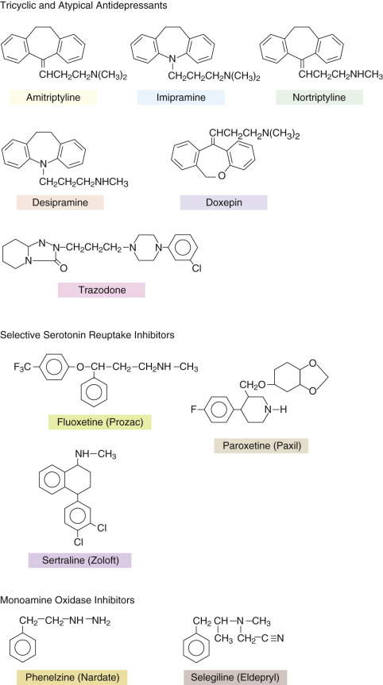

Figure 23-16 

Structures of the most commonly used drugs in the three classes of antidepressants: tricyclic and atypical antidepressants, selective serotonin reuptake inhibitors, and monoamine oxidase inhibitors. 

When the TCAs bind to α 1  receptors, they cause temporary blockade of these receptors. This effect is thought to cause the **observed side effect of initial hypotensive episodes** in patients who are treated with these drugs. Over time, the binding of TCAs to these postsynaptic receptors apparently causes **_increased_ sensitization ** of the α 1  receptors to norepinephrine, overcoming the initial inhibition, while the presynaptic reuptake blockade of norepinephrine continues unimpeded. Concurrently, binding of the TCAs to presynaptic α 2  receptors has the opposite effect from their binding to the postsynaptic α 1  receptors, that is, desensitization with resulting loss of inhibition of epinephrine biosynthesis. Thus the TCAs enhance norepinephrine-induced neurotransmission in the limbic system by blocking norepinephrine reuptake, sensitizing postsynaptic α 1  receptors, and desensitizing inhibitory presynaptic α 2  receptors. In addition, TCAs appear to block, in a nonspecific manner, the reuptake of dopamine in the dopaminergic pathways in the limbic system (  Baldessarini, 2006  ). 

Besides stimulating dopaminergic pathways, the tricyclics, especially amitriptyline, have anticholinergic effects (  Baldessarini, 2006  ). The pharmacologic side effects of the tricyclic antidepressants, in fact, reflect their anticholinergic activities. These include dry mouth, constipation, blurred vision, hyperthermia, adynamic ileus, urinary retention, and delayed micturition. Other CNS effects include drowsiness, weakness, fatigue, and lethargy, which are most common, as well as agitation, restlessness, insomnia, and confusion. Seizures and coma can also occur. Extrapyramidal symptoms may occur and include a persistent fine tremor, rigidity, dystonia, and opisthotonos. It is important to note that TCAs unfortunately have been used in suicide attempts by some depressed individuals who are being treated with them. The cardinal signs of tricyclic antidepressant overdose are anticholinergic symptoms, such as dilated pupils and dry skin. 

 

##  Toxicity. 

Overdose produces symptoms that are primarily extensions of common adverse reactions with excess CNS stimulation and anticholinergic activity. These include seizures, coma, hypotension, respiratory depression, areflexia, shock, and cardiorespiratory arrest. Agitation, confusion, hypertension, and the parkinsonian syndrome may also occur, as well as hallucinations and delirium. Occasional manifestations include ataxia, renal failure, dysarthria, and vomiting. 

 

##  Treatment. 

Symptomatic and supportive care is the general mode of treatment. Gastric lavage, accompanied by instillation of activated charcoal, is usually recommended for removal of the tricyclic from the GI tract. Seizures are generally treated with intravenous diazepam. For overdoses with amitriptyline (see [ Fig. 23-16 ](<#f0085>) ), use of cholinesterase inhibitors such as neostigmine has proved to be effective in reversing anticholinergic symptoms. 

 

##  Selective Serotonin Reuptake Inhibitors 

These are nontricyclic drugs with strong antidepressant activity that have been developed more recently. The most prominent of these is fluoxetine (Prozac), whose structure is shown in [ Figure 23-16 ](<#f0085>) . These drugs block the reuptake of serotonin in central serotonergic pathways as noted previously. Their effects on serotonin receptors parallel those of the TCAs on norepinephrine receptors, including ultimate downregulation of presynaptic autoreceptors. It is interesting to note that if the trifluromethyl group of fluoxetine is placed at the ortho rather than the para position, the resulting drug behaves as a tricyclic antidepressant (  Baldessarini, 2006  ). It is important to note that fluoxetine and SSRIs in general do not appear to cause some of the side effects, such as the anticholinergic effects, associated with TCAs. For this reason, they have become the drugs of choice for treating clinical depression, although reports have described attempted suicide with some patients, especially adolescents, who are being treated with SSRIs. In addition, SSRIs have been reported to cause nausea and decreased libido and sexual function. 

 

##  MAO Inhibitors 

MAO is a flavin-containing oxidative enzyme that is encoded by two distinct genes. The two resulting enzymes, called **MAO-A** and **MAO-B,** have about 70% sequence identity. Each enzyme is found on the mitochondrial membrane. MAO-A deaminates epinephrine, norepinephrine, and serotonin, and MAO-B deaminates phenylethylamine. Both enzymes deaminate dopamine. Several MAOIs have been synthesized that inhibit either enzyme selectively. Thus, for example, MAO-A is inhibited selectively by clorgyline, and MAO-B is inhibited by selegiline (see [ Fig. 23-16 ](<#f0085>) ). 

MAOIs are not used as the “first line” of treatment for depression because of their potential toxic effects and unfavorable interactions with TCAs and SSRIs. Toxic effects from overdoses include hypertension and/or hypotension, agitation, hallucinations, hyperreflexia, fever, and seizures (  Baldessarini, 2006  ). The combination of an MAOI with an SSRI can lead to the so-called **serotonin syndrome,** which includes akathisia, myoclonus, hyperreflexia, diaphoresis, and shivering progressing to seizures and coma. In addition, MAOIs potentiate the action of over-the-counter anticold sympathomimetic amines such that they can cause hypertensive crises and intracerebral bleeding. Therefore, it is imperative to avoid use of these anticold medications in individuals treated with an MAOI. Their use is mostly for patients who do not respond to either SSRI or TCA therapy and who refuse electroconvulsant shock therapy. 

 

##  Therapeutic Levels and Metabolism of Antidepressants 

It is difficult to obtain reference ranges for the antidepressants because of their large numbers of metabolites, some of which may be active and others of which may be inactive, and which vary significantly in concentration from individual to individual—a problem that also exists for the neuroleptics discussed later. In addition, the volumes of distribution of these drugs are quite high because most are lipophilic and thus are stored in tissue and slowly released. For the TCAs, serum levels from 100 to 250 ng/mL generally are considered therapeutic; toxic effects may result at levels above 500 ng/mL and lethal doses above 1 mcg/mL. Assays for the TCAs are performed by immunoassay (see the [ Immunochemical Methods ](<#s0015>) section earlier and [ Fig. 23-1 ](<#f0010>) ) or by HPLC (see the [ High-Performance Liquid Chromatography ](<#s0050>) section earlier and [ Fig. 23-4 ](<#f0025>) ). 

Virtually all of these drugs are metabolized in the liver using the cytochrome P450–dependent oxidase system (  Baldessarini, 2006  ). Different antidepressants require different isoforms of cytochrome P450. These isoforms include CYP2D6, CYP2C19, CYP3A3/4, and CYP1A2. In general, for both TCAs and SSRIs, oxidation, a modification that often includes glucuronidation and elimination of these drugs, occurs over several days. Most tricyclics are completely eliminated within 10 days. Secondary amine TCAs and _N_ -demethylated derivatives of SSRIs have about twice the half-lives of their parent compounds. The **atypical TCA,** trazodone, is metabolized to mCPP, a piperazine that is discussed earlier under the Drugs of Abuse section. MAOIs have much shorter half-lives than TCAs and SSRIs, requiring frequent dosing to maintain therapeutic levels. 

 

##  The Neuroleptics: Antipsychotic Major Tranquilizers 

These drugs are used mainly in the treatment of acute schizophrenia and result in suppression of the agitated state. All neuroleptics appear to block the actions of dopamine and serotonin postsynaptically in the limbic system and motor cortex (see [ Fig. 23-8 ](<#f0045>) ). Specific dopaminergic pathways, called the **mesolimbic-mesocortical pathways,** connect the substantia nigra of the midbrain to the limbic system and motor cortex (  Baldessarini & Tarazi, 2006  ). In addition, the substantia nigra connects to the basal ganglia via the nigrostriatal pathway; depletion of dopamine in this pathway results in Parkinson's disease. Thus it may be expected that dopamine antagonists would affect the latter pathway, in addition to the mesolimbic-mesocortical pathways. Indeed many of the neuroleptics have, as side effects, dystonias, tardive dyskinesias, and frank parkinsonism, the latter fortunately being much less common. Originally, two classes of neuroleptics, the phenothiazines, typified by chlorpromazine, and the butyrophenones, typified by haloperidol (Haldol), were the drugs of choice. Besides postsynaptic blockade of dopamine, Haldol is known to bind with high affinity to sigma receptors in the CNS, and this action may stimulate inhibitory pathways that modulate the activity of the dopaminergic pathways. All compounds in both classes have the undesired extrapyramidal side effects mentioned previously. In addition, the neuroleptics inhibit dopamine in the hypothalamic-pituitary tract, which inhibits release of prolactin by the pituitary gland. The effect of the neuroleptics therefore is to increase prolactin secretion by the pituitary gland, resulting in hyperprolactinemia. Treatment of patients with breast cancer with any neuroleptic that causes this effect is contraindicated (  Baldessarini & Tarazi, 2006  ). 

Newer neuroleptics have been developed that affect the nigrostriatal pathway to a lesser extent but are potent postsynaptic dopamine blockers in the mesolimbic-mesocortical pathways and therefore are effective, with fewer of the extrapyramidal side effects of the older drugs. These newer drugs (  Burns, 2001  ) include risperidone (Risperdal) (which does have some documented extrapyramidal side effects), olanzapine (Zyprexa), quetiapine (Seroquel), and aripiprazole (Abilify). 

It has been difficult to monitor the levels of any of these drugs in serum because of the large number of metabolites for each drug resulting from extensive metabolism in the liver. Chlorpromazine, for example, has approximately 150 metabolites. The therapeutic efficacy of most of these metabolites is unknown. Reference ranges for serum levels therefore have not been established. Similar to the antidepressants, the neuroleptics, being lipophilic, have high volumes of distribution and are stored in tissues from which they are released over time. 

Methods for assay include FPIA (see the [ Immunochemical Methods ](<#s0015>) section earlier and [ Fig. 23-1 ](<#f0010>) ) and HPLC (see the [ High-Performance Liquid Chromatography ](<#s0050>) section earlier and [ Fig. 23-4 ](<#f0025>) ). It is not clear in FPIA which, if any, metabolites cross-react with the antibody. For chlorpromazine, the estimated therapeutic range is wide—between 50 and 300 ng/mL. The half-life of the drug is 16 to 30 hours, and its bioavailability is 25% to 35%. Normal doses for chlorpromazine are 200 to 600 mg/day in divided doses. Other drugs in the phenothiazine series include thioridazine and fluphenazine (Prolixin). 

Besides the extrapyramidal side effects, the phenothiazines can cause orthostatic hypotension, cholestasis, and, rarely, aplastic anemia. Occasionally, contact dermatitis has been reported to occur with phenothiazines. Of great importance is the subset of patients who have been chronically treated with these drugs and develop tardive dyskinesia. In most of these patients, the motor disturbances are irreversible. 

Neuroleptics can cause a rare but important adverse reaction termed _neuroleptic malignant syndrome._ This can occur in patients who are extremely sensitive to the extrapyramidal effects of these drugs, and it may be fatal. Marked muscle rigidity, the first symptom to occur, may be followed by high fever, altered pulse and blood pressure, and leukocytosis. An excessively rapid inhibition of postsynaptic dopamine receptors is believed to be responsible for this syndrome. Treatment is cessation of the drug. 

 

##  Chemotherapeutic Agents: Methotrexate and Busulfan 

Serum levels of both of these agents are monitored to assess whether therapeutic serum levels are present. Both agents are used in the treatment of different forms of cancer. 

 

##  Methotrexate 

Methotrexate, an antimetabolite consisting of a mixture containing no less than 85% 4-amino-10-methylfolic acid and related compounds, is a folic acid antagonist ( [ Table 23-7 ](<#t0040>) ). It inhibits the enzyme dihydrofolate reductase (  Chabner et al, 2006  ). This results in blockade of the synthesis of tetrahydrofolic acid, which is needed for the formation of _N_ -5,10-methylene-tetrahydrofolate, an intermediate in the transfer of a methyl group to deoxyuridylate to form thymidylate, needed in DNA synthesis. It has also been suggested that methotrexate may cause a rise in the intracellular levels of adenosine triphosphate (ATP), which blocks ribonucleotide reduction, also resulting in blocking of DNA synthesis. Methotrexate appears to inhibit polynucleotide ligase involved in DNA synthesis and repair. Furthermore, methotrexate and its analogs, like pemetrexed, a pyrrole-pyrimidine folate analog, accumulate in cells and are stored as polyglutamates, which allows them to inhibit other enzymes in DNA synthesis, including thymidylate synthase. Methotrexate polyglutamates also inhibit enzymes involved in purine nucleotide biosynthesis such as glycinamide ribonucleotide transformylase and aminoimidazole carboxamide transformylase in the synthesis of inosine monophosphate. 

Methotrexate is used in the treatment of childhood acute lymphatic leukemia and a number of other hematologic malignancies, such as Hodgkin's lymphoma, usually in combination with other antineoplastic agents. It has also been used successfully in the treatment of choriocarcinoma (  Chabner et al, 2006  ). Pemetrexed is used to treat mesothelioma and refractory non–small-cell carcinoma of the lung. 

Methotrexate is also an important immunosuppressive agent. Indications are severe, recalcitrant psoriasis and severe, active rheumatoid arthritis; in the latter, it may be used in combination with cyclosporine (  Tugwell et al, 1995  ). Depending on the specific disease entity being treated, dosages given will vary, as will the therapeutic level of the drug. In [ Table 23-7 ](<#t0040>) , the doses and therapeutic drug levels for several different conditions are noted. The serum levels were determined by FPIA. 

The kinetics of steady-state levels of this drug is triphasic: a rapid distribution phase followed first by a renal clearance phase with a  of 2 to 3 hours, and then by a slow phase with a  of 8 to 10 hours, in which methotrexate and its metabolites are filtered through the glomerulus and secreted in the renal tubules. If renal blood flow is compromised, the third phase is slowed, allowing toxic effects of the drug to occur. Excretion of the drug is biphasic: 92% is excreted within 24 hours, and the remainder over a period of days. Approximately 50% of the drug in blood is bound to serum proteins. Based on these considerations, it is important, when treating with methotrexate, not to administer drugs that compromise renal blood flow and not to modify the drug regimen to account for reduced renal blood flow. The same considerations apply to patients with renal insufficiency. In both circumstances, it is important to monitor blood levels of methotrexate. Treatment with high-dose methotrexate and leucovorin (see later) can itself be nephrotoxic because of the tendency of methotrexate to precipitate in acidic urine. Therefore, it is important to maintain high levels of hydration and to ensure alkalinization of the urine (  Chabner et al, 2006  ). 

As with most antineoplastic agents, methotrexate does not discriminate between transformed and normal cells. The rationale for using this drug is that it will kill rapidly dividing cancer cells that require rapid DNA synthesis but will not immediately affect normal cells, many of which are not dividing. Normal cells can be “rescued” from the effects of methotrexate and its analogs by treatment with _N_ -5-formyltetrahydrofolate (called **leucovorin** or **citrovorum** ), the product of dihydrofolate reductase. Leucovorin rescue is critical in cases in which it is necessary to administer high doses of methotrexate to individuals with tumors that do not respond to normal doses of this drug. In such cases, leucovorin is given 18 to 36 hours after the initial methotrexate dose, while serum levels of methotrexate are monitored. In addition, leucovorin should immediately be administered to a patient receiving low-dose methotrexate when methotrexate overdose is suspected (  Roenigk et al, 1998  )). Serum methotrexate levels should be monitored during this time (  Grem et al, 1995  ;  Chabner et al, 2006  ). 

The methotrexate/leucovorin strategy is compromised by the existence of many fast-growing normal cells in bone marrow, the gastrointestinal tract, the skin, and other epithelial lining cells. These cells are as susceptible to the cell-killing effects of methotrexate as neoplastic cells. Thus, the toxic effects of methotrexate include hematologic effects (e.g., leukopenia, thrombocytopenia) from bone marrow suppression, gastrointestinal effects (e.g., ulceration, glossitis, stomatitis, nausea, vomiting), and dermatologic effects (e.g., urticaria, vasculitis). They further include hepatic lesions such as cirrhosis; pulmonary lesions such as pulmonary fibrosis; and CNS effects from intrathecal methotrexate, including arachnoiditis, leukoencephalopathy, and increased cerebrospinal fluid pressure. 

Toxicity of methotrexate can be treated using continuous flow hemodialysis. Alternatively, intravenous infusion of carboxypeptidase G2, a methotrexate-cleaving enzyme, results in rapid clearing of the drug (  Chabner et al, 2006  ). 

 

##  Busulfan 

Busulfan is an alkylating agent used to treat a variety of leukemias and lymphomas before bone marrow transplantation. It is cytotoxic to marrow cells and is used in combination with cyclophosphamide, which is cytotoxic to mature lymphocytes that may be involved in a graft-versus-host reaction (  Slattery & Risler, 1998  ). The therapeutic index of the drug is narrow. High plasma levels increase the possibility of development of hepatic venoocclusive disease (VOD), a potentially fatal complication. Therefore, therapeutic monitoring of busulfan levels, using HPLC or GC-MS, with measurement of the dose interval of this drug, is now routinely performed at bone marrow transplant centers. This decreases the incidence of VOD in patients whose initial serum levels of busulfan are too high and allows increasing doses for patients with too low an initial level of busulfan, thus optimizing therapeutic levels for each patient. 

Therapeutic drug monitoring of chemotherapeutic agents has been hampered by the nonuniformity in establishing appropriate dosing, concentration, therapeutic versus toxic target ranges, administration of combination chemotherapies depending on tumor type, analytical challenges with prodrugs, intracellular compounds, as well as variability in published data from pharmacologic trials. Improvement in defining concentration-effect relationships and effective utilization of population PK/PD models will likely foster more effective patient management (  Paci et al, 2014  ). 

,  

##  Toxins and Acute Poisoning 

In this section, agents that cause chronic or acute injury to the patient are discussed. This injury can be direct, as with poisons such as cyanide and carbon monoxide, or indirect, as with carcinogens that induce mutations in genes that encode proteins that are critical in controlling the cell cycle. 

 

##  Environmental Carcinogens 

Over the past decade or so, attention has been focused on the effects of chemical agents in the environment (carcinogens) that predispose individuals exposed to them to develop tumors in various tissues where these agents accumulate. Many of the individuals who are exposed to these agents work in industries where these agents are produced. Benzpyrene, an aromatic compound produced in cigarettes and in the exhaust of engines, is a known potent carcinogen and has been implicated in causing lung cancer. Nitrites, used as preservatives in red meats, have been associated with colon cancer. Aflatoxin, produced by the fungus _Aspergillus,_ has been implicated in causing hepatocellular carcinoma. Aromatic hydrocarbons such as benzene and ionizing radiation have been implicated in causing acute leukemias. Vinyl chloride and the formerly used dye Thorotrast have been linked to angiosarcoma. Benzidine dyes, β-naphthylamine, dimethylbenzanthracene, and other aromatic compounds have been linked to multiple malignancies occurring in humans. Exposure to asbestos has been strongly implicated as a carcinogen in lung cancer and mesothelioma. In animal studies, polychlorinated biphenyls (PCBs) and dioxin, the former produced in fires, have been strongly implicated as causing a variety of cancers. 

A number of carcinogens, like benzpyrene, are inactive in their native forms but are transformed into carcinogens through oxidative reactions catalyzed by cytochrome P450–dependent systems. Thus, to be an active carcinogen, benzpyrene must be converted into benzpyrene diol epoxide. Because only particular isoforms of cytochrome P450 react with particular carcinogens, only those individuals carrying the genes that encode these forms are susceptible (  Caraco, 1998  ). A major effort is now being devoted to identifying those individuals with phenotypes who would be at risk (  Peto, 2001  ). 

Much interest has been focused on workers in occupations where carcinogens are present in significant amounts. Steel foundries, shipbuilding and rubber plants, and other industrial plants may produce such carcinogens in significant amounts. In some of these industries, certain cancers occur at rates higher than in the general population (  Brandt-Rauf & Pincus, 1998  ;  Pincus & Friedman, 2003  ). Thus, in these exposed populations, it has become desirable to determine the levels of exposure to certain known carcinogens. 

Carcinogens are thought to bind to DNA, leading ultimately to mutations in the genetic code, often resulting in synthesis of mutated proteins involved in control of the cell cycle (  Brandt-Rauf & Pincus, 1998  ;  Pincus & Friedman, 2003  ). These proteins are called **oncogene-encoded proteins or oncoproteins.** Mutagenesis, oncogenes, and oncoproteins are discussed in [ Chapter 74 ](<##!/content/3-s2.0-B9780323295680000747?scrollTo=%23c00074>) . 

In populations with histories of exposure to carcinogens, assays have been developed to detect the presence of these carcinogens or of their DNA adducts. For detection of most unmodified carcinogens, the method of choice is currently GC-MS. For certain carcinogenic compounds like PCBs, the method of electron capture is used. Halogenated compounds like PCBs are separated on a GC column using an ionized gas as the carrier. Halogenated compounds “capture” electrons conducted through the carrier gas and thus are detected by the reduced currents. 

Often, the presence of carcinogens in blood or urine is hard to detect directly. The carcinogens, however, may be bound to proteins or to DNA intracellularly. These adducts can be detected using Western blotting, which takes advantage of the existence of monoclonal antibodies to carcinogen–DNA adducts (  Santella et al, 1987  ;  Perera et al, 1988  ). This technique is sensitive to nanogram quantities of the nucleic acid adduct, which can be conveniently harvested from peripheral lymphocytes. It is also very useful in detecting oncoproteins in the body fluids of patients who have been exposed to carcinogens (  De Vivo et al, 1994  ), as described in [ Chapter 74 ](<##!/content/3-s2.0-B9780323295680000747?scrollTo=%23c00074>) . 

 

##  Cyanide 

The cyanide anion binds avidly to iron in the ferric or trivalent state. Because cyanide forms a relatively stable cyanoferric complex, it is able to inactivate iron-containing enzymes that cycle between the ferrous and ferric states in oxidation–reduction reactions. Cyanide produces tissue and cellular hypoxia primarily by reversibly binding to cytochrome A3 and by inhibiting its reoxidation. This inhibits the electron transport system and prevents cellular respiration and ATP (high-energy phosphate) formation. This blockade prevents the utilization of oxygen and aerobic metabolism, producing severe metabolic (lactic) acidosis. Although cyanide binds preferentially to the ferric form of iron, it can also bind to the ferrous iron of hemoglobin, producing cyanohemoglobin, which cannot transport oxygen. Cyanide will form complexes with other iron-containing enzymes, but its acute poisonous effect is attributable to the inhibition of electron transport and cell death, predominantly in the CNS. 

The principal symptoms of cyanide overdose are tachypnea (initially), followed by respiratory depression and cyanosis, hypotension, convulsions, and coma. Death may occur in a matter of minutes because cyanide is a fast-acting toxin. Diagnosis may be difficult, and a high index of suspicion is needed to make the correct diagnosis. Clues include the odor of bitter almonds, the occurrence of an altered mental status and tachypnea in the absence of cyanosis, and an unexplained metabolic acidosis (with an increased anion gap). 

Antidotal therapy has been based on a two-step strategy: First, to pull the CN  – ions away from cytochrome A3, hemoglobin is converted to methemoglobin (Fe  3+  state) by using specific oxidants (i.e., amyl nitrite and sodium nitrite). The former is given first because it can be inhaled. Methemoglobin directly competes with ferricytochrome A3 to form a methemoglobin–CN  – complex. This cyanomethemoglobin complex is relatively nontoxic. In a second step, sodium thiosulfate is given intravenously. This reagent reacts with cyanomethemoglobin to form thiocyanate, which is harmless and is excreted in the urine. The first step is necessary simply to remove CN  – from the respiratory chain. Approximately 25% to 40% of the patient's total hemoglobin is converted to methemoglobin in this step; this methemoglobin is rapidly reconverted to oxyhemoglobin by red blood cell enzymes. The antidotes that are involved in each step are sold commercially as a cyanide antidote package by Eli Lilly and Company (Indianapolis). Cyanide also binds tightly to cobalt ions, and hydroxocobalamin (a form of vitamin B  12  ) has recently been approved by the U.S. Federal Drug Administration as a cyanide antidote (Cyanokit, King Pharmaceuticals, Bristol, Tenn.). It has the advantages of rapid onset of action and low toxicity at antidotal doses, making it suitable for prehospital administration to firefighters and others (  Hall et al, 2009  ). Unfortunately, hydroxocobalamin has a different type of side effect that clinicians need to be aware of, namely, that its deep red color can interfere in certain assays (  Beckerman et al, 2009  ). 

 

##  Carbon Monoxide 

Carbon monoxide (CO) intoxication produces tissue hypoxia as a result of decreased oxygen transport. CO disrupts oxygen transport by binding to hemoglobin to form a reversible complex, carboxyhemoglobin (CO-Hb). It produces toxicity by decreasing or inhibiting oxyhemoglobin saturation by inducing a leftward shift of the oxyhemoglobin dissociation curve, causing a decrease in oxygen delivery to tissues, and by binding to other heme-containing proteins such as myoglobin and cytochrome A3 (  Kao & Nanagas, 2006  ). Binding to cytochrome A3 inhibits cellular respiration and electron transport, as occurs with cyanide poisoning (see earlier), and binding to hemoglobin decreases the oxygen reserve available to cardiac and skeletal muscle, with cardiac muscle being more severely affected. 

However, binding of CO to hemoglobin cannot explain all of its toxic effects. Exchange transfusion into dogs of compatible blood that contained 57% to 64% CO-Hb (levels that are fatal) failed to induce any effect on the recipients (  Goldbaum et al, 1975  ;  Kao & Nanagas, 2006  ). The role of CO in inducing toxicity is therefore more complicated. In fact, numerous studies suggest that CO, in addition to its binding to hemoglobin and cytochrome A3, is involved in multiple other toxicity-inducing pathways. These include direct cellular toxicity caused by its binding to myoglobin, resulting in direct damage to skeletal and cardiac muscle. Further, it has been found that CO activates guanylyl cyclase in the CNS; this results in increased cyclic guanosine monophosphate that induces cerebral vasodilatation and can cause loss of consciousness. CO also induces the synthesis of nitric oxide (NO), a potent vasodilator that causes large decreases in systemic blood pressure. CO-induced damage to CNS structures such as the basal ganglia, white matter, and hippocampus correlates with the degree of systemic hypotension that it induces. Abnormally elevated levels of NO appear also to cause oxidative damage to the brain, resulting in delayed neurologic sequelae (DNS). This effect may be due to the ability of NO to enhance the ability of neutrophils to adhere to the endothelium via specific adherence molecules, such as β 2  -integrin, which results in free-radical formation via activation of such enzymes as xanthine oxidase (  Kao & Nanagas, 2006  ). These free-radicals are thought to cause the oxidation of brain lipids that may serve as a basis for the observed DNS (  Kao & Nanagas, 2006  ). Animal studies have further revealed that cerebrovascular vasodilation is inhibited by NO inhibitors. In addition, in several animal studies, it has been found that CO induces changes in myelin basic protein (MBP) that may cause an immunologic reaction. This effect is obviated in rats that have been made immunologically tolerant to MBP before exposure to CO (  Kao & Nanagas, 2006  ). 

Because the brain and the heart are most susceptible to carbon monoxide poisoning, CO intoxication is commonly manifested through respiratory, neurologic, and cardiac symptoms, with dyspnea being a principal symptom. Others include headache, visual disturbances, tachycardia, syncope, tachypnea, coma, convulsions, and death. However, diagnosis is difficult because no pathognomonic sign occurs, except for a cherry red color of the face that is a strong clue to acute CO poisoning. However, this sign is not common in CO poisoning (  Kao & Nanagas, 2006  ). Another problem is delayed neurologic symptoms that develop from days to months after apparent recovery. These include mental deterioration, mutism, memory impairment, gait disturbance, and urinary and fecal incontinence, which may be caused by NO-induced damage to CNS membrane lipids and cerebral vasodilation as discussed previously (  Kao & Nanagas, 2006  ). 

CO poisoning should enter into the differential diagnosis of an acute encephalopathic state in the appropriate circumstances or setting. Car exhaust fumes cause more than 70% of known CO poisoning, including attempted suicides and chronic incidental exposure (e.g., auto repair). In addition, exposure to house fires, indoor heaters, and stoves predisposes to CO toxicity. 

A CO-oximeter is utilized to make the definitive diagnosis by measuring the concentration of blood CO-Hb. This instrument is a dedicated spectrophotometer that measures total hemoglobin and the percentages of CO-Hb, oxyhemoglobin, and methemoglobin by screening at four different wavelengths simultaneously. This accurate and rapid analysis is mandatory to establish the diagnosis and should be performed with minimal delay after CO exposure. CO may also be quantitated by gas chromatography or GC-MS. Treatment is mainly with 100% oxygen, in some cases under hyperbaric conditions, with additional supportive treatment given as necessary. 

 

##  Alcohols and Glycols 

 

##  Ethanol 

Ethanol ( [ Table 23-8 ](<#t0045>) ) is probably the most common drug of abuse and is frequently responsible for the presentation of patients with altered mental status to hospitals and emergency rooms. Ethanol is rapidly absorbed from the gastrointestinal tract, has a volume of distribution approximately equal to that of total body water, and diffuses freely in body tissues. It is predominantly metabolized by hepatic alcohol dehydrogenase to acetaldehyde and acetic acid/acetyl coenzyme A and then, by way of the Krebs cycle, to carbon dioxide and water. The fatal dose is generally 300 to 400 mL of pure ethanol (600 to 800 mL of 100-proof whiskey) consumed in less than 1 hour. Peak plasma concentrations are usually reached within 1 hour after ingestion. [ Table 23-8 ](<#t0045>) summarizes the effects of different levels of ethanol in serum on human function. 

TABLE 23-8 

Influence of Acute Ethanol Ingestion on Ethanol Levels and Behavior 

Ounces  |  Blood Concentration  |  Influence   
---|---|---  
1-2  |  10-50 mg/dL (2.2-10.9 mmol/L)  |  None to mild euphoria   
3-4  |  50-100 mg/dL (10.9-21.7 mmol/L or greater)  |  Mild influence on stereoscopic vision and dark adaptation   
|  100 mg/dL (21.7 mmol/L)  |  Legally intoxicated   
4-6  |  100-150 mg/dL (21.7-32.6 mmol/L)  |  Euphoria; disappearance of inhibition; prolonged reaction time   
6-7  |  150-200 mg/dL (32.6-43.4 mmol/L)  |  Moderately severe poisoning; reaction time greatly prolonged; loss of inhibition and slight disturbances in equilibrium and coordination   
8-9  |  200-250 mg/dL (43.4-54.3 mmol/L)  |  Severe degree of poisoning; disturbances of equilibrium and coordination; retardation of the thought processes and clouding of consciousness   
10-15  |  250-400 mg/dL (54.3-86.8 mmol/L)  |  Deep, possibly fatal, coma   
  
Ethanol acts as a sedative-hypnotic and depresses the CNS irregularly in descending order from cortex to medulla. Acute intoxication may be manifested by decreased inhibitions, incoordination, blurred vision, slurred speech, stupor, coma, seizures, and death. Most fatal intoxications occur at blood concentrations greater than 400 mg/dL. Capillary and arterial blood samples most accurately reflect brain ethanol concentrations. Serum ethanol concentrations are usually determined by enzymatic, gas chromatographic, or electrochemical oxidation techniques. In the most accurate assays for ethanol, serum is incubated with alcohol dehydrogenase, which oxidizes ethanol to acetaldehyde, and nicotinamide adenine dinucleotide (NAD) is converted to NADH (reduced form of NAD). Thus, simple monitoring for the absorbance of the incubated serum at 340 nm gives a direct determination of alcohol present. Acute poisoning is generally treated by supportive therapy, gastric lavage with tap water, or hemodialysis, if indicated (>500 mg/dL). Symptoms of chronic intoxication, such as acute alcoholic mania, may be treated with diazepam. Phenytoin may be utilized in patients with a history of seizures. 

 

##  Methanol 

Methanol (wood alcohol) poisoning occurs in patients who ingest methylated spirits or methanol-containing antifreeze. It is rapidly absorbed from the gastrointestinal tract and is metabolized and excreted at approximately 20% of the rate of ethanol. The toxic range is thought to be 60 to 250 mL, although as little as 15 mL has caused death. Alcohol dehydrogenase metabolizes methanol to formaldehyde and formic acid, which is responsible for ocular toxicity (diminished light sensation or frank blindness), and anion gap metabolic acidosis; these are the principal symptoms of intoxication. Other symptoms include nausea, vomiting, headache, seizures, and coma. GC-MS is used to measure blood methanol levels, with a peak level greater than 50 mg/dL considered toxic. In addition, serum osmolality levels are increased to levels greater than 300 mOsm. Methanol (or ethylene glycol) poisoning should be considered in acutely ill patients with hyperosmolarity, metabolic acidosis, and increased anion gap. 

 

##  Osmolal Gap 

For methanol, ethylene glycol, and isopropyl alcohol poisoning, because the molecular masses of these simple compounds are low, relatively small quantities in serum give rise to high serum osmolalities. As discussed in [ Chapter 8 ](<##!/content/3-s2.0-B9780323295680000085?scrollTo=%23c00008>) , serum osmolality can be estimated as Na × 2 + glucose/18 + blood urea nitrogen/2.8. This value should be close to the serum osmolality measured by freezing-point depression. If, however, any of these three compounds (or ethanol) is present in serum, the computed osmolality will be significantly less than the measured value (i.e., a so-called **osmolal gap** will exist), suggesting that a toxin is present. This is an effective screening method as a first step in detecting the presence of toxic compounds. 

 

##  Ethylene Glycol 

Ethylene glycol (1,2-ethanediol) is used in car radiator antifreeze. It has a half-life of around 3 hours and is metabolized to three major toxic compounds: glycolaldehyde, glycolic acid, and glyoxylic acid. The oxidation of ethylene glycol to glycolaldehyde is catalyzed by liver alcohol dehydrogenase. Both oxalic acid and formic acid are formed in smaller amounts. Oxalic acid itself is a highly toxic compound, which can rapidly precipitate as calcium oxalate crystals in various tissues as well as in urine. The formation of these crystals in urine, although not a constant finding, is an important diagnostic clue to ethylene glycol poisoning. The metabolite that accumulates in the highest concentrations in the blood is glycolic acid, and its concentration in blood and urine appears to correlate directly with symptoms and mortality. It is the major contributor to the high anion gap seen in metabolic acidosis. The fatal dose of ethylene glycol is around 100 g, and anuria and necrosis are the principal symptoms of acute poisoning. Other symptoms include nausea and vomiting, myoclonus, seizures, convulsions, depressed reflexes, and coma. Definitive diagnosis of ethylene glycol intoxication can be made by measuring serum ethylene glycol and glycolic acid by HPLC. 

Treatment of ethylene glycol and methanol toxicity is similar and is based on symptoms and serum level. The mainstay of treatment is inhibition of the alcohol dehydrogenase enzyme, to minimize the formation of toxic metabolites, while the relatively nontoxic parent alcohol is eliminated renally. Although ethanol was originally used as a competitive inhibitor of alcohol dehydrogenase, the nonintoxicating agent fomepizole (4-methylpyrazole, Antizol, Paladin Labs, Montreal, Canada) is now generally preferred (  Brent, 2009  ). Dialysis, either hemodialysis or peritoneal dialysis, is utilized to remove either parent compound and its corresponding toxic metabolic products. 

Isopropyl alcohol has a half-life of approximately 3 hours and a volume of distribution similar to that of ethanol. It is readily absorbed through the GI tract and is metabolized at approximately 50% of the rate of ethanol. The metabolism of isopropanol occurs mainly by alcohol dehydrogenase to produce acetone, carbon dioxide, and water. The fatal dose of ingestion is 250 mL. Both isopropyl alcohol and its major metabolite, acetone, are CNS depressants. 

CNS depression is the principal symptom of acute isopropanol intoxication. In addition, it produces significant GI irritation, which may be manifested by nausea and vomiting, including hematemesis and melena, abdominal pain, and gastritis. Other symptoms include confusion, coma, hypertension, respiratory failure, and death. 

The diagnosis of isopropanol intoxication is difficult to make. Clues to the diagnosis include acetonuria, acetonemia and hyperosmolarity without glycosuria, hyperglycemia, or acidosis. Gas chromatography is generally considered to be the best technique to determine isopropanol blood concentrations. Treatment includes supportive care, activated charcoal with gastric lavage, and hemodialysis in severe poisoning. 

 

##  Arsenic 

Arsenic is used in ant poisons, rodenticides, herbicides and weed killers, insecticides, paints, wood preservatives, and ceramics, in the production of various metal alloys and livestock feed, as a tanning agent, and in medicines. Inorganic arsenicals, including sodium arsenate and lead or copper arsenite; organic arsenicals, such as carbarsone and tryparsamide; and arsine gas are the major toxicologic forms of arsenic. Arsine gas poisoning generally occurs in the industrial setting, where its production arises from the action of acid or water on arsenic-bearing metals. Arsenic compounds occur in three oxidation states: elemental, trivalent arsenite, and pentavalent arsenate. 

Arsenic is readily absorbed through the GI tract and lungs, whereas absorption through the skin occurs more slowly. Twenty-four hours after ingestion, arsenic is distributed to all body tissues. The major route of excretion is through the kidneys. Arsenic can cross the placenta. The major concern with arsenic ingestion is systemic poisoning, presumably through its reversible interaction with multiple enzyme sulfhydryl groups. This, in turn, leads to the disruption of multiple metabolic systems. This phenomenon suggests that effective treatment of arsenic poisoning would be provided through administration of sulhydryl-containing compounds that would compete with those of proteins for binding to the different forms of arsenic, as discussed later. 

Arsine gas, the most dangerous of the three forms of arsenic, may irreversibly attach to sulfhydryl groups of hemoglobin, causing intravascular hemolysis, hemoglobinemia, and consequent acute renal failure, as well as direct nephrotoxicity. The acute fatal dosage of arsenic trioxide is approximately 120 mg, whereas less than 30 parts per million (ppm) of arsenic gas can produce poisoning. Organic arsenicals release arsenic slowly and have a fatal dose of approximately 0.1 to 0.5 g/kg. 

Acute toxicity is usually manifested within the first hour of ingestion and generally reflects multiorgan involvement. Gastrointestinal symptoms are the most common presentation, with burning and dryness of the mouth and throat, difficulty swallowing, vomiting, and watery or bloody diarrhea containing shreds of intestinal lining or mucus. The odor of garlic may be on the breath, and a metallic taste in the patient's mouth. Cyanosis, hypotension, tachycardia, and ventricular arrhythmias may develop. Neuropathy usually occurs late (approximately 1 to 2 weeks) after ingestion, or may become most intense during this time period. Severe volume depletion with resulting hypovolemic shock and acute renal tubular necrosis may occur, with death resulting from circulatory failure. Cutaneous manifestations of arsenic poisoning include hyperpigmentation of the skin and keratosis. The nail beds can show transverse white striations, called **Mees lines,** although this is not specific for arsenic poisoning (  Ibrahim et al, 2006  ). Symptoms of poisoning with arsine gas usually manifest approximately 2 to 24 hours after exposure and may initially include nausea and vomiting, headache, anorexia, and paresthesias. Hematemesis and abdominal pain are also common, and acute renal failure, cardiac damage, anemia and hemolysis, or pulmonary edema may occur. The diagnosis of chronic intoxication is usually difficult and should be considered in patients with a combination of GI symptoms, neuropathy, and cutaneous, cardiovascular, and renal disturbances. 

Analysis of urine, hair, and nails, using ion emission spectroscopy, is important for the diagnosis of chronic arsenic poisoning. 

Treatment of acute poisoning includes removal of residual arsenic by gastric lavage or emesis, and treatment with dimercaprol, or British antilewisite (BAL), which combines with arsenic through its sulfhydryl groups to produce cyclic water-soluble complexes. However, the inherent toxicity of this compound limits its therapeutic usefulness. Less toxic derivatives of BAL are available, such as 2,3-dithioerythritol, which is less toxic in cell culture but shows greater efficacy than BAL at rescuing arsenic-poisoned cells in culture (  Boyd et al, 1989  ). In severe poisoning, hemodialysis can be used to remove the arsenic-dimercaprol complexes. 

 

##  Mercury 

Mercury compounds exist in four different forms with different toxicologic potential: elemental or metallic (Hg  o  ); mercurous (Hg  \+  ); mercuric (Hg  2+  ); and alkyl mercury (i.e., organomercurials). Elemental mercury is poorly absorbed from the GI tract if mucosal integrity is preserved and shows no toxic effect unless it is converted to the divalent form. This may occur slowly by oxidation-reduction with water and chloride ion if a GI site for mercury stasis exists, but this is uncommon. Significant poisoning occurs with elemental mercury when it is inhaled or absorbed through the skin. It can pass through the blood-brain barrier and can accumulate in the CNS, where oxidation produces mercuric ion; thus, primarily pulmonary and CNS toxicities are produced. 

Of the two inorganic salts of mercury, mercurous (Hg  \+  ) salts are poorly soluble and thus poorly absorbed. However, the mercuric (Hg  2+  ) salt is readily soluble and is readily absorbed after oral ingestion or inhalation. Severe inflammation of the mouth and other GI symptoms can result. The kidney is a preferred site of accumulation of inorganic mercuric compounds, where acute renal tubular and glomerular damage can ensue. Both elemental mercury and the inorganic mercury compounds are excreted mainly in the urine. 

In contrast to elemental and inorganic mercury, organic mercury compounds, containing alkyl, aryl, and alkoxyalkyl moieties, are environmental pollutants. These compounds contain at least one covalent mercury-carbon bond. Both the alkoxyalkyl and aryl mercurial compounds undergo metabolic breakdown and biotransformation to produce inorganic mercury, which toxicologically acts and manifests intoxication as would the previously mentioned inorganic mercury compounds. In contrast, the mercury-carbon bonds that occur within the methyl and ethyl forms are extremely stable and produce greater toxicity than the aryl and alkoxyalkyl forms. The alkyl forms are more lipid soluble, pass readily through biological membranes, and, on ingestion, show generally greater absorption into the body. Their major chemical effect is on the CNS, and they show a biological half-life of 70 to 90 days. A devastating effect of methylmercury, known as _congenital Minimata disease,_ has been described in Japan in the children of mothers who were exposed to methylmercury and were born with many of the stigmata of cerebral palsy (  Ibrahim et al, 2006  ). 

Because bile is the major route of excretion, methylmercury can be reabsorbed into the blood, via the enterohepatic system, accounting, in part, for its extended half-life. The major mechanism of action of mercury poisoning is through covalent bonding with protein sulfhydryl groups, producing widespread and nonspecific enzyme dysfunction, inactivation, and denaturation. Mercury inhibits the enzyme catecholamine- _O_ -methyltransferase, a major enzyme in the metabolism of catecholamines, especially epinephrine and norepinephrine (see [ Chapter 24 ](<##!/content/3-s2.0-B9780323295680000243?scrollTo=%23c00024>) ), resulting in hypertension, tachycardia, and sweating (  Ibrahim et al, 2006  ). Thus mercury poisoning can masquerade as a pheochromocytoma, which should be ruled out by performing 24-hour urine catecholamine determination (see [ Chapter 24 ](<##!/content/3-s2.0-B9780323295680000243?scrollTo=%23c00024>) ). At the same time, blood mercury levels should be determined (reference range <10 µg/L). Unfortunately, the usefulness of this testing is limited by the short half-life of mercury in the blood. 

Mercury, depending on its form, may cause systemic toxicity or local skin and mucous membrane lesions. Both organic and elemental mercury can cause CNS effects, whereas GI symptoms primarily occur with inorganic salts. Elemental mercury may produce severe pulmonary reactions. Chronic exposure to elemental mercury can give rise to two syndromes: acrodynia and erethism (  Ibrahim et al, 2006  ). Acrodynia, also called **pink disease, Feer-Swift disease,** and **Feer syndrome,** occurs mainly in children but can also occur in adults, and involves a complex of symptoms that include a desquamating, erythematous rash of the palms and soles, sweating, hypertension, tachycardia, pruritus, poor muscle tone, and weakness of the proximal pelvic girdle. Erethism is a complex of neurologic symptoms that include, most prominently, personality changes involving memory loss, drowsiness, withdrawal, depression, and irritability. A fine-motor intention tremor of the hands also occurs. Inorganic mercury can induce severe renal tubular damage, especially in the proximal tubule; chronic exposure can cause membranous glomerulonephritis and nephrotic syndrome (  Ibrahim et al, 2006  ). 

In general, acute toxicity, with elemental, inorganic, or most organic forms, can be diagnosed from 24-hour urine levels. Blood levels may rise rapidly after acute exposure, but fall rapidly and may not reflect total body burden. In contrast, because the short-chain alkyl organic mercuric compounds are mainly excreted in the bile, blood levels are better indicators of tissue levels and significant acute exposure. Hair analysis for mercury may help identify chronic mercury exposure, especially with organic mercury. 

Treatment includes gastric lavage or emesis to remove the ingested poison, as well as the use of dimercaprol and succimer. However, in methylmercury and alkylmercury poisoning, dimercaprol is contraindicated because it has been found to increase the concentrations of these compounds in the brain (  Bryson, 1989  ). In these cases, treatment is symptomatic, although new agents are being evaluated clinically. 

 

##  Iron 

Acute iron poisoning is common in young children and is usually the result of ingestion of iron-containing products. Generally, iron overload that causes increased deposition of iron in tissues is termed _hemosiderosis_ ; if the excess iron induces tissue damage, the condition is termed _hemochromatosis_ . Hemochromatosis can be inherited or acquired. Acquired hemochromatosis is caused by overingestion of iron or by leakage of iron from red blood cells, as may occur in a hemolytic crisis. Although ferric ions from food are usually reduced to ferrous ions and absorbed in the stomach, the large and small bowel can rapidly absorb toxic amounts (>30 mg/kg) of elemental iron. Once absorbed into the body, iron removal is difficult. Large doses of iron are thought to cause acute mucosal cell damage, and significant absorption of iron occurs once the binding capacity of transferrin is exceeded. Unbound iron in serum causes toxicity by hepatic cell damage, shock, and production of lactic acidosis. The hepatotoxicity seems to be dose related, occurs within 1 to 2 days of ingestion, and has been associated with levels equal to or greater than 1700 µg/dL (  Tenenbein, 2001  ). 

Iron absorption is tightly regulated by the HFE gene–encoded protein that is expressed mainly on hepatocytes and on epithelial cells in the gastrointestinal tract. This protein interacts with another protein synthesized in the liver called **hepcidin.** In addition, HFE protein interacts with transferrin receptors. In inherited or primary hemochromatosis, sometimes associated with other diseases such as type 2 diabetes (  Davis et al, 2008  ), mutations in the _HFE_ gene that result in single amino acid substitutions at critical positions in the amino acid sequence, such as cysteine-to-tyrosine 282 (C282Y) and histidine-to-aspartic acid 63 (H63D), cause this protein to fail to regulate iron absorption in the gut, resulting in iron overload. The occurrence of hereditary hemochromatosis is on the order of 1 per 200 to 300 individuals, making this condition important as a cause of iron overload. Recent studies have further determined that patients who have received more than 10 transfusions with packed red blood cells are at risk for developing acquired hemochromatosis (  Takatoku et al, 2007  ). 

 

##  Assays for Serum Iron 

Iron can be determined by specialized techniques for trace elements such as atomic absorption spectrophotometry, but in the modern clinical laboratory setting, it is almost always measured using a colorimetric indicator such as ferrozine. The Fe  2+  -ferrozine complex has an intense purple color (absorption maximum, 562 nm), and other metal ions generally do not interfere, with the possible exception of copper, whose effects can be minimized through addition of thiourea. It is necessary to use a reagent such as acid or detergent to release the serum iron from transferrin, and another reagent such as ascorbate to reduce iron to the ferrous state. 

 

##  Iron-Binding Capacity 

Normally all iron present in serum is bound to the iron-transporting protein, transferrin, which contains two iron-binding sites per transferrin molecule. In evaluating iron poisoning, it is important to measure iron-binding capacity, because toxicity will drastically increase as that capacity is exceeded. To obtain the total iron-binding capacity (TIBC), saturating concentrations of iron are added to a serum sample, excess iron is removed, for example, by adsorption with MgCO  3  , and iron is remeasured. Alternatively, the amount of excess iron can be measured, and subtraction from the concentration of iron added gives the unsaturated iron-binding capacity. 

 

##  Signs of Iron Intoxication 

Vomiting appears to be an early manifestation of iron intoxication, along with severe gastroenteritis, melena, abdominal pain, and hematemesis. This occurs up to 6 hours after ingestion. For up to the next 10 hours, the patient may appear to improve. This is deceptive because manifestations of systemic toxicity (cyanosis, convulsions, shock, coagulopathy, renal and hepatic failure) may occur, producing death. Patients who develop severe systemic symptoms and those who do not may develop late complications, including GI obstruction or stricture. 

Definitive diagnosis is made with measurements of serum iron concentration and TIBC. In addition to supportive treatment, emesis or gastric lavage is used to prevent iron absorption. Chelation therapy with deferoxamine is also utilized if the acute intoxication is severe. 

 

##  Lead 

Both organic and inorganic compounds of lead may be highly toxic, with their most serious effects occurring in the central and peripheral nervous systems. Absorption may occur by inhalation or ingestion. If more than 0.5 mg/day of lead is absorbed, lead accumulation and toxicity are believed to occur, whereas 0.5 g of absorbed lead is considered a fatal dose. However, acute toxicity is uncommon and is generally observed in patients who have been exposed to high concentrations of lead dusts. Lead poisoning is seen in children in large cities who consume lead in the form of paint (pica). Acute manifestations are primarily CNS symptoms (encephalopathy, convulsions, stupor) and GI symptoms such as colic. Chronic toxicity with lead accumulating in blood, soft tissues, and bone is more common. The largest body compartment of lead is bone, which contains approximately 96% of the total body burden. The half-life of lead in bone is 32 years, and bone may act as a reservoir for endogenous intoxication. Chronic toxicity may be manifested by a wide range of systemic effects, including general malaise, weight loss, anorexia, and constipation; lead encephalopathy exhibited by malaise with apathy, drowsiness, stupor, and seizures; peripheral neuropathy with wrist drop or foot drop; and lead nephrosis with albuminuria, hematuria, and pyuria and anemia (hypochromic, microcytic, or normocytic) with basophilic stippling—the latter finding often a strong clue. 

In addition, lead-induced pathologic changes may occur at even low levels of lead exposure.  Needleman and Gatsonis (1990)  reviewed 24 studies of childhood lead exposure to provide statistical evidence that low doses of lead may produce an intellectual deficit in children. However, the association of increased lead levels with decreased IQ has been called into question by the presence of confounding factors (  Ibrahim et al, 2006  ).  Schwartz and colleagues (1990)  examined lead-induced anemia in children 1 to 5 years of age, using a cross-sectional epidemiologic study. They found a relationship between age, blood lead level, and hematocrit such that younger children had an increased risk for anemia at lower blood levels than children only a few years older. It thus appears that lead may produce deleterious effects, especially in children, at low levels of exposure. Generally, blood lead levels greater than or equal to 10 µg/dL indicate excessive lead absorption in children, and concentrations greater than 25 µg/dL indicate consideration of chelation therapy in the child. Several more recent studies suggest that no neurologic benefit is derived from chelation therapy among children with blood lead levels between 20 and 44 µg/dL (  Ibrahim et al, 2006  ). The Centers for Disease Control and Prevention recommends universal screening of children, beginning at 6 months of age (  Klaassen, 2001  ;  Bernard, 2003  ). 

Organolead compounds such as tetraethyl and tetramethyl lead are lipid soluble and, similar to the organomercurials discussed previously, produce their major toxic effects on the CNS. Lead encephalopathy may occur early in the onset of intoxication and does not correlate well with blood lead concentrations. Hyperactive deep tendon reflexes, intention tremor, abnormal jaw jerk, and abnormalities of stance and gait are the most consistently observed neurologic manifestations of organolead toxicity. 

Lead appears to interact with thiol, carboxylic, and phosphate groups to form stable complexes with enzymes and proteins (  Bryson, 1989  ). This is particularly well known for heme synthesis, in which lead blocks the action of δ-aminolevulinic acid (ALA) synthetase, δ-ALA dehydratase (ALAD), coproporphyrinogen decarboxylase, and ferrochelatase, producing anemia. In addition, lead blocks two other enzymes—pyrimidine-5′-nucleotidase and Na-K–dependent ATPase, resulting in diminished energy supply for red blood cells, leading to decreased cell membrane integrity. Because pyrimidine-5′-nucleotidase is required for removal of clumped intracellular RNA, lead inhibition of this enzyme results in clumping of RNA complexes, giving rise to the observed basophilic stippling of red blood cells (  Ibrahim et al, 2006  ). Lead-induced disruptions in heme synthesis allow for objective testing for inorganic lead exposure. Increased amounts of ALA in urine, decreased ALAD activity in red blood cells, increased amounts of free erythrocyte protoporphyrin, and elevated amounts of zinc protoporphyrin are found with inorganic lead poisoning. The assay for zinc protoporphyrin is a particularly simple fluorometric one that is widely used and is an excellent screening test for frank lead toxicity, but the test is not sensitive to the low blood lead levels now regarded as harmful. The most sensitive screening test for organolead poisoning is decreased ALAD activity in urine because changes in the activities of other enzymes and in the levels of the products of heme synthesis are not consistent. Although whole blood lead concentrations are a reliable indicator of recent lead exposure, the short half-life of circulating lead in blood makes estimates of total body burden unreliable. However, use of in vivo x-ray fluorescence of bone allows determination of cumulative lead burden (  Kosnett et al, 1994  ). Treatment of poisoning includes supportive therapy as well as removal of soluble lead compounds by gastric lavage. Dilute magnesium sulfate or sodium sulfate solutions are commonly used. In addition, chelating agents such as dimercaprol, calcium disodium edetate, and succimer may be utilized, if necessary. 

 

##  Quantitation of Lead in Blood 

Unlike many other toxins, lead is generally measured in whole blood rather than in serum or plasma, because most of the circulating lead is bound within the blood cells. Lead levels may be determined directly using atomic absorption spectroscopy, inductively coupled plasma/mass spectrometry (ICP/MS), or anode stripping voltammetry (ASV). In ICP/MS, a very hot source (the “inductively coupled plasma”) atomizes the blood sample so that individual elements can be injected into and quantified by the mass spectrometer. In ASV, a voltaic cell is set up such that the anode consists of a mercury-coated graphite rod. When a negative potential is applied to this anode, cationic metals, such as lead, “plate out” in their metallic forms on the anode. The applied voltage is then stopped. Because an excess of electrons is present on the anode, current will flow to the cathode. Each of the metals plated on the anode therefore will become oxidized back to their respective ionic forms (i.e., be stripped from the anode). The metals with lowest oxidation potentials will strip first. Each metal will strip from the anode in the order of oxidation potential, recorded as the half-wave potential, which is a constant for a given metal. The total current associated with the stripping of each metal is proportional to the concentration of that metal. 

 

##  Organophosphates and Carbamates 

Pesticides generally contain organophosphates, which are esters of phosphoric acid or thiophosphoric acid, or carbamates, which are synthetic derivatives of carbamic acid. Although these are two distinctly different types of compounds, they both unfortunately interfere with neurotransmission. Both compounds inhibit the enzyme acetylcholinesterase (AChE), which normally hydrolyzes the neurotransmitter acetylcholine (ACh) after ACh has effected an action potential and has been released from its receptor site (see [ Chapter 20 ](<##!/content/3-s2.0-B9780323295680000206?scrollTo=%23c00020>) ). Both compounds produce inhibition by reacting with the active site of AChE. This occurs by phosphorylation with the organophosphates to produce a relatively stable phosphate ester bond, and by carbamoylation with the carbamates to form a more labile, and hence more easily reversible, carbamate ester bond. Both compounds thus cause accumulation of ACh at neuronal synapses and myoneural junctions to produce toxicity. 

ACh is an important neurotransmitter in both the peripheral and central nervous systems. It is located at a number of different synapses in the CNS, at ganglionic synapses between the sympathetic and parasympathetic preganglionic and postganglionic fibers, at junctions between parasympathetic postganglionic fibers and effector organs, and at junctions between somatic motor neurons and skeletal muscle cells. Thus, signs and symptoms of organophosphate poisoning include parasympathetic manifestations such as salivation, lacrimation, urination, and defecation; pupillary constriction; bradycardia; and bronchoconstriction, which may predominate at low-dose poisoning. Autonomic ganglionic and somatic motor manifestations (e.g., muscular weakness, twitching, areflexia, tachycardia, and hypertension) and CNS manifestations (e.g., confusion, slurred speech, ataxia, convulsions, and respiratory and/or cardiovascular center depression) may predominate in severe intoxication. Death usually results from respiratory failure as the result of a combination of central depression, bronchospasm, excessive bronchial secretions, and respiratory muscle paralysis. 

Morbidity and mortality due to carbamate poisoning are less severe because carbamates do not penetrate the CNS as effectively as organophosphates, and central cholinergic effects are thus minimal. In addition, the much greater lability of the carbamate ester bond allows spontaneous reactivation of AChE. This, in turn, decreases the slope of the toxicity dose-response curve, as compared with that of the curve for organophosphates, such that small increments in carbamate dose are less likely to produce severe increases in toxicity. 

In addition to acute poisoning, organophosphates may produce an intermediate syndrome occurring 1 to 4 days after poisoning, and/or delayed neurotoxicity usually occurring 2 to 5 weeks after acute exposure. The former syndrome develops after acute cholinergic crisis and appears to involve cranial nerve palsies, proximal limb weakness, and respiratory paralysis, with the patient requiring ventilatory support (  Senanayake & Karalliedde, 1987  ,  Senanayake, 1998  ). In contrast, delayed neurotoxicity, which is not seen with all organophosphate compounds, appears to be due to neurotoxic esterase inhibition and usually produces a distal and symmetric sensorimotor polyneuropathy of the extremities (  Davies, 1987  ;  Tafuri & Roberts, 1987  ). 

Diagnosis of organophosphate poisoning depends on a history of exposure shortly before the onset of illness, signs and symptoms of diffuse parasympathetic stimulation, and laboratory confirmation of exposure by measurement of erythrocyte acetylcholinesterase and plasma pseudocholinesterase activities (see [ Chapter 20 ](<##!/content/3-s2.0-B9780323295680000206?scrollTo=%23c00020>) ). Whereas AChE is found primarily in nervous tissue and erythrocytes, pseudocholinesterase is found in plasma. The latter enzyme is much more nonspecific in its action than AChE, in that, in addition to hydrolysis of ACh, pseudocholinesterase can hydrolyze many other natural and synthetic esters, as described in [ Chapter 20 ](<##!/content/3-s2.0-B9780323295680000206?scrollTo=%23c00020>) . Both activities may be decreased, and both activities can be measured in the laboratory. However, only inhibition of AChE is considered specific for organophosphate poisoning because a number of conditions may produce a low plasma pseudocholinesterase level (  Tafuri & Roberts, 1987  ). Thus, the latter measurement is more sensitive but less specific than the red blood cell cholinesterase level for organophosphate poisoning. Generally, levels 30% to 50% of normal indicate exposure, and toxic manifestations occur with greater than 50% inhibition; however, symptoms may not appear until levels are 20% or less of normal. In actuality, confirmation of poisoning, rather than diagnosis, occurs by laboratory determinations. Because baseline values of cholinesterase levels before exposure are unlikely to be available, sequential postexposure cholinesterase determinations appear to be the best way to confirm organophosphate poisoning (  Coye et al, 1987  ). 

Treatment of acute poisoning includes respiratory support and, if necessary, decontamination of the patient and gastric lavage or emesis. Administration of activated charcoal does not appear to be effective in removing the toxic agent (  Eddleston et al, 2008  ). In the presence of symptoms, atropine is given to ameliorate excessive parasympathetic stimulation by competitively blocking the action of ACh at muscarinic receptors. Pralidoxime is also given as a specific antidote for organophosphate poisoning. If pralidoxime is given within 24 to 48 hours of exposure, it may reactivate phosphorylated cholinesterase by removing the covalently bound phosphate group from the enzyme's active site. However, this time period is variable, and utilization of pralidoxime after 48 hours may be indicated (  Clark, 2006  ;  Howland & Aaron, 2006  ). Chronic poisoning is usually treated by avoidance of further exposure until cholinesterase levels become normal. 

 

##  Mycotoxins 

Over the last 20 years there has been an increase in the utility of medicinal plants to treat a number of human conditions. Much of this resurgence is thought to be due to rising costs of prescription drugs, interest in incorporating “natural” health and well-being regimens, multinational reform instituted by specific countries to utilize such crops as either facets of selected bioengineering initiatives and/or as export, as well as evidence-based medicine that demonstrates the benefit of using medicinal plants in certain disease states (  Hoareau & DaSilva, 1999  ). However, toxic contamination of medicinal plants, plant-derived pharmaceutical products, animal feeds, and other foodstuffs have been reported (  Ashiq et al, 2014  ;  Pereira et al, 2014  ), thus intake of such mold-derived “mycotoxins” can contribute to adverse human health problems and therefore represents a special hazard. 

Thus in cases of suspected poisoning by medicinal plant preparations, detection of mycotoxins, such as afalotixin, ochratoxin, zearalenone, fumonisin, deoxynivalenol, among others, is necessary. Clinical sequelae after exposure and/or ingestion of mycotoxins include liver cancer (afalotoxin), esophageal cancer and neural tube defects (fumonisins), gastroenteritis (deoxynivalenol), and renal diseases (ochratoxin A), among others (  Wu et al, 2014  ). 

In addition, detection of mycotoxins should be performed on preparations prior to their release for consumption. 

Screening and identification of mycotoxins employ chemical extractive techniques such as QuEChERS or dispersive liquid-liquid microextraction, solid-phase extraction, or solid-liquid extraction using solvent mixtures such as acetonitrile/water; antibody-based immunochemical methods such as enzyme-linked immunosorbent assay (ELISA) and immunoaffinity column assay; and chromatographic techniques such as liquid chromatography (LC), gas chromatography (GC), LC/mass spectrometry (MS), GC-MS, capillary electrophoresis, supercritical fluid chromatography, and other related techniques. Mycotoxins are highly stable and therefore pose a concern during production but also in storage, transport, processing, and postprocessing steps of medicinal plant and foodstuff preparation. 

,,
