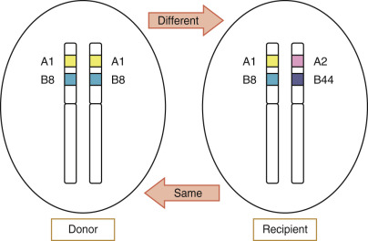

## Key Points

  * •

Criteria for blood donor eligibility are established by the U.S. Food and Drug Administration (FDA) to minimize risks to both the donor and the transfusion recipient. 

  * •

Blood components (red blood cells, platelet concentrates, fresh frozen plasma, cryoprecipitate) are manufactured and stored in a manner to minimize functional loss of desired constituents. 

  * •

Leukocyte reduction of blood components reduces alloimmunization to human leukocyte antigens, cytomegalovirus transmission, and febrile reactions. Irradiation of blood components can prevent graft-versus-host disease. 

  * •

Accurate identification of the pretransfusion blood sample and the intended recipient is the most important step in preventing acute hemolytic transfusion reactions. 

  * •

Restrictive red cell transfusion (hemoglobin target 7 to 9 g/dL) is associated with improved outcomes in some patient populations. 

  * •

Platelet transfusion is generally indicated for microvascular bleeding, platelet count <10,000/µL, or platelet count <50,000/µL before an invasive procedure. 

  * •

Failure to respond to platelet transfusion may be due to immune causes (human leukocyte antigens or platelet-specific antibodies), nonimmune clinical causes (bleeding, splenomegaly, disseminated intravascular coagulation, medications), or product-specific causes (ABO incompatibility, age of component). 

  * •

Plasma transfusion is generally indicated for coagulation factor deficiency, disseminated intravascular coagulation, dilutional coagulopathy, urgent warfarin reversal, and thrombotic thrombocytopenic purpura. 

  * •

Potentially severe adverse effects of transfusion include hemolytic reactions, allergic reactions, transfusion-related acute lung injury, bacterial contamination, and graft-versus-host disease. 

  * •

Current risks of transfusion-transmitted human immunodeficiency virus or hepatitis are very low, but the risk for other transfusion-transmitted diseases (cytomegalovirus, parvovirus B-19) may be significant in some populations. 

,  

##  Background 

* This book chapter reflects the views of the authors and should not be construed to represent the FDA's views or policies. 

Transfusion medicine is a multidisciplinary specialty encompassing all aspects of blood donation, blood component preparation, blood cell serology, and blood transfusion therapy. The term **blood banking** has largely been superseded by _transfusion medicine_ to emphasize the importance of patient care and clinical outcomes. 

Operationally, transfusion medicine is divided between blood centers and transfusion services. Blood centers recruit and collect blood from donors and manufacture and distribute blood components. Transfusion services perform pretransfusion compatibility testing, select and issue blood components for patients, and provide medical support for blood transfusion. Most hospital transfusion services do not collect their own blood, but rather rely on regional blood centers. 

Blood centers and transfusion services (collectively known as _blood establishments_ ) are regulated by the FDA. All blood establishments must be registered with the FDA, and blood centers that manufacture blood components must be licensed for distribution in interstate commerce. Criteria for the acceptability of blood donors, performance of pretransfusion testing, manufacture of blood components, donor infectious disease testing, and evaluation and reporting of adverse events associated with transfusion are all defined by the FDA. Blood establishments are subject to periodic unannounced inspections by the FDA. Compliance with federal regulations is an essential aspect of transfusion medicine. In addition, professional organizations such as AABB (formerly known as the American Association of Blood Banks), the College of American Pathologists, and The Joint Commission have put forth accreditation standards for transfusion services and conduct voluntary peer inspections. 

,  

##  Blood Collection 

Approximately 60% of the adult U.S. population is eligible to donate blood, although only about 4.5% actually do so annually. Approximately 16 million units of whole blood and red blood cells (RBCs) are collected annually in the United States (  U.S. Department of Health and Human Services, 2011  ). Virtually all donors are voluntary and noncompensated. The average blood donor is a college-educated male between 30 and 50 years of age, who is married and has above average income. However, donations among women and minority groups are increasing. Although the utilization of blood components has decreased in recent years, tightening of donor eligibility requirements and decreased donations have resulted in continued challenges in meeting the demand for blood components. Ongoing efforts to recruit additional donors are critical to ensure an adequate blood supply. 

Donor criteria are established for the protection of the blood donor and the transfusion recipient. Current U.S. (2015) donor qualification criteria are listed in [ Table 36-1 ](<#t0010>) . Criteria for donor protection include a minimum age of 16 years, a minimum weight of 110 pounds, normal vital signs, a minimum hemoglobin (Hb) concentration, and a specified donation interval. Criteria for the protection of the recipient include history or risk factors for infectious disease transmission (hepatitis, human immunodeficiency virus [HIV], malaria, and others), risk for bacteremia, ingestion of certain medications, and history of malignancy. Blood centers are required to maintain a registry of deferred donors, and each donor must be checked against this registry before any donation is made. Finally, every donation must be tested for infectious disease markers as defined by FDA regulations. Current U.S. (2014) donor testing requirements are indicated in [ Box 36-1 ](<#b0010>) . 

TABLE 36-1 

Requirements of Allogeneic Donor Qualification 

Category  |  Criteria   
---|---  
Age  |  At least 16 years or minimum age determined by state law   
Whole blood volume collected  |  Maximum of 10.5 mL/kg   
Donation interval  |  8 weeks after whole blood donation   
16 weeks after two-unit red cell collection   
4 weeks after infrequent apheresis   
At least 2 days after plasma, platelet, or leukocyte apheresis   
Blood pressure  |  Systolic pressure between 90 mm Hg and 180 mm Hg; diastolic pressure between 50 mm Hg and 100 mm Hg   
Regular and between 50 and 100 beats per minute   
Pulse  |  Regular and between 50 and 100 beats per minute   
Temperature  |  ≤37.5° C orally   
Hemoglobin/hematocrit  |  Females: ≥12.5 g/dL/38%; males: ≥13.0 g/dL/39%   
Drug therapy  |  Finasteride, isotretinoin—defer 1 month after last dose   
Dutasteride—defer 6 months after last dose   
Acitretin—defer 3 years after last dose   
Etretinate—defer indefinitely   
Bovine insulin manufactured in the United Kingdom—defer indefinitely   
Ingestion of medications that irreversibly inhibit platelet function (aspirin) within 36 hours of donation precludes use of donor as sole source of platelets   
General medical history  |  Free of major organ disease, cancer, abnormal bleeding tendency   
Family history of CJD or recipient of dura mater or human pituitary growth hormone—defer indefinitely   
Pregnancy  |  Defer if pregnant within the past 6 weeks   
Recipient of blood transfusion or tissue transplant  |  Defer for 12 months from time of transfusion/transplant   
Vaccinations and immunizations  |  Recipient of toxoid, synthetic, or killed viral, bacterial, or other vaccine—no deferral   
Recipient of live, attenuated intranasal flu vaccine—no deferral   
Recipient of live attenuated viral or bacterial vaccine—2- or 4-week deferral from the time of vaccination   
Smallpox vaccine—refer to current FDA guidance   
Other vaccines including unlicensed vaccines—12-month deferral from time of vaccination   
Infectious diseases—indefinite deferral  |  Viral hepatitis after 11th birthday   
Positive test for hepatitis B surface antigen or HBV NAT   
Repeat reactive test for anti-HBc on more than one occasion   
Clinical or laboratory evidence of HCV, HTLV, HIV, or _T. cruzi_ infection by current FDA regulations   
Previous donation associated with hepatitis, HIV, or HTLV transmission   
History of babesiosis or Chagas' disease   
Stigma of parenteral drug use   
Injection of nonprescribed drugs   
Risk for vCJD according to current FDA guidelines   
Infectious diseases—12-month deferral  |  Mucous membrane exposure to blood   
Nonsterile skin or needle penetration   
Sexual contact with an individual with a confirmed positive test for hepatitis B surface antigen   
Sexual contact with an individual with viral hepatitis   
Sexual contact with an individual with HIV infection or behavioral risk for HIV infection according to current FDA guidance   
Incarceration in a correctional institution for longer than 72 consecutive hours   
History of syphilis or gonorrhea   
West Nile virus  |  Defer according to current FDA guidance   
Malaria  |  Confirmed diagnosis—defer for 3 years after becoming asymptomatic   
Travel to or residence in an endemic area as defined by the CDC—defer according to FDA guidance   
  
_CDC,_ Centers for Disease Control and Prevention; _CJD,_ Creutzfeldt-Jakob disease; _FDA,_ U.S. Food and Drug Administration; _HBV,_ hepatitis B virus; _HCV,_ hepatitis C virus; _HIV,_ human immunodeficiency virus; _HTLV,_ human T cell lymphotropic virus; _NAT,_ nucleic acid test; _vCJD,_ variant of Creutzfeldt-Jakob disease. 

Box 36-1 

Current U.S. Donor Infectious Disease Testing 

  * Hepatitis B surface antigen (EIA) 

  * Hepatitis B core antibody (EIA) 

  * Hepatitis C virus antibody (EIA) 

  * HIV-1 and HIV-2 antibodies (EIA) [ * ](<#fn0010>)

* Combined HIV p24 antigen, HIV-1 antibodies, and HIV-2 antibodies acceptable. 

  * HTLV-I and HTLV-II antibodies (EIA) 

  * _Trypanosoma cruzi_ antibodies (EIA) 

  * Serologic test for syphilis 

  * Hepatitis C RNA (nucleic acid test) 

  * HIV RNA (nucleic acid test) 

  * West Nile virus DNA (nucleic acid test) 

  * Hepatitis B DNA (nucleic acid test) 

_EIA,_ Enzyme immunoassay; _HIV,_ human immunodeficiency virus; _HTLV,_ human T cell lymphotropic virus. 

Blood must be collected in a manner to minimize the risk for bacterial contamination. The skin at the venipuncture site must be prepared with an antibacterial scrub. Whole blood is collected into sterilized bag sets containing anticoagulant and attached satellite bags to facilitate component manufacture in a closed system. The rate of blood flow must be sufficient to prevent clot formation during phlebotomy. The volume of blood withdrawn is less than 10.5 mL/kg, including samples for testing. Typically, whole blood donations are 450 or 500 mL. 

Blood components can also be collected by apheresis. The advantage of apheresis donation is that a greater volume of the desired components may be obtained from a single donation. The most common use of the apheresis donation is the collection of platelets (commonly called _single donor platelets_ ). Plasma may also be collected, typically concurrently with platelets. Apheresis donation allows for the collection of two units of RBCs from suitable donors. Leukocytes may also be collected by apheresis. This is most commonly utilized for the collection of hematopoietic progenitor cells for autologous or allogeneic transplantation. Granulocytes or mononuclear cells may be collected by apheresis for special applications. 

Autologous donation is the collection of blood from a patient in advance of scheduled surgery for transfusion during or after the procedure to compensate for expected blood loss. Autologous transfusion prevents the transmission of blood-borne pathogens from allogeneic donors and is desired by some patients. It is not completely free of risk, however, particularly of bacterial contamination. Whether or not autologous transfusion actually decreases the need for allogeneic transfusion or improves patient outcome is controversial. Benefit in reducing allogeneic blood exposure or improving outcome has not been shown in controlled prospective randomized trials. For patients with antibodies to very common RBC antigens, autologous donation may be used to provide compatible blood products if compatible allogeneic components cannot be located. Candidates for autologous donation must not have underlying disease that would put them at risk from this procedure. They must not be significantly anemic, although a lower Hb level of 11.0 g/dL is allowed. They must not be at risk for bacteremia because the most serious adverse consequence of autologous transfusion is bacterial contamination. Patients with heart disease, particularly aortic stenosis, may be unable to tolerate phlebotomy. Pregnancy does not itself constitute a contraindication to autologous donation; however, the value of autologous donation except in certain high-risk situations such as placenta previa is minimal. Autologous donations can occur more frequently than allogeneic donations. Typically, two or three units may be collected several weeks before surgery. Optimally, there should be sufficient time from donation to surgery to allow for recovery of a substantial portion of the collected red cell mass. This may require iron supplementation. Erythropoietin stimulation has been used as an adjunct to autologous donation. 

Some patients desire to select donors for themselves (directed or designated donation) rather than receiving blood from the community blood supply. This provides some patients with the perception of greater safety, although no evidence suggests that directed donation reduces the risk for transfusion-transmitted disease. Directed donors must meet all criteria for allogeneic blood donation. In addition, directed donors must be compatible with the intended recipient. In certain situations, directed donation is contraindicated. Donation of any plasma-containing blood component from a mother to her child is particularly problematic because the formation of human leukocyte antigens (HLA) antibodies to fetal antigens is common in pregnancy, and transfusion of such antibodies can precipitate transfusion-related acute lung injury (see later). Transfusions from close relatives should be avoided in recipients of hematopoietic progenitor cell transplants because of the risk for immunization to HLA and other histocompatibility antigens, which may endanger graft survival. There are rare circumstances under which directed donation may be desirable. These include rare blood group compatibility requirements and limitations of donor exposure for patients with long-term expected transfusion requirements such as aplastic anemia. In cases of neonatal alloimmune thrombocytopenia, collection of maternal platelets may be the best way of providing compatible antigen-negative platelets. In the past, donor-specific transfusion was utilized in kidney transplantation. However, with current immunosuppressive regimens, donor-specific transfusion for prolonging renal graft survival is not used. 

Adverse effects may occur with blood donations. Minor reactions, mostly presyncope, occur during 2.5% of whole blood donations (  Eder et al, 2009  ). Major reactions, including loss of consciousness, nerve or arterial injury, allergic reaction, and citrate reaction, occur during about 0.07% of whole blood and 0.05% of apheresis platelet collections. Up to 36% of donors interviewed 3 weeks after donation report some adverse effect, mostly minor, such as arm bruise or soreness (  Newman et al, 2003  ). More serious adverse effects such as vasovagal symptoms were reported in about 5%, and nausea and vomiting in about 1%. Repeat donors are less likely to have reactions than first-time donors. Smaller donors are at greater risk for postdonation syncope. Most syncopal reactions occur shortly after donation. However, delayed reactions can occur, and if the donor is at work or is driving, these can be very serious. Seizures following blood donation have been reported, although it is unlikely that there is a causal relationship (  Krumholz et al, 1995  ). Some highly apprehensive donors hyperventilate, leading to respiratory alkalosis and tetany. This can usually be managed easily by having the donor breathe into a paper bag. 

Personnel at a collection site should be prepared to treat donor reactions. Vasovagal syncope can usually be managed easily by placing the donor into a supine position and applying a cold compress to the forehead. It is rare that intravenous fluids are required. A physician should be available to donor site personnel for consultation, and emergency medical support should be available, if necessary. Vasovagal reactions can be minimized by prior hydration of the donor, or by the use of caffeine (  Sauer & France, 1999  ;  Newman et al, 2007  ). 

,  

##  Blood Component Manufacture 

Whole blood donations are commonly manufactured into components. This facilitates the treatment of different patients with requirements for RBCs, plasma proteins, or platelets. The goals of component manufacture are to maintain viability and function, and to prevent detrimental changes or contamination of desired constituents. 

 

##  Red Blood Cells 

RBCs are prepared from whole blood by centrifugation and removal of plasma. RBCs prepared in the preservative solution CPDA-1, supplemented with dextrose and adenine to preserve red cell adenosine triphosphate levels, may be stored for up to 35 days at 1° to 6° C. RBCs may also have an additive solution containing glucose and other substrates added during manufacture. Such additive solutions permit a longer storage period (42 days) and have a lower hematocrit (Hct). During storage, red cells undergo senescence changes similar to aging in vivo, such that a portion of transfused red cells are rapidly cleared by the spleen. The maximum allowable storage time for RBCs is defined by the requirement for recovery of 75% of transfused cells 24 hours after transfusion. Leakage of intracellular potassium occurs during red cell storage due to lack of ATP to fuel the potassium pump. The potassium concentration in the supernatant of RBCs can reach levels of 76 mmol/L, which may appear alarmingly high. However, the total amount of potassium in a unit of RBCs at outdate is small compared with daily physiologic requirements, and hyperkalemia following transfusion is rare except in special circumstances (see later). Hypokalemia may also occur secondary to RBC transfusion due to influx of potassium into transfused RBCs. After transfusion, the intracellular ATP levels are restored and the ATPase potassium pump resumes activity. Red cells lose intracellular 2,3-diphosphoglycerate (2,3-DPG) during storage, resulting in a shift of the Hb-oxygen dissociation curve to the left. Thus, shortly after transfusion, stored red cells have relatively high oxygen affinity. Normal levels of 2,3-DPG are restored within 24 hours of transfusion. The shift in oxygen association with storage is rarely clinically significant. 

 

##  Plasma 

Plasma is separated from whole blood and frozen for extended preservation. In the liquid state at refrigerator temperatures, there is loss of labile clotting factors, particularly factor VIII and factor V. Fresh frozen plasma (FFP) is separated from the RBCs and is placed at −18° C within 8 hours of collection. Plasma frozen within 24 hours after phlebotomy (FP24) is manufactured similarly to FFP but may be frozen at any time up to 24 hours after collection. The coagulation factor content of FP24 is essentially equivalent to FFP (  Scott et al, 2009  ). Frozen plasma may be stored for up to 1 year at −18° C or lower. Before transfusion, both FFP and FP24 are thawed at 37° C and must be transfused within 24 hours. Thawed plasma not used within 24 hours may be relabeled as “thawed plasma.” Thawed plasma can be kept at refrigerator temperatures for up to 5 days, with maintenance of adequate levels of factors V and VIII (  Downes et al, 2001  ;  Scott et al, 2009  ). 

 

##  Cryoprecipitated Antihemophilic Factor 

Cryoprecipitated antihemophilic factor (cryoprecipitate or cryo) is the cold insoluble portion of plasma remaining after FFP has been thawed at refrigerator temperatures. It contains approximately 50% of the factor VIII and 20% to 40% of the fibrinogen present in the original plasma unit. Cryo also contains von Willebrand factor (vWF) and factor XIII. FDA regulations require that a unit of cryoprecipitate contain at least 80 IU of factor VIII (21CFR640.56), although most blood centers achieve higher levels routinely. A unit of cryoprecipitate contains approximately 250 mg of fibrinogen, but testing for the fibrinogen content is not required. Cryoprecipitated antihemophilic factor was a major advance in the treatment of hemophilia A before the development of safe purified clotting factor concentrates. Currently, cryo is used mainly as a source of fibrinogen. 

 

##  Platelet Concentrates 

Platelet concentrates (PCs) are prepared from whole blood by centrifugation of platelet-rich plasma and removal of platelet-poor plasma. PCs must contain at least 5.5 × 10  10  platelets per unit. They are stored at room temperature (20° to 24° C) because platelets stored at refrigerator temperature (1° to 6° C) have greatly diminished posttransfusion survival. Current FDA regulations allow PCs to be stored for up to 5 days with continuous gentle agitation to encourage gas exchange. At the end of storage, the pH of the PCs must be 6.0 or higher. PCs typically contain a small number of red cells, which are visibly apparent and can cause alloimmunization to red cell antigens. PCs contain 30 to 50 mL of plasma. It is typically necessary to pool five or more PCs to obtain a therapeutic dose for a typical adult patient. 

PCs that are pooled using an open system must be transfused within 4 hours. PCs can be pooled and leukocyte reduced at the time of manufacture, using a system that maintains sterility, often referred to as _prepooled platelets._ Because the integrity of the container is not compromised in this process, prepooled platelets can be stored for up to 5 days. 

PCs prepared by apheresis (platelets, pheresis, or single-donor platelets) are stored and handled in the same manner as platelet concentrates prepared from whole blood. Each apheresis platelet unit should contain a minimum of 3.0 × 10  11  platelets. It is possible to collect two or more platelet units in a single apheresis session from some donors. One apheresis platelet unit will typically provide a therapeutic dose for an adult patient. 

 

##  Leukocyte Components 

Granulocytes can be prepared by apheresis. Granulocytes may be stored at room temperature for up to 24 hours. However, after even brief in vitro storage, granulocytes may have reduced ability to circulate and migrate to areas of inflammation (  McCullough et al, 1983  ). It is desirable that they be transfused as soon as possible after collection. Donor stimulation with granulocyte colony-stimulating factor (G-CSF) is usually necessary to obtain a sufficient number of granulocytes to be a therapeutic dose for an adult patient (  Heuft et al, 2002  ). Granulocyte units contain a substantial number of RBCs and must be ABO compatible with the recipient. 

Mononuclear cells collected by apheresis can be a source of hematopoietic progenitor cells (HPCs) for autologous or allogeneic transplantation. The number of circulating HPCs can be increased by growth factor (G-CSF or granulocyte-macrophage colony-stimulating factor [GM-CSF]) stimulation, recovery from chemotherapy, or the chemokine receptor blocker plerixafor (  Cashen, 2009  ;  Nakasone et al, 2009  ). Autologous HPCs for transplantation in patients with lymphoma or other malignancies are typically collected when the bone marrow is recovering from chemotherapy because there are relatively high numbers of circulating stem cells at that time. HPCs may be stored frozen after addition of a cryoprotective agent, such as DMSO, for an extended period of time. After thawing at 37° C, HPCs should be transfused as soon as possible. Mononuclear cells can also be used as a source of lymphocytes for induction of graft-versus-tumor effect, known as _donor lymphocyte infusion_ (  Gilleece & Dazzi, 2003  ), or for future manufacturing to produce cellular therapy products. 

 

##  Leukocyte-Reduced Blood Components 

Leukocytes present in blood components, particularly RBCs and PCs, may cause adverse effects. Such untoward effects include febrile nonhemolytic transfusion reactions, immunization to leukocyte (particularly HLA) antigens with subsequent refractoriness to platelet transfusions, transmission of leukocyte-associated viruses, and graft-versus-host disease. To minimize most of these adverse impacts, many blood centers and transfusion services have instituted the use of leukocyte-reduced components for all transfusions (universal leukocyte reduction). It must be noted that leukocyte reduction has not been shown to prevent posttransfusion graft-versus-host disease and is not used for this purpose. To be considered leukocyte reduced, blood components must be prepared by a method known to reduce the total number of residual leukocytes to fewer than 5 × 10  6  per unit for RBCs and fewer than 8.3 × 10  5  for whole blood–derived PCs (  Levitt, 2014  ). 

Leukocyte reduction is typically accomplished by filtration at the time of component manufacture (prestorage leukocyte reduction) or at the time of transfusion (poststorage leukocyte reduction). Both methods are effective for removing leukocytes. However, prestorage leukocyte reduction has the advantage of preventing accumulation of leukocyte-derived biologic response modifiers, particularly cytokines, which may cause adverse reactions (  Heddle et al, 1999  ). In addition, filtration at the time of manufacture allows for better process control. Certain apheresis devices can reliably produce platelet concentrates containing fewer than 1 × 10  6  leukocytes. Subtle differences have been noted in the distribution of leukocyte subsets between such components and those produced by filtration (  Pennington et al, 2001  ). These differences, however, are unlikely to be clinically significant. 

Leukocyte reduction failures may occur during filtration of blood from donors with sickle trait. Such filtration failures may be due to Hb S polymerization in an environment of low oxygen tension and high osmolality (  Beard et al, 2004  ). Leukocyte reduction is not an effective means of preventing graft-versus-host disease (  Hayashi et al, 1993  ). Clearly, granulocytes and hematopoietic progenitor cells cannot be leukocyte reduced. 

 

##  Special Components 

Cryoprecipitate-reduced plasma (cryopoor plasma) is the supernatant remaining from the production of cryoprecipitate. It is relatively deficient in high molecular weight forms of vWF but retains normal levels of the vWF-cleaving metalloprotease ADAMTS 13 (  Blackall et al, 2001  ). For these reasons, cryoprecipitate-reduced plasma is an attractive alternative to FFP for the treatment of patients with thrombotic thrombocytopenic purpura. However, at present, no definitive evidence indicates that plasma exchange with cryoprecipitate-reduced plasma results in improved patient outcome. 

Red blood cells can be stored in the frozen state after addition of a cryoprotective agent, such as glycerol. Frozen RBCs can be stored in mechanical freezers or liquid nitrogen for up to 10 years. Frozen units are thawed rapidly at 37° C. The cryoprotective agent must be removed by progressive addition of washing solutions with decreasing osmolality. Failure to properly deglycerolize frozen RBCs can result in hemolysis. Cryopreservation and deglycerolization of sickle trait red cells by standard methods can result in the formation of a jellylike mass. This can be overcome by using a modified process (  Meryman & Hornblower, 1976  ). After deglycerolization, red cells can be stored for up to 1 day at 1° to 6° C if processed by an open method, or up to 14 days if processed by a closed method. The main use of frozen RBCs is to maintain an inventory of rare antigen-negative units. 

RBCs and PCs can be washed to remove plasma proteins and electrolytes. Washing can be accomplished by manual or automated methods. Loss of cells during the washing process can be substantial. In addition, washing of platelets can result in clumping and activation with reduced viability (  Pineda et al, 1989  ). Because this is an open process, washed red cells may be stored for 24 hours at refrigerator temperatures, and washed platelets must be transfused within 4 hours of initiation of washing, when prepared using an open system. The main use of washed components is the prevention of severe allergic reactions to plasma components. Washing is not an effective means of leukocyte reduction. 

Transfusion-associated graft-versus-host disease (TA-GVHD) can be prevented by irradiation of components containing viable lymphocytes (RBCs, PCs, granulocytes, and nonfrozen plasma). This can be accomplished by exposure to γ-rays or x-rays. The minimum dose should be 25 Gy delivered to the center of the blood container and no less than 15 Gy to the periphery. Irradiation causes chromosomal damage, which prevents replication of transfused lymphocytes in the recipient. However, irradiated cells remain immunogenic. Thus, irradiation is not equivalent to leukocyte reduction. Irradiation also causes damage to red cell membranes with increased potassium leakage and decreased posttransfusion survival (  Moroff et al, 1999  ). Irradiated red cells must have their outdate shortened to no more than 28 days from the date of irradiation. Platelets appear to sustain minimal damage from irradiation, and so their expiration date need not be altered, although the increment in platelet count may be reduced (  Sweeney et al, 1994  ;  Slichter et al, 2005  ). Clearly, hematopoietic progenitor cells must not be irradiated. Irradiation is not sufficient to prevent transmission of viral infections, including cytomegalovirus, or bacterial contamination. 

 

##  Pathogen Reduction 

Although great progress has been made in reducing the risk for transfusion-transmitted diseases, some risk remains. At present, there are multiple diseases that may be transmitted by transfusion for which there are no FDA-approved screening tests (e.g., babesiosis, dengue, Chikungunya). In addition, new transmissible diseases will continue to emerge as a threat to blood safety. For these reasons, strategies to inactivate contaminating microorganisms (pathogen reduction) are presently under active development. Blood derivatives such as albumin, coagulation factor concentrates, and immunoglobulins are commonly treated by a variety of methods, including heat and solvent-detergent, which are highly effective against viruses, including HIV, hepatitis B virus (HBV), and hepatitis C virus (HCV). The solvent-detergent treatment process disrupts the lipid envelope of viruses such as HIV, HBV, and HCV. However, it is ineffective against nonlipid-enveloped viruses. In addition, it destroys cell membranes and so is not applicable to cellular blood components. Solvent-detergent–treated plasma contains predictable levels of all coagulation factors and is effective in the treatment of thrombotic thrombocytopenic purpura (TTP) (  Horowitz et al, 1992  ;  Moake et al, 1994  ). It may, however, contain reduced levels of protein S and has been associated with thrombotic complications (  Doyle et al, 2003  ). 

On December 18, 2014, the U.S. Food and Drug Administration approved the Intercept Blood System (IBS) for platelets, the first pathogen reduction system to be made available in the United States to treat single-donor apheresis platelets (Cerus Corporation, Concord, Calif.). The system is for use by blood establishments that collect and manufacture blood and blood components to prepare pathogen-reduced platelets to reduce the risk for transfusion-transmitted infections. On December 16, 2014, the FDA also approved the IBS for the preparation of plasma to reduce the risk for transfusion-transmitted infections. 

Another pathogen reduction technology for platelets and plasma, not available in the United States but marketed elsewhere, is the Mirasol PRT System (Terumo BCT, Lakewood, Colo.) (  McClaskey et al, 2009  ). 

Both of these treatments are effective against broad ranges of viruses, bacteria, and protozoans, but not against prions since these pathogens do not contain nucleic acids (  Lin et al, 2004  ;  Ruane et al, 2004  ). 

Psoralen compounds used in the IBS intercalate between bases of RNA and DNA and, when exposed to ultraviolet (UV) light, form covalent cross-links that prevent replication. Intercept-treated platelet concentrate has been shown to be safe and effective in a randomized trial (  McCullough et al, 2004  ). The treatment process does result in a statistically significant, and possibly clinically significant, reduction in posttransfusion platelet recovery. Riboflavin, used in the Mirasol PRT system, causes strand cleavage of nucleic acids when activated by UV light. Because these methods require exposure to light, their applicability to RBCs is limited. Both the Intercept and Mirasol processes have been shown to presumably preclude the need for irradiation of blood components to prevent TA-GVHD (  Mintz, 2011  ). Although each of these techniques is promising, questions regarding their role in transfusion practice remain. 

,  

##  Selection of Blood Components 

Blood components must be serologically compatible with the recipient. ABO compatibility is the primary consideration. Transfused red cells must be compatible with recipient antibodies, and transfused plasma must be compatible with recipient red cells. Therefore, whole blood must be of identical ABO type to the recipient. Red blood cells contain a limited amount of plasma and need to be compatible but not necessarily identical to the ABO type of the recipient. Similarly, plasma and platelet concentrates contain few, if any, red cells. ABO-compatible blood component selection is summarized in [ Table 36-2 ](<#t0015>) . Red blood cells must also be negative for clinically significant antigens when transfused to alloimmunized recipients. It is highly desirable to transfuse only Rh-negative red cells to Rh-negative recipients because there is approximately a 30% risk for immunization to Rh(D) (  Frohn et al, 2003  ). This is particularly important for women of childbearing potential because of the risk for hemolytic disease of the newborn in subsequent pregnancies. 

TABLE 36-2 

ABO Compatibility 

Donor Type  |  RECIPIENT TYPE   
---|---  
O  |  A  |  B  |  AB   
O  |  R  |  R  |  R  |  R   
|  P  |  |  |   
A  |  |  R  |  |  R   
|  P  |  P  |  |   
B  |  |  |  R  |  R   
|  |  |  P  |   
AB  |  |  |  |  R   
|  P  |  P  |  P  |  P   
  
_P,_ Plasma-containing components (platelets, fresh frozen plasma) are compatible; _R,_ red cells are compatible. 

Special considerations apply to recipients of ABO-incompatible hematopoietic progenitor cell transplants. During the course of transplantation, such individuals will change their blood type. Transfused red cells should be compatible with both donor and recipient isohemagglutinins, and transfused plasma–containing components should be compatible with both donor and recipient red cells. Thus, the optimal choice for such a patient will depend on current and expected future typing results. 

 

##  Red Blood Cells 

The primary consideration in selection of RBCs is serologic compatibility for the prevention of hemolytic transfusion reactions. Because the posttransfusion survival of red cells is inversely related to length of storage, it is desirable to select fresh (typically less than 10 days old) units in situations in which it is particularly desirable to limit the number of transfusions, such as intrauterine and neonatal transfusion. For large-volume transfusions of pediatric patients (such as exchange transfusion or cardiac surgery), it may be desirable to select Hb S–negative (sickle-negative) units. It is also preferable to select sickle-negative red cells for transfusion to patients with sickle cell disease because the presence of Hb S in donor red cells may complicate monitoring of the effectiveness of transfusion therapy. However, it has never been shown that red cell transfusion from asymptomatic sickle trait donors is deleterious, and in some cases, such as rare blood requirements, the use of a sickle trait donor may be the only option. Heavily transfused patients, particularly those with sickle cell disease, are at risk for alloimmunization and hemolytic transfusion reactions (  Vichinsky et al, 1990  ). Such patients may benefit from prophylactic administration of antigen-matched red cells, particularly Rh and Kell antigens (  Ambruso et al, 1987  ;  Castellino et al, 1999  ). 

Exchange transfusion of the neonate with hemolytic disease of the newborn (HDN) is a special case. In this situation, antigen-negative red cells and plasma (for oncotic pressure and bilirubin-binding capacity) are needed. Red cells must be compatible with the maternal antibodies, including ABO antibodies. Reconstituted whole blood, prepared by combining RBC and compatible FFP to a desired Hct (typically 50%), is commonly used, although whole blood may be used if available. 

 

##  Platelets 

Major ABO compatibility is less of an issue in platelet transfusion than in red cell transfusion. ABO antigens are expressed weakly on platelets. ABO-incompatible platelet transfusions may result in lower posttransfusion survival, although this usually is not clinically significant. Transfusion of isohemagglutinins contained in the plasma of apheresis platelets from donors with high-titer anti-A or anti-B can cause an acute hemolytic reaction (  Larsson et al, 2000  ). Therefore, if non–ABO-identical platelets must be transfused, overriding consideration is typically given to plasma compatibility with the recipient. Some centers will screen apheresis platelets to ensure that high-titer incompatible anti-A or anti-B (e.g., <1 : 200 reactivity at immediate spin) is not transfused. 

Failure to achieve an expected platelet count increment after platelet transfusion on two or more occasions is commonly considered refractoriness. Platelet refractoriness may be due to immune causes (HLA or platelet-specific antibodies), nonimmune clinical causes (bleeding, splenomegaly, disseminated intravascular coagulation [DIC], medications), product-specific causes (ABO incompatibility; older products give lower increments), or the fact that some donors' platelets store poorly. A poor increment following a single platelet transfusion must not be presumed to be due to alloimmunization. The refractoriness is often multifactorial and changes with the patient's underlying condition and therapy. HLA antibodies are the most common cause of immune-mediated platelet refractoriness. HLA class I antigens are expressed on platelets, and class I antibodies are common in patients who have been previously pregnant or transfused with non–leukocyte-reduced blood components. Leukocyte reduction has been shown to effectively prevent both alloimmunization and platelet refractoriness in previously unexposed patients with leukemia (  Trial to Reduce Alloimmunization to Platelets Study Group, 1997  ). Antibodies to platelet-specific antigens are a relatively rare cause of platelet refractoriness. Several effective strategies are known for selection of platelets for the alloimmunized refractory recipient. The use of cross-match–compatible platelets is usually the first line (  O'Connell & Schiffer, 1990  ). If the patient's HLA antibody specificities can be defined, it may be possible to select antigen-negative donors (  Petz et al, 2000  ). Donors matched for HLA class I antigens may be selected. However, owing to constraints of donor availability, finding optimal matches may be very difficult. Even with a large donor base, many “HLA-matched” transfusions are mismatched for at least one antigen (  Dahlke & Weiss, 1984  ). 

,  

##  Pretransfusion Testing 

The most critical step in pretransfusion testing is proper collection and identification of the recipient blood sample. The most common cause of an acute hemolytic transfusion reaction is misidentification of the sample or patient (  Sazama, 1990  ;  Linden et al, 2000  ). Each transfusion service must develop and implement policies and procedures for patient identification and specimen collection. The pretransfusion samples should be labeled at the time of phlebotomy by comparison with the patient's permanent identifier (typically a wristband). The label should contain at least two unique identifiers, such as patient name and hospital registration number. The date of sample collection and the identity of the phlebotomist must also be documented. In emergency situations when the patient's identity is unknown, a unique identifier must be assigned. This identifier must remain with the patient throughout the course of transfusion even if the patient is subsequently identified. Policies and procedures must be in place for management of patients with confidential or alias names. 

Samples for pretransfusion testing should be collected no more than 3 days before transfusion, unless it is known that the patient has not been pregnant or transfused within the preceding 3 months. The common practice of patient admission on the same day as elective surgery presents special challenges. In this setting, pretransfusion samples may be collected during a preceding outpatient visit. One option is to require such patients to wear an identification wristband, although many patients find this undesirable. Another alternative is to assign a unique number to the pretransfusion specimen and affix this number to an identification form that the patient must provide on the day of surgery (  Butch et al, 1994  ). Pretransfusion samples must be retained until at least 7 days after each transfusion. Typically, transfusion services retain pretransfusion samples for a fixed time. 

Routine pretransfusion recipient testing consists of ABO and Rh(D) typing and screening for unexpected red cell antibodies. If the antibody screen is positive, antibody identification tests should be performed. Results of current testing should be compared with records of the previous testing, if available. Clinically significant red cell antibodies may become undetectable over time but may cause delayed hemolytic reactions owing to an anamnestic response. Therefore, a history of a clinically significant red cell antibody should be honored by providing only antigen-negative red cells for transfusion. Any discrepancy in current testing or disagreement with previous records must be resolved before pretransfusion testing can be concluded. 

Some patients present particular challenges in pretransfusion testing. Newborns typically have weak or absent isohemagglutinins. Expected ABO antibodies may not be present until 6 months of age. The occurrence of a weakly expressed Rh(D) antigen may complicate pretransfusion testing. Recently transfused patients may show a mixture of circulating red cells, if they have not received ABO-identical units. Unexpected red cell antibodies can be acquired passively from transfusion of platelet concentrates or immunoglobulins. Some patients may lack expected isohemagglutinins because of disease or immunosuppressive therapy. Recipients of allogeneic HPC transplants may have complex and variable typing results, which necessitate conclusion of a “declared” blood type. In urgent situations when the blood type cannot be concluded, selection of group O red cells and group AB plasma is usually safe. If antibody identification tests cannot be completed, a medical judgment must be made regarding the urgency of transfusion and the risk for incompatibility. It may be desirable to issue red cells lacking antigen specificities that cannot be excluded, if available. 

The final step of pretransfusion compatibility testing is the cross-match. The purpose of the cross-match is a final check of ABO compatibility and, to a lesser extent, detection of unidentified antibodies. A major cross-match is performed between the recipient's serum or plasma and donor red cells. A minor cross-match, between recipient red cells and donor or plasma, is usually unnecessary. In the absence of unexpected red cell antibodies, a cross-match can be performed by direct agglutination (“immediate spin”) for detection of ABO incompatibility. When unexpected red cell antibodies are present, the cross-match should be performed by antiglobulin technique. For antibodies judged to be clinically significant, antigen-negative cells are selected for cross-match. An alternative for ensurance of ABO compatibility is the so-called _computer cross-match._ This is applicable when at least two determinations of the recipient's ABO group have been made, at least one on a current sample, and there are no unexpected antibodies (  Butch & Oberman, 1997  ). A validated computer system can then ensure that issued blood components are ABO compatible. The presence of red cell autoantibodies presents a special problem. In this setting, it is essential that alloantibodies be excluded. Typically, the cross-match will be positive. Many transfusion services have a policy of issuing “least reactive” units, although the value of this policy has been called into question (  Petz, 2003  ). 

In urgent situations, emergency release of blood complements before completion of compatibility testing may be indicated. The goals of emergency release are to provide red cells for oxygen-carrying capacity and plasma for coagulation factor content to a rapidly bleeding patient. ABO compatibility is the first priority (see earlier discussion of component selection). Antibodies to other blood group antigens typically do not cause acute hemolytic reactions and therefore are of lower priority. However, when there is a history of prior antibodies, or when antibody identification tests are partially complete, it may be preferable to select antigen-negative RBCs, if available. Finally, documentation of the medical order for emergency release of blood components should be obtained. 

,  

##  Transfusion Administration 

The transfusion service is responsible for developing and implementing policies and procedures for the administration of blood components. A physician's order is required to prepare, dispense, and administer blood components. Optimally, venous access should be established before a blood component is issued. The selection of location and type of access depends on the volume, timing, and expected duration of transfusion therapy. Peripheral access with an 18-gauge needle or catheter is typically sufficient. Smaller catheters may be used; however, high-pressure flow through a small lumen may cause hemolysis (de la  Roche & Gauthier, 1993  ). Central venous access is desirable for high-volume administration or long-term therapy. 

Before administration of a transfusion, accurate identification of the component and the intended recipient is essential. This process should include at least two unique recipient identifiers, such as name and registration number, and comparison with a permanent identifier, such as a wristband. Additionally, the unit identifier on the blood container should be checked against the associated documentation (transfusion form or attached tag). The ABO and the Rh type on the unit label must agree with the associated documentation, and compatibility with the patient's recorded blood type should be verified. The expiration time and date of the blood component should be verified as acceptable. Many institutions require that two qualified individuals perform the identity check before transfusion. The physician's order and the patient's consent for transfusion should also be verified. Finally, the blood component unit should be inspected before transfusion for signs of contamination, clot formation, or bacterial growth, including particulates, change in color, gas formation, and clumping of cellular elements. 

All blood components must be administered through a filter intended to retain clots and particles, typically 170 to 260 µm pore size. Administration sets should contain a drip chamber, attached compatible intravenous solution, and a means of controlling the flow rate. During surgery, it is routine practice to add a microaggregate filter through which the blood component flows first. This decreases the metabolic burden placed on the recipient to process aggregates of fibrin and cellular debris that accumulate during storage, and helps to preserve the patency of the intravascular line. Care should be taken to avoid admixture of the blood components with incompatible intravenous solutions. Normal saline is the preferred solution for all transfusions. Calcium-containing solutions should be avoided, as these may precipitate clotting. RBCs should not be administered with 5% dextrose, hypertonic saline, or hypotonic saline, as this may cause hemol­ysis. Medications should not be added to blood components. Leukocyte reduction filters may be used for transfusion of RBCs or PCs, if the blood component has not already been prestorage leukocyte-reduced, to reduce the incidence of febrile transfusion reactions, HLA alloimmunization, or cytomegalovirus (CMV) transmission. The appropriate filter must be selected for the blood component because clogging or filter failure may occur if improperly used. 

It may be desirable to administer refrigerated blood components (RBCs or plasma) through a blood-warming device. Transfusion of cold components faster than 100 mL per minute for 30 minutes may increase the risk for cardiac arrest (  Boyan & Howland, 1963  ). Blood-warming devices should have a visible thermometer and an audible alarm to avoid exceeding temperature limits. Blood components should never be warmed by the use of tap water, conventional microwave ovens, or any other nonapproved warming device. 

The desirable rate of administration depends on the patient's blood volume, cardiac status, and hemodynamic state. Except for urgent resuscitation, the transfusion should be started slowly (approximately 2 mL/minute for the first 15 minutes). The patient should be carefully observed for the first 15 minutes of infusion because severe reactions such as hemol­ysis, anaphylaxis, or sepsis may manifest after a small volume has entered the circulation. Subsequently, the administration rate may be increased. In general, it is desirable to complete a red cell transfusion within 2 hours and a platelet or plasma transfusion within 30 to 60 minutes. Any transfusion should be completed within 4 hours of initiation. Patients at risk for volume overload may require slower administration. If the total administration time exceeds 4 hours, smaller-volume blood components should be provided. When high flow rates are required, such as in some resuscitation or surgical situations, an FDA-approved pressure infusion device may be used. When such devices are used, care must be taken to avoid mechanical hemolysis or air embolism. During transfusion, the patient's vital signs should be checked at regular intervals, and any suspected reaction should prompt interruption of the transfusion and immediate investigation. 

 

##  Blood Component Therapy 

All transfusion decisions are clinical judgments that should be made while taking into account clinical and laboratory data. There are no absolute indications, and few absolute contraindications, to blood transfusion. 

 

##  Red Cell Transfusion 

Red blood cells provide oxygen-carrying capacity. Red cell transfusion may be used to treat acute or chronic anemia. A patient's ability to tolerate anemia depends on the degree of anemia, physiologic adaptive mechanisms, and cardiac or respiratory disease. Normal physiologic adaptations to anemia include increased cardiac output, redistribution of blood flow, increased oxygen extraction, and increased red cell 2,3-DPG, resulting in rightward shift of the oxygen-Hb dissociation curve. General guidelines for red cell transfusion are summarized in [ Box 36-2 ](<#b0015>) . Symptomatic anemia, regardless of Hb concentration, in a euvolemic patient is an indication for RBC transfusion. Symptoms of anemia include fatigue, tachycardia, tachypnea, dyspnea on exertion, postural hypotension, and impaired mentation. Anemia may precipitate angina in patients with coronary artery disease. Generally, acute blood loss of greater than 15% of a patient's blood volume may be an indication for red cell transfusion. Studies of postsurgical morbidity in patients who refused blood transfusion have indicated that for patients with a preoperative Hb of at least 6 g/dL, without underlying coronary artery disease, and sustaining operative blood loss of less than 2 g/dL of Hb, there is little relationship between mortality and degree of preoperative anemia (  Carson et al, 1996  ). Mortality increases with preoperative Hb levels below 6 g/dL (  Spence et al, 1990  ). However, with a Hb loss of 2 to 4 g/dL, perioperative mortality increases with preoperative Hb levels below 10 g/dL. This risk is magnified by the presence of cardiovascular disease (angina, myocardial infarction, congestive heart failure, or peripheral vascular disease). One study of patients undergoing elective operations demonstrated no mortality despite Hb levels as low as 6 g/dL, provided that the blood loss was less than 500 mL (  Carson et al, 1988  ). 

Box 36-2 

Red Cell Transfusion Guidelines 

  * Symptomatic anemia in a euvolemic patient 

  * Acute blood loss of >15% of estimated blood volume 

  * Preoperative Hb <9.0 g/dL with expected blood loss >500 mL 

  * Hb <7.0 g/dL in a critically ill patient 

  * Hb <7.0 g/dL in non-exsanguinating upper GI bleeding 

  * Hb <8.0 g/dL in a patient with an acute coronary syndrome 

  * Hb <10.0 g/dL with uremic or thrombocytopenic bleeding 

  * Sickle cell disease 

    * Acute sequestration: Hb <5.0 g/dL or decrease of 20% from baseline 

    * Acute chest syndrome: Target Hb = 10 g/dL, HbS fraction <30% 

    * Stroke prophylaxis: Target HbS fraction <30% 

    * General anesthesia: Target Hb = 10.0 g/dL, HbS fraction <60% 

_Hb,_ Hemoglobin. 

The Transfusion Requirements in Critical Care (TRICC) study was the first randomized prospective trial comparing restrictive and liberal transfusion strategies (  Hebert et al, 1999  ). The TRICC trial enrolled 838 critically ill patients with Hb levels <9.0 g/dL. Subjects were randomized to receive liberal or restrictive transfusion regimens. The liberal regimen was a transfusion trigger of 10 g/dL with a target of 10 to 12 g/dL. The restrictive regimen was a transfusion trigger of 7.0 g/dL with a target of 7.0 to 9.0 g/dL. The primary result was no statistically significant difference in 30-day mortality, although a trend favoring lower mortality was noted in the restrictive strategy group (18.7% vs. 23.3%; _p_ = 0.11). Cardiac events, primarily pulmonary edema and myocardial infarction, occurred more frequently in the liberal than in the restrictive transfusion group (21.0% vs. 13.2%; _p_ < 0.001). Subgroup analysis showed lower mortality in the restrictive strategy group among patients with lower disease severity measured by APACHE II scores (8.7% vs. 16.1%; _p_ = 0.03) and among patients younger than 55 years of age (5.77% vs. 13.07%; _p_ = 0.02). Thus, it appears that many critically ill adult patients can tolerate Hb levels less than 10 g/dL. 

Whether the results of the TRICC trial are generalizable to patients with acute coronary syndromes has been debated. A large retrospective cohort study of patients >65 years of age with acute myocardial infarction has examined the association between admission Hb and 30-day mortality (  Wu et al, 2001  ). This showed a clear relationship between increasing mortality and lower initial Hb. Furthermore, among patients who received transfusion, lower adjusted odds of 30-day mortality were noted when the admission Hct was less than 33%, whereas the odds of death were higher for transfused patients with admission Hct >36% after adjustment for clinical factors, medication, and predictors of transfusion. These results suggested that red cell transfusion may result in lower short-term mortality among older adult patients with acute myocardial infarction who survived at least 2 days, if the Hct on admission is 30% or lower. However, inherent drawbacks of the retrospective study design, such as survivor bias, limit the conclusions that can be drawn from this study. A pilot study by  Carson and colleagues (2013)  examined the outcome of 110 patients with symptomatic ACS treated using either a liberal (Hb <10) or restrictive transfusion threshold (Hb <8 or symptomatic). The patients in the liberal arm had a nonsignificant trend toward worse outcomes, although the patient populations were not completely matched. A larger trial of similar construction is needed to determine if these findings are generalizable to patients with ACS. An analysis of transfusion effects on 30-day mortality in patients with acute coronary syndromes presented somewhat different results (  Rao et al, 2004  ). This was a reanalysis of three interventional drug trials with the primary outcome measure being 30-day mortality. Ten percent of subjects in the study were transfused. Transfused subjects were more likely to have comorbidities, including a higher Killip class, than nontransfused subjects. Cumulative mortality among transfused subjects was greater than in nontransfused subjects ( _p_ < 0.001). For subjects with a nadir Hct of 20%, no statistically significant difference in odds of death was observed between transfused and nontransfused individuals. 

The Transfusion Trigger Trial for Functional Outcomes in Cardiovascular Patients Undergoing Surgical Hip Fracture Repair (FOCUS) addressed the red cell transfusion trigger in surgical patients with cardiac disease (  Carson et al, 2011  ). The goal of this randomized clinical trial was to determine whether a more aggressive transfusion strategy in patients with cardiovascular disease or cardiovascular disease risk factors undergoing surgery for repair of hip fracture is associated with improved functional recovery and decreased risk for adverse postoperative outcomes. Subjects were randomly allocated to a 10 g/dL transfusion threshold or a symptomatic strategy. The study population consisted of patients 50 years of age or older who underwent surgical repair of a hip fracture, with Hb concentrations below 10 g/dL within 3 days after surgery, and who had clinical evidence of cardiovascular disease or cardiovascular risk factors. The primary outcome measure was ability to walk 10 feet (or across a room) without human assistance at 60 days after randomization, and the major secondary outcome measure was in-hospital acute coronary syndrome or death within 30 days. The FOCUS trial enrolled more than 2600 subjects, making it the largest and best-powered clinical trial to date in transfusion medicine. 

A randomized clinical trial of transfusion strategies in acute upper gastrointestinal bleeding compared the efficacy and safety of a restrictive transfusion strategy (hemoglobin trigger of 7 g/dL) with those of a liberal transfusion strategy (hemoglobin trigger of 9 g/dL) (Villaneuva et al, 2013). The primary outcome measure was overall survival at 42 days. The trial enrolled 921 patients, all of whom also received endoscopy and appropriate interventions to control bleeding. Approximately one third of patients had cirrhosis with portal hypertension. The probability of survival at 6 weeks was higher in the restrictive-strategy group than in the liberal-strategy group (95% vs. 91%). Further bleeding occurred in 10% of the patients in the restrictive-strategy group as compared with 16% of the patients in the liberal-strategy group, and adverse events occurred in 40% as compared with 48%. Improved survival with restrictive transfusion was most notable in patients with cirrhosis and Child-Pugh class A or B disease. 

A randomized clinical trial for transfusion strategies in septic shock also compared outcomes of patients assigned to a restrictive transfusion strategy (hemoglobin trigger of 7 g/dL) with those of a liberal transfusion strategy (hemoglobin trigger of 9 g/dL) (  Holst et al, 2014  ). The primary outcome measure was survival at 90 days. The trial enrolled 1005 patients who met criteria for severe septic shock. The results showed that the survival rates at 90 days were equivalent between the two groups (57% in the restrictive group compared to 55% in the liberal group). The results were similar in analyses adjusted for risk factors at baseline and in analyses of the per-protocol populations. The numbers of patients who had serious adverse events, including ischemic events, and who required life support, were similar in the two intervention groups. 

Transfusion of the patient with sickle cell disease (SCD) presents unique challenges. The indications for transfusion are to augment oxygen-carrying capacity in severe anemia and to improve microvascular circulation by decreasing the proportion of sickle red cells. Oxygen delivery in SCD represents a balance between oxygen-carrying capacity and blood viscosity. Optimal oxygen delivery is usually achieved when the posttransfusion Hct is about 30% (  Schmalzer et al, 1987  ). No universally accepted laboratory parameters are available for transfusion in SCD. Hb values less than 5 g/dL and an acute drop of 20% from baseline during an acute illness are general indications for red cell transfusion. Acute splenic sequestration can produce sudden hypovolemia and cardiovascular collapse, necessitating prompt transfusion. In this setting, the rise in Hb following transfusion may be greater than expected because of release of sequestered red cells. Careful monitoring is essential to avoid overtransfusion (  Powell et al, 1992  ). Acute chest syndrome may be life threatening. Prompt transfusion may prevent progression to respiratory failure (  Mallouh & Asha, 1988  ). Exchange transfusion with a goal of achieving Hb S level of 30% or less and Hct of 30% is a typical approach. Long-term transfusion therapy can reduce the risk for stroke in SCD. In children, transfusion with the goal of maintaining Hb S levels below 30% can reduce the risk for stroke (  Adams et al, 1998  ). How long a chronic transfusion regimen must be maintained is an open question. Termination, even after several years of therapy, can result in reversion to high risk for stroke (  Adams et al, 2004  ). Iron overload can develop if simple transfusions are performed for chronic management rather than exchange transfusions. Iron chelators are used to slow or prevent iron accumulation and the sequelae of iron overload. Before general anesthesia is administered, transfusion is indicated to achieve an Hb of 10 g/dL and an Hb S level of less than 60% (  Vichinsky et al, 1995  ). In uncomplicated pregnancy, prophylactic red cell transfusion is not beneficial. However, transfusion may be indicated in high-risk pregnancy or with a history of previous fetal loss (  Seoud et al, 1994  ). 

In autoimmune hemolytic anemia, transfusion may be indicated if cardiac or neurologic symptoms are present. Most patients with autoimmune hemolytic anemia tolerate transfusion of incompatible red cells, if alloantibodies have been excluded (  Salama et al, 1992  ). Transfused red cells usually are not cleared any more rapidly than the patient's own red cells. It is important to note that a necessary red cell transfusion must never be withheld because of cross-match incompatibility. It is far more dangerous to not give such a transfusion to a patient with autoimmune hemolytic anemia than it is to provide it. 

Red cell transfusion may be beneficial in bleeding associated with uremia, although administration of desmopressin is more effective in these patients. An inverse relationship between Hct and bleeding time has been noted in patients with chronic renal failure. Transfusion to an Hb of 10 g/dL may be beneficial in the bleeding uremic patient (  Fernandez et al, 1985  ). 

Transfusion of 1 unit of RBCs to an adult patient can usually be expected to raise the Hb by 1 g/dL and the Hct by 3%. However, the expected Hct increase may range from about 2% to 9%, depending on the patient's vascular volume (  Gorlin & Cable, 2000  ). 

An area of interest and considerable investigation is the effect of the storage age of RBCs on patient outcomes, since potentially damaging substances accumulate in older blood and the red cells undergo multiple changes that may interfere with oxygen delivery. Observational studies have shown conflicting results to date about the impact of RBC storage time. 

In 2012, Wang and colleagues published a meta-analysis of 21 studies that had compared outcomes of using RBCs transfused after longer and shorter storage times (  Wang et al, 2012  ). Three of these studies were randomized controlled trials (RCTs), and 18 were observational studies (6 prospective, 12 retrospective). Older blood was associated with a significantly increased risk for death (odds ratio, 1.16; 95% confidence interval, 1.07 to 1.24). 

In contrast, the results of the two RCTs published since this analysis have not demonstrated an adverse effect from the use of older stored RBCs. 

The Age of RBCs in Premature Infants (ARIPI) study was the first large RCT examining the effect of red cell storage on clinical outcomes. 377 neonates in 6 Canadian tertiary neonatal intensive care units weighing <1250 g and requiring a RBC transfusion were randomized to receive leukoreduced RBCs ≤7 days or be treated by the standard practice of transfusing dedicated units (  Fergusson et al, 2012  ). The study was performed between May 2006 and June 2011. The average age of the RBCs in the fresh group was 5.1 days, and the average age in the control group was 14.6 days. The primary outcome was a composite of death, intraventricular hemorrhage, necrotizing enterocolitis, bronchopulmonary dysplasia, and retinopathy of prematurity. There was no difference in the two groups with respect to the primary outcome (52.9% vs. 52.7%). The rates for the individual morbidities and mortality were similar. Subgroup analyses did not show any differences in patients receiving fresher or older RBCs. The authors concluded that in this trial the use of fresh RBCs compared with standard blood bank practice did not improve outcomes in premature, very low-birth-weight infants requiring a transfusion. 

Steiner and colleagues recently reported the results of an RCT of 1098 evaluable patients undergoing complex/redo cardiac surgery conducted from 2010 to 2014 at 33 U.S. centers (  Steiner et al, 2014  ). Participants ≥12 years old and >40 kg were randomized preoperatively to receive leukocyte-reduced RBCs stored either ≤10 days or ≥21 days for all transfusions through hospital discharge, death, or day 28. The primary endpoint was change in preoperative Multiple Organ Dysfunction Score (ΔMODS) to the highest composite MODS through day 7 (or death/discharge, if earlier), adjusted for baseline MODS. Secondary endpoints included adverse events and day 28 mortality. RBC storage duration was not significantly associated with 7-day ΔMODS, serious adverse events, or 28-day mortality. 

At present there is equipoise with respect to whether red blood cell RBC storage age affects patient outcomes. Additional RCTs are being conducted. 

 

##  Platelet Transfusion 

Platelet transfusion is indicated for prevention or treatment of hemorrhage due to thrombocytopenia or platelet dysfunction, as summarized in [ Box 36-3 ](<#b0020>) . The AABB recently published evidence-based guidelines addressing the indications for platelet transfusion (  Kaufman et al, 2015  ). The guidelines recommend prophylactic platelet transfusion to reduce the risk for spontaneous bleeding in hospitalized adult patients with therapy-induced hypoproliferative thrombocytopenia and a platelet count ≤10,000/µL as a “strong recommendation.” In addition, the guidelines make the following “weak recommendations”: 

  * 1.

Prophylactic platelet transfusion for patients undergoing elective central venous catheter placement with a platelet count below 20,000/µL. 

  * 2.

Prophylactic platelet transfusion for patients undergoing elective diagnostic lumbar puncture with a platelet count below 50,000/µL. 

  * 3.

Prophylactic platelet transfusion for patients undergoing major elective non-neuraxial surgery with a platelet count below 50,000/µL. 

  * 4.

Platelet transfusion for CABG patients with perioperative bleeding and thrombocytopenia or suspected platelet dysfunction. 

Box 36-3 

Platelet Transfusion Guidelines 

  * Thrombocytopenia due to decreased production 

  * Stable patient: platelet count <10,000/µL 

  * Invasive procedure with low risk for bleeding: platelet count <20,000/µL 

  * Bleeding, invasive procedure with high risk for bleeding, or surgery with high risk for bleeding: platelet count <50,000/µL 

  * Retinal or central nervous system (CNS) bleeding or surgery: platelet count <100,000/µL 

  * Microvascular bleeding due to platelet dysfunction 

For bleeding patients, or for those undergoing an invasive procedure with high risk for bleeding, including some endoscopic and surgical procedures, the goal of platelet transfusion therapy is to achieve sustained levels above 50,000/µL (  Kumar et al, 2015  ). This usually ensures hemostasis, although it may take longer than normal to achieve. For this reason, for patients experiencing bleeding in critical spaces, such as the retina or central nervous system, a target of 100,000/µL is the standard of practice, as this level typically ensures no abnormal delay in hemostasis. In bleeding associated with platelet dysfunction, or thrombocytopenic bleeding associated with coagulopathy, there is no single transfusion threshold, and therapy must be guided by the patient's clinical condition. Cardiopulmonary bypass may result in a transient acquired platelet dysfunction that may manifest as microvascular bleeding. The platelet count is not usually a useful indicator in such situations. The AABB Guidelines suggest against routine prophylactic platelet transfusion for patients undergoing CABG surgery (  Kaufman et al, 2015  ). 

The Prophylactic Platelet Dose (PLADO) trial addressed the optimal prophylactic platelet dose in patients with hypoproliferative thrombocytopenia from stem cell transplantation or chemotherapy (  Slichter et al, 2010  ). Subjects were randomized to one of three arms: a low platelet dose of 1.1 × 10  11  platelets/m  2  (half the medium dose), a medium dose of 2.2 × 10  11  /m  2  , or a high dose of 4.4 × 10  11  /m  2  (twice the medium dose). The primary outcome measure was the percentage of patients in each dose arm who had at least one episode of World Health Organization (WHO) grade 2 or higher bleeding. The incidence of grade 2 bleeding, higher-grade bleeding, and other adverse events was similar among the three groups. The median number of platelets transfused in the low-dose group was significantly lower than in the other groups, but the number of platelet transfusions was higher. Bleeding events were more common on days when the platelet count was 5000/µL or lower, regardless of treatment assignment. This trial demonstrated that low-dose prophylactic platelet transfusion is safe in hypoproliferative thrombocytopenia, but may not reduce total platelet transfusions. 

The platelet transfusion is relatively contraindicated in immune thrombocytopenic purpura. In this setting, posttransfusion platelet survival is extremely brief, and platelet transfusion is indicated only if there is severe hemorrhage. Clearly, transfusion in the setting of intravascular platelet consumption should be undertaken with great caution. Platelet transfusion in heparin-induced thrombocytopenia or thrombotic thrombocytopenic purpura may be deleterious, though this risk has not been demonstrated in recent trials (  Swisher et al, 2009  ;  Zhou et al, 2015  ). 

Transfusion of one apheresis platelet unit, or an equivalent pool of whole blood–derived platelet concentrates, can typically be expected to raise the platelet count of an adult by 20,000 to 40,000/µL. As a practical matter, it can be estimated that approximately 1 hour posttransfusion, the blood platelet count should increase by 8000 to 10,000/µL for each 1 × 10  11  platelets transfused for each square meter of body surface area (  Strauss, 1995  ). However, there are many reasons why this increment may not be achieved. Consumption or bleeding, splenomegaly, platelet antibodies, and drugs are all causes of a poor response to platelet transfusion. Drugs that can cause an inadequate platelet increment include antibiotics, heparin, antiplatelet agents (clopidogrel, tirofiban), quinidine, and antithymocyte globulin, along with many others. In assessing platelet transfusion effectiveness, it is useful to take into account dose and body size by calculating the corrected count increment (CCI; [ Box 36-4 ](<#b0025>) ). 

Box 36-4 

Corrected Count Increment 

 C  C  I  =  Platelet  count  increment  × B  S  A  Number  o  f  platelets  transfused  × (  10  11  ) 

where _BSA_ is the body surface area (m  2  ) 

 

##  Example 

  * Pretransfusion platelet count = 8000/µL 

  * Posttransfusion platelet count = 36,000/µL 

  * BSA = 1.5 m  2 

  * Platelet dose = 3.0 × 10  11 

 C  C  I  =  24  ,  000  × 1.5  3  =  12  ,  000 

A CCI >7500 at 1 hour or a CCI >4500 at 24 hours generally indicates a successful transfusion. Obtaining a platelet count within 1 hour of completing the transfusion may be helpful in distinguishing immune from nonimmune causes of platelet refractoriness. Typically, immune refractoriness will result in an inadequate platelet increment when measured at 1 hour. Typically nonimmune refractoriness will manifest as an adequate CCI at 1 hour but shortened survival time, so that the platelet count by 24 hours may be back to baseline. It must be appreciated that the CCI does not indicate that an adequate platelet count has been achieved. It indicates only the adequacy of a platelet count increment in relation to the number of platelets transfused. 

 

##  Plasma Transfusion 

Guidelines for plasma transfusion are summarized in [ Box 36-5 ](<#b0030>) . Plasma may be used to replace any plasma protein deficiency. Purified protein concentrates, such as factor VIII, albumin, or immunoglobulin, are preferable for replacement of specific deficiencies because these are highly purified and standardized, and carry extremely low risk for infectious disease transmission. Plasma is most commonly used either for replacement of coagulation factor deficiencies when no factor concentrate is available or for replacement of multiple factors. Multifactorial deficiencies are common in liver disease, massive bleeding, multiorgan system failure, and warfarin therapy. The degree to which factor deficiency may contribute to bleeding in such cases is controversial. Standard coagulation tests such as prothrombin time (PT) and activated partial thromboplastin time (APTT) are commonly used to assess the need for plasma transfusion; however, these tests are poorly predictive of bleeding risk. For nonbleeding patients, there is no change in bleeding risk for patients with a PT or aPTT less than 1.7 times the midpoint of the reference range (which will generally equate to an international normalized ratio [INR] less than 1.7), and thus no benefit will be gained by plasma transfusion. For maximal hemostatic effect, plasma should be transfused immediately before an invasive procedure is performed. For the bleeding patient, plasma transfusion may have to be repeated every 3 to 4 hours to maintain adequate coagulation factor levels. In general, a dose of 10 to 20 mL per kilogram is necessary to achieve a hemostatic effect. Plasma may be used for rapid reversal of warfarin, although 4-factor prothrombin complex concentrate (PCC) provides faster and more complete reversal of coagulopathy (  Kinard & Sarode, 2014  ). Plasma is a source of ADAMTS 13, the vWF protease that is commonly deficient or inhibited in thrombotic thrombocytopenic purpura. 

Box 36-5 

Plasma Transfusion Guidelines 

  * Coagulation factor deficiency, factor concentrate unavailable, and bleeding or prior to surgery 

  * Dilutional coagulopathy 

  * Hemorrhage in liver disease 

  * Disseminated intravascular coagulation (DIC) 

  * Coumadin reversal 

  * Thrombotic thrombocytopenic purpura (TTP) 

  * Acute trauma resuscitation 

 

##  Cryoprecipitate Transfusion 

General guidelines for the transfusion of cryo are summarized in [ Box 36-6 ](<#b0035>) . Cryo can be used for factor VIII or vWF replacement. High purity or recombinant factor concentrates, however, are better alternatives for each. Cryo is a good source of fibrinogen and factor XIII. Most patients with hypofibrinogenemia also have deficiencies of other coagulation factors and are better treated with FFP. Some trauma patients may require additional supplementation of fibrinogen using cryo or fibrinogen concentrate (  Rourke et al, 2012  ). Two trials are currently running to determine the clinical utility of fibrinogen supplementation in trauma (CRYOSTAT in the UK and FiTIC in Australia). Some evidence suggests that cryo may be effective in the treatment of uremic bleeding, possibly by providing high molecular weight forms of the vWF (  Triulzi & Blumberg, 1990  ). Desmopressin (DDAVP) is a preferred therapy for this situation. However, DDAVP may become ineffective after repeated short-term use, at which point cryo transfusion could be initiated. Cryo, when mixed with calcium and thrombin, can also be used to make a topical fibrin sealant for surgery, although more concentrated, virally inactivated commercial products are available. Each unit of cryo can be assumed to contain at least 80 units of factor VIII activity and 250 mg of fibrinogen, although the actual content is variable. 

Box 36-6 

Cryoprecipitate Transfusion Guidelines 

  * Factor VIII deficiency, factor concentrate unavailable, and bleeding or prior to surgery 

  * von Willebrand disease, factor concentrate unavailable, and bleeding or prior to surgery 

  * Hypofibrinogenemia (fibrinogen <100 mg/dL) and bleeding or prior to surgery 

  * Factor XIII deficiency and bleeding or prior to surgery 

  * Uremic bleeding (DDAVP preferred) 

  * Topical fibrin sealant (commercial product preferred) 

_DDAVP,_ Desmopressin. 

 

##  Massive Transfusion 

Massive transfusion, usually defined as replacement of one blood volume within 24 hours or ongoing blood loss of 150 mL/minute, necessitates a systematic approach. Large-volume blood loss is often due to trauma but also occurs in gastrointestinal hemorrhage (particularly with chronic liver disease), ruptured aortic aneurysms, obstetric emergencies, and some surgical procedures such as liver transplantation. No single massive transfusion protocol will be optimal for all patients, although establishing an institutional policy is helpful because these cases can become chaotic. Special attention should be paid to patient and sample identification to avoid transfusion errors. 

The priorities in transfusion management of massive bleeding are prevention or treatment of hypovolemic shock, maintenance of adequate oxygen-carrying capacity, maintenance of oncotic pressure, correction or prevention of coagulopathy, and avoidance of adverse effects of transfusion. Initial patient evaluation should include pertinent medical history (especially liver, kidney, cardiovascular, and hematologic diseases), history of previous transfusions or pretransfusion testing problems, examination for microvascular bleeding, complete blood count (CBC), and coagulation profile (PT, APTT, fibrinogen, thromboelastography). Note that in hypovolemia, the CBC will underestimate blood loss. A sample for pretransfusion testing should be obtained and processed as soon as possible. Red cell transfusion should be considered if greater than 15% loss of estimated blood volume (about 1000 mL in a typical adult) occurs with ongoing bleeding. RBC transfusions should be fully cross-matched if possible; however, the patient should not suffer adversely for want of serologically compatible RBCs. Transfusion can be started with group O uncross-matched RBCs. If the patient's Rh type is unknown, Rh(D)-negative RBCs are preferable, especially for females with childbearing potential. 

Coagulopathies may occur during massive transfusion as the result of dilution, consumption, and/or dysfunction. During resuscitation with RBCs and crystalloid/colloid fluids, measured factor levels and platelet counts may be higher than would be expected on a purely dilutional basis (  Counts et al, 1979  ;  Murray et al, 1995  ), with considerable variation between patients. Consumptive coagulopathies occur with DIC, burns, brain injury, hyperthermia, and sepsis. These usually manifest by prolonged PT and APTT, lower than expected fibrinogen and platelet counts, and the presence of fibrin degradation products or D-dimers. Platelet or coagulation factor dysfunction can occur in hypothermia, acidosis, liver disease, or renal failure. 

No single protocol has been established for plasma or platelet transfusion in massive bleeding. However, in retrospective studies, several protocols have been associated with improved outcomes (  Cotton et al, 2009  ;  Dente et al, 2009  ;  Riskin et al, 2009  ). Such protocols call for transfusion of RBCs, plasma, and platelets in fixed ratios approximating re-constitution of whole blood in the patient. Several retrospective studies in both military and civilian acute trauma resuscitation have suggested that more aggressive plasma transfusion is associated with lower mortality and improved outcomes (  Holcomb et al, 2008  ;  Cotton et al, 2009  ;  Zehtabchi & Nishijima, 2009  ;  Zink et al, 2009  ;  Mitra et al, 2010  ). However, many confounding factors in these studies make causal inference problematic. Lacking randomized clinical trials, it is not possible to say definitively that a protocol-driven approach is superior to individualized clinical judgment. 

In a laboratory-driven approach, plasma, platelets, and cryoprecipitate are given based on laboratory-determined need, while RBC and crystalloid are given based on perceived blood loss and hypovolemia. Using traditional laboratory testing, plasma is typically given if PT or APTT is greater than 1.5 times the reference range, and platelets are typically given for counts less than 50,000. It may be prudent to reserve platelet transfusion until after surgical control of major bleeding has been attained because it is likely to be ineffective during rapid blood loss. Cryoprecipitate may be given if the fibrinogen is less than 100 mg/dL, but hypofibrinogenemia is usually accompanied by deficiency of other factors, so plasma is often a better choice. Two trials are currently running to determine the clinical utility of fibrinogen supplementation in trauma (CRYOSTAT in the United Kingdom and FiTIC in Australia). Therapy is best guided by frequent assessment of coagulation parameters. Thromboelastography and thromboelastometry are functional whole-blood clot assay systems that may also be used in massive transfusion to direct administration of plasma, platelets, cryoprecipitate, tranexamic acid, and coagulation factor concentrates (  Whiting & DiNardo, 2014  ). 

Complications of massive transfusion include hypothermia, hypocalcemia, and acid-base disorders. Hypothermia can be avoided with the use of high-flow warming devices. When the transfusion rate exceeds about 100 mL/minute, a clinically significant drop in ionized calcium may occur as the result of accumulation of citrate, and calcium supplementation may be indicated. Liver disease, hypotension, and hypothermia may exacerbate hypocalcemia. Monitoring the corrected QT interval is useful. Measurement of total calcium will not accurately indicate the level of ionized calcium. During rapid transfusion of RBCs, a modest decrease in arterial pH may be seen (  Vretzakis et al, 2000  ); metabolic alkalosis is common after massive transfusion because of metabolism of citrate. 

 

##  Neonatal and Pediatric Transfusion 

Neonates receive RBC transfusions because of anemia of prematurity, HDN, or iatrogenic blood loss. The unique physiology of the neonatal period and the relative fragility of the developing brain vasculature necessitate some differences from the approach to older children or adults. Guidelines for neonatal transfusion are summarized in [ Box 36-7 ](<#b0040>) . RBC transfusion of 15 mL/kg will typically increase the Hb by 2 to 3 g/dL, and platelet transfusion of 10 mL/kg will typically increase the platelet count by 40,000 to 50,000/µL. For large-volume transfusion, as in exchange transfusion or cardiac surgery, selection of fresh RBCs (typically <10 days old) may be indicated. However, with transfusion of 15 mL/kg, most infants tolerate transfusion of RBCs stored until outdate, without adverse effects (  Strauss et al, 1996  ). For a premature infant with an expected ongoing transfusion requirement, the use of aliquots of a single unit until outdate can significantly reduce donor exposures. Premature and low-birthweight infants are at greater risk for CMV infection and graft-versus-host disease (see later). 

Box 36-7 

Guidelines for Neonatal Transfusion 

 

##  RBC Transfusion 

  * Hct <20% with symptomatic anemia 

  * Hct <30% with supplemental O  2  <35% or mechanical ventilation with MAP <6 cm H  2  O 

  * Hct <35% with supplemental O  2  >35% or mechanical ventilation with MAP >6 cm H  2  O 

  * Hct <45% with cyanotic congenital heart disease or extracorporeal oxygenation 

 

##  Plasma Transfusion 

  * Coagulation factor deficiency, factor concentrate unavailable, and bleeding or prior to surgery 

  * Disseminated intravascular coagulation (DIC) 

 

##  Platelet Transfusion 

  * Platelet count <30,000/µL in term infant with platelet production failure 

  * Platelet count <50,000/µL in stable premature infant 

  * Platelet count <100,000/µL in unstable premature infant 

_Hct,_ Hematocrit; _MAP,_ mean arterial pressure. 

Adapted from Roseff SD, Lugan NLC, Manno CS: Guidelines for assessing appropriateness of pediatric transfusion, _Transfusion_ 42:1398–1413, 2002. 

Exchange transfusion of the neonate for hyperbilirubinemia is usually indicated if the total bilirubin is greater than 25 mg/dL. Relating the total bilirubin to hours since birth is predictive of kernicterus risk (  Bhutani et al, 1999  ). A two-blood volume exchange is typically used, which can be expected to reduce the total bilirubin by 25% and the fetal red cell mass by about 70%. Whole blood or RBCs reconstituted with compatible plasma to Hct of 45% can be used. 

,  

##  Transfusion Reactions 

Transfusion reactions are a diverse group of adverse reactions to transfusion that usually present during or shortly after transfusion. The workup and treatment of a transfusion reaction must be predicated on the clinical picture, especially in atypical cases. If a transfusion reaction occurs while a transfusion is in progress, the transfusion should be stopped immediately, and the intravenous line should be kept open with saline. It is important to recognize that the unit a patient is reacting to is not necessarily the one that is being infused. All suspected transfusion reactions should be reported to the blood bank or transfusion service. 

 

##  Febrile Nonhemolytic Reactions 

A febrile transfusion reaction is defined as a rise in temperature of 1° C or greater, possibly accompanied by chills or rigors. Symptoms usually occur during the transfusion but may be delayed for up to 1 hour after the procedure has been completed. A patient who is hypothermic at the start of a transfusion and then manifests an expected temperature rise to normal, without symptoms, is not having a febrile reaction. In some patients, it may be impossible to distinguish between a febrile transfusion reaction and disease-related fever. 

It is important to rule out a hemolytic transfusion reaction or bacterial contamination of the unit. Antipyretics, such as acetaminophen (325 to 500 mg) can be administered. Antipyretics are not necessarily required, as the fever of nonhemolytic transfusion reactions is self-limited and usually resolves within 2 to 3 hours. Diphenhydramine (25 to 50 mg) is commonly administered in this setting but probably has no effect on the course of febrile reactions. 

Controversy continues as to whether the transfusion can be restarted after a febrile reaction has been diagnosed and the patient has been treated. The principal argument in favor of restarting the transfusion is the reduction in the number of donor exposures, especially if pooled platelet concentrates are involved (  Oberman, 1994  ). Arguments against restarting the transfusion include the possibility that the patient may have a continued febrile reaction to the unit, and, if a hemolytic reaction or bacterial contamination has not been definitely excluded, a severe reaction may ensue (  Widmann, 1994  ). The decision to restart the transfusion should be driven by the clinical condition of the patient and the results of transfusion reaction testing. 

Premedication with antipyretics is often used to prevent febrile reactions, although studies thus far have failed to show prevention of febrile reactions by premedication with acetaminophen and/or diphenhydramine even in patients with prior febrile reactions (  Tobian et al, 2007  ). Febrile reactions have been attributed to the accumulation of pyrogenic cytokines in units during storage (  Muylle et al, 1993  ). These biologic mediators are produced primarily by leukocytes. Filtration at the time of transfusion will not remove pyrogenic cytokines from blood units, although it may remove other cytokines and activated complement components (  Snyder et al, 1996  ). The use of prestorage leukocyte reduction has been shown to reduce the generation of cytokines in stored platelets and red cells and may be more effective than poststorage leukocyte reduction in preventing febrile reactions (  Federowicz et al, 1995  ). Some, but not all, studies have shown a reduction in the incidence of febrile reactions since the introduction of universal leukocyte reduction (  Uhlmann et al, 2001  ;  Dzik et al, 2002  ;  Ibojie et al, 2002  ). It is clear though that leukocyte reduction does not prevent all febrile reactions. Accumulated cytokines can be removed by plasma reduction or the washing of cellular blood components (  Heddle et al, 1994  ). Plasma removal appears to be equivalent to prestorage leukocyte reduction in prevention of febrile reactions (  Heddle et al, 2002  ). Plasma removal will not prevent all febrile reactions. Febrile reactions to platelet transfusion can be reduced by using platelet concentrates less than 4 days old (  Kelley et al, 2000  ). 

 

##  Allergic Reactions 

Mild allergic reactions to transfusion are commonplace. They may occur with any type of blood component, including autologous RBCs (  Domen & Hoeltge, 2003  ). Presenting symptoms may include pruritus, urticaria, erythema, and cutaneous flushing. About 10% of allergic reactions have pulmonary signs and symptoms but not cutaneous involvement. Gastrointestinal involvement may include nausea, vomiting, abdominal pain, and diarrhea. 

Should an allergic reaction occur, the transfusion should be discontinued and intravenous access maintained. If there is upper airway involvement, prompt intubation may be necessary. Oxygen should be administered if there is dyspnea or evidence of desaturation. Mild allergic reactions usually will respond to intravenous antihistamines such as diphenhy­dramine (50 to 100 mg). More severe reactions may require epinephrine. In mild cutaneous reactions, the transfusion usually can be restarted after treatment without recurrence or worsening of the symptoms. In more serious reactions, particularly if there is airway involvement, restarting the transfusion is not advisable. 

With rare exceptions (e.g., IgA and haptoglobin deficiencies), the specific antigen to which the patient is reacting cannot usually be identified. Premedication with an antihistamine, such as diphenhydramine, 25 to 50 mg, administered orally or intravenously, has historically been given to prevent mild allergic reactions, although the evidence showing benefit from premedication has not been shown in recent studies (  Tobian et al, 2007  ). Steroids such as hydrocortisone (100 mg) may help patients who manifest repeated allergic reactions, although the efficacy of steroids has not been proven. 

Patients who have had repeated or significant allergic reactions may benefit from the concentration of cellular blood components through the removal of most of the plasma or by the washing of red cells and platelets. However, the routine use of washed components for patients with cutaneous allergic reactions is unwarranted. 

 

##  Severe Allergic (Anaphylactic) Reactions 

In addition to the signs of typical milder allergic reactions, anaphylactic or anaphylactoid reactions manifest cardiovascular instability, including hypotension, tachycardia, loss of consciousness, cardiac arrhythmia, shock, and cardiac arrest. Respiratory involvement with dyspnea or stridor may be more pronounced than is seen usually in typical allergic reactions. 

If an anaphylactic reaction occurs, the transfusion should be discontinued and intravenous access maintained. Supportive care, including intubation, oxygen, intravenous fluids, and placement of the patient in the Trendelenburg position, should be instituted promptly. Epinephrine should be available immediately. For hypotension unresponsive to supportive measures or for significant bronchospasm, subcutaneous epinephrine 0.3 to 0.5 mg (0.3 to 0.5 mL of a 1 : 1000 solution) can be given. This dose can be repeated every 20 to 30 minutes for up to three doses. Alternatively, 0.5 mg of epinephrine may be given intravenously (5 mL of a 1 : 10,000 solution) and repeated every 5 to 10 minutes for refractory hypotension. 

An antihistamine such as diphenhydramine, 50 to 100 mg, can be given intravenously, particularly when there are cutaneous manifestations such as urticaria. Aminophylline (6 mg/kg loading dose) may be useful when there is bronchospasm. Steroids are probably not effective in the acute situation, but if symptoms persist, a drug such as hydrocortisone (500 mg) may be given. 

Patients with IgA deficiency who develop IgE anti-IgA can have anaphylactic reactions (  Vyas et al, 1969  ). Patients who have significant allergic reactions should be evaluated for their quantitative IgA levels. Recent transfusion may elevate serum IgA levels falsely. However, if IgA deficiency has been established, anti-IgA testing should be done, usually by a reference laboratory. IgA-deficient plasma can be obtained from rare donor registries, if necessary. Red cells and platelets can be washed to remove sufficient amounts of IgA to prevent reactions. 

Patients with haptoglobin deficiency can have similar anaphylactic transfusion reactions due to IgG or IgE antihaptoglobin (  Shimada et al, 2002  ). Haptoglobin deficiency is rare in North American populations but is more common than IgA deficiency among Japanese patients suffering anaphylactic reactions. 

 

##  Acute Hemolytic Reactions 

Acute hemolytic transfusion reactions (AHTRs), by definition, present within 24 hours of transfusion. AHTRs are most commonly caused by transfusion of RBC units that are positive for an antigen against which the recipient has formed antibodies. AHTRs may also be seen with transfusion of antibodies (in donor plasma or IVIG) into recipients whose RBCs bear the antigen recognized by those antibodies. Presenting signs include fever and chills, nausea, vomiting, pain, dyspnea, tachycardia, hypotension, bleeding, and hemoglobinuria. Fever is the most sensitive initial sign of an AHTR. Therefore, any increase in temperature of 1° C or greater should result in a transfusion being stopped and a laboratory evaluation initiated. Renal failure is a later complication. Pain during an AHTR has been reported as localizing to the flanks, back, abdomen, chest, head, and infusion site. A subjective feeling of distress is reported sometimes. Unexpected bleeding may be due to DIC. During surgery, hypotension and excessive bleeding may be the only signs of an AHTR. Both may be attributed to other causes; therefore, physicians must be mindful of the possibility of a hemolytic reaction in this circumstance. 

Laboratory findings in AHTRs include hemoglobinemia, hemoglobinuria, elevated lactate dehydrogenase, hyperbilirubinemia, and low haptoglobin. The blood urea nitrogen and creatinine will be elevated if renal injury has occurred. The direct antiglobulin test (DAT) may show positive results with a mixed-field pattern if transfused incompatible red cells are present in the circulation. Red cell antibody identification studies may or may not show positive results, depending on the specificity of the antibody involved and the amount of antibody in the serum. ABO incompatibility due to a clerical error is the most common cause of AHTRs. 

In the event of an AHTR, the transfusion should be discontinued and intravenous access maintained. The identity of the patient and the unit or units of RBCs should be reconfirmed, and other units of RBCs that have been dispensed for the patient should be located and quarantined. The reaction must be reported to the blood bank promptly. If a misidentification is discovered, another patient (e.g., with a similar name) may also be at risk for receiving incompatible blood. 

Treatment of an AHTR must be guided by the clinical response of the patient. Patients who have minimal symptoms may be managed best by careful observation. However, in severe reactions, early vigorous intervention may be lifesaving. It bears repeating that the severity of AHTRs is related directly to the volume of incompatible blood transfused. Thus, early recognition, discontinuation of the transfusion, and prevention of the transfusion of additional incompatible units are the essential first steps of treatment. Initial attention must be paid to cardiovascular support. If hypotension is present, fluid resuscitation and pressor support may be indicated. Care should be taken to avoid fluid overload, however, especially in patients with impaired cardiac or renal function. 

Because renal failure is a significant problem in some patients, attention should be given to prevention. Early treatments of hypotension and DIC are the most important interventions to limit the extent of possible renal impairment. Maintenance of urine output with intravenous fluids and diuretics, mannitol or furosemide, early in the course of the reaction has been used successfully. Hydration with normal saline and 5% dextrose (1 : 1 ratio) at a rate of 3000 mL/m  2  per day and administration of sodium bicarbonate to maintain the urine pH above 7.0 have been recommended (  Nussbaumer et al, 1995  ). Infusion of an initial dose of 20% mannitol 100 mL/m  2  given over 30 to 60 minutes followed by 30 mL/m  2  per hour for the next 12 hours has also been recommended (  Slavc et al, 1992  ). However, if oliguria in the face of euvolemia is present, fluid loading may be contraindicated. 

Since the load of incompatible red cells in the circulation dictates the severity and course of AHTRs, an exchange transfusion with antigen-negative blood may be considered in severe hemolytic transfusion reactions. The decision to perform an exchange transfusion must be guided by the clinical response of the patient to initial treatments. It is not appropriate to expose a patient to the added risk for infectious disease if the hemolytic process is well tolerated. With ABO incompatibility, however, an exchange transfusion may greatly reduce the chance of morbidity or death. 

Further transfusion of red cells should be avoided until the cause of the reaction has been established. Foremost, however, no patient should be allowed to exsanguinate for lack of serologically compatible blood. Group O RBCs lacking other known clinically significant antigens to which the patient currently has an antibody should be obtained, if possible. The results of serologic tests performed up to this point must be considered, and clinical judgment exercised. Although the focus of attention in most AHTRs is on red cells, care should be taken to avoid the transfusion of plasma or platelets that may aggravate hemolysis, especially when ABO incompatibility is a possible cause. Undue haste in both serologic evaluation and decision making must be avoided because human errors are committed most often under pressure. 

 

##  Delayed Hemolytic Reactions 

By definition, delayed hemolytic transfusion reactions (DHTRs) occur at least 24 hours after transfusion of the offending unit. The time from transfusion to diagnosis of a DHTR is variable. Most patients present within the first 2 weeks after receiving the transfusion. However, clinical DHTR may be recognized more than 6 weeks later. Almost all DHTRs are due to an anamnestic response to a red cell antigen to which the patient has previously made an antibody, the concentration of which was too low to detect in pretransfusion testing. Rarely, a DHTR may be due to primary alloimmunization to a red cell antigen. Typically, hemolysis is extravascular, but intravascular hemolysis may occur also. Fortunately, these reactions tend to be much less severe than AHTRs; accordingly, they may be overlooked. Some patients will present with only unexpected anemia. Other clinical signs include fever or chills, jaundice, pain, or dyspnea. Rarely, renal failure may ensue. In patients with sickle cell disease, DHTRs may precipitate a sickle crisis (  Mintz & Williams, 1986  ). 

Laboratory findings in DHTRs include anemia, elevated lactate dehydrogenase, hyperbilirubinemia, low haptoglobin, leukocytosis, the presence of a new red cell antibody, and a positive reaction on a DAT. The degree of hyperbilirubinemia will depend on the rate and amount of hemolysis, as well as on liver function. Typically, unconjugated bilirubin levels are elevated during active hemolysis. Depressed haptoglobin levels do not necessarily indicate intravascular hemolysis, as they may be seen with extravascular hemolysis as well. 

Many patients tolerate DHTRs well and may need only to be followed carefully. Generally, fluid loading and diuresis are not indicated unless there is active intravascular hemolysis. Complications, such as renal failure or sickle crisis, should be treated as such. If there is a large burden of antigen-positive red cells, an exchange transfusion should be considered. In general, transfusion should be avoided until the causative antibody can be identified and antigen-negative units obtained. However, as with AHTRs, a patient should not be allowed to have significant morbidity from anemia for lack of serologically compatible blood. The selection of red cells for transfusion needs to be based on the results of serologic testing and good communication between the medical director of the blood bank and the patient's physician. 

Because extravascular hemolysis is similar to autoimmune hemolytic anemia, in which high-dose intravenous immunoglobulin (IVIG) infusion may be useful, IVIG may be considered in the treatment of DHTRs also. A single dose of IVIG, 400 mg/kg, infused within 24 hours of transfusion, has been used successfully to prevent transfusion reactions in alloimmunized patients for whom compatible blood could not be obtained (  Kohan et al, 1994  ). Five patients so treated had sustained increases in Hct. No transfusion reaction developed in any of the cases. 

 

##  Bacterial Contamination of Blood Components 

The clinical presentation of a transfusion reaction caused by bacterially contaminated blood components is usually dramatic. Onset of symptoms in most cases occurs during the transfusion or shortly after it; delayed presentation of more than 1 day has rarely been reported with contaminated platelet transfusions. Fever, chills, hypotension, shock, nausea, and vomiting are the most commonly reported symptoms (  Kuehnert et al, 2001  ;  Perez et al, 2001  ). Dyspnea, pain, and diarrhea also may occur. High fever and hypotension during or shortly after transfusion are particular clues that a contaminated unit may have been transfused. The clinical complications due to bacterial contamination are significant, often resulting in shock, renal failure, DIC, and death. The mortality rate is high and depends on the type of component involved, the identity and amount of the causative organism, and the clinical condition of the patient. Patient factors associated with clinical reactions include thrombocytopenia and pancytopenia. Risk factors for fatality include contamination by gram-negative rods, greater patient age, smaller volume of component transfused, and younger age of stored platelet concentrate. The latter two factors most likely reflect greater numbers of organisms in the component. The organism involved depends on the type and storage of the blood component. RBCs have been found to contain _Acinetobacter, Escherichia, Staphylococcus, Yersinia,_ and _Pseudomonas_ species. Gram-positive cocci such as _Staphylococcus_ and _Streptococcus,_ gram-negative rods such as _Acinetobacter, Klebsiella, Salmonella, Escherichia,_ and _Serratia,_ and gram-positive rods such as _Propionibacterium_ have been reported in platelet concentrates (  Kuehnert et al, 2001  ;  Andreu et al, 2002  ). Some transfusion services culture for bacteria all platelet concentrates that have caused a febrile transfusion reaction because, if a red cell concentrate from the same donation exists, it can be withdrawn. 

Usually, treatment must be initiated before the causative organism has been identified. If a reaction occurs, the transfusion should be discontinued, the unit with its associated tubing should be removed, and any other blood bags that have been recently transfused should be recovered. Supportive care of circulation and respiration should be initiated as required. Antibiotic therapy initially should include broad-spectrum coverage such as a β-lactam and an aminoglycoside until microbiologic stains or cultures indicate the causative organism. From the remaining blood component unit, a sample should be taken for Gram stain and culture. Blood cultures from the transfusion recipient should also be collected at the time of reaction to compare with the results of the unit culture. 

AABB standards require that blood banks and transfusion services have methods to detect and limit bacterial contamination of platelets. FDA cleared or approved methods include culture, measurement of oxygen consumption, and rapid qualitative immunoassay (  AuBuchon et al, 2002  ;  Ortolano et al, 2003  ). Measurements of pH or glucose and inspection for “swirling” have been used as indicators of contamination but are not sufficiently sensitive to meet current AABB standards (  Wagner & Robinette, 1996  ). Some studies have found that apheresis platelets have a lower incidence of septic reactions than pooled whole blood–derived platelets (  Ness et al, 2001  ). Because skin flora, if present, enter the collection at venipuncture, diversion of the first 20 mL decreases the risk by 50% (  Eder et al, 2009  ). Most blood centers culture apheresis platelets and prepooled platelets at the time of manufacture. The components then are held for a brief time (typically at least 12 hours) and are released for distribution if the culture is negative. Although this approach is operationally efficient, it is not optimal in that the culture is taken at a time when the bacterial load is low. The residual risk for a septic reaction with culture-negative apheresis platelets is approximately 1 : 75,000 (  Eder et al, 2007  ). An FDA cleared or approved method may be used for detection of bacterial contamination in platelets closer to the time of issue (Platelet PGD Test, Verax Biomedical Incorporated, Worcester, Mass.; BacTx Rapid Assay System, Immunentics, Boston, Mass.). Although these tests hold promise for potentially reducing the risk for septic reactions, their use as a supplement to culture screening has not shown any significant increase in identification of contaminated platelet units (  Dunbar et al, 2013  ). Pathogen reduction technology appears to significantly reduce, if not eliminate, bacterial contamination. As noted previously, the IBS is now available in the United States for platelets (as well as for plasma). 

 

##  Transfusion-Related Acute Lung Injury 

Transfusion-related acute lung injury (TRALI) usually presents during or within hours of transfusion. Its symptoms include dyspnea, hypoxemia, tachycardia, fever, hypotension, and cyanosis (  Kleinman et al, 2004  ). Fever and hypotension, when present, are usually moderate and respond quickly to antipyretics and fluids. Characteristically, there is a lack of abnormal breath sounds. A chest x-ray usually shows pulmonary edema, most commonly in a generalized pattern rather than only along the major vasculature, as seen in cardiac failure. By definition, there are no signs of cardiac failure. Patients with hematologic malignancy or cardiac disease appear to be at higher risk for TRALI (  Silliman et al, 2003  ). This may reflect the fact that these patient groups receive the majority of platelet transfusions. Reported mortality is approximately 20%, depending on the severity of the lung injury and the underlying clinical status of the patient. A wide range of severity is seen in this transfusion reaction; milder forms may not be readily recognized. 

The differential diagnosis includes circulatory overload, bacterial contamination, allergic reactions, acute respiratory distress syndrome (ARDS), pulmonary embolism, and pulmonary hemorrhage. The diagnosis is established by findings of noncardiogenic pulmonary edema. Pulmonary artery wedge pressure is not elevated. An increase in brain natriuretic peptide (BNP) from pre- to post-transfusion is found in circulatory overload, but not in TRALI (  Zhou et al, 2005  ;  Tobian et al, 2008  ). Characteristically, TRALI resolves within 48 to 96 hours from outset (  Popovsky et al, 1992  ). Failure of the patient to improve substantially after this time should call the diagnosis into question. Although chest x-ray findings may persist beyond 7 days, no permanent pulmonary sequelae are evident, unlike with ARDS. A decrease in leukocyte or platelet count may be a useful clue in TRALI caused by transfusion of HLA class I antibodies (  Cooling et al, 2002  ). 

The treatment of TRALI is supportive. If a transfusion is in progress, it should be discontinued, and blood bags from recently transfused units should be recovered. The blood bank should be consulted regarding the evaluation of TRALI. Usually, oxygen is indicated. Severely affected patients may require mechanical ventilation. Corticosteroids appear to be of little, if any, value. Diuresis is not indicated in the absence of signs of fluid overload. 

TRALI has been attributed to the presence of antibodies in the plasma of the transfused unit that are directed against HLA or granulocyte antigens present on recipient leukocytes (  Kopko et al, 2002  ). Plasma from multiparous female donors may carry a greater risk for TRALI (  Palfi et al, 2001  ). It also has been attributed to the presence in the unit of lipid inflammatory mediators that activate already primed recipient neutrophils (from surgery, trauma, or inflammation) to cause capillary injury and leakage (  Silliman et al, 2003  ). 

 

##  Transfusion-Associated Circulatory Overload 

Circulatory overload is an all-too-common and preventable transfusion reaction. It presents as congestive heart failure during or shortly after transfusion. Signs and symptoms can include dyspnea, orthopnea, cyanosis, tachycardia, elevated blood pressure, pulmonary edema, jugular venous distention, pedal edema, and headache. The differential diagnosis includes TRALI, allergic reactions, and causes of congestive failure not related to transfusion, such as valvular heart disease. Clearly, patients with preexisting heart disease are at risk for circulatory overload with transfusion. The diagnosis of circulatory overload on clinical and radiologic examination may be difficult. Elevation of brain natriuretic peptide can be helpful in making the diagnosis (  Zhou et al, 2005  ;  Tobian et al, 2008  ). 

Volume overload should be anticipated in at-risk patients and prevented readily. Blood should be transfused slowly. Although a transfusion usually should be completed within 4 hours, the duration may be extended if medically indicated. If longer than 6 hours is required, however, alternative strategies should be considered. Small volumes can be transfused with adequate time between transfusions to allow for diuresis. To avoid additional donor exposures, a unit can be split using sterile technique and a portion retained in the blood bank for later transfusion. Units can also be concentrated by plasma removal. A diuretic can be administered before or during the transfusion. 

 

##  Graft-Versus-Host Disease 

Transfusion-associated graft-versus-host disease (TA-GVHD) can occur when viable donor T cells proliferate and are not recognized by the recipient's immune system as foreign, but recognize and reject the host as foreign. Patients with marked cellular immunodeficiencies are at risk for TA-GVHD ( [ Box 36-8 ](<#b0045>) ). These include congenital cellular immunodeficiencies (DiGeorge syndrome, severe combined immunodeficiency syndrome), immaturity of the immune system (intrauterine transfusions, very-low-birthweight infants), disease-associated immunodeficiencies (Hodgkin lymphoma), and therapy-associated cellular immunodeficiencies (hematopoietic progenitor cell transplantation, fludarabine treatment). Humoral immunodeficiencies, such as common variable immunodeficiency (CVID), are not a risk factor for GVHD. HIV infection, although it may cause marked T cell dysfunction, does not increase the risk for TA-GVHD. Common immunosuppressive regimens for solid organ transplantation and typical chemotherapy regimens for solid tumors do not increase the risk for TA-GVHD. However, TA-GVHD has been reported with highly aggressive chemotherapy for neuroblastoma and some other tumors. Patients with normal immunity may be at risk for TA-GVHD if the donor is homozygous for an HLA haplotype and the recipient is heterozygous but shares one haplotype. In this case, recipient lymphocytes are unable to recognize transfused lymphocytes as foreign, but transfused cells see recipient cells as foreign ( [ Fig. 36-1 ](<#f0010>) ). This is most likely to occur with donations from close (first- or second-degree) relatives but may also occur owing to chance, particularly in populations that are relatively homogeneous (  Aoun et al, 2003  ). 

Box 36-8 

Indications for Irradiation of Blood Components for Prevention of TA-GVHD 

 

##  Absolute Indications 

  * Congenital cellular immunodeficiency 

  * Hematopoietic progenitor cell transplantation 

  * Hodgkin lymphoma 

  * Granulocyte transfusions 

  * Intrauterine transfusions (IUTs) 

  * Transfusion to neonates who have received IUT 

  * Transfusions from biologic relatives 

  * Chemotherapy with purine analogs (fludarabine) 

 

##  Probable Indications 

  * Low-birthweight infants (<1200 g) 

  * Hematologic malignancies other than Hodgkin lymphoma 

  * HLA-matched platelet concentrates 

  * High-dose chemotherapy, radiation therapy, and/or aggressive immunotherapy 

 

##  Controversial Indications 

  * Large-volume or exchange transfusion of infants who did not receive IUT 

  * Aplastic anemia 

  * Absolute lymphopenia (absolute lymphocyte count <500/mL) 

 

##  Irradiation not Indicated 

  * Solid organ transplantation 

  * HIV infection 

  * Hemophilia 

  * Small-volume transfusions of term infants who did not receive IUT 

  * Older adult patients 

  * Typical dose immunosuppressive therapy (other than purine analogs) 

  * Immunocompetent surgical patients 

  * Pregnancy 

  * Red cell membrane, metabolic, or hemoglobin disorders (e.g., thalassemia, SCD) 

_HIV,_ Human immunodeficiency virus; _HLA,_ human leukocyte antigen; _SCD,_ sickle cell disease; _TA-GVHD,_ transfusion-associated graft-versus-host disease. 

Adapted from Gorlin JB, Mintz PD: Transfusion-associated graft-vs-host disease. In Mintz PD, editor: _Transfusion therapy: clinical principles and practice_ , ed 3, Bethesda, Md., 2011, AABB Press, p 650. 

Figure 36-1 

Mechanism of TA-GVHD in immunocompetent patients. 

The donor is homozygous at the HLA class I locus. The recipient is heterozygous and shares one haplotype with the donor. Engrafted donor T cells recognize the recipient as foreign, but the recipient's T cells do not identify donor T cells as foreign. _HLA,_ Human leukocyte antigens _; TA-GVHD,_ transfusion-associated graft-versus-host disease. 

TA-GVHD typically manifests 2 to 50 days after transfusion. Characteristic findings include rash, diarrhea, fever, liver dysfunction, and pancytopenia. Mortality is greater than 90%, with most patients dying of infection. In contrast to the expected GVHD of allogeneic HPC transplantation, the bone marrow in TA-GVHD is of recipient type and is a target organ. Aggressive immunosuppressive treatments have been tried but with rare exceptions have been unsuccessful. Thus, preventive measures are of paramount importance. 

The minimum number of viable transfused T cells necessary to cause TA-GVHD has not been established, but it is clear that current leukocyte reduction methods are not sufficient (  Hayashi et al, 1993  ). Exposure to ionizing radiation (γ-rays or x-rays) can cause chromosomal damage and prevent replication of transfused leukocytes. Current FDA guidelines suggest a midplane dose of 25 Gy, with a minimum dose of 15 Gy to any point of the blood container (see the Special Components section earlier in the chapter). It is possible that pathogen reduction technology based on nucleic acid modification may be effective in preventing TA-GVHD (  Mintz, 2011  ), but this remains to be established with certainty. Many centers using these technologies do not irradiate platelets for TA-GVHD prevention. 

 

##  Hypotensive Reactions 

Transfusion-associated hypotension is defined as hypotension that occurs during transfusion in the absence of signs or symptoms of other transfusion reactions, such as fever, chills, dyspnea, urticaria, or flushing. The degree of hypotension required for the diagnosis is controversial but could be defined reasonably as a drop of at least 10 mm Hg in systolic or diastolic arterial blood pressure from the pretransfusion baseline. However, if the immediate pretransfusion blood pressure is elevated from the patient's typical blood pressure and the arterial pressure does not fall below the patient's usual blood pressure, this should not be considered a hypotensive reaction. Hypotension begins during the transfusion and resolves quickly when the transfusion is discontinued. If hypotension persists beyond 30 minutes after discontinuation of the transfusion, another diagnosis should be strongly considered. Hypotensive reactions have been associated with red cell and platelet transfusions. Some reactions have been associated with the use of bedside leukocyte reduction filters (  Fried et al, 1996  ;  Abe et al, 1997  ). 

If hypotension occurs, the transfusion should be discontinued and intravenous access maintained. The patient should be positioned with head down and feet elevated (Trendelenburg position), and isotonic fluids should be administered. Pressor support is indicated only if the hypotension is severe and refractory to intravenous fluids. 

The cause of transfusion-associated hypotension has not been established definitively. However, the condition is most likely due to the release of bradykinin through activation of the contact pathway of coagulation. Some reactions have been associated with angiotensin-converting enzyme (ACE)–inhibitor drugs in the recipient and/or the use of leukocyte-reduction filters. ACE is the major enzyme that breaks down bradykinin in the circulation. Some bedside filters, particularly those with a net-negative surface charge, appear to cause activation of kallikrein and cleavage of high molecular weight kininogen, which results in the release of bradykinin (  Davenport & Penezina, 1997  ;  Shiba et al, 1997  ;  Mair & Leparc, 1998  ). However, there is variability because not all such filtered units show activation. 

 

##  Nonimmune Hemolysis 

Lysis of red cells can occur as a result of storage, handling, or transfusion conditions. Hyperosmotic or hypo-osmotic fluids mixed with red cells can result in significant lysis. Patients who receive lysed red cells may tolerate them remarkably well. However, transient hemodynamic, pulmonary, and renal impairment may occur, and death due to transfusion of lysed red cells has been reported (  Sazama, 1990  ). The transfusion of autologous blood from a patient with sickle Hb can result in hemolysis and death (  DeChristopher & Orlina, 1990  ). The clinical signs are usually hemoglobinemia and hemoglobinuria. Hyperkalemia may occur, particularly in patients with renal failure. Fever also may occur. Finding lysis of RBCs in the transfused unit and excluding other causes, such as hemolytic transfusion reactions, establishes the diagnosis. All RBC units will show a slight degree in hemolysis with prolonged storage, but this will not result in clinical signs after transfusion. The principal reported complications of nonimmune hemolysis are renal failure and cardiac arrhythmia due to hyperkalemia. Hemolytic transfusion reactions can rarely occur when no red cell antibody is identifiable (  Davey et al, 1980  ). Differentiation of this condition from nonimmune hemolysis may be impossible without careful investigation of the transfusion circumstances. 

Should nonimmune hemolysis occur, the transfusion should be discontinued and intravenous access maintained. The blood bag, together with attached tubing and intravenous fluids, should be saved for further investigation. A hemolytic transfusion reaction needs to be ruled out. The serum potassium level should be checked and an electrocardiogram obtained to assess hyperkalemia. Care is supportive. Urine output should be maintained with hydration unless there is a contraindication such as renal failure. 

 

##  Transfusion-Transmitted Disease 

Improvements in donor screening and testing have resulted in dramatic reductions in transfusion-transmitted disease risk over the past 2 decades. For example, the risk for transmitting HIV by blood transfusion in the United States has been reduced from approximately 1 in 100 in certain urban areas in the early 1980s to approximately 1 in 1,860,000 throughout the United States at present (  Zou et al, 2012  ). It is virtually impossible to accurately measure current risk for hepatitis and HIV transmission by epidemiologic methods. Risk estimates for HIV, HBV, and HCV are now based on mathematical models that take into account the probability of marker-negative window-phase donations, viral strains not reliably detected by current assays, persistent antibody-negative carriers, and testing errors (  Dodd et al, 2002  ). Current (2012) risk estimates are summarized in [ Table 36-3 ](<#t0020>) . 

TABLE 36-3 

Approximate Current Per-Unit Risks for Infectious Disease Transmission 

HIV  |  1 : 1,860,000   
---|---  
HBV  |  1 : 765,000 to 1 : 1,006,000   
HCV  |  1 : 1,660,000   
HTLV-I/II  |  1 : 3,390,000   
West Nile virus  |  ≈1 : 7,000,000   
  
_HBV,_ Hepatitis B virus; _HCV,_ hepatitis C virus; _HIV,_ human immunodeficiency virus; _HTLV,_ human T cell lymphotropic virus. 

Data from  Stramer SL, Notari EP, Krysztof DE, et al  : Hepatitis B virus testing by minipool nucleic acid testing: does it improve blood safety?, _Transfusion_ 53:2449–2458, 2013;  Busch MP, Glynn SA, Stramer SL, et al  : A new strategy for estimating risks of transfusion-transmitted viral infections based on rates of detection of recently infected donors, _Transfusion_ 45:254–264, 2005; and Zou S, Stramer SL, Dodd RY: Donor testing and risk: current prevalence, incidence, and residual risk of transfusion-transmissible agents in US allogeneic donations, _Transfus Med Rev_ 26:119–128, 2012. 

 

##  Hepatitis 

Historically, HCV has accounted for the majority of cases of posttransfusion hepatitis (PTH). Approximately 10% of chronic HCV is attributable to blood transfusion (  Alter et al, 1999  ). PTH is asymptomatic in the majority of cases. Three patterns of transaminase elevation have been observed: monophasic, polyphasic, and plateau (  Pastore et al, 1985  ). Approximately 75% to 85% of individuals have persistent HCV infection, and about 50% of these have evidence of chronic hepatitis. As many as 10% of patients with HCV PTH eventually manifest clinical liver disease (  Seeff et al, 1992  ). Acute PTH due to HBV is typically more severe, with 25% to 30% of individuals having jaundice, and with an incubation time of 40 to 60 days (  Walsh et al, 1970  ;  Seeff et al, 1975  ). Less than 10% of infected individuals progress to chronic hepatitis. If acquired before 5 years of age, acute HBV infection is usually less severe, but the risk for chronic hepatitis is much greater. Hepatitis D virus (HDV) requires coinfection with HBV for replication. If acquired simultaneously with HBV, HDV can cause severe hepatitis and liver failure. If acquired during chronic HBV infection (superinfection), HDV significantly increases the risk for severe chronic liver disease. Transfusion-transmitted HDV is rare, and screening methods for HBV are also effective against HDV. Hepatitis A virus and hepatitis E virus have relatively short periods of viremia and do not progress to a chronic carrier state. Transmission of these viruses by transfusion is rare but has occurred (  Sherertz et al, 1984  ;  Matsubayashi et al, 2004  ). Hepatitis G virus (GBV-C) has a prevalence rate of about 1% in asymptomatic blood donors (  Roth et al, 1997  ). Although it is clearly transmissible by transfusion, no causal relationship between GBV-C infection and hepatitis or chronic liver disease has been established (  Alter et al, 1997  ). 

 

##  Human Immunodeficiency Virus 

The clinical manifestations of transfusion-transmitted HIV are similar to those of HIV infection acquired through other routes. An acute viral syndrome occurs in about 60% of cases. Untreated, asymptomatic infection persists for about 10 years before acquired immunodeficiency syndrome (AIDS)-defining illness occurs, although progression tends to be more rapid in older individuals (  Blaxhult et al, 1990  ). The time to AIDS progression for transfusion recipients may be shorter than that for the implicated donor, but this may reflect the effects of age and other cofactors (  Busch et al, 1994  ). Until recently, Group O viral isolates were not reliably detected by enzyme immunoassay (EIA) tests. Currently, the prevalence of group O HIV in the United States is low, but it is endemic in some parts of western Africa, and transfusion-transmission by emigrants from such areas has occurred (  Pau et al, 1996  ). Therefore, residence in or emigration from such areas has been a reason for permanent donor deferral. However, a combined immunoassay for simultaneous detection of HIV p24 antigen and HIV-1 and HIV-2 antibodies that detects group O HIV has been FDA approved for donor testing (  Sickinger et al, 2008  ). Blood centers that have implemented this test have now discontinued geographic deferral for HIV group O. 

 

##  Human T Cell Lymphotropic Virus 

Human T cell lymphotropic virus type I (HTLV-I) is causally associated with adult T cell lymphoma/leukemia and HTLV-associated myelopathy (HAM) (  Hall et al, 1996  ;  Manns et al, 1999  ). Most carriers are asymptomatic. ATL or HAM develops in a small minority of cases after a latent period of many years. HTLV-I is rare in the United States. HTLV-II is prevalent in intravenous drug users in the United States and is also associated with HAM (  Murphy et al, 1997  ). 

 

##  Cytomegalovirus 

CMV is common in the general population. In immunologically competent individuals, it causes minor symptoms but becomes latent in virtually all cases (  Larsson et al, 1998  ). Approximately 50% of blood donors are CMV seropositive, although the estimated risk for transmission by a seropositive transfusion is about 1% (  Preiksaitis et al, 1988  ). In patients with cellular immunodeficiency, CMV can cause pneumonitis, hepatitis, retinitis, and multisystem organ failure. CMV transmission can be minimized by the use of seronegative blood components, although many studies have shown a low rate of CMV infection in such patients. Whether this is due to failure to detect potentially infectious donors or whether viral transmission occurred by other routes is unclear. Several studies, including a prospective randomized trial, have shown that leukocyte-reduced blood components are as effective as seronegative components in reducing the risk for CMV transmission (  Bowden et al, 1995  ). Due to the prevalence of leukoreduction and low risk for CMV transmission causing disease, most blood collection centers do not screen all units for CMV antibodies. 

 

##  Parvovirus B-19 

Parvovirus B-19 is also common in the general population. The incidence of viremia among blood donors is variable, with episodic peaks, but it averages around 1 : 5000 (  Hitzler & Runkel, 2002  ). In most individuals, parvovirus B-19 causes a mild self-limited febrile illness. However, it is trophic for erythrocyte precursors in the bone marrow and can cause aplasia, particularly in the setting of accelerated erythropoiesis. Transfusion-transmitted parvovirus infection has been implicated in causing chronic anemia after bone marrow transplantation and in thalassemia (  Zanella et al, 1995  ;  Cohen et al, 1997  ). Due to the prevalence of seropositivity in the general public, donor centers do not regularly screen for parvovirus antibodies. 

 

##  West Nile Virus 

West Nile virus (WNV) arrived in the United States in 1999. From its initial outbreak in New York, it has spread across the country. Birds are the natural reservoir, with mosquitoes serving as the vector of transmission. Humans are an accidental host, with infection occurring during times of mosquito activity. Most acute WNV infections are asymptomatic, with a febrile illness occurring in about 1 in 5 infections and neuroinvasive disease in about 1 in 150 infections (  Petersen & Marfin, 2002  ). In 2002, 23 confirmed cases of transfusion-transmitted WNV were reported by the Centers for Disease Control and Prevention (  Pealer et al, 2003  ). In areas of peak WNV activity in 2002, the estimated rate of viremia among blood donors was 1.5 in 1000 (  Biggerstaff & Petersen, 2002  ). Donor screening for WNV by nucleic acid testing (NAT) was implemented in July 2003 in North America. Subsequently, rare cases of WNV transmission by blood transfusion have been reported, most likely due to the low viral copy number that escaped detection (  Macedo de Oliveira & Beecham, 2004  ). 

 

##  Malaria 

About 1300 cases of malaria are reported annually in the United States. Transfusion-transmission of malaria still occurs rarely (1 to 2 cases annually). Implicated donors usually have a history of travel to an endemic area (  Mungai et al, 2001  ). At present, donors are screened by a questionnaire detailing travel to endemic areas and symptomatology. Donor centers are not currently performing laboratory testing to identify malaria-contaminated donations. 

 

##  Babesiosis 

_Babesia_ species are endemic in North American mammals and are transmitted by ticks of the genus _Ixodes._ Many cases of babesiosis are asymptomatic or mild. However, it may be more severe in the asplenic or immunosuppressed patient. The parasite is capable of survival in refrigerated red cells. About 40 cases of transfusion-transmitted babesiosis have been reported in the United States, although it is possible that transmission in endemic areas may be as high as 1 in 1800 red cell units (  Cable et al, 2001  ;  Lux et al, 2003  ). There are nucleic acid–based as well as serologic tests currently in development, although none are available at this point in the United States. 

 

##  Trypanosoma cruzi 

_T. cruzi_ is the cause of Chagas' disease and is endemic in parts of Central and South America. There may be more than 300,000 chronic carriers of _T. cruzi_ in the United States, largely as the result of immigration (  Centers for Disease Control and Prevention, 2015)  . Rare cases of transfusion-transmitted Chagas' disease have been reported in the United States (  Nickerson et al, 1989  ). The risk is dependent on the demographics of the donor population. Seropositivity rates among blood donors have been estimated to be 1 : 25,000 nationally and as high as 1 : 2000 in Los Angeles (  Leiby et al, 2002  ;  Centers for Disease Control and Prevention, 2006-2007  ). Since the FDA approval of a donor screening EIA test, more than 2000 confirmed positive donors have been detected in the United States (  AABB, 2015  ). Estimates of the residual risk for transfusion-transmitted Chagas' disease since implementation of donor testing in the United States have not been published to date. 

 

##  Transmissible Spongiform Encephalopathies 

Transmissible spongiform encephalopathies (TSEs) are caused by a protein, called a _prion,_ which is capable of assuming an abnormal configuration that is resistant to enzymatic degradation and serves as a template for further abnormal prion deposition. Variant Creutzfeldt-Jakob disease (vCJD) is a human TSE that emerged from an epidemic of bovine spongiform encephalopathy, probably as a result of entry of the pathogenic prion into the human food supply from affected cattle. The transmissibility of vCJD by blood in experimental models suggests a possible risk for transmission by transfusion. The magnitude of such a risk is presently unknown. However, four cases of prion acquisition have been reported in individuals who received transfusions from donors who were themselves diagnosed with vCJD (  Chohan et al, 2010  ). However, it is notable that no cases of transfusion transmission of sporadic or familial CJD have been found to date, despite ongoing surveillance (  Dorsey et al, 2009  ). Currently, there is no available serologic test suitable for testing donated units; thus donor centers defer at-risk donors based on exposure (vCJD) and family history (familial CJD) risk as determined by a predonation questionnaire. 

,  

##  Conclusion 

Discovery of the A, B, and O blood groups by Carl Landsteiner in 1900 led to the widespread use of blood transfusion therapy early in the 20th century. This treatment directly afforded a remarkable evolution in surgical, trauma, and medical care. Although remarkable progress has been made in identifying and reducing transfusion-transmitted infection, the incidence of the principal noninfectious risks—TRALI and mistransfusion due to clerical error—has remained stable for many years. Increasing attention has been focused recently on these latter hazards, and it is hoped that this will lead to a substantial reduction in their occurrence. Despite the continuing risk for transfusion, a much greater threat is posed by withholding a blood component that is clinically indicated than by transfusing it. 

,,
