## Key Points

  * •

Vasculitis affects blood vessels of any type in any organ or tissue and thus causes extremely diverse signs and symptoms of disease that overlap with many other diseases. 

  * •

Even if it is not the final diagnosis, vasculitis often is in the differential diagnosis in a patient with evidence for single organ or systemic inflammatory disease. 

  * •

Laboratory tests for vasculitis identify a specific etiologic factor or measure perturbations in physiological molecular and cellular events that result from specific pathogenic events. 

  * •

Clinical laboratory tests for the diagnosis of vasculitis include tests that document active inflammation (e.g., C reactive protein assay), demonstrate injury to a specific organ (e.g., urinalysis), or implicate a specific category of vasculitis (e.g., cryoglobulin assay). 

  * •

Vasculitis is categorized into infectious vasculitis that is caused by vessel wall invasion by pathogens and noninfectious vasculitis that is not known to be caused by infection in vessel walls. 

  * •

Noninfectious vasculitis is categorized as immune complex–mediated, antineutrophil cytoplasmic autoantibody (ANCA)–mediated, or cell-mediated immune vasculitis. 

  * •

Clinical diagnosis of vasculitis is based on both the presence _and_ absence of multiple clinical, pathologic, and laboratory features. 

  * •

Accurate and precise diagnosis of a specific category of vasculitis is essential for optimum patient outcome. 

,  

##  Introduction 

Vasculitis is inflammation of blood vessel walls. Blood vessels of any type in any organ or tissue may be affected. Thus the signs and symptoms of disease are extremely diverse and overlap with many other diseases. As a consequence, vasculitis often is in the differential diagnosis for both single organ and systemic disease, especially in a patient with evidence for an inflammatory condition. Clinical laboratory tests (i.e., tests for biomarkers) that are used for the diagnosis of vasculitis fall into three categories: those that document the presence of an inflammatory process (e.g., C reactive protein assay), those that demonstrate injury to a specific organ (urinalysis), and those that are indicative of a specific category of vasculitis (e.g., cryoglobulin assay). This chapter reviews the clinical and pathologic features of the major categories of vasculitis and discusses the role of laboratory testing in the diagnosis and management of these diseases. 

,  

##  Diagnostic Classification of Vasculitis 

Laboratory tests for a disease often are based on identification of a specific etiologic factor or measurement of perturbations in physiological molecular and cellular events that are caused by specific pathogenic events. This approach is difficult to apply to all forms of vasculitis because the etiology and pathogenesis of some forms are unknown. Vasculitis can be categorized into infectious vasculitis that is known to be caused by vessel wall invasion by pathogens that incite the inflammation (  Pagnoux et al, 2006  ), and noninfectious vasculitis that is not known to be caused by infection in vessel walls (  Jennette et al, 2013  ) ( [ Box 53-1 ](<#b0010>) ). For example, the infectious vasculitis of Rocky Mountain spotted fever (RMSF) is caused by proliferation of _Rickettsia rickettsii_ in endothelial cells and smooth muscle cells in small vessels in many tissues (  Silverman & Bond, 1984  ). The immune response to vessel wall rickettsiae causes vascular inflammation that results in hemorrhage that produces the skin spots that are typical for RMSF. Bacterial sepsis can cause small vessel vasculitis that can mimic noninfectious immune-mediated vasculitis (  Jain et al, 2007  ) and clearly must be diagnosed correctly and treated with antimicrobial drugs and not immunosuppression. 

Box 53-1 

Putative Pathogenic Mechanisms for Vasculitis 

 

##  Vasculitis Caused by Vessel Wall Infection 

  * Bacterial (e.g., neisserial vasculitis, syphilitic aortitis) 

  * Rickettsial (e.g., Rocky Mountain spotted fever) 

  * Fungal (e.g., cryptococcal vasculitis) 

  * Viral (e.g., cytomegalovirus vasculitis) 

  * Parasitic (e.g., toxoplasmosis vasculitis 

 

##  Immune Complex–Mediated Vasculitis 

  * Cryoglobulinemic vasculitis 

  * Polyarteritis nodosa 

  * IgA vasculitis (Henoch-Schönlein) 

  * Hypocomplementemic urticarial vasculitis 

  * Lupus vasculitis 

  * Rheumatoid vasculitis 

  * Drug-induced immune complex vasculitis 

  * Cancer-induced (paraneoplastic) immune complex vasculitis 

  * Anti-glomerular basement membrane disease 

 

##  Antineutrophil Cytoplasmic Antibody (ANCA)–Mediated Vasculitis 

  * Microscopic polyangiitis 

  * Granulomatosis with polyangiitis (Wegener's) 

  * Eosinophilic granulomatosis with polyangiitis (Churg-Strauss) 

  * Drug-induced ANCA vasculitis 

 

##  Cell-Mediated Immune Vasculitis 

  * Takayasu arteritis 

  * Giant cell arteritis 

  * Sarcoid vasculitis 

Noninfectious vasculitis is caused by inflammation that is not known to be caused by pathogens in vessel walls. However, it is important to realize that the etiology and pathogenesis of some forms of vasculitides are currently not known, so an infectious etiology cannot be completely ruled out. For example, although the etiology is not known for Kawasaki disease, giant cell arteritis, and Takayasu arteritis, some theories propose that an unidentified pathogen may be the cause. For example, _Mycobacterium_ tuberculosis has been incriminated but not proven to be involved in the pathogenesis of Takayasu arteritis and a _Burkholderia_ bacterium in the pathogenesis of giant cell arteritis (van  Timmeren et al, 2014  ). 

Noninfectious vasculitis can be caused indirectly by an infection that initiates a sequence of pathogenic events that causes vasculitis. For example, cryoglobulinemic vasculitis can be caused by hepatitis C virus infection in the liver, which induces polyclonal, oligoclonal, and monoclonal B cell proliferations that produce rheumatoid factors (antiantibodies) that bind to other immunoglobulins to form pathogenic immune complexes (  Tedeschi et al, 2007  ). Laboratory tests for cryoglobulinemic vasculitis comprise identification of the infectious agent (hepatitis C virus serology) that initiated the autoimmune response, the autoantibodies (rheumatoid factor assay), the pathogenic immune complexes (cryoglobulin assay), secondary disturbances in inflammatory mediators (e.g., hypocomplementemia), and the evidence for end organ damage (hematuria and proteinuria). 

Laboratory testing for RMSF provides a good example of testing strategies for infectious vasculitis. The most direct laboratory test for RMSF is immunohistologic visualization of _R. rickettsii_ in vessel walls in a skin biopsy specimen. This test has excellent specificity and 70% sensitivity during the acute phase before antibiotic treatment is started. Serologic testing for antibodies to _R. rickettsii_ has poor sensitivity during the first 10 to 12 days but increases to more than 90% after 2 weeks (  Nathavitharana & Mitty, 2015  ). The most definitive serologic finding for RMSF is a rise in titer over several weeks. Analogous testing is applicable to other infectious vasculitis—that is, testing to identify the etiologic infection and testing to demonstrate a specific immune response to the pathogen. 

Based on known or putative pathogenic mechanisms, noninfectious vasculitis can be categorized as immune complex–mediated, antineutrophil cytoplasmic autoantibody (ANCA)–mediated, or cell-mediated immune vasculitis (see [ Box 53-1 ](<#b0010>) ). Immune complex vasculitis can be caused by antibodies directed against a non–self-antigen (e.g., hepatitis B immune complex vasculitis caused by antibodies to viral antigens) or autoantibodies directed against an autoantigen (e.g., lupus vasculitis caused by autoantibodies against nuclear antigens). Cell-mediated immunity also can cause vascular inflammation. The pattern of inflammatory injury in giant cell arteritis and in Takayasu arteritis suggests possible cell-mediated immune injury; however, definitive self or non-self targets have not been conclusively identified. In idiopathic vasculitides, another possibility is an autoinflammatory process that is mediated by a disturbance in the regulation of the innate immune response in the absence of a specific antigen target. 

The absence of identifiable etiologies or distinctive pathogenic mechanisms in many forms of vasculitis does not allow diagnosis or classification of vasculitides based only on these characteristics. Alternatively, classification and diagnosis is most often based on the presence and absence of multiple clinical, pathologic, and laboratory features. The most widely used approach to categorizing vasculitis is based on the nomenclature of vasculitis proposed by the Chapel Hill Consensus Conferences (CHCC) held in 1994 (  Jennette et al, 1994  ) and modified in 2012 (  Jennette et al, 2013  ). The CHCC nomenclature provides consensus names ( [ Box 53-2 ](<#b0015>) ; [ Fig. 53-1 ](<#f0010>) ) and definitions for many, but not all, forms of systemic and single organ vasculitis. Three major categories are large vessel vasculitis (LVV), medium vessel vasculitis (MVV), and small vessel vasculitis (SVV). This terminology can be misleading if it is taken too literally. In general, LVV more often affects the aorta and its major branches than any other form of vasculitis, MVV is confined to arteries, with a preference for major visceral arteries, and SVV involves not only arteries but also vessels smaller than arteries. Especially with respect to arterial involvement, there is substantial overlap among the categories. For example, although large vessel involvement is the most specific finding, giant cell arteritis can affect any size artery from the aorta to the smallest arterial vessels, such as those in the uveal tract of the eye (  Waldman et al, 2013  ). 

Box 53-2 

Names for Vasculitides Adopted by the 2012 International Chapel Hill Consensus Conference on the Nomenclature of Vasculitides 

 

##  Large Vessel Vasculitis (LVV) 

  * Takayasu arteritis (TAK) 

  * Giant cell arteritis (GCA) 

 

##  Medium Vessel Vasculitis (MVV) 

  * Polyarteritis nodosa (PAN) 

  * Kawasaki disease (KD) 

 

##  Small Vessel Vasculitis (SVV) 

  * Antineutrophil cytoplasmic antibody (ANCA)–associated vasculitis (AAV) 

    * Microscopic polyangiitis (MPA) 

    * Granulomatosis with polyangiitis (Wegener's) (GPA) 

    * Eosinophilic granulomatosis with polyangiitis (Churg-Strauss) (EGPA) 

  * Immune complex SVV 

    * Anti-glomerular basement membrane (anti-GBM) disease 

    * Cryoglobulinemic vasculitis (CV) 

    * IgA vasculitis (Henoch-Schönlein) (IgAV) 

    * Hypocomplementemic urticarial vasculitis (HUV) (anti-C1q vasculitis) 

 

##  Variable Vessel Vasculitis (VVV) 

  * Behçet's disease (BD) 

  * Cogan's syndrome (CS) 

 

##  Single-Organ Vasculitis (SOV) 

  * Cutaneous leukocytoclastic angiitis 

  * Cutaneous arteritis 

  * Primary central nervous system vasculitis 

  * Isolated aortitis 

  * Others 

 

##  Vasculitis Associated with Systemic Disease 

  * Lupus vasculitis 

  * Rheumatoid vasculitis 

  * Sarcoid vasculitis 

  * Others 

 

##  Vasculitis Associated with Probable Etiology 

  * Hepatitis C virus–associated cryoglobulinemic vasculitis 

  * Hepatitis B virus–associated vasculitis 

  * Syphilis-associated aortitis 

  * Drug-associated immune complex vasculitis 

  * Drug-associated ANCA-associated vasculitis 

  * Cancer-associated (paraneoplastic) vasculitis 

  * Others 

From Jennette JC, Falk RJ, Bacon PA, et al: 2012 Revised International Chapel Hill Consensus Conference Nomenclature of Vasculitides, _Arthritis Rheum_ 65:1–11, 2013. 

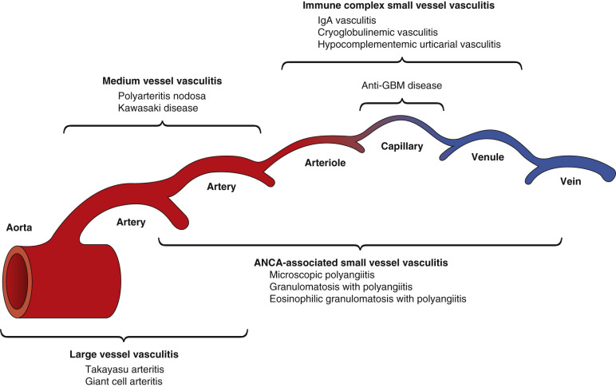

Figure 53-1 

The predominant distribution of vessel involvement by large vessel vasculitis, medium vessel vasculitis, and small vessel vasculitis. 

Note that all categories of vasculitis can affect all types of arteries. The aorta and the largest arteries are most often affected by large vessel vasculitis. Medium vessel vasculitis most often affects medium arteries, although large and small arteries may be affected. Small vessel vasculitis preferentially affects venules and capillaries, although arteries and veins may be affected. ANCA (antineutrophil cytoplasmic antibody)–associated vasculitis affects the broadest spectrum of vessels, whereas immune complex vasculitis usually is restricted to capillaries or venules or both. 

(Modified from Jennette JC, Falk RJ, Bacon PA, et al: 2012 Revised International Chapel Hill Consensus Conference Nomenclature of Vasculitides, _Arthritis Rheum_ 65:1–11, 2013, with permission.) 

In addition to SVV, MVV, and LVV, the 2012 CHCC also recognized variable vessel vasculitis (VVV), single organ vasculitis (SOV), vasculitis associated with systemic disease, and vasculitis associated with probable etiology (  Jennette et al, 2013  ). VV is vasculitis with no predominant type of vessel involved that can affect vessels of any size (small, medium, and large) and type (arteries, veins, and capillaries), such as Behçet's disease and Cogan's syndrome. SOV is vasculitis in arteries or veins of any size in a single organ that has no features that indicate that it is a limited expression of a systemic vasculitis. Some patients originally diagnosed with SOV will develop additional disease manifestations that warrant redefining the case as one of the systemic vasculitides (e.g., cutaneous arteritis later becoming systemic polyarteritis nodosa). Vasculitis associated with systemic disease should have a prefix term specifying the systemic disease (e.g., rheumatoid vasculitis, lupus vasculitis, etc.). Likewise, vasculitis associated with probable etiology should have a prefix term specifying the association (e.g., hydralazine-associated microscopic polyangiitis, hepatitis B virus–associated vasculitis, hepatitis C virus–associated cryoglobulinemic vasculitis, etc.). 

,  

##  Large Vessel Vasculitis 

CHCC 2012 defines LVV as vasculitis affecting the aorta and its major branches more often than other vasculitides, although any size artery may be affected (  Jennette et al, 2013  ). In fact, in some patients the number of medium and small arteries affected is greater than the number of large arteries affected. For example, in giant cell arteritis, very few branches of the carotid arteries may be affected, although there is involvement of numerous small arteries extending into the head and neck (  Waldman et al, 2013  ). 

The two major variants of LVV are Takayasu arteritis (TA) and giant cell arteritis (GCA) ( [ Table 53-1 ](<#t0010>) ). Both have similar pathologic features, so they cannot be distinguished based on pathologic features alone (  Jennette et al, 2013  ). Demographic and clinical features are required to make the distinction, especially age. The differential diagnosis for LVV includes syphilitic aortitis, which is an infectious vasculitis caused by tertiary syphilis, and very rarely by secondary syphilis (  Dietrich et al, 2014  ). The resulting aortic inflammation may lead to aneurysms of the aorta that can be life-threatening or fatal if not treated appropriately with antibiotics. 

TABLE 53-1 

Names and Definitions for Large Vessel Vasculitis Adopted by the 2011-2012 International Chapel Hill Consensus Conference Nomenclature of the Vasculitides 

Large vessel vasculitis (LVV)  |  Vasculitis affecting large arteries more often than other vasculitides. Large arteries are the aorta and its major branches. Any size artery may be affected.   
---|---  
Takayasu arteritis  |  Arteritis, often granulomatous, predominantly affecting the aorta and/or its major branches. Onset usually in patients younger than 50.   
Giant cell arteritis  |  Arteritis, often granulomatous, usually affecting the aorta and/or its major branches, with a predilection for the branches of the carotid and vertebral arteries. Often involves the temporal artery. Onset usually in patients older than 50 and often associated with polymyalgia rheumatica.   
  
From Jennette JC, Falk RJ, Bacon PA, et al: 2012 Revised International Chapel Hill Consensus Conference Nomenclature of Vasculitides, _Arthritis Rheum_ 65:1–11, 2013. 

 

##  Takayasu Arteritis 

 

##  Definition and Epidemiology 

Takayasu arteritis (TAK), is often granulomatous, with a predilection for the aorta and its major branches (  Jennette et al, 2013  ). Onset is usually in patients younger than 50. TAK most often affects women between 10 and 40 years of age. TAK occurs worldwide with an estimated incidence of 1.2 to 2.6/million per year in the Western countries. TAK occurs in all races, but the incidence is higher in Southeast Asia, Central and South America, and Africa (  Vaideeswar & Deshpande, 2013  ). 

 

##  Pathology 

The pathology of TAK in the acute active phase is characterized by inflammation of the aorta or larger arteries with a predominance of mononuclear leukocytes, often, but not always, accompanied by multinucleated giant cells (Jennette, 2015;  Vaideeswar & Deshpande, 2013  ). Even if disease appears more localized clinically, postmortem pathologic examination usually shows more extensive involvement. Involved vessels may have well-demarcated skip areas resulting in localized narrowing or dilation of lumens. This inflammation causes arterial stenosis, thrombosis, and aneurysms. There are at least two classification systems based on distribution of vessel involvement (  Vaideeswar & Deshpande, 2013  ). One classifies TAK into five types: type I, aortic arch and its branches; type II, descending thoracic and abdominal aorta; type III, aortic arch and thoraco-abdominal aorta; type IV, pulmonary artery in addition to the aforementioned types; and type V, coronary artery in addition to the other types (  Gulati & Bagga, 2010  ). Another classifies TAK into six types: type I, aortic arch and its branches; type IIa, ascending aorta, arch, and its branches; type IIb, ascending aorta, arch, and its branches, and descending thoracic aorta; type III, thoracic aorta and abdominal aorta; type IV, abdominal aorta; and type V, combination of type IIb and type IV (  Hata et al, 1996  ). 

The pathologic differential diagnosis includes syphilitic aortitis that also has inflammatory infiltrates with predominantly mononuclear leukocytes, including plasma cells. The only diagnostic pathologic finding that can identify syphilitic aortitis is immunohistochemical identification of _Treponema pallidum_ . 

 

##  Etiology and Pathogenesis 

An autoimmune or infectious etiology that is influenced by genetic and environmental factors and results in cell-mediated immune injury to vessels is incriminated in the pathogenesis of TAK; however, specific etiologic factors have not been identified (  Vaideeswar & Deshpande, 2013  ). 

 

##  Clinical Laboratory Testing 

In part because the specific etiology and unique pathogenic mechanisms are not known for TAK, no laboratory tests have been identified that are specific for this disease. Erythrocyte sedimentation rate (ESR) and C-reactive protein (CRP) are the laboratory tests that are used most often to support a diagnosis of TAK and to follow disease activity and response to therapy. The ESR is elevated in 75% to 100% of patients with active disease and tends to return to normal over time. ESR is thought to be a reliable index of inflammatory activity and has been used as a tool to monitor the effectiveness of therapy. Resolution of the disease, both symptomatically and angiographically, has been found to correlate with decline of the ESR, although one surgical series observed that 44% of patients thought to be quiet clinically were not upon arterial biopsy (  Langford, 2003  ). 

In a study of TAK treatment response, ESR decreased from 55.5 +/− 14.7 mm/h to 21.9 +/− 9.5 mm/h within 3 months ( _p_ < 0.001) and further to 20.8 +/− 15.2 at 1 year ( _p_ = NS). CRP concentrations fell from 4.8 +/− 5.2 mg/dL to 0.5 +/− 0.2 mg/dL at 3 months ( _p_ = 0.004) and remained at 0.5 +/− 0.3 mg/dL at 1 year ( _p_ = NS) (  Valsakumar et al, 2003  ). 

In addition to ESR and CRP, multiple biomarkers have been evaluated as diagnostic and prognostic tests in TAK: interleukin (IL)-6, serum amyloid A, fibrinogen, complement split fragments, B cell activating factor (BAFF), interleukin (IL)-12, matrix metalloproteinase 9 (MMP-9), and pentraxin 3 (PTX3) (  Chatterjee et al, 2014  ). To date, none of these have been adopted for widespread use. 

Laboratory testing to rule out syphilitic aortitis includes the VDRL (Venereal Disease Research Laboratory) test, TPPA ( _Treponema pallidum_ particle agglutination assay), and IgG and IgM FTA-Abs (fluorescent treponemal antibody-absorption) (  Dietrich et al, 2014  ). A definitive test is positive immunohistochemical staining for _Treponema pallidum_ organisms in tissue specimens (e.g., a resected aneurysm). A negative test is not as predictive. 

 

##  Diagnosis, Treatment, and Prognosis 

The diagnosis of TAK is based primarily on clinical signs and symptoms and on imaging studies to document involved vessels. Unlike in GCA, pathologic examination of biopsies or resected vessels is not a routine component of a diagnostic workup for TAK. TAK has three phases of progression (  Vaideeswar & Deshpande, 2013  ). The first is characterized by low-grade fever, malaise, night sweats, arthralgia, anorexia, and weight loss, with no clinical evidence for large vessel narrowing. The second phase is the vasculitic stage in which the first-phase constitutional symptoms are accompanied by evidence for large vessel inflammation, such as tenderness or pain over vessels (angiodynia). These first two phases may last for several months before signs of more chronic injury appear. The final phase, which may evolve over months or years, has various manifestations of chronic sclerosing vasculopathy affecting the aorta and its major branches, including pulseless disease, related to arterial stenosis or occlusion. 

In patients with active disease, corticosteroid therapy is the initial treatment of choice. If active disease persists despite corticosteroids, cyclophosphamide or methotrexate may be administered. Vasodilators, anticoagulants, and nonsteroidal anti-inflammatory agents are used for symptomatic relief. Surgical intervention may be necessary for symptomatic vascular stenosis or occlusion (  Hoffman, 2003  ). 

 

##  Giant Cell Arteritis 

 

##  Definition and Epidemiology 

Giant cell arteritis (GCA) is arteritis, often granulomatous, with a predilection for the aorta and its major branches (  Jennette et al, 2013  ). In contrast to TAK, GCA occurs in patients more than 50 years old. GCA is more common in Western countries with the highest incidence and prevalence in Caucasians of Scandinavian descent (  González-Gay & Pina, 2015  ). There is a north-south gradient in the incidence of GCA in Europe, with high rates in Sweden and Norway, which has an incidence of over 20 new cases per 100,000 individuals aged 50 and older per year, and a lower incidence in southern Europe, which has an annual incidence of 10 cases per 100,000 people aged 50 years and older in northwestern Spain (  González-Gay & Pina, 2015  ). 

 

##  Pathology 

The pathology of GCA in the acute active phase is characterized by inflammation of the aorta or larger arteries, with a predominance of mononuclear leukocytes often accompanied by multinucleated giant cells (Jennette, 2015) ( [ Fig. 53-2 ](<#f0015>) ). The chronic inactive phase has nonspecific chronic inflammation and scarring. Although minor focal necrosis may occur, extensive fibrinoid necrosis, especially in arteries, should raise the possibility of another variant of arteritis. The concurrence of another pathologic process that causes chronic inflammation and scarring (e.g., atherosclerosis) complicates the pathologic diagnosis of chronic LVV. 

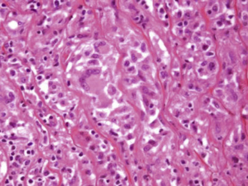

Figure 53-2 

Histopathologic features in the media of the aorta of a patient with giant cell aortitis. 

Note that the elastic fibers are spread apart by numerous infiltrating mononuclear leukocytes with admixed multinucleated giant cells (H&E stain, ×500). 

The most common pathologic pattern in active GCA is transmural inflammation, which is identified in more than 75% of patients, although a minority of specimens will have inflammation confined to the adventitial tissues, including the vasa vasorum (  Cavazza et al, 2014  ). In a study of 274 temporal artery biopsies that had transmural inflammation, most as a result of GCA, 100% had inflammation with predominantly mononuclear leukocytes (lymphocytes, monocytes macrophages, and plasma cells), 75% giant cells, 8% admixed eosinophils, and 2% admixed neutrophils (  Cavazza et al, 2014  ). Although small zones of laminar degeneration (necrosis) may occur in areas of medial inflammation, overt fibrinoid necrosis, especially if accompanied by neutrophils and/or neutrophils with leukocytoclasia, should raise the possibility of a vasculitis other than GCA, such as polyarteritis nodosa or ANCA vasculitis (  Hamidou et al, 2003  ;  Cavazza et al, 2014  ). 

 

##  Etiology and Pathogenesis 

Cell-mediated immune mechanisms are incriminated in the pathogenesis of GCA, although the initiating etiologic factors are not known. For example, in GCA, investigations have demonstrated that dendritic cells in vessel walls initiate the recruitment of T cells and macrophages that are the basis for the granulomatous inflammation (  Weyand & Goronzy, 2014  ). Two major immune-response networks have been identified in inflamed arteries: the interleukin-12, type 1 helper T cell (Th1), and interferon-γ axis; and the interleukin-6, type 17 helper T cell (Th17), and interleukin-17 or interleukin-21 axis. Cytokines released by these inflammatory pathways activate leukocytes as well as endothelial cells, vascular smooth muscle cells, and fibroblasts, leading to intimal and medial hyperplasia and fibrosis. Elastolytic and proteolytic enzymes (e.g., matrix metalloproteinases) and growth factors (e.g., vascular endothelial growth factor and platelet derived growth factor) promote both degenerative and proliferative and sclerosing changes that cause pathologic damage in vessel walls (  Weyand & Goronzy, 2014  ). A large-scale genetic analysis comprising 1651 patients with GCA and 15,306 unrelated control subjects from six different European countries of European ancestry identified multiple HLA loci, PTPN22, and other loci that influence Th1, Th17, and Treg cell function as risk factors for GCA (  Carmona et al, 2015  ). The involvement of these genes supports a role for a pathogenic autoimmune response in the pathogenesis of GCA. 

 

##  Clinical Laboratory Testing 

Temporal artery biopsy is the current gold standard for diagnosis of GCA; however, a biopsy that is not considered diagnostic does not exclude GCA. False-negative results are estimated to occur in up to 15% of patients and are influenced by the length of the biopsy specimen and the duration of corticosteroid treatment prior to biopsy (  Achkar et al, 1994  ;  Poller et al, 2000  ;  Kermani et al, 2013  ). 

Especially in the absence of a tissue diagnosis, laboratory data are very important in reaching an actionable diagnosis of GCA. Laboratory findings that support a diagnosis of GCA are increased erythrocyte sedimentation rate (ESR) and C-reactive protein (CRP), and thrombocytosis (  Kermani et al, 2012  ;  Waldman et al, 2013  ). An elevated platelet count is an early laboratory marker that can be detected a year before GCA is diagnosed (  Lincoff et al, 2000  ). In a study of patients with GCA confirmed by temporal artery biopsy, elevated CRP and elevated ESR had a sensitivity of 87% and 84%, respectively, and 4% had a normal ESR and CRP (  Kermani et al, 2012  ). ACR-EULAR Classification Criteria for GCA (  Dasgupta et al, 2012  ) require, in part, abnormal elevations in CRP, ESR, or both. An additional laboratory criterion is absence of rheumatoid factor or antibodies to cyclic citrullinated peptides. 

 

##  Diagnosis, Treatment, and Prognosis 

The diagnosis of GCA is most accurate when it is to be based on clinical manifestations, laboratory tests, and confirmation by biopsy of the temporal artery or other affected artery (  Waldman et al, 2013  ;  Weyand & Goronzy, 2014  ). Bilateral temporal artery biopsies increase diagnostic sensitivity (  Durling et al, 2014  ). Corticosteroid therapy should not be discontinued after a negative biopsy result if there is enough evidence to make the diagnosis. GCA with normal ESR and/or normal CRP levels is rare but does occur; thus laboratory testing cannot completely rule out GCA (  Kermani et al, 2012  ). 

Imaging studies of large arteries and the aorta—for example, with positron emission tomography (PET)—are a helpful adjunct to pathology and laboratory testing for making a diagnosis and assessing the status of patients with GCA (  Prieto-Gonzalez et al, 2014  ). One-quarter of patients with GCA have involvement of the aorta and its major branches that can be detected with imaging studies (  Weyand & Goronzy, 2014  ). PET also is useful in the early diagnosis of syphilitic aortitis (  Treglia et al, 2013  ). 

Most cases of GCA are effectively managed with glucocorticoid monotherapy (  Weyand & Goronzy, 2014  ). Disease flares are common when the glucocorticoids are tapered and often require a short-term increase to induce and maintain remission. Patients with visual impairment or evidence of unstable blood supply to the eyes benefit from high doses of intravenous glucocorticoids. If disease flares, patients may need to be treated with glucocorticoid-sparing agents, including methotrexate or infliximab. 

Corticosteroids are the treatment of choice for TAK but may not be sufficiently effective 50% of the time. An immunosuppressive regimen of azathioprine and prednisolone is safe, well tolerated, and effective in ameliorating systemic symptoms and laboratory abnormalities in TA, and it halts the progression in lesions based on angiographic studies, although it does not seem to lead to complete resolution of arterial lesions (  Valsakumar et al, 2003  ). Other agents may be considered, including cyclophosphamide and methotrexate. 

The differential diagnosis for LVV also includes variable vessel vasculitis (VVV), including Behçet's disease and Cogan's syndrome, and by infectious vasculitis (e.g., aortitis caused by tertiary syphilis) and lymphoplasmocytic disease (e.g., aortitis as a component of IgG4-related disease) (  Miller & Maleszewski, 2011  ). There is controversy about whether isolated aortitis or isolated giant cell arteritis of a visceral artery is a limited expression of Takayasu arteritis or GCA or a distinct form of single organ vasculitis. When single organ LVV is detected, follow-up should include vigilance for additional organ involvement. 

,  

##  Medium Vessel Vasculitis 

MVV is vasculitis that predominantly affects medium arteries defined as the main visceral arteries and their branches; however, any size artery may be affected (  Jennette et al, 2013  ). The two major categories are polyarteritis nodosa (PAN) and Kawasaki disease (KD) ( [ Table 53-2 ](<#t0015>) ). Inflammatory aneurysms and stenoses are common. It is important to note that medium arteries also can be affected by large vessel vasculitis and small vessel vasculitis. Thus multiple clinical, laboratory, and pathologic findings must be taken into consideration to make an accurate diagnosis of the disease that is causing arteritis. 

TABLE 53-2 

Names and Definitions for Medium Vessel Vasculitis Adopted by the 2011-2012 International Chapel Hill Consensus Conference Nomenclature of the Vasculitides 

Medium vessel vasculitis (MVV)  |  Vasculitis predominantly affecting medium arteries defined as the main visceral arteries and their branches. Any size artery may be affected. Inflammatory aneurysms and stenoses are common.   
---|---  
Polyarteritis nodosa  |  Necrotizing arteritis of medium or small arteries without glomerulonephritis or vasculitis in arterioles, capillaries, or venules, and not associated with ANCA.   
Kawasaki disease  |  Arteritis associated with the mucocutaneous lymph node syndrome and predominantly affecting medium and small arteries. Coronary arteries are often involved. Aorta and large arteries may be involved. Usually occurs in infants and young children.   
  
From Jennette JC, Falk RJ, Bacon PA, et al: 2012 Revised International Chapel Hill Consensus Conference Nomenclature of Vasculitides, _Arthritis Rheum_ 65:1–11, 2013. 

 

##  Polyarteritis Nodosa 

 

##  Definition and Epidemiology 

PAN is necrotizing arteritis of medium or small arteries without glomerulonephritis or vasculitis in arterioles, capillaries, or venules, and it is not associated with ANCA (  Jennette et al, 2013  ). PAN is a diagnosis of exclusion that is made after omitting many other categories of large, medium, and small vessel vasculitis that can affect medium arteries (  Jennette & Falk, 2007  ). PAN affects patients of all ages, genders, and racial backgrounds, although it is more common in older adults. The annual incidence ranges from 0 to 1.6 cases/million in European countries, and its prevalence is about 31 cases/million (  Hernández-Rodríguez et al, 2014  ). Before vaccination against HBV was available, more than one-third of adults with PAN were infected by HBV; however, currently, less than 5% of patients with PAN are infected with HBV in developed countries (  Mahr et al, 2004  ). 

 

##  Pathology 

Any type of artery in any organ can be affected; however, main visceral arteries and their initial branches in the parenchyma are the most frequent targets, such as the major mesenteric arteries, renal arteries, hepatic arteries, and coronary arteries. Epineural arteries of peripheral nerves and subcutaneous arteries of the skin also are common targets. When main arteries are involved, nodular inflammatory lesions and pseudoaneurysms can be observed grossly or with imaging studies (or palpated in the skin). The inflammation has a predilection for arterial branch points. The histopathologic features of PAN ( [ Fig. 53-3 ](<#f0020>) ) begin as fibrinoid necrosis with intense acute neutrophil-rich inflammation, evolve through chronic inflammation and fibroplasia, and eventually result in fibrosis that may completely or partially impede blood flow (  Jennette & Falk, 2007  ; Jennette, 2015). Acute occlusion causing infarction may result from thrombosis of arteries at sites of segmental acute inflammation, necrosis, and pseudoaneurysm formation ( [ Fig. 53-4 ](<#f0025>) ). 

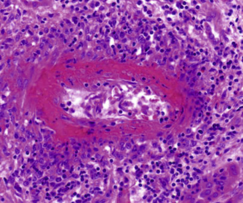

Figure 53-3 

Necrotizing arteritis caused by polyarteritis nodosa. 

Note the replacement of most of the media by deeply acidophilic fibrinoid necrosis and the perivascular inflammation with a mixture of polymorphonuclear leukocytes and mononuclear leukocytes (H&E stain, ×300). 

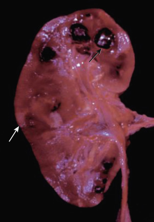

Figure 53-4 

Cross section of a kidney from a patient with polyarteritis nodosa showing multiple pseudoaneurysms (black arrow) and infarcts (white arrow). 

 

##  Etiology and Pathogenesis 

The etiology and pathogenesis of PAN are unknown. A role for infections has been incriminated. During the 1970s, about half of the patients with PAN were infected with HBV, and HBe antigen to anti-HBe antibody seroconversion usually paralleled recovery (  Pagnoux et al, 2006  ). This suggested that PAN was caused by hepatitis B virus infection. However, the frequency of HBV-associated PAN has declined from 35% in the 1980s to less than 5% in the early 2000s (  Mahr et al, 2004  ). Additional infections that have been incriminated as but not proven to be etiologies for PAN include hepatitis C virus (HCV), human immunodeficiency virus (HIV), cytomegalovirus, and parvovirus B19 (  Hernández-Rodríguez et al, 2014  ). Most cases are idiopathic. 

 

##  Clinical Laboratory Testing 

Laboratory testing in patients with PAN often demonstrates thrombocytosis, low serum albumin, and ESR and CRP. Liver enzymes may be abnormal in patients who have viral hepatitis. Testing for HBV, HCV, and HIV in patients with necrotizing arteritis is important because antiviral treatment must be added to immunosuppressive treatment for optimum outcome (  Guillevin, 2013  ). ANCA testing is important to rule out ANCA vasculitis with a component of necrotizing arteritis that is mimicking PAN. Other laboratory abnormalities are dictated by the organ systems that are involved, such as kidneys, pancreas, skeletal muscle, heart, gastrointestinal tract, and so on. 

 

##  Diagnosis, Treatment, and Prognosis 

Clinical manifestations of PAN are protean and depend on the organs that are affected (  Hernández-Rodríguez et al, 2014  ). Most patients have nonspecific constitutional symptoms, such as fever, malaise, arthralgias, myalgias, and weight loss. Peripheral neuropathy occurs in approximately 75% of patients, and gastrointestinal involvement in approximately half. The major cutaneous manifestations are inflammatory nodules, infarction, and livido reticularis. Renal involvement manifests as flank pain and hematuria and, rarely, as retroperitoneal hemorrhage from rupture of an aneurysm. Greater than 2 g/day proteinuria and hematuria with red blood cell casts are not features of PAN and raise the possibility of a small vessel vasculitis such as microscopic polyangiitis. Involvement of the gastrointestinal tract, kidneys, heart, and central nervous system is associated with higher mortality. Laboratory abnormalities reveal a prominent acute phase response but are nonspecific. Histologic confirmation of vasculitis in medium-sized arteries is valuable for diagnosis. Positive pathologic finds are more likely if biopsies are obtained from symptomatic organs if feasible. Skin or muscle and nerve are preferred because of higher diagnostic yield and safety. If biopsies are negative or cannot be obtained, visceral angiography may reveal multiple micro-aneurysms, supporting the diagnosis of PAN. 

Current treatment includes high-dose corticosteroids, which are combined with immunosuppressive agents when critical organ involvement or life-threatening complications occur. IV pulse cyclophosphamide in the remission induction phase, later switched to a safer immunosuppressant for remission maintenance, is a frequently used therapeutic approach (  Hernández-Rodríguez et al, 2014  ). 

 

##  Kawasaki Disease 

 

##  Definition and Epidemiology 

Kawasaki disease (KD) is arteritis associated with the mucocutaneous lymph node syndrome and predominantly affecting medium and small arteries (  Jennette et al, 2013  ). Coronary arteries are often involved. Aorta and large arteries may be involved. KD usually occurs in infants and young children. Clinical manifestations include persistent fever for a week or more, erythematous rash, conjunctivitis, oropharyngeal erythema, and lymphadenopathy. Over 80% of KD cases occur between the ages of 6 months and 4 years. The annual incidence varies from approximately 3 per 100,000 children under 5 years of age in South America to 4 in Australia, 8 in the United Kingdom, 4 to 15 in the United States, 20 to 30 in China, 50 in Taiwan, 90 in Korea, and more than 130 in Japan (  Burgner & Harnden, 2005  ). Kawasaki disease is more common in boys, with a male : female ratio of 1.6 : 1\. 

A number of epidemiological observations suggest but do not prove an infectious etiology for KD (  Burgner & Harnden, 2005  ). Geographical clustering of KD cases and epidemics has been reported. The onset of KD has seasonal variations, but the predominant season varies in different countries. In the United Kingdom, Australia, and the United States, KD is most common in the winter and spring; in China, in the spring and summer; and in Korea, during the summer months. 

 

##  Pathology 

Active KD arteritis is characterized by segmental necrotizing arteritis ( [ Fig. 53-5 ](<#f0030>) ). In the acute phase, in general, KD has more infiltration by monocytes, whereas PAN has more infiltration by neutrophils (  Jennette & Falk, 2007  ). Fibrinoid necrosis occurs with both PAN and KD, but it is less conspicuous in KD. The chronic sclerotic phase is characterized by segmental transmural chronic inflammation and scarring. Special stains for elastica demonstrate focal disruption of the internal elastica. 

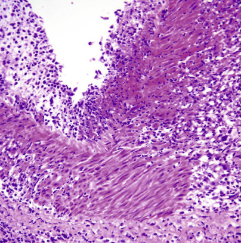

Figure 53-5 

Kawasaki disease arteritis showing segmental transmural necrotizing inflammation with residual areas of intact muscularis adjacent to intense medial inflammation that is continuous with intimal inflammation and adventitial inflammation (H&E stain, ×400). 

The acute lesion of KD is characterized by transmural necrotizing inflammation that is rich in neutrophils and monocytes (  Orenstein et al, 2012  ; Jennette, 2015). Degeneration of artery walls results in aneurysm and pseudoaneurysm formation, with the latter having complete erosion of the necrotizing process into the perivascular tissues. Thrombosis may occur at sites of arteritis, especially sites of aneurysm/pseudoaneurysm formation. Acute arteritis wanes by 2 weeks after fever onset, and it is replaced by varying degrees of subacute and chronic inflammation, including intimal myofibroblast proliferation (  Orenstein et al, 2012  ;  Reindel et al, 2014  ). 

 

##  Etiology and Pathogenesis 

Infection also has been suspected as a cause of KD because concurrent infection with pathogens has been detected by culture, molecular methods, or serological testing in patients with KD; however, although more than 20 different pathogens have been incriminated, none have been proven to be a direct cause of KD, and many are infectious diseases that are common in young children (  Burgner & Harnden, 2005  ;  Principi et al, 2013  ). Mediation by an immune response to a superantigen (possibly of microbial origin) has been studied extensively. KD shares many clinical features with superantigen-mediated diseases—for example, rash, conjunctivitis, and skin sloughing—and KD has been reported in children with toxic shock syndrome, which can be caused by superantigens (  Burgner & Harnden, 2005  ). However, there is no proof that superantigens are involved in the pathogenesis of KD. Multiple inflammatory pathways are upregulated in the inflamed arteries of KD, including a pathway that involves the lymphocyte activation molecule CD84 (  Reindel et al, 2014  ). CD84 was upregulated 16-fold in acute coronary arteritis caused by KD and 32-fold in chronic coronary arteritis caused by KD (5 months to years after onset). CD84 was detected in leukocytes in KD tissues. 

 

##  Clinical Laboratory Testing 

Diagnosis of KD is based primarily on clinical signs and symptoms. Nonspecific laboratory indicators of acute inflammation (i.e., acute phase reactants, including CRP and ESR) are consistently elevated in the acute phase of KD. One study suggests that elevated serum levels of the cardiac natriuretic peptide called N-terminal of the prohormone brain natriuretic peptide (NT-pro-BNP) might be a useful diagnostic tool for KD, especially in patients with cardiac injury and atypical clinical presentations (  Cho et al, 2011  ). The cutoff level of NT-pro-BNP that best distinguished KD from other childhood febrile illnesses was 235.2 pg/mL. The same study concluded that serum levels of high-sensitivity CRP are not useful in distinguishing KD from other childhood febrile illnesses. 

 

##  Diagnosis, Treatment, and Prognosis 

Features of the mucocutaneous lymph node syndrome, especially in a child 5 years of age or younger, are important for diagnosis of KD, but some patients present with other KD manifestations before full-blown mucocutaneous lymph node syndrome, including signs and symptoms of myocardial ischemia caused by coronary arteritis. Although timely treatment with intravenous gamma globulin (IVIG) plus aspirin has profoundly reduced the frequency and severity of coronary arteritis in KD, approximately 10% to 20% of patients develop clinically significant sequelae of coronary arteritis (  Orenstein et al, 2012  ). Myocardial infarction occurs in approximately 2% of KD patients with coronary arteritis (  Burgner & Harnden, 2005  ). 

,  

##  Small Vessel Vasculitis 

Small vessel vasculitis (SVV) is vasculitis predominantly affecting small vessels, defined as small intraparenchymal arteries, arterioles, capillaries, and venules (  Jennette et al, 2013  ). Medium arteries and veins may be affected. 

As with other vasculitides, an important diagnostic dichotomy is between infectious SVV and immune-mediated SVV. Viral infection and bacterial infection can mimic immune-mediated SVV, and the diagnostic distinction between these forms of vasculitis is critically important for appropriate treatment with antimicrobial therapy versus immunosuppressive therapy. Detection of the pathogen by culture or by genomic or proteomic assays or serologic detection of an immune response to the pathogen reveals the etiologic infection (  Jain et al, 2007  ;  D'Alessandro et al, 2014  ). 

Based on immunopathologic features, noninfectious SVV is divided into ANCA-associated vasculitis with few or no vessel-immune deposits, and immune complex SVV with moderate to marked vessel wall deposits of immunoglobulin and/or complement components. 

 

##  ANCA-Associated Small Vessel Vasculitis 

 

##  Definition and Epidemiology 

ANCA-associated vasculitis is necrotizing vasculitis, with few or no immune deposits, that predominantly affects small vessels (i.e., capillaries, venules, arterioles, and small arteries) and is associated with myeloperoxidase (MPO)–ANCA, or proteinase 3 (PR3)–ANCA (  Jennette et al, 2013  ) ( [ Table 53-3 ](<#t0020>) ). However, not all patients have MPO-ANCA or PR3-ANCA, at least using current analytic methods. The few or no immune deposits distinguishes ANCA vasculitis from immune complex vasculitis that has moderate to marked vessel wall deposits of immunoglobulin and/or complement components (  Jennette et al, 2013  ). Because of this paucity of immune deposits, ANCA vasculitis is also called pauci-immune vasculitis. 

TABLE 53-3 

Names and Definitions for ANCA-Associated Small Vessel Vasculitis Adopted by the 2011-2012 International Chapel Hill Consensus Conference Nomenclature of the Vasculitides 

ANCA-associated vasculitis (AAV)  |  Necrotizing vasculitis, with few or no immune deposits, predominantly affecting small vessels (i.e., capillaries, venules, arterioles, and small arteries), associated with MPO-ANCA or PR3-ANCA. Not all patients have ANCA. Add a prefix indicating ANCA reactivity—for example, PR3-ANCA, MPO-ANCA, ANCA-negative.   
---|---  
Microscopic polyangiitis (MPA)  |  Necrotizing vasculitis, with few or no immune deposits, predominantly affecting small vessels (i.e., capillaries, venules, or arterioles). Necrotizing arteritis involving small and medium arteries may be present. Necrotizing glomerulonephritis is very common. Pulmonary capillaritis often occurs. Granulomatous inflammation is absent.   
Granulomatosis with polyangiitis (Wegener's) (GPA)  |  Necrotizing granulomatous inflammation usually involving the upper and lower respiratory tract, and necrotizing vasculitis affecting predominantly small to medium vessels (e.g., capillaries, venules, arterioles, arteries, and veins). Necrotizing glomerulonephritis is common.   
Eosinophilic granulomatosis with polyangiitis (Churg Strauss) (EGPA)  |  Eosinophil-rich and necrotizing granulomatous inflammation often involving the respiratory tract, and necrotizing vasculitis predominantly affecting small to medium vessels, and associated with asthma and eosinophilia. ANCA is more frequent when glomerulonephritis is present.   
  
From Jennette JC, Falk RJ, Bacon PA, et al: 2012 Revised International Chapel Hill Consensus Conference Nomenclature of Vasculitides, _Arthritis Rheum_ 65:1–11, 2013. 

ANCA SVV is classified based on clinicopathologic phenotypes and by the antigen-specificity of ANCA. The clinicopathologic variants are microscopic polyangiitis (MPA), granulomatosis with polyangiitis (GPA) (formerly called Wegener's granulomatosis), eosinophilic granulomatosis with polyangiitis (EGPA) (formerly called Churg-Strauss syndrome), and renal limited vasculitis (RLV) (  Jennette et al, 2013  ). An additional variant is drug-induced ANCA vasculitis, which may manifest as MPA, GPA, or RLV (  Pendergraft & Niles, 2014  ). An optimum diagnosis should include both the ANCA serology status and the clinicopathologic phenotype—for example, MPO-ANCA MPA, PR3-ANCA GPA, ANCA-negative EGPA, and so on (  Jennette et al, 2013  ). 

MPA is multiorgan pauci-immune small vessel vasculitis with no granulomatous inflammation or asthma. MPA often has necrotizing glomerulonephritis and pulmonary capillaritis. GPA has necrotizing granulomatous inflammation usually involving the upper and lower respiratory tract, as well as vasculitic lesions indistinguishable from those of MPA. EGPA has eosinophil-rich and necrotizing granulomatous inflammation often involving the respiratory tract, as well as asthma and blood eosinophilia. Although there appears to be a prevasculitic phase that is ANCA-negative, ANCA-positive EGPA patients typically have pauci-immune small vessel vasculitis and pauci-immune necrotizing and crescentic glomerulonephritis that is indistinguishable from MPA and GPA. ANCA vasculitis confined to a single organ may occur. One example is ANCA renal-limited vasculitis (RLV) causing pauci-immune necrotizing and crescentic glomerulonephritis. 

The incidence of ANCA vasculitis increases with age, with a peak around 60 years old, although children can develop ANCA vasculitis. Gender distribution is about equal, with a possible slight male predominance. The incidence and prevalence of ANCA vasculitis varies among the different clinicopathologic phenotypes and among different geographic locations (  Watts et al, 2015  ). Roughly, the incidence of all forms of ANCA vasculitis is 15 to 20/million, and the prevalence is roughly 50 to 150/million. There is a higher ratio of GPA : MPA in northern Europe (e.g., Germany and Scandinavia) and northern U.S. states (e.g., Montana and Minnesota), and a lower ratio of GPA : MPA in southern Europe (e.g., Greece and Spain) and southern U.S. states (e.g., North Carolina). This is accompanied by the expected differences in ratio of PR3:MPO ANCA specificity in accord with more frequent PR3-ANCA with GPA and more frequent MPO-ANCA with MPA. The precise ratios are not known, but in general there is a reversal of preponderance of MPO-ANCA MPA versus PR3-ANCA GPA from north to south in both Europe and North America. There is a striking preponderance of MPO-ANCA and of MPA in Asia. For example, in one study of ANCA-associated vasculitis in Japan, the estimated annual incidence was 15 per million adults (over age 15) and 45 per million older adults (over age 65). Ninety-one percent of the patients were MPO-ANCA positive, but none were PR3-ANCA positive, and none had GPA or EGPA (  Fujimoto et al, 2006  ). 

 

##  Pathology 

ANCA vasculitis can affect arteries (usually small arteries), arterioles, capillaries, venules, and veins (usually small veins). In all organs and in all clinicopathologic variants (e.g., MPA, GPA, EGPA), acute ANCA arteritis is characterized by segmental fibrinoid necrosis ( [ Fig. 53-6 ](<#f0035>) ), and mural and perivascular neutrophil-rich infiltration (  Jennette & Falk, 2007  ; Jennette, 2015). Eosinophils may be numerous, especially in EGPA. Within several days, the neutrophil-rich inflammation is replaced by predominantly mononuclear leukocytes, with numerous monocytes and macrophages and fewer lymphocytes. Within a week, the active inflammatory process wanes and vasculitic lesions develop progressive sclerosis/fibrosis. In a given tissue, such as skin, gut, or kidney, vasculitic lesions of different ages often are observed because persistently active ANCA vasculitis has multiple acute vasculitic lesions developing while prior active lesions are undergoing scarring. Patients in complete remission should have only chronic quiescent lesions. ANCA arteritis is histopathologically indistinguishable from other forms of necrotizing arteritis (e.g., PAN). 

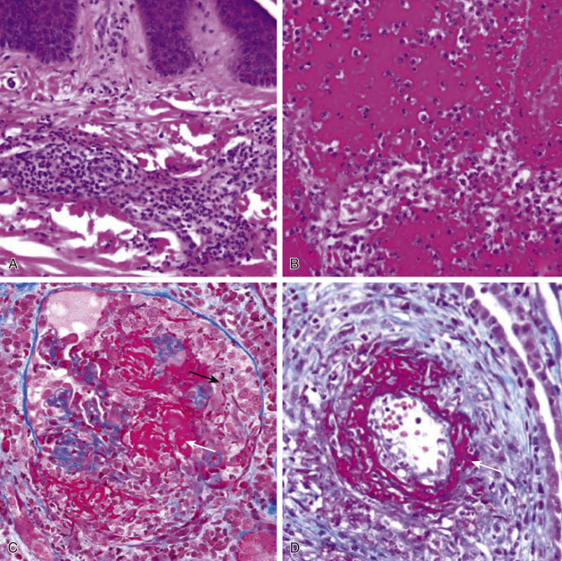

Figure 53-6 

ANCA disease can cause many forms of vascular injury. 

These include: **A,** dermal leukocytoclastic angiitis with intense neutrophil-rich infiltrates centered in small dermal vessels (H&E stain, ×400); **B,** hemorrhagic pulmonary alveolar capillaritis with destruction of alveolar walls by neutrophil-rich inflammation (H&E stain, ×500); **C,** glomerulonephritis with fibrinoid necrosis of glomerular capillaries _(white arrow)_ and adjacent cellular crescent formation _(black arrow)_ (Masson trichrome stain, ×500); and **D,** arteritis with extensive irregular fibrinoid necrosis (Masson trichrome stain, ×400). 

When ANCA vasculitis affects venules—for example, in the dermis—acute lesions have less conspicuous fibrinoid necrosis and more prominent leukocytoclasia ( [ Fig. 53-6, _A_ ](<#f0035>) ). This pattern of injury may be called leukocytoclastic angiitis, and it can also be caused by other forms of SVV, especially immune complex SVV. 

Acute pulmonary alveolar capillaritis is characterized by accumulation of neutrophils in alveolar capillary lumens, destruction of capillary basement membranes (seen with silver stains), and hemorrhage into alveolar air spaces ( [ Fig. 53-6, _B_ ](<#f0035>) ). 

The necrotizing glomerulonephritis that often is a component of ANCA vasculitis and that may occur as renal limited vasculitis is characterized by segmental fibrinoid necrosis with adjacent cellular crescent formation in the acute phase ( [ Fig. 53-6, _C_ ](<#f0035>) ) and segmental sclerosis with adjacent fibrous crescents in the chronic phase. The pathology of ANCA glomerulonephritis is the same in MPA, GPA, EGPA, and renal limited disease. In addition to necrotizing and crescentic glomerulonephritis, kidney lesions in ANCA disease also include necrotizing arteritis (most often affecting interlobular and arcuate arteries) ( [ Fig. 53-6, _D_ ](<#f0035>) ) and leukocytoclastic medullary angiitis affecting the vasa rectae. 

Immunohistology demonstrates an absence or paucity of immunoglobulin deposition, which distinguishes ANCA vasculitis from immune complex vasculitis. However, most specimens, including glomeruli affected by ANCA disease, have at least a small amount of immune complex–type staining for immunoglobulins and complement, and a small amount of immune complex–type electron-dense deposits by electron microscopy. ANCA disease also can occur concurrently with anti-GBM disease or immune complex disease, and in this context, there is substantial immunostaining for immunoglobulins and complement. 

The necrotizing granulomatous inflammation of GPA and EGPA begins as a focus of neutrophil-rich inflammation that may resemble a microabscess. EGPA lesions also contain numerous eosinophils (  Jennette, 2011  ). These lesions may be small and spherical, or they may be large and irregular, creating so-called geographic necrosis. Within days, the focus of acute inflammation is surrounded by a rim of monocytes and macrophages, including multinucleated giant cells ( [ Fig. 53-7, _A_ ](<#f0040>) ). The central zone of inflammation becomes completely necrotic and evolves from basophilic or eosinophilic cellular fragments (derived primarily from degenerated neutrophils and eosinophils) to amorphous necrotic debris. The adjacent granulomatous inflammation becomes more organized with palisades of elongated macrophages adjacent to the necrosis. Eventually, the central zone forms a cavity or becomes fibrotic. Necrotizing granulomatous inflammation occurs most often in the upper and lower respiratory tract, but occasionally in other tissues, such as the nasal tissues, orbit, skin, and kidneys. The differential diagnosis for pulmonary granulomatous inflammation includes mycobacterial and fungal infectious disease. The presence of pulmonary vasculitis along with the granulomatous inflammation is more specific evidence for GPA or EPGA. Numerous eosinophils in the granulomatous inflammation and the vasculitis favor EGPA ( [ Fig. 53-7, _B_ ](<#f0040>) ). 

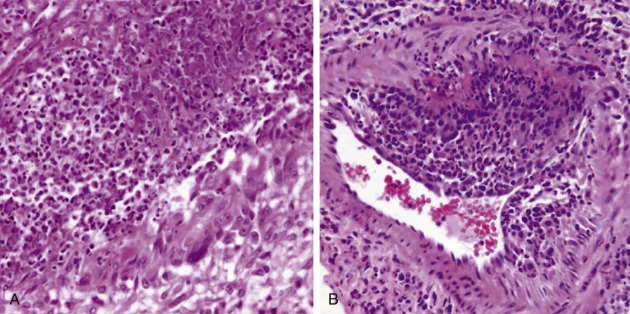

Figure 53-7 

Pulmonary lesions in GPA and EGPA include necrotizing granulomatous inflammation and vasculitis. 

**A,** Necrotizing granulomatous inflammation in a GPA patient showing neutrophil-rich necrotic debris in the upper left with a marginal zone of macrophages, including a giant cell in the lower right (H&E stain, ×500). **B,** Necrotizing arteritis in the lung of a patient with EGPA showing intense eosinophil-rich inflammation (H&E stain, ×400). 

 

##  Etiology and Pathogenesis 

Clinical and experimental observations support a direct role of ANCA in the pathogenesis of vasculitis (  Jennette & Falk, 2014  ;  Kallenberg, 2014  ). Clinical observations that support a pathogenic role include the high frequency of ANCA in the blood, the general correlation of ANCA titers with disease activity (especially if capture assays are used), increased risk for disease when there are higher levels of ANCA antigens on the surface of circulating neutrophils, induction of ANCA as well as vasculitis by certain drugs (e.g., hydralazine, propylthiouracil, penicillamine, minocycline), and the therapeutic efficacy of apheresis and targeted B cell therapy (e.g., rituximab). 

The best experimental evidence is induction of ANCA-mediated pauci-immune crescentic glomerulonephritis and small-vessel vasculitis in experimental animals. The first animal model that was described used intravenous injection of mouse anti-MPO IgG (derived from immunizing MPO knockout mice with purified mouse MPO) into wild-type mice, resulting in the induction of a pauci-immune glomerulonephritis with segmental fibrinoid necrosis and crescent formation that closely resembled human ANCA glomerulonephritis (  Xiao et al, 2002  ). Some of the mice that received anti-MPO IgG also developed systemic small-vessel vasculitis, including alveolar capillaritis and necrotizing arteritis that was histologically indistinguishable from human ANCA disease. 

Numerous in vitro and in vivo experiments support the hypothesis that ANCA in the circulation can interact with ANCA antigens (MPO, PR3) on the surface of neutrophils that have been primed by cytokines or complement fragments (e.g., C5a) (  Jennette & Falk, 2014  ). ANCA-activated neutrophils release factors that activate the alternative complement pathway, which in turn recruits more neutrophils and primes and activates neutrophils by engaging the C5a receptors (  Xiao et al, 2014  ). Neutrophils that are activated in the circulation adhere to and penetrate vessel walls and release destructive enzymes and oxygen radicals that cause vascular injury. Hypothetically, primed neutrophils in the extravascular tissues that are activated by ANCA are the cause for the granulomatous inflammation of GPA and EGPA (  Jennette & Falk, 2014  ). 

Drugs can induce the development of ANCA, especially MPO-ANCA (  Pendergraft & Niles, 2014  ). Hydralazine, minocycline, propylthiouracil, and levamisole-adulterated cocaine are major causes. A hypothesis has been proposed to explain the induction of ANCA by hydralazine. Patients with ANCA vasculitis have circulating neutrophils that aberrantly transcribe and express neutrophil granule proteins, including the MPO and PR3, because of altered epigenetic regulation of gene expression (  McInnis et al, 2015  ). Hydralazine can function as a nonnucleoside DNA methylation inhibitor, so it can reverse epigenetic silencing of PR3 and MPO, which could result in increased expression of both autoantigens and loss of tolerance (  Pendergraft & Niles, 2014  ). 

Except for the small minority of cases caused by drugs, the etiology of ANCA disease is not known. Various theories postulate the result of infections (e.g., _Staphylococcus aureus_ ), environmental exposures (e.g., silica), or dysregulated gene expression (e.g., of PR3 antisense peptides) (  Jennette & Falk, 2014  ;  Kallenberg, 2014  ). One novel theory posits that a protein that is complementary to the autoantigen PR3 triggers the PR3-ANCA autoimmune response through an anti-idiotypic network (  Pendergraft et al, 2004  ). This complementary protein could be an endogenous protein resulting from age-related dysregulation of antisense gene expression or an exogenous protein derived from a pathogen that makes an antisense peptide mimic that is an inhibitor of the antimicrobial function of complementary PR3. 

 

##  Clinical Laboratory Testing 

In 1999, an International Consensus Statement on Testing and Reporting of Antineutrophil Cytoplasmic Antibodies recommended that testing in new patients should be by indirect immunofluorescence (IIF) assay and that samples that are positive by IIF should be tested by ELISAs for PR3-ANCA and MPO-ANCA (  Savige et al, 1999  ). The recommendation for optimum testing of patients suspected of having ANCA disease was to test by ELISA for PR3-ANCA and MPO-ANCA on all serum samples irrespective of IIF results. Although immunoassays have become more effective since this recommendation was made, most laboratories continue to employ both IIF and antigen-specific immunoassays for MPO and PR3 for ANCA testing. An automated ANCA-pattern recognition system (  Damoiseaux et al, 2012  ) and a digital indirect immunofluorescence assay (  Sowa et al, 2014  ) have been evaluated as alternatives to IIF, but they are unlikely to replace conventional IIF microscopy assays anytime soon. 

IIF assay using ethanol-fixed, normal human neutrophils as substrate produces two different staining patterns: cytoplasmic (C-ANCA) ( [ Fig. 53-8, _A_ ](<#f0045>) ) and perinuclear (P-ANCA) ( [ Fig. 53-8, _B_ ](<#f0045>) ) (  Savige et al, 2000  ). The perinuclear staining is an artifact of substrate preparation that results from diffusion of the cationic MPO antigen from the cytoplasm to the nucleus during substrate preparation. This perinuclear relocation does not occur when formalin is used to fix plasma protein in place before preparing neutrophils for IIF. Thus a true P-ANCA will produce cytoplasmic staining on formalin-fixed neutrophils, whereas an antinuclear antibody will stain the nucleus in both ethanol- and formalin-fixed preparations (  Falk & Jennette, 1988  ). 

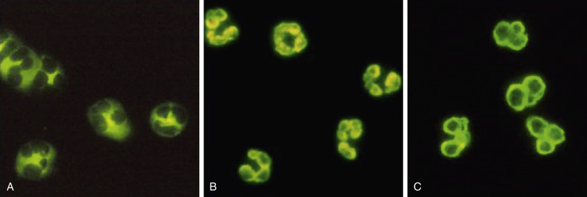

Figure 53-8 

IIF assay using ethanol-fixed, normal human neutrophils as substrate showing: **A,** C-ANCA cytoplasmic staining; **B,** P-ANCA perinuclear staining; and **C,** atypical-ANCA showing heaped-up, very perinuclear staining (×1000). 

When the antigen specificity is determined by immunoassays, PR3-ANCA typically produces the C-ANCA staining pattern by IIF, and MPO-ANCA typically produces a P-ANCA staining pattern. ANCAs that cause a P-ANCA pattern in IIF assays are not restricted to MPO and include a variety of autoantibodies that occur in inflammatory diseases, including ulcerative colitis, sclerosing cholangitis, autoimmune hepatitis, rheumatoid arthritis, and Felty's syndrome (  Savige et al, 2000  ). Positive ANCA IIF results in serum from patients with inflammatory bowel disease and other nonvasculitic inflammatory diseases may have an atypical pattern that shows more intense and heaped-up perinuclear staining (very perinuclear staining) ( [ Fig. 53-8, _C_ ](<#f0045>) ). Antibodies that produce an atypical ANCA IIF pattern usually are not specific for MPO or PR3 (  Savige et al, 2000  ). 

Antigen-specific, quantitative immunoassays are the standard of care for diagnosis and some management decisions in patients with ANCA disease. ANCA serotype may be more important than clinicopathologic classification for predicting outcome, including the likelihood of recurrence after induction of remission (  Kallenberg, 2014  ). Detection of ANCA to monitor disease activity and adjust treatment remains controversial; however, epitope-specific assays that can distinguish between pathogenic and nonpathogenic ANCA may change this in the future (  Roth et al, 2013  ). 

First-generation ANCA assays were direct noncompetitive enzyme-linked immunosorbent assay (ELISA). The second-generation tests (capture ELISA) or third-generation tests (anchor ELISA) are more sensitive and specific for ANCA testing (  Cohen Tervaert & Damoiseaux, 2012  ). Fourth-generation assays may be epitope specific and more effective in guiding therapy (  Roth et al, 2013  ). 

Chemiluminescence assays (CIAs) have been used to detect PR3-ANCA and MPO-ANCA with comparable results to ELISAs (  Mahler et al, 2012  ). A combination of cell- and microbead-based digital indirect immunofluorescence analysis of ANCA in one reaction environment by the novel multiplexing bead technology for simultaneous screening and confirmatory ANCA testing has been developed (  Sowa et al, 2014  ). ANCA results by classical testing (IIF and ELISA) compared with multiplex bead analysis were very good (κ = 0.831) with no significant difference ( _p_ = 0.735). Automated ANCA titer detection in one dilution demonstrated very good agreement with classical analysis requiring dilution of samples (κ = 0.985). 

Even using current ANCA testing capabilities, patients with clinical features and pathologic findings consistent with ANCA vasculitis can test negative for ANCA. In a study of 539 patients with a clinical diagnosis of ANCA vasculitis, positive ANCA serology was demonstrated in 98% of MPA patients, 96% of GPA patients, 94% of renal-limited pauci-immune crescentic glomerulonephritis patients, and 64% of EGPA patients (  Kallenberg, 2014  ). Of the 364 patients with GPA in this analysis, 12 tested negative for ANCA, but 10 had GPA limited to the ear, nose, and throat. 

EGPA patients usually have P-ANCA with MPO-ANCA specificity (  Sinico et al, 2005  ). EGPA patients with a positive ANCA have more glomerulonephritis, pulmonary capillaritis, peripheral neuropathy, and biopsy-proven vasculitis, whereas patients with a negative ANCA have more myocarditis (  Sablé-Fourtassou et al, 2005  ;  Sinico et al, 2005  ). All EGPA patients who have biopsy-proven pauci-immune necrotizing and crescentic glomerulonephritis are ANCA positive (  Sinico et al, 2006  ). It appears that EGPA may have two serologically defined phenotypes: ANCA-positive EGPA with vasculitis and ANCA-negative EGPA without vasculitis. 

ANCA specificity correlates with clinical symptoms. Ninety percent of patients with ANCA who have destructive upper respiratory tract disease (e.g., saddle-nose deformity) have PR3-ANCA, whereas most patients with exclusively or predominantly renal involvement have MPO-ANCA (  Lionaki et al, 2012  ). Dual positivity for both MPO-ANCA and PR3-ANCA is rare except in the setting of drug-induced ANCA (  Pendergraft & Niles, 2014  ). 

ANCAs are in approximately one third of patients with anti-GBM disease (  Jennette, 2003  ;  Rutgers et al, 2005  ). The dual anti-GBM and ANCA specificity is the result of two different antibody populations rather than one cross-reacting population (  Rutgers et al, 2005  ), and the antigen specificities of anti-GBM antibodies are the same in patients with anti-GBM antibodies only or combined ANCA and anti-GBM antibodies (  Hellmark et al, 1997  ). Compared with patients with anti-GBM alone, patients with both autoantibodies are older, often have features of systemic small-vessel vasculitis, and have a better prognosis for renal survival with treatment. 

The possibility of drug-induced disease should be considered in patients with ANCA vasculitis. The most common are hydralazine, minocycline, propylthiouracil, and levamisole-adulterated cocaine. If cocaine abuse is a possibility, the urine should be tested for cocaine, and if positive, should be tested for levamisole (  Pendergraft & Niles, 2014  ). Most drug-induced vasculitis is not caused by ANCA. A recent study of 239 patients with all forms of drug-associated cutaneous vasculitis demonstrated that the most common laboratory abnormalities were increased ESR (40%) and cryoglobulins (26%), while leukocytosis and positive ANA were found in less than 25% (  Ortiz-Sanjuán et al, 2014  ). Only rare examples of drug-induced immune complex vasculitis have been described, and most of these have been caused by therapeutic agents that are proteins, such as monoclonal antibodies (  Baldo, 2013  ). 

The diagnostic value in patients with vasculitis of ANCA with other specificities has been investigated; however, to date, the only routine testing that has been adopted is for MPO-ANCA and PR3-ANCA. ANCA with specificity for lysosomal membrane protein 2 (LAMP2) has been reported to have high sensitivity and specificity for pauci-immune SVV (  Kain et al, 2008  ); however, not all investigators have confirmed this finding (  Roth et al, 2012  ). 

 

##  Diagnosis, Treatment, and Prognosis 

The diagnosis of ANCA-associated vasculitides as MPA, GPA, or EGPA is based on algorithms that have been derived from the Chapel Hill Consensus Conference definitions (  Watts et al, 2007  ;  Abdulkader et al, 2013  ). The diagnostic evaluation of patients with ANCA disease should include both testing for ANCA specificity—that is, for proteinase 3 (PR3-ANCA) or myeloperoxidase (MPO-ANCA)—as well as classification as MPA, GPA, EGPA, or renal-limited vasculitis (RLV). Assessment of the disease stage and severity also is important for tailoring treatment. 

Treatment of ANCA disease begins with induction of remission, followed by maintenance of remission (  Kallenberg, 2014  ). In patients with active generalized disease, remission is most often induced with an immunosuppressive agent (e.g., cyclophosphamide or rituximabrituximab) and high-dose glucocorticoids. Rituximab has been shown to be noninferior to cyclophosphamide for induction of remission. Patients presenting with severe kidney failure (i.e., requiring dialysis or an estimated GFR less than 15) or diffuse alveolar hemorrhage should receive plasma exchange as well as the usual induction therapy. Mild localized disease, especially with no renal or pulmonary disease, may be controlled with methotrexate and glucocorticoids. When disease is in remission, patients should be transitioned to oral azathioprine, although the use of rituximab as remission maintenance therapy is increasing (  Kallenberg, 2014  ). Once a patient is in remission, glucocorticoids should be tapered within 6 months to reduce the likelihood of infectious complications (  McGregor et al, 2012  ). Other treatment options for refractory disease are IVIg, infliximab, alemtuzumab, and deoxyspergualin (  Kallenberg, 2014  ). 

Drug-induced ANCA vasculitis may require not only cessation of the drug and supportive care but also immunosuppression, plasma exchange in severe cases, and dialysis as needed (  Pendergraft & Niles, 2014  ). 

 

##  Anti-Glomerular Basement Membrane Disease 

 

##  Definition and Epidemiology 

Anti-glomerular basement membrane (anti-GBM) disease is an autoimmune disease caused by autoantibodies that target the noncollagen domain of the α3 chain of type IV collagen (  Cui & Zhao, 2011  ;  Greco et al, 2015  ). This form of vasculitis can be grouped with immune complex vasculitis because it results from immune complexes forming in situ along capillary basement membranes ( [ Table 53-4 ](<#t0025>) ). The glomerular capillaries of the kidneys and alveolar capillaries of the lungs contain this autoantigen, and either or both can be injured in anti-GBM disease. When both are involved, the resultant pulmonary-renal syndrome is called Goodpasture syndrome. Most patients with anti-GBM disease have rapidly progressive glomerulonephritis, approximately half have pulmonary disease, and only a few have lung disease. 

TABLE 53-4 

Names and Definitions for Immune Complex Small Vessel Vasculitis Adopted by the 2011-2012 International Chapel Hill Consensus Conference Nomenclature of the Vasculitides 

Immune complex vasculitis  |  Vasculitis with moderate to marked vessel wall deposits of immunoglobulin and/or complement components predominantly affecting small vessels (i.e., capillaries, venules, arterioles, and small arteries). Glomerulonephritis is frequent.   
---|---  
Anti-GBM disease  |  Vasculitis affecting glomerular capillaries, pulmonary capillaries, or both, with basement membrane deposition of antibasement membrane autoantibodies. Lung involvement causes pulmonary hemorrhage, and renal involvement causes glomerulonephritis with necrosis and crescents.   
Cryoglobulinemic vasculitis  |  Vasculitis with cryoglobulin immune deposits affecting small vessels (predominantly capillaries, venules, or arterioles) and associated with cryoglobulins in serum. Skin, glomeruli, and peripheral nerves are often involved.   
IgA vasculitis (Henoch-Schönlein)  |  Vasculitis, with IgA1-dominant immune deposits affecting small vessels (predominantly capillaries, venules, or arterioles). Often involves skin and gut, and frequently causes arthritis. Glomerulonephritis indistinguishable from IgA nephropathy may occur.   
Hypocomplementemic urticarial vasculitis (anti-C1q vasculitis)  |  Vasculitis accompanied by urticaria and hypocomplementemia affecting small vessels (i.e., capillaries, venules, or arterioles), and associated with anti-C1q antibodies. Glomerulonephritis, arthritis, obstructive pulmonary disease, and ocular inflammation are common.   
  
From Jennette JC, Falk RJ, Bacon PA, et al: 2012 Revised International Chapel Hill Consensus Conference Nomenclature of Vasculitides, _Arthritis Rheum_ 65:1–11, 2013. 

The incidence of anti-GBM disease is estimated to be 1 per million per year (  Cui & Zhao, 2011  ;  Greco et al, 2015  ). It occurs more commonly in Caucasians than African Americans. Age distribution is bimodal, with the most common ages being between 20 and 30 and between 60 and 70. The younger patients are predominantly men, and there is a higher frequency of pulmonary disease. The older patients are predominantly women, and there is a lower frequency of pulmonary disease. 

 

##  Pathology 

The light microscopic features of anti-GBM glomerulonephritis (GN) are indistinguishable from ANCA glomerulonephritis, although on average the extent of injury is more severe in anti-GBM GN compared to ANCA GN. For example, at the time of biopsy, anti-GBM GN has an average of 77% crescents compared to 49% for ANCA GN (  Jennette, 2003  ). Concurrent anti-GBM plus ANCA GN has an average of 62% crescents. The activity and chronicity of anti-GBM GN lesions tend to be more synchronous than the lesions of ANCA GN. That is, anti-GBM lesions are either mostly acute or mostly chronic, whereas ANCA GN lesions more often have a mixture of acute and chronic lesions. This is in accord with the clinical and serologic observations that anti-GBM disease and anti-GBM seropositivity typically occur as one episode with uncommon relapses, whereas ANCA disease and ANCA seropositivity often are persistent with multiple recurrences even after initial induction of remission. 

Anti-GBM pulmonary disease is characterized by extensive hemorrhage into the alveolar air spaces but with less overt influx of neutrophils into alveolar capillaries than is observed with ANCA pulmonary capillaritis. Identification of arteritis in the kidney or lung of a patient with anti-GBM disease is strong evidence for concurrent anti-GBM plus ANCA disease. 

The most definitive pathology finding is demonstration by direct immunofluorescence microscopy of linear staining for IgG along glomerular capillary basement membranes or pulmonary alveolar capillary basement membranes ( [ Fig. 53-9 ](<#f0050>) ). This usually is accompanied by staining for C3 and other complement components and variable staining for IgM and IgA. This is distinct from the granular staining for immunoglobulin in vessel walls with immune complex vasculitis or the paucity of immunoglobulin staining in vessel walls in ANCA vasculitis (  Jennette et al, 2013  ). 

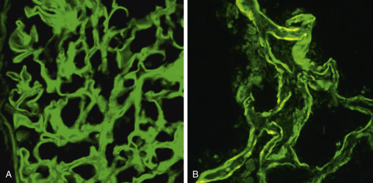

Figure 53-9 

Linear immunofluorescence staining for IgG along glomerular basement membranes ( **A** ) and pulmonary alveolar capillary basement membranes ( **B** ); demonstration by direct immunofluorescence microscopy (FITC rabbit antihuman IgG, ×400). 

 

##  Etiology and Pathogenesis 

Both humoral and cellular autoimmune responses have been incriminated in the pathogenesis of anti-GBM disease (  Pusey, 2003  ;  Cui & Zhao, 2011  ). There is compelling evidence that anti-GBM antibodies are pathogenic, which includes (1) the close association of circulating and basement membrane–bound anti-GBM antibodies with disease; (2) relatively good correlation of autoantibody levels with activity of disease; (3) clinical response to therapy that reduces circulating anti-GBM levels, such as apheresis and immunosuppressive therapy; (4) recurrence of disease in kidney transplants in the presence of residual circulating anti-GBM antibodies in the recipient; (5) development of anti-GBM glomerulonephritis in patients with hereditary type IV collagen abnormalities who make nephritogenic autoantibodies directed against donor GBM; and (6) experimental animal studies, including direct transfer of glomerulonephritis to primates by intravenous injection of human anti-GBM antibodies. 

Although anti-GBM antibodies appear to be major pathogenic factors, T cells also play an important role. T cell help is required for class-switching to produce high-affinity IgG antibodies, and T cell involvement is indicated by MHC associations. 

The etiology of anti-GBM disease is not known. One hypothesis proposes that anti-GBM disease is an autoimmune “conformeropathy” that involves pathogenic conformational changes in the alpha 3 and alpha 5 noncollagen domains of type IV collagen, revealing cryptic epitopes that in turn elicit an autoimmune response (  Pedchenko et al, 2010  ). 

Another hypothesis is that autoimmunity to the alpha 3 chain of type IV collagen is triggered by “autoantigen complementarity” that begins with an immune response against a peptide that is antisense or complementary to the autoantigen (  Reynolds et al, 2015  ). Autoantigen complementarity also is incriminated as a cause for ANCA disease (  Pendergraft et al, 2004  ). 

 

##  Clinical Laboratory Testing 

Anti-GBM assays using ELISAs, chemiluminescence assays, dot blots, and Western blots are highly specific (>90%) and sensitive (>95%) for anti-GBM disease (  Pusey, 2003  ). Most commercial assays use bovine or sheep GBM enriched for the noncollagen domain of the α3 chain of type IV collagen (  Pusey, 2003  ). Positive results can be confirmed by Western blotting using collagenase-solubilized human GBM. Indirect immunofluorescence microscopy assays using normal human or primate kidney as substrate were used historically, but they are not sensitive enough for current clinical use. 

Rapid screening assays are available for concurrently detecting PR3-ANCA, MPO-ANCA, and anti-GBM antibodies in the same assay for rapid diagnosis of patients with clinical evidence for rapidly progressive glomerulonephritis, hemorrhagic pulmonary capillaritis, or both, using either ELISA (  Westman et al, 1997  ) or dot-blot technology (  Rutgers et al, 2005  ). A rapid, random access chemiluminescence assay (CIA) also has been developed to detect anti-GBM antibodies with 95.6% sensitivity and 99.6% specificity (  Mahler et al, 2012  ). 

All patients with anti-GBM disease should be tested for ANCA to rule out concurrent anti-GBM plus ANCA disease, which occurs in approximately one third of patients with anti-GBM disease (  Jennette, 2003  ;  Rutgers et al, 2005  ). The double anti-GBM and ANCA reactivity in assays is the result of two different antibody populations rather than one cross-reacting population (  Rutgers et al, 2005  ). 

 

##  Diagnosis, Treatment, and Prognosis 

Standard treatment is a combined therapy of plasmapheresis, prednisolone, and cyclophosphamide (  Pusey, 2003  ;  Cui & Zhao, 2011  ). Anecdotal reports of success with anti-CD20 targeted B cell therapy have emerged but are not conclusive. The important determinant for the response to therapy and long-term prognosis for anti-GBM disease is early diagnosis to prevent end-stage kidney disease and life-threatening pulmonary hemorrhage. If treatment is started before the serum creatinine is above 5 mg/dL, there is a good chance of renal survival. Even in patients with advanced renal disease, treatment may result in improvement and may also be beneficial in preventing or ameliorating concurrent pulmonary disease. Patients should not be transplanted until circulating anti-GBM autoantibodies can no longer be detected by standard assays. 

 

##  Cryoglobulinemic Vasculitis 

 

##  Definition and Epidemiology 

Cryoglobulinemic vasculitis (CV) is vasculitis with cryoglobulin-immune deposits affecting small vessels (predominantly capillaries, venules, or arterioles) and is associated with serum cryoglobulins (  Tedeschi et al, 2007  ;  Jennette et al, 2013  ). Skin, glomeruli, and peripheral nerves are often involved. 

Cryoglobulins are immunoglobulins that reversibly precipitate in the cold (  Damoiseaux, 2014  ). Type I cryoglobulins consist of a monoclonal immunoglobulin, generally either IgM or IgG. Type II cryoglobulins contain a monoclonal immunoglobulin with rheumatoid factor (RF) activity and polyclonal immunoglobulins. Most often this is a combination of a monoclonal IgM with polyclonal IgG. Type III cryoglobulins contain polyclonal immunoglobulins, typically IgM and IgG, with RF activity in the IgM fraction. Types II and III are called mixed cryoglobulins. 

Type I cryoglobulins often are associated with B cell lymphoproliferative diseases, such as Waldenström's macroglobulinemia or multiple myeloma. Type II cryoglobulins are often associated with HCV infection, as well as other chronic viral infections and systemic autoimmune diseases. Type III cryoglobulins often are associated with chronic viral infections and systemic autoimmune diseases and may be a transient state between polyclonal hypergammaglobulinemia and type II cryoglobulinemia (  Damoiseaux, 2014  ). 

 

##  Pathology 

CV usually is confined to capillaries (e.g., glomerular capillaries), venules (e.g., dermal venules), and arterioles or very small arteries (e.g., epineural arteries in peripheral nerves). Involvement of medium arteries is extremely rare. The acute inflammation is neutrophil-rich with leukocytoclasia. The inflammation may be accompanied by luminal or vessel wall deposits of PAS-positive hyaline material that is a coagulum of cryoglobulins. Cryoglobulinemic glomerulonephritis occurs as a renal-limited process or as a component of systemic CV. Cryoglobulinemic glomerulonephritis usually has a membranoproliferative pattern but may have other patterns of proliferative glomerulonephritis. A useful diagnostic finding is hyaline material in glomerular capillary lumens (“hyaline thrombi”) that are composed of cryoglobulins ( [ Fig. 53-10 ](<#f0055>) ). By immunofluorescence microscopy, these deposits contain the immunoglobulins of the cryoglobulins as well as complement components that have been activated by the cryoglobulin immune complexes (see [ Fig. 53-10 ](<#f0055>) ). 

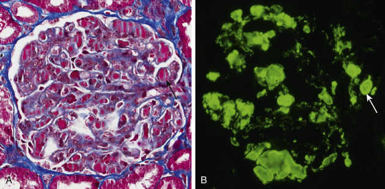

Figure 53-10 

Cryoglobulinemic glomerulonephritis with “hyaline thrombi” seen by light microscopy ( **A,** Masson trichrome stain, ×500) and by direct immunofluorescence microscopy using FITC-labeled rabbit antihuman C3 ( **B,** ×500). 

 

##  Etiology and Pathogenesis 

Hepatitis C virus (HCV) is the main etiologic agent of mixed cryoglobulinemic vasculitis (  Cacoub et al, 2014  ). In some European settings, mixed cryoglobulinemia has been associated with HCV infection in more than 80% of the patients, although only a minority develop signs and symptoms of vasculitis (  Pagnoux et al, 2006  ). Although the association of CV with HCV is approximately 85% in the Mediterranean region, it varies from 30% to 100% in other geographic locations (  Damoiseaux, 2014  ). 

Deposition of cryoglobulins in vessel walls incites vasculitis by complement activation. Monoclonal cryoglobulins (type I) are not as effective at activating inflammatory mediator systems as are mixed cryoglobulins (types II and III), which are immune complexes composed of antiantibodies (rheumatoid factors) bound to target antibodies. An important cause for cryoglobulinemia is hepatitis C infection. In HCV-CV, immune complex deposits contain viral proteins (  Damoiseaux, 2014  ). 

 

##  Clinical Laboratory Testing 

Clinical laboratory testing for cryoglobulins is divided into three phases: the preanalytic phase, the analytic phase, and the typing phase (  Damoiseaux, 2014  ). The preanalytic phase entails collecting the sample in prewarmed (37° C) tubes, transporting at 37° C, allowing coagulation of the blood sample at 37° C for at least 1 hour, and centrifugation at 37° C to separate the serum. The analytic phase entails incubating two fractions of the sample at 4° C for 3 to 7 days, visual assessment of precipitation, incubating one fraction at 37° C to assess resolution, and isolating the cryoglobulin from the other fraction for typing. The typing phase includes determining the immunoglobulin composition (e.g., by immunofixation or immunoelectrophoresis) and quantifying the cryoglobulin by assessing cryocrit, total protein content, and/or content of immunoglobulin isotypes (  Damoiseaux, 2014  ). 

In addition to a positive cryoglobulin assay, in a patient with clinical evidence for SVV, laboratory detection of low C4, rheumatoid factor, and evidence for HCV infection add additional support for a diagnosis of CV (  Lamprecht et al, 2001  ). 

 

##  Diagnosis, Treatment, and Prognosis 

Detection of mixed cryoglobulins, especially accompanied by low C4, along with purpura, peripheral neuropathy, and/or glomerulonephritis, is strong evidence for CV. 

One set of classification criteria for CV requires the detection of cryoglobulins in at least two determinations more than 12 weeks apart (  DeVita et al, 2011  ). In addition to the detection of cryoglobulins, at least two additional patient-reported symptoms, clinical observations, or laboratory findings must be documented to make a diagnosis of CV. 

Antiviral therapy with pegylated interferon-α and ribavirin is recommended for induction therapy for HCV-CV with mild to moderate disease severity and activity (  Cacoub et al, 2014  ). In patients with more severe disease, an immunosuppressive treatment regimen is required for the induction phase while awaiting the response to antiviral treatments—for example, pegylated interferon-α and ribavirin plus steroids and cyclophosphamide or rituximab. If there is life-threatening disease or rapidly progressive glomerulonephritis, apheresis may be beneficial. 

The 1-year, 3-year, 5-year, and 10-year survival rates for HCV-CV are 95%, 85%, 75%, and 65%, respectively. Mortality is mainly related to infections and end-stage liver disease. Factors associated with a poor prognosis are severe liver fibrosis (HR 5.31), central nervous system involvement (HR 2.74), kidney involvement (HR 1.91), and heart involvement (HR 4.2) (  Terrier et al, 2011  ). 

 

##  IgA Vasculitis (Henoch-Schönlein Purpura) 

 

##  Definition and Epidemiology 

IgA vasculitis (IgAV) (formerly called Henoch-Schönlein purpura) is vasculitis with IgA1-dominant immune deposits affecting small vessels (predominantly capillaries, venules, or arterioles) (  Jennette et al, 2013  ). IgAV often involves the skin and gastrointestinal tract, and it frequently causes arthritis. Glomerulonephritis indistinguishable from IgA nephropathy may occur. 

IgA vasculitis is most common in children, especially children under 10 years old, which differs from ANCA vasculitis and CV, which are more common in older patients. In fact, IgAV is the most common systemic small-vessel vasculitis in children (  Chen & Mao, 2015  ). Depending on ethnic background, 6 to 24 per 100,000 children younger than 17 years of age will develop IgAV. In Asia, the incidence is as high as approximately 70 cases per 100,000 children every year. IgAV is rare in adults, with an annual incidence of 0.1 to 1.8 per 100,000 individuals (  Audemard-Verger et al, 2015  ). Disease is more frequent in males (male : female ratio of 5 : 1). 

 

##  Pathology 

The histopathologic features of inflammation in venules, arterioles, and small arteries, caused by IgAV, are indistinguishable from other forms of SVV. In the dermis, this takes the form of a leukocytoclastic angiitis affecting predominantly venules and arterioles. The presence of hyaline aggregates in areas of inflammation or the lumen increases the likelihood of CV. Arteritis affecting arteries in the deep dermis, and especially arteries in the subcutaneous tissue, increases the likelihood of ANCA vasculitis. Numerous eosinophils increase the likelihood of hypersensitivity drug-induced vasculitis or EGPA. However, it is best to correlate the histopathology with immunostaining for IgA, IgG, IgM, C3, and C1q, and with serologic testing for ANCA, cryoglobulins, HCV antigen and antibody, anti-C1q, ANA, C3, and C4 before reaching a diagnosis. Patients with IgAV have immune complex deposits in small dermal vessels that stain brightly by direct immunofluorescence microscopy using antibodies specific for IgA ( [ Fig. 53-11 ](<#f0060>) ). 

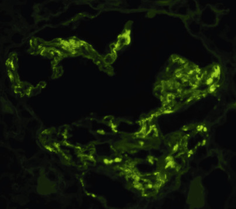

Figure 53-11 

Direct immunofluorescence microscopy of small vessels in the upper dermis of a patient with IgA vasculitis demonstrating coarsely granular deposits of IgA in vessel walls (FITC-labeled rabbit antihuman C3, ×600). 

The glomerulonephritis of IgAV is indistinguishable from IgA nephropathy (IgAN), although glomerular necrosis and crescents are somewhat more frequent in IgA vasculitis. Because glomerulonephritis is a frequent component of many forms of immune complex SVV, immunopathologic features are very helpful in distinguishing among different forms of SVV—for example, IgAV with IgA1-dominant glomerular deposits, CV with membranoproliferative lesions and IgG/IgM deposits, anti-GBM disease with necrosis and linear IgG, and ANCA vasculitis with necrosis and a paucity of immunoglobulin deposits in glomeruli. 

 

##  Etiology and Pathogenesis 

Patients with IgAV and IgAN have increased serum levels of IgA1 with abnormal glycosylation of the hinge region (  Suzuki et al  2009  ;  Mestecky et al, 2013  ). This abnormality is caused by combined genetic and environmental/infectious influences. There is strong evidence that IgAV and IgAN are caused by vessel wall deposition of aggregates of abnormally glycosylated IgA1 molecules or by deposition of immune complexes composed of IgA1 complexed to anti-IgA1 IgG that recognizes the abnormal hinge region glycosylation (  Suzuki et al  2009  ;  Mestecky et al, 2013  ). 

Abnormally glycosylated IgA1 molecules also could induce disease through a variety of other mechanisms, such as reduced clearance from the circulation because of lack of Fc receptor engagement by the abnormal IgA, increased self-aggregation of IgA1 in the circulation resulting in deposition in vessel lumens and vessel walls, and increased affinity of the abnormal IgA1 for perivascular and glomerular mesangial matrix. 

Vascular deposits containing IgA1 appear to mediate inflammation by activating complement via the lectin pathway and the alternative pathway. 

 

##  Clinical Laboratory Testing 

Abnormally glycosylated IgA1 has been detected in serum using lectin-binding assays and proteomic mass spectroscopy analysis. For example, a lectin that recognizes _N_ -acetylgalactosamine was used in an ELISA to measure serum galactose-deficient IgA1 (  Moldoveanu et al, 2007  ). This study concluded that the assay for abnormal IgA1 had diagnostic sensitivity of 76.5%, specificity of 94%, positive predictive value of 88.6%, and negative predictive value of 78.9% for IgAN. 

Anti-IgA antibodies with specificity for the IgA1 hinge region have been detected in serum using monoclonal human IgA1 as substrate and by identifying IgA1 in circulating immune complexes. One study concluded that IgA1 glycan-specific IgG antibodies have 88% specificity and 95% sensitivity for IgA nephropathy (  Suzuki, 2009  ). In addition to diagnosis, serologic tests for abnormally glycosylated IgA1 and IgA1 immune complexes may be of value in monitoring disease activity. Serum levels of galactose-deficient IgA1 and IgA1-IgG immune complexes are associated with disease activity of IgA nephropathy (  Suzuki et al, 2014  ). 

To date, these research observations on abnormal IgA1 glycosylation and anti-IgA1 antibodies in IgAV and IgAN have not been translated into analytically and clinically validated diagnostic tests, although multiple research laboratories are working on this. 

 

##  Diagnosis, Treatment, and Prognosis 

Until alternative clinical tests are validated, pathologic identification of IgA-dominant immune deposits in vessel walls or glomeruli by direct immunofluorescence microscopy is the gold standard method for confirming a diagnosis of IgAV or IgAN. Immunostaining is required in biopsy specimens because the light microscopic patterns of injury are not as conclusive for distinguishing among the many forms of SVV. For example, a skin biopsy that has leukocytoclastic angiitis by light microscopy could be found by immunofluorescence microscopy to be IgAV with IgA-dominant deposits, CV with IgM and C3 deposits, or ANCA vasculitis with a paucity of immunoglobulin and complement deposits. 

The classic triad of symptoms and signs for IgAV are purpura, arthralgia, and abdominal pain. The frequency of renal disease varies from 45% to 85% in different cohorts (  Audemard-Verger et al, 2015  ). The European League Against Rheumatism (EULAR), the Paediatric Rheumatology International Trials Organization, and the Paediatric Rheumatology European Society have proposed classification criteria for pediatric patients (  Audemard-Verger et al, 2015  ). Based on these criteria, a patient is classified as IgAV if there are purpura with lower-extremity predominance plus one of the following four criteria: abdominal pain, histopathology demonstrating IgA-dominant deposits in vessels or glomeruli, arthritis or arthralgia, or renal involvement. These criteria have not been adopted for adults and would be problematic in adults because the prevalence of IgAV is much lower than the prevalence of other forms of SVV that cause similar signs and symptoms, especially ANCA disease. For example, a patient who has purpura, arthralgias, and nephritis fulfills the EULAR criteria for IgAV. Such a patient could also have ANCA vasculitis, cryoglobulinemic vasculitis, or other forms of SVV. Especially if applied to adults, the pediatric EULAR criteria should be combined with testing for ANCA, cryoglobulins, HCV infection, and hypocomplementemia. 

Because the clinical course of IgAV is relatively benign in most patients, treatment is usually conservative and directed at symptom relief. Patients who develop severe gastrointestinal complications may require steroids or/and immunosuppressive drugs. When kidney disease develops with IgAV, the following Kidney Disease Improving Global Outcome (KDIGO) guidelines can be used (  Chen & Mao, 2015  ). Persistent proteinuria should be treated with angiotensin-converting enzyme inhibitors or angiotensin receptor blockers. If the proteinuria persists and the glomerular filtration rate is greater than 50 mL/min per 1.73 m  2  , a 6-month course of corticosteroid therapy should be given. If severe renal failure and crescentic glomerulonephritis are documented, immunosuppressive therapy similar to that used for other forms of crescentic glomerulonephritis should be provided. 

 

##  Hypocomplementemic Urticarial Vasculitis 

 

##  Definition and Epidemiology 

Hypocomplementemic urticarial vasculitis (HUV) (anti-C1q vasculitis) is vasculitis accompanied by urticaria and hypocomplementemia affecting small vessels (i.e., capillaries, venules, or arterioles), and it is often associated with anti-C1q antibodies (  Jennette et al, 2013  ). Glomerulonephritis, arthritis, obstructive pulmonary disease, and ocular inflammation are commonly present in HUV, and HUV has overlapping clinical and laboratory features with SLE, though it also occurs independently of SLE (  Venzor et al, 2002  ;  Kallenberg, 2008  ;  Grotz et al, 2009  ). 

HUV is a rare disease. The incidence of all forms of leukocytoclastic vasculitis affecting the skin in a population-based study in Minnesota from 1996 to 2010 identified an incidence rate of 4.5 per 100,000 person-years (  Arora et al, 2014  ). The cohort included 38 patients with leukocytoclastic vasculitis not otherwise specified (45%), 25 with IgA vasculitis (30%), 10 with urticarial vasculitis (12%), 8 with ANCA vasculitis (10%), and 3 with cryoglobulinemic vasculitis (4%) (  Arora et al, 2014  ). Thus HUV has an incidence of less than 0.5 per 100,000 person-years in this population. 

HUV affects women more frequently than men (ratio 2 : 1) and has a peak incidence in the fifth decade of life, although HUV has been observed in children (  Grotz et al, 2009  ). 

 

##  Pathology 

The dermal vasculitis in HUV is a leukocytoclastic angiitis that cannot be readily distinguished from other forms of SVV by histology alone. Direct immunofluorescence microscopy demonstrates complement-rich immune complex deposits with prominent C1q in dermal vessels and along the dermal-epidermal junction. 

By immunofluorescence microscopy, glomerulonephritis in HUV has extensive capillary wall and mesangial immune complex deposits containing immunoglobulin and complement, including prominent C1q. The most frequent histologic pattern is membranoproliferative glomerulonephritis with thickened capillary walls and endocapillary hypercellularity, although focal or diffuse proliferative glomerulonephritis may also occur. In this respect, HUV glomerulonephritis resembles lupus nephritis, and patients with HUV who also meet clinical criteria for SLE should be considered to have lupus nephritis. 

 

##  Etiology and Pathogenesis 

Experimental studies strongly support a pathogenic role for anti-C1q antibodies in forming pathogenic immune complexes in SLE and HUV, and anti-C1q antibodies may interfere with the clearance of apoptotic cells and enhance induction of autoimmunity (  Kallenberg, 2008  ). The hypocomplementemia appears to be secondary to classical complement pathway activation with reduced C1, C2, C4, and C3 (  Kallenberg, 2008  ). The extensive deposition of immune complexes in the walls of inflamed vessels—for example, dermal venules and glomerular capillaries—supports an immune complex pathogenesis for the inflammation. 

 

##  Clinical Laboratory Testing 

The typical laboratory test profile is elevated anti-C1q antibodies (essentially 100% sensitive) and hypocomplementemia with low C1q, C3, and C4. In patients who have HUV without overt SLE, ANA often is present without anti–double-stranded DNA. Positive testing for cryoglobulins supports a diagnosis of CV rather than HUV. 

C1q has a collagen-like portion attached to globular heads, resembling a bouquet of tulips (  Venzor et al, 2002  ;  Kallenberg, 2008  ). Immune complex Fc regions bind to these globular portions, whereas anti-C1q autoantibodies instead bind to the collagen-like portion. Anti-C1q usually is detected by ELISA using human C1q as the substrate. High ionic strength conditions (0.5 to 1.0 M NaCl) are used to inhibit binding of immune complexes (  Kohro-Kawata et al, 2002  ). Anti-C1q is detected in a variety of inflammatory diseases, including HUV (100%), rheumatoid vasculitis (77%), Felty syndrome (76%), lupus nephritis (63%), membranoproliferative glomerulonephritis (54%), and SLE without nephritis (33%) (  Seelen et al, 2003  ;  Kallenberg, 2008  ). HUV patients who do not have overt SLE may have low-titer antinuclear antibodies, rheumatoid factor, lupus anticoagulant, and cryoglobulins. 

While the presence of anti-C1q antibodies is highly sensitive for HUV (found in 100% of patients), they are neither sensitive nor specific for SLE. Anti-C1q antibodies are more prevalent in SLE patients with lupus nephritis than in patients without nephritis. In a study of 43 patients with SLE, anti-C1q antibodies were identified in 82% of patients with nephritis, compared to only 38% of patients who did not have nephritis (  Coremans et al, 1995  ). In a study of 228 patients with lupus nephritis, the evaluation of anti-C1q, C3, and C4 provided the best prediction of renal flares (  Sinico et al, 2009  ). However, some SLE patients with high titers of anti-C1q antibodies do not develop nephritis. 

 

##  Diagnosis, Treatment, and Prognosis 

HUV is characterized by recurrent episodes of urticaria with underlying leukocytoclastic vasculitis. Skin manifestations include painful, tender, burning, or pruritic urticarial skin lesions that persist for greater than 24 hours, often with central areas of hemorrhage. Once the urticaria resolves, there may be residual purpura. Additional manifestations include angioedema, laryngeal edema, pulmonary involvement, arthritis, arthralgia, glomerulonephritis, and uveitis. Compared to patients with urticaria and vasculitis who do not have hypocomplementemia, HUV patients are more likely to have abdominal pain and chronic obstructive pulmonary disease (  Mehregan et al, 1992  ). Chronic obstructive pulmonary disease and acute laryngeal edema are important causes for morbidity and mortality. Around 30% of HUV patients suffer gastrointestinal symptoms: pain, nausea, vomiting, diarrhea, and sometimes ascites in connection with serositis, hepatomegaly, and splenomegaly (  Grotz et al, 2009  ). 

The two major diagnostic criteria are chronic urticaria and hypocomplementemia. Minor criteria include anti-C1q antibodies, leuko­cytoclastic vasculitis, arthralgia and arthritis, uveitis or episcleritis, glomerulonephritis, and abdominal pain (  Grotz et al, 2009  ). 

Glucocorticoids are standard therapy for HUV. Depending on clinical severity, additional immunosuppressive agents such as methotrexate, azathioprine, cyclophosphamide, cyclosporine, and mycophenolate mofetil may be added. Apheresis is reserved for very aggressive disease (  Grotz et al, 2009  ). 

 

##  Rheumatoid Vasculitis 

 

##  Definition and Epidemiology 

Rheumatoid vasculitis is an uncommon extra-articular complication of rheumatoid arthritis (RA) and primarily affects small to medium vessels (  Ntatsaki et al, 2014  ;  Makol et al, 2015  ). There has been a decrease in the incidence of rheumatoid vasculitis in the last decade in both Europe and the United States (  Ntatsaki et al, 2014  ). The average annual incidence of rheumatoid vasculitis in the United Kingdom declined from 9.1 per million between 1988 and 2002 to 3.9 per million between 2001 and 2010 (  Ntatsaki et al, 2014  ). This reduction may be the result of the use of current disease-modifying antirheumatic drugs (DMARDs), including methotrexate. 

 

##  Pathology 

Rheumatoid vasculitis involves small and medium vessels, including medium and small arteries and venules. It is a necrotizing arteritis that is histologically indistinguishable from other forms of necrotizing arteritis, such as PAN and MPA. Its venulitis, especially in the dermis, is histologically indistinguishable from the leukocytoclastic angiitis of ANCA or immune complex disease. In patients with rheumatoid vasculitis, dermal necrotizing venulitis has been identified as the cause of palpable purpura, maculopapular erythema, erythema elevatum diutinum, and hemorrhagic blisters; arteritis has been identified as the cause of subcutaneous nodules, livedo reticularis, and deep ulcers (  Chen et al, 2002  ). Some patients have both patterns of vasculitis. 

 

##  Etiology and Pathogenesis 

There is a strong association between rheumatoid vasculitis and particular HLA genotypes that suggests a role for immune recognition of antigens in its pathogenesis. A role for immune complexes containing autoantibodies has been proposed based on the observed high prevalence and high titer of rheumatoid factor (RF), anticitrullinated peptide antibodies (ACPA), antinuclear antibodies, and circulating or tissue-deposited immune complexes in patients with rheumatoid vasculitis (  Makol et al, 2015  ). However, many RA patients with high titers of RF and ACPA do not develop rheumatoid vasculitis. Immunoglobulin and complement have been detected by immunofluorescence in dermal vessels of patients with dermal rheumatoid vasculitis (  Chen et al, 2002  ). 

 

##  Clinical Laboratory Testing 

Rheumatoid vasculitis should be suspected in a patient with clinical or pathologic evidence for vasculitis who has rheumatoid factor (RF), anti­citrullinated peptide antibodies (ACPA), antinuclear antibodies, and circulating or tissue-deposited immune complexes (  Makol et al, 2015  ). Less specific features that are often observed include anemia, leukocytosis, thrombocytosis, elevated erythrocyte sedimentation rate, increased C-reactive protein, and polyclonal hypergammaglobulinemia. The absence of RF and ACPA has a high negative predictive value for rheumatoid vasculitis (  Makol et al, 2015  ). 

In a study of 19 patients with rheumatoid vasculitis, all of the patients were seropositive for RF, no patients were C-ANCA positive, 5 patients were P-ANCA positive by IIF but had negative ELISA for MPO-ANCA, 1 patient with P-ANCA was positive for PR3-ANCA by ELISA, all of the patients were negative for ANA, and 1 patient was positive for antimitochondrial antibodies (  Ntatsaki et al, 2014  ). Anti-C1q antibody testing is positive in approximately 75% of patients with rheumatoid vasculitis (  Seelen et al, 2003  ;  Kallenberg, 2008  ). This raises the possibility of a relationship with HUV, but anti-C1q positive patients with rheumatoid vasculitis typically do not have other features of HUV, including no hypocomplementemia, or urticarial or immune complex glomerulonephritis. 

 

##  Diagnosis, Treatment, and Prognosis 

The Scott and Bacon diagnostic criteria for rheumatoid vasculitis require the presence of one or more of the following in a patient with RA: mononeuritis multiplex or peripheral neuropathy, peripheral gangrene, biopsy evidence of acute necrotizing arteritis plus systemic illness (e.g., fever and weight loss), deep cutaneous ulcers or extra-articular disease (e.g., pleurisy, pericarditis, scleritis) if associated with typical digital infarcts, or biopsy evidence of vasculitis (  Scott & Bacon, 1984  ). 

Hydroxychloroquine and low-dose aspirin are associated with lower odds of developing rheumatoid vasculitis among RA patients, suggesting a possible protective effect (  Makol et al, 2015  ). Among 86 patients treated for rheumatoid vasculitis at Mayo Clinic between 2000 and 2010, 99% received glucocorticoids, 29% received cyclophosphamide, 55% received another disease-modifying antirheumatic drug (methotrexate, azathioprine, mycophenolate mofetil, hydroxychloroquine, minocycline), and 28% received a biologic agent (anti-TNF, rituximab, abatacept, anakinra) (  Makol et al, 2014  ). However, despite aggressive use of cyclophosphamide and biologics, rheumatoid vasculitis remained difficult to treat, with high relapse rates and mortality rates of 12% at 1 year and 60% at 5 years. 

,  

##  Summary 

The diagnosis of vasculitis is difficult. Accurate and precise diagnosis requires knowledgeable integration of evidence from the medical history, patient demographics, clinical signs and symptoms, laboratory tests, and pathologic findings. Positive as well as negative laboratory test results are critically important in the diagnostic evaluation of patients with suspected vasculitis, and they are useful for prognostication, predicting and monitoring response to therapy, and predicting or detecting relapse. Over the past 20 years, there has been a valuable increase in the menu of laboratory tests that facilitate the care of patients with vasculitis (e.g., ANCA). More are currently on the verge of entering clinical practice (e.g., IgA1 glycosylation and anti-IgA1 antibody assays), and undoubtedly more will be discovered before the next edition of this text is published. 

,,
