## Key Points

  * •

Viruses cause more human infections than any other group of microorganisms and produce diseases that range from trivial upper respiratory infections to lethal rabies. Viral pathogens, including CoV-MERS, Influenza A subtypes, arboviruses, and hemorrhagic fever viruses, are continuously being discovered or identified in different geographic areas and have the potential to cause widespread disease. 

  * •

Accurate and timely viral diagnosis is essential for optimal patient management, for reasonable use of antiviral drugs, for reduction of unnecessary laboratory testing and inappropriate antimicrobial therapy, for timely application of infection-control procedures, and for proper, effective response to community outbreaks. 

  * •

Virus isolation in cell culture and viral antigen identification have been the traditional tests available in community hospital laboratories to diagnose genital and mucocutaneous, respiratory, gastrointestinal, central nervous system, and disseminated viral infections. These methods are being replaced by more sensitive, reliable, rapid, and specific amplified molecular methods for detection of viral DNA and RNA. 

  * •

Viral serology has two major applications: diagnosis of recent infection and determination of immunity. Demonstration of immunoglobulin IgM-specific antibody during acute illness or a significant rise in IgG antibody between acute and convalescent sera defines acute infection. Serology can be helpful if culture, antigen assays, or nucleic acid–based testing is not available or feasible. Persistent specific IgG is a marker of immune status for measles, mumps, VZV, and hepatitis A and B viruses. Enzyme immunoassay methods are sensitive and are widely used for defining immunity. 

  * •

Nucleic acid hybridization and nucleic acid amplification tests detect virus by recognizing specific and stable segments of the DNA or RNA viral genome. An important attribute to this technology is neither virus viability nor propagation is required. _In situ_ hybridization is a direct probe technique for detection of human papillomavirus (HPV), CMV, HSV, and parvovirus B19 in tissue; specificity is high, but sensitivity can be variable. 

  * •

Nucleic acid–based testing such as polymerase chain reaction (PCR), strand displacement amplification, and nucleic acid sequence–based amplification have raised the sensitivity of molecular diagnosis beyond culture or antigen-detection methods and are considered the new gold standard. The use of less-invasive specimens due to increased sensitivity of amplified molecular methods has greatly simplified specimen-collection resulting in less variable results. 

  * •

Point-of-care amplified nucleic acid technology is becoming a common and routine feature of emergency room and admission decisions, providing diagnostic information about viral targets in a matter of hours. Rapid results guide diagnostic testing, influence treatment, and impact patient placement. 

  * •

Combining several viral nucleic acid tests in a single syndromic array has greatly expanded the clinical utility of molecular testing for viral infections, sometimes resulting in detection of multiple pathogens. These assays generate reliable answers in a clinically actionable time frame. 

  * •

Real-time PCR transcription allows for accurate quantization of viral load in a variety of specimen types. Quantitative analysis permits differentiation between disease association and carrier states (Bocaviruses, Rhinoviruses), prognosis (HIV, HCV), and monitoring of response to therapy for viral pathogens such as human immunodeficiency virus (HIV), HCV, hepatitis B virus (HBV), CMV, Epstein-Barr virus (EBV), and BK virus. 

  * •

Detection of antiviral resistance mutations is now available for HIV, HBV, HCV, HSV, CMV, VZV, and Influenza A. 

  * •

Next-generation sequencing is an evolving technique that can be used for viral detection and characterization of known and novel viruses, assessment of species and quasispecies for antiviral susceptibility, and in-depth exploration of viral outbreaks. 

We gratefully acknowledge the contributions of Margaret Yungbluth, MD, and Linda Sabatini, PhD, who authored this chapter in previous editions. 

,  

##  Introduction 

Viruses are responsible for a remarkable spectrum of human illnesses ranging from the annoying common cold to fatal immunoimpairment caused by HIV and some cancers. Virology has evolved rapidly from early characterization of viral morphology by electron microscopy (EM) to the development of techniques for virus replication in cell culture, to production of sophisticated amplified nucleic acid–based diagnostic tests and to sequencing of entire viral genomes. Discovery and complete genotyping of new emerging pathogenic viruses can now be accomplished in a matter of days from occurrence of the initial outbreak (  Fauci & Morens, 2012  ). The role of the clinical virology laboratory has expanded from merely viral identification to one of patient management encompassing viral identification/quantitation, and genotypic monitoring for predicting efficacy of antiviral therapy (  Antonelli, 2012  ;  Caliendo et al, 2013  ). 

Accurate and timely viral diagnosis is fundamental to optimize patient management, to appropriately use antiviral drugs, to reduce unnecessary diagnostic tests, to limit use of superfluous antibiotics, and to implement hospital precautions to control nosocomial spread (  Dellit et al, 2007  ;  Van Panhuis et al, 2013  ). Early and precise identification and sequencing of viral pathogens clearly benefit the general population through focused public health initiatives, as recently demonstrated by identification of zoonotic coronaviruses associated with severe acute respiratory syndrome (SARS) and middle-east respiratory syndrome (CoV-MERS) and identification of ever-changing strains of influenza A viruses. 

Several excellent references provide detailed information about taxonomy and pathogenicity of human viruses (  Garcia, 2010  ;  Versalovic, 2011  ). These chapters review common viral syndromes that generate the majority of testing conducted in a typical hospital laboratory. Most hospitals have a case mix of common viral infections in healthy and immunocompromised children and adults to support a virology service. [ Table 56-1 ](<#t0010>) summarizes test volumes and recovery rates for a Chicago-based hospital system, with adult and pediatric primary care, and high-risk obstetrics, neonatology, hematology-oncology, transplantation, and infectious disease services. In 2004, culture and antigenic-detection methods were the core assays utilized for detection of viruses. The steady and persistent transition to molecular diagnostics was essentially completed by 2013. Results for 2013 reflect the wider variety of viruses detected using molecular methods. Multiplexed molecular panels are now available for detection of a wider range of viruses reflecting the trend toward syndromic nucleic acid–based panels. Hospitals with different medical specialty profiles detect the same viruses, but with variations in relative percentages. 

TABLE 56-1 

Viruses Detected by Conventional Virology (2004) vs. Molecular Methods (2013) 

|  % POSITIVE SPECIMENS [ * ](<#hl0000162>)  
---|---  
2004  |  2013 [ † ](<#hl0000165>) |  Comments   
**Viruses**  
Herpes simplex  |  22  |  21.4  |  2013—HSV subtyped (HSV-1 = 11%; HSV-2 = 10.4%)   
Cytomegalovirus  |  4  |  14  |  2004—diagnosis; 2013—diagnosis and monitoring   
Epstein-Barr virus  |  N/A  |  11.3  |   
Enterovirus  |  10  |  2  |  2003—throat, rectal, CSF; 2013—CSF only, yearly panel   
Varicella zoster  |  <1  |  14.3  |  2004—vesicles only; 2013—vesicles, CSF, plasma, and urine   
**Respiratory Viruses**  
Adenovirus  |  8  |  1.1  |  2013—RVP available throughout the year   
Influenza A  |  9  |  8.4  |  2013—RVP available throughout the year   
Influenza 2009 H1N1  |  NA  |  3.4  |  2013—RVP available throughout the year   
Influenza B  |  4  |  2.9  |  2013—RVP available throughout the year   
Respiratory syncytial virus  |  31  |  7.4  |  2004—seasonal; 2013—RVP available throughout the year   
Human metapneumovirus  |  NA  |  3.4  |  2013—RVP available throughout the year   
Parainfluenza 1-3  |  10  |  2.9  |  2004—seasonal; 2013—RVP available throughout the year   
Parainfluenza 4  |  NA  |  1.2  |  2013—RVP available throughout the year   
Coronavirus (4 serotypes)  |  NA  |  2.0  |  2013—RVP available throughout the year   
Enterovirus/Rhinovirus  |  NA  |  17.5  |  2013—Respiratory samples only. Available through the year   
  
_NA,_ Not available; _RVP,_ respiratory viral panel. 

Personal data, M. Costello and L. Mazur, Multiple hospitals, Chicago area and southeast Wisconsin. 

 * 2004: Conventional virology testing methods (Culture, DFA, EIA); 2013: molecular testing methods. 

 † Average recovery of respiratory viruses from respiratory specimens was 47%. 

The average detection time for most viruses is now between 1 and 2 days (the same time scale as routine bacterial cultures), reflecting the combined use of rapid antigen assays and nucleic acid amplification testing (NAAT). Overall detection rates for viruses in clinical samples are surprisingly high (up to 43%)—several times greater than for routine bacterial blood or stool culture, mycobacterial culture, or ova and parasite examination (  Espy et al, 2006  ;  Leland & Ginocchio, 2007  ). Many common viruses exhibit seasonal variations ( [ Fig. 56-1 ](<#f0010>) ). Norovirus, influenza, RSV, and parainfluenza viruses 1 and 2 circulate every winter. Adenovirus, parainfluenza virus 3, CMV, and HSV infections occur year-round. Enterovirus and insect-borne arboviruses cluster in late summer and early autumn. Seasonal variations are somewhat dependent on methods of detection employed with the more sensitive NAAT increasing yield of viruses detected and extending detection time. 

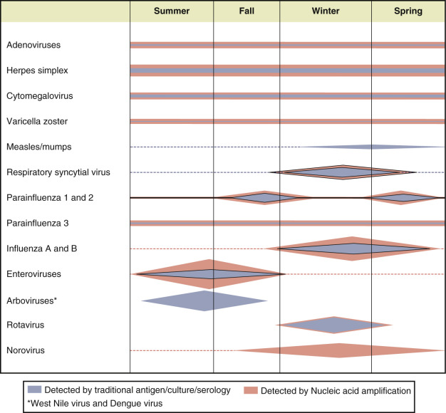

Figure 56-1 

Seasonal variation of viral infections. 

Four principal viral diagnostic laboratory methods are still used: culture, antigen detection, nucleic acid detection, and serology. Each method has advantages and limitations ( [ Table 56-2 ](<#t0015>) ). 

TABLE 56-2 

Methods for Diagnosis of Viral Infection 

Method  |  Advantages  |  Disadvantages   
---|---|---  
**Growth Dependent**  
Cell Culture  | 

  * • Virus growth, restricted by the ability of cell lines to support viral growth. 
  * • Moderate reagent costs 

| 

  * • Viable virus required, necessitating optimizing collection and transport. 
  * • Multiple cell lines required to optimize sensitivity. 
  * • Not all viruses are detected, even when using multiple cell lines 
  * • Long TAT (days to weeks) 
  * • Expertise required to detect CPE or other means needed to detect virus (e.g., hemagglutination, antibody) 

  
Shell Vial Culture  | 

  * • Faster TAT and more sensitive than cell culture for certain viruses (Herpes viruses, respiratory viruses) 

| 

  * • Viable virus required, necessitating optimizing collection and transport. 
  * • Moderately long TAT (1-3 days) 
  * • Moderately time-consuming 
  * • Requires specific fluorescent antibodies 

  
**Antibody Dependent**  
DFA  | 

  * • Rapid TAT 
  * • Moderate sensitivity 
  * • Moderately easy to perform 
  * • Moderate reagent costs 

| 

  * • Sensitivity dependent on optimizing sample collection 
  * • Expertise required to interpret staining patterns 
  * • Only detects pathogens defined by antibodies used 

  
EIA/FIA  | 

  * • Rapid TAT 
  * • Moderate sensitivity 
  * • Easy to perform—Point of care 
  * • Moderate reagent costs 

| 

  * • Sensitivity dependent on optimizing sample collection 
  * • Only detects pathogens defined by antibodies used 

  
**Nucleic Acid Amplified Test (NAAT)**  
NAAT (PCR, Isothermal Amplification RAP, LAMP)  | 

  * • Most sensitive 
  * • Define genotype sensitivities and prognosis 
  * • Moderate to very easy to perform 
  * • Low contamination risk if closed configuration used 

| 

  * • May be more expensive than other options 
  * • Only detects pathogens defined by primers and probes 
  * • Limited multiplex options 

  
NAAT Panels  | 

  * • Comprehensive group of targets, not restricted to viruses 
  * • Highly sensitive 
  * • Same-day results 

| 

  * • Expensive 
  * • Only detects pathogens defined by primers and probes 
  * • Does not differentiate between carrier vs. pathogenic viruses 

  
Next-Generation Sequencing  | 

  * • Emerging technique that can be used for viral detection and “de novo” characterization of unknown viruses 
  * • Assessment of antiviral susceptibility 
  * • Very high sensitivity compared to Sanger Sequencing 
  * • Exploration of viral outbreaks 
  * • Detection of viral variants 

| 

  * • Very expensive 
  * • Not currently available to most clinical virology laboratories 
  * • Bioinformatics required 

  
**Serology**  
IgM  | 

  * • May be present during primary infections 

| 

  * • Not useful for infections with short prodromal incubation times 
  * • Cross-reactivity with closely related viruses 
  * • Can also be detected during secondary infections 

  
IgG  | 

  * • Presence indicates immunity to certain viruses 

| 

  * • Presence of viral-specific IgG does not always indicate immunity 
  * • Detection of rising IgG titers from acute and convalescent sera can take several weeks 

  
  
_DFA,_ Direct fluorescent antibody; _EIA,_ enzyme immunoassay; _FIA,_ florescent immunoassay; _NAAT,_ nucleic acid amplified test; _TAT,_ turnaround time. 

Cell culture and direct antigen procedures for virus isolation and detection are being supplanted, in most clinical diagnostic laboratories, by rapid, easy to perform, highly sensitive and specific NAAT techniques that can consistently detect as few as 0.01 to 100 virions per milliliter of specimen (  Hodinka & Kaiserb, 2013  ). NAAT methods have the highest sensitivity and allow greater latitude in specimen collection, window for collection of specimens, and transport since presence of viable viruses is not essential. The throughput time for most nucleic acid–based testing is one day or less and definitely outpaces timelines for standard culture, and turnaround time is becoming comparable to antigen assays. Despite continuous improvement, direct fluorescent antibody (DFA) and enzyme immunoassay (EIA) are becoming niche assays that are offered when a NAAT option is not available or feasible. NAATs are invaluable for identifying viruses that propagate slowly or not at all in cell culture. However, viral nucleic acid fragments may persist into the recovery phase of illness, long after viable virions have been eliminated by the immune response, limiting their use as tests of cure. Also, mutations in DNA or RNA target sequences can reduce sensitivities of NAATs. Quantitative real-time PCR has become the standard of care in assessing viral loads and monitoring response to therapy for viruses (e.g., HIV, HCV, and HBV) as well as diagnosing and monitoring transplant and transfusion patients (e.g., CMV, HHV6 for bone marrow engraftment, EBV, BKV, and JCV in organ transplant). As the mechanisms of antiviral drug resistance are being defined, mutation detection is becoming the method of choice for appropriately targeting antiviral therapy. Both community hospitals and large medical centers now offer a broad range of amplified nucleic acid tests capable of detecting known viral, bacterial, and parasitic pathogens to common respiratory, skin, central nervous system, gastrointestinal, transplant, and disseminated infections (  DiMalo, 2014  ). The number of viruses that can be detected or quantified by nucleic acid–based tests continues to grow, and many assays are FDA approved and commercially available. Laboratory-developed tests (LDTs) require considerable technical expertise and extensive validation protocols, and all molecular methods demand stringent quality control to guarantee accuracy and to minimize contamination of amplified products (amplicons). Despite these additional concerns, molecular approaches have considerably enhanced overall sensitivity and quantitative accuracy, relative to conventional procedures. Successful implementation of international (NIBSC/WHO, CDC/NIST) quantification standards (HIV, HCV, HBV, CMV, EBV, BKV) helped standardize validation and proficiency processes, and they now allow result comparison between performing laboratories regardless of assay chemistry or instrumentation being used. New molecular systems effectively isolate amplified DNA fragments, so amplicon contamination is not as common as when amplified molecular assays first entered the clinical virology laboratory. As available technologies continue to improve driven by the need to generate clinically significant results in a clinically actionable time frame, one should expect most clinical virology laboratories to transform to essentially all molecular assays in the near future. Next-generation sequencing is an emerging technique that will find utility for viral detection and characterization of subtypes of known and novel viruses. 

Traditional serologic diagnosis (see [ Table 56-2 ](<#t0015>) ) requires paired sera from the acute and convalescent stages of infection to demonstrate a significant rise in specific viral antibody titer. This is a retrospective process and is now rarely performed in most clinical virology Laboratories. Detection of virus-specific IgM antibody can diagnose acute illness from a single serum obtained during the acute or early convalescent period for some viral infections. Virus-specific IgG antibody tests are typically helpful to document immune status for selected viruses. 

Success with any diagnostic test begins with proper specimen collection and transportation. The laboratory must have realistic and well-defined guidelines for optimal specimen collection and handling along with the ability and will to enforce a credible specimen-rejection policy, and then must communicate this information to the clinical staff and patient care sites ( [ Table 56-3 ](<#t0020>) ). Specimens for culture and antigen assays must be obtained early in acute illness, when virus shedding is highest; these testing methods are, at best, unreliable during convalescence. 

TABLE 56-3 

Specimen Collection for Common Viral Syndromes 

Syndrome  |  Common Viruses  |  Preferred Specimen and Transport Conditions  |  Specimen Quality Validation  |  Most Useful Tests (Listed in Order of Utility)   
---|---|---|---|---  
Bronchiolitis/bronchitis Influenza Pneumonia  |  RSV, PIV, hMPV adenovirus, Influenza A and B   
Influenza A and B, RSV, hMPV, PIV, influenza A, adenovirus  |  NP swab, NP aspirate/wash; BAL; transport on ice for culture  |  Ciliated columnar cells or alveolar macrophages for NP aspirates and BAL  |  Nucleic acid amplification; EIA or DFA (in season); culture   
Conjunctivitis  |  HSV, adenoviruses, enteroviruses, VZV  |  Conjunctival scrapings/swab in VTM; transport on ice for culture  |  Conjunctival   
epithelial cells  |  Nucleic acid amplification; DFA; culture   
Vesicular rash  |  HSV, VZV  |  Vesicular fluid/cells in VTM or slide smear for DFA; transport on ice for culture  |  Squamous   
epithelial cells  |  Nucleic acid amplification; DFA; culture   
Meningitis  |  Enteroviruses, HSV, VZV, EBV, West Nile virus and other arboviruses  |  CSF; transport on ice for culture  |  Abnormal CSF protein and cell counts  |  Nucleic acid amplification; IgM serology (arboviruses) culture (enteroviruses)   
Encephalitis  |  HSV, VZV, West Nile virus and other arboviruses, rabies  |  CSF, fresh brain tissue; transport on ice for culture  |  Abnormal CSF, protein and cell counts  |  Nucleic acid amplification; IgM serology (arboviruses)   
Enteritis  |  Rotavirus, norovirus, enteric adenoviruses  |  Fresh stool; transport promptly  |  Swab must be covered with stool  |  Rotavirus and adenovirus: EIA   
Norovirus: RNA amplification   
Disseminated viral infection  |  CMV, EBV, HSV, VZV, adenovirus  |  Blood, tissue biopsy, BAL, CSF; transport immediately  |  |  Nucleic acid amplification; viral load for CMV, EBV; culture for CMV, HSV, VZV, adenovirus   
|  HIV  |  Blood  |  |  Serology; viral load; ARV resistance testing   
Prenatal/neonatal viral infection  |  HSV-1 and -2, CMV, enterovirus, parvovirus B19, rubella  |  CSF, vesicular fluid, tissue biopsy, amniotic fluid, urine; transport immediately  |  |  Nucleic acid amplification; culture; IgM serology   
  
_ARV,_ Antiretroviral therapy; _BAL,_ bronchoalveolar lavage; _CMV,_ cytomegalovirus; _CSF,_ cerebrospinal fluid; _DFA,_ direct fluorescent antibody; _EBV,_ Epstein-Barr virus; _EIA,_ enzyme immunoassay; _HIV,_ human immunodeficiency virus; _HSV,_ herpes simplex virus; _hMPV,_ human metapneumovirus; _IgM,_ immunoglobulin M; _NP,_ nasopharyngeal; _PCR,_ polymerase chain reaction; _PIV,_ parainfluenza virus; _RSV,_ respiratory syncytial virus; _VTM,_ viral transport medium; _VZV,_ varicella zoster virus. 

Viral transport medium (VTM) contains a buffered salt solution, protein and saccharide nutrients, pH indicator, and antibiotics to inhibit bacterial and fungal contaminants, and is designed to stabilize virions and the patient's infected cells. Swab specimens, nasopharyngeal aspirates, and tissue biopsies should be placed in VTM for culture and antigen detection. VTM can also be used for the NAAT, if none of the additives are inhibitory. 

NAAT is more sensitive and has optimal value early and late in the course of disease when culture and antigen assays will be negative. Body fluids, lavages, blood, and bone marrow samples require a sterile container instead of VTM or UTM (  Caliendo et al, 2013  ). Most viral loads for HBV, HIV, HCV, CMV, EBV, and BKV are performed on plasma or serum spun down within 6 hours post-collection and sent to the laboratory frozen. Viral respiratory specimens are acceptable from nasopharyngeal swabs or aspirates sent in UTM media and refrigerated for no longer than 48 hours. Whole blood or bone marrow viral testing is acceptable from room temperature or refrigerated specimens. Formalin-fixed, paraffin-embedded (FFPE) tissue is an acceptable specimen for various types of viruses as confirmation of IHC or a standalone diagnostic test. In order to prevent degradation, tissue must be frozen for molecular assays. 

Urine should be collected in a sterile cup. Stool specimen collected in a sterile cup and transported in Cary-Blair are acceptable specimen types. 

 

##  Cell Culture 

A class II biosafety laminar flow cabinet should be used for specimen setup and whenever cultures are manipulated, to protect the technologist from infectious aerosol and to reduce specimen cross-contamination. Equipment for performing cell cultures including centrifuge with covered carriers to accommodate shell vials; incubators to maintain to incubate inoculated cultures; an inverted phase-contrast microscope to identify CPE in cell culture monolayers; an epifluorescence microscope for direct and indirect immunofluorescence assay (IFA) procedures; and freezer space at –20° C (–70° C, if available) for specimen and reagent storage is required. 

 

##  Antigen Detection 

Rapid identification by direct methods are useful when specific antiviral therapy is available (for HSV, VZV, CMV, and influenza), when nosocomial control is a factor (influenza, RSV, metapneumovirus, rotavirus, and VZV), and when NAAT is not an option. Viral antigen is detected with comparable sensitivity and specificity by both DFA and EIA methods. DFA has the distinct advantage of microscopic visualization of the specimen's cell content, so sample adequacy can be easily verified (  Clarke, 2010  ), but DFA procedures are labor-intensive and may be unfeasible during seasonal respiratory viral outbreaks with high specimen demand. EIA methods require less subjective interpretive judgment than DFA, but assessment of sample quality is lost. DFA is best performed with an epifluorescence microscope, and as with EIA methods, positive and negative controls must be run routinely. The positive predicative value (PPV) of EIA assays are highly dependent on the prevalence of the virus in the patient population tested. For example, the PPV of antigen-based assays are very low during non-epidemic periods for influenza and RSV, making these assays unreliable during times of low prevalence. Sensitivity of viral antigen assays is highly dependent on adequate specimen collection, as illustrated by the variable sensitivity seen with these assays in the outbreak of 2009 influenza A (H1N1) (  Ginocchio & Zhang, 2009  ). 

 

##  Nucleic Acid Amplification Testing (NAAT) 

Nucleic acid amplification technologies have raised the sensitivity of viral diagnosis far beyond that of antigen assays or culture. Commonly employed target amplification technologies include PCR, real-time PCR, strand displacement amplification (SDA), nucleic acid sequence–based amplification (NASBA), transcription-mediated amplification (TMA), loop-mediated isothermal amplification (LAMP), and isothermal nucleic acid amplification technology (INAAT), to name a few (  Wu and Tang, 2009  ;  Lee et al, 2011  ). Quantitative real-time PCR is now standard for monitoring HIV, HCV, HBV, CMV, EBV, HHV6, BKV, and JCV viral loads. Most quantitative assays currently are standardized and normalized against NIBSC/WHO international standards, greatly reducing result variability among laboratories, regardless of method being used. Still, it is recommended to base clinical management on viral load assessment from a single laboratory to reduce the variability that is still inherent among laboratories and technologies (  Hayden & Hokanson, 2008  ). Automation of nucleic acid–based testing, including extraction methods and incorporation of internal controls, has increased the precision of quantitative methods, reduced the risk for amplicon contamination, reduced the rate of false-positive or false-negative errors, and accelerated throughput. 

Food and Drug Administration (FDA)-cleared commercial kits have increased their market share covering mostly high-volume assays for HIV, HCV, HBV, HPV, CMV, HSV, Enteroviruses, and a variety of respiratory and gastrointestinal viruses. The FDA maintains a website that lists nucleic acid-based tests and companion diagnostic tests ( [ http://www.fda.gov/MedicalDevices/ProductsandMedicalProcedures/InVitroDiagnostics/default.htm ](<http://www.fda.gov/MedicalDevices/ProductsandMedicalProcedures/InVitroDiagnostics/default.htm>) ). 

The College of American Pathologists (CAP) has the most comprehensive menu for proficiency testing ( [ www.cap.org ](<http://www.cap.org>) ). Strict adherence to specimen-collection, storage, and processing requirements; proper handling and storage of extracted nucleic acid, particularly RNA; and routine monitoring for amplicon contamination are all essential for maximizing detection and reducing error. Analytic and clinical validation and verification are the responsibilities of the individual laboratories. 

Equipment and reagents required to perform nucleic acid–based testing is becoming more accessible for community hospital laboratories. Better system designs have greatly curtailed the requirements for specialized molecular institutions (separation of areas for reagents, specimen processing, and amplification with unidirectional air flow) and highly skilled technologists. Increasing availability of automation has significantly influenced the precision and ease of use of nucleic acid–based testing, particularly for quantitative analyses (e.g., HIV, HCV, HBV viral loads, HPV detection systems). Many nucleic acid–based virology assays remain highly complex laboratory-developed methods requiring an appropriate level of oversight and monitoring. 

Nucleic acid hybridization and amplification-based tests detect virus by targeting specific regions of the viral RNA or DNA genome. In situ hybridization (ISH) is a direct probe technique that can be used in anatomic pathology to detect a variety of viral pathogens. ISH is a useful method for the localization of specific viral nucleic acids inside individual cells with preservation of cellular morphology. ISH is particularly useful for diagnosis of EBV-related neoplasms (  Gulley & Tang, 2008  ). 

PCR is commonly used for the identification and diagnosis of viral infection in formalin-fixed, paraffin-embedded (FFPE) tissue biopsies, and is particularly useful for confirming the diagnosis of herpes viruses when histologic features are “nondiagnostic” (  Anderson et al, 2014  ). 

 

##  Viral Serology 

Serologic diagnosis of viral infection has its attractions because serum specimens are easy to obtain, transport, and store. Viral serology has two major clinical applications: diagnosis of recent infection and determination of immunity (  Hodinka, 1999  ). Evidence of current/recent infection requires demonstration of virus-specific IgM during the acute stage of illness, or demonstration of a significant rise in virus-specific IgG titer between acute and convalescent sera. Specific IgM is usually found in blood within the first week of primary infection and typically becomes undetectable within 1 to 3 months; in general, EIA methods are more sensitive, so detectable IgM may persist for approximately twice as long as immunofluorescent assays. The specificity and sensitivity of IgM assays are improved by removal of rheumatoid factor, by removal of IgG to eliminate competition with IgM for viral antigen, and by selective IgM or IgG capture methods. Virus-specific IgG is normally produced 1 to 2 weeks following primary infection, peaks at 4 to 8 weeks, and then declines but usually remains detectable indefinitely at low titer. Specificity for closely related viruses, such as HSV, is improved by selecting antibodies to specific antigens (glycoprotein G) (  Bernstein et al, 2013  ;  Anderson et al, 2014  ). The secondary immune response following viral reinfection or reactivation produces a different serologic profile: IgM may reappear transiently and in low titer, and IgG rapidly increases in titer. These are only general response patterns; intensity, specificity, timing, and class of antibody are influenced by the infecting virus, site of infection, and immune status of the host. In congenital infection, maternal IgG antibodies passively transfer across the placenta into the fetal circulation, but any IgM, IgA, or IgE detected in fetal, cord, or newborn blood represents antibody produced by the fetus or neonate following primary perinatal infection. 

Serology is particularly helpful when specimen quality or transportation conditions are suboptimal for culture or direct antigen testing. If viral disease was not suspected at initial evaluation, then serology may be the only diagnostic tool available once the opportunity for culture, antigen assay, or even nucleic acid amplification has passed. Serology is a logical diagnostic choice for viruses that require complex isolation procedures (EBV, human herpesvirus 6) or animal inoculation (arboviruses, some coxsackie A viruses), are a biohazardous risk (HIV, arboviruses, hemorrhagic fever viruses), or have no readily available nucleic acid amplification protocols. For some infections, serology is fast and relatively inexpensive; measles, mumps, and rubella infections can be diagnosed by culture, but IgM-specific antibody is detectable within 3 days of onset of illness and is more reliable. Virus may no longer be present when clinical symptoms develop; West Nile virus (WNV) and other arboviruses are often cleared from spinal fluid at the onset of clinical encephalitis, making serology a more useful diagnostic approach. Infections with a prolonged prodrome often have detectable antibody when the patient first develops symptoms (e.g., EBV and CMV mononucleosis). Specific situations for serologic diagnosis are listed in [ Figure 56-2 ](<#f0015>) . Serologic techniques used as a confirmatory diagnostic method are widely accepted for HCV and HIV diagnosis, including fourth-generation assays that detect both antibody and antigen, providing early detection within 8 to 14 days. 

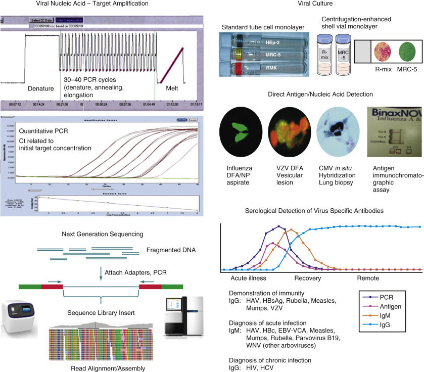

Figure 56-2 

Laboratory methods for diagnosis of viral infections. 

,  

##  Clinical Viral Infectious Syndromes 

Our approach to laboratory diagnosis separates viral infections into specific clinical syndromes, encouraging the physician to associate a reasonable but limited group of viruses with the patient's presenting illness. Orderable tests should be selected by the laboratory to limit testing to the most useful and cost-effective tests. Test selection has become more important with the aviability of more expensive molecular syndromic panels. The requisition form or order screen should be designed to require specific patient demographic data and a working clinical diagnosis, so that the laboratory can tailor testing and focus on rapid, high-yield, efficient testing. In this chapter, the following viral diseases and syndromes are discussed: 

  * •

Herpetic mucocutaneous infections 

  * •

Pediatric and adult respiratory syndromes 

  * •

Infectious mononucleosis 

  * •

Congenital and neonatal infections 

  * •

Viral central nervous system infections 

  * •

Viral exanthems and cutaneous infections 

  * •

Viral enteric infections 

  * •

Viral hepatitis 

  * •

Viral infections in the immunocompromised host 

  * •

Acquired immunodeficiency syndrome 

  * •

Virus-associated neoplasia 

 

##  Herpetic Mucocutaneous Infections 

HSV and varicella zoster virus (VZV) are commonplace worldwide, and characteristically produce infections in the skin and squamous mucous membrane surfaces of the body. Neither is usually life-threatening; however, the effectiveness of acyclovir therapy has produced demand for prompt laboratory diagnosis, particularly for HSV (Anderson, 2014). 

HSV is ubiquitous and infects all racial groups worldwide. The two strains of HSV (serotype 1 and serotype 2) share many genomic and biological features, and both preferentially infect squamous epithelium; however, each has a unique antigenic profile and a somewhat distinctive epidemiology. HSV-1 is transmitted via saliva to infect oropharyngeal and labiofacial surfaces. Lesions may develop on the exposed skin of athletes (herpes gladiatorum) or the hands of medical personnel (herpetic whitlow) after direct salivary contact. Initial HSV-1 infection usually occurs in early childhood; primary infection is typically mild or asymptomatic, although a substantial minority of patients develop fever with painful gingivostomatitis. HSV-1 is also responsible for an increasing number of genital herpetic ulcers (  Ribes et al, 2001  ). 

HSV-1 directly infects ectodermal cells; viral replication depletes the host cells, so squamous cells lose their cytoplasmic integrity, leak fluid, and separate from one another to create a vesicle. Surface bacteria convert the vesicle to a pustule, which then ulcerates. Cutaneous herpes lesions heal without scarring as the epidermal cells regenerate. The immediate immune response involves natural killer cells, cytotoxic T lymphocytes, and production of neutralizing antibody. Despite cellular and humoral factors, HSV-1 is able to migrate through sensory nerve fibers to the trigeminal ganglion and persists indefinitely in a dormant state in the neuronal nucleus (Anderson, 2014). HSV-1 episodically reactivates and travels back down neurosensory axons to the mouth and lips, where it again initiates replication in squamous cells. Most recurrent herpes infections are asymptomatic or produce transient vesicles with only cosmetic significance. With severe impairment of cell-mediated immunity (in acquired immunodeficiency syndrome [AIDS] and transplant patients), reactivation infection may be severe or even fatal. Encephalitis is another rare but devastating HSV-1 infection. These complications are discussed in later sections of this chapter. 

HSV-2 infection is found principally in genital squamous surfaces and is transmitted through intimate sexual contact. At least 40 million Americans have been infected, with estimates of 1 million new cases annually. HSV-2 recovery in children is most unusual and raises concerns about sexual abuse; however, beginning with adolescence, seroprevalence rises steadily through middle age and is proportional to the number of sexual partners (  Fleming et al, 1997  ). In the United States, HSV-2 seroprevalence in persons 13 years of age or older had progressively increased to a rate of 22%; however, a recent survey has shown a modest decrease to 17% (  Xu, 2006  ). HSV-2 produces the same pattern of primary and recurrent mucocutaneous lesions seen with oral HSV-1. Latency is established in sacral neural ganglia, but reactivation rates are at least twice as high as with HSV-1, and transient meningitis (Mollaret's meningitis) may occur. Primary and recurrent HSV-2 lesions also heal completely in people with normal cellular immune function. The principal concern is exposure of infants during vaginal delivery; neonatal herpes is discussed later in this chapter. 

 

##  Specimen Collection and Handling Guidelines 

HSV is probably the easiest and fastest human virus to propagate in cell culture. Antigen assays are also relatively straightforward procedures. NAATs are now widely available and have superior sensitivity. Specimen collection is simple, and HSV is sufficiently durable and/or present in sufficient numbers that stat transport and laboratory handling are not essential. Swab specimens in VTM with antibiotics can tolerate a room temperature (22° C) transportation delay of 12 hours with only modest viral loss. Specimens should be inoculated to cell culture on the day of receipt, but overnight refrigeration is acceptable. 

 

##  Cell Culture Isolation of Herpes Simplex Virus 

HSV grows well in a variety of cell lines; human fibroblasts (WI-38, MRC-5, foreskin), rabbit kidney (RK), mink lung, HeLa, rhabdomyosarcoma (RD), Vero, and HEp-2 cell lines work well; however, primary monkey kidney (PMK) is not reliable. Two tissue culture tubes (e.g., one RK and one MRC-5) are usually inoculated; the procedure is summarized in [ Figure 56-3 ](<#f0020>) . HSV replicates rapidly with CPE usually apparent after 1 or 2 days of incubation. Genital cultures that fail to show HSV CPE after 5 days of incubation can be reported as negative. Incubation of cultures from central nervous system (CNS), corneal, oral, and other nongenital sites should be extended for 2 weeks, so other viruses (e.g., VZV, CMV, adenoviruses, enteroviruses) may be recovered. Individual HSV-infected cells become swollen and rounded, and this damage spreads rapidly across the monolayer. This CPE is characteristic of but not unique for HSV; changes caused by other viruses, toxins, or trichomonads may be confused with HSV, so confirmation with a DFA stain is needed. Reaction of infected cells with monoclonal HSV antibodies can distinguish HSV-1 from HSV-2 (  Lipson et al, 1991  ). With the use of shell vial centrifugation-enhanced culture, HSV can be identified in the monolayer by DFA staining after only 1 day of incubation (  Clarke, 2010  ). 

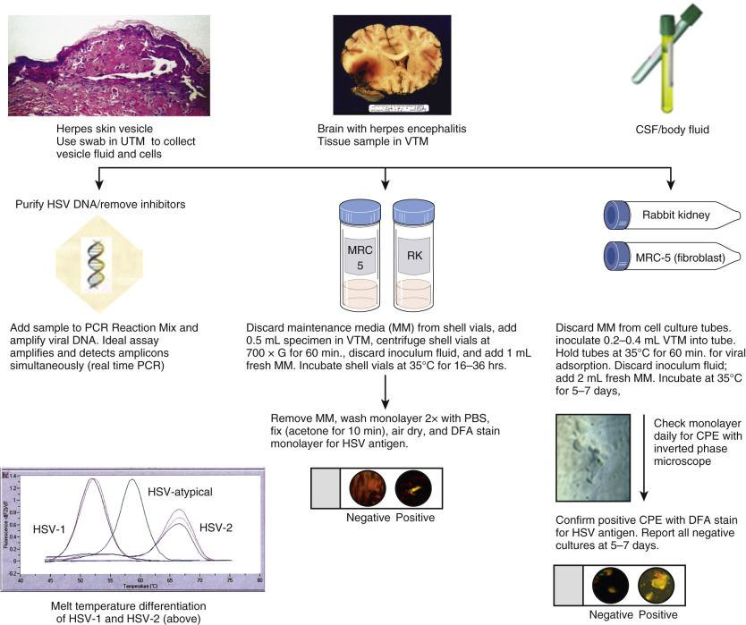

Figure 56-3 

Traditional tube and shell vial cultures for HSV and HSV DNA amplification. 

 

##  Direct Detection of Herpes Simplex Virus 

A direct smear from the base of a herpetic skin vesicle can be stained with Giemsa reagent (Tzanck smear) to demonstrate viral multinucleated syncytial epithelial giant cells and intranuclear inclusions; however, these findings are not specific for HSV infection; identical changes are seen in VZV (chickenpox and shingles). Only 67% of herpetic lesions at the vesicle stage have a positive Giemsa Tzanck smear; sensitivity drops to only 30% for ulcerated skin lesions. Immunostaining of direct smears with fluorescein- or immunoperoxidase-labeled HSV antibodies eliminates confusion with VZV, and viral antigen can be identified in cells that do not yet have nuclear inclusions. However, when compared with culture, DFA staining has at best a 20% to 30% false-negative error (  Lafferty et al, 1987  ). All negative direct specimen test results must be considered as possible false-negatives that should be validated by parallel culture. On the other hand, PCR diagnosis of mucocutaneous genital herpes infection is 20% to 30% more sensitive than culture and has a more rapid turnaround time (  Espy et al, 2006  ). PCR is superior for identification of asymptomatic mucocutaneous viral shedding—eight times more sensitive than culture (  Wald et al, 2003  ). 

 

##  Nucleic Acid–Based Detection of Herpes Simplex 

Real-time PCR with hybridization probes or melt curve analysis is commonly used for the detection and typing of HSV. A wide variety of specimen types can be accommodated with molecular methods, including swab specimens in VTM or universal transport media, cerebrospinal fluid (CSF), bronchoalveolar lavage (BAL), frozen tissue specimens, urine, blood, serum, plasma, and formalin-fixed paraffin-embedded (FFPE) tissue. PCR-quality DNA can be extracted by a variety of commercially available methods (manual or automated). Specimen DNA is combined with PCR reagents and placed in a real-time thermal cycler for temperature cycling and fluorescence monitoring, resulting in multiple rounds of DNA replication of specific regions of the viral genome with increasing levels of fluorescence. Most currently available multiplex assays can detect and identify HSV-1 and HSV-2. Costs are comparable with culture-based detection and typing methods; because of increases in sensitivity and rapid turnaround, NAAT has replaced other methods as the standard of care. 

 

##  Serologic Diagnosis 

Broad antigenic homology has been noted between HSV-1 and HSV-2, so accurate serologic testing requires antigens that are serotype-specific. EIA and Western blot methods that use unique HSV-1 and HSV-2 glycoprotein G (gG) envelope antigens do not detect cross-reacting antibodies (  Ashley et al, 1988  ;  Morrow et al, 2003  ). HSV-2–specific antibody testing of pregnant women and their husbands helps predict neonatal transmission risk (  Ashley & Wald, 1999  ;  Cherpes et al, 2003  ). Positive HSV-2 antibody in a patient with genital vesicles or ulcers is highly likely to represent true genital herpes (  Jerome & Morrow, 2007  ). IgM serology for HSV-1 or HSV-2, including gG IgM antibody, is not specific or sensitive and should not be used for diagnosis of primary infection. 

 

##  Pediatric and Adult Viral Respiratory Syndromes 

Every year, several million combined outpatient visits and hospitalizations in the United States are related to respiratory tract infections, and most are viral in origin. All age groups are affected, and infections range from minor colds to serious laryngotracheobronchitis (croup), bronchiolitis, and pneumonia. Colds and pharyngitis have usually been managed with clinical judgment and no laboratory testing. Hospital laboratories have traditionally used a combination of antigen assays and culture to identify influenza viruses, parainfluenza viruses, RSV, and adenovirus among pediatric and adult patients. Antigen-detection and culture methods are being replaced by NAAT; commercial multiplex nucleic acid panels significantly increase the number of viral pathogens detected by simultaneously testing for influenza A and B, several influenza A hemagglutinin (H) variants, parainfluenzas 1 to 4, RSV, adenoviruses, multiple coronaviruses, metapneumoviruses, rhinoviruses, and enteroviruses ( [ Fig. 56-4 ](<#f0025>) ). Molecular assays designed for batch testing with a throughput time of 4 to 8 hours (  Li et al, 2007  ;  Mahony et al, 2007  ) are being superseded by multiplex syndromic panels that can be performed in a clinical laboratory in a few hours without the need for a specialized molecular laboratory or highly trained molecular technologists (  Loeffelholz et al, 2011  ). 

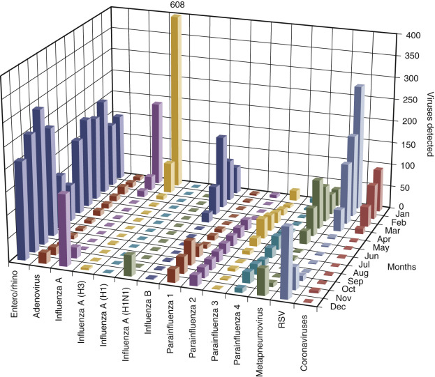

Figure 56-4 

Seasonal variation of respiratory viral infections (Chicago/Milwaukee area, 2013). 

The additional cost of these expanded syndromic panels is offset by rapid turnaround time that dramatically increases their clinical utility, and as many as 40% more viral infections are identified, particularly when multiplex assays include metapneumovirus, coronaviruses, and rhinovirus/enterovirus (  Mahony et al, 2007  ;  Popowitch et al, 2013  ). During high-prevalence respiratory outbreaks, multiplex viral nucleic acid tests are the least costly diagnostic strategy for hospitalized children (  Mahony et al, 2009  ;  Hirsch et al, 2013  ; [ Fig. 56-5 ](<#f0030>) ). 

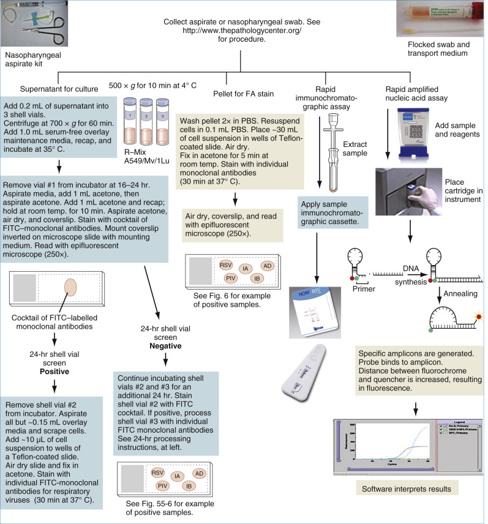

Figure 56-5 

Methods for detection of respiratory viruses. 

This “democratization of viral testing” illustrates the obvious immediate advantage(s) of these expanded test profiles for the individual patient, highlighting the far greater likelihood of prompt identification of the viral pathogen for evidence-based use of antiviral drugs, limitation of inappropriate antibiotic use, and rapid implementation of appropriate infection-control measures (  Arnold et al, 2008  ;  Buller, 2013  ). These assays should also help delineate the clinical effects of coinfection with multiple viral pathogens (  Buller, 2013  ). With the detection of picornavirus/rhinovirus, coronavirus, and metapneumovirus pathogens, public health laboratories have used multiplex amplified molecular tests to successfully characterize additional viral respiratory infection outbreaks (  Marshall et al, 2007  ;  Wong et al, 2009  ). 

Molecular techniques have been successfully applied in the rapid evaluation of recent novel viral respiratory disease outbreaks. An example is the initial emergence of worldwide SARS in 2003; the causative agent was sequenced and was promptly characterized as a novel coronavirus, and accurate diagnostic testing quickly became available (  Ksiazek et al, 2003  ). In the spring of 2009, a novel H1N1 influenza A virus, first detected in Mexico, rapidly evolved into a global pandemic. Within a matter of weeks, the strain had been sequenced and accurate diagnostic reagents had been developed; within 6 months, a vaccine was mass-produced and distributed (  Perez-Padilla et al, 2009  ;  Sullivan et al, 2010  ). The same strategy will be used when other influenza A strains cause pandemics. The wider implementation of molecular methods has also demonstrated that clinical respiratory tract symptoms can be caused by a more diverse range of viral agents than was previously presumed. Metapneumovirus has been defined as having epidemiologic and clinical properties similar to those of RSV (  Kahn, 2006  ). 

 

##  Influenza 

Influenza A and B viruses cause predictable annual cold weather outbreaks of acute febrile upper and lower respiratory tract illness with characteristic accompanying systemic features (see [ Fig. 56-4 ](<#f0025>) ). Influenza A is usually more common than influenza B and produces more serious disease. Co-circulation of influenza A and B is not unusual. Influenza antigens change through point mutations in the genome (antigenic drift, influenza A and B) and through recombination of human and animal viral RNA segments (antigenic shift, influenza A), so antibodies from prior infections may not be protective in subsequent outbreaks (  Sullivan et al, 2010  ;  Treanor, 2010  ). The ever-changing influenza genome resulting in selection of new and unique viral antigens is the reason why yearly vaccination is required to ensure optimal antigenic coverage. 

Influenza is a true respiratory pathogen and is easily spread from person to person in aerosol droplets; the virus attaches to and replicates rapidly in the ciliated columnar epithelial cells of the pharynx and tracheobronchial tree. After incubation of 1 to 2 days, disease usually begins abruptly with the onset of fever and chills; viral respiratory epithelial necrosis causes sore throat and cough, but associated systemic myalgias, headache, and generalized weakness are typically more severe than respiratory symptoms. Uncomplicated influenza usually resolves after 4 to 5 days. However, during every influenza outbreak, a small number of patients develop severe acute primary pneumonia with viral necrosis extending into the alveolar lining cells. These patients are at risk for developing bacterial lower respiratory infection following acute influenza, because the bronchi are temporarily covered by metaplastic epithelium and have not yet reacquired normal ciliated mucosa; individuals with chronic lung and cardiac disease are most vulnerable and account for a majority of the deaths recorded each year for influenza epidemics (  Yeldandi & Colby, 1994  ;  Soto-Abraham et al, 2009  ). 

Influenza outbreaks in a local community have a characteristic epidemiologic curve (  Treanor, 2010  ); numbers of infected individuals rise rapidly, peak, and then decline rapidly over about a 6- to 8-week period. A second peak of influenza-related bacterial pneumonia then follows; Gram-positive cocci such as _Staphylococcus aureus_ and _Streptococcus pneumoniae_ are commonly implicated (  Liderot et al, 2013  ). Every year, approximately 100,000 hospitalizations and 3000 to 49,000 deaths in the United States are linked to influenza, and most fatalities are caused by bacterial bronchopneumonia, usually affecting patients with preexisting chronic obstructive lung disease or congestive heart failure. Myocarditis, meningoencephalitis, Reye syndrome, and Guillain-Barré syndrome are relatively rare complications (  Thompson et al, 2010  ). 

Influenza is diagnosed best during the first 2 to 3 days of illness by antigen-based assays and culture, when viral shedding is maximal. Infected cells from the upper respiratory tract are the easiest to collect for testing (  Ginocchio & Zhang, 2009  ;  Lee et al, 2011  ). Nasopharyngeal aspirate (NPA) and pharyngeal swab specimens provide sufficient material for simultaneous testing for several viral agents, including influenza viruses. Nucleic acid testing by RT-PCR has been shown as the most sensitive method for diagnosis at all stages of the disease, with its extreme sensitivity allowing for detection of influenza RNA in what would be inferior specimens for culture and antigen-detection assays and has surpassed culture methods in both accuracy and turnaround time (  Erdman et al, 2003  ;  Templeton et al, 2004  ;  IDSA, 2012  ). Culture is the next most sensitive diagnostic test but has a longer turnaround time; nasopharyngeal secretions/NPA samples are ideal; nasopharyngeal swabs and throat swabs may be satisfactory but often provide suboptimal samples. Shell vial culture with 1 to 2 days' incubation has excellent sensitivity (  Dunn et al, 2004  ) and may still provide a diagnosis within a time frame to affect management of the index patient or prophylaxis of contacts. Hybrid mink lung and A549 shell vial monolayers are versatile and can recover influenza A and B, parainfluenzas, adenovirus, and RSV ( [ Fig. 56-6 ](<#f0035>) ). Traditional tube culture may not yield a positive result for 2 to 7 days, and currently is rarely used in hospital laboratories. 

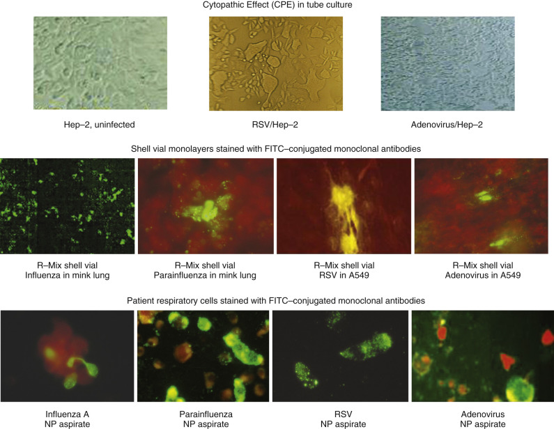

Figure 56-6 

Viral growth in cell culture line and viral detection in patient samples. 

DFA stain can demonstrate virus-infected columnar epithelial cells in NPA samples (see [ Fig. 56-6 ](<#f0035>) ), Compared with cell culture, DFA sensitivity ranges from 77% to 93% for detection of influenza A, and from 70% to 80% for influenza B (higher in pediatric patients). Specificity is excellent, greater than 95%; however, good results are heavily influenced by the experience of the microscopist and by specimen quality. Throat and nasopharyngeal swabs generally lack sufficient columnar cells for DFA staining. Commercial immunochromatographic EIA methods are rapid and easy to perform but are less sensitive than molecular methods for detection of influenza in NPA specimens during outbreaks. Specificity of any antigen testing during nonseasonal times of the year is poor, so laboratories should restrict ordering to high-prevalence months. Sensitivity with nasopharyngeal swabs is considerably lower, particularly for antigen assays and culture. Nasopharyngeal swab specimens collected during the 2009 H1N1 influenza outbreak were tested by DFA and two rapid EIA methods, along with a commercial RT-PCR multiplex test and an R-mix shell vial culture. DFA sensitivity was poor (46%), and EIA methods showed only 10% to 40% sensitivity; all antigen assays had 6% false-positive results (  Ginocchio & Zhang, 2009  ). It is not surprising that RT-PCR was clearly superior to all other methods and is the method of choice for clinical virology laboratories. 

 

##  Bronchiolitis 

RSV is the most important cause of serious lower respiratory viral disease in infants and young children (  Hall, 2010  ). Like influenza, RSV is transmitted by droplet aerosol, and outbreaks recur every winter. Currently, no vaccine for RSV is available; natural immunity to RSV is incomplete and of short duration, so multiple infections occur throughout life. RSV, similar to influenza, infects ciliated columnar epithelial cells from the nasopharynx to the distal bronchioles. Small babies experience the most serious infections because their narrow terminal airways become occluded by necrotic epithelial cells; bronchiolar obstruction leads to air trapping and hypoxia, which may be severe enough to require hospitalization. Acute symptoms usually resolve in a few days; administration of oxygen and other supportive measures are often the only medical interventions needed. Most critical RSV infections occur in premature infants, in children with underlying cardiopulmonary disease or immunodeficiencies, and in transplant recipients. Sequelae of severe RSV bronchiolitis may include an increased risk for the development of asthma (  Blanken et al, 2013  ). Adults who are immunocompromised and older adults may also have severe lower airway RSV disease with mortality similar to seasonal influenza (  Lee et al, 2013  ). Treatment with ribavirin or with the monoclonal antibody palivizumab is available but generally is prescribed only for severe cases (  Empey et al, 2010  ;  Blanken et al, 2013  ). 

RSV is a particularly fragile and labile virus that may not remain viable if specimen transport is delayed. In addition, RSV replicates slowly in cell culture, and recovery times range from 3 to 10 days, limiting the use of cell culture (  Tristram, 2003  ;  Tang & Crowe, 2008  ). Shell vial culture improves RSV recovery somewhat and shortens isolation time to 1 to 2 days (  Dunn et al, 2004  ). Use of shell vial monolayers with a hybrid mix of A549 and mink lung cells detects RSV, as well as influenza A and B, parainfluenzas, and adenoviruses (see [ Fig. 56-6 ](<#f0035>) ). Detection of RSV antigen in respiratory secretions by DFA staining (see [ Fig. 56-6 ](<#f0035>) ) or by EIA is as sensitive as or superior to culture, and availability of results is clinically relevant; therefore, rapid tests have remained popular and practical methods for RSV diagnosis in children when RT-PCR methods are not available. However, sensitivities are only approximately 85% compared with RT-PCR (  Ohm-Smith et al, 2004  ;  Tang & Crowe, 2008  ;  Principi & Esposito, 2009  ;  Papenburg et al, 2013  ). Similar to rapid antigen assays for influenza, RSV antigen tests should be performed only during wintertime outbreaks; off-season testing, when prevalence is low, has poor specificity, with false-positive results outnumbering true-positive results. RT-PCR has been shown to have superior sensitivity over all other methods, is not as dependent on optimization of specimen collection, and transport conditions are not as restricted because viability is not required (  Falsey et al, 2002  ;  Perkins et al, 2005  ). High sensitivity and specificity make RSV nucleic amplification the ideal method for off-season specimens. With the advent of multiplex amplified nucleic acid testing methods, other viruses, such as metapneumovirus, coronaviruses, bocaviruses, parainfluenzas, and even rhinoviruses, have been shown to produce respiratory disease that clinically mimics RSV and should be considered as a possible cause of viral bronchiolitis (  Hirsch et al, 2013  ). 

 

##  Croup 

Approximately 80% of croup is caused by parainfluenza viruses (PIVs) (  Henrickson, 2003  ). PIV1, PIV2, and PIV4 are more common during cold weather; PIV3 causes disease year-round (see [ Fig. 56-4 ](<#f0025>) ). PIVs (particularly PIV3) are the second most frequent cause of viral lower respiratory tract infection in young children. The remaining 20% is mainly associated with other virus infections including adenoviruses, RSV, enteroviruses, bocaviruses, coronaviruses, rhinoviruses, metapneumoviruses, and influenza viruses. 

Viral epithelial necrosis and mucosal edema in the larynx, trachea, and large bronchi narrow the airway, producing hoarseness, barking cough, and the stridorous obstructed breathing pattern characteristic of croup. Immunity is transient, and repeat infections are common; however, in older children and adults, symptoms are less severe and are centered in the upper respiratory tract, possibly resembling rhinovirus colds. Antigen assay methods are limited to DFA staining of virus-infected nasopharyngeal cells (see [ Fig. 56-6 ](<#f0035>) ), which shows 70% to 85% sensitivity when compared with culture; all DFA-negative specimens should be cultured to maximize recovery (  Costello et al, 1993  ). Multiplex viral nucleic acid tests, which include the parainfluenzas, are superior to both antigen assays and culture for clinical diagnosis (  Mahony, 2008  ;  Mahony et al, 2009  ). 

 

##  Metapneumovirus 

Human metapneumovirus (hMPV) is a recently recognized RNA myxovirus of the genus _Metapneumovirus_ (  Falsey, 2010  ). Similar to RSV, hMPV causes a range of cold-weather respiratory infections, including upper airway disease, lower airway bronchitis and bronchiolitis, influenza-like syndrome, and pneumonia. hMPV bronchiolitis tends to be less harsh than RSV, but coinfection with RSV and hMPV can be more severe than infection with either one alone (  Souza, 2013  . Human MPV ranks as the second or third most common cause of serious lower airway pediatric disease; older adults and the immunocompromised also can experience severe respiratory tract infection (  Bouscambert et al, 2005  ;  Kahn, 2006  ;  Dare et al, 2007  ;  Lüsebrink et al, 2010  ). 

Recovery in LLC-MK2 cells or Vero cells may take up to 7 days (  Deffrasnes et al, 2005  ). Culture of NPA and bronchial lavage specimens using a shell vial culture format and anti-hMPV monoclonal antibody DFA staining can shorten recovery (  Ebihara et al, 2005  ;  Landry et al, 2005  ). However, nucleic acid testing is considered the gold standard, and inclusion of hMPV in commercial multiplex RT-PCR assays has demonstrated that hMPV is a consistently recovered pathogen in a community hospital practice (see [ Fig. 56-4 ](<#f0025>) ). Wider availability of nucleic acid assays will better define the spectrum of hMPV disease and the true incidence of infection. 

 

##  Adenovirus 

Adenovirus has a consistent year-round epidemiology profile, and most clinical isolates are seen in patients with respiratory tract and conjunctival infections (see [ Fig. 56-4 ](<#f0025>) ). Most adenovirus respiratory disease is mild and self-limiting; however, outbreaks of severe respiratory infection have been reported in military personnel and in other populations living in crowded conditions. Outbreaks of a virulent adenovirus serotype 14 and a recombinant adenovirus with properties of serotypes 11 and 14 have recently been reported in otherwise healthy adults and children (  Lewis et al, 2009  ;  Tate et al, 2009  ). Serious adenoviral pneumonia can also develop in immunocompromised persons; stem cell and solid organ transplant recipients are the most common patient groups involved, and disease is identified by standard culture and molecular methods (  Rhee & Barouch, 2010  ). Adenovirus can be demonstrated by DFA staining of nasopharyngeal aspirate cells (see [ Fig. 56-6 ](<#f0035>) ). Adenovirus also grows well in R-Mix hybrid mink lung/A549 shell vial monolayers (see [ Fig. 56-6 ](<#f0035>) ). Molecular methods, particularly as part of syndromic panels, are the most sensitive and efficient way for detection of most respiratory viruses including adenoviruses (  Popowitch et al, 2013  ). 

 

##  Coronavirus 

Coronaviruses (CoVs) have recently been divided into four genera, _Aphacoronaviruses, Betaconronaviruses, Gamacoronaviruses,_ and _Detalcoronaviruses_ (  Woo et al, 2012  ). Human coronaviruses include NL63 and 229E _(Alphacoronavirus),_ SARS- CoV, MERS-CoV, OC43, and HKU1 _(Betacoronavirus)._ Most coronaviruses are associated with minor upper respiratory tract infections the exception being SARS-CoV and MERS-CoV, which can cause severe zoonotic infections. Primary reservoirs are most likely bats (SARS-CoV and MERS-CoV). Palm civets (SARS-CoV) and dromedary camels (MERS-CoV) are also involved and may play a significant role in the transmission cycle (  Coleman & Frieman, 2014  ). 

 

##  Severe Acute Respiratory Syndrome Coronavirus (SARS-CoV) 

In 2003, an outbreak of highly contagious acute hemorrhagic pneumonia originated in China and was spread by international travelers within Asia and beyond; the responsible organism was identified as a coronavirus variant, the clinical disease was named _severe acute respiratory syndrome (CoV-SARS),_ and the outbreak had a mortality rate of almost 10% (  Yam et al, 2003  ). Detailed molecular characterization of CoV-SARS was performed and accurate diagnostic testing was developed within a matter of months. Strict infection-control measures were implemented for all recognized cases to limit transmission. NAAT for CoV-SARS is available through public health laboratories. However, even though these diagnostic methods are available, only very rare cases of SARS have been reported since the 2003 epidemic, and these were connected to research institutions. The explanation for the dramatic disappearance of CoV-SARS is not clear, but public health institutions continue surveillance for a possible recurrence. 

 

##  Middle Eastern Respiratory Syndrome Coronavirus (MERS-CoV) 

In 2012, the first cases of severe community-acquired rapidly progressive pneumonia from patients in the Middle East were reported (  Zaki et al, 2012  ). The virus implicated was identified as a betacoronavirus, like SARS-CoV, and causes a similar, but more aggressive pneumonia. Person-to-person transmission of MERS-CoV can occur in health care settings and is associated with considerable morbidity. Fortunately, MERS-CoV is not easily spread; the rate of secondary transmission among household contacts of patients is approximately 5% (  Drosten et al, 2014  ). All human cases have been epidemiologically linked to the Middle East (Jordon, Saudi Arabia, United Arab Emirates, Yemen, Oman, Kuwait, Lebanon, Iran, and Qatar). The severity of the illness can range from mild to fulminant. The incubation period is similar to SARS: a median incubation period of 4.0 days, with 5% of cases developing within 1.8 days and 95% within 10.6 days (  Assiri et al, 2013  ). 

Most coronaviruses can be grown in cell culture, but SARS and MERS are best identified by RT-PCR, which is more sensitive and rapid than culture, and exposure to live viruses in the laboratory is limited. 

 

##  Bocaviruses 

Human bocaviruses (HBoV), members of the _Parvoviridae_ virus family, are human pathogens first reported in 2005 that have been associated with upper and lower respiratory tract as well as gastrointestinal infections, predominantly in children (  Kantola et al, 2010  ). There are four species of bocavirus (HboV 1-4). HboV-1 is more prevalent in young children with both upper and lower respiratory tract symptoms. HboV-1 can also be detected in stool. HboV-2 to -4 are found mainly in stool, are associated with gastroenteritis as well as asymptomatic carriage, and are rarely found in respiratory samples. HboV-1 to -4 are found worldwide, with a greater than 90% seropositive rate (  Kantola et al, 2010  ). Coinfection with other viruses is very common, with another virus detected in 83% of patients with pneumonia, making the role of HboV in human disease difficult to discern (  Fry et al, 2007  ). HboV is more pathogenic in the immunosuppressed, and carriage may be prolonged (  Sedeghi et al, 2013  ). 

 

##  Rhinoviruses (HRV) 

HRVs are divided into three genetically distinct clades: designated groups A, B, and C. Groups A and B grow in culture, and group C does not, emphasizing the advantages of molecular techniques for detection of emerging and hitherto unknown viral pathogens (  Jacobs et al, 2013  ) . 

Acute upper respiratory tract colds are caused by rhinoviruses and coronaviruses; more than 100 of these agents circulate almost continuously in pediatric and adult communities. HRVs are the most common viruses detected in patients with upper and lower respiratory tract infections (see [ Fig. 56-4 ](<#f0025>) ). Human HRVs are common causes of upper respiratory infections, especially if presenting with otitis media and sinusitis. Healthy hosts get many colds over a lifetime and account for up to 25% of total sick days for children and adults. HRV infections are found worldwide and are most common in the spring, summer, and fall months in temperate climates. Their role in lower respiratory disease is difficult to define due to high carriage rates, particularly in young children (  Costa et al, 2014  ). Widespread implementation of multiplex PCR panels for respiratory virus detection has shown that these “benign” viruses can cause significant lower respiratory tract disease, particularly in young persons, patients with asthma, older adults, and the immunosuppressed, especially when found in association with another viral pathogen such as RSV (  Jacobs et al, 2013  ). Expanded use of molecular viral detection methods have documented that HRVs cause clinically severe lower respiratory illness in normal and compromised hosts (  Piotrowska et al, 2009  ;  Talbot et al, 2009  ;  Kuypers et al, 2010  ;). An example is the recent outbreak of severe enteroviral respiratory illness in children, especially those with a history of asthma or wheezing, which was detected in August 2014 by laboratories using syndromic molecular respiratory panels. Enterovirus D68 was recognized as the cause within weeks (  MMWR, 2014  ). 

 

##  Specimen Collection 

The respiratory myxoviruses and adenoviruses can infect ciliated columnar epithelial cells from the nasopharynx to the alveoli, so when lower airway disease (croup, bronchiolitis, pneumonia, or influenza) is suspected, the upper respiratory mucosa is still the easier and more accessible site to sample for culture, antigen assay, or nucleic acid assays. The upper respiratory tract is the most common site of infection for rhinovirus and coronavirus. Specimens should be collected during the first few days of illness, when viral replication is greatest. A throat swab placed in VTM with antibiotics may be accepted for influenza culture, but the yield is 10% to 20% less; expectorated sputum is also adequate for culture, particularly in adults who are coughing productively. Seriously consider NAAT if your laboratory receives less than optimal specimens for viral detection. Nasopharyngeal swab specimens vary considerably in quality but are adequate for nucleic acid assays; culture and a limited panel of viruses for direct antigen detection can also be performed on NP swabs. Collect swab specimens using flocked swabs with plastic shafts. Nasopharyngeal specimens obtained with flocked swabs collect a larger volume of sample with more numerous epithelial cells, and consistently provide better samples than are provided by fiber swabs (  Daley et al, 2006  ;  Walsh et al, 2008  ). 

Collection of nasopharyngeal aspirates (NPA) is straightforward and simple: a catheter attached to a syringe is inserted through the nares to the nasopharynx; 1 to 3 mL of saline is instilled, then saline and mucosal cells and secretions are immediately re-aspirated directly back into the syringe. All specimens should be transported on ice promptly to minimize RSV loss if the sample is to be cultured. Specimen quality can be verified before performing culture or antigen assay. NPA with at least two ciliated columnar epithelial cells per 250× field yields a fourfold greater recovery of respiratory viral pathogens (  Costello et al, 1993  ). NP swabs may be substituted if your laboratory is using a NAAT assay without any loss of sensitivity. Nasal swabs are never acceptable for testing by any method. However, paired nasal and pharyngeal swabs are acceptable for NAAT. 

 

##  Virus Antigen Assays 

Reproducible and accurate viral antigen detection by DFA requires interpretive expertise; therefore, if possible, both viral culture and antigen assay should be done to maximize recovery. Hospitals with a large pediatric service routinely test respiratory specimens for a panel of viruses (RSV, hMPV, influenza A and B, PIVs, and adenovirus) during winter months if budgets permit. Panel testing is best performed using NAAT panels. Older adult patients are reasonable candidates for panel testing since they should be tested for influenza virus; RSV, hMPV, and HRV should also be considered. 

Several EIAs are commercially available for RSV and influenza A and B. The specificity and sensitivity of these products are comparable with those of DFA staining but inferior to NAAT (  Ohm-Smith et al, 2004  ;  Weinberg & Walker, 2005  ). The limited sensitivity of EIA assays for influenza restrict their use to epidemic periods. 

 

##  Virus Isolation 

The same specimen requirements and restrictions used for antigen assays also apply to virus culture. Respiratory cultures in non-immunocompromised adults and children can be modified throughout the calendar year to accommodate predictable seasonal epidemics of influenza, RSV, metapneumovirus, and PIV. At a minimum, virology laboratories should attempt to isolate RSV and influenza during the winter; if staffing permits, PIV, metapneumovirus, and adenovirus can be included for pediatric patients (  Hodinka, 2010  ). Nasopharyngeal swabs for influenza culture only should be placed in VTM with antibiotics at collection and transported promptly, preferably on ice. Sputum that contains lower respiratory tract cells and/or acute inflammation is also acceptable for influenza culture and should be placed in VTM with antibiotics. VTM vial specimens should be vortexed vigorously; culture inoculation should not be delayed past 24 hours; inoculation on the day of collection is obviously preferable. For prompt recovery, the supernatant is inoculated into duplicate shell vials (i.e., two trypsinized Madin-Darby canine kidney [MDCK], two Rhesus monkey kidney [RMK], or two hybrid R-Mix), which are refed after centrifugation with FBS-free MEM (bovine serum may contain antibodies to influenza virus). After 1 to 2 days' incubation at 35° C, shell vial monolayers are DFA-stained for influenza antigen. 

Laboratories that culture for only RSV should consider using shell vials in place of traditional tubes to reduce recovery time. HEp-2 or A549 cells in Eagle MEM supplemented with 2% to 5% fetal bovine serum support RSV replication. Cell culture tube monolayers should be checked daily for CPE for 10 days. [ Figure 56-6 ](<#f0035>) shows typical RSV multinucleated cellular syncytium CPE, a pattern that is influenced by cation content and freshness of the maintenance medium (  Shahrabadi & Lee, 1988  ;  Tristram, 2003  ). Adenovirus also replicates in HEp-2 and A549 cell lines and produces a grapelike rounding and swelling of monolayer cells, usually by 5 to 7 days; shell vial cultures shorten adenovirus detection to 3 days. 

A number of serologic methods may be used to detect specific antiviral antibodies, but none is practical for rapid diagnosis and clinical management. Serologic diagnosis is most useful for public health epidemiology studies. 

 

##  Molecular Detection Methods 

Multiplexed nucleic acid– and array-based assays are consistently more sensitive than culture and are the tests of choice for point-of-care detection of common respiratory viral pathogens (  Mahony, 2008  ;  Popowitch et al, 2013  ). NAAT technology is rapidly evolving to point of care rapid testing. Large syndromic respiratory panels dramatically increase the clinical utility of these tests (  Bell & Selvarabgan, 2014  ). The currently available assays have all been approved for use with nasopharyngeal swabs in viral transport media. Clinical laboratories should consider incorporating these versatile molecular assays when possible into their service menu (see [ Fig. 56-6 ](<#f0035>) ). 

 

##  Infectious Mononucleosis and Related Infections 

Infectious mononucleosis is a common systemic lymphoproliferative disease usually caused by primary EBV infection. EBV is part of the _Herpesviridae_ family and, similar to HSV, eventually infects the vast majority of the population worldwide. EBV is spread by saliva; primary infection in early childhood is usually asymptomatic, but if delayed until the teen or young adult years, it often leads to classic infectious mononucleosis. Approximately 150,000 mononucleosis cases are reported annually in the United States (  Cohen, 2000  ;  Johannsen & Kaye, 2010  ). 

EBV first infects the pharynx; sore throat, fever, and tonsillitis typically mark the onset of infectious mononucleosis. EBV is strikingly lymphotrophic; it attaches to the C3d receptor (CD21) on the surface of B lymphocytes in the oropharynx and initiates a polyclonal proliferation of immortalized B lymphoblasts, which generates a polyclonal array of nonspecific IgM antibodies (detected in heterophile antibody assays for infectious mononucleosis). The cell-mediated immune system responds with natural killer cells and CD8  \+  cytotoxic T lymphocytes to eradicate infected B cells. EBV-infected B lymphocytes accumulate in lymph nodes throughout the body, and defensive cytotoxic T lymphocytes infiltrate nodal interfollicular areas, spleen, and liver and circulate as atypical lymphocytes in the peripheral blood (  Strickler et al, 1993  ;  Luzuriaga & Sullivan, 2010  ). As the patient's cell-mediated factors bring EBV replication under control, infectious mononucleosis symptoms diminish, and lymphadenopathy, splenomegaly, and hepatitis subside. 

Similar to other herpesviruses, EBV infection persists in a dormant asymptomatic state. A small percentage of the immortalized B lymphocytes evade eradication and remain latently infected, serving as a lifelong reservoir for reactivation. The EBV genome circularizes and persists as an episome in the lymphocyte nucleus; Epstein-Barr–encoded RNA (EBER) and the Epstein-Barr nuclear antigen (EBNA) and latent membrane protein antigens maintain the EBV genome in a dormant state, working in concert with CD8  \+  cells. Asymptomatic EBV reactivation is common, and up to 20% of healthy adults sporadically shed infectious virus in the saliva. With impaired cell-mediated immunity (AIDS, organ transplantation, X-linked lymphoproliferative disease), EBV cannot be held in check; overt diseases such as oral hairy leukoplakia and B cell lymphoproliferative disease and lymphoma may develop. EBV DNA and EBER are identified by nucleic acid tests in the spinal fluid of patients with primary CNS lymphoma, and by NAAT and in situ hybridization in transplant recipients who develop B cell post transplant lymphoproliferative disease (PTLD) during immunosuppressive therapy. EBV viral load quantitation is a reliable predictor of PTLD and can be used to monitor success of intervention (  Gully & Tang, 2010  ). EBV is also linked to nasopharyngeal carcinoma in Asians and to African Burkitt's lymphoma; EBV apparently functions as an initiator; then proliferative factors such as confection or immune dysregulation lead to malignancy (  Johannsen & Kaye, 2010  ). 

 

##  Diagnosis of Infectious Mononucleosis 

Cytotoxic T lymphocytes and apoptotic lymphocytes circulate in the bloodstream during infectious mononucleosis (  Luzuriaga & Sullivan, 2010  ); lymphocytosis (>50%) along with atypical lymphocytosis (>10% total lymphocytes) is relatively insensitive for diagnosing EBV mononucleosis, but the combined findings have a specificity of at least 95%. EBV can be cultivated in lymphoblastoid cell lines, but positivity does not differentiate primary infection from reactivation. Serologic testing is the principal laboratory method for infectious mononucleosis diagnosis (  Odumade et al, 2011  ). The polyclonal B lymphocyte proliferation of acute EBV infection generates a variety of transitory but generally harmless autoantibodies such as IgM anti-i (cold agglutinin), rheumatoid factor, and antinuclear antibody. Perhaps the most unusual immunoglobulins produced in infectious mononucleosis are the Paul-Bunnell heterophile antibodies. These IgM class antibodies have affinity for sheep, horse, and bovine erythrocytes, and are not directed against any EBV antigens. They are apparently random antibodies produced during EBV-induced B lymphocyte polyclonal proliferation; they emerge during the first week of infectious mononucleosis, decline during convalescence, and are usually undetectable by 3 to 6 months. Various heterophile antibodies can also develop during serum sickness and occasionally in other viral infections; however, heterophile antibody with strong affinity for beef erythrocyte antigens unchanged by adsorption with guinea pig kidney antigen (the differential absorption test) is specific for acute EBV infectious mononucleosis. 

Several commercial rapid assays directly mix patient serum on a slide with a suspension of guinea pig kidney antigen; this is followed by addition of preserved equine or bovine erythrocyte antigen bound to latex particles; agglutination occurs almost immediately if the serum contains infectious mononucleosis heterophile antibody. Rapid agglutination tests and solid-phase modifications are approximately 80% to 90% sensitive, have a false-positive rate of less than 2% and a positive predictive value of 95% or greater, and are excellent POC assays (  Rogers et al, 1999  ;  Hess, 2004  ). Their chief limitation is sensitivity: Heterophile antibody is present in more than 90% of teens and adults but in only 40% or less of young children with EBV infectious mononucleosis. 

As EBV evolves from primary infection into latency, various EBV antigens are sequentially expressed, and the specific antibodies generated can be used as markers of the stage of infection. The structural nucleocapsid protein viral capsid antigen (VCA) is produced during acute lytic infection; VCA IgM is a specific and sensitive indicator of acute primary EBV infection and subsides with recovery; VCA IgG can usually be detected with onset of symptoms and then persists for life. The early antigens (EAs) (DNA polymerase and thymidine kinase) are produced during acute infection and active EBV replication; antibody to EA-D is present in recent infection, but EA-R antibody is a persistent late marker. As acute mononucleosis subsides, a small percentage of Epstein-Barr–immortalized B lymphocytes escape immune destruction and latently retain episomal EBV DNA; EBNA is responsible for duplication and survival of this episome. Therefore, EBNA IgG typically develops after acute EBV infection has resolved. 

The serologic patterns encountered in the various stages of EBV infection are summarized in [ Table 56-4 ](<#t0025>) . IFA serologic assays use lymphoblastoid cell lines, and EBV production is arrested at specific stages for expression of specific antigens; IFA methods are sensitive and specific but have some interpretive subjectivity and require technical expertise. EIA methods using purified or recombinant VCA, EA, and EBNA antigens show better than 95% sensitivity and almost 100% specificity, and have the advantage of objective interpretation and automated processing (  Hess, 2004  ;  Corrales et al, 2014  ). Most primary care physicians rely upon demonstration of atypical lymphocytes in peripheral blood, rapid heterophile screens, and IgM and IgG VCA for diagnosis of infectious mononucleosis. 

TABLE 56-4 

Serologic Profiles in Epstein-Barr Virus Infections 

Interpretation  |  Heterophile Antibodies  |  VCA (IgM)  |  VCA (IgG)  |  EA (IgG)  |  EBNA-1 (IgG)  |  Viral Load (Blood)   
---|---|---|---|---|---|---  
Never infected (susceptible)  |  – |  – |  – |  – |  – |  –  
Current primary infection  |  +/– 50%-85%  |  \+ (70%-100%)  |  \+ (>95%)  |  \+ (60%-80%)  |  – |  ++   
Infectious mononucleosis  |  ++  |  ++  |  ++  |  ++  |  – |  ++   
Recent primary infection  |  –/+  |  –/+  |  ++  |  \+  |  – |  \+   
Remote past infection  |  – |  – |  ++  |  \+  |  \+  |  –/+   
Immunodeficient patient with persistent activation  |  –/+  |  –/+  |  +++  |  ++  |  –/+  |  ++   
  
_EA,_ Early antigen; _EBNA,_ Epstein-Barr nuclear antigen; _IgG,_ immunoglobulin G; _IgM,_ immunoglobulin M; _VCA,_ viral capsid antigen. 

Atypical serologic profiles may require further testing (VCA-IgG avidity testing, Western blot). 

Adapted from Hess RD. Minireview: routine Epstein-Barr virus diagnostics form the laboratory perspective: still challenging after 35 years. _J Clin Microbiol_ 42:3381–3387, 2004. 

 

##  Heterophile-Negative Infectious Mononucleosis 

Of the many patients who present with typical clinical features of infectious mononucleosis in the United States, 70% or more have a positive heterophile test, identifying EBV as the cause. Of the 30% who lack heterophile antibody, up to half are IgM-VCA positive, which also verifies acute EBV infection. In approximately 15% of patients with a febrile lymphoproliferative mononucleosis syndrome, primary infection with _Toxoplasma gondii,_ CMV, human herpesvirus 6 (HHV6), or HIV is demonstrated; in the remaining 5% to 10%, no etiology is established. 

Toxoplasmosis is discussed in [ Chapter 33 ](<##!/content/3-s2.0-B9780323295680000334?scrollTo=%23c00033>) ; accurate diagnosis is most critical in pregnancy, in immunocompromised hosts, and in chorioretinitis (  Remington et al, 2004  ). Primary CMV infection acquired in childhood is usually asymptomatic, whereas teens and adults may have a systemic febrile lymphoproliferative illness that clinically overlaps with EBV infectious mononucleosis (  Wreghitt et al, 2003  ;  Crough & Khanna, 2009  ). Isolation of CMV from saliva or urine is not helpful because asymptomatic reactivation and shedding is such a common event. Detection of CMV-DNA by PCR from leukocytes or plasma is valid and sensitive but is expensive compared with serodiagnosis. CMV IgM IFA serology is complicated by the fact that CMV-infected substrate cells express receptors for immunoglobulin Fc; the anticomplement IFA method (ACIF) is procedurally more complex but reduces this false-positive error. IgM-specific EIAs and enzyme-linked fluorescence assays have overall accuracy that is comparable with the older ACIF-IFA IgM assay and have less interpretive subjective variation; pretreatment of serum to remove IgG and rheumatoid factor improves sensitivity. 

HHV6 is another ubiquitous lymphotrophic virus with affinity for T cells. HHV6 causes roseola infantum (exanthem subitum), a common febrile exanthem in young children (  Prober, 2005  ;  Zerr et al, 2005  ). Most primary infections occur in young children; when first exposure is delayed until adulthood, infection is often symptomatic and clinically similar to mononucleosis (  Braun et al, 1997  ). Both IFA- and EIA-specific IgM assays can diagnose acute infection; virus can also be identified in saliva and plasma with PCR. However, confirmatory testing is not practical for routine primary care practice (  Chiu et al, 1998  ;  Zerr et al, 2005  ). 

Infection with HIV1 can also produce an acute illness that clinically mimics EBV mononucleosis (  Cohen et al, 2011  ). One third or more of patients develop fever, lymphadenopathy, atypical lymphocytosis, and occasionally mild hepatocellular damage or meningoencephalitis. As many as 2% of EBV-negative mononucleosis cases may be caused by HIV acute retroviral syndrome. Standard anti-HIV EIA may fail to detect specific antibody if blood is collected during this early phase of infection, but quantification of plasma HIV by RT-PCR is typically high (10  5  copies/mL). EIA, Western blot, and IFA serologic tests all become positive for HIV antibodies within 1 to 3 months, as features of acute infection resolve (  Schupbach, 2003  ). [ Figure 56-7 ](<#f0040>) shows an algorithmic approach to the serologic evaluation of a patient with symptoms of acute mononucleosis. Despite extensive laboratory testing for these acknowledged causes of mononucleosis, no etiologic agent is identified in at least 10% of cases. 

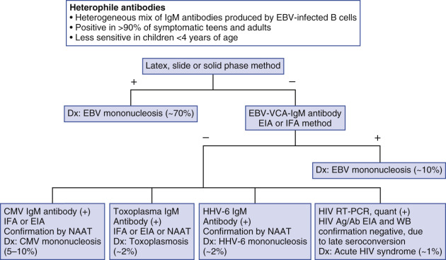

Figure 56-7 

Serologic evaluation of patients with clinical symptoms of acute infectious mononucleosis and atypical lymphocytosis. 

 

##  Chronic Fatigue Syndrome 

Both the medical press and the lay press have discussed at length a clinical entity characterized by persistent disabling fatigue accompanied by fever, pharyngitis, tender lymphadenopathy, arthralgias, and myalgias (  Holmes et al, 1988  ;  Natleson, 2001  ). Although the clinical features of this syndrome suggest an infectious cause, none has yet been clearly identified. Initial reports implied that EBV, as chronically persistent primary or reactivated infection, was responsible because many patients had high titers to EBV VCA and EA. However, serologic tests were neither standardized nor reproducible, and EBV culture and ISH performed on saliva and circulating leukocytes showed no difference between chronic fatigue patients and normal controls. Some studies have suggested a role for CMV, enteroviruses, _T. gondii,_ HHV6 and HHV7, and human T cell leukemia virus, but other reports have failed to verify a causative role (  Reeves et al, 2000  ;  Colby, 2006  ). One current theory implies that chronic fatigue syndrome may be due to a deficiency in the immune response to EBV (  Loebel et al, 2014  ). Immunologic and serologic testing is not helpful for diagnosis or prognosis. Chronic fatigue syndrome remains defined by clinical signs and symptoms, rather than by laboratory test results (  Lloyd, 1998  ;  Gantz & Coldsmith, 2001  ). 

 

##  Congenital and Perinatal Viral Infections 

The pregnant uterus is a sterile secluded environment that shelters the fetus from external microbial injury. Maternal vaginal bacteria that ascend through a flawed cervical barrier cause many infections in pregnancy, but maternal infection also can spread hematogenously to the fetus across the placenta, or can directly involve the baby at the time of vaginal delivery. These perinatal infections are collectively named TORCH infections, for toxoplasma, rubella, cytomegalovirus, HSV, and other organisms such as HIV, parvovirus B19, enteroviruses, EBV, VZV, Hepatitis B virus, Hepatitis C virus, West Nile Virus, measles, adenovirus, and _Treponema pallidum_ . Infection with these agents may be silent or cause only minor symptoms in the mother; however, the immature fetal immune system may not generate an effective cellular or humoral response, so fetal tissue necrosis may be severe or even fatal. Alternatively, infection with hepatitis E virus can be severe with an elevated incidence of acute liver failure and a high mortality rate of 15% to 25% in pregnant women, especially during the third trimester (  Kourtis et al, 2014  ;  Krain et al, 2014  ). 

Diagnosis of perinatal infection centers on two issues: identification of acute maternal infection (particularly primary infection) and verification of involvement of the fetus or newborn. Maternal infection is best established by recovery of the suspected organism, but for many infectious agents this is impractical, and serologic demonstration of specific IgM antibody, although imperfect, is the first-line diagnostic test. Maternal infection crosses the placenta in 30% to 60% of cases. Ultrasound may detect fetal organ damage (e.g., microcalcifications, microcephaly, hydrocephalus, organomegaly, hydrops), but recovery of the organism by culture, demonstration of its antigen or genome in fetal blood or tissues, or detection of specific antibody is required to prove specific fetal infection. Test selection for diagnosis of common congenital and perinatal infection is summarized in [ Table 56-5 ](<#t0030>) . Routine screening of all pregnant women for syphilis, for immunity to rubella, and also for HIV serostatus is the standard of care; however, routine prenatal testing for toxoplasma, HSV, and CMV antibodies is not advised. IgM serologic methods in particular may show interlaboratory and intralaboratory variation, with false-negative and false-positive errors; IgG assays do not differentiate primary from recurrent or latent maternal infection and cannot predict fetal involvement. Testing should be reserved for mothers with suspected infection. 

TABLE 56-5 

Laboratory Testing for Congenital and Perinatal Infections 

Pathogen  |  Maternal Serology  |  Culture, Antigen Assays, Nucleic Acid Amplification  |  Fetal or Newborn Serology   
---|---|---|---  
Cytomegalovirus  |  IgM EIA   
IgG avidity  |  CMV PCR, in utero: amniotic fluid, umbilical cord blood   
CMV PCR, newborn: urine, saliva, blood, tissues (first 2 weeks of life)   
CMV PCR, mother: blood   
Shell vial assay, newborn: urine   
CMV nuclear inclusions: tissues  |  IgM EIA   
Herpes simplex virus  |  IgM EIA for HSV-1 and HSV-2  |  HSV PCR, in utero: amniotic fluid or culture: newborn conjunctiva, oral mucosa, skin, CSF   
HSV nuclear inclusions: newborn tissues, skin lesions  |  IgM EIA or IFA   
Enterovirus  |  |  Enterovirus RT-PCR, newborn: CSF, blood, tissues, throat, stool   
Enterovirus culture, newborn: blood, CSF, tissues, stool, throat   
Request enterovirus typing from Public Health laboratory  |  None   
Parvovirus B19  |  IgM EIA or IFA  |  PB19 PCR: maternal blood   
PB19 PCR, in utero: amniotic fluid   
Ground-glass viral nuclear inclusions: newborn erythroblasts   
PB19 ISH, newborn: erythroblasts   
PB19 PCR: placenta, fetal tissues, blood  |  IgM EIA   
Hepatitis B virus  |  HBsAg, HBc-IgM, anti-HBsAg  |  HBV PCR quantitative viral load: newborn blood  |   
Human immunodeficiency virus  |  HIV-1/-2 EIA antibody/p24 antigen with confirmatory NAAT assay  |  HIV Proviral DNA PCR, newborn   
HIV RNA RT-PCR after 3 months of age   
HIV RNA RT-PCR maternal; plasma  |  Monitor HIV-1/2 EIA antibody/p24 antigen for possible seroconversion (6-18 months)   
Rubella  |  IgM EIA or IFA  |  Rubella RT-PCR: amniotic fluid, placenta, fetal or newborn tissue  |  IgM EIA or IFA   
  
_HBc,_ Hepatitis B core antigen; _HBsAg,_ hepatitis B surface antigen; _CMV,_ cytomegalovirus; _CSF,_ cerebrospinal fluid; _EIA,_ enzyme immunoassay; _gG,_ glycoprotein G; _HDF,_ human diploid fibroblast; _HIV,_ human immunodeficiency virus; _HSV,_ herpes simplex virus; _IFA,_ indirect immunofluorescence assay; _IgG_ and _IgM,_ immunoglobulin G and M; _ISH,_ in situ hybridization; _PB19,_ parvovirus B19; _PCR,_ polymerase chain reaction; _RT-PCR,_ reverse transcriptase PCR. 

 

##  Cytomegalovirus 

CMV, the most common intrauterine infection, affects approximately 1% to 4% of live-born babies (  Townsend et al, 2013  ). About 90% of these infants are asymptomatic at birth; isolation of CMV from urine or saliva or detection of IgM CMV may be the only marker of primary congenital infection. Both primary and nonprimary infections can cause congenital CMV infection, with primary infections carrying a greater risk for transmission and more severe sequelae (  Grangeot-Keros et al, 1997  ). The symptomatic 10% may present with jaundice, hepatosplenomegaly, pancytopenia, and compensatory cutaneous hematopoiesis (  Abdel-Latif & Sugo, 2010  ); approximately 10% of these babies will die, and the remainder will suffer permanent neurologic sequelae. Primary CMV infection in the mother is often viremic, with risk for vertical hematogenous transplacental fetal infection and prenatal tissue injury (  Stagno et al, 1982  ;  Cheeran et al, 2009  ). Reactivation of CMV infection in the mother can cross the placenta, but maternal IgG CMV antibody traverses the placenta and is somewhat protective; these infants are usually asymptomatic at birth, but 5% to 15% have sensorineural hearing loss or neurodevelopmental difficulties (  Istas et al, 1995  ). Maternal reinfection with a new CMV strain has a greater risk for causing symptomatic congenital infection (  Pass, 2013  ). 

IgM-specific assays have shifted from complement fixation, IFA, and anticomplement IFA methods to EIA methods, which use refined recombinant CMV antigens and IgM capture to improve specificity and sensitivity. IgM may persist for longer than 3 months in at least one third of adult women, obscuring the interpretive value of a positive result during pregnancy. CMV IgG avidity testing can be useful in dating recent (low-avidity) versus remote (high-avidity) infection, similar to assessment of toxoplasma serology in pregnancy; identification of both IgM and low-avidity IgG in a pregnant woman correlates with primary CMV infection with a high risk for intrauterine transmission (  Ville & Leruez-Ville, 2014  ). Identification of CMV DNA by PCR in maternal blood in a nonimmunocompromised pregnant woman provides conclusive evidence of active maternal infection. However, risk for fetal involvement is estimated at about 40% following a primary infection. No test performed on the mother can predict fetal infection accurately. 

The most reliable prenatal test to verify fetal infection is PCR detection of CMV in amniotic fluid, which has a combined sensitivity of 75% to 92% (  Revello and Gerna, 2002  ). Virus in amniotic fluid indicates overflow shedding from the _in utero_ infected child, and a positive result has 100% specificity for infection. High CMV viral load in amniotic fluid has also been proposed as an indicator of severity of fetal tissue damage. However, false-negative error can occur if there is less than a 7-week interval between the onset of maternal infection and the collection of amniotic fluid for testing. Detection of CMV-IgM in fetal cord blood is less sensitive (55% to 60%) because of delayed fetal immune response following exposure; cordocentesis CMV DNA PCR has a sensitivity of 84%. IgM CMV in cord blood collected at delivery is also diagnostic, but can be false-negative in up to 30% of cases. Identification of CMV by culture or PCR from newborn urine, saliva, CSF, or blood is very sensitive. PCR detection of CMV DNA in newborn tissue or blood has very high sensitivity—almost 100%; however, use of dried blood samples collected from neonates has variable sensitivity, and its practical applications have not yet been verified. Specimens for any testing must be collected during the first 2 weeks after birth to avoid confusion with postnatally acquired infection (  Nelson et al, 1995  ;  Revello and Gerna, 2002  ) Typical CMV nuclear inclusions in urine cytology preparations are specific but very insensitive; even autopsy material may have few remaining diagnostic cells if tissue necrosis is advanced. Placenta specimens may show nuclear inclusions or may yield recoverable virus by culture; infection that occurred several weeks before delivery may show only nonspecific avascular sclerotic chorionic villi. 

 

##  Rubella 

Rubella (German measles) is highly communicable and produces mild fever and a transient rash in children and adults. All infections are viremic, and transplacental spread during the first trimester produces devastating teratogenic cardiac, ocular, and brain malformations (  Schluter et al, 1998  ). Rubella is no longer endemic in the United States because of widespread vaccination; genome analysis demonstrates that most recent rubella cases are imported from Latin America. Routine prenatal screening for maternal rubella IgG as proof of immunity is standard practice. Only four cases of congenital infection have been identified since 2001, three of which occurred in immigrant mothers (  CDC, 2005a  ). When acute rubella is suspected in a pregnant woman, the most straightforward diagnostic method is assay of maternal serum for rubella IgM by EIA or IFA. RT-PCR for rubella virus RNA performed on amniotic fluid is almost 100% sensitive and specific and can also be performed on placenta and autopsy tissues and is available through referral laboratories (  Revello et al, 1997  ;  Mace et al, 2004  ). The congenitally infected newborn is IgM positive and excretes rubella in urine for months to years. 

 

##  Herpes Simplex Virus 

Despite the high prevalence of HSV in adults, neonatal disease is uncommon, occurring at a rate of 5 to 60 cases per 100,000 live births in the United States. Pregnant women with primary HSV infections suffer from an increased risk for dissemination and HSV hepatitis (  Kourtis et al, 2014  ). Also, acquisition of maternal genital HSV-1 or HSV-2 infection during pregnancy has devastating implications for the newborn. Primary disease rather than recurrence puts the baby at great risk for two reasons: The total number of mucocutaneous genital lesions is often higher with first involvement, and although maternal serum contains IgM, little or no IgG is present for transplacental passive protection of the baby (  Corey & Wald, 2009  ). Most babies have a vertex presentation during labor, so the scalp and the face are the first to encounter HSV in the maternal tract; viral exposure on the chest wall and buttocks occurs in breech delivery. Vesicles develop where skin and mucous membranes are directly inoculated with virus. Because the newborn immune response is still immature, a baby's chief resource for modifying infection is maternal IgG-HSV; when this passive protection is lacking, viral replication and visceral dissemination can proceed unchecked. Conjunctival and oral mucosa and skin lesions are usually rich in virus; if dissemination occurs, any visceral organ can be infected. 

Obstetric management is complicated by several issues. Routine HSV culture of all mothers without vesicles or infants at the time of delivery has a 0.2% yield and is not recommended (  Corey & Wald, 2009  ). Prenatal HSV surveillance cultures of women with known recurrent genital herpes fail to predict which mothers will shed virus at the time of delivery (  Arvin et al, 1986  ). Studies of women who experienced their first recognized episode of genital herpes during pregnancy demonstrated that half had true primary genital herpes, and these pregnancies had a high rate of complications, such as herpetic amnionitis, preterm labor, and severe neonatal infection. Almost half of mothers who acquired their primary infection shortly before labor had severely affected babies (  Brown et al, 1997  ). Mothers with recurrent genital herpes had a much lower rate of neonatal infection, with involvement confined to mucocutaneous sites and showing no visceral dissemination (  Brown et al, 1991  ). 

It is accepted practice that women in labor who have genital lesions suspicious for herpes are managed with cesarean section to prevent possible exposure of the baby. Women with a history of recurrent genital herpes can deliver vaginally if active lesions are not present at labor, but careful clinical monitoring of their newborns (including HSV culture/PCR of conjunctiva, oral mucosa, and any suspicious cutaneous lesions) is warranted. Neonatal herpes infection may be silent for up to several days before disease becomes apparent. Despite antiviral therapy, disseminated infection can be fatal; infants with infection confined to the CNS who survive are always severely retarded. 

Laboratory diagnosis of HSV infection was discussed earlier in this chapter. Type-specific HSV serology is now available and can identify seronegative women with seropositive partners, highlighting their risk for acquiring infection during pregnancy (  Ashley & Wald, 1999  ;  Cherpes et al, 2003  ). Tzanck smears and rapid antigen assays may be positive for vesicle lesions but cannot replace culture (which yields a positive result in 24 hours when shell vials are used). Identification of HSV DNA by PCR in neonatal spinal fluid or mucocutaneous lesions has greater sensitivity than culture and is particularly valuable for detecting virus in CSF in babies with known CNS involvement (  Kimberlin et al, 1996  ;  Kimberlin, 2004  ). 

 

##  Human Immunodeficiency Virus, Parvovirus, Enterovirus, and Hepatitis B Virus 

HIV can spread hematogenously to the fetus, with placental trophoblast and Hofbauer macrophages acting as a cellular reservoir. However, approximately 75% of perinatal infections are acquired at delivery when the baby is exposed to maternal blood. Perinatal risk for HIV acquisition varies from 13% to 45%, depending on maternal HIV-1 viral load, but transmission rates are reduced to less than 2% by administration of antiviral drugs to the mother during pregnancy and labor and to the newborn (  Aberg et al, 2014  ). HIV is also transmissible postpartum in leukocytes in breast milk. 

Diagnosis of maternal HIV infection is straightforward (positive HIV 1/2 antibody/p24 antigen assay followed by HIV-1 NAAT). Routine screening is strongly recommended in the first trimester, and seropositive mothers should be offered antiviral prophylaxis. Maternal IgG crosses the placenta and persists in infant blood for up to 15 months, so standard EIA HIV serologic tests cannot be used to diagnose neonatal infection. If infection occurred in utero, newborn blood is positive for HIV DNA that has been transcribed and integrated into his or her circulating lymphoid cells. HIV-DNA PCR has a diagnostic sensitivity of over 95% at 1 month of age (  Aberg et al, 2014  ). HIV RNA RT-PCR assay is positive at birth if the baby was infected transplacentally, and becomes positive within several weeks when the baby was infected during delivery. HIV RNA RT-PCR is also used for quantitative monitoring to assess the baby's response to antiretroviral therapy. 

Parvovirus B19 (PB19) causes the benign, self-limited childhood exanthem erythema infectiosum (fifth disease) (  Young & Brown, 2004  ). Approximately 50% of young women are seronegative, and infection in pregnancy has a 25% risk for fetal infection; fetal death estimates vary from 2% to 38% (  Brown, 2015  ). PB19 targets erythroid progenitor cells; virolytic cytotoxicity causes fetal anemia, hydrops, and intrauterine demise (  Anand et al, 1987  ;  Tolfvenstam et al, 2001  ). Infected erythroblasts have characteristic ground-glass nuclear inclusions. Parvovirus can only be cultivated in human bone marrow containing erythrocytic precursor cells. Acute infection is diagnosed serologically by detecting specific IgM in maternal or fetal blood, or by ISH or PCR detection of viral DNA in amniotic fluid or cord blood (  Bruu & Nordbo, 1995  ;  Zerbini et al, 1996  ). 

Enterovirus infection is very common, with 10 million or more cases each year in the United States. Many enteroviral infections are viremic; maternal infection just prior to delivery spreads virus across the placenta to the fetus, and the baby is born with disseminated virus but with no passively acquired maternal IgG antibody to modify infection. Nosocomial outbreaks with nursery personnel as the source of virus have also been reported. Echovirus 11 is particularly virulent, causing hepatocellular necrosis and meningoencephalitis that is often fatal. Coxsackie B viruses can produce neonatal myocardial injury (  Bryant et al, 2004  ). Perinatal infection with other enteroviruses usually is benign. RT-PCR and NASBA NAAT that detect a common sequence present in all enteroviruses have excellent sensitivity, superior to standard culture (  Landry et al, 2003  ). Echovirus grows well in shell vial and standard tube cultures (PMK, HDF, and RD cell lines); suitable specimens for viral culture include neonatal blood, CSF, throat, and rectal swab samples, or tissues from fatal cases. 

Maternal infection with hepatitis B virus is often transmitted vertically; the baby may be infected transplacentally or during delivery with exposure to maternal blood. Screening for hepatitis B surface antigen (HbsAg) is standard prenatal care; if the maternal screen is positive, then immediately after birth the newborn is given hepatitis B virus (HBV) immune globulin along with the first dose of the HBV vaccination series (  Poland & Jacobson, 2004  ). 

 

##  Viral Meningitis and Encephalitis 

An estimated 263,300 encephalitis-associated hospitalizations occurred in the United States during 1998 to 2010 or an average of 20,250 encephalitis-associated hospitalizations per year. A fatal outcome occurred in 5.8% of all encephalitis-associated cases. The proportion of encephalitis-associated hospitalizations in which an etiology for encephalitis was specified was approximately 50%. Total charges for encephalitis-associated hospitalizations in 2010 were an estimated $2 billion (  Vora et al, 2014  ). Accurate and prompt laboratory diagnosis aids patient management and is important for public health interventions to control arboviral arthropod vectors and investigate waterborne sources. PCR has been recognized as the reference method for diagnosis of viral CNS infections, which permits both specific and sensitive virus detection. Some neurotropic viruses are fastidious and require molecular methods for accurate diagnosis. Viral proliferation in the meningeal layers covering the brain induces acute inflammation with fever, headache, nuchal rigidity, and CSF pleocytosis. In encephalitis, virus replicates within the brain parenchyma; inflammation and tissue necrosis may be diffuse or may produce a space-occupying lesion with mass effect. Many viruses are associated with meningitis or encephalitis, but overlap injury with involvement of both anatomic sites (meningoencephalitis) is common, particularly with arbovirus infections ( [ Fig. 56-8 ](<#f0045>) ). 

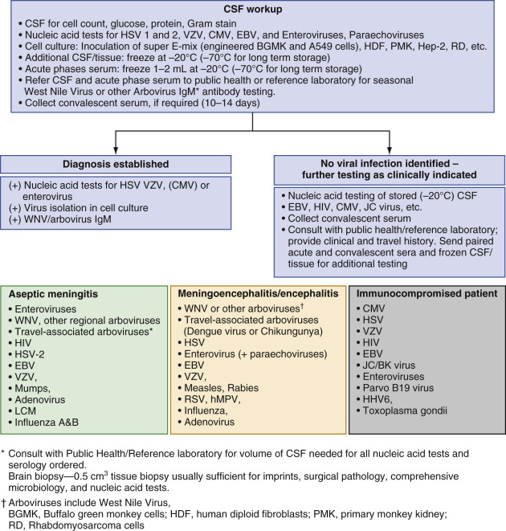

Figure 56-8 

Workup of CSF and brain biopsy for viral pathogens. 

Arboviruses (arthropod borne) and HSV cause most cases of acute encephalitis in the United States. Mosquitoes are vectors for hundreds of neurotropic viruses worldwide, but only five arboviruses are encountered regularly in the United States: WNV, eastern equine encephalitis, western equine encephalitis, St Louis, and California-LaCrosse encephalitis viruses (  Lindsey et al, 2014  ). HSV encephalitis usually occurs as a reactivation of latent HSV-1 that tracks (via the olfactory or trigeminal cranial nerves) into the cerebral cortex, producing a large necrotic mass. Overall, herpes simplex viruses account for approximately 0.5% to 3% of all cases of aseptic meningitis. In patients beyond the neonatal period, it is critical to differentiate between herpes simplex encephalitis (HSV-1), a potentially fatal form of encephalitis, and herpes simplex meningitis (HSV-2), a usually self-limited syndrome by determination of genotype. About 700 cases of herpes encephalitis are reported each year in the United States; the pattern is sporadic and nonseasonal. Progression is rapid and mortality is high, but early diagnosis with appropriate antiviral treatment reduces both mortality and the level of permanent disability (  Steiner et al, 2007  ). Treatment of this disorder involves the use of the antiviral drug acyclovir. Other, antiviral agents may include Vidarabine and Xascarnet. The sooner antiviral treatment is instituted, the better the prognosis of the patient (Tunkel, 2008). Arboviruses are a heterogeneous group, and mosquito transmission is their common denominator; the most frequent in North America are members of the flavivirus, togavirus, and bunyavirus families. Before the WNV outbreak, total annual U.S. arboviral cases varied between 100 and 2000; disease peaked during warm weather when mosquito populations were greatest. Severity and mortality are highest with the Eastern equine virus, the least frequent of the group (  Kuno & Chang, 2005  ). The WNV outbreak originated in 1999 in New York; the virus then traveled in infected birds from the East Coast across America and involved all states by 2004. WNV has since become endemic (  Snapinn et al, 2007  ). The estimated total number of cumulative human WNV infections is currently about 1 million; approximately 200,000 patients have become clinically ill with disease ranging from simple fever to meningitis, encephalitis, and flaccid poliomyelitic paralysis; both long-term encephalitic and paralytic disabilities have been reported, along with many fatalities (  Nash et al, 2001  ;  Petersen & Hayes, 2004  ;  Hayes et al, 2005  ). Mosquito bites are the typical route of acquisition, but blood transfusion and organ transplantation also accounted for several cases (  Iwamoto et al, 2003  ;  Pealer et al, 2003  ;  Kleinman et al, 2005  ). Blood donations are now screened for WNV by NAAT during summer months, effectively interrupting this mechanism of spread (  Busch et al, 2005  ). 

By the time of onset of CNS disease, WNV and many other arboviruses often cannot be detected by culture or PCR in blood or spinal fluid; therefore, diagnosis primarily hinges on EIA for specific IgM antibody in CSF and serum, or demonstration of rising specific IgG. NAAT for WNV plays an important role in screening blood donors but is of limited clinical use and may be helpful only when WNV-infected patients seek medical attention very soon after onset of symptoms (  Reznicek & Bloch, 2010b  ;  Petersen et al, 2013  ). Interpretation of a positive IgM serologic test for WNV must be made with caution because elevated titers may persist for prolonged periods following acute infection, and because cross-reaction with other flaviviruses (yellow fever and dengue) may occur (  Reznicek & Bloch, 2010b  ). State health departments and reference laboratories offer a range of tests for common regional arboviruses, but hundreds of arboviruses are endemic outside the United States in Asia, Africa, Latin America, and parts of Eastern Europe. Testing for arbovirus infection in travelers is available through public health laboratories; the referring laboratory must provide a detailed travel history and clinical information, along with blood, CSF, or tissue specimens submitted for culture, nucleic acid detection, or serologic diagnosis (see [ Fig. 56-8 ](<#f0045>) ). For example, Japanese encephalitis (JE) virus is encountered in other world sites, depending on the range of its vector and should be considered if the patient has visited a JE-endemic country. Current information about global arbovirus activity and risk to tourists is available at [ www.cdc.gov/travel ](<http://www.cdc.gov/travel>) . 

Estimates from the Centers for Disease Control and Prevention (CDC) indicate that 30,000 to 75,000 cases of enteroviral meningitis occur annually in the United States, accounting for more than 85% of all cases of viral meningitis. There are four species of enteroviruses: Human Enterovirus A, B, C and D, with over 100 serotypes ( [ http://www.picornaviridae.com/enterovirus/enterovirus.htm ](<http://www.picornaviridae.com/enterovirus/enterovirus.htm>) ). Enteroviral encephalitis is an uncommon manifestation of enteroviral infection; echovirus 9 is the most common etiologic agent followed by echovirus 6, coxsackie A9, coxsackie B2, and coxsackie B5 (  Romero, 2008  ). 

Paralytic polio caused by poliovirus necrosis of spinal cord or brainstem motor neurons has been eliminated in most of the world, with sporadic residual disease in Africa and Asia, which may soon be eradicated by vaccination efforts. Rabies virus travels via nerve fibers directly to the CNS and produces necrotizing brain damage; bat strains account for most disease in the United States; a recent outbreak was traced to transplanted organs from a donor who had died with undiagnosed rabies (  Smith, 2003  ;  CDC, 2005b  ). Measles, mumps, EBV mononucleosis, and chickenpox rarely are complicated by acute encephalitis (  Cherry & Shields, 1998  ). HHV-6 can produce focal cerebral injury (  Isaacson et al, 2005  ). High levels of HHV-6 DNA in plasma are associated with a higher risk for encephalitis after allogeneic hematopoietic cell transplantation (  Ogata et al, 2013  ). HIV replication in CNS glial cells can cause progressive dementia in advanced AIDS (  Atwood & Berger, 1993  ). Opportunistic necrotizing brain infection with HSV, CMV, and VZV, as well as JC polyomavirus destruction of oligodendroglia, may also develop in the immunocompromised host. 

In the United States, the 14 most commonly occurring enteroviral serotypes account for more than 80% of isolates (  Romero, 2002  ) and cause usually a relatively benign and transient disease. Enteroviruses spread easily from person to person via fecal-oral means, and distinct seasonality is seen, with annual summer-fall outbreaks (see [ Fig. 56-1 ](<#f0010>) ); most clinically recognized infections are seen in children and young adults. Human parechoviruses (HPeVs) cause a variety of symptoms ranging from mild diarrhea to sepsis and meningitis, particularly among young children (  Fischer et al, 2014  ). HPeV1 and HPeV2, originally known as _echovirus 22_ and _23_ were reclassified in 1999 as a separate genus _(Parechovirus)._ There are now 16 genotypes ( [ http://www.picornaviridae.com/parechovirus/parechovirus_a/parechovirus_a.htm ](<http://www.picornaviridae.com/parechovirus/parechovirus_a/parechovirus_a.htm>) ). HPeV3 is commonly associated with meningitis/sepsis symptoms in young children (  Fischer et al, 2014  ). 

Chronic severe enteroviral or paraechoviral meningoencephalitis can develop in patients with hypogammaglobulinemia and may leave permanent sequelae. Acute HIV infection occasionally produces acute meningeal inflammation (  Schupbach, 2003  ). About 1% of primary HSV-2 genital herpes infections are accompanied by transient meningitis; HSV-2 is the major cause of Mollaret's benign recurrent lymphocytic meningitis. Mumps, measles, metapneumovirus, and adenovirus infections rarely produce acute meningitis (  Reznicek & Bloch, 2010b  ). 

 

##  Laboratory Diagnosis 

Initial evaluation of CSF should include cell count and glucose and total protein quantitation. Pleocytosis is usually mild (50 to 1000 cells/mm  3  ) compared with bacterial infection. Mononuclear cells usually predominate, but neutrophils can dominate early, particularly following infection with WNV. Protein may be somewhat elevated (rarely >200 mg/dL), and glucose levels are normal to slightly decreased (  Reznicek & Bloch, 2010a;  2010b  ). Syndromic meningitides/encephalitis panels, which identify viral, bacterial, and fungal pathogens, are now available allowing for rapid and comprehensive laboratory evaluation of viral CNS disease. Alternatively, a streamlined plan for stepwise testing based on the clinical scenario can coordinate in-house testing with efficient use of reference laboratory and public health laboratory services if the molecular syndromic option is not available (see [ Fig. 56-7 ](<#f0040>) ). For immunocompetent patients, initial testing of spinal fluid/brain biopsy tissue using NAAT for enteroviruses HSV, VZV, and possibly CMV plus virus culture can be paired with serum and CSF assays for IgM antibodies to the prevalent regional seasonal arboviruses (  Reznicek, 2010a  ). [ Table 56-6 ](<#t0035>) illustrates yields of molecular detection for enterovirus, parechovirus, HSV, VZV, EBV, and CMV using an in-house syndromic panel in a large metropolitan area laboratory. VZV may be overlooked as a cause of meningoencephalitis, particularly if skin lesions are not appreciated (  Frazen-Röhl et al, 2007  ). If clinically indicated, CSF reserved at –20° C or lower and paired acute and convalescent sera can be referred for more extensive arbovirus testing in public health laboratories, and for culture and additional NAAT for less common causes of viral meningitis or encephalitis. The 1999 WNV outbreak was quickly identified because of cooperative and coordinated efforts between hospital and government laboratories. Despite extensive evaluation, an infectious cause for encephalitis often is not identified (  Granerod et al, 2010  ). 

TABLE 56-6 

Yield from CSF Specimens Tested for Enteroviruses, VZV, HSV, and CMV by Nucleic Acid Assays 

Virus  |  2009  |  2013 [ * ](<#hl0000720>) |  2014 [ * ](<#hl0000720>)  
---|---|---|---  
Enteroviruses  |  11.3% (36/318)  |  4.2% (27/646)  |  5.1% (30/584   
Parechoviruses  |  Not tested  |  Not tested  |  0.9% (5/584)   
Herpes simplex virus (HSV-1 and HSV-2)  |  4.1% (56/1360)  |  7.0% (51/726)  |  4.6% (27/584)   
Varicella zoster virus (VZV)  |  10.6% (13/123)  |  1.4% (15/726)  |  2.6% (15/584)   
Cytomegalovirus (CMV)  |  2.1% (3/144)  |  1.5% (11/726)  |  1.0% (6/584)   
Epstein-Barr virus (EBV)  |  Not tested  |  4.2 (4/96)  |  3.9 (2/51)   
  
 * All year-round testing data (Personal data, L. Mazur, Multiple hospitals, Chicago area and southeast Wisconsin.) 

Immunocompromised patients may develop CNS disease with the same viruses that afflict the healthy host; in addition, several opportunistic viral infections may produce CNS involvement. JC polyomavirus, CMV, VZV, and HSV can cause CNS disease; CNS B lymphocyte lymphoma is almost always related to EBV infection; PCR for EBV in CSF in patients with AIDS is diagnostic of CNS lymphoma. 

The most practical and productive approach to diagnosis of viral encephalitis is multiplex NAAT performed on CSF. Reverse transcriptase–PCR testing is designed to detect viral RNA of most enteroviruses and parechoviruses. The results usually are available in 24 hours, making detection more sensitive (95%), more specific (97%), and more time-efficient. PCR is designated for detection of DNA in HSV, VZV, EBV, CMV, and HHV6 and is more sensitive than virus recovery by cell culture from CSF or brain tissue. Several multiplexed and microarray-based assays have been developed and are commercially available (  Wolffs et al, 2009  ;  Lévêque et al, 2014  ). 

Preliminary screening of CSF for elevated protein and pleocytosis is advisable because herpes viruses are rarely, if ever, identified when protein and cell counts are normal (  Simko et al, 2002  ). Brain biopsy is still performed on occasion, usually when tumor or nonviral infection is a clinical consideration. A 0.5-cm  3  biopsy is sufficient for surgical pathology examination, imprint smears for direct examination, NAAT, and comprehensive culture for all infectious organisms. Imprints stained with DFA reagents can demonstrate HSV-infected cells. Some arboviruses and enteroviruses require animal inoculation for replication; if needed, tissue should be frozen at –20° C or lower and the specimen forwarded to a public health or reference laboratory. 

Several tissue lines (PMK, HDF, HEp-2, RD, buffalo green monkey Super E-Mix [genetically engineered cell line BGMK-hDAF]) support the growth of many enteroviruses and of HSV, VZV, measles, mumps, and adenovirus; E-mix hybrid shell vial culture is also an excellent choice for culture of enteroviruses (  Huang et al, 2002  ). From 0.1 to 0.2 mL of CSF should be inoculated directly into each tube or shell vial without delay. 

 

##  Viral Exanthems and Common Cutaneous Infections 

Several viruses primarily target the skin. Some infect the squamous epidermis through direct inoculation (oral and genital herpes, warts caused by human papillomavirus or molluscum poxvirus). Exanthems are also caused by viruses that spread hematogenously to skin and mucous membranes (VZV, measles, rubella, enteroviruses, parvovirus, HHV6). Many of these benign childhood exanthems are diagnosed clinically with no laboratory testing needed, and several are now preventable through pediatric vaccinations. When laboratory confirmation of acute infection is required for unusual cases, to apply infection-control precautions for hospitalized patients, or to guide appropriate antiviral treatment, serology is often easier and more accurate than culture, or antigen or nucleic acid assays. With the exception of varicella, specific nucleic acid assays generally are not needed for diagnosis. Laboratory diagnostic procedures are summarized in [ Table 56-7 ](<#t0040>) . 

TABLE 56-7 

Laboratory Diagnosis of Common Viral Exanthems and Mucocutaneous Lesions [ * ](<#hl0000814>)

Exanthem or Skin Lesion  |  Virus  |  Culture/Antigen and Nucleic Acid Assays  |  Serology   
---|---|---|---  
Chickenpox/shingles  |  Varicella zoster  |  NAAT (most sensitive)   
Tzanck or DFA smear   
Culture (shell vial most sensitive)  |  IgM-EIA (chickenpox)   
IgG-EIA for immunity following chickenpox   
Commercial VZV-IgG tests may not be reliable for documenting immunity post-vaccination   
Enteroviral rash (hand, foot, and mouth disease)  |  Enteroviruses  |  NAAT (most sensitive)   
Culture  |  None   
Measles  |  Measles  |  Culture and NAAT [ † ](<#hl0000817>) |  IgM-EIA or IFA [ † ](<#hl0000817>)  
Rubella  |  Rubella  |  Culture and NAAT [ † ](<#hl0000817>) |  IgM-EIA [ † ](<#hl0000817>)  
Erythema infectiosum  |  Parvovirus B19  |  NAAT  |  IgM-EIA or IFA [ † ](<#hl0000817>)  
Exanthem subitum  |  HHV6  |  NAAT [ * ](<#hl0000814>) |  IgM-EIA [ † ](<#hl0000817>)  
Anogenital condyloma  |  Papillomaviruses  |  NAAT targeting high-risk genotypes (most sensitive), Hybrid capture, Evaluation of ASCUS cervical cytology  |   
HSV  |  HSV-1 and HSV-2  |  NAAT (most sensitive may offer typing)   
Culture typing available   
DFA smear or Tzanck smear  |  HSVgG-1 and HSVgG-2 glycoprotein-specific antibody;   
IgM, not specific   
  
_ASCUS,_ Atypical squamous cells of undetermined significance; _DFA,_ direct fluorescent antibody; _EIA,_ enzyme immunoassay; _gG,_ glycoprotein G; _HSV,_ herpes simplex virus; _HHV,_ human herpes virus; _IFA,_ indirect fluorescent antibody; _IgM,_ immunoglobulin M; _NAAT,_ nucleic acid amplification test; _RT-PCR,_ reverse transcriptase polymerase chain reaction; _VZV,_ varicella-zoster virus. 

 * If smallpox is considered in a patient with vesicular lesions, contact local health authorities for specific instructions. 

 † Test available at reference and research laboratories. 

VZV causes both varicella (chickenpox) and zoster (shingles). In chickenpox, VZV is spread through infected respiratory aerosol droplets, multiplies in the nasopharynx, and then enters the bloodstream and travels to the skin (  Arvin, 1996  ). Replication in the squamous epithelium produces pruritic vesicles that rapidly progress to ulcers, which eventually crust over and heal without scarring—similar to HSV skin lesions. In healthy children, systemic symptoms are mild and sequelae are uncommon; however, serious bacterial superinfection, cerebellar ataxia, and encephalitis can occur. Along with the clinical resolution of chickenpox skin lesions, varicella virions travel via nerve fibers to regional sensory neural ganglions, where latent infection is established and maintained by memory CD4  \+  and CD8  \+  T lymphocytes (  Arvin, 2005  ). When cell-mediated immunity is impaired by aging, immunosuppressive drugs, or HIV infection, active VZV replication begins again in neurons and spreads from trigeminal or dorsal root ganglia back down nerve fibers to the skin, producing painful cutaneous vesicles with a classic dermatome distribution. Postherpetic persistent neuralgia is a frequent debilitating complication of zoster eruptions. CNS or disseminated visceral involvement from reactivated VZV develops only in the immunodeficient patient, but may be fatal. Varicella vaccine given in childhood produces high titers of specific IgG; because of waning humoral immunity and breakthrough mild atypical varicella cases (  Vazquez & Shapiro, 2005  ), a second dose is needed to guarantee continued protection. Varicella vaccine formulation administered to patients at 60 years of age markedly reduces the burden of zoster and its complications in this age group (  Oxman et al, 2005  ). Any vesicular rash in children or adults that raises the possibility of smallpox should be immediately reported to local public health officials. 

Vesicle fluid is rich with virus and is the ideal specimen for culture or for DFA staining. VZV replicates in HDF cell lines. Traditional tube culture is slow and insensitive and is not recommended; shell vial culture has better yield (up to 75%) and allows more rapid detection (  Brinker & Doern, 1993  ). Collection of skin vesicle specimens is identical to that used for HSV vesicles (see [ Fig. 56-3 ](<#f0020>) ). Culture setup is also similar to herpes culture; however, tubes are held for 2 weeks, and shell vial monolayers are stained at 3 and 5 days with VZV DFA reagent. VZV CPE develops in HDF as small patches of rounded, swollen, refractile cells. Because the behavior of VZV in tissue culture may be somewhat fastidious, DFA staining of vesicle cells for viral antigen is a rapid and practical diagnostic test and can differentiate VZV from HSV (  Schrim et al, 1989  ). NAAT has also been developed; it is more sensitive than culture and serves as the only practical approach for diagnosis when skin lesions have progressed to ulcers (  Leung et al, 2010  ). IgM antibody is usually detectable by the time chickenpox vesicles first erupt and is a useful confirmatory test; serology is not helpful for evaluation of zoster lesions. 

Of the greater than 71 enterovirus serotypes, several produce vesicular or maculopapular eruptions (coxsackie B1 and A9, and echoviruses 2, 4, 9, 11, 19, and 33), usually during summer months. Hand-foot-mouth disease (coxsackie A16) in young children presents with vesicles on the tongue and palmar and plantar skin (  Goksugur, 2010  ). Adult family members of infected children occasionally also develop symptomatic disease. Laboratory diagnosis is limited to enterovirus recovery from skin lesion specimens by cell culture and RT-PCR NAAT; vesicles from the soles and palms should be completely unroofed and the exposed squamous cells vigorously swabbed. Cell culture identification of enterovirus was described earlier. DFA stains and serology are impractical and have low sensitivity and specificity for diagnosis of enteroviral exanthems. 

Measles is highly contagious and presents with both mucocutaneous and respiratory features (fever, conjunctivitis, coryza, oral ulcerating lesions, cough, and generalized maculopapular erythematous rash). Vaccination has dramatically curtailed measles, and at present, 90% of confirmed cases in the United States are imported and then are disseminated in under vaccinated groups (  CDC, 2013  ). Recently, the United States is experiencing a record number of measles cases. From January 1 to October 31, 2014, there have been 603 confirmed measles cases reported (  MMWR, 2014  ). 

Despite international eradication efforts, measles still persists in impoverished countries; morbidity and mortality are high because of accompanying pneumonia and impaired nutrition. Measles virus in the nasopharynx can be identified by culture or NAAT, but acute infection is most easily diagnosed serologically by detecting measles-specific IgM antibody. Immunity following natural infection presumably is lifelong, verified by the presence of specific IgG; however, immunity following vaccination may fade during the late teen years, with a second dose needed for sustained coverage. Breakthrough infection occurring in the setting of waning antibody may be atypical and difficult to diagnose. 

Parvovirus B19 (PB19) causes erythema infectiosum (fifth disease), a common childhood febrile illness with a distinctive maculopapular rash that gives the face a “slapped cheek” appearance (  Young & Brown, 2004  ). PB19 infection in adults often produces arthralgias. Parvovirus infects erythroblastic precursor cells in the bone marrow and may provoke aplastic crisis in patients with hemoglobinopathy or HIV infection. Primary infection during pregnancy can cause fetal red cell aplasia with hydrops fetalis. Serology (IgM and IgG) is available to diagnose current infection or immunity to B19 infection. NAAT can be used to prove acute infection. 

Rubella virus produces German measles, a mild febrile illness with a transient maculopapular rash, and is the third infectious exanthem of childhood (  Gershon, 2010  ). Infection in children is inconsequential, although adult-onset rubella may be associated with arthralgias. The only serious complication of rubella is transplacental spread to the first-trimester developing baby, with a risk for virus-induced tissue necrosis and congenital malformation. Widespread use of rubella vaccine has largely eliminated disease in developed countries. Laboratory confirmation of acute infection is most easily accomplished by detection of virus-specific IgM, rather than by attempting virus isolation. Verification of immune status is established with specific IgG antibody testing. NAAT can give added proof of acute infection. 

HHV6, a lymphotrophic herpesvirus that infects lymphocytes, is the cause of exanthem subitum (roseola infantum, the sixth clinically distinctive exanthem). Roseola is a common early childhood illness characterized by high fever and development of a fleeting maculopapular rash as fever abruptly subsides (  Prober, 2005  ;  Zerr et al, 2005  ). Primary HHV6 infection in older children and adults produces a systemic, febrile lymphoproliferative illness resembling acute mononucleosis; it may cause pneumonitis in immunosuppressed patients (  Cone et al, 1993  ). The distinctive clinical presentation of roseola rarely makes laboratory confirmation necessary. 

Human papillomaviruses are ubiquitous and are found in all societies; hundreds of HPV serotypes have been defined by unique DNA sequences, and various HPV types target different skin or mucosal sites in the body. Most HPV warty cutaneous infections of the hands and feet are transient and of no medical consequence. HPV is the most common of all sexually transmitted infections. Sexual encounters easily transmit HPV types that are associated with anogenital disease; quadrivalent vaccine is now in use for immunization of children against HPV types 11, 6, 16, and 18. Low-risk non-oncogenic HPV types (6, 11, and others) can cause low-grade squamous intraepithelial proliferative lesions that usually resolve with no medical intervention. Infection with high-risk oncogenic HPV types (16, 18, and others) carries a much greater likelihood of persistent viral infection in the squamous epithelium of the cervix, vagina, vulva, or perineum; these oncogenic HPV viral infections can produce high-grade dysplastic intraepithelial lesions that over time may progress to invasive squamous carcinoma. Widespread use of the quadravalent vaccine has significantly reduced the occurrence of genital warts among vaccinated individuals, and it is hoped that a similar effect will be seen for precancerous lesions (  Blomberg et al, 2013  ). Three vaccine doses, given over a period of 6 months, are required to generate an optimal immune response before becoming sexually active, so HPV vaccination is recommended for preteen girls and boys at 11 or 12 years of age. The histopathologic and cytopathologic characteristics of HPV lesions are well described in standard pathology texts. However, HPV detection has been enhanced by the use of NAAT. The hybrid capture signal amplification method, which can identify several high-risk HPV and low-risk HPV types in endocervical swab and liquid-based cervical cytology specimens, was the first commercial assay (  Burd, 2003  ). Nucleic acid amplification–based methods for HPV identification have also been developed (  Soderlund-Strand et al, 2005  ;  Carozzi et al, 2007  ). Novel linear array and line probe and HPV typing methods have been described (  Castle et al, 2008  ). HPV can infect oropharyngeal and respiratory tract mucosa and is associated with carcinoma and papillomatosis (  Glikman & Barody, 2005  ;  D'Souza et al, 2007  ). Performance of HPV molecular assays for nongenital sites has not been widely established. 

Although HPV genital infections with both low- and high-risk genotypes are common in sexually active populations, persistent high-risk HPV infections that progress to high-grade intraepithelial lesions and onto invasive carcinoma are not, and the timeline for progression to carcinoma spans many years. Since persistent infection of the cervix by high-risk HPV genotypes (principally HPV-16 and HPV-18) is a requirement for the development of cervical cancer, screening for these and other high-risk genotypes is now recommended for primary screening. Recommendations for prudent use of HPV testing in connection with routine cervical cytology with the goal of preventing cervical carcinoma have been issued by a multidisciplinary panel of cytopathologists and gynecologists; these utilization guidelines outline clinical scenarios in which HPV and HPV genotype testing should and should not be ordered (  Huh et al, 2015  ). 

 

##  Viral Gastroenteritis 

Infectious gastroenteritis, caused by a variety of bacteria, viruses, and parasites, is responsible for an estimated 179 million cases per year in the United States, causing 500,000 hospitalizations and over 5000 deaths (  Halligan et al, 2013  ). The viruses responsible constitute a diverse group and all are ubiquitous. Severe debilitating diarrhea with rotavirus, enteric adenovirus, saphovirus, norovirus, astrovirus, and coronavirus is largely confined to infants and young children. All treatment is supportive (  Thielman & Guerrant, 2004  ). 

Prior to the availability of an effective rotavirus vaccine, rotaviruses caused most cases of watery diarrhea in infants and young children in the United States (  Musher & Musher, 2004  ). Transmission is fecal-oral; epidemics occur during cold weather in temperate climates and year-round in tropical regions. Rotavirus is highly infectious, with infection rates as high as 50% for children and up to 30% for adults following family exposure; some children and most adults will be asymptomatic (  Musher & Musher, 2004  ). Dehydration with electrolyte imbalance is the most serious complication. Enteric isolation precautions must be followed to prevent nosocomial or day care spread. Safe and effective monovalent and multivalent vaccines are currently available and have greatly reduced yearly winter outbreaks due to rotavirus in pediatric populations with this important gastrointestinal pathogen (  Cortes et al, 2011  ;  Payne et al, 2014  ). In addition, vaccination of the pediatric population has indirectly shown a protective effect on the adult population; suggesting that pediatric rotavirus vaccination protects adults from rotavirus infection (  Anderson et al, 2013  ). 

Adenovirus, subgenus F (serotypes 40 and 41), is associated with gastroenteritis and accounts for 10% to 20% of pediatric cases. Adenovirus enteritis is clinically similar to rotavirus disease but has no seasonality, and diarrhea can be more protracted (  Dey et al, 2011  ). Coronavirus and astrovirus have caused nosocomial and day care center outbreaks (  Papaventsis et al, 2008  ;  Principi et al, 2010  ), mild gastroenteritis in adults, and diarrhea in HIV and immunosuppressed patients (  Grohmann et al, 1993  ). 

Noroviruses (NoVs), a member of the _Caliciviridae_ family, cause epidemic acute gastroenteritis, characterized by acute-onset nausea and vomiting that may be more intense than the accompanying diarrhea (  Hall et al, 2011  ). NoVs are nonenveloped and can survive for days on inanimate surfaces, as well as in contaminated water, shellfish, and prepared foods; they have been identified in many community and national epidemics and cruise ship and day care outbreaks. They have been notoriously difficult to eradicate from the environment. NoVs have proved to be genetically diverse, with three out of six genogroups (GI, GII, and GIV) infecting humans. These genogroups are further divided into at least 32 genotypes (  White, 2014  ). Currently, the most common norovirus genotype detected is GII.4 Sydney, first described in March of 2012. 

NoV infection is common in all age groups and is seen in a wide variety of settings, including but not restricted to person-to-person transmission in closed settings such as nursing homes, hospital wards, day care centers, cruise ships, restaurants, and catered events. NoVs account for 12% of severe gastroenteritis cases among children younger than 5 years of age and at least 12% of mild and moderate diarrhea cases among persons of all ages, making NoV the most common cause of diarrhea in adults and the second most common cause in children (  Glass et al, 2009  ;  White, 2014  ). The morbidity and mortality rates are highest in young children, older adults, and immunocompromised patients (  White, 2014  ). Chronic norovirus infections lasting from weeks to years have been reported in immunocompromised patients, making clinical management challenging (  Green, 2014  ). 

High infection rates with NoV are due to its low infectious dose and its stability in food and on environmental services. Norovirus antigenic diversity is thought to be driven by the immune system, resulting in selection of emerging pandemic NoVs and causing replacement of dominant circulating viruses every 3 to 5 years, with new variants reinfecting hosts previously exposed to earlier viruses (  White, 2014  ). 

The great and changing antigenic diversity of norovirus strains results in incomplete immunity, and multiple infections are common (  Glass et al, 2009  ). 

 

##  Laboratory Diagnosis 

Gastroenteritis viruses grow poorly or not at all in standard cell lines. Historically, diagnosis had been based on the distinctive morphology of each virus when stool samples are negatively stained with phosphotungstic acid and examined by EM, but this service is time-intensive to perform and requires special expertise, so it is not available in most laboratories (  Goldsmith & Miller, 2009  ). Rapid detection of rotavirus antigen in stool is easily and accurately accomplished with commercially available latex agglutination and immunoassays. All methods have excellent specificity and low sensitvity (  Thomas et al, 1994  ;  Dennehy et al, 1999  ). Rapid diagnosis is useful for patient cohorting and infection-control measures to contain nosocomial spread. An accurate and sensitive commercial EIA for enteric adenovirus antigen detection is available. 

Syndromic gastrointestinal diarrheal nucleic acid amplification panels for comprehensive detection of viral, bacterial, and parasitic infections are now commercially available. These new panels allow for the sensitive, specific, and clinically significant rapid detection of multiple pathogens and quick identification of those patients who have diarrhea of noninfectious etiology, thus limiting isolation protocols to those patients who require them (  Halligan et al, 2013  ). 

 

##  Viral Hepatitis 

Many viruses are hepatotoxic. Yellow fever virus (  Markoff, 2013  ) causes massive hepatocellular necrosis. All of the human herpesviruses can produce mild liver disease with systemic infection, but fulminant hepatic necrosis is unusual. Serious herpesvirus infections of the hepatic allograft can occur after liver transplant. Adenovirus, HSV, VZV, CMV, and echoviruses occasionally produce aggressive hepatitis in immunocompromised patients (  Gitnick, 1994  ). However, hepatitis A, B, C, D, and E virus infections characteristically lead to lytic hepatocyte injury and account for most clinical cases of infectious hepatitis (  Dienstag and Delemos, 2015  ). 

 

##  Hepatitis A Virus (HAV) 

HAV and hepatitis E virus (HEV) are nonenveloped agents with fecal-oral transmission; inadequate sewage treatment and crowded living conditions are linked to waterborne outbreaks, and HAV has been spread in contaminated foods. Acute hepatitis A incidence in the United States declined by 53% between 2008 and 2012 (to 0.5 case per 100,000) among persons in all age groups (  Klevens et al, 2014  ). Due to universal infant vaccination since 2006, rates and evidence of vaccine-induced immunity in young patients have been increasing continuously in the past decade (  Klevens et al, 2011  ;  CDC 2013  ). Half of all hepatitis A infections now apparently are acquired outside the United States by adult travelers (  Klevens et al, 2010  ). The remaining cases are almost exclusively associated with consumption of fresh produce contaminated with HAV during cultivation, harvesting, processing, or distribution. Acute disease in children is mild and often asymptomatic; adults occasionally develop severe infection, but fulminant hepatitis and death are unusual; IgM antibody is the most practical marker of acute infection ( [ http://www.cdc.gov/hepatitis/Statistics/2012Surveillance ](<http://www.cdc.gov/hepatitis/Statistics/2012Surveillance>) ). Presence of HAV-IgG antibody is evidence for immunity. Recovery is complete with no chronic infectious state. Helpful laboratory tests include assessment of liver disease, serologic markers of HAV replication, HAV antibody (IgM) diagnostic testing for acute hepatitis A, and HAV (IgG) screen for immunity. Viral culture is not routinely available because HAV grows very poorly in cell culture. There are no NAAT HAV-RNA tests commercially available. 

 

##  Hepatitis E Virus (HEV) 

HEV, the causative agent of hepatitis E, was first reported in 1980 and belongs to the family _Hepeviridae_ . At least four major genotypes of HEV have been recognized: genotypes 1 and 2 are restricted to humans and associated with epidemics in developing countries, whereas genotypes 3 and 4 are zoonotic and infect humans and several other animals in both developing and industrialized countries. (  Meng, 2010  ;  Bihl & Negro, 2010  ). Human infections with HEV are not “new,” and are of considerable global importance, including in developed countries. (  Dalton et al, 2013  ). Hepatitis E is believed to be uncommon in the United States. However, some studies have found a high prevalence of antibodies to HEV in the general population (  CDC, 2014  ). HEV infection in industrialized countries has been detected in patients with no history of travel to HEV-endemic areas. Viral isolates from these cases were almost identical to strains detected in swine, deer, and wild boars, suggesting zoonotic sources of infection (  Wenzel et al, 2011  ;  Dalton et al, 2013  ). Most people with hepatitis E recover completely. The overall case-fatality rate is about 1%. However, hepatitis E can cause serious illness in pregnant women with mortality reaching 10% to 30% in their third trimester of pregnancy (  Hoofnagle et al., 2012  ;  CDC 2013  ). HEV can cause chronic disease among immunosuppressed persons (  Kamar et al, 2012  ;  CDC, 2013  ). Diagnosis of HEV acute cases is based on detection of anti-HEV IgM and/or HEV RNA in sera. Sensitivity of currently available commercial assays for IgM is usually within 91% to 97% (  Candido et al, 2012  ;  Wenzel et al, 2013  ). No serologic tests to diagnose HEV infection have been approved by the FDA for use in the United States. Several tests are available for research purposes, and some commercial laboratories use commercially available assays in other countries. Additional tests including reverse transcriptase polymerase chain reaction (RT-PCR) to detect the hepatitis E virus RNA in blood and/or stool are available in Europe and Asia (  WHO, 2014  ). 

 

##  Hepatitis B Virus (HBV) 

HBV is easily transmitted through blood and is classically acquired through transfusions, needle sharing, or occupational injury with contaminated sharp objects. Infection may be vertical, with HBV acquired transplacentally during pregnancy. Sexual contact and household exposure to HBV in body fluids are important routes of spread. Acute infection is frequently symptomatic, with much of the liver damage inflicted by CD8  \+  cytotoxic T lymphocytes; 1% develop fulminant fatal massive hepatocellular necrosis. Serologic diagnosis of acute infection is based on the presence of IgM antibody to hepatitis B core antigen (anti-HBc) and the presence of hepatitis B surface antigen (HBsAg) ( [ http://www.cdc.gov/hepatitis/HBV/PDFs/SerologicChartv8.pdf ](<http://www.cdc.gov/hepatitis/HBV/PDFs/SerologicChartv8.pdf>) ). Up to 90% of infants born with HBV vertically acquired in utero become chronic carriers, compared with 25% to 30% of infected older children and less than 5% of adults. Diagnosis of chronic HBV infection is based on the absence of anti-HBc IgM and the presence of HBsAg, hepatitis E antigen, (HBeAg), or HBV DNA ( [ http://www.cdc.gov/hepatitis/HBV/PDFs/SerologicChartv8.pdf ](<http://www.cdc.gov/hepatitis/HBV/PDFs/SerologicChartv8.pdf>) ). HBV-induced cirrhosis is a risk factor for hepatocellular carcinoma (HCC). 

HBV infection and sequelae are largely preventable; with the implementation of vaccination programs, the incidence of new infections in the United States has decreased significantly. Acute hepatitis B incidence in the United States decreased by 28% overall during 2008 to 2012, to 0.9 cases per 100,000. Vaccination may also decrease the incidence of hepatocellular carcinoma. In addition, vaccination of Taiwanese newborns and mothers infected with hepatitis B virus resulted in a reduction in the average annual incidence of HCC from 0.70 per 100,000 children between 1981 and 1986 to 0.36 from 1990 to 1994 (  Chang et al, 2005  ). 

Laboratory tests include assessment of liver disease, serologic markers of HBV replication, and tests for coinfection with HCV, HDV, or HIV for those at risk. The presence of HBsAg and HBeAG in addition to HBV DNA viral load quantitation are crucial components in the evaluation of patients with chronic HBV infection and in assessment of efficacy of antiviral treatment (  Tuaillon et al, 2012  ). Determination of the HBV genotype may be used to assess treatment efficacy and possible emergence of drug resistance (  Zoulim & Locarnini, 2012  ;  Rodriguez et al, 2013  ). 

HBV coinfection/superinfection with hepatitis D virus (HDV) is associated with a more severe course of hepatitis that frequently leads to rapid progressive fibrosis, hepatic decompensation, and the development of hepatocellular carcinoma. HDV is a defective RNA viroid that requires HBV surface antigen for full expression, replication, and transmission. HDV is a blood-associated virus that may be transmitted from person to person in household situations in endemic areas (Middle East, South America, Central Africa, Mediterranean countries). HDV is rare in the United States; needle sharing among intravenous drug abusers is the principal risk factor. Anti-HDV IgG and IgM testing is available when HDV coinfection is suspected in HBsAg-positive individuals (  Brichler et al, 2014  ). 

 

##  Hepatitis C Virus (HCV) 

HCV is transmitted primarily through direct contact with the blood of an infected person and is the leading cause of non-A non-B hepatitis infecting an estimated 2.7 to 3.9 million persons in the United States (  Denniston et al, 2014  ). Thankfully, serologic testing of blood products has resulted in a dramatic drop of transfusion-associated HCV (  Stramer et al, 2004  ). Transmission of HCV during pregnancy or through sexual and household contact is much less efficient than transmission of HBV and HIV. Fulminant and fatal acute HCV hepatitis are rare; however, HCV clearance by cytotoxic T lymphocytes is inadequate in most patients. About 80% of infections become chronic, leading to hepatic fibrosis and hepatocellular regeneration that may progress further to cirrhosis (20%) and hepatocellular carcinoma (1% to 4% per year in cirrhotic patients). Superinfections with HIV, as well as alcohol use, accelerate the natural course and can trigger fulminant hepatitis (  CDC, 2014  ). HCV infection differs from other chronic viral infections, notably HIV or HBV infection, in that it can be cured by treatment. Several medications are available to treat persons infected with HCV, and cure rates have steadily improved with the introduction of newer medicines. The field of HCV therapeutics is evolving rapidly, and a number of compounds are in various stages of development. These new compounds can cure more than 90% of persons with HCV infection and are effective against genotypes that were previously difficult to treat. Currently licensed treatments for HCV infection include pegylated and standard interferon alpha (IFN); ribavirin (RBV); the protease inhibitors boceprevir, telaprevir, and simeprevir; and the NS5B nucleotide polymerase inhibitor sofosbuvir (  WHO, 2014  ). 

Laboratory tests for HCV can determine infection with high sensitivity and specificity with currently available third-generation serology assays. Additionally, the use of point-of-care (POC) tests can increase HCV screening opportunities. However, active HCV infection must be confirmed by direct NAAT diagnostic methods. Presence of HCV-RNA reflects viral replication; sensitive molecular assays (with a lower limit of detection <12 IU/mL) are used to diagnose active HCV infection in patients with a positive antibody test. Second, molecular testing is the most sensitive method for early diagnosis of acute HCV infection, as the HCV-RNA can be detected before specific antibodies become detectable (within 1 to 3 weeks post exposure). Third, the diagnosis of a chronic HCV infection is confirmed by the presence of both HCV antibodies (with the exception of severely immunosuppressed patients) and HCV-RNA over a period of 6 months (  Saludes et al, 2014  ). Fourth, quantitative HCV RNA tests are used to follow antiviral therapy in order to minimize side-effects, monitor emergence of resistance, and minimize costs. With the advent of new treatment regimens that include a protease inhibitor and the response-guided treatment algorithms, only assays with a lower limit of quantification of ≤25 IU/mL and a lower limit of detection of approximately 10 to 15 IU/mL should be used (  Drexler et al, 2012  ;  Lontok et al, 2013  ). Because of the high rate of chronic HCV disease and favorable outcomes with antiviral therapy, an algorithm for efficient testing that begins with an antibody screen has been recommended by the Centers for Disease Control and Prevention (  CDC, 2014  ; [ http://www.cdc.gov/hepatitis/HCV/PDFs/hcv_flow.pdf ](<http://www.cdc.gov/hepatitis/HCV/PDFs/hcv_flow.pdf>) ). 

HCV genotyping is helpful for selecting appropriate treatment. Persons with HCV genotype 1 infection should be considered for treatment with direct-acting antivirals (telaprevir, boceprevir, or simeprevir) given in combination with PEG-IFN and RBV rather than only PEG-IFN and RBV. In addition, persons with HCV genotype 1a infection treated with simeprevir/PEG-IFN/RBV require testing for the absence of the Q80K mutation, which significantly reduces efficacy of treatment with this drug combination. Persons with genotypes 1, 2, 3, or 4 HCV infection should be considered for treatment with sofosbuvir and RBV with or without PEG-IFN, depending on the genotype (  WHO, 2014  ). 

Hepatitis GB virus-C (GBV-C), a flavivirus related to HCV, has been identified in post transfusion hepatitis. However, GBV-C does not appear to be hepatotropic, does not replicate efficiently in hepatocytes, and does not cause acute or chronic hepatitis. It is interesting to note that coinfection with GBV-C and HIV appeared to induce host antiviral activity against HIV and prolong survival (  Williams et al, 2004  ). In spite of a decade of follow-up studies, the question of whether GBV-C is associated with better prognosis in HIV coinfected patients remains unresolved. 

None of the hepatitis viruses replicate in standard culture cell lines. Detection of specific IgM and IgG antibodies and specific viral antigens designates the stage of infection with each virus; viral load assessment is used to monitor response to treatment of chronic infection. [ Table 56-8 ](<#t0045>) summarizes virologic and serologic markers with viral hepatitis. 

TABLE 56-8 

Serologic and Virologic Tests for Hepatitis Viruses 

|  IgM   
Anti-HAV  |  IgG   
Anti-HAV  |  HBsAg  |  Anti-HBs  |  IgM   
Anti-HBVc  |  HBeAg  |  Anti-HBe  |  HBV DNA  |  Anti-HCV Screen  |  HCV RNA  |  Anti-HDV  |  Anti-HEV   
---|---|---|---|---|---|---|---|---|---|---|---|---  
HAV:  |  |  |  |  |  |  |  |  |  |  |  |   
Acute  |  \+  |  \+  |  |  |  |  |  |  |  |  |  |   
Remote  |  \+  |  \+  |  |  |  |  |  |  |  |  |  |   
HBV:  |  |  |  |  |  |  |  |  |  |  |  |   
Early  |  |  |  \+  |  – |  \+  |  \+  |  – |  \+  |  |  |  |   
Window  |  |  |  – |  – |  \+  |  – |  – |  \+  |  |  |  |   
Resolving  |  |  |  –/+  |  \+  |  – |  –/+  |  \+  |  –/+  |  |  |  |   
Chronic  |  |  |  \+  |  –/+  |  – |  \+  |  +/– |  \+  |  |  |  |   
TX monitoring  |  |  |  |  |  |  |  |  \+  |  |  |  |   
Remote  |  |  |  – |  \+  |  – |  –/+  |  +/– |  –/+  |  |  |  |   
HCV:  |  |  |  |  |  |  |  |  |  |  |  |   
Screen  |  |  |  |  |  |  |  |  |  \+  |  \+  |  |   
Acute  |  |  |  |  |  |  |  |  |  +/– |  \+  |  |   
Chronic  |  |  |  |  |  |  |  |  |  \+  |  \+  |  |   
TX monitoring  |  |  |  |  |  |  |  |  |  |  \+  |  |   
Remote  |  |  |  |  |  |  |  |  |  \+  |  –/+  |  |   
HDV:  |  |  |  |  |  |  |  |  |  |  |  |   
Superinfection  |  |  |  \+  |  – |  +/– |  \+  |  –/+  |  +/– |  |  |  \+  |   
HEV  |  |  |  |  |  |  |  |  |  |  |  |  \+   
  
_HAV,_ Hepatitis A virus; _HBe,_ hepatitis E; _HBeAg,_ hepatitis E antigen; _HBs,_ hepatitis B surface; _HBsAg,_ hepatitis B surface antigen; _HBV,_ hepatitis B virus; _HCV,_ hepatitis C virus; _HDV,_ hepatitis D virus; _HEV,_ hepatitis E virus; _IgM,_ immunoglobulin M; +, positive; _ –, _ negative. 

Data from CDC: Surveillance for acute hepatitis, United States, 2007, _MMWR_ 58(SS-3), 2009. 

 

##  Acquired Immunodeficiency Syndrome 

HIV-1 is a retrovirus in the _Lentiviridae_ family that now has worldwide distribution. HIV infects and destroys CD3/4  \+  T lymphocytes and eventually leads to debilitating opportunistic infections and malignancies (  Schupbach, 2003  ). HIV-1 is also neurotropic and can cause acute meningitis and slow destructive encephalopathy (  Atwood & Berger, 1993  ). The HIV-2 strain present in West Africa is somewhat less pathogenic, with reduced risk for transmission and progression to AIDS. HIV-2 infection remains uncommon in the United States, and no definitive criteria have been recommended for HIV-2 diagnosis (  del Rio and Curran, 2015  ). Half of individuals acutely infected with HIV experience mononucleosis-like symptoms before entering an asymptomatic latent stage. During acute infection, circulating HIV viral load is high, p24 antigen is present, but antibody may not yet be detectable. Screening with a fourth-generation HIV-1/HIV-2 antibody/p24 antigen assay is the most sensitive screening option (  del Rio and Curran, 2015  ). Median time for CD3/4  \+  cell destruction sufficient to develop full features of AIDS is 10 to 11 years; 5% to 10% of individuals develop AIDS in 3 years, and 5% to 10% of individuals maintain stable CD3/4  \+  blood levels and remain asymptomatic indefinitely (  del Rio and Curran, 2015  ). Children vertically infected at birth often show accelerated progression if untreated. Both the diagnosis and ongoing management of HIV infection rely heavily on laboratory testing (see [ Table 56-8 ](<#t0045>) ). The CDC has recently published a new algorithm for the early diagnosis of HIV infection based on screening with fourth-generation EIA tests that combine screening for HIV-1 and HIV-2 antibody with detection of HIV p24 antigen; these tests have even greater sensitivity in recognizing early infection, shortening the eclipse period after infection to 2 to 3 weeks ( [ Fig. 56-9 ](<#f0050>) ). The CDC recommends routine screening for HIV antibody in all health care settings for all patients 13 to 64 years of age (  CDC, 2014  ). 

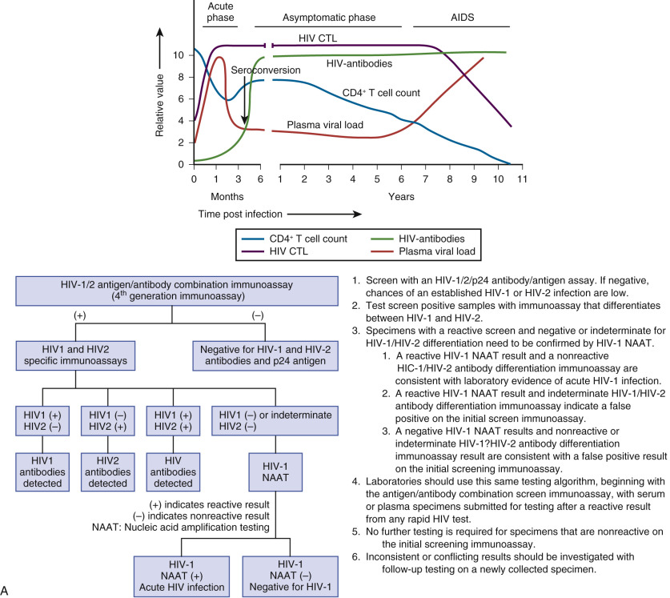

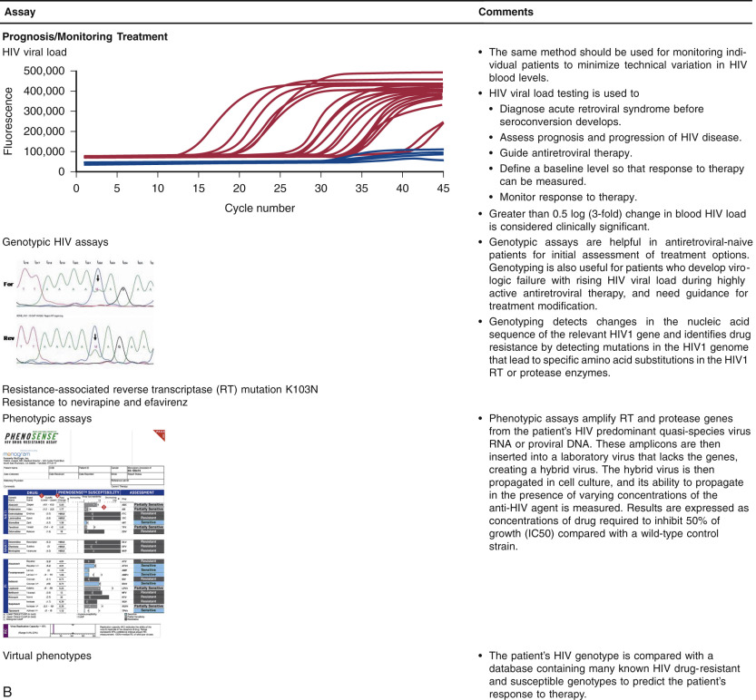

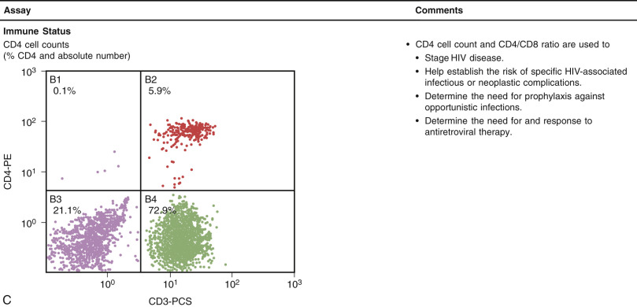

Figure 56-9 

Laboratory diagnosis of HIV infection. 

Blood banks in industrialized countries always test donor blood for HIV RNA to identify donors in the false-negative window (  Candotti et al, 2003  ;  Stramer et al, 2004  ). U.S. blood banks also test for HIV-2 antibody, which is standard screening in Africa and Europe. Western blot assays are no longer recommended for confirmation of HIV EIA testing since Western blot is less sensitive than the EIA assay (  CDC, 2011  . HIV-2 infection should be suspected in persons of West African origin who have clinical conditions suggestive of HIV infection but with atypical serologic test results (  Aberg et al, 2014  ). HIV is propagated in tissue culture by co-cultivating infected patient lymphocytes or tissues with normal donor lymphocytes that have been stimulated with phytohemagglutinin, interleukin-2, and interferon. Culture is complex, expensive, and dangerous and should be attempted only in research laboratories. HIV culture has been supplanted by nucleic acid testing for routine management; real-time RT-PCR, NASBA, and TMA methods are commercially available. Antiretroviral treatment has dramatically improved survival and quality of life for HIV patients (  Aberg et al, 2014  ). Quantitative HIV RNA assays to measure viral load in plasma have revolutionized monitoring of antiretroviral therapy; treatment-related reductions in HIV RNA of more than 0.5 to 1.0 log copies/mL correlate with slower clinical progression. HIV-infected patients typically have a genotypic resistance test performed at baseline, regardless of whether antiretroviral therapy will be initiated immediately (  Aberg et al, 2014  ). Genotypic methods typically involve sequence analysis of the HIV reverse transcriptase and protease genes to identify mutations that are linked to drug resistance and have the greatest clinical utility. As use of agents with other HIV targets increases, testing will no doubt broaden. Phenotypic testing is complex and involves amplification of protease and reverse-transcriptase genes from virus recovered from the patient's blood, followed by insertion of these genes into a test virus and then in vitro susceptibility testing of this hybrid laboratory-constructed virus against specific antiviral drugs. A virtual phenotype can be approximated from the genotypic mutation data to ascertain the likelihood of in vitro phenotypic actual susceptibility, with the two methods often showing excellent correlation (  Clavel & Hance, 2004  ). Tropism testing is recommended prior to initiation of a CCR5-antagonist antiretroviral drug, and HLA-B*5701 typing should be performed prior to treatment with abacavir to reduce the risk for a hypersensitivity reaction (  CDC, 2014  ). In utero or perinatal transmission from HIV-infected mothers can be dramatically reduced with treatment and strict avoidance of breast feeding. The transmission rate has been reported to be <1% in women who achieve undetectable viral loads with treatment (  Aberg et al, 2014  ). Early identification of HIV1 infection in exposed infants is important to allow early intervention with antiretroviral therapy and adjunctive care. Maternal antibody can remain detectable in the infant up to 18 months of age. Diagnosis of active HIV infection in the infant is primarily made by means of PCR-based assays for HIV DNA or RNA. Virologic testing should be performed at 14 to 21 days, 1 to 2 months, and 4 to 6 months of age. Infected infants should also undergo HIV resistance testing (  Aberg et al, 2014  ) (see the “ [ Congenital and Perinatal Viral Infections ](<#s0165>) ” section earlier in the chapter). 

 

##  Virus-Associated Neoplasia 

 

##  Human Papilloma Viruses (HPV) 

Although the topic is beyond the scope of this chapter, it is worth noting that viral infections are associated with 15% to 20% of human cancers worldwide (  Martin & Gutkind, 2009  ;  Fernandez & Esteller, 2010  ). The association of viruses with tumorigenesis has been appreciated since the early 20th century (  Rous, 1911  ). Tumorigenic viruses are found in diverse virus families and employ diverse mechanisms to contribute to neoplasia ( [ Table 56-9 ](<#t0050>) ). Oncogenic viruses tend to cause persistent infection, and viral proteins frequently disrupt normal cellular processes such as apoptosis and cell cycle checkpoint activation. However, viral infections generally are not considered to be sufficient for carcinogenesis; additional factors, including host immunity and cell mutations, are certainly involved in the neoplastic process. 

TABLE 56-9 

Tumorigenic Viruses 

Virus  |  Genome  |  Viral Taxonomy  |  Human Cancers   
---|---|---|---  
EBV  |  dsDNA  |  Herpesviridae  |  BL, NPC, HD, GC   
KSHV, HHV-8  |  dsDNA  |  Herpesviridae  |  KS, PEL, MCD   
HPV  |  dsDNA  |  Papillomaviridae  |  Cervical, penile, oropharynx, anogenital, skin   
HBV  |  dsDNA (partial)  |  Hepadnaviridae  |  HCC   
HCV  |  ssRNA  |  Flaviviridae  |  HCC   
HTLV-1  |  ssRNA>dsDNA  |  Retroviridae  |  ATL   
HIV  |  ssRNA>dsDNA  |  Retroviridae  |  Unknown   
CMV  |  dsDNA  |  Herpesviridae  |  CRC, glioma, prostate   
SV40  |  dsDNA  |  Polyomaviridae  |  Osteosarcoma, mesothelioma, brain   
JCV  |  dsDNA  |  Polyomaviridae  |  Brain, CRC, glioma, medulloblastoma   
BKV  |  dsDNA  |  Polyomaviridae  |  Prostate, brain   
MCV  |  dsDNA  |  Polyomaviridae  |  MCC   
HHV-6  |  dsDNA  |  Herpesviridae  |  Hematologic malignancies   
  
_ATL,_ Adult T cell leukemia; _BKV,_ BK cell polyomavirus; _BL,_ Burkitt's lymphoma; _CMV,_ cytomegalovirus; _CRC,_ colorectal cancer; _EBV,_ Epstein-Barr virus; _GC,_ gastric carcinoma; _HBV,_ hepatitis B virus; _HCC,_ hepatocellular carcinoma; _HCV,_ hepatitis C virus; _HD,_ Hodgkin disease; _HHV,_ human herpes virus; _HIV,_ human immunodeficiency virus; _HPV,_ human papilloma virus; _HTLV-1,_ human T cell leukemia virus type 1; _JCV,_ JC virus; _KS,_ Kaposi's sarcoma; _KSHV,_ Kaposi's sarcoma–associated herpesvirus; _MCC,_ Merkel cell carcinoma; _MCD,_ multicentric Castleman's disease; _MCV,_ Merkel cell polyomavirus; _NPC,_ nasopharyngeal primary carcinoma; _PEL,_ primary effusion lymphoma; _SV40,_ Simian virus 40. 

Data from Fernandez AF, Esteller M: Viral epigenomes in human tumorigenesis, _Oncogene_ 29:1405–1420, 2010; White MK, Pagano JS, Khalili K: Viruses in human cancers: A long road of discovery of molecular paradigms, _Clin Microbiol Rev_ 27:463–480, 2014. 

 

##  Emerging Infections 

 

##  Ebola Viral Disease (EVD) 

The virus family _Filoviridae_ includes 3 genera: _Cuevavirus, Marburgvirus,_ and _Ebolavirus._ Five _Ebolavirus_ species have been identified: _Zaire, Bundibugyo, Sudan, Reston, and Ta ï Forest _ . _Bundibugyo, Zaire,_ and _Sudan_ have been associated with large outbreaks in Africa. The virus causing the 2014 West African outbreak belongs to the _Zaire_ species. 

Ebola virus disease (EVD) first appeared in 1976 in two simultaneous outbreaks: one in Nzara, Sudan, and the other in Yambuku, Democratic Republic of Congo. The latter occurred in a village near the Ebola River, from which the disease takes its name. 

The 2014 Ebola epidemic is the largest in history. The outbreak is centered in Guinea, Liberia, and Sierra Leone in West Africa, with cases imported to other parts of Africa and the world, including Europe and the United States ( [ http://www.cdc.gov/vhf/ebola/outbreaks/2014-west-africa/index.html ](<http://www.cdc.gov/vhf/ebola/outbreaks/2014-west-africa/index.html>) ). 

Ebola virus disease is a severe zoonotic disease with a fatality rate of around 50%. Fruit bats appear to be the natural host. The virus is transmitted to people from wild animals and spreads in the human population through human-to-human transmission. Health care workers are a high-risk group due to the exposure to highly infectious blood or body fluids from severely ill patients. Extreme care and the proper use of personal protective equipment is essential to protect health care personnel. 

There are currently no licensed Ebola vaccines. Early supportive care with rehydration and symptomatic treatment improves survival. 

,, 

## Websites and E-Mail Addresses

* Author. [ Lech.Mazur@advocatehealth.com ](<#mailto:Lech.Mazur@advocatehealth.com>) -
* Author. [ Mike.Costello@advocatehealth.com ](<#mailto:Mike.Costello@advocatehealth.com>) -
* CDC Ebola Updates. [ http://www.cdc.gov/vhf/ebola/ ](<http://www.cdc.gov/vhf/ebola/>) -
* CDC Influenza Update. [ http://www.cdc.gov/flu/ ](<http://www.cdc.gov/flu/>) -
* CDC Site. Recommended Testing Sequence for Identifying Current Hepatitis C Virus (HCV) Infection. [ http://www.cdc.gov/hepatitis/HCV/PDFs/hcv_flow.pdf ](<http://www.cdc.gov/hepatitis/HCV/PDFs/hcv_flow.pdf>) -
* CDC Website. Viral Hepatitis Statistics & Surveillance. [ http://www.cdc.gov/hepatitis/Statistics/2012Surveillance ](<http://www.cdc.gov/hepatitis/Statistics/2012Surveillance>) -
* Enterovirus Classification. [ http://www.picornaviridae.com/enterovirus/enterovirus.htm ](<http://www.picornaviridae.com/enterovirus/enterovirus.htm>) -
* FDA Website. Nucleic acid–based tests and companion diagnostic tests. [ http://www.fda.gov/MedicalDevices/ProductsandMedicalProcedures/InVitroDiagnostics ](<http://www.fda.gov/MedicalDevices/ProductsandMedicalProcedures/InVitroDiagnostics>) -
* Infectious Disease Society of America. [ http://www.idsociety.org/idsa_practice_guidelines/ ](<http://www.idsociety.org/idsa_practice_guidelines/>) -
* International Society for Infectious Disease. [ http://www.isid.org/ ](<http://www.isid.org/>) -
* WHO Website. Influenza Surveillance and Monitoring. [ http://www.who.int/influenza/surveillance_monitoring/en/ ](<http://www.who.int/influenza/surveillance_monitoring/en/>) -
,
